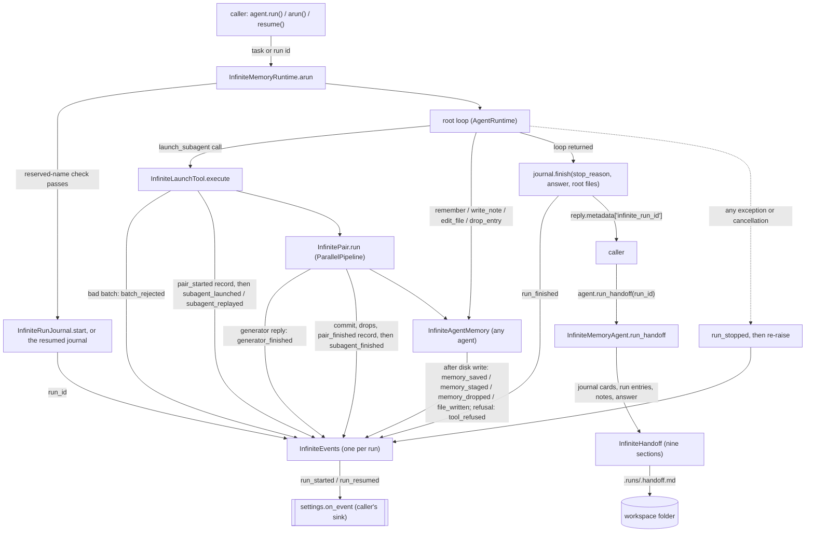
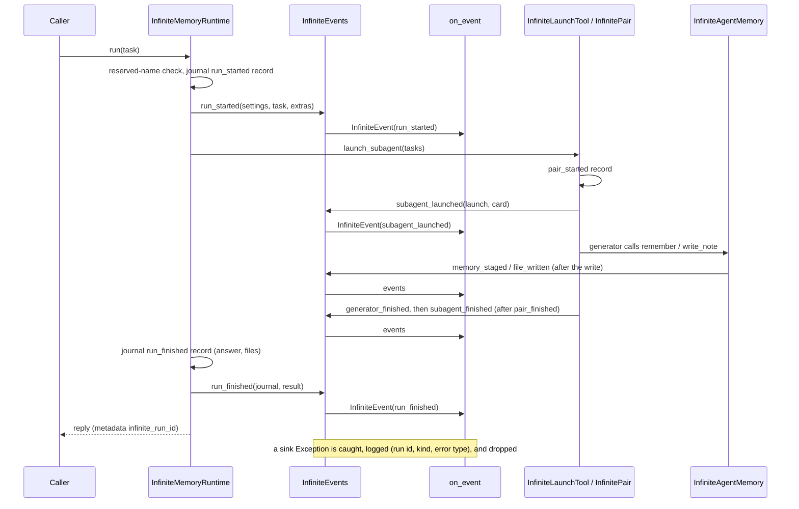

# Spec: InfiniteMemoryAgent native run events and handoff

> **TL;DR** — `InfiniteMemoryAgent` gains a live, typed, high-level action trace of its own: one `InfiniteEvent` per state-changing agent action (14 kinds), delivered to an optional `InfiniteMemoryAgentSettings.on_event` callback by a single per-run writer class, `InfiniteEvents`. A failed or cancelled run now announces itself (`run_stopped`) before re-raising, every reply carries its journal run id, and `InfiniteMemoryAgent.run_handoff()` builds a deterministic, model-free `InfiniteHandoff` and saves it beside the journal. The decision that matters most: events are observation only. An observer can never break a run, and the journal remains the only source of truth for resuming a run.

## §0 User prompts

### 0.1 Invoking request (verbatim)
Yeah I think that a class that implements all events, customly and native to the infinite memory agent, is the right approach to take. Then maybe at certain points thoughtout the run we can "checkpoint" the agent with the vidbyte/ backend when we run it on the cli (once every 50 iterations or something, or however you see fit to this). Make sure dashboard page too generates tokens server side and pass no sensitive info to client, you can make all the prs in each repo using the skill. Also, with the "next step" suggestions can you try to focus on vidbyte-cli/. Feel like we could implement/add more here with the cli

### 0.2 User replies during the run
_None yet._

---

## Part A — Framing

## §1 Goal

Today a caller of `InfiniteMemoryAgent` is blind until `run()` returns. A long run can launch up to 200 agents, and the caller cannot see which agents are running, which have finished, or what they produced. The SDK tracer cannot help here. It records spans with a string output, its `llm.call` spans carry full message histories, and every subagent gets a `NullTracer`. The run journal records only 4 of the 14 things worth showing, and it is fsynced under a global lock because resume depends on it. Three more gaps: a failed or cancelled run raises without saying which journal it left behind, the reply never names its run id, and nothing summarizes a run once it is over (the folder README says so: "No live tree view, event stream, transcript archive, or end-of-run report"). The user asked to "see alll of the agents that are running and which ones have ran/what they produced" through "a high level action trace that is tailor made to the agent (without the user of another agent)", built as "a class that implements all events, customly and native to the infinite memory agent", plus "a 'handoff' as another artifact after the run". This PR is the SDK slice that the CLI checkpoint sync and the Vidbyte dashboard consume.

| ID | Goal (outcome) | How we will know | Source |
|---|---|---|---|
| G-1 | A caller sees a long run as it happens: every state-changing action of every agent in the tree, at a readable, high level, built by the agent itself (no tracer, no extra agent, no model call). | With `on_event` set, a run that uses every agent action delivers each of the 14 `InfiniteEventKind` values at its documented point, with a one-line `summary` and typed `details`. No tool call or model call produces an event (AC-2, AC-25). | request.md §A Prompt 3, §0.1, §C contract |
| G-2 | A caller can tell a running run from a stopped or finished one, and tie each to its journal so it can resume it. | Every run that opens a journal ends its events with exactly one `run_finished` or `run_stopped`, and `reply.metadata["infinite_run_id"]` names the journal for every run and resume (AC-5, AC-6, AC-15). | request.md §A Prompt 3, §C contract |
| G-3 | After a run, its outcome is a shareable artifact: what it produced, what is unverified, and how to continue. It costs no model call. | `agent.run_handoff(run_id)` returns an `InfiniteHandoff` with the nine contract sections and writes `.runs/<run_id>.handoff.md`. Calling it twice gives identical bytes and makes zero model calls (AC-16..AC-19). | request.md §A Prompt 3 ("handoff ... after the run"), §C contract |
| G-4 | Observing a run never harms it. A broken or slow-to-fail observer cannot fail the run, corrupt the journal, or change what any model sees. | A sink that raises on every event leaves the reply, the journal, and the workspace identical to a run with a working sink (AC-4). With no sink, the run's bytes on disk and the prompts its models receive are unchanged apart from the additions in §9.4 (AC-20). | request.md §B ("an observer must never break a run"), §C contract |

## §2 Objective

When this PR merges, the stacked `feat/infinite-memory-agent` code contains the following. `InfiniteEventKind` (14 values) and three small vocabularies (`InfiniteDropReason`, `InfiniteFileChange`, `InfiniteStopCause`). The frozen, validated `InfiniteEvent` record, with one flat details record per kind. A new agent-package module that holds `InfiniteEvents`, the single writer of every event, called from the runtime, the launch tool, and the memory tools. The `on_event` settings field. A `run_stopped` event on failure or cancellation, followed by re-raising the original exception. The `infinite_run_id` reply metadata key. The journal's `run_finished` record gains the root's final answer and the files the root wrote, and the journal gains a reader for any run. The workspace gains readers for one run's entries and for note descriptions. `InfiniteHandoff` sits in the context layer's handoff package, and `InfiniteMemoryAgent.run_handoff()` builds it and writes it to `.runs/<run_id>.handoff.md`. Exports go through `vidbyte`, `vidbyte.agents`, `vidbyte.context`, and `vidbyte.lib.enums`. The public-API contract is regenerated, both READMEs are updated, and one pre-approved edit raises the #1084 complexity-budget test. Later slices, built by the sibling runs, are NG-1 and NG-2.

## §3 Non-goals

- **NG-1** — Checkpoint cadence ("once every 50 iterations or something"), the outbox, the HTTP sync, budget cancellation, `--send-to`, and the `vidbyte-cli agents infinite-memory run|resume` command. — *Why not:* they belong to the CLI sibling run (`feat/infinite-memory-agent-command`). The field guide also rules that the SDK ships no CLI (`prebuilt-agents.md`). This PR only gives that run a stable Python surface.
- **NG-2** — Backend checkpoint ingest, Mongo storage, the `/agents/dashboard` pages, server-side tokens, and the marketplace listing. — *Why not:* they belong to the Vidbyte sibling run (`feat/agent-run-dashboard`). The SDK's share of "pass no sensitive info to client" is T-3: events never carry secrets.
- **NG-3** — Events for tool calls (`bash`, `grep`, `read_lines`), model calls, or raw turns, and any transcript archive. — *Why not:* already decided in request.md §C. These are raw-turn level, they would turn a readable trace into a log, and bash output carries secrets that no scrubber sees.
- **NG-4** — Turning the journal into an event log, writing observation records, or letting resume read events. — *Why not:* already decided. The journal stays the only resume source. Only its existing `run_finished` record gains two fields (D-11).
- **NG-5** — An asynchronous sink, an event queue, a background thread, or back-pressure for `on_event`. — *Why not:* nobody asked for these controls. Ordering and durable-before-announced (INV-4, INV-5) are simplest inline, and the CLI's sink appends to a local outbox. A slow sink slows the run; that is a documented limitation (EC-9).
- **NG-6** — A model-written handoff, overriding `BaseAgent.handoff`, or writing the handoff automatically at the end of every run. — *Why not:* already decided that the handoff is deterministic. `BaseAgent.handoff` is an async, model-calling method that other code relies on. Automatic writing is Q-1 (default: no).
- **NG-7** — Saving events to disk in the SDK (no `.runs/<id>.events.jsonl`). — *Why not:* the CLI owns event durability (its outbox). The journal header forbids observation records.
- **NG-8** — A `verifier_started` event, per-iteration events, or root-iteration counters. — *Why not:* "verifying" can be derived (request.md §B). The CLI substitutes event counts for iterations (request.md §C).
- **NG-9** — Exporting the details records or `InfiniteEvents` from `vidbyte` or `vidbyte.agents`. — *Why not:* the contract exports exactly `InfiniteEvent`, `InfiniteEventKind`, and `InfiniteHandoff`. The details records stay importable from their lib module, and the CLI serializes with `dataclasses.asdict`.
- **NG-10** — Fixing #1084 behaviors unrelated to events: sibling pairs that keep running after an error outside `VidbyteSdkError`/`OSError`/`ValueError`, the stale `api_key` note in request.md §B, and cross-process workspace locking. — *Why not:* they are outside this slice. Where they touch events, they are documented as limitations (EC-12).
- **NG-11** — Normalizing the note paths that models pass, or changing what `write_note` returns. — *Why not:* events report the same path the result card already records (D-23). Changing it would ripple into card text that existing tests pin.

## §4 Developer usage

```python
from vidbyte import InfiniteEvent, InfiniteMemoryAgent, InfiniteMemoryAgentSettings, InfiniteWorkspaceSettings

events: list[InfiniteEvent] = []
agent = InfiniteMemoryAgent(
    InfiniteMemoryAgentSettings(
        name="analyst",
        system_prompt="You research markets and report sourced findings.",
        provider="openai",
        model_name="gpt-4.1",
        root_dir=".",
        workspace=InfiniteWorkspaceSettings(root="memory"),
        on_event=events.append,  # called once per event, in order; an error it raises never stops the run
    )
)
reply = agent.run("Compare the list prices of our five competitors.")
run_id = reply.metadata["infinite_run_id"]  # the journal id, also given to resume()

for event in events:
    print(event.kind.value, event.agent_key, event.summary)

handoff = agent.run_handoff(run_id)  # no model call; also saved as memory/.runs/<run_id>.handoff.md
print(handoff.section_titles())
```

For a root whose model answers at once with `Acme is cheapest at 49 USD per seat.`, the snippet prints exactly:

```text
run_started root Run started: Compare the list prices of our five competitors.
run_finished root Run finished (final_response): Acme is cheapest at 49 USD per seat.
('Outcome', 'Work done', 'Decisions', 'Facts', 'Lessons', 'Open questions', 'Files', 'Unverified or failed work', 'How to continue')
```

The developer gets a live, typed trace of the whole agent tree without wrapping tools, parsing the journal, or adding a tracer. When a run is longer, the same loop prints one line per launch, staged or saved memory, file write, refusal, and finished subagent. The developer no longer has to guess which journal a run used, and no longer needs a model call to summarize a finished run.

## §5 Flow diagram





The runtime validates first. A reserved tool name refuses the run before the journal opens, so no event is emitted. Next it opens or resumes the journal, builds the per-run `InfiniteEvents`, and emits the opening event. Durable state only changes in the existing places: journal records, `entries.jsonl`, notes, and `files.jsonl`. Each event that reports such a change is emitted right after that change is on disk. Everything after the opening event runs inside one `try`. Any exception or cancellation emits `run_stopped` and is re-raised unchanged, and the journal is left without `run_finished`, so the run stays resumable. Failures inside the observer are caught in `InfiniteEvents` itself, around both building the event and calling the sink. `run_handoff` only reads the journal and the workspace, and the one file it writes is the handoff.

---

## Part B — Behavior (this is the spec; everything else is framing)

## §6 Behavior

### 6.1 Invariants

**Lifecycle**
- **INV-1** — A run that opens a journal (new or resumed) delivers exactly one opening event, and it comes before every other event of that run: `run_started` for `run()`/`arun()`, `run_resumed` for `resume()`/`aresume()`. A run refused before its journal opens delivers no event at all. Reasons for refusal: a reserved tool name, a malformed, unknown, or finished resume id, or no unfinished run.
- **INV-2** — A run that delivered an opening event delivers exactly one terminal event, never both: `run_finished` when the root loop returned and the journal's `run_finished` record is on disk, or `run_stopped` when anything raised after the opening event. The one exception is EC-12. After `run_stopped`, the same exception object is re-raised.
- **INV-3** — `run_stopped` is classified this way: any `Exception` subclass gives `reason=failed`. Every other `BaseException` gives `reason=cancelled`; this includes `asyncio.CancelledError`, `KeyboardInterrupt`, and `SystemExit`. `error_type` is the exception's class name, and `message` is `str(exc)` cut to the excerpt cap (it may be empty).
- **INV-4** — Durable before announced. An event that reports a change on disk is delivered only after that change is written: `run_started` after the journal's `run_started` record; `subagent_launched` after that pair's `pair_started` record; `memory_saved` after the entry's line is in `entries.jsonl`; `file_written` after the note holds the new text (and, for a created note, after its `files.jsonl` line); `subagent_finished` after the `pair_finished` record; `run_finished` after the `run_finished` record.
- **INV-5** — The sink is called synchronously, once per event, on the thread that runs the agent's event loop, in the order the events are emitted. No event of one run is delivered twice, and two events of one run are never delivered at the same time.
- **INV-6** — `run_stopped` never writes, cuts, or finishes the journal. After it, `resume()` finds the run exactly as it would without events.

**Isolation**
- **INV-7** — A sink that raises any `Exception` subclass never affects the run. The reply content, the journal records, the workspace files, the tool results, and every later event come out the same as with a sink that does not raise. Each such failure is logged once at WARNING on the events module's logger, with the run id, the event kind, and the exception's class name. The log never includes the exception message, the summary, or any details text. A `BaseException` raised by the sink (`KeyboardInterrupt`, `CancelledError`, `SystemExit`) propagates.
- **INV-8** — Building an event never raises into the run either. An `Exception` raised while gathering details or constructing a record is handled like a sink failure (logged, event skipped).
- **INV-9** — With `on_event=None` (the default), no `InfiniteEvent` or details record is built and nothing is logged by the events module. The run's model calls, prompts, tool results, card text, `entries.jsonl`, notes, `files.jsonl`, and journal records are the same as at `base_commit`, apart from the two additions in §9.4: `answer` and `files` on `run_finished`, and `infinite_run_id` on the reply.
- **INV-10** — No event is produced by a model call, and no event causes one. Every `summary` is built only from a template constant in the infinite constants module. Events never carry `api_keys`, `vidbyte_api_key`, the system prompt, model messages, tool results, `bash`/`grep`/`read_lines` output, or absolute filesystem paths of the developer's machine (seed files appear by file name only).

**Shape**
- **INV-11** — Every event has the envelope of §9.1. `run_id` is the journal run id. `agent_key`, `role`, and `depth` name the agent whose action produced the event: the root (`"root"`, `root`, `0`) for run events, the launching agent for `batch_rejected`, `subagent_launched`, `subagent_replayed`, and `subagent_finished`, the generator for `generator_finished`, and the acting agent for memory, file, and refusal events. `at` is timezone-aware UTC, and its microseconds are a multiple of 1,000.
- **INV-12** — `summary` is one line (no line break of any kind) of 1 to 280 characters, produced by `OutputText.single_line` from a template. No capped details text exceeds its cap in §9.1, and text that was cut ends with the truncation marker of `OutputText.truncate`. The card texts that events reuse (`summary`, `review`) are the card's values, already capped by tokens, and are not cut again.
- **INV-13** — After `dataclasses.asdict`, every event and its details hold only `str`, `int`, finite `float`, `bool`, `None`, tuples, str-valued enum members, and `datetime`. `json.dumps(asdict(event), default=<datetime to ISO>)` succeeds for every event. `InfiniteEvent` has no `to_dict` and no `from_dict`.
- **INV-14** — `details` is always the record type that its `kind` uses (§9.1). `InfiniteEvent` refuses any other type when it is created.

**Per action**
- **INV-15** — For each `launch_subagent` call, a rejected batch delivers exactly one `batch_rejected` and nothing else: no `subagent_launched`, and no journal record. An accepted batch delivers exactly one event per task, in task order, before any agent of the batch runs: `subagent_launched` for a new pair, or `subagent_replayed` for a name already finished in this run.
- **INV-16** — Each launched pair gets at most one `generator_finished`, and only when its generator returned a reply. It gets exactly one `subagent_finished`, after its card is journaled. The generator's and verifier's memory and file events come between `subagent_launched` and `subagent_finished`. The `subagent_finished` details agree with the journaled card: same status, verdict, review, and files; `committed[*].entry_id` equals `card.entries`; and the rendered `dropped` equals `card.dropped`.
- **INV-17** — Each committed entry is reported exactly once. A root entry is reported by `memory_saved`. A pair's entry is reported in that pair's `subagent_finished.details.committed`. Each staged entry is reported once by `memory_staged`, and later exactly once in either `committed` or `dropped` of its pair's `subagent_finished`. A pair cancelled before it finishes is the one exception (EC-11).
- **INV-18** — `memory_dropped` is delivered once for each successful `drop_entry` call, with `reason=verifier`. The same drop also appears in `subagent_finished.details.dropped`.
- **INV-19** — `file_written` is delivered once for each successful `write_note` or `edit_file` call. `change` is `created` when the note did not exist, `appended` when `write_note` added to an existing note, and `edited` for `edit_file`. `added_chars` is the length of the text the call wrote: the appended text, or the replacement text of an edit.
- **INV-20** — A memory tool call that is refused (`remember`, `write_note`, `edit_file`, `drop_entry` returning `ToolResult.error`) delivers exactly one `tool_refused` with that tool's name and the refusal's problem text, and no `memory_*` or `file_written` event for the same call.

**Run id and handoff**
- **INV-21** — `reply.metadata["infinite_run_id"]` equals the journal run id (the journal file's stem) for `run()`, `arun()`, `resume()`, and `aresume()`. For a resume, it is the resumed run's id. Events of that run carry the same id.
- **INV-22** — `run_handoff` is deterministic. With the same workspace files and journal, two calls return equal titles and sections and write byte-identical files. It makes no model call. It changes no journal, entry, or note file. The one file it writes is `.runs/<run_id>.handoff.md` (replaced if present).
- **INV-23** — The handoff has exactly nine sections, titled in this order: `Outcome`, `Work done`, `Decisions`, `Facts`, `Lessons`, `Open questions`, `Files`, `Unverified or failed work`, `How to continue`. An empty section holds the fixed placeholder. The object is an `InfiniteHandoff` (a `Handoff` subclass) with `is_filled` true, and `fill()` returns an `InfiniteHandoff`. The file's text equals `handoff.to_context_text()` with any character UTF-8 cannot encode replaced.
- **INV-24** — Handoff content, section by section:
  - Outcome: the task and the stop reason plus the root's full final answer, or a fixed "not finished" statement.
  - Work done: one line per finished card, in finishing order, at every depth.
  - Decisions, Facts, Lessons, and Open questions: the live entries committed during this run, of that kind, in id order.
  - Files: the notes created in this run, then the files on its cards, then the files the root wrote, each listed once with its description; then the run's `pointer` entries.
  - Unverified or failed work: cards with status `failed` or verdict `failed` or `unchecked`, then pairs that started and never finished.
  - How to continue: `agent.resume("<run_id>")` for an unfinished run, or the new-run sentence for a finished one.
- **INV-25** — The handoff file and events never change what the agents see or count. `.runs/` stays outside the caps, outside the workspace map, and outside `grep`. Resume reads only `.runs/*.jsonl`.

**Must not regress:**
- **INV-26** — The journal keeps exactly its four record kinds, its order, fsync per record, ASCII JSON, and torn-tail handling (the journal module's `_append`, `_whole_lines`, and `_parse`). A journal whose `run_finished` has no `answer` or `files` (every journal written at `base_commit`) still loads for both `resume` and `run_handoff`.
- **INV-27** — Cancellation still propagates out of `arun` unchanged. In the existing cancel scenario, the journal holds exactly `["run_started", "pair_started"]` afterwards, and `aresume()` then finishes the run (the resume test's cancellation case).
- **INV-28** — Result-card text is byte-identical. The strings in `InfiniteResultCard.dropped` stay `"{key} ({text}): dropped by the verifier"`, `"{key} ({text}): {rule message}"`, and `"{key} ({text}): not committed, because the verdict is {verdict}"`. `card.entries` holds the committed ids in commit order. `InfinitePair.render` output and all 40 prompt leaves are unchanged.
- **INV-29** — The reserved-name refusal still happens before any journal record, and `reply.metadata["stop_reason"]` and every other existing reply metadata key keep their values.
- **INV-30** — `BaseAgent.handoff` (async, model-calling) is not overridden on `InfiniteMemoryAgent` and behaves as before.
- **INV-31** — Events and `run_handoff` add no model calls, so `agent.get_usage()` totals are unchanged.
- **INV-32** — `InfiniteMemoryAgentSettings` keeps every existing field in its order. `on_event` is appended last, so positional construction keeps working.

### 6.2 Acceptance criteria

| ID | Given | When | Then | Priority | Proof |
|---|---|---|---|---|---|
| AC-1 | a clean checkout of this branch | the §4 snippet runs | it produces exactly the shown result | P0 | |
| AC-2 | `on_event` collects events, and a scripted root launches one task. The task's generator calls `remember` (fact), then `write_note` to a new note, then replies; its verifier replies `VERDICT: passed`. The root then answers. | the run finishes | The kinds are exactly, in order: `run_started`, `subagent_launched`, `memory_staged`, `file_written`, `generator_finished`, `subagent_finished`, `run_finished`. Run and launch events carry `root`/`root`/`0`. `memory_staged`, `file_written`, and `generator_finished` carry `root/<name>/gen`/`generator`/`1`. Every `run_id` equals `reply.metadata["infinite_run_id"]`. `subagent_finished.details.committed` holds one entry whose `entry_id` is the card's single entry id and whose `staged_key` is `s1`. | P0 | |
| AC-3 | the root calls `remember` and a pair's verifier passes the pair's staged entry | the run finishes | Exactly one `memory_saved`, for the root's entry, delivered before the root's next model call, with that entry's id, kind, text, tags, refs, and supersedes. No `memory_saved` for the pair's entry, which appears only in `subagent_finished.details.committed`. | P0 | |
| AC-4 | a sink that raises `RuntimeError` on every call, and the AC-2 script | the run finishes | `run()` returns the same `content` as with a list sink. The journal record kinds and fields (ignoring `at`), the bytes of `entries.jsonl`, `files.jsonl`, and the notes, and the model calls match the list-sink run. One WARNING per event on the events logger names the run id, the kind, and `RuntimeError`, and contains no summary text. | P0 | |
| AC-5 | a run cancelled while a generator waits (the existing cancellation pattern) | `arun` is cancelled, then `aresume()` runs | `CancelledError` propagates. The first run's last event is `run_stopped` with `reason=cancelled` and `error_type="CancelledError"`. Its journal holds exactly `run_started`, `pair_started`. The resume's first event is `run_resumed` with `finished=0` and `interrupted=("root/<name>",)`, and its last is `run_finished`. Both runs' events carry the same `run_id`. | P0 | |
| AC-6 | the root's model runner raises `RuntimeError` | `run()` runs | the call raises as it did at `base_commit`. The last event is `run_stopped` with `reason=failed` and `error_type="RuntimeError"`. The journal has no `run_finished`, and `resume()` accepts the run. | P0 | |
| AC-7 | the root sends a batch that the launch tool refuses (for example, two tasks with the same name) | the tool call returns its error | exactly one `batch_rejected` with `agent_key="root"`, `details.tool="launch_subagent"`, and `details.problem` equal to the rejection reason cut to 500. No `subagent_launched`, and no journal record for that call. | P0 | |
| AC-8 | a name already finished in this run is launched again in a batch that also holds one new task | the batch runs | One event per task, in task order: `subagent_replayed` (with the recorded status and verdict) for the old name, and `subagent_launched` for the new one. Both come before any event of the new pair's generator. The replayed name gets no `generator_finished` or `subagent_finished`. | P0 | |
| AC-9 | a verifier calls `drop_entry("s1")` and then passes | the pair finishes | One `memory_dropped` with `key="s1"`, the entry text, `reason=verifier`, and `note="dropped by the verifier"`, from the verifier's agent key. `subagent_finished.details.dropped` holds the same item. The card's `dropped` string is byte-identical to `base_commit`. | P0 | |
| AC-10 | (a) a verifier with no `VERDICT:` line; (b) a staged entry that breaks a rule when it is committed, because a sibling committed the same text first | the pairs finish | In (a), every staged entry is in `dropped` with `reason=unchecked` and `note="not committed, because the verdict is unchecked"`. In (b), the entry is in `dropped` with `reason=rule` and `note` equal to the rule's message. In both, the card strings are unchanged. | P0 | |
| AC-11 | the FULL preset: an agent appends to an existing note, then edits it | the calls succeed | Two `file_written` events: `change=appended` with `added_chars` equal to the appended text's length, then `change=edited` with `added_chars` equal to `len(new_text)`. Each `excerpt` is that text, cut to 500. | P0 | |
| AC-12 | `remember` past the quota, `write_note` outside the workspace, `edit_file` with zero matches, and `drop_entry` with an unknown key | each call is refused | Exactly one `tool_refused` per call, with the tool's name and a problem of at most 300 chars that contains the refusal reason the model saw. No `memory_*` or `file_written` event for those calls. | P0 | |
| AC-13 | every event collected in AC-2 to AC-12 | each is serialized | `json.dumps(dataclasses.asdict(event), default=lambda value: value.isoformat())` succeeds. Every leaf is of a type allowed by INV-13. `InfiniteEvent` has no attribute `to_dict`. | P0 | |
| AC-14 | a 3,000-char task; a card with a 5,000-char goal, 15 criteria of 1,000 chars each, and 10,000-char prompts; a 10,000-char final answer with line breaks | the run finishes | The details are within the caps: task 500, goal 1,000, 10 criteria of 300 each, prompts 2,000, answer 2,000. Every cut field ends with the truncation marker. Every `summary` is one line of at most 280 chars. | P0 | |
| AC-15 | the same agent object | `run()`, `arun()`, and `resume(<id>)` each return | each reply's `metadata["infinite_run_id"]` equals its journal file's stem. The resume's value equals the id passed in. `metadata["stop_reason"]` is unchanged. | P0 | |
| AC-16 | the finished AC-2 run | `agent.run_handoff(run_id)` is called twice | Returns an `InfiniteHandoff` (a `Handoff` subclass, `is_filled` true) with the nine titles in order. The sections hold the following. Outcome: the task, `final_response`, and the full answer. Work done: one line for the pair. Facts: `- #<id> <text>`. Files: the note with its description. Decisions, Lessons, and Open questions: the placeholder. `.runs/<run_id>.handoff.md` equals `to_context_text()`, and both calls leave identical bytes. No model call happens. The journal, `entries.jsonl`, and `files.jsonl` bytes are unchanged. | P0 | |
| AC-17 | the cancelled run of AC-5, before the resume | `run_handoff(run_id)` | Outcome holds the not-finished statement. Unverified lists the interrupted pair key. How to continue holds `agent.resume("<run_id>")`. | P0 | |
| AC-18 | a journal written by the fixture's `run_finished_record()` (no `answer`, no `files`) | `run_handoff(<id>)` and `resume()` of a sibling unfinished run | the handoff's Outcome uses the no-answer placeholder, and nothing raises. Resume behaves as at `base_commit`. | P0 | |
| AC-19 | `run_handoff("../x")`, a well-formed unknown id, and a workspace with no runs | each call | `ConfigurationError` with `details["field"]=="run_id"`. No handoff file is written. | P0 | |
| AC-20 | `on_event` left at its default | the AC-2 script runs | The journal kinds and fields match `base_commit`, plus `answer` and `files` on `run_finished`. The events module logs nothing. The reply carries `infinite_run_id`. | P0 | |
| AC-21 | `on_event=42`, `on_event="x"`, `on_event=print`, a bound method, and an object with `__call__` | settings are built | the first two raise `ConfigurationError` naming `InfiniteMemoryAgentSettings.on_event`, with `details={"field": "on_event"}`. The last three are accepted. | P0 | |
| AC-22 | `max_depth` ≥ 2, and a generator of task `a` launches task `b` | the run finishes | The nested `subagent_launched` has `agent_key="root/a/gen"`, `role=generator`, `depth=1`, `details.key="root/a/gen/b"`, `details.parent="root/a/gen"`, and `details.depth=2`. The events of `b`'s generator carry `agent_key="root/a/gen/b/gen"` and `depth=2`. | P1 | |
| AC-23 | scripted usage per step (the existing `usage={...}` seam) | the AC-2 run finishes | `generator_finished.details.tokens` is the generator's scripted total. `subagent_finished.details.tokens` is generator plus verifier. `run_finished.details.tokens` equals `agent.get_usage().total_tokens`. | P1 | |
| AC-24 | the package as installed | `from vidbyte import InfiniteEvent, InfiniteEventKind, InfiniteHandoff`, the same from `vidbyte.agents`, and `InfiniteHandoff` from `vidbyte.context` | the imports succeed. `InfiniteEventKind` has exactly the 14 values. `issubclass(InfiniteHandoff, Handoff)` holds. the public-API contract check (§11 command) exits 0. | P0 | |
| AC-25 | agents call `bash`, `grep`, and `read_lines` during a run | the run finishes | no event is delivered for those calls or for any model call. The kinds are only those implied by the memory, launch, and run actions. | P0 | |
| AC-26 | a sink that inspects the disk on each call | the AC-2 run delivers its events | On `subagent_launched`, the journal already has that pair's `pair_started`. On `memory_saved`, `entries.jsonl` has the entry. On `file_written`, the note holds the text. On `subagent_finished`, the journal has `pair_finished`. On `run_finished`, it has `run_finished`. | P0 | |
| AC-27 | a model runner raises `KeyboardInterrupt` inside `arun` | `arun` is awaited | `KeyboardInterrupt` propagates, and the last event is `run_stopped` with `reason=cancelled` and `error_type="KeyboardInterrupt"`. | P1 | |
| AC-28 | a generator whose runner raises an SDK error | the pair finishes | The pair has no `generator_finished`. Its `subagent_finished` has `status=failed`, `verdict=unchecked`, and the error text as `review`. Its staged entries are in `dropped` with `reason=unchecked`. | P1 | |

### 6.3 Edge cases and failure modes

| ID | Trigger (input + state) | System behavior | User sees | Guarded by (INV-/D-) |
|---|---|---|---|---|
| EC-1 | A sink raises `ValueError` on `subagent_launched`, during a batch of 3 pairs. Without a guard, the error would escape `execute` after `pair_started`, the pairs would never run, and the root would get a tool failure. | `InfiniteEvents` catches it, logs WARNING (`run_id`, `subagent_launched`, `ValueError`), and returns. The batch runs normally. | the run's events except that one; a warning in the log | INV-7, D-3 |
| EC-2 | A sink raises `KeyboardInterrupt` (the user hit Ctrl-C while the sink ran) | It is not caught, and it propagates like any cancellation. If it escapes the root loop, `run_stopped` is attempted (and is itself delivered to the sink). | the run stops and stays resumable | INV-7, D-3 |
| EC-3 | Data the records refuse. Example: a reply whose `usage_rollup` is missing or of another type. Without a guard, a `ConfigurationError` from a details record would fail a healthy pair. | Usage that is missing or of another type counts as 0 tokens and an unknown cost. Any other build error is caught like a sink error, and that one event is skipped. | one missing event and a warning; the run is unaffected | INV-8, D-18 |
| EC-4 | `on_event` is a non-callable (`42`, `"x"`, `[]`) | `InfiniteMemoryAgentSettings` raises `ConfigurationError` naming the field, before any agent or workspace exists | a clear settings error | FR-4, D-22 |
| EC-5 | A run is refused before its journal opens: a reserved tool name, a malformed or finished resume id, or no unfinished run | No `InfiniteEvents` is built and no event is delivered. Without the guard, a `run_started` with no journal behind it would point the CLI at a run that does not exist. | the existing `ConfigurationError`; no events | INV-1 |
| EC-6 | `journal.finish` raises `OSError` (disk full) after the loop returned | The error is inside the `try`, so the run delivers `run_stopped(failed, "OSError")` and re-raises. No `run_finished` event, and the journal stays unfinished. | the error, and a resumable run | INV-2, INV-4 |
| EC-7 | `InfiniteRunJournal.start` raises (the `.runs` folder cannot be written) | No journal and no run id, so no event. The error propagates as at `base_commit`. | the original error | INV-1 |
| EC-8 | Cancellation while 3 pairs run | The cancelled pairs deliver no `subagent_finished`, because their cards are never journaled. The root delivers `run_stopped(cancelled)`. The pairs' staged entries were never committed. | `subagent_launched` with no matching finish, then `run_stopped`; on resume, `run_resumed` lists them in `interrupted` | INV-2, INV-17, INV-6 |
| EC-9 | A slow sink (for example, 200 ms per call) | The run waits for each call, because delivery is synchronous and on the loop thread. The order is kept. | a slower run. This is a documented limitation, and the README says to keep the sink fast. | INV-5, D-4, NG-5 |
| EC-10 | The developer runs the same agent object from two threads at once, each with its own `asyncio.run` | Each run has its own `InfiniteEvents` and run id. The sink may be called concurrently from two threads. | events of both runs, told apart by `run_id`; a sink shared across threads must be thread-safe (documented in the README) | INV-5 |
| EC-11 | A pair is cancelled after its generator staged entries | Those `memory_staged` events have no matching `committed` or `dropped` item, because the pair never finishes. Its interrupted pair runs again on resume, and its staged entries are lost by design (#1084 behavior). | staged events without an outcome, then `run_stopped` | INV-17, INV-6 |
| EC-12 | A pair's agent raises an error outside `VidbyteSdkError`/`OSError`/`ValueError`. The error escapes the pair and the batch while sibling pairs keep running (launch-module header, #1084 behavior). | The siblings' later events may arrive after the root's terminal event, because the siblings keep running. Each still carries the run id. | events after `run_finished`/`run_stopped`; the CLI must tolerate them | INV-2 (stated exception), NG-10 |
| EC-13 | A generator that raised (SDK error) or answered blank | Raised: no `generator_finished`, and `subagent_finished` has `status=failed`, `verdict=unchecked`, and review = the error text. Blank: `generator_finished` with `status=failed` and an empty summary, no verifier, then `subagent_finished(failed, unchecked)`. | "verifying" is never shown for a failed generator | INV-16, AC-28 |
| EC-14 | A verifier raises after the generator finished | `subagent_finished` has `verdict=unchecked`, and its usage covers only the generator, because the verifier's reply never arrived. | lower pair usage than was billed; `run_finished`'s total is still complete | D-18 |
| EC-15 | A verdict of `failed` | The staged entries are still committed (#1084 behavior), so `committed` lists them. The handoff lists the pair under "Unverified or failed work". | entries committed under a failed verdict, flagged in the handoff | INV-24, INV-28 |
| EC-16 | A model passes a note path such as `./notes/a.md` or an absolute path inside the workspace | `file_written.details.path` and card files hold the raw path as given, and the handoff may list it without its description. | a path spelled as the model wrote it | D-23, NG-11 |
| EC-17 | Text with a lone surrogate (for example, a model reply holding `"\ud800"`) | The journal stores it as ASCII JSON (existing). The events carry the Python string unchanged. The handoff file is written with unencodable characters replaced, and without the replacement the write would raise `UnicodeEncodeError`. | `?` in the handoff file only | INV-23, D-19 |
| EC-18 | `run_handoff()` with no id while a run is still in progress in another process, or with only unfinished runs | It picks the newest run of any state by run id and builds an "unfinished" handoff from what is on disk now | a partial handoff; call it again after the run ends | D-14, INV-24 |
| EC-19 | `run_handoff` on a workspace whose `entries.jsonl` has a malformed line | The workspace reader raises its existing `ToolExecutionError` naming the file and line. No handoff file is written. | the malformed-line error | INV-22 |
| EC-20 | A journal whose `run_finished.answer` is not a string, or whose `files` is not a list of strings (hand-edited) | The journal is refused like any malformed record, with its line number, in both `run_handoff` and resume's scan. | `ConfigurationError` with the line | INV-26 |
| EC-21 | A journal written at `base_commit` (no `answer`/`files`) | It loads. `answer` is `None` and `root_files` is `()`. Outcome uses the no-answer placeholder, and Files omits root-only appends. | a handoff with less detail | INV-26, D-11 |
| EC-22 | A run resumed after an interrupted session in which the root appended to notes | Files includes notes created in any session (from `files.jsonl` by run id) and every card's files. The root's appends and edits from the earlier session are not listed, because only the finishing session's root files are recorded. | an incomplete Files list for that case | D-11 |
| EC-23 | Two `run_handoff` calls for the same run at the same time (threads or processes) | Each writes the same deterministic text. The last write wins, so the content is identical whichever finishes last. A reader may see a partly written file during the write. | a correct file after both finish | INV-22, D-19 |
| EC-24 | An oversized answer (100k chars) | The journal stores the full answer once. `run_finished.details.answer` is cut to 2,000. The handoff holds the full answer. | a long Outcome section | INV-12, D-11 |
| EC-25 | `subagent_finished` for a pair that wrote to many notes (up to `max_files`, default 200) | `files` lists every path, as the journal card does. The event can reach about 30 KB at the defaults. | a large event; the backend's byte cap (Vidbyte sibling) must accept it, or the CLI trims it | NFR-4; A-4 |
| EC-26 | The same name is launched twice in one run: once in a batch, then again after it finished | The second launch delivers `subagent_replayed`, not `subagent_launched`, and runs nothing. | "already finished; result reused" | INV-15 |
| EC-27 | A clock change between events | `at` can go backwards. Delivery order is the true order. | the CLI orders by its own sequence number, never by `at` (request.md §B) | INV-5 |
| EC-28 | `run_handoff` is called while `.runs/` is read-only | The write raises `OSError`. The handoff is not returned, and nothing else changed. | the OS error | INV-22 |
| EC-29 | A developer hands `InfiniteHandoff` to `BaseAgent.handoff(spec=...)` as a model spec | `default_sections()` supplies the nine titles, each with a one-line description of what it holds, so a model-filled handoff stays well-formed | a model-written variant (not this feature's path) | INV-23, INV-30 |

**Rollback of the user action:** Events are observation only. To stop receiving them, pass `on_event=None` or leave it out; nothing on disk depends on them. A handoff file is regenerable: delete `.runs/<run_id>.handoff.md` freely, and `run_handoff(run_id)` writes it again from the journal and the workspace. The two new `run_finished` fields cannot be rolled back per run, and they do not need to be: older code ignores them when it reads the journal (INV-26). To undo the whole feature, revert the PR. Journals written meanwhile still load in the reverted code, because the old `_parse` reads only `stop_reason`.

## §7 Requirements

**Functional**
| ID | Requirement | Priority | Source (request.md / G-) |
|---|---|---|---|
| FR-1 | `InfiniteEventKind` is a `str` enum whose 14 values are exactly `run_started`, `run_resumed`, `run_finished`, `run_stopped`, `batch_rejected`, `subagent_launched`, `subagent_replayed`, `generator_finished`, `subagent_finished`, `memory_saved`, `memory_staged`, `memory_dropped`, `file_written`, `tool_refused`. Each value is its member name in lowercase. Also: `InfiniteDropReason` (`verifier`, `unchecked`, `rule`), `InfiniteFileChange` (`created`, `appended`, `edited`), and `InfiniteStopCause` (`failed`, `cancelled`). | P0 | §D "think of all the actual events we can add to the architecture of the infinite memory agent"; §C contract; G-1 |
| FR-2 | `InfiniteEvent` is a frozen, slotted, validated record with exactly the envelope fields `kind`, `run_id`, `agent_key`, `role`, `depth`, `at`, `summary`, `details` (§8.5, §9.1). It has no serialization methods. | P0 | §C contract; G-1 |
| FR-3 | Each kind's `details` is the flat record in §9.1, with the fields and caps listed there. Usage is primitive (`tokens: int`, `cost_usd: float | None`). | P0 | §B table, §C contract |
| FR-4 | `InfiniteMemoryAgentSettings.on_event: Callable[[InfiniteEvent], None] | None = None` is the only new settings field. It is appended last and checked as callable or None. | P0 | §C contract |
| FR-5 | `InfiniteEvents` is the single writer of every event: one public method per kind (§8.5), built once per run with the sink and the run id, and used by the runtime, the launch tool, every pair, and every agent's memory tools. | P0 | §D "a class that implements all events, customly and native to the infinite memory agent" (§0.1); §C |
| FR-6 | Each kind is emitted at the point in §9.1, with the envelope agent named there, and after the durable change it reports (INV-4). | P0 | §D "see alll of the agents that are running and which ones have ran/what they produced"; §B table; G-1 |
| FR-7 | Sink failures and build failures are contained, as in INV-7 and INV-8. | P0 | §C ("A sink exception never reaches the run"); G-4 |
| FR-8 | A failed or cancelled run emits `run_stopped`, classified as in INV-3, then re-raises the original exception, and leaves the journal untouched. | P0 | §C contract; G-2 |
| FR-9 | Every reply from `run`/`arun`/`resume`/`aresume` carries `metadata["infinite_run_id"]` (INV-21). | P0 | §C contract; G-2 |
| FR-10 | A pair keeps its drops as structured `InfiniteDroppedEntry` items (reason and note) and its commits as `InfiniteCommittedEntry` items. The card's `dropped` strings and `entries` stay byte-identical (INV-28). | P0 | §B ("`dropped` gets a reason enum"); G-1 |
| FR-11 | Every summary comes from a template constant, and every capped text uses `OutputText.truncate` / `OutputText.single_line` with the caps in §9.1 (INV-12). | P0 | §C ("summary ... built from constants"); G-1 |
| FR-12 | `generator_finished` reports the generator's status, stop reason, capped summary, tool-call count, usage, and duration in ms (from its launch to its reply). `subagent_finished` reports generator plus verifier usage. `run_finished` reports the run's totals (finished pairs, agents started, tokens, cost). | P1 | §B table |
| FR-13 | The journal's `run_finished` record also stores `answer` (the root's final output) and `files` (paths the root wrote this session). The journal loads those with defaults, exposes `answer`, `root_files`, `cards` (every finished card, in finishing order), and `interrupted` (keys started and never finished), and gains `load(workspace_root, run_id)` for a run in any state. | P0 | §C ("from ... the root's final answer"); G-3 |
| FR-14 | The workspace exposes `run_entries(run_id)` (the live entries whose `run` is that id, in id order) and `descriptions(run_id=None)` (path → description from `files.jsonl`, for one run or for all). | P0 | G-3 |
| FR-15 | `InfiniteHandoff` subclasses `Handoff`. Its `default_sections()` gives the nine titles, and static renderers build each section from lib records (§8.5). | P0 | §C contract |
| FR-16 | `InfiniteMemoryAgent.run_handoff(run_id: str | None = None) -> InfiniteHandoff` builds the handoff deterministically, with no model call (INV-22..INV-24), and writes it to `<workspace>/.runs/<run_id>.handoff.md`. `run_id=None` picks the newest run in any state. A malformed, unknown, or absent run raises `ConfigurationError`. | P0 | §D "I want the infinite memory agent to create a 'handoff' as another artifact after the run"; §C contract; G-3 |
| FR-17 | `InfiniteEvent`, `InfiniteEventKind`, and `InfiniteHandoff` are importable from `vidbyte` and `vidbyte.agents`. `InfiniteHandoff` is also importable from `vidbyte.context` and `vidbyte.context.handoff`. The four new enums are exported from `vidbyte.lib.enums`. | P0 | §C contract; AGENTS.md Placement Rules |
| FR-18 | The folder README and the agents README describe events, `on_event`, `run_stopped`, the run id, the handoff, the new `.runs/` file, and the sink rules (fast, thread-safety across threads). The README line "No live tree view, event stream, transcript archive, or end-of-run report." is replaced. | P0 | S020/A009; G-1 |
| FR-19 | The committed public-API contract file is regenerated after the export change is committed (§12.3 row 19), and C016 is clean. | P0 | C016; generator header |
| FR-20 | The #1084 complexity-budget test is raised exactly as in §12.3 row 22. This is the one pre-approved existing-test edit, owned by S2. | P0 | orchestrator ruling; NFR-1 |

**Non-functional**
| ID | Requirement | Priority | Target |
|---|---|---|---|
| NFR-1 | Complexity stays inside §8.4. | P0 | 2 new production files. Agent package ≤ 9 modules. Lines after header: `launch` ≤ 420, the lib records module ≤ 560, every other budget module ≤ 400, the new events module ≤ 400. |
| NFR-2 | A run with no sink pays nothing for events. | P0 | 0 `InfiniteEvent` instances and 0 log records from the events module with `on_event=None` (AC-20). Each public `InfiniteEvents` method returns before any formatting. |
| NFR-3 | "every" and "all" from the request are testable: every state-changing agent action in the tree has an event, and the trace stays "a high level action trace that is tailor made to the agent (without the user of another agent)" (§D): no tracer, no extra agent, no model call, no tool-call or model-call events. | P0 | All 14 kinds reachable in tests (AC-2..AC-12, AC-22, AC-27, AC-28). 0 events from tool or model calls (AC-25). |
| NFR-4 | Events are bounded. | P0 | `summary` ≤ 280 chars. Every capped field within §9.1. At default settings, compact JSON per event ≤ ~32 KiB (worst case `subagent_finished` with 200 files). |
| NFR-5 | No model calls are added. | P0 | Scripted-runner call count and `get_usage()` totals are unchanged by events and by `run_handoff` (INV-31). |
| NFR-6 | Deterministic handoff. | P0 | Byte-identical file on repeat calls with unchanged inputs (INV-22). |
| NFR-7 | Lint and type ratchets do not move. | P0 | The lint runner (§11) reports SDK-LINT PASS with no baseline raised. A001, A002, A006, A007, S009, S019, S020, S039, S060, C016 introduce 0 new findings. Semgrep typed-mapping is clean. Ruff I001 is clean. |
| NFR-8 | The full local gate passes. | P0 | `run_ci.py --stage source` (PYTHONPATH set) and `--stage package` (no PYTHONPATH) pass, except the 3 pre-existing `harness_threads` surface failures (§11 baseline). |
| NFR-9 | Secrets never leave through events, logs, or the handoff. This is the SDK's share of §D "pass no sensitive info to client": the dashboard can only show what the SDK emits. | P0 | No settings secret, system prompt, tool output, or absolute developer path in any event or handoff (INV-10). Logs carry only the run id, the kind, and the error class name (INV-7). |

---

## Part C — Design

## §8 Architecture and decisions

### 8.1 Decisions
| ID | Decision | Deciding reason | Runner-up | Flips if |
|---|---|---|---|---|
| D-1 | One `InfiniteEvents` class in its own new module of the infinite agent package. The runtime builds it once per run and passes it explicitly to the root memory, the launch tool, child launch tools, and every pair's memories. | §C fixes a single class in the agent package's `events` module, with the JevResponse pattern. A per-run object carries the run id. Explicit passing keeps call chains visible (style 1). | Define it inside the runtime module and import launch, memory, and journal types under `TYPE_CHECKING`. Rejected: it mixes two subsystems in one module (style 3), and the contract names the module. | the user forbids the budget-test edit (D-2) |
| D-2 | Raise the #1084 complexity-budget test with exactly one S2-owned edit: module count 8 → 9; `launch` 400 → 420; the lib records module 400 → 560. All other caps stay at 400. | Measured headroom: `launch` has 16 lines left, and the events wiring needs about 21 (§8.4). The lib records module has 186 left, and the 15 contract records need about 310. The events module must exist (§C). The orchestrator pre-approved one such row. | Put the details records in a new lib module (not in the budget list). Rejected: the AGENTS.md Placement Rules say to "add to the existing domain module", and §C places `InfiniteEvent` in the existing one. | the user rejects the test edit: the records then go to a new lib domain module, and `InfiniteEvents` into the runtime module |
| D-3 | Catch `Exception` (not `BaseException`) around building each event and calling the sink. Log at WARNING `infinite_event_failed run_id=%s kind=%s error_type=%s` and drop the event. | §C requires that a sink exception never reaches the run. Interrupts must still interrupt. This follows the fail-open observer precedents (`ledger_controller`, `workflows/machine`) and the `jev_managed_run_close_failed` log format. | Swallow silently. Rejected: a broken sink would be invisible. | operators ask to rate-limit the warnings (one per run) |
| D-4 | Deliver synchronously and inline, at the emitting call site, on the loop thread. | It is the simplest way to guarantee order (INV-5) and durable-before-announced (INV-4). The CLI sink appends to an outbox, which is fast. No unrequested controls (rule 9). | An `asyncio.Queue` with a background task, or a thread. Rejected: reordering, shutdown flushing, and new failure modes. | a measured CLI sink adds more than ~5 ms per event on a typical run |
| D-5 | Envelope = the agent whose action produced the event. Pair lifecycle events (`batch_rejected`, `subagent_launched`, `subagent_replayed`, `subagent_finished`) belong to the launcher, and their details name the pair (`name`, `key`, plus `parent` and `depth` on launch). | A pair is not an agent and has no role. The launcher is the actor ("root launched pricing"). The dashboard tree groups by `agent_key`. | Pair-scoped envelope with `role=generator`. Rejected: that would make the generator the actor of its own launch. | the dashboard sibling needs pair events keyed by the pair |
| D-6 | One flat, frozen details record per kind, with field names from the §B table. Two item records (`InfiniteCommittedEntry`, `InfiniteDroppedEntry`). The drop record doubles as `memory_dropped`'s details. | The CLI and dashboard siblings map fields by the names in §B. Flat records keep `details.text` rather than `details.draft.text`. Typed records are the house rule (style 4). | Reuse the nested `InfiniteTaskCard`, `InfiniteResultCard`, and `InfiniteEntry` as details. Fewer lines, but the field paths would differ from §B and carry fields the table does not list. | siblings prefer the nested shapes |
| D-7 | Cap by characters with the canonical `OutputText.truncate` (the marker counts inside the cap) and `OutputText.single_line` (summary). Card summary and review are reused as already capped. | The contract caps are in characters. Style 5 prefers the canonical lib helper. | `TokenEstimate.cut` plus `INFINITE_TRUNCATION_MARKER`. Rejected: token-based, so the caps would not match the contract. | — |
| D-8 | A pair's shared drop list becomes `list[InfiniteDroppedEntry]`, and its commit list becomes `list[InfiniteCommittedEntry]`. The card strings are rendered from them with one template constant, byte-identical to today. | `subagent_finished` needs a reason per drop, and today the three reasons are mixed into free text. Tests read the card strings, so the strings must not change. | Parse the reasons back out of strings. Rejected: fragile. Or keep a second parallel list. Rejected: two sources of truth. | — |
| D-9 | The runtime wraps everything after the opening event in `try` / `except BaseException as exc: events.run_stopped(exc); raise`. `run_finished` is emitted after the `try`. | S019 requires a `raise` inside `except BaseException` in async code. A bare `raise` re-raises the same object. A `finish` failure must be reported as stopped. | `try/finally` with a "finished" flag. Rejected: the exception would be harder to reach for classification. | — |
| D-10 | Put the run id on the reply through `replace(result, metadata={**dict(result.metadata), INFINITE_RUN_ID_METADATA_KEY: run_id})` in the runtime. | `AgentResult` is frozen, and `BaseAgent` copies result metadata into `reply.metadata` when it assembles the reply. This is the JevResponse `_with_usage` precedent. The field guide's "never into `AgentResult.metadata`" rule is scoped to Jev capabilities. | A property such as `agent.last_run_id`. Rejected: §C fixes the metadata key, and the property would race between concurrent runs. | — |
| D-11 | The journal's `run_finished` record gains `answer` and `files`, both read with defaults. | `run_handoff(run_id)` must work for any past run, and the answer exists nowhere else on disk. The journal header's extension pattern is additive, and the old `_parse` ignores extra keys. | Write the handoff automatically at the end of the run, or write a separate `.runs/<id>.answer.md`. Rejected: a second file per run, or a handoff that cannot be rebuilt later. | the user wants journal record shapes frozen: auto-write the handoff at run end instead (Q-1) |
| D-12 | `run_handoff` is on demand. It is not written automatically at the end of a run. | §C defines it as a method. A write failure at the end of a run would turn a finished run into an error. The CLI calls it after every run. | Auto-write after `run_finished`. | Q-1 is answered yes |
| D-13 | `InfiniteHandoff` lives in the context layer's handoff package, beside the other `Handoff` variants. Its renderers take lib records. `InfiniteMemoryAgent.run_handoff` (agents layer) gathers the inputs and assembles the sections in order. | It follows the folder's grain (REPO_MAP: "domain-shaped variants over a shared base"). It needs no new agent-package module, and it keeps the dependency direction context → lib. | A new module in the agent package (a 10th module), or the class inside the agent module. Rejected: budget, and mixed concerns. | — |
| D-14 | `run_handoff(None)` picks the newest run in any state (finished or not), by run id. | "After the run" includes a run that stopped. Run ids sort by start time. The CLI passes an explicit id anyway. | Newest finished run only. | — |
| D-15 | `memory_saved` fires only for the root's immediate commits. A pair's commits are reported once, in `subagent_finished.details.committed` (exactly-once rule, INV-17). | It matches the §B table ("memory.py:85 (root)") that the sibling specs were written against. It also avoids double-counting memories in the dashboard. | `memory_saved` for every commit, pairs included. | the dashboard sibling wants one event per saved entry (Q-2) |
| D-16 | Launch and replay events are emitted together, in task order, after each new pair's `pair_started` and before the batch's pipeline runs. | It gives one clean ordering rule (INV-15), and "already finished" is known at launch time. | Emit replays in the existing labelling loop, after the pipeline. Rejected: replays would show up after new pairs finish. | — |
| D-17 | `InfiniteEvents` measures `duration_ms` itself. It records a monotonic time at `subagent_launched`, keyed by pair key, and subtracts it at `generator_finished`. | It costs no lines in `launch`, which has a tight budget. Pairs start right after launch. | Time it inside `InfinitePair.run`. | — |
| D-18 | Usage sums: `tokens = Σ (rollup.total_tokens or 0)`. `cost_usd = Σ rollup.cost_usd` only when every part's cost is known, else `None`. A part with no `UsageRollup` counts as 0 tokens and an unknown cost. Pair usage = the generator's reply plus the verifier's reply, each including its nested agents. Run usage = the root rollup in `result.metadata`, which includes merged children. | Primitive usage per §C. "Unknown" is never shown as 0 dollars. A child's usage ledger merges into its parent's when the child finishes (`BaseAgent.generate_reply`). | Report `cost_complete`. Rejected: not in §C. | — |
| D-19 | Write the handoff file with `LocalFileSystemBackend.write_text(..., encoding="utf-8", create_parents=True)` through the workspace's backend. The text is first re-encoded with replacement. It is a plain write that replaces the file, not an atomic swap. | The file can be rebuilt from its sources. The workspace's atomic `_replace` is private, and it targets caps-counted notes. | Make the workspace's atomic swap public. | readers start polling the handoff file during writes |
| D-20 | `added_chars` = the length of the text the call wrote, never negative (net change is not reported). | It is simple, matches "added chars" in §B, and the record can validate it as ≥ 0. | Net change (it can be negative for an edit). | — |
| D-21 | Some §B rows gain small fields, and no field is removed: `run_resumed.task`, `file_written.description`, `name`/`key` on pair events, and `note` on drops. | The CLI needs the task to start the backend run when resuming from a fresh machine (request.md §C, Idempotency-Key by run id). The description is what §B's display line shows. The note keeps the card text derivable. | Exactly the §B fields. | the siblings reject extra fields |
| D-22 | `on_event` validation: `callable(value)` or `None`, otherwise `ConfigurationError(f"InfiniteMemoryAgentSettings.on_event must be a callable that takes one InfiniteEvent, or None; got {value!r}.", details={"field": "on_event"})`. There is no named default constant, because the default is `None`. | It follows the settings module's error format and its "one field, one check" pattern. A `None` default carries no tunable value. | — | — |
| D-23 | `file_written.path` is the path exactly as the model gave it, which is what `files_written` and card files already hold. | It needs no change to `InfiniteWorkspace.write_note`'s return or to card text. | Return the normalized relative path from the workspace. | the dashboard needs canonical paths for linking events to artifacts |

### 8.2 Patterns inherited
- **Single writer, one method per outcome** — every event comes from one place, so the vocabulary and the rules about failure live together — `vidbyte/agents/jev/response.py:JevResponse` (built once by `JevAgent.__init__` and handed to every feature).
- **Fail-open observer** — a recorder's own failure never changes the observed run — `vidbyte/agents/multi/ledger_controller.py:163-174` (`except Exception`, records the error type), `vidbyte/workflows/machine.py:173-178`.
- **Event-name log lines** — `logger = logging.getLogger(__name__)`; `logger.warning("<event_name> key=%s ...", ...)` — `vidbyte/lib/jev/managed.py:27,64`.
- **Frozen validated lib records with shared field helpers** — `_text_field`, `_text_items`, `_count_field`, `_choice_field` in `vidbyte/lib/dataclasses/infinite.py:37-71`.
- **Copy-and-replace on a frozen result** — `replace(result, metadata={**dict(result.metadata), ...})` — `vidbyte/agents/jev/response.py:144-150`.
- **Short label templates as constants** — `INFINITE_FINISHED_PAIR_LINE` (`vidbyte/lib/constants/infinite.py:118`), `INFINITE_NO_DESCRIPTION`.
- **Additive journal evolution** — the journal header: "old journals without it must still load".
- **Handoff variant over the shared base** — override `DEFAULT_TITLE` and `default_sections()` — `vidbyte/context/handoff/engineering.py:EngineeringHandoff`.
- **Canonical text cutting** — `vidbyte/lib/outputs/text.py:OutputText.truncate/single_line`.

### 8.3 Smaller design rejected
**Call `settings.on_event(...)` directly at each site, with no class.** This is the smallest diff: about 14 inline calls with dict payloads. It fails:
- FR-5 and the §0.1 request ("a class that implements all events").
- INV-7 and INV-8, because every site would need its own `try/except` and logging, and `launch` has no room for them.
- FR-2 and FR-3 (typed records), and INV-12 (the caps would be scattered).

**Tail the journal.** No new emission code at all. It fails FR-6 for 10 of 14 kinds, and the journal records nothing for memory, files, refusals, generator results, or `run_stopped`. It also fails INV-4's timing, because it polls.

**Leave drops as free text.** It fails FR-10 and AC-9/AC-10, because the reason would not be machine-readable.

### 8.4 Complexity budget
| Item | Count | Justification for each |
|---|---|---|
| New files | 2 | The agent-package events module (holds `InfiniteEvents`; the contract fixes its path). The context handoff module (holds `InfiniteHandoff`; D-13). S2's new test files are outside this budget. |
| New classes/modules | 21 new classes: 2 in the new modules, 19 in the existing lib enum and record modules | `InfiniteEvents`; `InfiniteHandoff`; `InfiniteEvent`; 12 details records (`InfiniteRunStartedDetails`, `InfiniteRunResumedDetails`, `InfiniteRunFinishedDetails`, `InfiniteRunStoppedDetails`, `InfiniteRefusalDetails`, `InfiniteSubagentLaunchedDetails`, `InfiniteSubagentReplayedDetails`, `InfiniteGeneratorFinishedDetails`, `InfiniteSubagentFinishedDetails`, `InfiniteMemorySavedDetails`, `InfiniteMemoryStagedDetails`, `InfiniteFileWrittenDetails`); 2 item records (`InfiniteCommittedEntry`, `InfiniteDroppedEntry`); 4 enums (`InfiniteEventKind`, `InfiniteDropReason`, `InfiniteFileChange`, `InfiniteStopCause`). Each kind needs typed details (§C, D-6). Each closed set is an enum (AGENTS.md). One type alias, `InfiniteEventDetails`. |
| New dependencies | 0 | — |
| New config keys | 1 | `InfiniteMemoryAgentSettings.on_event` (§C: "the only new public settings field"). |
| New collections/tables | 0 | One new workspace file type, `.runs/<run_id>.handoff.md`, and two new fields on the existing journal record `run_finished`. |
| New public endpoints/commands | 1 method + 3 exported names + 1 metadata key | `InfiniteMemoryAgent.run_handoff`; `InfiniteEvent`, `InfiniteEventKind`, `InfiniteHandoff`; `reply.metadata["infinite_run_id"]`. Also internal-public readers: `InfiniteRunJournal.load`, `.cards`, `.interrupted`, `.answer`, `.root_files`; `InfiniteWorkspace.run_entries`, `.descriptions`. |

Estimated lines after the header, with the budget test's limits after row 22: `launch` 384 → ~405 (≤ 420); the lib records module 214 → ~525 (≤ 560); `memory` 265 → ~287; `runtime` 110 → ~135; `agent` 103 → ~150; `settings` 248 → ~255; `journal` 183 → ~222; `workspace` 358 → ~372; the lib enums module 58 → ~100; the lib constants module 160 → ~265; the new events module ~260 (≤ 400); the context handoff module ~90.

_The implementer may not exceed this budget without stopping and reporting BLOCKED._

### 8.5 Key interfaces

These names are a contract.

```python
# vidbyte.lib.enums.infinite  (values = member names in lowercase)
class InfiniteEventKind(str, Enum):
    RUN_STARTED = "run_started"; RUN_RESUMED = "run_resumed"; RUN_FINISHED = "run_finished"; RUN_STOPPED = "run_stopped"
    BATCH_REJECTED = "batch_rejected"; SUBAGENT_LAUNCHED = "subagent_launched"; SUBAGENT_REPLAYED = "subagent_replayed"
    GENERATOR_FINISHED = "generator_finished"; SUBAGENT_FINISHED = "subagent_finished"
    MEMORY_SAVED = "memory_saved"; MEMORY_STAGED = "memory_staged"; MEMORY_DROPPED = "memory_dropped"
    FILE_WRITTEN = "file_written"; TOOL_REFUSED = "tool_refused"
class InfiniteDropReason(str, Enum): VERIFIER = "verifier"; UNCHECKED = "unchecked"; RULE = "rule"
class InfiniteFileChange(str, Enum): CREATED = "created"; APPENDED = "appended"; EDITED = "edited"
class InfiniteStopCause(str, Enum): FAILED = "failed"; CANCELLED = "cancelled"

# vidbyte.lib.dataclasses.infinite  (all @dataclass(frozen=True, slots=True), validated in __post_init__)
class InfiniteEvent:
    kind: InfiniteEventKind
    run_id: str                    # matches INFINITE_RUN_ID_PATTERN
    agent_key: str                 # "root", "root/pricing/gen", "root/pricing/gen/sub/ver"
    role: InfiniteAgentRole
    depth: int                     # >= 0
    at: datetime                   # tz-aware UTC, microsecond % 1000 == 0
    summary: str                   # one line, 1..280 chars
    details: InfiniteEventDetails  # the record type its kind uses (§9.1)

InfiniteEventDetails = (InfiniteRunStartedDetails | InfiniteRunResumedDetails | InfiniteRunFinishedDetails
    | InfiniteRunStoppedDetails | InfiniteRefusalDetails | InfiniteSubagentLaunchedDetails
    | InfiniteSubagentReplayedDetails | InfiniteGeneratorFinishedDetails | InfiniteSubagentFinishedDetails
    | InfiniteMemorySavedDetails | InfiniteMemoryStagedDetails | InfiniteDroppedEntry | InfiniteFileWrittenDetails)

class InfiniteCommittedEntry:  staged_key: str; entry_id: int; kind: InfiniteEntryKind; text: str
class InfiniteDroppedEntry:    key: str; text: str; reason: InfiniteDropReason; note: str
# details field lists: §9.1

# vidbyte.agents.infinite.settings
class InfiniteMemoryAgentSettings:            # existing; one field appended last
    ...
    on_event: Callable[[InfiniteEvent], None] | None = None

# vidbyte.agents.infinite.events
class InfiniteEvents:
    def __init__(self, on_event: Callable[[InfiniteEvent], None] | None, run_id: str) -> None: ...
    def run_started(self, settings: InfiniteMemoryAgentSettings, task: str, extras: tuple[str, ...]) -> None: ...
    def run_resumed(self, journal: InfiniteRunJournal) -> None: ...
    def run_finished(self, journal: InfiniteRunJournal, result: AgentResult) -> None: ...
    def run_stopped(self, error: BaseException) -> None: ...
    def batch_rejected(self, launch: InfiniteLaunchTool, problem: str) -> None: ...
    def subagent_launched(self, launch: InfiniteLaunchTool, card: InfiniteTaskCard) -> None: ...
    def subagent_replayed(self, launch: InfiniteLaunchTool, card: InfiniteResultCard) -> None: ...
    def generator_finished(self, memory: InfiniteAgentMemory, reply: AgentMessage, status: InfiniteResultStatus, summary: str) -> None: ...
    def subagent_finished(self, pair: InfinitePair, card: InfiniteResultCard) -> None: ...
    def memory_saved(self, memory: InfiniteAgentMemory, entry: InfiniteEntry) -> None: ...
    def memory_staged(self, memory: InfiniteAgentMemory, staged: InfiniteStagedEntry) -> None: ...
    def memory_dropped(self, memory: InfiniteAgentMemory, dropped: InfiniteDroppedEntry) -> None: ...
    def file_written(self, memory: InfiniteAgentMemory, path: str, change: InfiniteFileChange, text: str, description: str | None) -> None: ...
    def tool_refused(self, memory: InfiniteAgentMemory, tool: str, problem: str) -> None: ...
    # private helpers (names are the implementer's): one shields observer work (catch Exception, log),
    # one builds and delivers an InfiniteEvent; every public method returns at once when on_event is None.

# vidbyte.agents.infinite (internal constructors; required keyword parameters added)
InfiniteAgentMemory(workspace, *, key, role, run_id, depth: int, events: InfiniteEvents, staged=None, dropped: list[InfiniteDroppedEntry] | None = None)
InfiniteLaunchTool(settings, workspace, journal, *, key, depth, extras, events: InfiniteEvents)
InfinitePair: .committed: list[InfiniteCommittedEntry]; .dropped: list[InfiniteDroppedEntry]; .replies: list[AgentMessage]   # replaces .entries

# vidbyte.agents.infinite.journal.InfiniteRunJournal
def finish(self, stop_reason: str, answer: str, files: tuple[str, ...]) -> None: ...
@classmethod
def load(cls, workspace_root: Path, run_id: str | None) -> InfiniteRunJournal: ...   # any state; newest when None
answer: str | None            # None until/unless run_finished stored one
root_files: tuple[str, ...]   # () when absent
@property
def cards(self) -> tuple[InfiniteResultCard, ...]: ...     # every finished card, finishing order
@property
def interrupted(self) -> tuple[str, ...]: ...              # keys started and never finished, each once, all depths

# vidbyte.agents.infinite.workspace.InfiniteWorkspace
def run_entries(self, run_id: str) -> tuple[InfiniteEntry, ...]: ...           # live entries with run == run_id, id order
def descriptions(self, run_id: str | None = None) -> dict[str, str]: ...      # files.jsonl path -> description, file order

# vidbyte.context.handoff.infinite
class InfiniteHandoff(Handoff):
    DEFAULT_TITLE = INFINITE_HANDOFF_DEFAULT_TITLE
    def default_sections(self) -> dict[str, str]: ...      # the nine titles -> what each holds
    @staticmethod
    def outcome(task: str, stop_reason: str | None, answer: str | None) -> str: ...
    @staticmethod
    def work_done(cards: tuple[InfiniteResultCard, ...]) -> str: ...
    @staticmethod
    def entries(entries: tuple[InfiniteEntry, ...], kind: InfiniteEntryKind) -> str: ...
    @staticmethod
    def files(paths: tuple[str, ...], descriptions: Mapping[str, str], pointers: tuple[InfiniteEntry, ...]) -> str: ...
    @staticmethod
    def unverified(cards: tuple[InfiniteResultCard, ...], interrupted: tuple[str, ...]) -> str: ...
    @staticmethod
    def how_to_continue(run_id: str, finished: bool) -> str: ...

# vidbyte.agents.infinite.agent.InfiniteMemoryAgent
def run_handoff(self, run_id: str | None = None) -> InfiniteHandoff: ...

# reply metadata
reply.metadata[INFINITE_RUN_ID_METADATA_KEY]  # == "infinite_run_id", the journal run id
```

## §9 Data, API, configuration, migration

### 9.1 Data model

**Envelope and emission points.** "Launcher" means the agent that holds the `launch_subagent` tool that was called. Its `agent_key` is the tool's key (`"root"` or a generator's key), its role is `root` when that key is `"root"` and `generator` otherwise, and its depth is the tool's depth. "Acting agent" means the memory's `key`, `role`, and `depth`. Root depth is 0. A pair's agents are at launcher depth + 1.

| Kind | Envelope agent | Emitted (after) | Details record and fields | Caps |
|---|---|---|---|---|
| `run_started` | root | runtime, after the journal's `run_started` record (new run only) | `InfiniteRunStartedDetails(task: str, model: str, preset: InfiniteMemoryPreset, max_depth: int, max_parallel: int, max_agents: int, max_iterations: int, extras: tuple[str, ...], seeds: tuple[str, ...])`. `extras` = the root's extra tool names; `seeds` = seed file names only. | task ≤ 500 |
| `run_resumed` | root | runtime, at the start of a resumed run (journal already loaded) | `InfiniteRunResumedDetails(task: str, finished: int, interrupted: tuple[str, ...])`. `finished` = `len(journal.cards)`; `interrupted` = `journal.interrupted` (pair keys). | task ≤ 500 |
| `run_finished` | root | runtime, after `journal.finish(...)` | `InfiniteRunFinishedDetails(stop_reason: str, answer: str, pairs: int, agents: int, tokens: int, cost_usd: float \| None)`. `pairs` = finished cards; `agents` = `journal.agents_started`; usage = root rollup. | answer ≤ 2,000 |
| `run_stopped` | root | runtime `except BaseException`, before re-raise | `InfiniteRunStoppedDetails(reason: InfiniteStopCause, error_type: str, message: str)` | message ≤ 500 (may be empty) |
| `batch_rejected` | launcher | launch tool, in its rejection branch | `InfiniteRefusalDetails(tool: str, problem: str)`, with `tool = "launch_subagent"` | problem ≤ 500 |
| `subagent_launched` | launcher | launch tool, after that pair's `pair_started` record | `InfiniteSubagentLaunchedDetails(name: str, key: str, parent: str, depth: int, goal: str, done_criteria: tuple[str, ...], generator_prompt: str, verifier_prompt: str, context: tuple[str, ...], tools: tuple[str, ...])`. `key` = `parent/name`; `depth` = the pair's depth. | goal ≤ 1,000; first 10 criteria, each ≤ 300; each prompt ≤ 2,000; context ≤ 20 items (the card's own cap) |
| `subagent_replayed` | launcher | launch tool, in task order with launches | `InfiniteSubagentReplayedDetails(name: str, key: str, status: InfiniteResultStatus, verdict: InfiniteVerdict)` | — |
| `generator_finished` | the generator | pair, right after the generator's reply, before the fairness yield | `InfiniteGeneratorFinishedDetails(status: InfiniteResultStatus, stop_reason: str, summary: str, tool_calls: int, tokens: int, cost_usd: float \| None, duration_ms: int)`. `summary` = the card summary (capped by tokens, may be empty). | card cap (400 tokens) |
| `subagent_finished` | launcher | pair, after `journal.pair_finished` | `InfiniteSubagentFinishedDetails(name: str, key: str, status, verdict, review: str, committed: tuple[InfiniteCommittedEntry, ...], dropped: tuple[InfiniteDroppedEntry, ...], files: tuple[str, ...], tokens: int, cost_usd: float \| None)`. Usage = generator plus verifier. | review = card cap; lists bounded by `2 × max_entries_per_agent` and `max_files` |
| `memory_saved` | acting agent (root) | memory, after `commit_entry` returns | `InfiniteMemorySavedDetails(id: int, kind: InfiniteEntryKind, text: str, tags: tuple[str, ...], refs: tuple[str, ...], supersedes: int \| None)` | entry rules already bound it (`max_entry_tokens`, 3 tags, 3 refs) |
| `memory_staged` | acting agent | memory, after the entry is appended to the pair's staged list | `InfiniteMemoryStagedDetails(key: str, kind: InfiniteEntryKind, text: str, supersedes: int \| None)` | as above |
| `memory_dropped` | acting agent (verifier) | memory `drop`, after removal from staged | `InfiniteDroppedEntry(key, text, reason=verifier, note=INFINITE_DROP_NOTE_VERIFIER)` | as above |
| `file_written` | acting agent | memory `write_note` / `edit_file`, after the workspace call returns | `InfiniteFileWrittenDetails(path: str, change: InfiniteFileChange, added_chars: int, excerpt: str, description: str)`. `description` = "" unless `created`. | excerpt ≤ 500 |
| `tool_refused` | acting agent | each memory tool's `execute` error branch, before returning `ToolResult.error` | `InfiniteRefusalDetails(tool: str, problem: str)`, with `problem` = the exception's text | problem ≤ 300 |

**Validation.** All validation uses the existing helper style; errors are `ConfigurationError(f"{Type}.{field} must …; got {value!r}.", details={"field": f"{Type}.{field}"})`.
- Text fields may be empty, except `agent_key`, `summary`, `name`, `key`, `tool`, `error_type`, and `staged_key`/`key` on the item records, which must be non-blank.
- `name` matches `INFINITE_TASK_NAME_PATTERN`. Staged keys match `INFINITE_STAGED_KEY_PATTERN`. `run_id` matches `INFINITE_RUN_ID_PATTERN`.
- Counts are whole numbers ≥ 0 (`id` and `entry_id` ≥ 1). `bool` is refused.
- `cost_usd` is `None` or a finite `float` ≥ 0.
- Sequence fields must already be tuples of strings or of item records.
- Enum fields must be members.
- Records refuse nothing that a real run produces (INV-8 is the safety net).

`InfiniteCommittedEntry` and `InfiniteDroppedEntry` are also built on the run path (pair commit and drop), not only inside the shield, so their validation must accept every real value: drop notes and rule messages may be any text.

**Summary templates** (constants; `{agent}` = the envelope `agent_key`). All are rendered with `OutputText.single_line(template.format(...), INFINITE_EVENT_SUMMARY_MAX_CHARS)`:
`INFINITE_EVENT_RUN_STARTED_SUMMARY = "Run started: {task}"` · `INFINITE_EVENT_RUN_RESUMED_SUMMARY = "Run resumed: {finished} tasks done earlier, {interrupted} will run again"` · `INFINITE_EVENT_RUN_FINISHED_SUMMARY = "Run finished ({stop_reason}): {answer}"` · `INFINITE_EVENT_RUN_STOPPED_SUMMARY = "Run stopped ({reason}): {error_type}; resume it to continue"` · `INFINITE_EVENT_REFUSED_SUMMARY = "{tool} refused for {agent}: {problem}"` (both `batch_rejected` and `tool_refused`) · `INFINITE_EVENT_SUBAGENT_LAUNCHED_SUMMARY = "{agent} launched {name}: {goal}"` · `INFINITE_EVENT_SUBAGENT_REPLAYED_SUMMARY = "{agent}: {name} already finished; its result is reused"` · `INFINITE_EVENT_GENERATOR_FINISHED_SUMMARY = "{agent}: {status}: {summary}"` · `INFINITE_EVENT_SUBAGENT_FINISHED_SUMMARY = "{name}: {verdict}, {committed} memories saved, {dropped} dropped, {files} files"` · `INFINITE_EVENT_MEMORY_SAVED_SUMMARY = "Memory #{id} ({kind}): {text}"` · `INFINITE_EVENT_MEMORY_STAGED_SUMMARY = "{agent} proposed {key} ({kind}): {text}"` · `INFINITE_EVENT_MEMORY_DROPPED_SUMMARY = "{agent} dropped {key}: {text}"` · `INFINITE_EVENT_FILE_WRITTEN_SUMMARY = "{agent} {change} {path}"` · `INFINITE_EVENT_FILE_CREATED_SUMMARY = "{agent} created {path}: {description}"` (a created note that has a description).

**Cap constants:**
- `INFINITE_EVENT_SUMMARY_MAX_CHARS = 280`
- `INFINITE_EVENT_EXCERPT_MAX_CHARS = 500`: task, stop message, batch problem, and file excerpt
- `INFINITE_EVENT_REFUSAL_MAX_CHARS = 300`
- `INFINITE_EVENT_ANSWER_MAX_CHARS = 2_000`
- `INFINITE_EVENT_GOAL_MAX_CHARS = 1_000`
- `INFINITE_EVENT_CRITERIA_MAX_ITEMS = 10`
- `INFINITE_EVENT_CRITERION_MAX_CHARS = 300`
- `INFINITE_EVENT_PROMPT_MAX_CHARS = 2_000`
- `INFINITE_EVENT_MILLISECONDS_PER_SECOND = 1_000` and `INFINITE_EVENT_MICROSECONDS_PER_MILLISECOND = 1_000` (A007)

**Metadata key constants:**
- `INFINITE_RUN_ID_METADATA_KEY = "infinite_run_id"`
- `INFINITE_STOP_REASON_METADATA_KEY = "stop_reason"`
- `INFINITE_TOOL_CALLS_METADATA_KEY = "tool_call_count"`
- `INFINITE_USAGE_METADATA_KEY = "usage_rollup"`

**Drop notes and the card line:**
- `INFINITE_DROPPED_LINE = "{key} ({text}): {note}"`
- `INFINITE_DROP_NOTE_VERIFIER = "dropped by the verifier"`
- `INFINITE_DROP_NOTE_UNCHECKED = "not committed, because the verdict is {verdict}"`
- A rule drop's note is the rule's message.

**Journal record change** (`.runs/<run_id>.jsonl`, `run_finished` only):
- Before: `{"event": "run_finished", "at": "...", "stop_reason": "final_response"}`
- After: `{"event": "run_finished", "at": "...", "stop_reason": "final_response", "answer": "<root final output>", "files": ["notes/a.md", ...]}`

The full answer is stored once as ASCII JSON. On load, a missing `answer` gives `None` and missing `files` give `()`. A wrong type refuses the journal with its line number.

**Handoff file** `.runs/<run_id>.handoff.md` = `to_context_text()`:
- The first line is the title, `INFINITE_HANDOFF_TITLE = "InfiniteMemory handoff: run {run_id}"`.
- Then each section as `## <title>` plus its body. Empty sections hold `INFINITE_HANDOFF_EMPTY = "(none)"`.

Section bodies:
- Outcome: `INFINITE_HANDOFF_OUTCOME = "Task: {task}\nStop reason: {stop_reason}\n\n{answer}"`. If the run did not finish: `INFINITE_HANDOFF_UNFINISHED = "Task: {task}\nThis run has not finished, so it has no final answer yet."`. If no answer was recorded: `INFINITE_HANDOFF_NO_ANSWER = "(no final answer was recorded for this run)"`.
- Cards: `INFINITE_HANDOFF_CARD_LINE = "- {key}: {status}, verdict {verdict}. {text}"`. The text is the summary in Work done and the review in Unverified, single-lined.
- Interrupted pairs: `INFINITE_HANDOFF_INTERRUPTED_LINE = "- {key}: started but never finished; it runs again on resume"`.
- Entries: `INFINITE_HANDOFF_ENTRY_LINE = "- #{id} {text}"`.
- Files: `INFINITE_HANDOFF_FILE_LINE = "- {path}: {description}"`, falling back to `INFINITE_NO_DESCRIPTION`.
- How to continue: `INFINITE_HANDOFF_RESUME = "This run has not finished. Continue it with agent.resume(\"{run_id}\"): finished tasks are reused and interrupted ones run again."` or `INFINITE_HANDOFF_NEW_RUN = "This run finished. Start a new run on the same workspace with agent.run(task); its memory entries and notes carry over."`
- Titles and their one-line descriptions: `INFINITE_HANDOFF_SECTIONS: tuple[tuple[str, str], ...]` (nine pairs in contract order). Also `INFINITE_HANDOFF_SUFFIX = ".handoff.md"` and `INFINITE_HANDOFF_DEFAULT_TITLE = "InfiniteMemory handoff"`.
- `handoff.metadata = {"filled": True, "run_id": <id>}`.

**Volume.**
- A typical run of about 20 pairs has about 200 events of under 1 KB each. A 200-agent run has about 1,100 events.
- Worst-case single event at defaults: `subagent_finished` with 200 file paths, about 30 KB. `subagent_launched` is at most about 11 KB.
- One handoff file per run on which `run_handoff` is called, about the size of the answer plus about 100 bytes per card or entry.

Lifecycle: event objects are transient and never stored by the SDK. The handoff file is regenerable. The journal is append-only, as before.

### 9.2 API and interface surface

- **Settings field** `on_event`: validated when the settings are built (D-22). It is called with one `InfiniteEvent` per event and its return value is ignored. It may be any callable: a function, a bound method such as `list.append`, or an object with `__call__`.
- **Reply metadata**: `reply.metadata["infinite_run_id"]: str` on every successful `run`/`arun`/`resume`/`aresume`. A failed or cancelled run has no reply, so its id comes from its events.
- **`InfiniteMemoryAgent.run_handoff(run_id: str | None = None) -> InfiniteHandoff`**: synchronous, with no async twin (C011 pairs only `arun`/`run`). `run_id` is validated against `INFINITE_RUN_ID_PATTERN` before it becomes a path.
  - Errors: `ConfigurationError` (`details={"field": "run_id"}`) for a malformed id ("run_id must look like 20261015T024900Z-1a2b3c4d; got ..."), an unknown id ("There is no run {id} in {runs}."), or no runs ("There is no run in {runs}; run the agent first."). The journal's existing bad-record `ConfigurationError` for a malformed journal. The workspace's `ToolExecutionError` for a malformed `entries.jsonl` line. `OSError` from the file write.
  - On any error, no handoff file is written or changed.
- **Exports**: `vidbyte.InfiniteEvent`, `vidbyte.InfiniteEventKind`, `vidbyte.InfiniteHandoff`; the same three from `vidbyte.agents`. `InfiniteHandoff` from `vidbyte.context` and `vidbyte.context.handoff`. `InfiniteEventKind`, `InfiniteDropReason`, `InfiniteFileChange`, `InfiniteStopCause` from `vidbyte.lib.enums`. Details records from `vidbyte.lib.dataclasses.infinite` only (NG-9).
- **No network, no auth**: this is an in-process library API, so auth and tenancy belong to the sibling runs.

### 9.3 Configuration and flags
| Variable / key | Required | Default | Purpose | Lives in |
|---|---|---|---|---|
| `InfiniteMemoryAgentSettings.on_event` | no | `None` (no events, no overhead) | the caller's sink for `InfiniteEvent`s, called synchronously on the run's loop thread | the infinite agent settings module |

There are no environment variables. The caps and templates are constants (§9.1), not configuration.

### 9.4 Migrations and compatibility

- **Journal, expand only.** New journals add `answer` and `files` to `run_finished`. Old journals load with defaults (INV-26), and code at `base_commit` reading new journals ignores the extra keys (its `_parse` reads `stop_reason` only). No backfill.
- **Reply metadata, additive.** The new key `infinite_run_id`. No existing key changes.
- **Settings, additive.** `on_event` is appended last (INV-32), so positional construction is unaffected.
- **Internal constructors.** `InfiniteAgentMemory` and `InfiniteLaunchTool` gain required keyword parameters (`depth`, `events`), and `InfinitePair.entries` becomes `.committed`. These are not exported from `vidbyte`. `git grep` shows no callers outside the agent package and no tests that construct them.
- **Public API contract.** Three new root exports. Regenerate the committed public-API contract (C016; §12.3 row 19). The vidbyte-cli lint lane vendors that file, so the CLI sibling re-vendors it after release.
- **Behavior.** With no sink, the run is unchanged apart from the two journal fields and the metadata key (INV-9). No deprecations.

## §10 Security and tenancy
| ID | Attacker | Shortest path to harm | Control | Where the control sits |
|---|---|---|---|---|
| T-1 | Careless user | A sink that raises, or one that blocks on a slow network call, would kill or stall a long, paid run. | Exceptions are contained and logged (INV-7, INV-8). Blocking is a documented limitation, and the README tells sinks to only enqueue (EC-9). | inside the SDK (`InfiniteEvents`), not in the caller's sink |
| T-2 | Hostile user / prompt-injected model | An injected model writes a secret it found into a note, an entry, or its final answer. Events and the handoff then carry it to the CLI outbox and the backend. | Events carry only agent-written text that is already on disk in the workspace, cut to its cap. They never carry tool output, model messages, or system prompts (INV-10). The CLI applies its credential scrubber before upload (sibling run). The README tells developers not to put secrets in the workspace (existing note). | the SDK limits what is emitted; scrubbing is in the CLI sink (sibling) |
| T-3 | Compromised teammate / leaked credential | Keys leak through an event, a log, or a handoff that ends up on the dashboard. | `run_started` lists only the model name, preset, limits, extra tool names, and seed file names: never `api_keys`, `vidbyte_api_key`, `system_prompt`, or absolute paths. Settings keep `repr=False` on keys. Logs carry only the run id, the kind, and the error class (INV-7). The handoff holds no workspace path and no settings. `run_stopped.message` is `str(exc)` cut to 500; SDK errors never include keys (settings-module rule). | inside the SDK: records' field sets, emitter, logger |
| T-4 | Another tenant | N/A in the SDK: events are delivered in-process to the owner's own callback. Tenant isolation is the backend's `user_id` filter on every query (Vidbyte sibling). | `run_id` is not an authorization token. A malicious `run_id` passed to `run_handoff` cannot escape `.runs/`, because the pattern is checked before the path is built (existing journal rule). | the journal's run-id pattern check |

There is no new endpoint or command, so no auth applies in the SDK. Secrets follow the settings module's existing rules (`repr=False`, never in error messages).

## §11 Codebase grounding

- **Rules read:**
  - `AGENTS.md`: the Repository Map rules (do not read `docs/` beyond named documents; run the full gate), the Coding Style principles 1–5 (one-level call chains, narrated main functions, layering, `lib/` never imports up, validated frozen dataclasses, canonical helpers in `lib/`), and the Placement Rules (dataclasses in `vidbyte/lib/dataclasses/<domain>.py`; enums in `vidbyte/lib/enums/<domain>.py` exported from its `__init__`; editing existing modules in place is fine).
  - `vidbyte/agents/infinite/README.md`, including its Notes for agents: one process per workspace; no secrets in the workspace; Windows Ctrl-C leaves bash running.
  - `tests/features/infinite_memory_agent/README.md` and `FEATURE.md`.
  - `vidbyte/context/README.md`: lists `handoff/` with no per-file index.
  - `REPO_MAP.md`: handoff folder = "domain-shaped variants over a shared base".
  - The module headers of every infinite module, in particular:
    - lib dataclasses: no `to_dict`/`from_dict`/`dict[str, Any]`; no higher-layer imports; no list→tuple conversion.
    - lib enums: never change a value; no methods.
    - lib constants: no model-facing sentences.
    - journal: a new record type adds an enum member, a writer, and a parse case; old journals must load; no settings or keys in records.
    - launch: no `CancelledError`/`BaseException` catch in `InfinitePair.run`; no module constants.
    - memory: return `ToolResult.error`, never raise; no module constants.
    - runtime: no journal record before the clash check.
    - settings: one field, one check, one named default, one README limits row.
- **Field-guide entries applied** (`C:/Users/422mi/vidbyte-repos/field-guide/vidbyte-sdk/`):
  - `local-ci-verification.md`:
    - Run the gate with the PYTHONPATH split from a worktree, and `git add` new files before lint or semgrep.
    - The `harness_threads` surface tests fail on any feature branch and are pre-existing.
    - Append new dataclass fields at the end.
  - `blocking-lint-invariants.md`: no dict wire encoder or TypedDict on lib records (S060/S039). Higher-layer types in lib only under `TYPE_CHECKING`.
  - `comment-format.md`: 72-column comment blocks directly above the code, with `# @intent <name>` first.
  - `jev-capability-layout.md`: its "never into `AgentResult.metadata`" rule is Jev-scoped, so D-10 does not violate it.
  - `prebuilt-agents.md`: no CLI in the SDK (NG-1).
  - `strict-config-dataclasses.md`: settings checks live in `__post_init__` and name the field.
- **Stack (from manifests):** Python ≥ 3.11 (`pyproject.toml` `requires-python`; local interpreter 3.11.0); `vidbyte-sdk` 0.3.0; pydantic ≥2,<3; dev tools pytest 8.3.5, pytest-asyncio 1.3.0 (`asyncio_default_fixture_loop_scope = "function"`, `--strict-markers`), mypy 2.3.1, ruff 0.16.4; semgrep 1.170.1 (field guide). No database.
- **Commands (exact, from `context/code-map.md` §1 / AGENTS.md):**
  - Install: `python -m pip install -e ".[dev]"`
  - Confirm that the worktree is the one imported: `PYTHONPATH=$(pwd) python -c "import vidbyte,inspect;print(inspect.getfile(vidbyte))"`
  - Lint: `PYTHONPATH=$(pwd) python lint/run.py` (one rule: `--rule S060`); then `git add -A` and `semgrep scan --error --config .semgrep/typed-mapping-boundary-policy.yml vidbyte`; import order: `python -m ruff check vidbyte --config lint/ruff.toml --select I001 --no-cache`
  - Typecheck: the mypy ratchet runs inside `lint/run.py` as S009 (`lint/mypy.ini`)
  - Test (focused): `PYTHONPATH=$(pwd) python -m pytest tests/features/infinite_memory_agent/test_infinite_memory_resume.py -q`
  - Test (full area): `PYTHONPATH=$(pwd) python -m pytest tests/features/infinite_memory_agent -q`
  - Full local gate: `PYTHONPATH=$(pwd) python scripts/run_ci.py --stage source`, then `python scripts/run_ci.py --stage package` (without PYTHONPATH)
  - Public API: commit the `__init__` changes, then `python scripts/generate-sdk-public-api.py`, then commit `contracts/sdk-public-api.json`; check with `python scripts/generate-sdk-public-api.py --check`
  - Remote-only checks: CI and Static policy workflows on the PR (dispatched). Locally, `run_ci.py` is the gate.
  - Local tool state (checked 2026-10-15): `python -m ruff --version` prints 0.16.4. `semgrep --version` crashes at import in the global Python, because semgrep 1.170.1 imports `mcp.server.fastmcp` and the global `mcp` is 2.x. Run semgrep from a scratch venv with `semgrep==1.170.1` and `mcp<2`, or rely on the Static policy run. Never "fix" this by changing global packages.
- **Baseline on HEAD `9131138d` (= `base_commit` + one docs commit), run by S1 on 2026-10-15:**
  - `tests/features/infinite_memory_agent`: 112 passed.
  - `generate-sdk-public-api.py --check`: current at 9eca4a33 (644 exports).
  - `lint/run.py`: SDK-LINT PASS. It also prints "S063 IMPROVED 4 -> 3", which predates this branch; do not update that baseline here.
  - `run_ci.py --stage source`: lint and the static checks pass. pytest gives **3 failed, 5959 passed, 16 skipped**. The 3 failures are pre-existing branch-scoped tests in `tests/features/harness_threads/test_harness_threads_surface.py`: `test_failure_codes_keep_main_and_append_exactly_the_28_harness_codes`, `test_branch_leaves_the_tools_and_configs_packages_as_main_has_them`, and `test_import_vidbyte_starts_no_process_and_leaves_the_native_package_unloaded` (the field-guide entry above).
  - The package stage was not run at baseline.
- **Directory layout relevant to this change:**
  ```
  vidbyte/
    agents/infinite/  __init__.py agent.py settings.py runtime.py workspace.py journal.py memory.py launch.py  [+ events.py] README.md
    agents/__init__.py  agents/README.md
    context/handoff/  __init__.py base.py engineering.py minimal.py research.py  [+ infinite.py]
    context/__init__.py
    lib/enums/infinite.py  lib/enums/__init__.py
    lib/dataclasses/infinite.py
    lib/constants/infinite.py
    lib/outputs/text.py            (OutputText, reused)
    __init__.py
  contracts/sdk-public-api.json
  tests/features/infinite_memory_agent/  (pack; S2 adds files, edits the budget test only)
  ```
- **Nearest sibling feature (the template to copy):**
  - `vidbyte/agents/jev/response.py` (`JevResponse`): a plain class with one method per outcome, built once and handed to every feature, and the `replace(result, metadata=...)` finishing. Copy the shape, not the per-agent lifetime: `InfiniteEvents` is per run (D-1).
  - `vidbyte/context/handoff/engineering.py` (`EngineeringHandoff`): the `Handoff` variant shape.
- **Reusable pieces:**
  - `vidbyte/lib/outputs/text.py:OutputText.truncate` / `.single_line` for every cap and summary.
  - `vidbyte/lib/dataclasses/infinite.py:_text_field/_text_items/_count_field/_choice_field` for record validation.
  - `vidbyte/agents/infinite/journal.py:InfiniteRunJournal.find`, the model for `load` (same pattern check and newest-first sort, without the unfinished filter).
  - `vidbyte/agents/infinite/workspace.py:_entry_lines/_descriptions/_text`, wrapped by the new public readers.
  - `vidbyte/agents/infinite/workspace.py:InfiniteWorkspace.backend` (`LocalFileSystemBackend.write_text`) for the handoff file.
  - `vidbyte/agents/infinite/launch.py:InfinitePair._capped`: card texts reused as-is.
  - `vidbyte/agents/pricing/records.py:UsageRollup`: the type to read `total_tokens`/`cost_usd` from (agents layer, so only `InfiniteEvents` touches it).
  - `vidbyte/lib/jev/managed.py:27,64`: logger pattern.
  - `vidbyte/context/handoff/base.py:Handoff`: keyword constructor, `to_context_text`, `fill`, `section_titles`.
- **Code-style exemplar** (`vidbyte/agents/infinite/memory.py:94-107`):
  ```python
      def write_note(self, path: str, text: str, description: str | None) -> str:
          """Create or append to a note, counting a created file against this agent's allowance, and return the reply."""
          created = self.workspace.write_note(path, text, description, by=self.key, run=self.run_id, may_create=self.created < INFINITE_NEW_FILES_PER_AGENT)
          self.created += int(created)
          if path not in self.files_written:
              self.files_written.append(path)
          return Prompts().get(Prompt.INFINITE_MEMORY_NOTE_SAVED_PROMPT).format(path=path)

      def edit_file(self, path: str, old_text: str, new_text: str) -> str:
          """Replace the one match of old_text in a note and return the reply."""
          self.workspace.edit_file(path, old_text, new_text)
          if path not in self.files_written:
              self.files_written.append(path)
          return Prompts().get(Prompt.INFINITE_MEMORY_NOTE_SAVED_PROMPT).format(path=path)
  ```
- **Domain glossary:**
  - **run / run id**: one `run()`/`resume()` lineage, journaled at `.runs/<run_id>.jsonl`. The id looks like `20261015T024900Z-1a2b3c4d`.
  - **pair**: a generator plus a verifier launched for one task card.
  - **pair key**: `<launcher key>/<task name>`.
  - **agent key**: `root`, `<pair key>/gen`, `<pair key>/ver`.
  - **launcher**: the agent whose `launch_subagent` call started a pair.
  - **staged entry**: a pair's `remember`, held in memory until the verdict, with key `s<n>`.
  - **committed**: a staged entry written to `entries.jsonl`.
  - **dropped**: a staged entry that was never committed, because the verifier dropped it (`verifier`), it had no verdict or an error (`unchecked`), or it broke a rule at commit time (`rule`).
  - **card**: `InfiniteResultCard`, the capped result a parent sees.
  - **replay**: relaunching a finished name, which returns its recorded card.
  - **sink**: the caller's `on_event` callable.
  - **checkpoint**: the CLI → backend sync call (sibling; not a resume point).
- **Prior specs / design docs / ADRs that constrain this:** `docs/spec/infinite-memory-events/request.md` (§C cross-repo contract, §B event table) and `context/code-map.md`. The #1084 spec (`docs/spec/infinite-memory-agent/`) is referenced by the module headers, but was not read (AGENTS.md `docs/` rule; it is not named by the orchestrator).
- **Conflicts between house style and AGENTS.md:** None that bind the code. One tension is recorded: the field guide's Jev rule against `AgentResult.metadata` versus the contract's metadata key. The rule is Jev-scoped (D-10).

## §12 Work breakdown — everything this PR has to do

### 12.1 Feature list
| ID | Feature (capability this PR adds) | Serves | Visible to |
|---|---|---|---|
| W-1 | Event vocabulary and records: 4 enums, `InfiniteEvent`, 12 details records, 2 item records, union alias, caps, templates, and constants | FR-1, FR-2, FR-3, FR-11; AC-13, AC-14 | developer |
| W-2 | `on_event` settings field and its check | FR-4; AC-21 | developer |
| W-3 | `InfiniteEvents`, the single writer, with containment, logging, usage, and duration | FR-5, FR-7, FR-12; AC-4, AC-23 | developer |
| W-4 | Run lifecycle: opening event, `run_stopped` plus re-raise, `run_finished`, and the run id on the reply | FR-6, FR-8, FR-9; AC-1, AC-5, AC-6, AC-15, AC-20, AC-27 | developer / CLI |
| W-5 | Launch and pair events, with structured drops and commits | FR-6, FR-10; AC-2, AC-7, AC-8, AC-9, AC-10, AC-22, AC-26, AC-28 | developer / CLI |
| W-6 | Memory, file, and refusal events | FR-6; AC-3, AC-11, AC-12, AC-25 | developer / CLI |
| W-7 | Journal: answer and files on `run_finished`, `load`, `cards`, `interrupted` | FR-13; AC-16, AC-17, AC-18 | developer |
| W-8 | Workspace readers: `run_entries` and `descriptions` | FR-14; AC-16 | developer |
| W-9 | `InfiniteHandoff` and `run_handoff`, including the file | FR-15, FR-16; AC-16..AC-19 | developer / CLI / end user (dashboard) |
| W-10 | Exports, READMEs, the public-API contract, and the budget-test edit | FR-17..FR-20; AC-24 | developer / reviewers |

### 12.2 Folder and module map
| Folder | Kind of code (per repo rules) | New? | README / header obligation | May import from |
|---|---|---|---|---|
| `vidbyte/lib/enums/` | closed vocabularies only | no | A001 header of `infinite.py` updated (ten enums); export in `__init__.py` | stdlib only |
| `vidbyte/lib/dataclasses/` | validated records only | no | A001 header of `infinite.py` updated (inventory, edge cases) | `vidbyte.lib.*` only; higher layers only under `TYPE_CHECKING` (none needed) |
| `vidbyte/lib/constants/` | named constants and short label templates | no | header of `infinite.py` updated; `__all__` one name per line | nothing above lib |
| `vidbyte/agents/infinite/` | the InfiniteMemoryAgent feature | no (+1 module) | A001 header for `events.py`; headers of changed modules updated; README File Index lists `events.py` (S020); A009 ≤ 40,000 chars | lib, context, tools, pipelines, prompts, middleware, other agents modules (as today) |
| `vidbyte/context/handoff/` | `Handoff` variants over the shared base | no (+1 module) | A001 header in the new module (not the older Context Protocol Header); no folder README exists, and `vidbyte/context/README.md` lists only the folder | `vidbyte.context.handoff.base`, `vidbyte.lib.*` — never `vidbyte.agents` |
| `vidbyte/agents/`, `vidbyte/context/`, `vidbyte/` (package roots) | export facades | no | update `__all__` and docstring export lists | as today |
| `contracts/` | generated contract | no | generated only, never hand-edited | — |
| `tests/features/infinite_memory_agent/` | feature tests (S2) | no | S2 updates the pack README File Index and FEATURE.md for its own new files | — |

### 12.3 File-by-file actions
| # | Action | Path | Kind of code | What exactly changes (symbols, signatures, exports, registrations) | Governing standard (AGENTS.md § / placement rule / field-guide file / lint rule ID) | Serves | Phase |
|---|---|---|---|---|---|---|---|
| 1 | MODIFY | `vidbyte/lib/enums/infinite.py` | enum | Add `InfiniteEventKind` (14 members), `InfiniteDropReason`, `InfiniteFileChange`, `InfiniteStopCause`, each with a one-line docstring and values = names in lowercase. Extend the single-line `__all__`. Update the header: PURPOSE "ten closed vocabularies", FUNCTION INVENTORY, edge case "`InfiniteEventKind` shares `run_started`/`run_finished` values with `InfiniteJournalEvent` on purpose; they are separate vocabularies". | AGENTS.md Placement Rules / Enums; file header (no methods, never change values); A001 | FR-1; W-1 | P1 |
| 2 | MODIFY | `vidbyte/lib/enums/__init__.py` | export facade | Add the four names to the `from vidbyte.lib.enums.infinite import (...)` block (alphabetical, one per line) and to `__all__`. | AGENTS.md ("every public enum is added to the export list"); S051/I001 | FR-17; W-1 | P1 |
| 3 | MODIFY | `vidbyte/lib/constants/infinite.py` | constants | Add the cap, metadata-key, ms, summary-template, drop-note, `INFINITE_DROPPED_LINE`, and handoff constants of §9.1, with exact names and values, each in `__all__` (one per line). Header: COMMON MODIFICATION PATTERNS ("a new event kind adds one summary template here"). These are caller-facing labels, not model prompts. | A007 (named literals); file header (no model-facing sentences; event and handoff texts are developer-facing); house style "no hardcoded meaningful strings" | FR-11; W-1, W-5, W-9 | P1 |
| 4 | MODIFY | `vidbyte/lib/dataclasses/infinite.py` | dataclass | Add `InfiniteEvent`, the 12 details records, `InfiniteCommittedEntry`, `InfiniteDroppedEntry`, and the `InfiniteEventDetails` alias, with fields and validation per §8.5/§9.1. Add a private kind → details-type table used by `InfiniteEvent.__post_init__`, and at most one new private helper (usage fields: tokens ≥ 0; cost None or finite ≥ 0). `at` check: aware, UTC offset 0, ms precision. Extend `__all__`. Header: PURPOSE (21 records), ROLE (events built only by `InfiniteEvents`; item records by `InfinitePair`), FUNCTION INVENTORY, KNOWN EDGE CASES (empty texts allowed; serialization is `dataclasses.asdict` by the caller). | AGENTS.md Placement / Dataclasses; style 4; file header (no `to_dict`/`from_dict`/`dict[str, Any]` signatures; no higher-layer import; no list→tuple); S060; S039 (no TypedDict); A006; field guide `blocking-lint-invariants.md` | FR-2, FR-3, FR-10; W-1 | P1 |
| 5 | MODIFY | `vidbyte/agents/infinite/settings.py` | settings | Append `on_event: Callable[[InfiniteEvent], None] \| None = None` as the last field of `InfiniteMemoryAgentSettings`. Add one check in `__post_init__` (D-22 message and details). Import `Callable` from `collections.abc` and `InfiniteEvent`. Header: ROLE mentions `on_event`, and that the default `None` needs no named constant. | settings header ("one field, one check, a named default ... one README limits row"); AGENTS.md exception 1 (settings live here); field guide `local-ci-verification.md` (append fields at the end); `strict-config-dataclasses.md` | FR-4; W-2 | P1 |
| 6 | CREATE | `vidbyte/agents/infinite/events.py` | service (single writer) | `class InfiniteEvents` per §8.5: ctor `(on_event, run_id)`; 14 public methods named by kind; each returns at once when `on_event is None`; each builds its details with `OutputText` caps and a template summary, then delivers through one private deliver helper. A private shield catches `Exception` around building and delivering, and logs `logger.warning("infinite_event_failed run_id=%s kind=%s error_type=%s", ...)`. `_launched: dict[str, float]` for durations. Launcher role and depth from the launch tool. Usage via `UsageRollup` read from reply/result metadata. Imports of launch, memory, pair, and journal types under `TYPE_CHECKING` only (no import cycle: launch, memory, and runtime import this module). `logger = logging.getLogger(__name__)`. Full A001 header with FUNCTION INVENTORY, WHAT NOT TO DO (never catch BaseException; never log event text; never call a model; never emit before the durable change), and KNOWN EDGE CASES (EC-2, EC-9, EC-10, EC-12). | the §C contract path; style 1 (one-level chains), 2 (narrate), 3; A001; A002 (no policy tokens in names; `# @intent` on the shield and the ordering rule); comment-format; D-3, D-4 | FR-5, FR-7, FR-11, FR-12; W-3 | P2 |
| 7 | MODIFY | `vidbyte/agents/infinite/memory.py` | tool/service | `InfiniteAgentMemory.__init__` gains required keyword `depth: int` and `events: InfiniteEvents`; `dropped: list[InfiniteDroppedEntry] \| None`. `remember`: after the root commit, `events.memory_saved(self, entry)`; after staging, `events.memory_staged(self, staged)`. `write_note`: after the workspace write, `events.file_written(self, path, CREATED or APPENDED, text, description if created else None)`. `edit_file`: after the edit, `events.file_written(self, path, EDITED, new_text, None)`. `drop`: append `InfiniteDroppedEntry(key, text, VERIFIER, INFINITE_DROP_NOTE_VERIFIER)`, then `events.memory_dropped(self, item)`. Each of the 4 tool `execute` error branches calls `self.memory.events.tool_refused(self.memory, <TOOL NAME>, <exception text>)` before returning its unchanged `ToolResult.error`. The staged-key numbering formula is unchanged. Header: ROLE, FUNCTION INVENTORY, edge cases (events after the write; refusals report the problem). | memory header (return `ToolResult.error`, never raise; no module constants); INV-4; INV-28; A001; style 2 | FR-6, FR-10; W-6 | P2 |
| 8 | MODIFY | `vidbyte/agents/infinite/launch.py` | tool/service | `InfiniteLaunchTool.__init__` gains required keyword `events: InfiniteEvents` (stored as `self.events`), passed to child launch tools in `_agent`. `execute`: in the rejection branch, `self.events.batch_rejected(self, exc.message)`. Replace the `pair_started` loop with one task-ordered loop: new pair → `journal.pair_started(key)`, then `events.subagent_launched(self, pair.card)`; finished name → `events.subagent_replayed(self, card)`. The replay labelling below is unchanged. `InfinitePair`: `self.dropped: list[InfiniteDroppedEntry]`; `self.entries` becomes `self.committed: list[InfiniteCommittedEntry]`; new `self.replies: list[AgentMessage]`. Writer and checker memories get `depth=launch.depth + INFINITE_DEPTH_STEP, events=launch.events`. After the generator's reply, append it to `replies` and call `events.generator_finished(writer, reply, status, summary)`. The verifier's reply is kept and appended (split today's single line), and `review = <reply>.content`. `_commit`: append `InfiniteCommittedEntry(...)`, and a rule drop becomes `InfiniteDroppedEntry(..., RULE, exc.message)`. `_finish`: unchecked drops become `InfiniteDroppedEntry(..., UNCHECKED, INFINITE_DROP_NOTE_UNCHECKED.format(verdict=verdict.value))`. Card `entries=tuple(item.entry_id ...)` and `dropped=tuple(INFINITE_DROPPED_LINE.format(...) ...)`. After `journal.pair_finished`, `self.launch.events.subagent_finished(self, self.result)`. Narration comments updated. Header: ARCHITECTURE NOTE (events), KNOWN EDGE CASES (EC-12 events after the terminal event). | launch header (no `BaseException` catch in `InfinitePair.run`; no module constants); INV-15, INV-16, INV-28; NFR-1 (≤ 420 after row 22); S009 (Optional card at replay narrowed explicitly); A001 | FR-6, FR-10; W-5 | P2 |
| 9 | MODIFY | `vidbyte/agents/infinite/runtime.py` | runtime | `arun`: after the journal line, build `events = InfiniteEvents(self.settings.on_event, journal.run_id)`. Emit `run_started(self.settings, message, tuple(extra names))` for a new journal, or `run_resumed(journal)` when `self.resuming`. Wrap the rest in `try:` (memory with `depth=INFINITE_ROOT_DEPTH, events=events`; launch with `events=events`; context; loop; `journal.finish(<stop reason>, result.output, tuple(memory.files_written))`) and `except BaseException as exc: events.run_stopped(exc); raise`. Then `events.run_finished(journal, result)` and `return replace(result, metadata={**dict(result.metadata), INFINITE_RUN_ID_METADATA_KEY: journal.run_id})`. Narration updated: the existing "a cancelled or failed run never gets here" comment becomes the `run_stopped` explanation. Header: PURPOSE, FUNCTION INVENTORY, edge cases (no events before the clash check; `run_stopped` leaves the journal resumable). | runtime header ("no journal record before the clash check"); S019 (`except BaseException` must `raise`); style 2; D-9, D-10 | FR-6, FR-8, FR-9; W-4 | P2 |
| 10 | MODIFY | `vidbyte/agents/infinite/journal.py` | persistence | `finish(stop_reason, answer, files)` writes `{"stop_reason", "answer", "files": list(files)}`. `__init__` gains keyword `answer: str \| None = None`, `root_files: tuple[str, ...] = ()`. `_parse` RUN_FINISHED reads `answer` (must be str when present) and `files` (must be a list of str when present), with defaults. A wrong type raises the existing bad-record error. New classmethod `load(workspace_root, run_id)`: same pattern check as `find`; newest of any state, or the named run; messages per §9.2. New properties `cards` and `interrupted`. `find` stays unchanged. Header: PURPOSE, FUNCTION INVENTORY, KNOWN EDGE CASES (old `run_finished` without answer/files loads). | journal header (additive; old journals load; fsync; no settings/keys in records; run-id pattern before path); INV-26; A001 | FR-13; W-7 | P3 |
| 11 | MODIFY | `vidbyte/agents/infinite/workspace.py` | persistence | New public `run_entries(run_id) -> tuple[InfiniteEntry, ...]` (live entries with `run == run_id`, via `_entry_lines`; malformed lines raise as today). `descriptions(run_id=None) -> dict[str, str]` (from `files.jsonl`; with a run id, only records whose `run` equals it; insertion order; malformed lines skipped as `_descriptions` does now). Both read outside the lock, as `entries()` does. Header: FUNCTION INVENTORY. | workspace header; style 1; NFR-1 (≤ 400) | FR-14; W-8 | P3 |
| 12 | CREATE | `vidbyte/context/handoff/infinite.py` | context primitive (`Handoff` variant) | `class InfiniteHandoff(Handoff)` per §8.5: `DEFAULT_TITLE`, `default_sections()` from `INFINITE_HANDOFF_SECTIONS`, and six static renderers using the §9.1 line templates and `INFINITE_HANDOFF_EMPTY`. It keeps the base keyword constructor, so `fill()` works. Imports only `vidbyte.context.handoff.base` and `vidbyte.lib.*`. `__all__ = ["InfiniteHandoff"]`. A001 header (FILE / PURPOSE / ROLE IN CODEBASE / ARCHITECTURE NOTE / FUNCTION INVENTORY / COMMON MODIFICATION PATTERNS / WHAT NOT TO DO IN THIS FILE / KNOWN EDGE CASES / RELATED DOCS / TESTS). | REPO_MAP handoff grain; style 3 (context never imports agents); A001; D-13 | FR-15; W-9 | P3 |
| 13 | MODIFY | `vidbyte/agents/infinite/agent.py` | agent | Add the narrated main function `run_handoff(self, run_id: str \| None = None) -> InfiniteHandoff`: load the journal (`InfiniteRunJournal.load`); read `workspace.run_entries` and `workspace.descriptions` (all, and this run's); build the ordered unique paths (this run's created notes, card files, root files); assemble the nine sections in contract order with the `InfiniteHandoff` renderers; build `InfiniteHandoff(sections=..., title=INFINITE_HANDOFF_TITLE.format(run_id=...), metadata={"filled": True, "run_id": ...})`; write the sanitized `to_context_text()` to `.runs/<run_id>.handoff.md` via `self.workspace.backend.write_text(..., encoding="utf-8", create_parents=True)`; return it. Do not override `handoff`. Header: PURPOSE, FUNCTION INVENTORY, edge cases (EC-17..EC-23). | style 1–2; INV-22..INV-24, INV-30; C011 (sync-only method is fine); A001 | FR-16; W-9 | P3 |
| 14 | MODIFY | `vidbyte/agents/infinite/__init__.py` | export facade | Import and export `InfiniteEvent`, `InfiniteEventKind` (from lib) and `InfiniteHandoff` (from `vidbyte.context.handoff.infinite`). Header: "mirrored in vidbyte/agents/__init__.py". | package header (export only supported API; mirror in agents); Jev re-export precedent | FR-17; W-10 | P4 |
| 15 | MODIFY | `vidbyte/context/handoff/__init__.py` | export facade | `from vidbyte.context.handoff.infinite import InfiniteHandoff`; add to `__all__`; mention it in the header's Architecture list. | sibling variants' export pattern | FR-17; W-10 | P4 |
| 16 | MODIFY | `vidbyte/context/__init__.py` | export facade | Add `InfiniteHandoff` to the handoff import block (~:88-92) and `__all__`. | sibling pattern | FR-17; W-10 | P4 |
| 17 | MODIFY | `vidbyte/agents/__init__.py` | export facade | Add `InfiniteEvent`, `InfiniteEventKind`, `InfiniteHandoff` to the `from vidbyte.agents.infinite import (...)` block (~:84-89) and `__all__` (~:392-395). | package header; S051 | FR-17; W-10 | P4 |
| 18 | MODIFY | `vidbyte/__init__.py` | export facade | Add the three names to the import from `vidbyte.agents` (~:105-108), to `__all__` (~:758-761, alphabetical), and to the docstring "Agent exports" line (:12). | root export convention; C016 | FR-17; W-10 | P4 |
| 19 | MODIFY | `contracts/sdk-public-api.json` | generated contract | Regenerate with `python scripts/generate-sdk-public-api.py` after committing rows 14–18. Never hand-edit. | generator header; C016 | FR-19; AC-24; W-10 | P4 |
| 20 | MODIFY | `vidbyte/agents/infinite/README.md` | doc | Replace "No live tree view, event stream, transcript archive, or end-of-run report." with what remains out of scope (no live tree view, no transcript archive; events and the handoff exist). Add an "Events and handoff" section: `on_event`, the 14 kinds with one line each, envelope rules, the synchronous loop-thread delivery (keep the sink fast; make it thread-safe when one agent runs from several threads), errors contained and logged, `run_stopped`, `reply.metadata["infinite_run_id"]`, `run_handoff`. Add the `on_event` default to the Limits list. In Workspace layout, add `run_finished` with answer and files, and `.runs/<run_id>.handoff.md`. File Index: add `events.py`. Notes for agents: EC-12. Stay ≤ 40,000 chars. | S020 (File Index); A009; settings header (README limits row) | FR-18; W-10 | P4 |
| 21 | MODIFY | `vidbyte/agents/README.md` | doc | In the InfiniteMemory section (~:151-181): one paragraph on events (`on_event`), the run id, and `run_handoff`. In the folder list line for `infinite/` (~:394): "...; streams typed run events and builds a deterministic run handoff". | folder README duty; A009 | FR-18; W-10 | P4 |
| 22 | MODIFY (S2 only) | `tests/features/infinite_memory_agent/test_infinite_memory_contract.py` | test (pre-approved single edit) | In `test_new_modules_stay_inside_the_complexity_budget` only: module count `<= 8` → `<= 9` (new module `events.py`, D-1); the per-module cap stays 400, except `vidbyte/agents/infinite/launch.py` ≤ 420 and `vidbyte/lib/dataclasses/infinite.py` ≤ 560 (D-2; §8.4 estimates ~405 and ~525). Update its docstring to say why. No other line in this file or any other existing test changes. Reason: the events feature needs one new module (contract path), about 21 lines of wiring in `launch` (16 left), and 15 contract records (~310 lines, 186 left). | orchestrator ruling (one pre-approved existing-test edit, S2-owned); NFR-1 | FR-20; NFR-1 | P0 (S2, before S3) |

### 12.4 Standards checklist for this change
- [ ] Every new enum lives in `vidbyte/lib/enums/infinite.py`, has values equal to its member names in lowercase, has no methods, and is exported from `vidbyte/lib/enums/__init__.py` — *source:* AGENTS.md Placement Rules / Enums; enums header
- [ ] Every new dataclass lives in `vidbyte/lib/dataclasses/infinite.py`, is `@dataclass(frozen=True, slots=True)`, and validates every field in `__post_init__` with an error naming `Type.field` and the bad value — *source:* AGENTS.md Placement / style 4; dataclasses header
- [ ] No `to_dict`, `from_dict`, `dict[str, Any]` public signature, or `TypedDict` anywhere in lib records; sequences are tuples supplied by the caller — *source:* dataclasses header; S060; S039; `blocking-lint-invariants.md`
- [ ] No lib module imports from agents or context (A006); `vidbyte/context/handoff/infinite.py` never imports `vidbyte.agents` — *source:* AGENTS.md style 3; A006
- [ ] Every numeric literal with operational meaning (caps, ms factors) is a named constant in the infinite constants module; every summary, label, and handoff string is a template constant — *source:* A007; house style; §C "built from constants"
- [ ] Each of the two new modules opens with the full A001 header, and every modified module's header (PURPOSE / FUNCTION INVENTORY / KNOWN EDGE CASES) is brought up to date — *source:* A001; `vidbyte/agents/infinite/*` header convention
- [ ] Main functions are narrated in plain English (`InfiniteMemoryRuntime.arun`, `InfiniteLaunchTool.execute`, `InfinitePair.run`, `InfiniteMemoryAgent.run_handoff`, `InfiniteRunJournal.load`), and existing narration is updated where steps changed — *source:* AGENTS.md style 2
- [ ] Call chains are at most one level deep inside each class; `InfiniteEvents` public methods call only private helpers that call no further own helpers — *source:* AGENTS.md style 1
- [ ] Comments wrap at 72 columns and sit directly above their code, with `# @intent <name>` first for each invariant (the shield, durable-before-announced ordering, `run_stopped` re-raise, the task-ordered launch loop, the drop rendering that keeps card text identical) — *source:* `comment-format.md`; A002
- [ ] `except BaseException` in the async `arun` contains a bare `raise`; no `BaseException`/`CancelledError` catch is added in `InfinitePair.run` — *source:* S019; launch header
- [ ] `InfiniteEvents` catches only `Exception`; it never logs exception messages or event text — *source:* D-3; INV-7; T-3
- [ ] No `asyncio.Lock`; no thread or queue for events — *source:* `lint/ruff.toml` TID251 / S039; D-4
- [ ] No new prompt leaves (the 40-leaf contract test); no model-facing sentence in constants — *source:* contract test; constants header
- [ ] `on_event` is appended as the last settings field, with one check, and the README limits row is updated — *source:* settings header; `local-ci-verification.md`
- [ ] `vidbyte/agents/infinite/README.md` File Index lists `events.py`; the README stays ≤ 40,000 chars — *source:* S020; A009
- [ ] mypy ratchet unchanged: `TYPE_CHECKING` imports in events; the Optional card at replay is narrowed; no incompatible override (`handoff` is not overridden) — *source:* S009
- [ ] Import blocks are parenthesized with one name per line, as in the existing modules, and I001-clean — *source:* S051; ruff I001
- [ ] New files are `git add`ed before lint and semgrep; the gate runs with the PYTHONPATH split — *source:* `local-ci-verification.md`
- [ ] `__init__` export changes are committed before running the public-API generator; the regenerated contract is committed in the same PR — *source:* generator header; C016
- [ ] No lint baseline is raised; the pre-existing "S063 IMPROVED 4 -> 3" is not ratcheted in this PR — *source:* `lint/README.md`; §11 baseline
- [ ] Only the §12.3 row-22 edit touches an existing test; S2 owns it — *source:* orchestrator ruling; §14

### 12.5 Non-code actions
- Update `vidbyte/agents/infinite/README.md` (row 20) and `vidbyte/agents/README.md` (row 21) — *source:* folder README duty, S020, A009, settings header.
- Regenerate and commit `contracts/sdk-public-api.json` (row 19) — *source:* C016, generator header.
- Exports in `vidbyte/lib/enums/__init__.py`, `vidbyte/agents/infinite/__init__.py`, `vidbyte/agents/__init__.py`, `vidbyte/context/handoff/__init__.py`, `vidbyte/context/__init__.py`, `vidbyte/__init__.py` (rows 2, 14–18) — *source:* AGENTS.md Placement Rules; §C contract.
- Checked and not needed: `REPO_MAP.md` (folder-level descriptions stay true), `llms.txt` and `artifacts/` (no InfiniteMemory mentions), `vidbyte/context/README.md` (lists `handoff/` with no file index), `vidbyte/prompts/` (no new leaves), `.env.example` (no env vars). No changelog convention exists in AGENTS.md.
- S2 (not the implementer): add its new test files to `tests/features/infinite_memory_agent/README.md`'s File Index and record their failure modes in `FEATURE.md` — *source:* S020; pack convention.

### 12.6 Phases and dependency order

**P0 — budget test (S2, before implementation)** (ships: the #1084 budget test allows the planned layout): row 22.
**P1 — vocabulary and records** (ships: importable enums, records, constants, and the `on_event` field; no behavior change): rows 1, 2, 3, 4, 5.
**P2 — emission and the journal's end record** (ships: live events, `run_stopped`, the run id, and `answer`/`files` on `run_finished`; the §4 snippet works up to `run_handoff`): rows 6, 7, 8, 10, 9.
**P3 — workspace readers and handoff** (ships: `run_handoff` and the handoff file): rows 11, 12, 13.
**P4 — exports, docs, contract** (ships: the public surface and docs; the full gate is green): rows 14, 15, 16, 17, 18, 20, 21, then 19 last.

**Dependency order:** 22 → (1, 3) → 2 → 4 → 5 → 6 → (7, 8) → 10 → 9 → 11 → 12 → 13 → 14..18 → 20, 21 → commit → 19. Row 10 comes before row 9 because the runtime calls the new three-argument `finish`. Every phase leaves the pack green: with no sink, behavior is unchanged (INV-9). **Independent:** rows 1 and 3; rows 7 and 8 (both need 6); rows 11 and 12; rows 20 and 21.

## §13 Test seams (facts for the test author — no tests here)

- **Framework:**
  - pytest 8.3.5 with pytest-asyncio 1.3.0. Async cases use `@pytest.mark.asyncio` (`--strict-markers`; function-scoped loop), for example the resume and delegation tests.
  - Logging is checked with pytest's `caplog` on the logger named `vidbyte.agents.infinite.events`.
- **Layout and naming:**
  - Tests live in `tests/features/infinite_memory_agent/test_infinite_memory_<area>.py`.
  - Every test file needs an A001 header, an entry in the pack README's File Index (S020), and its failure modes in `FEATURE.md`.
  - Pack rule (each file's WHAT NOT TO DO #1): import feature symbols inside the test, not at module level.
- **Prior art to copy:**
  - `tests/features/infinite_memory_agent/test_infinite_memory_resume.py`: journal order, cancellation with a `Gate`, resume, and hand-written journals.
  - `tests/features/infinite_memory_agent/test_infinite_memory_delegation.py`: batches, replay, nesting, and failure isolation.
  - `tests/features/infinite_memory_agent/test_infinite_memory_acceptance.py`: runs the spec §4 snippet byte for byte inside `tree.install()`, using `monkeypatch.chdir(tmp_path)` and `capsys`.
- **Fixtures / factories** (`tests/features/infinite_memory_agent/infinite_memory_fixtures.py`):
  - `ScriptedTree` patches `BaseAgent._runner_for_model` and routes by agent name. Agent names: root `analyst`; generator `analyst/root/<name>/gen`; verifier `analyst/root/<name>/ver`. Helpers `generator(name, parent=...)` / `verifier(...)` / `pair_key(name)`. Nested: `parent=f"{ROOT}/root/<a>/gen"`.
  - Steps: `tool_call(name, args, usage=...)`, `reply(text, usage=...)`, `fail(error: BaseException)` (raises any `BaseException`, including `KeyboardInterrupt`), `observe`, `after(Gate|Signal, step)`, `launch(task(...))`, `simple_pair(name, summary, review=PASSED_REVIEW)`.
  - Tree queries: `tree.assert_complete()`, `tree.calls_by(agent)`.
  - Builders: `build_settings(tmp_path, workspace=..., **fields)` and `build_agent(...)` pass extra fields straight to `InfiniteMemoryAgentSettings`, so `on_event=` needs no fixture change.
  - Readers: `journal_paths` globs `.runs/*.jsonl`, so the handoff `.md` is never counted. `journal_records`; `events(records)` returns *journal* record names — a name collision; call the new event lists something else, such as `seen`. `finished_cards`, `snapshot(root, include_runs=False)` (excludes `.runs/`).
  - Hand-written journals: `write_journal`, `run_started_record`, `pair_started_record`, `pair_finished_record`, `card_record`, and `run_finished_record()`, which writes `{event, at, stop_reason}` with no answer or files (the old shape, for AC-18).
  - Constants `RUN_A`, `RUN_B`, `AT`, `TASK`, `MODEL`, `ROOT`.
- **Real seams (do not mock):**
  - The workspace, the journal, `ParallelPipeline`, the prompt catalog, the filesystem, `bash`, `InfiniteEvents`, and the sink path all run for real under `tmp_path`.
  - The only fake is the model runner.
  - A sink is a plain `list.append`, or a test function (raising, or inspecting the disk for AC-26).
  - Usage totals come from the scripted `usage={...}` per step. `agent.get_usage()` is the reference.
  - Never mock `OutputText`, the records, or `datetime` to make caps or timestamps pass. Check `at` for timezone and ms precision, not for an exact value.
- **Per-area config:** none beyond `pyproject.toml` `[tool.pytest.ini_options]`. The bash cases need POSIX bash or Git for Windows bash.
- **Run one file:** `PYTHONPATH=$(pwd) python -m pytest tests/features/infinite_memory_agent/test_infinite_memory_resume.py -q` · **Run all:** `PYTHONPATH=$(pwd) python -m pytest tests/features/infinite_memory_agent -q` (area), and the full gate via `run_ci.py` (§11).
- **Existing tests that pin behavior this change must keep:**
  - `test_infinite_memory_resume.py`: the 4-record journal and `metadata["stop_reason"]` at :99-117; cancellation leaving exactly `[run_started, pair_started]` at :276-312; reserved-name refusal before any journal at :333-347.
  - Card `dropped` substring checks in `test_infinite_memory_verification.py` and `test_infinite_memory_delegation.py`.
  - The 40 prompt leaves and the lowercase enum values for the existing six enums (`test_infinite_memory_contract.py`).
  - `tests/test_handoff_agent.py` (`BaseAgent.handoff`).

## §14 Agent boundaries
- **Always:**
  - Keep every edit inside the worktree.
  - Cite W-/FR-/AC- IDs in commit messages.
  - Run `PYTHONPATH=$(pwd) python -m pytest tests/features/infinite_memory_agent -q` after each work item.
  - `git add` new files before lint and semgrep.
  - Run the full gate (source with PYTHONPATH, package without) before reporting done.
  - Commit `__init__` changes, then regenerate the public-API contract.
  - Keep §8.5 names exactly.
  - Update module headers and READMEs in the same commit as the behavior.
- **Ask first (stop and report BLOCKED):**
  - Exceeding §8.4: a third new production file, a module over its §8.4 limit, or a new dependency.
  - Changing a §8.5 name or signature, or the §9.1 field sets, caps, or templates.
  - Adding journal record kinds or fields beyond §9.1.
  - Touching files outside §12.3.
  - Changing card text, prompt text, or the 40 prompt leaves.
  - Exporting more names than FR-17.
  - Any change to an existing test file. The implementer never modifies a test file. Row 22 is S2's.
  - A gate failure other than the 3 pre-existing `harness_threads` failures.
- **Never:**
  - Commit secrets.
  - Delete, skip, xfail, or weaken a failing test.
  - Raise a lint baseline or add a suppression (`# noqa`, `type: ignore`, a semgrep ignore) to pass a new finding.
  - Catch `BaseException` in `InfiniteEvents` or `InfinitePair.run`.
  - Make a model call from events or the handoff.
  - Write events to disk.
  - Push to `main`, or touch `C:/Users/422mi/vidbyte-repos/vidbyte-sdk` or other worktrees.
  - Read `docs/` beyond this spec folder.
  - Implement anything in NG-1..NG-11.

## §15 Assumptions and open questions
**Assumptions** (stand unless the user corrects them):
- **A-1** — Python ≥ 3.11 `asyncio.run` turns Ctrl-C during `agent.run()` into a `CancelledError` inside the main task, so `run_stopped(cancelled)` fires before `KeyboardInterrupt` surfaces. Checked by S1 with a standalone probe on Windows, Python 3.11.0: `signal.raise_signal(SIGINT)` inside `asyncio.run` gave the coroutine a `CancelledError`, and then the caller a `KeyboardInterrupt`. Not yet checked through `BaseAgent.run` itself. — *If wrong:* a Ctrl-C during `run()` emits no `run_stopped`, and the CLI must treat "no terminal event" as interrupted. The README says so.
- **A-2** — Every emission happens on the run's event-loop thread. The memory and launch tools are async `BaseTool`s, not thread-offloaded `FunctionTool`s (`git grep to_thread` finds no offload on these paths). — *If wrong:* `InfiniteEvents` needs a `threading.Lock` around delivery, which is one private change.
- **A-3** — The CLI sibling serializes with `dataclasses.asdict` and maps the flat field names of §9.1, as §C states. — *If wrong:* renaming fields becomes a cross-repo change; flag it in S4.
- **A-4** — The sibling consumers accept the small additions of D-21 (`run_resumed.task`, `file_written.description`, `name`/`key`/`parent`/`depth` on pair events, `note` on drops), and the backend's details byte cap accommodates the documented worst case (~30 KB at defaults) or the CLI trims. — *If wrong:* drop the extra fields, or the CLI trims `files`.
- **A-5** — The CLI may override "How to continue" with its own shell command by replacing that section (`handoff.sections` is a plain dict, or `fill()`) before uploading. The SDK writes the Python form. — *If wrong:* a CLI-specific command would need a parameter on `run_handoff`, which is outside the contract.
- **A-6** — A child agent's `reply.metadata["usage_rollup"]` includes the usage of its nested children, because they merge into its ledger on finish (`BaseAgent.generate_reply`'s merge step). — *If wrong:* pair usage under-counts nested agents, while `run_finished` stays correct.
- **A-7** — Models give workspace-relative note paths in practice (`notes/x.md`). — *If wrong:* more descriptions are missing from the handoff's Files (EC-16).
- **A-8** — The 3 `harness_threads` failures are the pre-existing, branch-scoped failures in the field guide, and they need no action in this PR.

**Open questions** (max 5 blocking):
| ID | Question | Blocking? | Default if unanswered |
|---|---|---|---|
| Q-1 | Should every finished run write `.runs/<run_id>.handoff.md` automatically, without a `run_handoff()` call? | non-blocking | **no**: on demand only (D-12). The CLI calls `run_handoff()` after every run, so CLI runs always leave one. |
| Q-2 | Should `memory_saved` also fire for each entry a pair commits, giving one event per saved memory, in addition to `subagent_finished.committed`? | non-blocking | **no**: exactly-once reporting as in the §B table (D-15). |
| Q-3 | Should the details records (and `InfiniteEvents`) be exported from `vidbyte` / `vidbyte.agents`? | non-blocking | **no**: the contract names only three exports (NG-9). |

Blocking questions: 0.

## §16 Review log
| Round | ID | Severity | Section | Finding (one line) | Disposition | Change made / reason |
|---|---|---|---|---|---|---|

## §17 Revision history
| Revision | Date | Stage | Summary |
|---|---|---|---|
| r1 | 2026-10-15 | S1 spec | Initial spec |
