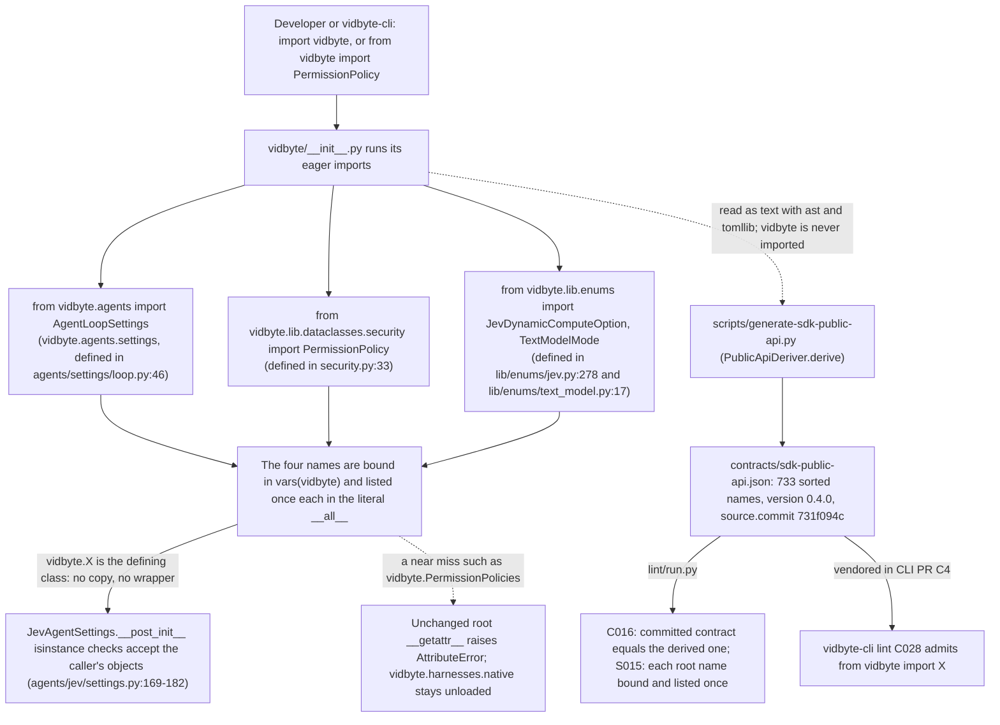

feat(agents): export AgentLoopSettings, PermissionPolicy, TextModelMode and JevDynamicComputeOption from vidbyte
## Summary
`AgentLoopSettings`, `PermissionPolicy`, `TextModelMode` and `JevDynamicComputeOption` are now top-level `vidbyte` names, and `contracts/sdk-public-api.json` lists them. vidbyte-cli may import only root names that its vendored copy of that contract lists (its lint rule C028). `JevAgentSettings` accepts only these exact classes for `loop`, `permission_policy` and `model_mode`, so until now the CLI could not set loop limits, allow write and execute tools, or choose the text-model mode. The decision that matters most: `vidbyte/__init__.py` binds the existing class objects eagerly, from modules that `import vidbyte` already loads. So `vidbyte.PermissionPolicy is vidbyte.tools.security.PermissionPolicy`, no class or default changes, and a fresh `import vidbyte` loads the same 950 `vidbyte*` modules as `main`. The SDK default policy still allows only `SAFE` and `READ`; a caller allows writes by choosing `PermissionPolicy.allow_all()`. The version stays 0.4.0, which is unreleased, and these names ship in it. Spec: `docs/spec/jev-cli-root-exports/spec.md` (r3).

## How to use what this PR introduces
```python
import vidbyte
from vidbyte import AgentLoopSettings, JevAgent, JevAgentSettings, JevComputeSettings
from vidbyte import JevDynamicComputeOption, JevRuntimeSettings, PermissionPolicy, TextModelMode

settings = JevAgentSettings(
    name="jev",
    system_prompt="You are a careful coding agent.",
    provider="openai",
    model_name="gpt-5-mini",
    permission_policy=PermissionPolicy.allow_all(),
    loop=AgentLoopSettings(max_iterations=40, max_tool_calls=200, timeout_seconds=900),
    model_mode=TextModelMode.DIRECT,
)
compute = JevComputeSettings(dynamic_compute=(JevDynamicComputeOption.CLONE, JevDynamicComputeOption.FRESH_AGENT))
agent = JevAgent(settings, JevRuntimeSettings(compute=compute))

print(sorted(level.value for level in settings.permission_policy.allowed))
print(settings.loop.max_iterations, settings.model_mode.value)
print([option.value for option in compute.dynamic_compute])
print({"AgentLoopSettings", "PermissionPolicy", "TextModelMode", "JevDynamicComputeOption"} <= set(vidbyte.__all__))
```
This is spec §4, unchanged. It was run on this branch in a fresh `PYTHONPATH=$(pwd) py -3.11` interpreter, with all five `*API_KEY*` variables of the shell unset, and `vidbyte.__file__` resolved to this worktree:
```
['execute', 'read', 'safe', 'write']
40 direct
['fresh_agent', 'clone']
True
```
Exit 0 and empty stderr. After CRLF to LF, stdout equals spec §4's "Exact stdout" byte for byte. The third line lists `fresh_agent` first although `CLONE` was given first: `JevComputeSettings` keeps options in tie-break order, and this PR does not change that. Nothing calls a model, so no key is needed. As a control, the same file against `git archive origin/main` (`0324d5d6`) stops at line 2 with `ImportError: cannot import name 'AgentLoopSettings' from 'vidbyte'`.

A caller no longer needs a deep import, which C028 forbids, or a bare string to reach these four settings. The first consumer is vidbyte-cli's upcoming `agents jev run` (CLI PR C4): its `services/jev/sdk.py` adapter imports these four names from the root.

## Flow

Run-time validation stays where it was. `JevAgentSettings.__post_init__` checks `isinstance` against the same class objects that the root now hands out, so the CLI's objects pass, and a string `model_mode` still raises `ConfigurationError`. Gate-time validation is static: the generator reads `vidbyte/__init__.py` and `pyproject.toml` as text and never imports the package. C016 fails when the committed contract differs from what the source derives, and S015 fails when a root name is unbound or listed twice. The only state change is the committed JSON file. The CLI steps (H to J) happen in another repository, in a later PR.

## What changed
| File | Change |
|---|---|
| `vidbyte/__init__.py` | +9 lines, 0 removed. Four eager imports (`:54`, `:488`, `:497`, `:503`), four `__all__` entries beside their domain siblings (`:897`, `:1127`, `:1128`, `:1511`), and one `- Agent setting exports:` header bullet (`:13`). `__version__`, `__getattr__`, `__dir__` and `_LAZY_NATIVE_THREAD_EXPORTS` are untouched |
| `contracts/sdk-public-api.json` | Regenerated by `scripts/generate-sdk-public-api.py`, never by hand: +4 names and a new `source.commit`, `731f094c` (the last merge of `main`, whose root lists the four). 733 exports at 0.4.0 |
| `docs/design/release-0-4-0.md` | Three sentences. `TextModelMode.DIRECT` is now "exported from the root and from `vidbyte.lib.enums`". The "Later changes on `main`" bullet gains a sentence for #1190. The contract count is recounted to 733, which is 639 at `v0.3.0` plus 94 |
| `tests/features/jev_cli_root_exports/` (5 files) | New feature pack: `FEATURE.md`, `README.md`, and three test files with 21 tests (acceptance, contract, import time) |
| `docs/spec/jev-cli-root-exports/**` | Spec, request, test plan, review, verify log, stage reports, and this body. No code reads them |

## Acceptance criteria → proof
Every test named below exists on this branch (checked with `git grep -n "def <name>"`). The one-time facts are proven by command output against `MB=$(git merge-base origin/main HEAD)` = `0324d5d6`, never by a test, because such a test would go red on `main` after the merge (spec NG-13).

| AC | What it checks (plain words) | Proven by |
|---|---|---|
| AC-1 | The §4 snippet, using root names only and no key, prints its four lines | `test_jev_cli_root_exports_acceptance.py::test_spec_snippet_builds_jev_settings_from_root_names_alone_with_no_key`; also run by hand above |
| AC-2 | Each name is listed once in `__all__`, is the same object at every existing path, works through `from vidbyte import`, and `allow_all()` holds every level | `test_jev_cli_root_exports_contract.py::test_each_setting_name_is_listed_exactly_once_in_the_root_all`, `::test_root_name_is_the_same_object_at_every_path_in_its_inv2_row` (12 cases), `::test_from_vidbyte_import_binds_the_defining_objects`, `::test_root_permission_policy_keeps_its_default_and_allow_all_permits_every_level` |
| AC-3 | `from vidbyte import *` binds every root name, the four included, as the root's objects | `test_jev_cli_root_exports_import_time.py::test_star_import_binds_every_root_name_and_the_four_as_the_root_objects` |
| AC-4 | The contract lists the four, and its version equals `pyproject.toml`'s and `vidbyte.__version__` | `test_jev_cli_root_exports_contract.py::test_public_api_contract_lists_the_four_names_at_the_package_version` |
| AC-5 | Exactly the four names are added, and the root diff only adds lines | At `731f094c`, `--check` printed `contracts/sdk-public-api.json is stale: exports added: AgentLoopSettings, JevDynamicComputeOption, PermissionPolicy, TextModelMode` (exit 1, no `exports removed` line). `git diff --numstat $MB HEAD -- vidbyte/__init__.py` → `9	0`; re-run by S6 at `004b5d42`: 0 removed lines, 0 `__version__` lines |
| AC-6 | Only the three planned files, the pack and the spec folder change | Re-run by S6 at `004b5d42`: `git diff --name-only $MB HEAD` lists the contract, the release note, the root, the 5 pack files and `docs/spec/jev-cli-root-exports/**`, nothing else. The same command over `vidbyte/tools`, `vidbyte/lib/configs`, `vidbyte/agents/settings`, `vidbyte/lib/dataclasses`, `vidbyte/lib/enums`, `vidbyte/lib/config`, `vidbyte/agents/__init__.py` and `vidbyte/agents/jev` prints nothing |
| AC-7 | A fresh `import vidbyte` binds the four eagerly, starts no process, and leaves `vidbyte.harnesses.native` unloaded | `test_jev_cli_root_exports_import_time.py::test_fresh_import_binds_the_four_eagerly_without_loading_native_or_starting_a_process` |
| AC-8 | Defaults hold through the root: `PermissionPolicy()` is `SAFE` and `READ` only, and a string `model_mode` is rejected | `test_jev_cli_root_exports_contract.py::test_root_permission_policy_keeps_its_default_and_allow_all_permits_every_level`, `::test_jev_settings_take_the_root_text_model_mode_and_still_reject_a_string` |
| AC-9 | No version literal changes | Re-run by S6 at `004b5d42`: the diff against `$MB` of `pyproject.toml`, `vidbyte/cli/__init__.py`, `vidbyte/mcp_server/server/core.py`, `vidbyte/tools/mcp/client.py`, `README.md`, `llms.txt` and `.github/ISSUE_TEMPLATE/bug_report.yml` is 0 lines, and the root diff has 0 `__version__` lines |
| AC-10 | Misspelled names such as `vidbyte.PermissionPolicies` still fail and load nothing | `tests/features/root_native_thread_exports/test_root_native_thread_exports_contract.py::test_a_misspelled_root_name_is_still_an_attribute_or_import_error`; the two names are also probed in `test_fresh_import_binds_the_four_eagerly_without_loading_native_or_starting_a_process` |
| AC-11 | The root header has one `- Agent setting exports:` bullet naming the four, and `- Error exports:` keeps `ConfigurationError` | `test_jev_cli_root_exports_contract.py::test_root_header_has_one_agent_setting_exports_bullet_naming_the_four`; `tests/features/public_skill_loader/test_public_skill_loader_docs.py::test_docs_describe_the_public_door[root header error exports]` |
| AC-12 | No lint rule gains a finding | At `26d05084`: `lint/run.py` → `C016 … 0 0 CLEAN`, `S015 … 13 13`, `A001 … 642 642`, `S051 … 259 259`, `S062 … 889 889`, no REGRESSED or ERRORED row, `SDK-LINT: PASS`; all 91 rule rows equal the same command's rows on a pristine `0324d5d6`. Ruff I001 prints 0 `vidbyte\__init__.py` lines |
| AC-13 | The contract's provenance is true | Re-run by S6 at `004b5d42`: `--check` → `contracts/sdk-public-api.json is current at 731f094c6b23932937d7dc969b6f6c25c0b4d705 (vidbyte-sdk 0.4.0, 733 exports).` (exit 0); `git merge-base --is-ancestor 731f094c HEAD` exits 0; `git show 731f094c:vidbyte/__init__.py` lists the four at `:897`, `:1127`, `:1128`, `:1511` |
| AC-14 | A fresh `import vidbyte` loads the same modules as on `main` | Re-run by S6: a fresh `py -3.11` on `git archive origin/main vidbyte pyproject.toml` and on this worktree both load 950 `vidbyte*` modules, sorted-name SHA-256 prefix `bcad6b199764ec12`, with `vidbyte.harnesses.native` unloaded; the four are in `vars(vidbyte)` only on this branch |
| AC-15 | The release note carries exactly its three edits, with the real PR number | Re-run by S6 at `004b5d42`: `git diff --numstat $MB HEAD -- docs/design/release-0-4-0.md` → `3	3`; 0 `#<n>` placeholders, `#1190` twice |

## Verification
The last change outside `docs/spec/` is `26d05084`. S5 ran the local gates at `99d5f0fd`, and the orchestrator re-ran the source stage at `0a2f20be`. Every commit after `26d05084` changes only `docs/spec/jev-cli-root-exports/**`. S6 re-ran the pack and the contract check at `004b5d42`.

| Gate | Command | Result |
|---|---|---|
| Feature pack | `PYTHONDONTWRITEBYTECODE=1 PYTHONPATH=$(pwd) py -3.11 -m pytest -q -p no:cacheprovider tests/features/jev_cli_root_exports` | `21 passed in 3.67s` (S6, at `004b5d42`) |
| Contract | `PYTHONPATH=$(pwd) py -3.11 scripts/generate-sdk-public-api.py --check` | `contracts/sdk-public-api.json is current at 731f094c6b23932937d7dc969b6f6c25c0b4d705 (vidbyte-sdk 0.4.0, 733 exports).` (S6, at `004b5d42`) |
| Source stage: lint | `PYTHONIOENCODING=utf-8 PYTHONPATH=$(pwd) py -3.11 scripts/run_ci.py --stage source` | `SDK-LINT: PASS` at `0a2f20be`. At `99d5f0fd`: `C016 … 0 0 CLEAN` · `S015 … 13 13 RATCHETED` · `A001 … 642 642 RATCHETED` · `S051 … 259 259 RATCHETED` · `S062 … 889 889 RATCHETED`; 0 REGRESSED or ERRORED rows |
| Source stage: pytest | same command | `1 failed, 7548 passed, 18 skipped` at `0a2f20be`. The 1 is the local-only clause described below |
| Package stage | `env -u PYTHONPATH PYTHONDONTWRITEBYTECODE=1 py -3.11 scripts/run_ci.py --stage package` | `Installed vidbyte-sdk 0.4.0 passed smoke checks.` · `CI passed.` |
| Semgrep | `semgrep scan --error --metrics=off --config .semgrep/typed-mapping-boundary-policy.yml vidbyte` | `Findings: 0 (0 blocking)` · `Ran 1 rule on 1030 files: 0 findings.` |
| Remote CI | [run 39358180543](https://github.com/cerredz/Vidbyte-SDK/actions/runs/39358180543), `workflow_dispatch`, headSha `0a2f20be` | 3/3 jobs success. Source / Python 3.11: `SDK-LINT: PASS` · `7334 passed, 233 skipped in 149.49s (0:02:29)` · `CI passed.` Source / Python 3.12: `SDK-LINT: PASS` · `7334 passed, 233 skipped, 19 warnings in 218.06s (0:03:38)` · `CI passed.` Package: `Installed vidbyte-sdk 0.4.0 passed smoke checks.` · `CI passed.` |
| Remote static policy | [run 39358182288](https://github.com/cerredz/Vidbyte-SDK/actions/runs/39358182288), `workflow_dispatch`, headSha `0a2f20be` | success: `Findings: 0 (0 blocking)` · `Ran 1 rule on 1030 files: 0 findings.` |
| PR checks | `gh pr checks 1190` | No checks reported. This is expected: both workflows run only on `workflow_dispatch` here, and dispatched runs do not attach to the PR |
| Main moved? | `git fetch origin && git merge-base --is-ancestor origin/main HEAD` | exit 0; `origin/main` is `0324d5d6` |

**The one local-only red.** `tests/features/harness_threads/test_harness_threads_surface.py::test_import_vidbyte_starts_no_process_and_leaves_the_native_package_unloaded` fails locally at `:309`, with `Extra items in the left set: 'AgentLoopSettings' 'PermissionPolicy' 'TextModelMode' 'JevDynamicComputeOption'`. Only that clause fails. It sits inside `if base is not None:` (`:304`) and compares root `__all__` with the merge base, allowing only native names to be added. The process and native-package assertion at `:302` passes. CI has no `origin/main` ref, so it skips that clause, which is why the remote source jobs are green. On a pristine `0324d5d6` the file gives `9 passed`, and adding only `"PermissionPolicy",` to `__all__` there fails at the same line (S5; the re-review reproduced the `9 passed`). After the squash, the merge base is `main` itself, so the clause passes there and no red reaches `main`. Nothing else is red: the 3 `root_native_thread_exports` tests that spec r3 once listed as inherited pass on this branch (`3 passed`), and the `167 == 120` failure-code test no longer exists on `main`.

## Adversarial review
5 findings confirmed by an independent verifier across three lenses (spec conformance, repo conventions, engineering): 1 Blocker, 1 Major and 3 Minor. 4 fixed, 0 waived; the fifth, R-5 (the draft state), is the merge step itself. The re-review after repair is SOUND, with 1 Minor (stale inherited-red text in spec §12.5 and §11), fixed in `219ff9a8`. Full record: `docs/spec/jev-cli-root-exports/review.md`.

| ID | Finding | Fixed in |
|---|---|---|
| R-1 (Blocker) | After S3, `main` gained #1147 (+51 root exports), so the PR conflicted on the contract's `source.commit` line, and a hand-picked line would have stamped a commit whose root did not list those names | Merge `731f094c` took `main`'s contract whole; `7c8f8377` regenerated it (733 exports, `source.commit` `731f094c`) |
| R-2 (Major) | After that merge, the release note's "682 exports … 43 added" would be false, and nothing reads the note to catch it | `26d05084` recounted it from the committed contracts: 733 = 639 + 94, 51 of them from #1147 |

The Minors: R-3, a stale inherited-red set in the spec, was fixed in `99d5f0fd`. R-4, the `[WIP]` title, is fixed by this title. R-5, the draft state, is cleared by `gh pr ready` before the merge.

## Deviations from the spec
- **`main` was merged three times, not zero.** Spec A-4 assumed no other root export would land first. #1189 (`b21fd94e`), #1159 (`181f1992`) and #1147 (`0324d5d6`) each changed the root and the contract. Each merge took `main`'s contract and was followed by a regeneration in its own commit, as EC-7 prescribes. So `source.commit` is the last merge, `731f094c`, not commit A, `f0527b55`. The root still differs from `main` by exactly the spec's 9 lines.
- **The counts moved from 668 exports and 29 added to 733 and 94.** `main` added 65 root names while this PR was open. FR-5, G-2, INV-17, §8.5 and §9.2 still say 668 and 29. INV-15's EC-7 clause and spec §17 record the real numbers, and the release note states 733 and 94. For the same reason, INV-16's module set is 950 modules on both sides, not 948.
- **The local inherited-red set shrank from 5 to 1.** #1189 turned the 3 `root_native_thread_exports` tests green, and #1147 replaced the `…_28_harness_codes` test with one that passes. Spec NFR-2, §11, §12.5 and §13 now name the one remaining local-only red.

## Follow-ups
- `docs/design/release-0-4-0.md:19` still says "Do not tag until the Meta key fix, #1184, is on `main`". #1184 merged as `513aa614`, so that sentence is stale. Fix it in the release PR.
- PyPI's latest `vidbyte-sdk` is 0.3.0. Publishing 0.4.0 needs the user's explicit approval, which has not been given. Until then, vidbyte-cli tests against a locally built 0.4.0 wheel.
- Next in this program: SDK PRs R3 (a USD spend cap on `AgentLoopSettings`) and R2 (reasoning effort), and CLI PRs C2 to C5. C4 vendors this contract, moves the pin to `vidbyte-sdk[codex]>=0.4.0,<0.5`, and adds `agents jev run`.
- `ModelProvider` stays non-root (spec Q-3). The CLI validates providers through `JevAgentSettings(provider=…)` until a later SDK PR exports it.
- `skills/usage/create_agent_with_tools.md:164` builds `PermissionPolicy(allowed=..., denied=...)`, which raises `TypeError: PermissionPolicy.__init__() got an unexpected keyword argument 'denied'`. It is a separate documentation bug (spec NG-7).
- The `:309` clause of `test_import_vidbyte_starts_no_process_and_leaves_the_native_package_unloaded` allows only native names to join root `__all__`. It is red locally on every branch that adds any other root export, as here. A separate PR on `main` could narrow it.

🤖 Generated with [Claude Code](https://claude.com/claude-code)
