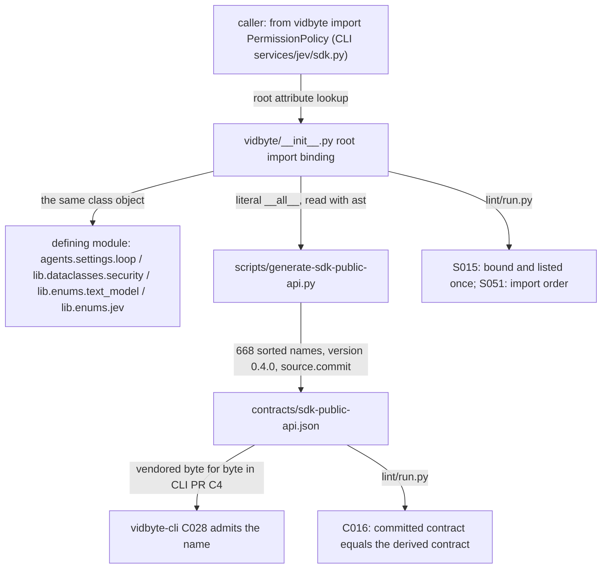

# Spec: Root-export the loop, permission, text-mode, and compute names the CLI's JevAgent needs

> **TL;DR** — Four classes that already exist, `AgentLoopSettings`, `PermissionPolicy`, `TextModelMode` and `JevDynamicComputeOption`, become top-level `vidbyte` exports, and `contracts/sdk-public-api.json` is regenerated from 664 to 668 names. vidbyte-cli may import only root names that this contract lists, so after this change it can set JevAgent's loop limits, allow write and execute tools, choose the text-model mode, and name compute options by enum. The decision that matters most: the root binds the existing class objects eagerly from modules that `import vidbyte` already loads. There are no copies, no lazy hooks, and no change to any definition, default, sub-package export list, or version literal. The work lands in two commits, because the contract generator refuses to stamp a commit whose inputs are uncommitted.

## §0 User prompts

_The verbatim record of what the user asked lives in `docs/spec/jev-cli-root-exports/request.md` (every prompt in order, the handoff block if one exists, and the structured conversation notes). This block reproduces only the prompt that invoked the pipeline, plus the two answers that define this PR's slice._

### 0.1 Invoking request (verbatim)

Prompt 2, which invoked the pipeline:

```
/spec-pipeline I like this and I agree with the setup, can you start building it into the vidbyte-cli/.
```

The answers in Prompt 3 that create this SDK slice (request.md §A, mapped to the questions in §C.1), verbatim:

```
2) you can create a new seperate pr in the vidbyte-sdk/ that you can just auto merge that applies this change and updates the version. 3) I dont want writes to be denied.
```

### 0.2 User replies during the run
_None yet. The orchestrator appends any reply the user sends during the run here verbatim, labeled with the revision it produced._

---

## Part A — Framing

## §1 Goal

The program "JevAgent in vidbyte-cli" (request.md §C.2 D-P1) needs the CLI to turn flags into the two frozen settings objects `JevAgent` accepts. The CLI may import only top-level `vidbyte` names that its vendored copy of `contracts/sdk-public-api.json` lists (CLI lint C028, request.md §C "Why"). On `base_commit`, none of the four names below is a root name. `hasattr(vidbyte, name)` is False for each one, and none is in `vidbyte.__all__` (verified in this session with `PYTHONPATH=<worktree> py -3.11`). The settings objects will not accept a substitute:

- `JevAgentSettings.loop` must be an `AgentLoopSettings` instance (`vidbyte/agents/jev/settings.py:181-182`). Without the class, the agreed `--max-iterations`, `--max-tokens`, `--max-tool-calls` and `--loop-timeout` flags (request.md §C.0 flag map, row `.loop`) have nothing to build.
- `JevAgentSettings.permission_policy` must be a `PermissionPolicy` instance (`settings.py:179-180`). Its default allows only `SAFE` and `READ` (`vidbyte/lib/dataclasses/security.py:36-38`). Without the class, every write and execute tool call is denied, and the user said "I dont want writes to be denied" (Prompt 3, answer 3; D-P3).
- `JevAgentSettings.model_mode` must be a `TextModelMode` member (`settings.py:169-170`). Reproduced: `model_mode="direct"` raises `ConfigurationError: JevAgentSettings.model_mode must be a TextModelMode value.` `TextModelMode.DIRECT` is the only mode that calls the provider with the caller's own key and needs no Vidbyte key (`vidbyte/lib/enums/text_model.py`, KNOWN EDGE CASES). The CLI's own-key-only rule (D-P5) points at that mode.
- `JevComputeSettings.dynamic_compute` accepts strings, but the agreed CLI design mirrors every SDK enum as a CLI-local `click.Choice` list, with a parity test against the installed SDK (request.md §C.0 "Framing"). That test needs `JevDynamicComputeOption` itself. Without it, the CLI "must pass compute options as bare strings" (request.md §C "Why").

| ID | Goal (outcome) | How we will know | Source |
|---|---|---|---|
| G-1 | vidbyte-cli can build every JevAgent setting in the agreed flag map from top-level `vidbyte` names alone: loop limits, write and execute permissions, text-model mode, and compute options by enum | The §4 snippet runs with only `from vidbyte import …`, and the regenerated contract lists all four names | request.md §C "This run's scope" and "Why"; §C.0 flag map rows `.permission_policy` and `.loop`; Prompt 3 answers 2 and 3 |
| G-2 | The record of the unreleased 0.4.0 release still describes exactly what 0.4.0 ships | `docs/design/release-0-4-0.md` names the four exports, states 668 exports, and no longer says `TextModelMode` is "not the root" | request.md §C "Version (D-P2)" ("add them there") |
| G-3 | No existing SDK user sees any change | Every existing import path, default, and validation behaves exactly as on `base_commit`, and `import vidbyte` loads the same modules | request.md §C "Not in this run: … any behavior change to the four classes" |

## §2 Objective

When this PR merges, `vidbyte/__init__.py` binds `AgentLoopSettings`, `PermissionPolicy`, `TextModelMode` and `JevDynamicComputeOption` from the modules they already come from, and lists each name exactly once in `vidbyte.__all__`. The root header gains one bullet that names the four. `contracts/sdk-public-api.json` is regenerated by `scripts/generate-sdk-public-api.py` to 668 exports at version `0.4.0`, and `docs/design/release-0-4-0.md` records the four exports in the release they ship in. Nothing else changes: no class definition, no default, no sub-package `__all__`, no version literal, and no other root name. This is PR **R1** of the 8-PR program (request.md §C.2 D-P1). Later slices, all out of scope here: R3 (a USD spend cap on `AgentLoopSettings`), R2 (reasoning effort), and C1 to C5 (vidbyte-cli, including the refresh of the CLI's vendored contract and its pin move to `>=0.4.0,<0.5`).

## §3 Non-goals

- **NG-1** — Root-export the 11 native browser names that #1183 added to `vidbyte.harnesses.native.__all__` (`BrowserThreadResult`, `BrowserToolCall`, `{run,continue,fork}_{grok,opencode,muse}_with_browser`). Their absence makes 3 tests in `tests/features/root_native_thread_exports/` fail on pristine `base_commit`. — *Why not:* request.md §C fixes exactly four names. Those 3 failures are inherited (§11 baseline) and belong to a separate PR (Q-1).
- **NG-2** — Root-export any other type that is not a root name today (`ModelProvider`, `ProviderKeys`, `ToolErrorPolicy`, `OutputContract`, `DecisionModelConfig`, `JevUsageReport`, `PermissionDecision`, `PermissionCeiling`). — *Why not:* this is not in the request. `provider` and `api_keys` accept strings. The others are not in the agreed flag map, or are never exposed (`.decision`). A response record such as `JevUsageReport` can be read through its attributes without importing its type (A-2).
- **NG-3** — Clear the four pre-existing S015 root findings: `ContinualTraceAgentDescriptor`, `FunctionTool`, `HandoffAgentDescriptor` and `ToolMixin` are imported by the root but missing from `__all__`, and they count in S015's baseline of 13. — *Why not:* clearing them adds four public exports that nobody asked for (hard rule: scope is the conversation).
- **NG-4** — Change the version, tag, or publish. — *Why not:* D-P2 (request.md §C.2). 0.4.0 is unpublished, and these exports ship in it. The release note forbids tagging until SDK #1184 is on `main`. The user's "updates the version" is met by these exports shipping in the unreleased 0.4.0 (D-7).
- **NG-5** — Change any behavior or default of the four classes, or move the legacy enums `PermissionDecision` (`vidbyte/lib/dataclasses/security.py:25`) and `ToolPermission` (`vidbyte/lib/dataclasses/tools.py:47`) to `vidbyte/lib/enums/`. — *Why not:* request.md §C "Not in this run". AGENTS.md Placement Rules / Existing code: "Moving it to `vidbyte/lib/` is a change of its own and belongs in its own pull request."
- **NG-6** — Split `vidbyte/__init__.py`, which is 1,467 lines, against General Coding Style 3 ("Keep files well below 1,000 lines"). — *Why not:* AGENTS.md General Coding Style preamble: "Do not rewrite untouched code just to make it conform; that belongs in its own pull request." The precedent PRs #1179 and #1099 grew the file without splitting it. No lint rule enforces the limit (code-map §2.4).
- **NG-7** — Rewrite the examples in README.md, llms.txt or `skills/**` to import from the root, or fix the unrelated `PermissionPolicy(allowed=..., denied=...)` mistake at `skills/usage/create_agent_with_tools.md:164`. `PermissionPolicy` has no `denied` field. — *Why not:* the sub-package paths those examples use keep working (INV-13), no rule ties those files to `__all__` (code-map §2.7), and the `denied=` mistake is a separate documentation bug.
- **NG-8** — Edit the headers of the defining modules, or any file under `vidbyte/tools/**` or `vidbyte/lib/configs/**`. — *Why not:* nothing in those headers becomes false (D-9). An edit under `vidbyte/tools/**` turns `test_branch_leaves_the_tools_and_configs_packages_as_main_has_them` red (`tests/features/harness_threads/test_harness_threads_surface.py:227-235`).
- **NG-9** — Make lazy root exports for the four names. — *Why not:* `import vidbyte` already loads all four defining modules (verified), so laziness saves nothing and adds a mapping and a `__getattr__` branch (D-1).
- **NG-10** — Convert the root's legacy "Context Protocol Header" to the A001 field format. — *Why not:* this is untouched code (the AGENTS.md style preamble), and the file is already counted in A001's baseline of 642.
- **NG-11** — Any vidbyte-cli change: refreshing `lint/contracts/sdk-public-api.json`, moving the pin to `>=0.4.0,<0.5`, or adding flags. — *Why not:* that is CLI PR C4 (request.md §C.2 D-P1, D-P2).
- **NG-12** — The weighted words that belong to other PRs of the program, each traced: "one of the 7 provider keys", "use a key outside of this", "a helper class that runs before the core logic runs", and "raise an error with a message explaining that they need 1 of these 7 api providers" belong to C1. "make "max_spend" a universal command" and "every agent to be tracking usage" belong to R3 and C3. "if there are clarifying questions the JevAgent will stop …" belongs to C4. "JevAgent should have a reasoning effort" belongs to R2 and C5. "just run the jev agent with no parameters … whatever these defaults are they will run" belongs to C4, and this PR keeps every SDK default unchanged so that C4 inherits them (INV-7). "Can you give me a checklist of all the basic/required commands" was answered in the conversation (request.md §C.0). "all the setting/things that are possible to be tweaked/customized through the jevAgent" is served here by G-1 and AC-1 for the four field types it needs, and by the CLI PRs for the commands themselves. "updates the version" is handled by D-7 and NG-4. "I dont want writes to be denied" is served here by FR-2 and AC-2.

## §4 Developer usage

This is how vidbyte-cli's `services/jev/sdk.py` adapter, or any SDK user, builds JevAgent settings once this PR merges. It uses root names only, as CLI lint C028 requires. No provider key or Vidbyte key is needed, because nothing runs.

```python
import vidbyte
from vidbyte import AgentLoopSettings, JevAgent, JevAgentSettings, JevComputeSettings
from vidbyte import JevDynamicComputeOption, JevRuntimeSettings, PermissionPolicy, TextModelMode

settings = JevAgentSettings(
    name="jev",
    system_prompt="You are a careful coding agent.",
    provider="openai",
    model_name="gpt-5-mini",
    permission_policy=PermissionPolicy.allow_all(),
    loop=AgentLoopSettings(max_iterations=40, max_tool_calls=200, timeout_seconds=900),
    model_mode=TextModelMode.DIRECT,
)
compute = JevComputeSettings(dynamic_compute=(JevDynamicComputeOption.CLONE, JevDynamicComputeOption.FRESH_AGENT))
agent = JevAgent(settings, JevRuntimeSettings(compute=compute))

print(sorted(level.value for level in settings.permission_policy.allowed))
print(settings.loop.max_iterations, settings.model_mode.value)
print([option.value for option in compute.dynamic_compute])
print({"AgentLoopSettings", "PermissionPolicy", "TextModelMode", "JevDynamicComputeOption"} <= set(vidbyte.__all__))
```

Exact stdout:

```
['execute', 'read', 'safe', 'write']
40 direct
['fresh_agent', 'clone']
True
```

The third line shows existing behavior that this PR does not change: `JevComputeSettings` puts the options in tie-break order (`vidbyte/lib/enums/jev.py:278`), whatever order they were given in. The same script, with the four names imported from their sub-packages, prints these lines on `base_commit`, except that the last line is `False` (verified with `OPENAI_API_KEY` and `VIDBYTE_API_KEY` unset). The CLI no longer needs a deep import, which C028 forbids, or bare strings to reach these four settings.

## §5 Flow diagram



A caller's `from vidbyte import X` resolves to a binding the root module makes at import time. That binding is the class object from the defining module, not a wrapper, so `isinstance` checks and JevAgentSettings' validators see one class. The generator never imports `vidbyte`: it reads the literal `__all__` and `pyproject.toml` with `ast` and `tomllib`. It writes the sorted names, the version and the HEAD commit, and it refuses to write while either input file is uncommitted. Validation happens in the lint gate. S015 rejects an unbound or unlisted root name, S051 rejects import-order drift, and C016 rejects a committed contract that differs from what the source derives. The only state change is the committed JSON file. The CLI-side step F happens in a different repository, in a later PR.

---

## Part B — Behavior (this is the spec; everything else is framing)

## §6 Behavior

### 6.1 Invariants

- **INV-1** — Each of `AgentLoopSettings`, `PermissionPolicy`, `TextModelMode` and `JevDynamicComputeOption` is an attribute of the root `vidbyte` module bound at import time, and appears **exactly once** in `vidbyte.__all__`.
- **INV-2** — `vidbyte.<name>` is the very object (`is`, not `==`) defined by its defining module: `vidbyte.agents.settings.loop.AgentLoopSettings`, `vidbyte.lib.dataclasses.security.PermissionPolicy`, `vidbyte.lib.enums.text_model.TextModelMode`, and `vidbyte.lib.enums.jev.JevDynamicComputeOption`. It is therefore also identical to the object at every existing export path: `vidbyte.agents`, `vidbyte.agents.settings`, `vidbyte.tools.security`, `vidbyte.lib.dataclasses`, `vidbyte.lib.enums`, and `vidbyte.lib.config`.
- **INV-3** — `set(vidbyte.__all__)` equals the `__all__` of `base_commit` plus exactly the four names. No name is removed and no other name is added. Every entry that already exists keeps its relative order.
- **INV-4** — At the PR head, `contracts/sdk-public-api.json` is the generator's canonical output. Its `exports` equal `sorted(set(vidbyte.__all__))` (668 names). Its `version` equals `pyproject.toml`'s `[project].version`, which equals `vidbyte.__version__`, which equals `"0.4.0"`. Its `source.commit` names a commit whose `vidbyte/__init__.py` and `pyproject.toml` are identical to the head's. The file is LF-only with a trailing newline.
- **INV-5** — A fresh `import vidbyte` loads no module that it did not load on `base_commit`, starts no process, and leaves `vidbyte.harnesses.native` unloaded until a thread function is named (harness thread spec INV-23).
- **INV-6** — The definitions and every sub-package export list are byte-identical to `base_commit`. Only the three files in §12.3 differ from `base_commit` outside `docs/spec/jev-cli-root-exports/` and the test author's files under `tests/`.
- **INV-7** — Defaults and validation are exactly as on `base_commit`:
  - `PermissionPolicy().allowed == frozenset({ToolPermission.SAFE, ToolPermission.READ})`.
  - `PermissionPolicy.allow_all().allowed == frozenset(ToolPermission)`.
  - The `model_mode` default of `JevAgentSettings` is `TextModelMode.AUTO`.
  - `JevComputeSettings().dynamic_compute == (FRESH_AGENT, FORK_AGENT, SUBAGENT)`.
  - `AgentLoopSettings()` has no iteration, token, or tool-call limit, with `max_queued_prompts == 25` and `max_contract_rejections == 3`.
  - A string `model_mode` is still rejected with `ConfigurationError`.
  - The members of `TextModelMode` are `auto`, `vidbyte_managed` and `direct`, and the members of `JevDynamicComputeOption` are `fresh_agent`, `fork_agent`, `subagent`, `clone` and `swarm`, in that order.
- **INV-8** — Every version literal still reads `0.4.0`: `pyproject.toml:7`, `vidbyte/__init__.py` `__version__`, `vidbyte/cli/__init__.py:58`, `vidbyte/mcp_server/server/core.py:79`, `vidbyte/tools/mcp/client.py:46`, `README.md:86`, `llms.txt:17`, `.github/ISSUE_TEMPLATE/bug_report.yml:19`, and the contract's `version`.
- **INV-9** — `from vidbyte import *` binds every name in `vidbyte.__all__`, including the four. The names it binds are the root's own objects.
- **INV-10** — The text describes the code. The root header has one Architecture bullet that names all four. The release note no longer says `TextModelMode` is exported "not the root". It states 668 exports and 29 added since `v0.3.0`, and it names the four. No placeholder such as `#<n>` remains in a merged file.

**Must not regress:**
- **INV-11** — A misspelled root name, such as `vidbyte.PermissionPolicies` or `from vidbyte import TextModelModes`, still raises `AttributeError` or `ImportError` and does not load `vidbyte.harnesses.native`. Today's `__getattr__`/`__dir__` block (`vidbyte/__init__.py:1449-1467`) and `_LAZY_NATIVE_THREAD_EXPORTS` (`:1435-1445`) are unchanged.
- **INV-12** — The root header's `- Error exports:` bullet still contains `ConfigurationError` (`tests/features/public_skill_loader/test_public_skill_loader_docs.py:91`).
- **INV-13** — Every existing import path for the four names keeps working and returns the same object: `vidbyte/agents/__init__.py:258-264`, `vidbyte/agents/settings/__init__.py`, `vidbyte/lib/enums/__init__.py` (`:122`, `:204`, `:284`, `:347`), `vidbyte/tools/security/__init__.py`, `vidbyte/lib/dataclasses/__init__.py` (`:201`, `:413`), and `vidbyte/lib/config/__init__.py` (`:16`, `:34`).
- **INV-14** — No lint rule gains a finding. C016 stays at 0. S015 stays at 13. S051 stays at or below 259, with no I001 finding on `vidbyte/__init__.py`. A001 stays at 642.

### 6.2 Acceptance criteria

| ID | Given | When | Then | Priority | Proof |
|---|---|---|---|---|---|
| AC-1 | a clean checkout of this branch at the PR head, on `PYTHONPATH`, with no provider or Vidbyte key in the environment | the §4 snippet runs | it prints exactly the four lines shown in §4 and raises nothing | P0 | |
| AC-2 | the root package is imported | each of the four names is read as `vidbyte.<name>`, and through `from vidbyte import <name>` | each resolves; `vidbyte.__all__.count(name) == 1`; each is the defining module's object (INV-2); `vidbyte.PermissionPolicy.allow_all().allowed` holds all four `ToolPermission` levels | P0 | |
| AC-3 | a fresh interpreter with `PYTHONPATH` set to the checkout | `from vidbyte import *` runs | the namespace holds the four names, each identical to the root's attribute | P1 | |
| AC-4 | the PR head, after the contract commit | `python scripts/generate-sdk-public-api.py --check` and `python lint/run.py --rule C016` run | both exit 0; the check reports `vidbyte-sdk 0.4.0, 668 exports`; the four names are in `exports` at their sorted positions; `version` is `0.4.0`; `git show <source.commit>:vidbyte/__init__.py` lists the four names in `__all__` | P0 | |
| AC-5 | the root `__all__` on `base_commit` and at the PR head | the two sets are compared | the head adds exactly the four names and removes none (negative: no other name joins, including none of the 11 native browser names) | P0 | |
| AC-6 | `base_commit` and the PR head | the four defining modules and the `__all__` of `vidbyte.agents`, `vidbyte.agents.settings`, `vidbyte.agents.jev`, `vidbyte.lib.enums`, `vidbyte.lib.dataclasses`, `vidbyte.lib.config`, `vidbyte.tools` and `vidbyte.tools.security` are compared | none differs (negative); `git diff --name-only <base_commit> -- vidbyte/tools vidbyte/lib/configs` prints nothing | P0 | |
| AC-7 | a fresh interpreter | `import vidbyte` runs | `vidbyte.harnesses.native` is not in `sys.modules`; no subprocess starts; the set of loaded modules equals the set that `base_commit` loads (negative: no new import-time module) | P0 | |
| AC-8 | the root names | each default named in INV-7 is built through the root names | each equals the INV-7 value; `JevAgentSettings(..., model_mode="direct")` still raises `ConfigurationError` (negative: nothing became looser) | P0 | |
| AC-9 | the PR head | the nine version places of INV-8 are read | each reads `0.4.0` (negative: no bump) | P0 | |
| AC-10 | the PR head | `vidbyte.PermissionPolicies` is read, and `from vidbyte import TextModelModes` runs, in a fresh interpreter | `AttributeError` and `ImportError` respectively; `vidbyte.harnesses.native` stays unloaded | P1 | |
| AC-11 | the PR head | the root header and `docs/design/release-0-4-0.md` are read | the header has one `- Agent setting exports:` bullet naming all four, and `- Error exports:` still contains `ConfigurationError`; the release note carries the three edits of §12.3 row 2, with a real PR number and no placeholder. The release-note half is proven by the implementer's diff, because tests may not read `docs/` (§13) | P1 | |
| AC-12 | the PR head | `python lint/run.py` runs with `PYTHONPATH` set to the worktree | its last line is `SDK-LINT: PASS`; C016 0, S015 13, A001 642, S051 ≤ 259; `py -3.11 -m ruff check vidbyte --config lint/ruff.toml --select I001 --no-cache` reports no `vidbyte\__init__.py` line | P0 | |

### 6.3 Edge cases and failure modes

| ID | Trigger (input + state) | System behavior | User sees | Guarded by (INV-/D-) |
|---|---|---|---|---|
| EC-1 | `"PermissionPolicy"` is added to `__all__` but the import is forgotten | `from vidbyte import *` raises `AttributeError: module 'vidbyte' has no attribute 'PermissionPolicy'` through `__getattr__`; S015 reports "`__all__` entry is not bound/imported/lazily declared" | every star-import user breaks; the lint gate is red | INV-1, INV-9, S015 |
| EC-2 | the import is added but the `__all__` entry is forgotten | `from vidbyte import PermissionPolicy` works, but the generator omits the name, so the CLI's C028 rejects the import; S015 reports "root public import is missing from `__all__`" | the CLI cannot use the name, although the SDK seems to export it | INV-1, INV-4, S015 |
| EC-3 | a name is listed twice, for example both beside its sibling and in a cluster at the end | S015 reports "duplicate `__all__` entry"; the contract silently collapses duplicates (`lint/core/public_api_contract.py` KNOWN EDGE CASES) | the lint gate is red | INV-1, S015 |
| EC-4 | the generator runs before the root change is committed | it prints `SDK public-API contract not written: these input files have uncommitted changes:` and exits 1; nothing is written | the implementer must commit first | D-8 |
| EC-5 | the four names are typed into the JSON by hand, and `source.commit` stays `ebd18517…` | C016 compares only the data and the canonical bytes, so it can pass, while `source.commit` names a commit whose root file has 664 names | the provenance is false; a CLI owner who audits `source.commit` finds no such export there | INV-4, D-8 |
| EC-6 | commit A is amended or rebased after the contract commit | `source.commit` names a commit that is no longer on the branch; the data stays correct and C016 stays green | nothing at run time; after the squash merge the SHA is not on `main` anyway, which is the normal state today (`ebd18517` is not an ancestor of `main`, code-map §2.1) | accepted limitation; if commit A's inputs change, regenerate in a new commit |
| EC-7 | `main` merges another root export, for example the browser names, before this PR merges | `contracts/sdk-public-api.json` conflicts, or C016 reports `exports-stale` after the merge | the gate is red after the merge | field guide "Main can break a long-lived feature branch …": merge `main`, run the generator, commit, then `--check` |
| EC-8 | `PermissionPolicy` is imported from `vidbyte.tools.security` instead of its defining module | the same object; every test passes | a review comment for deviating from D-2 | D-2 |
| EC-9 | the implementer notes the root re-export in a header under `vidbyte/tools/security/` | `test_branch_leaves_the_tools_and_configs_packages_as_main_has_them` fails locally | red source stage | INV-6, D-9, §14 Never |
| EC-10 | the implementer "fixes" the 3 inherited `root_native_thread_exports` failures by adding the 11 browser names | the contract reaches 679; AC-5 fails; the release-note counts become wrong | scope creep in a PR that is auto-merged | NG-1, INV-3, §14 Never |
| EC-11 | the implementer reads "updates the version" and bumps to `0.4.1` | the contract `version` changes; the release note and D-P2 become wrong | a version that no release record describes | D-7, INV-8 |
| EC-12 | the new header bullet is written as a continuation line, with no leading `- `, under `- Error exports:` | the docs test still finds `ConfigurationError`, but the header now presents the four setting types as errors | misleading header | §12.4 header-bullet obligation, INV-10 |
| EC-13 | a root import goes through a module that `import vidbyte` did not already load | import time grows for every SDK user | slower `import vidbyte` | INV-5, D-1, D-3 (every chosen path is already loaded) |
| EC-14 | a consumer does `from vidbyte import *` after defining its own `PermissionPolicy` or `TextModelMode` | the root's object shadows the consumer's | a changed name binding after the upgrade | accepted limitation: an additive export always does this to star importers, and the root already exports 664 names |
| EC-15 | a misspelled near name, such as `vidbyte.TextModelModes` | the unchanged `__getattr__` raises `AttributeError` without importing the native package | the same error as today | INV-11 |
| EC-16 | the contract file is opened and saved in an editor that writes CRLF | the working copy is not canonical; C016 reports `not-canonical` | red lint | D-8 (run the generator, never edit the file); `contracts/.gitattributes` `*.json text eol=lf` |
| EC-17 | the implementer stops after commit A | C016 reports `exports-stale`; any test that reads the contract JSON is red | a red PR | §12.6: P2 is mandatory, and the PR is complete only after commit B |
| EC-18 | the PR number is unknown when the release note is edited | a literal `#<n>` could be committed and merged | a broken reference in the release record | A-1, INV-10 |
| EC-19 | `test_import_vidbyte_starts_no_process_and_leaves_the_native_package_unloaded` fails locally, because root `__all__` differs from the merge base by design | someone edits that test, or drops a name, to make it pass | a weakened guard, or a missing export | §14 Never; field guide "Two `harness_threads` surface tests fail locally …"; CI skips it |
| EC-20 | a gate runs from the worktree without `PYTHONPATH=$(pwd)` | the editable install resolves `vidbyte` to the canonical checkout, so the old code is tested | a false green, or a false red | §11 commands; field guide "Run the source stage with `PYTHONPATH=<worktree>` …" |
| EC-21 | `pip install -e .` runs from the worktree | the shared editable install is repointed at this worktree, for every other session and worktree | other checkouts silently test this branch | §14 Never |
| EC-22 | concurrency, retries, empty or first-run state, timeouts, scale | N/A: the module import is serialized by Python's import lock, there is no I/O or stored state, and both the generator and S015 are O(names), with 668 names | — | — |

**Rollback of the user action:** `git revert` the squash commit on `main`. The revert restores `vidbyte/__init__.py`, the release note, and the 664-name contract together, so C016 stays green and `source.commit` returns to `ebd18517…`. Before 0.4.0 is published, no released consumer depends on the four root names. After publication, removing a root name is a breaking change for vidbyte-cli, and `contracts/README.md` ("tell the vidbyte-cli owners") applies.

## §7 Requirements

**Functional**
| ID | Requirement | Priority | Source (request.md / G-) |
|---|---|---|---|
| FR-1 | `AgentLoopSettings` is a root export: bound in `vidbyte/__init__.py` from `vidbyte.agents`, and listed once in `__all__`; it is `vidbyte.agents.settings.loop.AgentLoopSettings` | P0 | request.md §C "Build exactly this"; G-1 |
| FR-2 | `PermissionPolicy` is a root export: bound from `vidbyte.lib.dataclasses.security`, and listed once; `vidbyte.PermissionPolicy.allow_all()` permits all four `ToolPermission` levels ("I dont want writes to be denied") | P0 | request.md §C; Prompt 3 answer 3; G-1 |
| FR-3 | `TextModelMode` is a root export: bound from `vidbyte.lib.enums`, and listed once; it is `vidbyte.lib.enums.text_model.TextModelMode` | P0 | request.md §C; G-1 |
| FR-4 | `JevDynamicComputeOption` is a root export: bound from `vidbyte.lib.enums`, and listed once; it is `vidbyte.lib.enums.jev.JevDynamicComputeOption` | P0 | request.md §C; G-1 |
| FR-5 | `contracts/sdk-public-api.json` is regenerated by `scripts/generate-sdk-public-api.py` (never by hand) to 668 exports at `0.4.0`, in a commit after the root change | P0 | request.md §C ("regenerate … with the repo's generator"); contracts/README.md; C016 |
| FR-6 | The root header documents the four names in one new Architecture bullet; every other header line is unchanged | P1 | CONTRIBUTING.md "Making a Change" step 3; precedents 64e2bd67, 82b46c85; G-1 |
| FR-7 | `docs/design/release-0-4-0.md` records the four exports and the new counts, and drops the claim that `TextModelMode` is not a root export | P1 | request.md §C "Version (D-P2)" ("add them there"); G-2 |
| FR-8 | No other export path changes: no sub-package `__all__`, no definition, and no other root name | P0 | request.md §C "any behavior change" out of scope; G-3 |
| FR-9 | No version literal changes | P0 | request.md §C.2 D-P2; G-2 |

**Non-functional**
| ID | Requirement | Priority | Target |
|---|---|---|---|
| NFR-1 | Import cost: the change adds no import-time work | P0 | the set of `sys.modules` keys after a fresh `import vidbyte` is identical to `base_commit`'s; `vidbyte.harnesses.native` is absent |
| NFR-2 | Gate: the full local gate is green apart from the named inherited failures | P0 | The source stage's pytest shows exactly 5 failures: the 4 inherited ones of §11, plus `test_import_vidbyte_starts_no_process…`, which is red by design and only locally. Every test the test author added passes. Lint ends `SDK-LINT: PASS`. The package stage passes |
| NFR-3 | Smallest diff: the implementer changes only three files | P0 | `git diff --stat <base_commit>` lists `vidbyte/__init__.py` (+9 lines, −0), `contracts/sdk-public-api.json` (+4 names and a new `source.commit`), and `docs/design/release-0-4-0.md` (three sentences), plus the test author's files and the spec folder |
| NFR-4 | The change is purely additive: every existing import and behavior keeps working ("always") | P0 | the full existing suite passes, except the inherited failures; INV-13 |

---

## Part C — Design

## §8 Architecture and decisions

### 8.1 Decisions
| ID | Decision | Deciding reason | Runner-up | Flips if |
|---|---|---|---|---|
| D-1 | Bind the four names **eagerly**, as ordinary imports in the root initializer | All four defining modules are already in `sys.modules` after a plain `import vidbyte` (verified), so an eager import costs nothing and keeps the name visible to type checkers and S015 with no hook | A lazy entry in a `_LAZY_*_EXPORTS` mapping, served by `__getattr__` | a later refactor stops `import vidbyte` from loading one of these modules, and that change measurably affects import time |
| D-2 | Import `PermissionPolicy` from its defining module: `from vidbyte.lib.dataclasses.security import PermissionPolicy` | AGENTS.md Placement Rules: "Import it from its domain module, `vidbyte.lib.dataclasses.<domain>`". This matches the root's precedent for a lib dataclass, `from vidbyte.lib.dataclasses.skills import SkillResolution` (`vidbyte/__init__.py:480`, added by #1099). The `vidbyte.lib.dataclasses` package re-exports it the same way (`vidbyte/lib/dataclasses/__init__.py:201`) | `from vidbyte.tools.security import PermissionPolicy`, the path `JevAgentSettings` uses (`vidbyte/agents/jev/settings.py:68`) and the one README.md shows | a repo rule or a reviewer requires root imports to go through package façades. Either path yields the same object, so the flip costs one line |
| D-3 | Add `AgentLoopSettings` to the existing `from vidbyte.agents import (…)` block, and both enums to the existing `from vidbyte.lib.enums import (…)` block | Three of the four names need no new import statement. The sibling `ToolSettings` already comes from the `vidbyte.agents` block, and the enum block is how the root imports enums. Both paths are already loaded | Import from `vidbyte.agents.settings` or `vidbyte.lib.enums.text_model` directly | none expected; the objects are identical on every path |
| D-4 | Place each name in `__all__` beside its domain sibling: `JevDynamicComputeOption` after `"JevComputeSettings"`, then `AgentLoopSettings` and `TextModelMode` after `"AgentStopReason"` (the agent-configuration run that ends with `"ToolSettings"`), and `PermissionPolicy` after `"ToolPermission"` | Root `__all__` is grouped by domain, not sorted (code-map §2.1). A reader looking for compute options or permission types finds them next to the related names. No test pins the order | One cluster of four, appended together, as #1099 did with `SkillLoader`, `SkillResolution` and `ConfigurationError` | a reviewer prefers the single-cluster form. Order is not part of any contract (the contract sorts), so the flip is free |
| D-5 | Document the four in **one new** header bullet, `- Agent setting exports:`, inserted after `- Agent exports:` | One line states what the four are for and who needs them, without rewriting the existing bullets. The precedent #1179 added a bullet of its own ("Native harness thread exports") | Append the names to the existing Agent and Tool bullets | a reviewer prefers the names inline. That is also a one-line change |
| D-6 | The release record is `docs/design/release-0-4-0.md`. Edit three sentences: the `TextModelMode.DIRECT` claim, the "Later changes on `main`" bullet, and the contract-count sentence | It is the only record of the unreleased 0.4.0. It enumerates every root export the release adds, with counts (664 = 639 + 25), and it states that `TextModelMode.DIRECT` is "exported from `vidbyte.lib.enums` and not the root". After this PR, both statements are false unless edited. Putting the PR in "Later changes" keeps the list's stated range (`v0.3.0..82b46c85` plus #1099) true | A bullet of its own in the release list | the release note is rewritten or replaced before this PR merges. Then the same three facts go into whatever replaced it |
| D-7 | No version change (user decision, request.md §C.2 D-P2) | 0.4.0 is unpublished, and these exports ship in it; "updates the version" is met by that | Bump to 0.4.1 | the user says otherwise during the run |
| D-8 | Two commits. Commit A holds the root change and the release note. Commit B holds only the regenerated contract, written by the generator | The generator refuses to write while `vidbyte/__init__.py` or `pyproject.toml` differs from HEAD, and it records HEAD as `source.commit` (`scripts/generate-sdk-public-api.py:69-72`, `:118-130`). Hand edits falsify provenance (EC-5) | — (forced by the tool) | the generator changes |
| D-9 | Leave the headers of the defining modules unchanged | Nothing in them becomes false. They name some re-exporters and have never listed every one (for example, `security.py:12` does not name `vidbyte.lib.dataclasses`). Leaving them alone keeps INV-6 simple. The `vidbyte/tools/**` headers cannot change anyway (NG-8) | Add "re-exported from the root" to `loop.py`, `security.py`, `text_model.py` and `jev.py` | a reviewer asks for it (Q-2). Then only the three files outside `vidbyte/tools/` change |

### 8.2 Patterns inherited
- **Façade re-export: one public import surface over layered packages.** The root initializer re-exports lower-layer objects without redefining them. It fits because the CLI's C028 admits only root names. The repo uses it in `vidbyte/__init__.py` (for example, `SkillResolution` at `:480` and `ToolSettings` through `from vidbyte.agents import …`). A006 explicitly exempts every `__init__.py` from the layering graph (`lint/rules/a006_directed_dependency_graph.py:67`).
- **Generated contract with provenance and a freshness lint (generate, then check).** The contract file is derived from source by one script that stamps the commit it read, and a lint rule fails when the committed copy drifts. The repo uses it in `scripts/generate-sdk-public-api.py`, `lint/core/public_api_contract.py`, and `lint/rules/c016_public_api_contract_current.py`.
- **Expand-only API change.** An additive public name needs no deprecation path and no migration. Removing it later would be the breaking "contract" step (`contracts/README.md`: "When an export is removed or renamed, tell the vidbyte-cli owners").

### 8.3 Smaller design rejected
- **Root imports and `__all__` only, with no contract regeneration and no doc edits.** This fails FR-5 and INV-4. C016 reports `exports-stale` (baseline 0, blocking), and the CLI's vendored copy would never list the names, so G-1 is not met. It also fails FR-7 and INV-10: the release note would keep saying `TextModelMode` is "not the root" and that the contract lists 664.
- **Export only the three names the CLI cannot replace with a string** (`AgentLoopSettings`, `PermissionPolicy`, `TextModelMode`). This fails FR-4. The request names `JevDynamicComputeOption` explicitly, and the CLI's `click.Choice` parity test needs the SDK enum (request.md §C.0 "Framing").

### 8.4 Complexity budget
| Item | Count | Justification for each |
|---|---|---|
| New files | 0 | The implementer creates no file. The test author's pack files are written at S2 and do not count against this budget; they must meet the §12.4 test-file obligations |
| New classes/modules | 0 | All four classes exist; only bindings are added |
| New dependencies | 0 | — |
| New config keys | 0 | — |
| New collections/tables | 0 | — |
| New public endpoints/commands | 4 root export names | `AgentLoopSettings`, `PermissionPolicy`, `TextModelMode`, `JevDynamicComputeOption`, each required by request.md §C |
| Files changed (implementer) | 3 | `vidbyte/__init__.py` (source), `docs/design/release-0-4-0.md` (release record, D-6), `contracts/sdk-public-api.json` (generated, D-8) |

_The implementer may not exceed this budget without stopping and reporting BLOCKED._

### 8.5 Key interfaces

These names are the contract that the test author imports and that the implementer must provide. Each is an existing object, with its signature unchanged:

```python
# vidbyte (root package): the four new root names and where each binding comes from.
from vidbyte.agents import AgentLoopSettings                     # defined in vidbyte.agents.settings.loop
from vidbyte.lib.dataclasses.security import PermissionPolicy    # defined there
from vidbyte.lib.enums import JevDynamicComputeOption            # defined in vidbyte.lib.enums.jev
from vidbyte.lib.enums import TextModelMode                      # defined in vidbyte.lib.enums.text_model

class AgentLoopSettings:  # plain validated class; raises ConfigurationError on bad input
    def __init__(self, *, max_iterations: int | None = None, max_tokens: int | None = None,
                 max_tool_calls: int | None = None, max_queued_prompts: int = 25,
                 max_parallel_tool_calls: int | None = None, max_retries: int | None = None,
                 timeout_seconds: float | None = None, context_window_budget: int | None = None,
                 compaction_trigger_tokens: int | None = None, compaction_target_tokens: int | None = None,
                 allowed_tools: tuple[str, ...] | None = None, tool_error_policy: ToolErrorPolicy | None = None,
                 tool_settings: ToolSettings | None = None, output_contracts: Sequence[OutputContract] = (),
                 max_contract_rejections: int = 3) -> None: ...

@dataclass(frozen=True, slots=True)
class PermissionPolicy:
    allowed: frozenset[ToolPermission] = frozenset({ToolPermission.SAFE, ToolPermission.READ})  # strings are converted
    def check(self, spec: ToolSpec, call: ToolCall) -> PermissionDecision: ...  # also honors PermissionCeiling
    @classmethod
    def allow_all(cls) -> "PermissionPolicy": ...  # every ToolPermission

class TextModelMode(str, Enum):
    AUTO = "auto"; VIDBYTE_MANAGED = "vidbyte_managed"; DIRECT = "direct"

class JevDynamicComputeOption(str, Enum):  # members in tie-break order
    FRESH_AGENT = "fresh_agent"; FORK_AGENT = "fork_agent"; SUBAGENT = "subagent"; CLONE = "clone"; SWARM = "swarm"
```

Contract file shape (schema unchanged, `schema_version` 1):

```json
{
  "schema_version": 1,
  "source": {"repository": "cerredz/Vidbyte-SDK", "commit": "<full SHA of commit A>", "generator": "scripts/generate-sdk-public-api.py"},
  "distribution": "vidbyte-sdk",
  "version": "0.4.0",
  "exports": ["ActionTrace", "…668 names, sorted with Python's sorted()…", "vidbyte_tool"]
}
```

## §9 Data, API, configuration, migration

### 9.1 Data model
N/A — no entity, record, field, or stored data is added or changed; the four classes are byte-identical.

### 9.2 API and interface surface
Four public Python names are added to the root package: `vidbyte.AgentLoopSettings`, `vidbyte.PermissionPolicy`, `vidbyte.TextModelMode`, and `vidbyte.JevDynamicComputeOption`. Their constructors, members, validation, and error types are unchanged. Validation stays at the existing boundaries: `AgentLoopSettings.__init__` and `JevAgentSettings.__post_init__` raise `ConfigurationError`, and `PermissionPolicy.__post_init__` raises `ValueError` for a single string. No auth applies, because this is an in-process library. The cross-repository contract `contracts/sdk-public-api.json` grows from 664 to 668 `exports` with no schema change.

### 9.3 Configuration and flags
N/A — no environment variable, setting, or flag is added; the CLI flags that will use these names are CLI PRs C2 and C4.

### 9.4 Migrations and compatibility
Additive only. Every existing import path keeps working (INV-13), so no caller has to migrate and nothing is deprecated. The public contract changes by addition. vidbyte-cli picks up the new names when its PR C4 vendors the regenerated contract and moves its pin to `>=0.4.0,<0.5` (request.md §C.2 D-P2). Until 0.4.0 is published, which waits on SDK #1184 per the release note, the CLI tests against a locally built wheel (A-3).

## §10 Security and tenancy
| ID | Attacker | Shortest path to harm | Control | Where the control sits |
|---|---|---|---|---|
| T-1 | Careless user | Imports `PermissionPolicy` from the root and passes `allow_all()` as a blanket default to an agent with coding tools, so the model can write files and run shell commands | The SDK default stays `SAFE` and `READ` (INV-7). `allow_all()` is an explicit opt-in call; for the CLI it is the user's own decision (D-P3). Every executor still checks the run's `PermissionCeiling` (`PermissionPolicy.check`, `vidbyte/lib/dataclasses/security.py:48-56`), and Jev's `read_only` preset can lower it | inside the SDK, in the caller's process; this change has no server |
| T-2 | Hostile user | N/A — the change adds no input surface (no parser, no I/O, no new argument) | The four classes validate hostile values exactly as before | the existing constructors |
| T-3 | Compromised teammate / leaked credential | Slips an extra internal name into root `__all__` and the contract in this auto-merged PR, which makes it a public commitment | INV-3 and AC-5 (exactly four added, checked against `base_commit`). `generate-sdk-public-api.py --check` prints "exports added: …" for any drift. The contract diff is reviewed at S4 | CI and the lint gate, plus review |
| T-4 | Another tenant | N/A — an in-process library with no tenancy and no stored data | — | — |

No secret is involved: none of the four classes holds a key, and their `repr` is unchanged. The repo's secret conventions (`repr=False` on key fields, as in `JevAgentSettings.api_keys` and `vidbyte_api_key`) are untouched.

## §11 Codebase grounding

- **Rules read:** AGENTS.md in full. The rules that bind this change:
  - Repository Map: the full local gate `python scripts/run_ci.py`; `docs/` is opaque, except a document a human names.
  - General Coding Style 3: the layering rule (it does not bind the root initializer); "keep files well below 1,000 lines" (see NG-6).
  - Placement Rules, Dataclasses: "Import it from its domain module … the definition stays in `vidbyte/lib/dataclasses/`".
  - Placement Rules, Enums: "every public enum is added to the export list in `vidbyte/lib/enums/__init__.py`". Both enums already are, at `:284` and `:347`.
  - Placement Rules, Existing code.
  - `CONTRIBUTING.md:38-45` ("Keep public API changes explicit … Update nearby documentation when … imports … change") and `:52-75`.
  - `contracts/README.md` (37 lines): never hand-edit; regenerate after committing the source.
  - `.github/pull_request_template.md`.
  - `vidbyte/` has no folder README.
- **Field-guide entries applied** (`C:/Users/422mi/vidbyte-repos/field-guide/vidbyte-sdk/`):
  - `local-ci-verification.md`, "Run the source stage with `PYTHONPATH=<worktree>` and the package stage without it": source stage and tests use the worktree on `PYTHONPATH`; the package stage runs without it.
  - `local-ci-verification.md`, "Check S051 import sorting with ruff over the whole `vidbyte` tree": run ruff I001 over `vidbyte`, not over one file.
  - `local-ci-verification.md`, "Two `harness_threads` surface tests fail locally …": `test_import_vidbyte_starts_no_process…` turns red because root `__all__` changes; classify it as pre-existing and do not edit it.
  - `local-ci-verification.md`, "`test_failure_codes_keep_main_and_append_exactly_the_28_harness_codes` fails on main itself": inherited, so name it in the PR body.
  - `local-ci-verification.md`, "Main can break a long-lived feature branch …": after any merge of `main`, rerun `generate-sdk-public-api.py --check`.
  - `local-ci-verification.md`, "Semgrep only scans git-tracked files": `git add` first.
  - `local-ci-verification.md`, "Dispatched checks never unblock the merge": merge with `--admin --match-head-commit`.
  - `review-scope.md`: keep the PR to its minimal surface.
- **Stack (from manifests):** Python `>=3.11` (`pyproject.toml:10`; local `py -3.11` is 3.11.0; CI matrix 3.11 and 3.12). setuptools build. Dev tools pinned in `pyproject.toml:45-50`: `pytest==8.3.5`, `pytest-asyncio==1.3.0`, `mypy==2.3.1`, `ruff==0.16.4`. `semgrep==1.170.1` (`.github/workflows/static-policy.yml:24`). No database.
- **Commands** (exact, from code-map.md §1.2/§3.1 and AGENTS.md; on this machine use `py -3.11` in place of `python`, prefix `PYTHONPATH=$(pwd)` for source-side commands run from the worktree root, and never `export` it):
  - Install: none for this worktree. The shared editable install (`python -m pip install -e ".[dev]"`, `CONTRIBUTING.md:35`) already exists and resolves to the canonical checkout. Do not reinstall from the worktree (EC-21).
  - Lint: `PYTHONPATH=$(pwd) py -3.11 lint/run.py` (last line `SDK-LINT: PASS`). Focused: `PYTHONPATH=$(pwd) py -3.11 lint/run.py --rule C016`, `--rule S015`, `--rule S051`, `--rule A001`.
  - Import order (S051/I001): `py -3.11 -m ruff check vidbyte --config lint/ruff.toml --select I001 --no-cache`. Filter the output to `vidbyte\__init__.py`; there are 0 lines on `base_commit`.
  - Contract: `py -3.11 scripts/generate-sdk-public-api.py --check`; regenerate with `py -3.11 scripts/generate-sdk-public-api.py`, only after commit A.
  - Typecheck: mypy runs inside lint as S009: `PYTHONPATH=$(pwd) py -3.11 lint/run.py --rule S009`.
  - Test (focused): `PYTHONPATH=$(pwd) py -3.11 -m pytest -q tests/features/<pack>`, or one file by its path.
  - Test (full): `PYTHONPATH=$(pwd) py -3.11 -m pytest`.
  - Full local gate: AGENTS.md's `python scripts/run_ci.py`, run on this machine as `PYTHONPATH=$(pwd) py -3.11 scripts/run_ci.py --stage source`, then `py -3.11 scripts/run_ci.py --stage package` with no `PYTHONPATH`.
  - Static policy: `git add -A`, then `semgrep scan --error --config .semgrep/typed-mapping-boundary-policy.yml vidbyte`.
  - Remote-only checks: `.github/workflows/ci.yml` and `static-policy.yml` run only on `workflow_dispatch`; their automatic triggers are removed ("TEMPORARILY DISABLED"). Dispatched runs do not attach to the PR's check rollup, so the merge is `gh pr merge <n> --squash --admin --match-head-commit <sha>` (field guide; request.md §C).
- **Baseline on clean `origin/main`** (`b7350ed6` plus the docs-only commit `0e7a8eb0`, run in this session):
  - `PYTHONPATH=$(pwd) py -3.11 -m pytest` gives `4 failed, 6715 passed, 17 skipped`. The 4 failures:
    - `tests/features/harness_threads/test_harness_threads_surface.py::test_failure_codes_keep_main_and_append_exactly_the_28_harness_codes` (`assert 167 == 120`; inherited, per the field guide).
    - `tests/features/root_native_thread_exports/test_root_native_thread_exports_contract.py::test_every_native_export_is_listed_in_the_root_all`, `::test_each_root_name_is_the_native_object_itself`, and `::test_the_public_api_contract_lists_every_root_native_name_at_the_package_version`. These are inherited from #1183: the 11 browser names have no root export (NG-1).
  - After this change, `::test_import_vidbyte_starts_no_process_and_leaves_the_native_package_unloaded` also fails locally, by design (EC-19). CI skips it.
  - CI-only: `tests/test_mcp_stdio_transport.py::test_cancelled_waiter_does_not_break_transport` is a known 3.11 flake.
  - The package stage was not run at S1 (A-6).
  - Lint on HEAD: `PYTHONPATH=$(pwd) py -3.11 lint/run.py` exits 0 with `SDK-LINT: PASS`.
    - C016 is `CLEAN` (0).
    - These rules are `RATCHETED` at their baselines: S015 at 13 (4 of them on the root, as listed in NG-3), A001 at 642, S051 at 259, and S020 at 1.
    - Seven rules already report `IMPROVED` on `main`, all from earlier PRs: A002 (703 → 566), S001 (59 → 56), S009 (350 → 346), S010 (5 → 0), S025 (263 → 261), S061 (6 → 5), and S063 (4 → 3).
    - `generate-sdk-public-api.py --check` prints "current at ebd18517… (vidbyte-sdk 0.4.0, 664 exports)".
    - ruff I001 has 0 findings on `vidbyte/__init__.py`.
- **Directory layout relevant to this change:**
  ```
  vidbyte/__init__.py                 root façade: header :1-37, __version__ :41, imports :45-760, __all__ :762-1427, lazy natives :1435-1467
  vidbyte/agents/settings/loop.py     AgentLoopSettings :46 (read only)
  vidbyte/lib/dataclasses/security.py PermissionPolicy :32-61 (read only)
  vidbyte/lib/enums/text_model.py     TextModelMode :17 (read only)
  vidbyte/lib/enums/jev.py            JevDynamicComputeOption :278 (read only)
  contracts/sdk-public-api.json       generated, LF (contracts/.gitattributes)
  scripts/generate-sdk-public-api.py  the only writer of the contract
  docs/design/release-0-4-0.md        0.4.0 release record (19 lines; the one docs/ file this PR edits)
  ```
- **Nearest sibling feature (the template to copy):** commit `64e2bd67` (#1099, public skill loader), which touches `vidbyte/__init__.py`, `contracts/sdk-public-api.json` and `docs/design/release-0-4-0.md`. Copy four things from it: a lib dataclass imported from its domain module (`from vidbyte.lib.dataclasses.skills import SkillResolution`), new names placed in a thematic `__all__` spot, a header line edit, and the release-note entry with counts. A second sibling is commit `82b46c85` (#1179, native thread root exports): copy its own header bullet and its two-commit contract regeneration.
- **Reusable pieces:**
  - `scripts/generate-sdk-public-api.py:PublicApiContractGenerator.run`: writes the contract (this PR's row 3).
  - `lint/core/public_api_contract.py:PublicApiDeriver.derive`: the static derivation that both C016 and the generator use.
  - `lint/rules/s015_public_export_integrity.py:ExportIntegrityAnalyzer`: checks root binding and listing.
  - The existing re-export blocks `vidbyte/__init__.py:45-280` (`vidbyte.agents`) and `:481-491` (`vidbyte.lib.enums`), which receive three of the four names.
- **Code-style exemplar** (`vidbyte/__init__.py:477-491`, verbatim):
  ```python
      ProsecutorDefenderJudgeReport,
      ProsecutorReportPayload,
  )
  from vidbyte.lib.dataclasses.skills import SkillResolution
  from vidbyte.lib.enums import (
      BudgetPreset,
      GrokPermissionMode,
      GrokReasoningEffort,
      InfiniteMemoryPreset,
      MuseReasoningEffort,
      PermissionPreset,
      Prompt,
      StructuredOutputSupport,
      SystemPromptPreset,
  )
  ```
- **Domain glossary:**
  - root export: a name bound in `vidbyte/__init__.py` and listed in its `__all__`.
  - the contract: `contracts/sdk-public-api.json`, `sorted(set(vidbyte.__all__))` plus the distribution, version and provenance.
  - C028: vidbyte-cli's lint rule that admits only contract-listed root names.
  - C016: the SDK lint rule that keeps the contract current.
  - S015: the SDK lint rule for export integrity.
  - text-model mode: how text calls are routed (gateway relayed, gateway Vidbyte-paid, or direct).
  - dynamic compute option: a kind of extra agent that Jev's mid-run checkpoint may launch.
- **Prior specs / design docs / ADRs that constrain this:** `docs/design/release-0-4-0.md` (named by the orchestrator; read in full). request.md §C.2 D-P1 to D-P3. No other.
- **Conflicts between house style and AGENTS.md:** none that bind. House style's "small functions" and "narrate the main function" have no target here, because no function is written. AGENTS.md's file-length rule is noted in NG-6.

## §12 Work breakdown — everything this PR has to do

### 12.1 Feature list
| ID | Feature (capability this PR adds) | Serves | Visible to |
|---|---|---|---|
| W-1 | `AgentLoopSettings`, `PermissionPolicy`, `TextModelMode` and `JevDynamicComputeOption` importable from top-level `vidbyte` as the defining objects, each listed once in `__all__` | FR-1 to FR-4, FR-8, NFR-1, NFR-4, AC-1 to AC-3, AC-5 to AC-8, AC-10, AC-12 | developer (vidbyte-cli, SDK users) |
| W-2 | The public-API contract lists the four names at 0.4.0 with true provenance | FR-5, FR-9, NFR-2, AC-4, AC-9, AC-12 | vidbyte-cli (C028), operator |
| W-3 | The root header and the 0.4.0 release record describe the new surface | FR-6, FR-7, AC-11 | maintainer, release operator |

### 12.2 Folder and module map
| Folder | Kind of code (per repo rules) | New? | README / header obligation | May import from |
|---|---|---|---|---|
| `vidbyte/` (root initializer only) | public façade above every layer; A006 excludes it (`a006_directed_dependency_graph.py:67`) | no | no folder README exists. The file keeps its legacy "Context Protocol Header"; add one Architecture bullet (D-5) | any sub-package; chosen paths per D-2 and D-3 |
| `contracts/` | generated machine-readable contracts | no | `contracts/README.md` File Index already lists `sdk-public-api.json`; no change (its Change Log records creation only, and no precedent adds a line per regeneration) | n/a (generated) |
| `docs/design/` | design and release records (opaque to agents unless named) | no | none | n/a |

### 12.3 File-by-file actions
| # | Action | Path | Kind of code | What exactly changes (symbols, signatures, exports, registrations) | Governing standard (AGENTS.md § / placement rule / field-guide file / lint rule ID) | Serves | Phase |
|---|---|---|---|---|---|---|---|
| 1 | MODIFY | `vidbyte/__init__.py` | package initializer (public façade) | **(a)** In `from vidbyte.agents import (…)` (`:45-280`), insert `    AgentLoopSettings,` between `    AgentInput,` (`:52`) and `    AgentMessage,` (`:53`). **(b)** Insert the new statement `from vidbyte.lib.dataclasses.security import PermissionPolicy` on its own line, between the closing `)` of the `vidbyte.lib.dataclasses.prosecutor_defender_judge` block (`:479`) and `from vidbyte.lib.dataclasses.skills import SkillResolution` (`:480`). **(c)** In `from vidbyte.lib.enums import (…)` (`:481-491`), insert `    JevDynamicComputeOption,` between `    InfiniteMemoryPreset,` (`:485`) and `    MuseReasoningEffort,` (`:486`), and insert `    TextModelMode,` after `    SystemPromptPreset,` (`:490`). Positions (a) to (c) were checked with ruff I001 on a scratch probe. **(d)** In `__all__`: insert `    "JevDynamicComputeOption",` immediately after `    "JevComputeSettings",` (`:824`); insert `    "AgentLoopSettings",` then `    "TextModelMode",` immediately after `    "AgentStopReason",` (`:1053`), before `    "ToolSettings",`; insert `    "PermissionPolicy",` immediately after `    "ToolPermission",` (`:1373`). **(e)** Header: insert this line, verbatim, directly after the `    - Agent exports: …` line (`:12`): `    - Agent setting exports: AgentLoopSettings (loop limits), PermissionPolicy (which ToolPermission levels tools may use) and TextModelMode (gateway or direct text calls), which BaseAgent and JevAgentSettings take, plus JevDynamicComputeOption, the values of JevComputeSettings.dynamic_compute, so a caller limited to root names, such as vidbyte-cli, can set JevAgent's loop, permission, text-mode and compute options.` Nothing else in the file changes: not `__version__`, the `TYPE_CHECKING` block, `_LAZY_NATIVE_THREAD_EXPORTS`, `__getattr__`/`__dir__`, any other import, or any other `__all__` entry or its order. Net change: +9 lines | S015 (bound and listed once; `s015_public_export_integrity.py:38-45`); S051/I001 (field guide "Check S051 …"); C016 input (`__all__` stays one literal list: `lint/core/public_api_contract.py` fails closed on a computed one); AGENTS.md Placement Rules / Dataclasses ("Import it from its domain module") for (b); the docs test `test_public_skill_loader_docs.py:91` (keep `- Error exports:` intact); AGENTS.md style preamble (do not rewrite untouched code: the header style stays legacy, A001 stays 642); CONTRIBUTING.md step 3 for (e) | FR-1 to FR-4, FR-6, FR-8, W-1, W-3 | P1 |
| 2 | MODIFY | `docs/design/release-0-4-0.md` | doc (release record) | Three edits, everything else byte-identical (`<n>` is this PR's number, see A-1). **(a)** Replace `` `TextModelMode.DIRECT`, exported from `vidbyte.lib.enums` and not the root, calls the provider directly with the caller's own key. `` with `` `TextModelMode.DIRECT`, exported from the root and from `vidbyte.lib.enums`, calls the provider directly with the caller's own key. ``. **(b)** At the end of the `- **Later changes on `main`.**` bullet, after `` lists it beside #1099. ``, append: `` Among them, #<n> makes `AgentLoopSettings`, `PermissionPolicy`, `TextModelMode`, and `JevDynamicComputeOption` root exports, 4 names, so vidbyte-cli can set `JevAgent`'s loop limits, allow write and execute tools, choose the text-model mode, and name compute options without a deep import; the four classes and their defaults are unchanged. ``. **(c)** Replace `` The contract now lists 664 exports, against 639 at `v0.3.0`: 25 added and none removed, 3 from #1099, 4 from #1084, 17 from #1179, and `SystemPromptPreset` from #1095. `` with `` The contract now lists 668 exports, against 639 at `v0.3.0`: 29 added and none removed, 3 from #1099, 4 from #1084, 17 from #1179, 4 from #<n>, and `SystemPromptPreset` from #1095. `` (639 was verified from `git show v0.3.0:contracts/sdk-public-api.json`). Keep UTF-8, and keep the one non-ASCII `…` in the "Breaking default" bullet | request.md §C "Version (D-P2)" ("add them there"); D-6; AGENTS.md Repository Map: `docs/` is opaque, and this file is the one named document, so read and edit only this file | FR-7, W-3, AC-11 | P1 |
| 3 | REGENERATE | `contracts/sdk-public-api.json` | generated contract | After commit A, run `py -3.11 scripts/generate-sdk-public-api.py`. The expected console line is `wrote contracts/sdk-public-api.json at <SHA of commit A> (vidbyte-sdk 0.4.0, 668 exports)`. The result: four `exports` lines (`"AgentLoopSettings"` after `"AgentInput"`, `"JevDynamicComputeOption"` after `"JevDoneResult"`, `"PermissionPolicy"` after `"ParentPolicy"`, `"TextModelMode"` after `"TextContextItem"`) and a new `source.commit`. Commit it alone as commit B. Never edit it by hand | `contracts/README.md` ("Never edit a contract by hand"); generator header WHAT NOT TO DO 1-2; C016 (baseline 0); `contracts/.gitattributes` (LF) | FR-5, FR-9, W-2, AC-4 | P2 |

### 12.4 Standards checklist for this change
- [ ] Each of the four names is imported exactly once and listed exactly once in root `__all__`. S015 stays at 13 findings, and none of them is a new root finding. — *source:* `lint/rules/s015_public_export_integrity.py`, `lint/baseline.json` (`"S015": 13`)
- [ ] The import positions follow ruff isort exactly as in row 1 (a) to (c). `py -3.11 -m ruff check vidbyte --config lint/ruff.toml --select I001 --no-cache` prints no `vidbyte\__init__.py` line, and S051 does not regress. — *source:* field guide `local-ci-verification.md` "Check S051 …"; `lint/baseline.json` (`"S051": 259`)
- [ ] `__all__` stays one literal list of string constants; no existing entry is moved, removed, or reordered. — *source:* `lint/core/public_api_contract.py` (fails closed on a computed `__all__`); INV-3
- [ ] `PermissionPolicy` is imported from `vidbyte.lib.dataclasses.security`; the definitions stay where they are. — *source:* AGENTS.md Placement Rules / Dataclasses (D-2)
- [ ] Both enums are already in `vidbyte/lib/enums/__init__.py`'s `__all__` (`:284`, `:347`), so that file is not edited. — *source:* AGENTS.md Placement Rules / Enums
- [ ] The new header line starts with `    - ` (four spaces, a dash, a space), sits on its own line directly after `- Agent exports:`, and does not wrap. `- Error exports:` still contains `ConfigurationError`. — *source:* `tests/features/public_skill_loader/test_public_skill_loader_docs.py:24,91` (its `PART_BREAK` reads a bullet up to the next `- ` line)
- [ ] The header keeps its legacy "Context Protocol Header" format; no A001 field is added or removed, and A001 stays at 642. — *source:* AGENTS.md style preamble; `lint/baseline.json` (`"A001": 642`)
- [ ] The contract is written only by the generator, after commit A. Commit B contains only `contracts/sdk-public-api.json`, LF-only. C016 is `CLEAN`, and `--check` exits 0 at the head. — *source:* `contracts/README.md`; `scripts/generate-sdk-public-api.py` (D-8); `lint/baseline.json` (`"C016": 0`)
- [ ] No file under `vidbyte/tools/**` or `vidbyte/lib/configs/**`, and no defining module or sub-package `__init__.py`, changes. — *source:* `tests/features/harness_threads/test_harness_threads_surface.py:227-235`; INV-6
- [ ] No version literal changes (INV-8). — *source:* request.md §C.2 D-P2; `tests/features/public_skill_loader/test_public_skill_loader_release.py`
- [ ] Under `docs/`, read and edit only `docs/design/release-0-4-0.md` and this spec folder. — *source:* AGENTS.md Repository Map
- [ ] No tracked bytecode. Run Python with `PYTHONDONTWRITEBYTECODE=1`; the source stage checks this. — *source:* `scripts/run_ci.py:_assert_no_tracked_bytecode`; CONTRIBUTING.md step 4
- [ ] Every gate runs from the worktree root, with `PYTHONPATH=$(pwd)` for source-side commands and none for the package stage. The final verdict comes from both stages. — *source:* AGENTS.md Repository Map; field guide `local-ci-verification.md`
- [ ] New test files (the test author's, at S2) carry all seven A001 fields (`PURPOSE:`, `ROLE IN CODEBASE:`, `ARCHITECTURE NOTE:`, `COMMON MODIFICATION PATTERNS:`, `KNOWN EDGE CASES:`, `RELATED DOCS:`, `TESTS:`). A pack `README.md` with `## File Index` lists every direct child (S020). Test basenames stay unique across `tests/`. — *source:* `lint/rules/a001_agent_readable_file_headers.py:24-32`; `lint/rules/s020_readme_file_index_parity.py`
- [ ] Commit messages cite spec IDs (for example `W-1`, `FR-1..FR-4`) and end with `Co-Authored-By: Claude Opus 5.5 <noreply@anthropic.com>`; subjects follow `feat(<scope>): …`. — *source:* `git log` style (code-map §1.4); attribution instruction
- [ ] N/A for this change, with the reason: main-function narration, `@intent` comments, validated dataclasses, and structured error packets all need a new function, rule, record, or raise, and this PR writes none. — *source:* AGENTS.md General Coding Style 2 and 4; house style

### 12.5 Non-code actions
- Release-record entry for the unreleased 0.4.0: `docs/design/release-0-4-0.md` (row 2). — *source:* request.md §C "Version (D-P2)"
- Regenerate the public-API contract: `contracts/sdk-public-api.json` (row 3). — *source:* request.md §C; C016
- README.md, llms.txt, REPO_MAP.md, and `artifacts/file_index.md` root-export listings: **none found**. None of those files lists root exports or `__all__`. This was checked with `git grep -n -i "root export\|__all__\|public api\|public surface\|sdk-public-api"` over the four files, and no test ties them to `__all__` (code-map §2.7). No action. — *source:* request.md §C ("the spec author finds and cites each")
- `contracts/README.md` Change Log: no entry. It records the folder's creation only, and neither #1099 nor #1179 added a line when regenerating. — *source:* `contracts/README.md:35-37`
- Lint-baseline ratchet: none. The seven rules that report `IMPROVED` on `main` (§11 baseline) improved in earlier PRs, not this one, so lowering their baselines is not this PR's change (hard rule 9). Leave `lint/baseline.json` untouched. Report any rule whose count this PR itself changes. — *source:* vidbyte-gates "ratchet … only after a genuine source improvement"; house style
- `.env.example`, registrations, folder READMEs: N/A. There is no configuration, no registry, and no new folder.
- PR body (S6): name the inherited failures, each with proof on pristine `main`. These are the 3 in `root_native_thread_exports`, the `assert 167 == 120` test, and the local-only `test_import_vidbyte_starts_no_process…`. List the follow-ups: Q-1, the `denied=` doc bug from NG-7, and the CLI refresh of the vendored contract (C4). — *source:* field guide `local-ci-verification.md`; `.github/pull_request_template.md`

### 12.6 Phases and dependency order

**P1 — Source commit (commit A)** (ships: the four names are importable from `vidbyte`; C016 is red with `exports-stale`, and any test that reads the contract JSON is red, by design until P2): rows 1 and 2. Run the focused tests and `lint/run.py --rule S015`, `--rule S051`, and ruff I001 before committing.

**P2 — Contract commit (commit B)** (ships: C016 is CLEAN, and the CLI-facing contract lists 668 names): row 3. P2 must run. The PR is incomplete after P1 alone (EC-17).

**P3 — Verify** (ships: nothing new): the full local gate (§11), `--check`, and the S015/S051/C016 counts. If `main` moved, merge it, regenerate in a new commit if the derived data changed, and run `--check` again.

**Dependency order:** row 1 → commit A → row 3 → commit B. Row 2 goes with row 1 into commit A. **Independent:** rows 1 and 2 do not depend on each other. Row 3 depends on row 1 being committed.

## §13 Test seams (facts for the test author — no tests here)

- **Framework:** pytest 8.3.5 (`pyproject.toml:78-81`: `testpaths = ["tests"]`, `addopts = ["--strict-config", "--strict-markers"]`); some older files use `unittest.TestCase`; `pytest-asyncio==1.3.0` is installed.
- **Layout and naming:**
  - A feature pack is `tests/features/<pack>/`. It holds a `FEATURE.md` (the agentic-engineering feature-test-pack format), an optional `README.md` with `## File Index` and `## Logs`, and files named `test_<pack>_<aspect>.py`.
  - Packs and `tests/features/` have no `__init__.py`; `tests/__init__.py` exists. Test basenames are unique across the tree today, and must stay unique.
  - Every new `.py` file needs the seven A001 header fields. A README with a File Index is checked by S020.
- **Prior art to copy:**
  - `tests/features/root_native_thread_exports/test_root_native_thread_exports_contract.py`, the closest pack: root `__all__` membership; identity with `getattr(vidbyte, n) is getattr(source, n)` and through `from vidbyte import …`; a fresh-interpreter probe `fresh_interpreter()` with `PYTHONPATH=REPO_ROOT`; star import; misspelled-name errors; contract JSON plus the version check.
  - `tests/features/public_skill_loader/test_public_skill_loader_contract.py`: the `FEATURE_MISSING` try/except-`ImportError` guard with an autouse fixture that re-raises it, so tests written before the code collect and fail at setup; `root.__all__.count(name) == 1`; identity against the defining module; `OTHER_EXPORTERS` ("exported nowhere else new").
  - `tests/features/harness_threads/test_harness_threads_surface.py`: `optional_merge_base()` and `literal_all(git show <base>:vidbyte/__init__.py)`, for comparisons against `main` that must return early when CI's shallow clone has no `origin/main`.
- **Fixtures / factories:** none shared. The packs use module-level helpers, `importlib`, `subprocess` probes, and `monkeypatch`. No conftest is needed for import-only checks.
- **Real seams (do not mock):**
  - Import the real root package and the real defining modules.
  - Run import-time checks (`sys.modules` contents, star import) in a fresh interpreter, because the test process has usually imported `vidbyte.harnesses.native` already.
  - `JevAgentSettings`, `JevRuntimeSettings`, `JevComputeSettings` and `JevAgent` construct offline with no key in the environment (verified), so the §4 snippet runs as a test with no network.
  - `scripts/generate-sdk-public-api.py --check` is static and git-backed, and can run as a subprocess.
- **Facts the tests may rely on:**
  - All four defining modules are in `sys.modules` after a plain `import vidbyte` on `base_commit`. In a fresh `py -3.11` interpreter with `PYTHONPATH` set to the worktree, that import adds 948 modules named `vidbyte` or `vidbyte.*` (1,343 modules in all, a number that depends on the environment). The sorted `vidbyte*` names hash to a SHA-256 beginning `ff657e9052f220c0`, computed by joining them with `\n`. Nothing in this PR may change that set (INV-5).
  - `vidbyte.harnesses.native` is not.
  - On `base_commit`, all four names are absent from the root.
  - The existing export paths and their identity: INV-2 and INV-13.
  - `JevComputeRegistry.validate` reorders `dynamic_compute` into tie-break order and accepts strings.
  - `PermissionPolicy.__post_init__` converts string members and rejects a single string with `ValueError`.
  - `JevAgentSettings` rejects a string `model_mode` with `ConfigurationError`.
- **The contract JSON in pytest: two precedents conflict.**
  - `public_skill_loader` deliberately does not read it (`FEATURE.md:95`), because such a test is red between commit A and commit B.
  - `root_native_thread_exports` and `infinite_memory_agent` (`test_infinite_memory_contract.py:165-168`) do read it.
  - Either choice is green at the PR head. C016 and `--check` already enforce freshness.
- **Inherited red, which tests must neither depend on nor fix:**
  - The 3 tests in `root_native_thread_exports` (NG-1).
  - `test_failure_codes_keep_main_and_append_exactly_the_28_harness_codes`.
  - `test_import_vidbyte_starts_no_process_and_leaves_the_native_package_unloaded`, red locally once root `__all__` changes; CI skips it.
  - Any test that edits `vidbyte/tools/**` turns `test_branch_leaves_the_tools_and_configs_packages_as_main_has_them` red.
- **`docs/` is off limits to tests:** `test_public_skill_loader_docs.py` WHAT NOT TO DO 2 says "Do not read anything under docs/", per the AGENTS.md opacity rule. The release-note half of AC-11 is proven by the implementer's diff, not by a test. The root header is under `vidbyte/` and may be read. That docs test's `part()` helper and `PART_BREAK` regex (`:24-41`) show how a header bullet is isolated.
- **Per-area config:** none. The root `pyproject.toml` pytest settings apply.
- **Run one file:** `PYTHONPATH=$(pwd) py -3.11 -m pytest -q tests/features/<pack>/<file>.py` · **Run all:** `PYTHONPATH=$(pwd) py -3.11 -m pytest` (the source stage of `scripts/run_ci.py` runs the same suite after lint)

## §14 Agent boundaries
- **Always:**
  - Work only inside `C:/Users/422mi/vidbyte-repos/worktrees/vidbyte-sdk-jev-cli-root-exports`.
  - Use `py -3.11`, with `PYTHONPATH=$(pwd)` inline for source-side commands, and `PYTHONDONTWRITEBYTECODE=1`.
  - Commit the source (commit A) before running the generator, then commit the contract alone (commit B).
  - Run the new tests, `lint/run.py --rule S015`, `--rule C016`, and ruff I001 after each phase.
  - Run both gate stages before reporting done, and quote the final lines.
  - Cite spec IDs in commit messages.
- **Ask first (stop and report BLOCKED):**
  - Modifying any test file, including the test author's new files and the inherited red tests.
  - Touching any file outside §12.3.
  - Exceeding the §8.4 budget.
  - Adding any root name beyond the four.
  - Changing a definition, a default, or a sub-package `__all__`.
  - A lint rule that reports REGRESSED for a reason this spec does not name.
  - The generator writing anything other than the 4-line addition plus a new `source.commit`.
  - The PR number still being unknown when row 2 is applied (A-1).
- **Never:**
  - Hand-edit `contracts/sdk-public-api.json`.
  - Edit anything under `vidbyte/tools/**` or `vidbyte/lib/configs/**`.
  - Change a version literal.
  - Add the 11 native browser names.
  - Read or edit any `docs/` file except `docs/design/release-0-4-0.md` and this spec folder.
  - Run `pip install -e` from the worktree.
  - Delete, skip, xfail, or weaken a test, or raise a number in `lint/baseline.json`, or add a suppression.
  - Commit secrets or bytecode.
  - Push to `main`, tag, or publish.

## §15 Assumptions and open questions
**Assumptions** (stand unless the user corrects them):
- **A-1** — This PR's number is in the spec frontmatter `pr:`, which is filled at S3, when the implementer applies row 2. Edits (b) and (c) then use it for `#<n>`. — *If wrong:* the implementer stops and reports BLOCKED (§14) rather than committing a placeholder. The orchestrator supplies the number, or S6 adds it before the merge (INV-10).
- **A-2** — After R1, every field type in the agreed flag map (request.md §C.0) is a root name or accepts a string. That covers `provider`, `api_keys`, `preflight`, `checks`, `gate` and `dynamic_compute`, and `ToolPermission` is already a root name. So the CLI's C2 and C4 need no further SDK export. — *If wrong:* a follow-up SDK PR adds the missing name. This PR does not grow (NG-2).
- **A-3** — Merging R1 does not make the names installable from PyPI. Publishing 0.4.0 waits on SDK #1184 (release note), and the CLI tests against a locally built 0.4.0 wheel until then. — *If wrong:* nothing in this PR changes; only the CLI's verification route does.
- **A-4** — No other PR adds root exports to `main` before this one merges. — *If wrong:* merge `main`, rerun the generator in a new commit, and recompute the counts in row 2 (c) (EC-7).
- **A-5** — D-P2 is right that "updates the version" means "ship in the unreleased 0.4.0", not "bump the number". The briefing records this as the user-approved program decision, and the spec author agrees: a bump would leave 0.4.0, which already carries #1027's breaking changes, unpublished in favor of a number no release note describes. — *If wrong:* a user reply changes D-7, which then touches the nine places of INV-8 and the release note.
- **A-6** — `py -3.11 scripts/run_ci.py --stage package` passes on `base_commit`. It was not run at S1. It builds a wheel and installs it, with its dependencies, into a fresh virtual environment. — *If wrong:* the implementer proves the same failure on a clean `origin/main` worktree and names it as inherited. This PR adds no package asset, so it cannot cause a package-stage failure of its own.

**Open questions** (max 5 blocking):
| ID | Question | Blocking? | Default if unanswered |
|---|---|---|---|
| Q-1 | Root-export the 11 native browser names from #1183 (`BrowserThreadResult`, `BrowserToolCall`, `{run,continue,fork}_{grok,opencode,muse}_with_browser`), lazily through `_LAZY_NATIVE_THREAD_EXPORTS`, to turn `root_native_thread_exports` green? | non-blocking | **No**: not built here; it is a separate PR for the orchestrator to schedule |
| Q-2 | Add "also exported from the root" to the headers of `loop.py`, `security.py`, `text_model.py` and `jev.py`? | non-blocking | **No** (D-9) |

## §16 Review log
| Round | ID | Severity | Section | Finding (one line) | Disposition | Change made / reason |
|---|---|---|---|---|---|---|

## §17 Revision history
| Revision | Date | Stage | Summary |
|---|---|---|---|
| r1 | 2026-10-19 | S1 spec | Initial spec |
