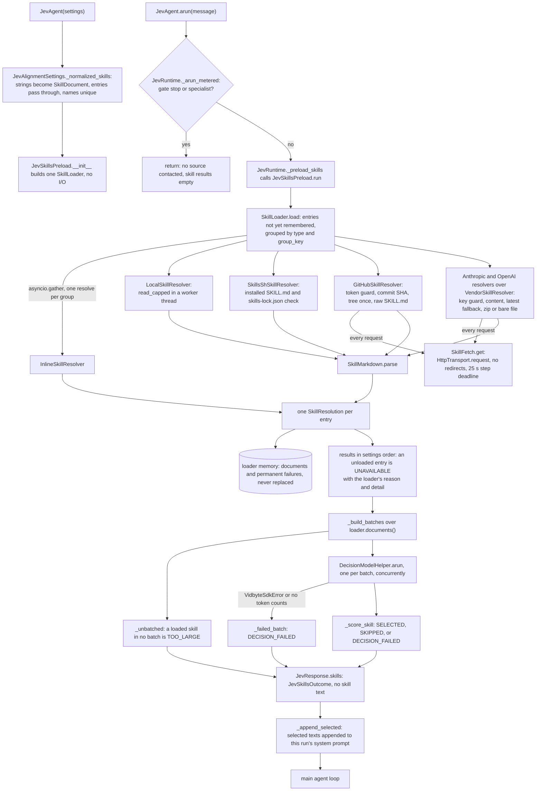
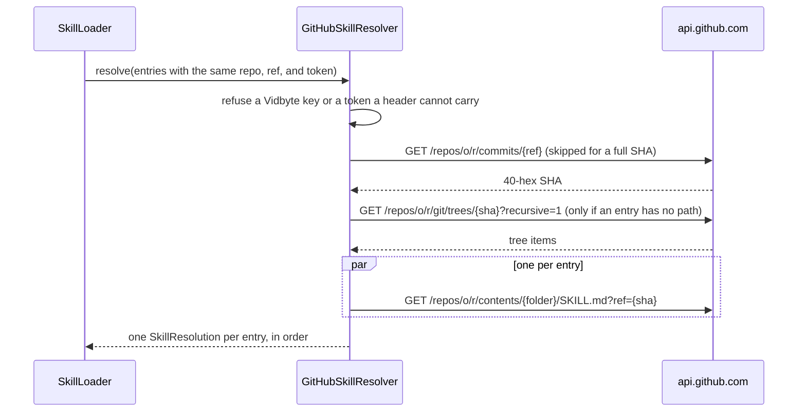

feat(jev): JevAgent skills load from inline text, local folders, skills.sh, GitHub, Anthropic, and OpenAI
## Summary
`JevAlignmentSettings.skills` now accepts six declarative entries next to the existing strings and `SkillDocument`s: `InlineSkill`, `LocalSkill`, `SkillsShSkill`, `GitHubSkill`, `AnthropicSkill`, and `OpenAISkill`. A new agent-agnostic package, `vidbyte/agents/skills/`, turns each entry into a `SkillDocument` through one resolver per source behind a `SkillLoader`. Building the agent reads nothing. The first run that reaches the skill preload loads every entry, and the loader remembers each document and each permanent failure for the agent's lifetime, so later runs send no requests; rate limits and network failures are tried again on the next run. The decision that matters most: loading never fails a run. Every expected source failure ends as an `unavailable` skill result with a `SkillUnavailableReason` and a `detail` that says how to fix it, and only cancellation and programming errors propagate. Spec: `docs/spec/jev-skill-sources/spec.md` (r5).

## How to use what this PR introduces
```python
from vidbyte import (
    AnthropicSkill, GitHubSkill, InlineSkill, JevAgent, JevAgentSettings,
    JevAlignmentSettings, LocalSkill, SkillsShSkill,
)

skills = (
    InlineSkill(name="house-review", description="Our PR review checklist.", text="Read every edited function and its tests first."),
    LocalSkill(name="sql-migrations", path="skills/sql-migrations"),                # reads skills/sql-migrations/SKILL.md
    SkillsShSkill(name="react-best-practices", source="vercel-labs/agent-skills"),  # the copy `npx skills add` installed
    GitHubSkill(name="webapp-testing", repo="anthropics/skills", ref="v1.2.0"),
    AnthropicSkill(name="release-notes", skill_id="skill_01AbCd"),                 # key from ANTHROPIC_API_KEY
)
agent = JevAgent(JevAgentSettings(name="dev-assistant", system_prompt="You help engineers review and ship code.",
    provider="openai", model_name="gpt-4.1-mini", alignment=JevAlignmentSettings(skills=skills)))  # reads and fetches nothing

reply = await agent.arun("Review PR 182 and check it doesn't break the public API.")
for skill in agent.response.skills.results:
    print(skill.name, skill.status.value, skill.reason.value if skill.reason else "-")
```
This is the spec's §4 snippet unchanged; it runs as written inside async code. I ran it on this branch through `tests/features/jev_skills_preload/test_skill_sources_acceptance.py::test_developer_snippet_prints_the_documented_lines`, which adds one line that binds an offline main-model runner. In that run GitHub is answered at the transport seam, Jev is a stand-in that answers 0.9 for house-review and webapp-testing and 0.1 for sql-migrations, there is no `.agents/skills` folder, and `ANTHROPIC_API_KEY` is unset. It printed:
```text
house-review selected -
sql-migrations skipped -
react-best-practices unavailable not_installed
webapp-testing selected -
release-notes unavailable auth_failed
```
The same run's sources were `inline`, `local:sql-migrations`, and `github:anthropics/skills@0123456789ab/skills/webapp-testing/SKILL.md`. The two details were "react-best-practices is not installed at `<project>/.agents/skills/react-best-practices`: run `npx skills add vercel-labs/agent-skills --skill react-best-practices` in the project folder." (the run printed the test's absolute temporary folder where this shows `<project>`) and "No API key for api.anthropic.com: pass api_key= on the entry or set ANTHROPIC_API_KEY." The developer no longer reads files, calls APIs, or builds `SkillDocument`s; they list where each skill lives, and each unusable skill says what to do.

## Flow



Every entry checks its own fields when it is created, and creating entries, settings, the preload, or the loader reads no file, sends no request, and reads no key variable. State changes in one place: `SkillLoader.load` writes its memory with `setdefault` after every group has returned, so a remembered resolution is never replaced. Expected failures are caught inside each resolver (HTTP statuses, missing files, bad YAML, JSON, or zips) or inside `SkillFetch.get` (transport errors and the step deadline); the loader and the preload catch nothing broad, so a crash or a cancellation leaves before anything is remembered. Jev failures are still caught per batch, and now carry `decision_failed`.

## What changed
| File | Change |
|---|---|
| `vidbyte/lib/enums/skills.py` | Adds `SkillSourceType`, `SkillUnavailableReason`, and the internal `SkillFetchStep`; replaces the old header with an A001 header. |
| `vidbyte/lib/enums/__init__.py` | Exports the three enums. |
| `vidbyte/lib/constants/skills.py` | New: caps (1 MiB per SKILL.md, 32 MiB per download), fetch bounds (10 s, 1 retry, 0.5 s, 25 s deadline), transient reasons, skills.sh layout, GitHub and vendor header values, zip checks. |
| `vidbyte/lib/dataclasses/skills.py` | Adds `SkillEntry` and its six frozen, slotted subclasses with construction checks, the `SkillText` check helpers, and `SkillResolution`; `SkillDocument` is unchanged. |
| `vidbyte/lib/dataclasses/jev.py` | `JevSkillResult` gains `reason` and `detail`; `description` may be `None` only on an unavailable result. |
| `vidbyte/lib/dataclasses/__init__.py` | Exports the seven entry classes. |
| `vidbyte/lib/__init__.py` | Exports the seven entry classes. |
| `vidbyte/agents/skills/__init__.py` | New package marker that exports nothing. |
| `vidbyte/agents/skills/README.md` | New: the package contract, how to add a source, non-goals, and notes for agents. |
| `vidbyte/agents/skills/resolver.py` | New: the generic `SkillResolver` base with `group_key` and `resolve`. |
| `vidbyte/agents/skills/loader.py` | New: `SkillLoader`, which groups pending entries, resolves every group at once, and remembers documents and permanent failures. |
| `vidbyte/agents/skills/fetch.py` | New: `SkillFetch`, the one bounded GET over `HttpTransport` with a whole-step deadline. |
| `vidbyte/agents/skills/markdown.py` | New: `SkillMarkdown`, the strict-UTF-8, `safe_load` SKILL.md parser that keeps the body exact. |
| `vidbyte/agents/skills/inline.py` | New: `InlineSkillResolver`. |
| `vidbyte/agents/skills/local.py` | New: `LocalSkillResolver` and the capped, off-loop file read. |
| `vidbyte/agents/skills/skills_sh.py` | New: `SkillsShSkillResolver`, which reads the installed copy and checks `skills-lock.json`. |
| `vidbyte/agents/skills/github.py` | New: `GitHubSkillResolver` with shared commit and tree lookups, and the private `_GitHubAnswer` status map. |
| `vidbyte/agents/skills/vendor.py` | New: `VendorSkillResolver`, the shared Skills API base (key guard, latest fallback, status map, zip or bare SKILL.md in memory). |
| `vidbyte/agents/skills/anthropic.py` | New: `AnthropicSkillResolver` with `x-api-key` and the skills beta headers. |
| `vidbyte/agents/skills/openai.py` | New: `OpenAISkillResolver` with bearer headers from `HttpResponseParser`. |
| `vidbyte/agents/jev/settings.py` | `JevAlignmentSettings.skills` accepts entries beside documents and strings; names stay unique across all of them. |
| `vidbyte/agents/jev/alignment/skills.py` | `JevSkillsPreload` owns one `SkillLoader`, loads before batching, and gives every unavailable skill a reason and a detail. |
| `vidbyte/agents/jev/__init__.py` | Exports the seven entries and two public enums. |
| `vidbyte/agents/__init__.py` | Re-exports the nine new public names. |
| `vidbyte/__init__.py` | Exports the nine new public names from the root. |
| `vidbyte/agents/README.md` | Lists `skills/` under Key Modules. |
| `REPO_MAP.md` | Adds the `vidbyte/agents/skills/` entry and counts four skills locations. |
| `contracts/sdk-public-api.json` | Regenerated: 9 names added, none removed (615 exports). |
| `lint/baseline.json` | A001 lowered from 643 to 642 after the `enums/skills.py` header upgrade. |
| `tests/features/jev_skills_preload/FEATURE.md` | Describes the skill source contract and the new test modules. |
| `tests/features/jev_skills_preload/conftest.py` | New offline fixtures: a URL-routed fake of `HttpTransport._send_once`, a Jev stand-in, SKILL.md writers, an I/O recorder. |
| `tests/features/jev_skills_preload/test_skill_sources_acceptance.py` | New: the §4 snippet, construction without I/O, gate stop and hand-off. |
| `tests/features/jev_skills_preload/test_skill_sources_contract.py` | New: exports, enum values, and the `JevSkillResult` and `SkillResolution` records. |
| `tests/features/jev_skills_preload/test_skill_sources_entries.py` | New: entry validation, path pinning, settings normalization. |
| `tests/features/jev_skills_preload/test_skill_sources_fetch.py` | New: the shared GET, retries, and the step deadline. |
| `tests/features/jev_skills_preload/test_skill_sources_github.py` | New: GitHub lookups, search, status map, caps, tokens. |
| `tests/features/jev_skills_preload/test_skill_sources_jev_wiring.py` | New: exact appending and the preload's reasons. |
| `tests/features/jev_skills_preload/test_skill_sources_local.py` | New: local reads, labels, caps, and misses. |
| `tests/features/jev_skills_preload/test_skill_sources_markdown.py` | New: the SKILL.md parser. |
| `tests/features/jev_skills_preload/test_skill_sources_memory.py` | New: memory, grouping, concurrency, crash and cancellation. |
| `tests/features/jev_skills_preload/test_skill_sources_security.py` | New: secrets, the Vidbyte-key and header-safe guards, redirects, processes, disk writes. |
| `tests/features/jev_skills_preload/test_skill_sources_skills_sh.py` | New: installs, the lock check, hostile files. |
| `tests/features/jev_skills_preload/test_skill_sources_vendor.py` | New: vendor downloads, the latest fallback, archives, caps. |
| `docs/spec/jev-skill-sources/` (`spec.md`, `request.md`, `test-plan.md`, `review.md`, `verify-log.md`, `pipeline.md`, `pr-body.md`, `context/code-map.md`, and `reports/S0` to `S6`) | The pipeline record: request, spec r5, test plan, review, verification log, and each stage's report. |

## Acceptance criteria → proof
Test files are under `tests/features/jev_skills_preload/`.

| AC | What it checks (plain words) | Proven by |
|---|---|---|
| AC-1 | The §4 snippet prints its five documented lines. | `test_skill_sources_acceptance.py::test_developer_snippet_prints_the_documented_lines` |
| AC-2 | Building an agent with all six entry types reads no file, sends no request, and reads no key variable. | `test_skill_sources_acceptance.py::test_construction_reads_no_file_sends_no_request_and_reads_no_key` |
| AC-3 | Inline text is appended byte for byte and labelled `inline`. | `test_skill_sources_jev_wiring.py::test_inline_text_is_appended_byte_for_byte` |
| AC-4 | A local SKILL.md with a BOM, CRLF, and a folded description loads with its exact body under `local:<folder>`. | `test_skill_sources_local.py::test_local_skill_loads_the_exact_body_under_its_folder_name` |
| AC-5 | An installed skills.sh skill whose lock source matches loads with the lock hash in its label. | `test_skill_sources_skills_sh.py::test_installed_skill_loads_with_the_lock_hash_in_its_label` |
| AC-6 | A skills.sh skill that is not installed is `not_installed`, and the detail has the `npx skills add` command and the path. | `test_skill_sources_skills_sh.py::test_missing_install_is_not_installed_with_the_install_command_and_path` |
| AC-7 | Three GitHub skills from one repo and ref cost one commit lookup, one tree listing, and three file fetches. | `test_skill_sources_github.py::test_one_repo_and_ref_share_one_commit_lookup_and_one_tree_listing` |
| AC-8 | An Anthropic zip loads only its SKILL.md, sent with `x-api-key` and the version and beta headers, and no `authorization`. | `test_skill_sources_vendor.py::test_anthropic_archive_loads_only_its_skill_md_with_vendor_headers` |
| AC-9 | An OpenAI zip with a root `skill.md` loads, sent with a bearer key. | `test_skill_sources_vendor.py::test_openai_archive_with_a_root_skill_md_loads_with_a_bearer_key` |
| AC-10 | Loaded and permanently failed entries cost nothing on later runs; transient ones are tried again. | `test_skill_sources_memory.py::test_remembered_entries_cost_nothing_and_transient_ones_retry` |
| AC-11 | No token or key appears in any repr, result field, or response. | `test_skill_sources_security.py::test_secrets_never_leave_their_own_request_header`, `::test_settings_repr_hides_secrets_before_any_run` |
| AC-12 | A Vidbyte key in `OPENAI_API_KEY` is never sent to OpenAI. | `test_skill_sources_security.py::test_vidbyte_key_never_reaches_a_vendor` |
| AC-13 | A 302 is not followed. | `test_skill_sources_security.py::test_redirect_is_never_followed` |
| AC-14 | A too-large skill, a failed Jev batch, and a missing answer each say why. | `test_skill_sources_jev_wiring.py::test_every_unavailable_result_explains_why` |
| AC-15 | A resolver crash and a cancellation propagate, and nothing from that load is remembered. | `test_skill_sources_memory.py::test_a_crash_while_loading_propagates_and_remembers_nothing`, `::test_cancellation_while_loading_propagates_and_remembers_nothing` |
| AC-16 | The existing skill-preload tests pass unchanged. | `tests/test_jev_skill_preload.py` (20 tests, not changed by this PR) |
| AC-17 | The nine new public names import from `vidbyte`, and the API contract is current. | `test_skill_sources_contract.py::test_public_names_are_one_object_across_every_export_path`; `python scripts/generate-sdk-public-api.py --check` (615 exports) |
| AC-18 | A gate stop or a specialist hand-off contacts no skill source. | `test_skill_sources_acceptance.py::test_gate_stop_and_specialist_contact_no_skill_source` |
| AC-19 | When `latest` is refused, the version the skill record names is downloaded and shown in the label. | `test_skill_sources_vendor.py::test_latest_refused_downloads_the_version_the_skill_record_names` |
| AC-20 | A source that keeps failing costs each run at most one retried pair per step. | `test_skill_sources_fetch.py::test_a_source_that_keeps_failing_costs_each_run_one_retried_pair` |
| AC-21 | Lint passes with A001 at 642, and the repo map lists the package and four skills locations. | `python lint/run.py` (`SDK-LINT: PASS`, A001 642/642); `REPO_MAP.md` at `2c19a646` |
| AC-22 | A Vidbyte key in `GITHUB_TOKEN` or `token=`, padded or not, is never sent to GitHub. | `test_skill_sources_security.py::test_vidbyte_key_never_reaches_github` |
| AC-23 | An impossible YAML date, deeply nested YAML, and a deeply nested lock file end as data and the run returns. | `test_skill_sources_skills_sh.py::test_hostile_files_end_as_data_and_the_run_returns` |
| AC-24 | A server that drips bytes ends at the step deadline as `fetch_failed`, which is not remembered. | `test_skill_sources_fetch.py::test_step_that_never_finishes_ends_at_the_deadline` |
| AC-25 | A missing record-named version says the content route was not found. | `test_skill_sources_vendor.py::test_named_version_missing_says_the_content_route_was_not_found` |
| AC-26 | A bare SKILL.md body with a BOM loads. | `test_skill_sources_vendor.py::test_bare_skill_md_body_loads` |
| AC-27 | Overlapping loads agree on the first remembered resolution. | `test_skill_sources_memory.py::test_overlapping_loads_agree_on_the_first_remembered_resolution` |
| AC-28 | bzip2, bad-UTF-8-name, and corrupt archives end `invalid_skill` and the run returns. | `test_skill_sources_vendor.py::test_corrupt_archives_never_escape_a_run` |
| AC-29 | A bare SKILL.md one byte over the cap is `too_large` and remembered. | `test_skill_sources_vendor.py::test_bare_skill_md_cap_is_inclusive` |

## Verification
Local runs on `0cb790b5` (Windows, Python 3.11.0); every commit after `3ce9de96` changes only `docs/spec/`.

| Gate | Command | Result |
|---|---|---|
| Feature tests | `PYTHONDONTWRITEBYTECODE=1 PYTHONPATH=$(pwd) python -m pytest tests/features/jev_skills_preload tests/test_jev_skill_preload.py -q -p no:cacheprovider` | `426 passed, 1 skipped in 4.47s` (the skip is the lowercase `skill.md` row, which needs a case-sensitive filesystem) |
| Lint | `PYTHONPATH=$(pwd) python lint/run.py` (step 2 of the source stage) | `A001 RATCHETED: 642 known finding(s).` … `S064 RATCHETED: 4 known finding(s).` / `SDK-LINT: PASS`; no rule REGRESSED |
| Source stage | `PYTHONPATH=$(pwd) python scripts/run_ci.py --stage source` | `4219 passed, 14 skipped in 35.28s` / `CI passed.` |
| Package stage | `python scripts/run_ci.py --stage package` (no `PYTHONPATH`) | `No broken requirements found.` / `Installed vidbyte-sdk 0.2.1 passed smoke checks.` / `CI passed.` |
| API contract | `PYTHONPATH=$(pwd) python scripts/generate-sdk-public-api.py --check` | `contracts/sdk-public-api.json is current at 3a4cb929… (vidbyte-sdk 0.2.1, 615 exports).` |
| Semgrep | `semgrep --test --config .semgrep/typed-mapping-boundary-policy.yml .semgrep/typed-mapping-boundary-policy.py`; `semgrep scan --error --metrics=off --config .semgrep/typed-mapping-boundary-policy.yml vidbyte` (1.170.1, own venv) | `1/1: ✓ All tests passed` / `Ran 1 rule on 905 files: 0 findings.` |
| Remote checks | `gh workflow run ci.yml` and `gh workflow run static-policy.yml` on the branch (both are dispatch-only), read with `gh api repos/cerredz/Vidbyte-SDK/commits/<sha>/check-runs` | 4/4 green on `276b0dd2` (CI run 38250786020, Static policy run 38250790715): `Source / Python 3.11 success` (`4215 passed, 18 skipped in 56.18s` / `CI passed.`), `Source / Python 3.12 success` (`4215 passed, 18 skipped, 19 warnings in 49.74s` / `CI passed.`), `Package success` (`Installed vidbyte-sdk 0.2.1 passed smoke checks.` / `CI passed.`), `Static policy success` (`Ran 1 rule on 905 files: 0 findings.`). The last code commit, `3ce9de96`, was also 4/4 green |

## Adversarial review
19 findings confirmed by an independent verifier across three lenses (spec conformance, repo conventions, engineering) plus the remote CI result, 11 fixed, 8 waived as follow-ups. A post-repair conformance re-review found every fix sound and one new Minor spec-text drift (R-RC1, under Deviations). Full record: `docs/spec/jev-skill-sources/review.md`.

| ID | Finding | Fixed in |
|---|---|---|
| R-1 (Blocker) | A GitHub tree listing whose items were not objects with a text `path` (what a 2,000-level body parses to on Python 3.12) was read as "no match" and remembered as `not_found`; Source / Python 3.12 was red. | `879a4b16` (test rows `f90b0680`) |
| R-2 (Blocker) | A token or API key holding a character an HTTP header cannot carry made httpx raise outside every catch, so every run of the agent failed and the token appeared in the exception repr. Such a credential is now `auth_failed` with no request. | `556b84fc` (tests `f90b0680`) |
| R-3 (Blocker) | 60 PR-authored `#` comment lines were over the owner's 72-column rule. | `75c5f459` |
| R-4 (Major) | The remembered local `not_found` detail did not say that a new agent is needed after the fix. | `757a0464` (test `f90b0680`) |
| R-5 (Major) | The vendor version check and the folder check were copied in two entry classes each; they now have one owner in `SkillText`. | `ca340b36` |
| R-6 (Major) | The skills.sh size cap, read-error, and lock-read-error guards, and the parser's rule against anything before `---`, were not pinned by any test. | `f90b0680` (tests only) |

## Deviations from the spec
- **`GITHUB_CREDENTIAL_ENV_VAR`.** Spec §12.3 row 3 names the constant `GITHUB_TOKEN_ENV_VAR`. The code uses `GITHUB_CREDENTIAL_ENV_VAR` (value still `"GITHUB_TOKEN"`), because lint S054 runs ruff S105, which flags any `*_TOKEN_*` name bound to a string.
- **The zip `SKILL.md` count check.** S3 added `SKILL_ARCHIVE_MARKDOWN_COUNT = 1` to satisfy A007; review R-8 removed it. R-8's suggested shape (`case [member]:` holding two `if` checks) would nest four levels deep and break S024's limit of three, so `vendor.py` uses guarded `match` cases, each a single return. A differential probe found the behavior identical to the old code.
- **`_raw_document`, not `_raw_documents`.** D-31 and row 15 name a `_raw_documents` leaf. `GitHubSkillResolver._raw_document` fetches one entry per call, so the `asyncio.gather` that S063 checks stays in the narrated `resolve`.
- **`SkillText`.** Its helpers take `field_name` instead of `field`, so the module's `dataclasses.field` import is not shadowed. Since R-5 it also has `require_version` and `require_folder`, beyond row 4's three helpers.
- **Two extra preload helpers.** `JevSkillsPreload` gains `_unbatched` and `_failed_batch`, which keep `run` under 50 lines and the four §9.2 detail texts inside methods. A loaded skill starts as `_score_skill(index, document, {})` (`decision_failed`, missing-answer detail) until Jev answers; every path replaces that seed (R-10).
- **Commit order.** Row 20 (`JevSkillResult`) is committed before rows 21 and 22, so `tests/test_jev_skill_preload.py` is red at `5438110e` and `b4164134` and green from `830f9860`. Bisecting through those two commits will see that.
- **Lint baseline.** Only A001 is lowered in `lint/baseline.json`. The counts that report IMPROVED (A002, A007, C012, S001, S009, S010, S025, S051) are left for their own change.
- **`SKILL_MARKDOWN_DELIMITER`.** Review R-13 added this constant (`"---"`), which row 3's list does not name; the parser and the vendor bare-body check share it.
- **GitHub headers (R-RC1).** Since R-9, a GitHub request that carries a token builds its headers with `HttpResponseParser.bearer_headers`, which also sends `content-type: application/json`. The §9.2 GitHub rows list only `accept` and `authorization`. The extra header is harmless on a GET, and a request without a token has no `content-type`. §9.2 is left as it is.

## Follow-ups
- **R-7.** `Path("")` equals `Path(".")`, so `LocalSkill(path=Path(""))` and `SkillsShSkill(directory=Path(""))` mean the working folder; document that in the package README.
- **R-10.** A loaded skill is seeded with a detail that says "Jev answered" before Jev is asked; callers never see it, but seeding only unloaded skills would be clearer.
- **R-11.** Construction errors name the class and field but not the type of the bad value; a `details={"field": …, "value_type": …}` packet would add it without echoing secrets.
- **R-15.** `read_capped` and `SkillMarkdown` sit beside near-copies elsewhere; move them to `vidbyte/lib/` when a third caller appears.
- **R-16.** A `ref`, `skill_id`, or `version` of `.` or `..` is dropped by httpx's dot-segment cleanup (the host never changes); reject those values at construction.
- **R-17.** `yaml.safe_load` runs on the event loop; a 1 MiB flow-list frontmatter blocked it for 6.5 s. Run `SkillMarkdown.parse` in a worker thread.
- **R-18 [scope-adding].** No log line records a load failure; failures show only in results. Logging was never agreed, so this is the owner's call.
- **R-19.** A value that pushes a URL past httpx's 65,536-character limit raises `httpx.InvalidURL`, which escapes the loader as R-2 did; it needs absurd input.
- **Real-key QA for A-1 and A-4.** The Anthropic and OpenAI `/v1/skills/{id}/versions/{v}/content` route and body format are not verified against the live APIs. The code handles a zip or a bare SKILL.md, the `latest` fallback, and a distinct "content route was not found" detail. Please test one real `AnthropicSkill` and one real `OpenAISkill`.
- **Test comment width.** Test files carry `#` lines over 72 columns. R-3 covered `vidbyte/` only, and the tests were frozen during repair.
- **Draft.** This PR stays a draft; marking it ready and merging are the owner's decision.

🤖 Generated with [Claude Code](https://claude.com/claude-code)
