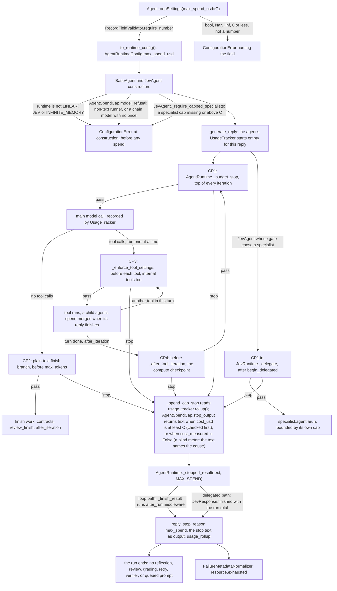

feat(agents): add a USD spend cap that every agent loop enforces
## Summary
`AgentLoopSettings(max_spend_usd=...)` is a new optional USD cap on one reply's measured spend. The shared agent loop, `AgentRuntime`, reads the agent's own usage ledger before every main model call, every tool call (isDone and the launch tools included), every plain-text finish, and the compute checkpoint, and a capped `JevAgent` checks it once more before a specialist it chose starts. A run the cap stops ends with the new stop reason `AgentStopReason.MAX_SPEND` (`"max_spend"`), which sessions report as the existing `resource.exhausted`, and no SDK retry, review, grading, verifier, or queued prompt runs after it. The decision that matters most is that the cap fails closed: when the ledger cannot price or count a call, a capped run stops as if the cap were reached and names the cause, and construction refuses every agent whose spend the loop could not measure, before the first call. The cap is a threshold checked between steps, not a maximum bill, so one step can carry spend past it. Spec: `docs/spec/loop-spend-cap/spec.md` (r4).

## How to use what this PR introduces
```python
from vidbyte import Agent, AgentLoopSettings, AgentStopReason

cap = 0.50
agent = Agent(
    name="researcher",
    system_prompt="Answer directly.",
    provider="openai",
    model_name="gpt-5.4-mini",
    agent_loop_settings=AgentLoopSettings(max_spend_usd=cap),
)
reply = agent.run("Summarize the open issues in this repository.")

usage = agent.get_usage()            # vidbyte.UsageRollup for the whole call
spent = usage.cost_usd or 0.0        # USD the SDK measured for this run
if reply.metadata["stop_reason"] == AgentStopReason.MAX_SPEND.value:
    if reply.metadata["usage_rollup"].cost_measured:  # the ledger the cap read
        print(f"stopped at ${spent:.4f}: reached the ${cap:.2f} cap")
    else:
        print(f"stopped: spend could not be fully measured (at least ${spent:.4f})")
else:
    print(f"finished; spent ${spent:.4f}" + ("" if usage.cost_measured else " or more"))
```
This is spec §4, unchanged, and it works as written. `agent.run` makes a live model call, so it needs a key. Run on this branch in a fresh `PYTHONPATH=$(pwd) py -3.11` with every `*API_KEY*` variable unset, the agent constructs and then `agent.run` raises `AgentExecutionError`, caused by `ConfigurationError: Missing Vidbyte API key. Pass vidbyte_api_key or set VIDBYTE_API_KEY, or use mode=TextModelMode.DIRECT ...`. That error is raised while the runner is built, so no request is sent.

To see all three outcomes offline, the same file was run three times, each in a fresh interpreter, with a Vidbyte key built at run time and only `HttpTransport.request` replaced by a scripted Responses body. That is the seam the AC-1 test uses; the gateway route, the Responses parser, the runtime, the ledger, and the pricebook are production code. Each run sent exactly one request. Below, the case and its scripted usage are on the left, and the snippet's whole stdout is on the right:
```
cap       one call, 1,024,000 input + 10 output tokens  ->  stopped at $0.7680: reached the $0.50 cap
blind     one call whose response has no usage object  ->  stopped: spend could not be fully measured (at least $0.0000)
finished  one call, 1,000 input + 10 output tokens      ->  finished; spent $0.0008
```
The first line shows what the cap can and cannot do. That one call took spend from $0 to $0.7680, past the $0.50 cap. The cap then stopped the run before any finish work, but it cannot undo a call already made. The construction refusals and the field validation run offline too (the call on the left, the error it raised on the right):
```
Agent(..., model_name="gpt-unpriced-probe", cap 0.50)   ConfigurationError: Agent b sets max_spend_usd, but the pricebook has no price for openai:gpt-unpriced-probe, so its spend could not be measured.
Agent(..., runtime=AgentRuntimeType.MCTS_SEARCH, cap)   ConfigurationError: Agent d uses non-linear runtime mcts_search, which does not enforce max_spend_usd.
AgentLoopSettings(max_spend_usd=float("nan"))           ConfigurationError: AgentLoopSettings.max_spend_usd must be a finite number greater than 0 and at most 1.7976931348623157e+308; got nan.
```
`True`, `inf`, `0`, `-1`, and `"5"` get the same message, ending in the value given. The same unpriced model without a cap constructs as before.

A developer no longer estimates spend from tokens at a flat rate (`CostBudgetMiddleware`) or polls `get_cost_usd()` from outside the loop. The first consumers will be in vidbyte-cli: C3 will add a universal `--max-spend` to every agent command and map it to this field, and C4's `agents jev run` will pass it through. Both read the caller contract in spec §9.2, which this table condenses:

| Agent | What the cap does |
|---|---|
| `Agent`, `BaseAgent`, `CodingAgent` (`LINEAR`) | Checked at CP1 to CP4 (see Flow). |
| `JevAgent` | Checked in its inherited loop, so decision, run-state, and tool-selector spend before the loop counts at the first CP1. On the delegated path, CP1 runs once before the chosen specialist starts. Every specialist must carry its own cap, no higher than JevAgent's, or construction fails. |
| `InfiniteMemoryAgent` | Checked in its root loop. A generator the cap stopped gets no verifier. |
| Forks, clones, swarm helpers, bulk workers, and subagents built from the same settings | Each enforces the same cap against its own spend. The fork tool re-applies the parent's cap, and the model cannot raise, lower, or clear it. |
| `MultiAgent`, `AggregateAgent` | No team-level setting. Each member enforces its own cap. A capped worker blocks its task, and a capped manager phase ends the run. |
| `MCTS_SEARCH` and the three `ACTOR_MODEL` runtimes, a non-text runner, a configured primary or fallback model the pricebook cannot price (OpenRouter, which reports its own cost, is exempt), `CodexHarnessAgent` | Refused at construction. |
| The independent-critic and prosecutor-defender-judge reviewer runs, and JevAgent's fixed-prompt agents | Built by the SDK with no cap. Their spend counts at the parent's next check. |

## Flow

"pass" means `stop_output` returned `None`. Validation happens once, at construction: the field validator refuses a bad number, and the constructors refuse every agent whose spend the loop could not measure, before any call. State changes only in the existing ledger (`record_call`, `record_billed_failure`, `record_operation`, `merge`). At each check, `_spend_cap_stop` reads `UsageTracker.rollup()` and never writes, and an uncapped agent returns before it computes a rollup. `AgentSpendCap.stop_output` reports a reached cap (`cost_usd >= C`) first. Otherwise it stops a blind ledger (`cost_measured` is False: an unpriced call, a call with no usage, or failed recording) and names the cause. A capped `JevAgent` whose ledger goes blind still raises `UsageAccountingError` from `settle()`, as on `main`. Every stop leaves through `_stopped_result(MAX_SPEND)`, then `_finish_result`, the path every budget stop uses, or on the delegated path through `JevResponse.finished`, so `usage_rollup` is the run total.

## What changed
| File | Change |
|---|---|
| `vidbyte/agents/spend_cap.py` (new, +118) | `AgentSpendCap`. `stop_output` returns the reached text, the blind text naming each cause in a fixed order, or `None`. `model_refusal` says why a capped agent's runner type or configured chain cannot be measured (OpenRouter exempt). Not exported. |
| `vidbyte/agents/runtime.py` (+37/−2) | `_spend_cap_stop` helper. CP1 is the first clause of `_budget_stop`. CP2 comes first in the plain-text branch. CP3 is the first step of `_enforce_tool_settings`, ahead of the internal-tool early return. CP4 comes before `_after_tool_iteration`. |
| `vidbyte/agents/jev/runtime.py` (+11/−1) | CP1 in `_delegate`, after `begin_delegated`/`require_accounted()` and before the specialist starts. A stop returns through `response.finished` with the run total (review R-1). |
| `vidbyte/agents/base.py` (+20/−3) | Construction refusals for a non-linear runtime and through `model_refusal`. `max_spend_usd` added to `_export_loop_settings`. The queued-prompt drain stops after a `max_spend` reply. |
| `vidbyte/agents/jev/agent.py` (+19) | `_require_capped_specialists`: each specialist needs its own cap, no higher than JevAgent's. |
| `vidbyte/agents/settings/loop.py` (+18/−1) | The `max_spend_usd` keyword, validated by `RecordFieldValidator.require_number`, and carried by `to_runtime_config()` and `__repr__`. |
| `vidbyte/lib/dataclasses/agents.py` (+10) | `AgentStopReason.MAX_SPEND` after `TIMEOUT`. `AgentRuntimeConfig.max_spend_usd`, validated in `__post_init__`. |
| `vidbyte/agents/pricing/records.py` (+23/−3) | `UsageRollup.cost_measured`, a read-only property: every call and operation priced, no unaccounted call, and recording intact. An empty ledger is measured. |
| `vidbyte/sessions/failure/router.py` (+1) | `"max_spend"` maps to `FailureCode.RESOURCE_EXHAUSTED`. |
| `vidbyte/evals/behavior/efficiency.py` (+3/−1) | A `max_spend` stop counts as a budget stop. |
| `vidbyte/context/algorithms/reflexion.py` (+5/−2) | No reflection or new attempt after a cap stop. |
| `vidbyte/agents/algorithms/independent_critic.py` (+5/−2) | A capped producer is returned unreviewed. |
| `vidbyte/agents/algorithms/prosecutor_defender_judge.py` (+5/−2) | A capped producer gets no debate. |
| `vidbyte/agents/algorithms/multi_provider_agentic_grader.py` (+10/−5) | A capped trial is returned without grading and keeps its stop text. |
| `vidbyte/agents/multi/transfer.py` (+6) | A capped worker's task is `BLOCKED` with `TaskBlocker(code="max_spend", retryable=False)`, never retried. |
| `vidbyte/agents/multi/orchestrator.py` (+10/−2) | A capped manager phase raises `MultiAgentExecutionError` with `details["stop_reason"] == "max_spend"` after one attempt. |
| `vidbyte/agents/infinite/launch.py` (+6/−2) | `InfinitePair._status` marks a cap stop `FAILED`, so no verifier runs. |
| `vidbyte/agents/fork.py` (+1) | `AgentForker` carries the cap. |
| `vidbyte/tools/builtins/fork/fork.py` (+4/−1) | The fork tool re-applies the parent's cap as a guardrail. The cap is not in its schema. |
| `vidbyte/lib/dataclasses/config.py` (+1) | YAML `agent.loop.max_spend_usd` is accepted. |
| `vidbyte/lib/constants/codex.py` (+1) | `max_spend_usd` joins `CODEX_UNSUPPORTED_LOOP_FIELDS`, so `CodexHarnessAgent` refuses a capped loop. |
| `vidbyte/agents/README.md` (+48) | New `## Spend Cap` section: what is and is not measured, where it is checked, the overshoot, what runs after a stop, the refusals, and the per-agent answer. Plus a Key Modules bullet. |
| `vidbyte/agents/jev/README.md` (+1/−1) | The specialist cap rule, and the A-8 sentence. |
| `llms.txt` (+5/−3) | The validation sentence, a table row, and the `to_runtime_config()` projection. |
| `skills/agentic-loop-settings/SKILL.md` (+4/−1) | Parameter, validation, stop-reason, and context-exclusion rows. |
| `skills/output-contracts/SKILL.md` (+1/−1) | The cost-ceiling row names `max_spend_usd` beside `CostBudgetMiddleware`. |
| `skills/failure/vocabulary.md` (+4/−3) | A `max_spend` stop reports `resource.exhausted`. |
| `docs/design/release-0-4-0.md` (+1/−1) | One sentence in the 0.4.0 "Later changes" bullet, with `(#1192)`. |
| `docs/spec/loop-spend-cap/**` | The pipeline record: spec r4, request, test plan, review, verify log, stage reports, and this body. |
| `tests/features/loop_spend_cap/` (new: `FEATURE.md`, `README.md`, fixtures, 10 test files) | The feature test pack. |
| `tests/test_codex_output_contracts.py` (+1) | One `cases` entry, `"max_spend_usd": 1.0`, which the pinned constant forces. |

**Compatibility.** The change is additive. No root name, `FailureCode` member, default, dependency, or version changes, and `contracts/sdk-public-api.json` still lists 733 exports. `AgentStopReason` gains one member, so code that matches it exhaustively sees one more value. Uncapped agents run exactly as before: the S4 review and the S5 re-review compared scrubbed dumps of nine uncapped BaseAgent and five uncapped JevAgent scenarios with `main`, and they are byte-identical. A checkpoint of an uncapped agent omits the key, so an older SDK restores it. A checkpoint of a capped agent needs this release (0.4.0, unreleased).

## Acceptance criteria → proof
Test paths are under `tests/features/loop_spend_cap/` unless written in full. Each name was checked with `git grep` and with `pytest --collect-only` on this branch, which collects 188 tests from the pack and the codex file.

| AC | What it checks (plain words) | Proven by |
|---|---|---|
| AC-1 | The §4 snippet, run as written over a scripted gateway, prints the one line that matches the run. | `test_loop_spend_cap_acceptance.py::test_the_developer_snippet_prints_the_line_that_matches_the_run[cap, blind, finished]` |
| AC-2 | Bad cap values are refused, naming the field; `1`, `0.25`, and `None` are accepted. | `test_loop_spend_cap_contract.py::test_settings_reject_each_invalid_cap_and_name_the_field` (7 values), `::test_settings_accept_valid_caps_unchanged`, `::test_cap_error_never_echoes_a_long_value` |
| AC-3 | The cap reaches the runtime config and the repr, and the runtime config refuses bad values too. | `test_loop_spend_cap_contract.py::test_runtime_config_carries_the_cap_and_repr_shows_it`, `::test_runtime_config_rejects_each_invalid_cap` |
| AC-4 | A tool turn that reaches the cap runs none of its tools and sends no further model call. | `test_loop_spend_cap_runtime.py::test_a_tool_turn_that_reaches_the_cap_runs_none_of_its_tools` |
| AC-5 | A plain-text answer that reaches the cap is replaced by the stop text before any finish work. | `test_loop_spend_cap_runtime.py::test_a_plain_text_answer_that_reaches_the_cap_is_replaced_before_any_finish_work[finish, max_tokens_tie]` |
| AC-6 | isDone or a launch tool requested after the cap never runs. | `test_loop_spend_cap_runtime.py::test_a_finish_or_internal_tool_requested_after_the_cap_never_executes[isDone, launch_helpers]` |
| AC-7 | A tool that spends past the cap stops the next tool, or the compute hook when it was the last tool. | `test_loop_spend_cap_runtime.py::test_a_priced_operation_that_crosses_the_cap_stops_the_next_tool_in_its_turn[free_turn, max_tool_calls_tie]`, `::test_a_last_tool_that_crosses_the_cap_stops_before_the_after_tool_iteration_hook`; `test_loop_spend_cap_children.py::test_a_sub_agent_tool_that_spends_past_the_cap_stops_the_next_tool` |
| AC-8 | A response with no usage stops a capped run as blind and names the cause. | `test_loop_spend_cap_runtime.py::test_a_response_without_usage_stops_the_run_blind` |
| AC-9 | A call the pricebook cannot price stops the run and is named; OpenRouter is metered from its reported cost. | `test_loop_spend_cap_runtime.py::test_a_response_naming_an_unpriced_model_stops_the_run_and_names_it`, `::test_openrouter_spend_is_enforced_from_its_reported_cost[reported_cost_reaches_cap, no_reported_cost]` |
| AC-10 | A cap the run never reaches changes nothing. | `test_loop_spend_cap_runtime.py::test_a_cap_the_run_never_reaches_changes_nothing[final_response, is_done, max_iterations, max_tool_calls, max_tokens]`; the existing suite, unedited except the one codex `cases` entry |
| AC-11 | A capped non-linear runtime is refused. | `test_loop_spend_cap_refusals.py::test_a_capped_non_linear_runtime_is_refused[mcts_search, actor_model, actor_model_p2p, actor_model_broadcast]` |
| AC-12 | A capped non-text model is refused, naming its runner type. | `test_loop_spend_cap_refusals.py::test_a_capped_non_text_model_is_refused_naming_its_runner_type` |
| AC-13 | A capped JevAgent refuses a specialist with no cap or a higher one, and accepts one capped at or below it. | `test_loop_spend_cap_jev.py::test_a_capped_jev_agent_refuses_a_specialist_that_could_outspend_it[uncapped_specialist, one_step_above]`, `::test_a_capped_jev_agent_accepts_specialists_capped_no_higher_than_it[equal, lower]` |
| AC-14 | JevAgent decision spend alone stops the run at the first CP1, before any generative call. | `test_loop_spend_cap_jev.py::test_preflight_decision_spend_alone_stops_the_run_before_any_generative_call` |
| AC-15 | A child agent's spend counts in the parent, and the parent's next check stops on the total. | `test_loop_spend_cap_children.py::test_a_sub_agent_tool_that_spends_past_the_cap_stops_the_next_tool`, `::test_concurrent_capped_children_each_keep_their_own_cap_and_the_parent_stops_on_their_total` |
| AC-16 | A checkpoint, YAML, `AgentForker`, and the fork tool all keep the cap, and the model cannot set it. | `test_loop_spend_cap_copy_paths.py::test_a_checkpoint_carries_the_cap_and_an_uncapped_one_omits_it`, `::test_a_yaml_loop_cap_reaches_the_built_agent`, `::test_a_fork_with_a_max_iterations_override_keeps_the_cap`, `::test_a_fork_tool_loop_override_keeps_the_parents_cap`, `::test_the_fork_tool_refuses_any_model_supplied_cap[raise, lower, clear]` |
| AC-17 | A cap stop is recorded as exactly one `resource.exhausted` failure. | `test_loop_spend_cap_failure_routing.py::test_a_cap_stop_routes_as_one_exhausted_resource_failure` |
| AC-18 | Evals count a cap stop as a budget stop. | `test_loop_spend_cap_failure_routing.py::test_a_cap_stop_counts_as_a_budget_stop` |
| AC-19 | `cost_measured` is True only for an empty ledger or a fully priced, intact one. | `test_loop_spend_cap_contract.py::test_cost_measured_follows_inv2_for_every_combination` (16 cases), `::test_empty_rollup_is_measured_although_cost_is_not_complete`, `::test_cost_measured_is_derived_and_read_only` |
| AC-20 | A JevAgent continuation's budget extension never lifts the cap. | `test_loop_spend_cap_jev.py::test_a_continuation_budget_extension_never_lifts_the_cap` |
| AC-21 | The cap never reaches the model's request. | `test_loop_spend_cap_acceptance.py::test_the_cap_never_reaches_the_model` |
| AC-22 | When the cap and `max_iterations` run out at the same check, the stop reason is `max_spend`. | `test_loop_spend_cap_runtime.py::test_spend_after_the_last_tool_check_is_caught_at_the_next_iteration_before_max_iterations` |
| AC-23 | Reflexion never reflects on a capped attempt, and a reflection that reaches the cap stops the next attempt before its first call. | `test_loop_spend_cap_run_ending.py::test_reflexion_never_reflects_on_an_attempt_the_cap_stopped`, `::test_a_reflection_that_reaches_the_cap_stops_the_next_attempt_before_its_first_call` |
| AC-24 | No public name, `FailureCode` member, or contract changes. | No new test, as the spec says: `scripts/generate-sdk-public-api.py --check` (733 exports), lint C016, and `tests/features/harness_threads/test_harness_threads_surface.py::test_failure_codes_keep_main_and_append_exactly_the_32_harness_codes`; plus `test_loop_spend_cap_contract.py::test_spend_cap_policy_is_exported_from_its_own_module_only`. `git diff origin/main... -- contracts vidbyte/lib/enums/failure.py vidbyte/__init__.py vidbyte/agents/__init__.py` is empty. |
| AC-25 | A capped JevAgent with an unpriced call still raises from `settle()` after the cap stops its loop. | `test_loop_spend_cap_jev.py::test_an_unpriced_call_still_fails_closed_after_the_cap_stops_the_loop` |
| AC-26 | Each named doc mentions the cap, and the README section says what a caller reads. | `test_loop_spend_cap_docs.py::test_the_agents_readme_has_a_spend_cap_section_naming_what_a_caller_reads`, `::test_each_named_doc_mentions_the_cap` (5 docs). Tests never read `docs/`, so the release-record sentence was checked in review: `c554521e` added it, and `b4f564a9` adds `(#1192)`. |
| AC-27 | `CodexHarnessAgent` refuses a capped loop through its existing field list. | `test_loop_spend_cap_refusals.py::test_codex_refuses_a_capped_loop_through_its_existing_field_list`; `tests/test_codex_output_contracts.py::ContractValidationTests::test_rejects_every_field_the_constant_lists` |
| AC-28 | The critic, PDJ, and the grader return a capped producer or trial with no review or grading. | `test_loop_spend_cap_run_ending.py::test_a_capped_producer_is_returned_unreviewed[independent_critic, prosecutor_defender_judge]`, `::test_the_grader_returns_a_capped_trial_without_grading` |
| AC-29 | A capped worker blocks its task, a capped manager phase is not retried, and a capped InfiniteMemory generator is failed and never verified. | `test_loop_spend_cap_run_ending.py::test_a_capped_worker_blocks_its_task_without_retry`, `::test_a_capped_manager_phase_is_not_retried_as_a_parse_failure`, `::test_a_capped_infinite_memory_generator_is_failed_and_never_verified` |
| AC-30 | An unpriced primary or fallback is refused, naming each one; a measurable chain constructs. | `test_loop_spend_cap_refusals.py::test_a_capped_agent_with_an_unpriced_configured_model_is_refused_naming_each_one[unpriced_primary, unpriced_fallbacks_in_chain_order]`, `::test_a_capped_agent_whose_whole_chain_is_measurable_constructs[priced_primary, priced_fallback, openrouter_primary, openrouter_fallback]`, `::test_a_capped_parent_cannot_fork_a_child_onto_an_unpriced_model` |
| AC-31 | No queued prompt runs after a cap stop. | `test_loop_spend_cap_run_ending.py::test_a_capped_reply_runs_no_queued_prompt`, `::test_a_drained_reply_that_hits_the_cap_ends_the_drain` |
| AC-32 | With an output schema, a cap stop raises `OutputSchemaViolationError` carrying `max_spend`. | `test_loop_spend_cap_run_ending.py::test_a_capped_reply_with_an_output_schema_raises_with_the_cap_stop` |
| AC-33 | A capped JevAgent whose gate, or run-state writer, has already reached the cap starts no specialist. | `test_loop_spend_cap_jev.py::test_a_reached_cap_starts_no_specialist_the_gate_chose[gate_decision, run_state_relation_writer]` |

The pack also covers points that no AC names:
- A fallback switch stops before the backup model (EC-27): `test_loop_spend_cap_runtime.py::test_a_billed_failure_that_reaches_the_cap_stops_before_the_backup_model`.
- An uncapped run computes no cap rollup and looks up no price (NFR-1): `::test_an_uncapped_run_computes_no_spend_cap_rollup_or_price[tool_then_text, queued_drain_of_three]`.
- A failed operation recording stops the run as blind: `::test_a_failed_operation_recording_stops_the_run_blind`.
- The refusal guards: `test_loop_spend_cap_refusals.py::test_a_capped_slug_model_without_a_provider_is_refused_as_the_runner_reads_it`, `::test_a_capped_chain_whose_primary_is_unmeasurable_is_refused_naming_the_primary`, and `::test_the_unpriced_refusal_names_each_pair_once_and_marks_a_missing_part`.
- The `stop_output` contract tests in `test_loop_spend_cap_contract.py`.

The orchestrator ran 11 mutants against the pack after S2b, and the tests killed all 11. The S5 re-review killed M1 to M6 again, plus five mutants of the R-1 fix.

## Verification
Gate results are quoted from the last verify-log iteration, at code head `0be0545d`. Nothing outside `docs/` has changed since then: `git diff --stat 0be0545d HEAD -- . ':!docs/spec'` lists only `docs/design/release-0-4-0.md`, the `(#1192)` insert.

| Gate | Command | Result |
|---|---|---|
| Pack plus codex file | `PYTHONDONTWRITEBYTECODE=1 PYTHONPATH=$(pwd) py -3.11 -m pytest -q -p no:cacheprovider tests/features/loop_spend_cap tests/test_codex_output_contracts.py` | `188 passed in 1.54s` at `0be0545d`; rerun by S6 after `b4f564a9`: `188 passed in 1.53s` |
| S2b additions, incl. AC-33 | the same, `-k` over the 6 S2b test names | `14 passed, 123 deselected in 0.86s` |
| Area suite | the pack plus the loop-settings, usage, runtime, session-failure, fork-tool, Jev, multi-agent, InfiniteMemory, and algorithm suites | `1291 passed in 11.43s` |
| Source stage (AGENTS.md full gate) | `PYTHONIOENCODING=utf-8 PYTHONPATH=$(pwd) py -3.11 scripts/run_ci.py --stage source` | `1 failed, 7686 passed, 18 skipped in 255.74s (0:04:15)`: the one inherited local-only failure explained below |
| Package stage | `env -u PYTHONPATH py -3.11 scripts/run_ci.py --stage package` | `Installed vidbyte-sdk 0.4.0 passed smoke checks.` / `CI passed.` |
| Lint | `PYTHONIOENCODING=utf-8 PYTHONPATH=$(pwd) py -3.11 lint/run.py` | `SDK-LINT: PASS`. Diffed per rule against the same run on `main`: every rule's count equals base, 0 regressed |
| S009 / mypy | `lint/run.py --rule S009 --format json`; `py -3.11 -m mypy --config-file lint/mypy.ini vidbyte` | `"found": 346, "baseline": 350, "verdict": "IMPROVED"`; mypy finds 346 errors, the same as base |
| Semgrep (Static policy) | `semgrep scan --error --config .semgrep/typed-mapping-boundary-policy.yml vidbyte` | `Ran 1 rule on 1031 files: 0 findings.` |
| Public API contract | `PYTHONPATH=$(pwd) py -3.11 scripts/generate-sdk-public-api.py --check` | `contracts/sdk-public-api.json is current at 731f094c… (vidbyte-sdk 0.4.0, 733 exports).` |
| Remote: CI | dispatched run [39422105237](https://github.com/cerredz/Vidbyte-SDK/actions/runs/39422105237) on `eba8bf85` | `success`: Source / Python 3.11, Source / Python 3.12, Package |
| Remote: Static policy | dispatched run [39422108655](https://github.com/cerredz/Vidbyte-SDK/actions/runs/39422108655) on `eba8bf85` | `success` (semgrep policy) |
| `gh pr checks 1192` | `gh pr checks https://github.com/cerredz/Vidbyte-SDK/pull/1192` | No checks attached. Both workflows run only on dispatch here, and a dispatched run does not attach to a PR. |

The two remote runs are on `eba8bf85`. Every commit after it changes only `docs/`.

The source stage's one failure is inherited and appears only in a local run: `tests/features/harness_threads/test_harness_threads_surface.py::test_branch_leaves_the_tools_and_configs_packages_as_main_has_them`. It asserts at `:278` that this branch leaves `vidbyte/tools` as `origin/main` has it, and this PR deliberately edits `vidbyte/tools/builtins/fork/fork.py` (spec §12.3 row 8). CI has no `origin/main` ref, so the test skips there (`:139-143`) and CI passed. After the squash, the test compares `main` with itself and passes.

## Adversarial review
9 findings confirmed by an independent verifier across three lenses (spec conformance, repo conventions, engineering), 9 fixed, 0 waived. The verifier refuted none. The confirmed set is 1 Blocker, 3 Majors, and 5 Minors. A conformance re-review of the repair found it SOUND, with 2 further Minors. Both were handled in spec wording: R-C1 became limitation A-9, and the delegated CP1 was added to the spec §5 diagram for R-C2. The code-header half of R-C2 is a follow-up. Full record: `docs/spec/loop-spend-cap/review.md`.

| ID | Finding | Fixed in |
|---|---|---|
| R-1 (Blocker) | A capped JevAgent's delegated path had no spend check, so a specialist started after the gate or the run-state writer had already reached the cap. The verifier's probe ended `final_response` at 2.118×C. | `54a11a21` (the CP1 in `JevRuntime._delegate`, spec r4 row 28) and `9f684068` (both READMEs); proven by AC-33 |
| R-2 (Major) | `spend_cap.py:111` added a mypy `arg-type` error, taking S009 from 346 to 347. | `b7e13995`; mypy is back to 346, the same as base |
| R-3 (Major) | NFR-1 ("an uncapped run computes no cap rollup") had no test that could fail. | `b3796d74`: `test_an_uncapped_run_computes_no_spend_cap_rollup_or_price` |
| R-4 (Major) | Two refusal mutants survived: a slug-form model with no provider, and a bad primary in front of a good fallback. | `b3796d74`: the slug-form and chain-primary refusal tests |

The Minors were R-M1 `de093778`, R-M2 `de677706`, R-M3 `0be0545d`, R-M4 `977086ff`, and R-M5 `b3796d74`. The re-review wording landed in `68b67231` and `dc494a88`.

## Deviations from the spec
- **`AgentSpendCap` has three private helpers.** Spec §8.5 names two static methods. The code adds `_blind_causes`, `_chain_runners`, and `_unpriced_pairs`, so each method stays one call deep and at C901 5 or less. Behavior is exactly §8.5.
- **The README section is longer than planned.** Row 13 asks for "at most about 36" lines. `## Spend Cap` is 46 lines, heading included. The extra lines come from the delegated check (r4), R-M1, and R-M2. The re-review mapped every line to a required clause and found nothing to cut.
- **One `@intent` block covers both refusals.** Row 6 puts `@intent spend-cap-is-never-silently-unenforced` above the `model_refusal` call. The code places it above both construction refusals, because it gives the reason for both.
- **The worker branch reads the metadata directly.** Row 22's branch in `transfer.py` reads `reply.metadata.get("stop_reason")`, because the `stop_reason` local is assigned later in the function. It sits where the row says: after the middleware-abort branch and before the `worker_stopped` branch.
- **Six existing `@intent` blocks were reflowed.** Their existing words are unchanged, but the lines were rewrapped to 72 columns (`comment-format.md`, commit `2a69ffee`), so those diffs are wider than a one-clause append.

## Follow-ups
**Known limitations, stated in the spec and not fixed here:**
- **A threshold, not a bill (INV-6).** At a stop, measured spend is below the cap plus the largest single step that began after a passing check. That step can be one model call with its retries, one tool's whole child-agent tree, a finish step, a compute checkpoint, or a JevAgent pre-loop phase. The snippet's cap case shows this: one call took a $0.50 cap to $0.7680.
- **Concurrent children (EC-14).** Children that inherit the cap can each spend up to it. A child's spend reaches the parent only when the child's reply finishes.
- **What the meter cannot see (INV-3, A-1).** It misses a failed call that reported no usage, Vidbyte's relay fee, a tool that pays an API without recording the cost, and any gap between list price and the invoice. The pricebook is dated 2026-10-11, and DeepSeek is always rated at its peak rate. Callers should say "measured spend", never "your bill".
- **SDK-built runs carry no cap (D-18).** The critic and PDJ reviewer runs and JevAgent's fixed-prompt agents have no cap. One review can carry a finished reply past the cap.
- **Steps after a stop (EC-36).** Your own `after_run` middleware and a configured auto-handoff still run after a cap stop, and they can spend.
- **A-8.** After a delegated cap stop, `agent.response.specialist` still names the specialist the gate chose, although it never ran. A caller can tell this case by `stop_reason == "max_spend"` with `iteration_count == 0`. The Jev README says so.
- **A-9.** A specialist's queued prompts each get their own cap. One delegated run can therefore spend up to `1 + max_queued_prompts` capped specialist replies and still end `final_response`. The re-review probe reached 3.201×C.
- **R-6 / EC-35.** Use one capped agent object per concurrent run. Two overlapping replies on one object reset each other's ledger, so the first cap can fail open.
- **Per reply.** Each queued prompt drained after a primary reply that finished has its own cap (INV-11).
- **Very large integers.** An `int` too large for a float raises `OverflowError: int too large to convert to float`, not `ConfigurationError` (INV-14). C3 should validate `--max-spend` itself, before it builds the settings.

**Next changes:**
- `vidbyte/agents/spend_cap.py:5`: the ARCHITECTURE NOTE lists CP1 to CP4, but it does not say that CP1 also runs in `JevRuntime._delegate` (the code half of re-review R-C2).
- `vidbyte/lib/dataclasses/jev.py:3863`: the `JevAgentResponse.specialist` docstring says it names "the JevSpecialist that ran the task", and it does not mention A-8.
- `[scope-adding]` A JevAgent-level control for A-9, such as refusing a capped JevAgent whose specialist can drain queued prompts.
- `docs/design/release-0-4-0.md:19` is stale. It still says "Do not tag until the Meta key fix, #1184, is on `main`", but #1184 is on `main` as `513aa614`.
- Publishing SDK 0.4.0 to PyPI needs the maintainer's explicit approval, which has not been given.
- The next PRs in this program: R2, reasoning effort, in the SDK; then, in vidbyte-cli, C3 `--max-spend`, C4 `agents jev run`, and C5 `--reasoning-effort`.

🤖 Generated with [Claude Code](https://claude.com/claude-code)
