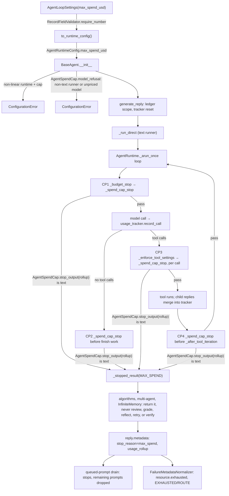
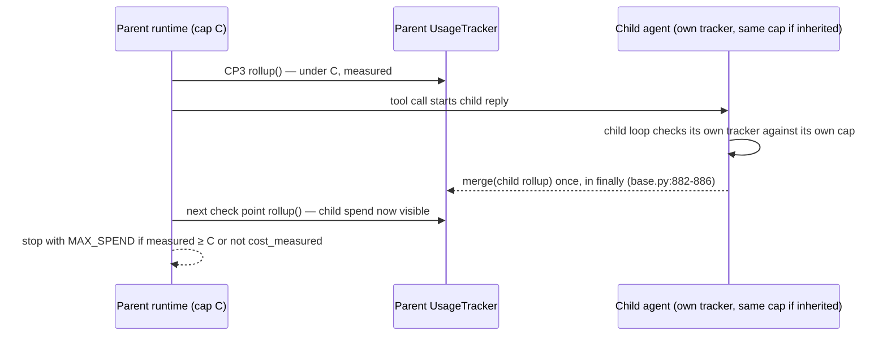

# Spec: An optional USD spend cap that every agent's own loop enforces

> **TL;DR** — `AgentLoopSettings` gains `max_spend_usd`, an optional USD cap. The shared agent loop checks it against the run's own live ledger (`UsageTracker`) before every model call, every tool call, every finish attempt, and the after-tool-iteration hook. It stops the run with the new stop reason `AgentStopReason.MAX_SPEND`, and stops just as hard when the meter goes blind, naming the cause. A cap stop ends the run: no algorithm reviews, grades, reflects on, or retries it, no multi-agent component retries it, and no queued prompt runs after it. A new read-only property, `UsageRollup.cost_measured`, tells a caller such as vidbyte-cli C3 whether the reported `cost_usd` is the whole measured bill or only a lower bound. The decision that matters most: the cap is a metered hard limit with a stated overshoot bound, not a promise that spend never exceeds the number. Spend the meter cannot see is never called capped. An agent that cannot enforce the cap refuses it at construction, before any spend: a non-linear runtime, a non-text runner, a configured model the pricebook cannot price, a JevAgent specialist without its own cap, and `CodexHarnessAgent`.

## §0 User prompts

### 0.1 Invoking request (verbatim)
/spec-pipeline I like this and I agree with the setup, can you start building it into the vidbyte-cli/.

### 0.2 User replies during the run
_None yet. The orchestrator appends any reply the user sends during the run here verbatim, labeled with the revision it produced._

---

## Part A — Framing

## §1 Goal

The user asked for a universal `max_spend` and said "i want every agent to be tracking usage, figure out the best way to do this" (request.md §A Prompt 3, Q7). The program decided (D-P6, request.md §C.2) that the SDK meters and enforces, and the CLI owns the option. This PR is the SDK half. Today no agent loop can stop itself on money:

- `AgentLoopSettings` (`vidbyte/agents/settings/loop.py:49-67`) has no USD field.
- The runtime's budget stop (`vidbyte/agents/runtime.py:2046-2089`) checks iterations, tokens, tool calls, and wall-clock only.
- The only USD ceiling, `CostBudgetMiddleware` (`vidbyte/middleware/builtins/cost_budget.py:36-84`), multiplies tokens by a caller-supplied flat rate. It never reads the priced ledger the SDK already keeps.

| ID | Goal (outcome) | How we will know | Source |
|---|---|---|---|
| G-1 | A developer, or vidbyte-cli on a user's behalf, sets one USD number on any agent's loop. The run then stops itself once the spend the SDK measured for that run reaches the number. | `AgentLoopSettings(max_spend_usd=x)` stops a priced run with `stop_reason == "max_spend"` (AC-4..AC-7). | request.md §C "This run's scope"; Prompt 3 Q7 "max_spend" |
| G-2 | A caller can read from the run's result that the cap stopped it, what the run spent, and whether that figure is complete. The CLI can then say "your run stopped at $X", and an agent driving the CLI can decide what to do next. | The caller contract in §9.2 holds (AC-1, AC-8, AC-19). | request.md §C "The run's result must also say plainly…"; briefing §1 |
| G-3 | "Every agent" holds. Each agent either enforces the cap, or refuses it before spending anything. No agent accepts the cap and then ignores it. After a run the cap stopped, no SDK component reviews, grades, reflects on, verifies, retries, or drains queued prompts (INV-23). Only the developer's own end-of-run steps may still spend: `after_run` middleware, a configured auto-handoff, and a session rule the developer bound to `resource.exhausted` (INV-23, EC-34, EC-36). A MultiAgent manager may also replan a blocked task onto another worker, which has its own cap (EC-33). | The per-runtime table in §9.2 holds (AC-11..AC-13, AC-27, AC-30). A cap stop ends the run (AC-28, AC-29, AC-31). | Prompt 3 Q7 "i want every agent to be tracking usage"; request.md §C "Every agent" |
| G-4 | Unmeasured spend is never presented as capped or complete. A capped run whose meter goes blind stops. | `cost_measured` is False whenever the meter missed something (AC-19). A capped run stops at the next check point after a blind call (AC-8, AC-9). | briefing; request.md §C Q2 |

## §2 Objective

When this PR merges, vidbyte-sdk `main` contains the following:

- An optional `max_spend_usd` field on `AgentLoopSettings`. It is validated as a finite USD amount greater than 0. It is carried into `AgentRuntimeConfig` and through every path that copies loop settings: export and restore, YAML `agent.loop`, `AgentForker`, and the model-facing fork tool (as a guardrail the model cannot override).
- A new focused module, `vidbyte.agents.spend_cap`. Its class `AgentSpendCap` decides, from a `UsageRollup`, whether a capped run must stop and with which text.
- Four thin call sites in `AgentRuntime` that apply that decision.
- The new stop reason `AgentStopReason.MAX_SPEND`. Sessions route it to the existing `FailureCode.RESOURCE_EXHAUSTED`, and the efficiency eval treats it as a budget stop.
- The derived property `UsageRollup.cost_measured`.
- Construction-time refusals wherever the loop cannot enforce or measure the cap: the four non-linear runtimes, non-text runners, a configured primary or fallback model the pricebook cannot price (OpenRouter, which reports its own cost, is exempt), JevAgent specialists that carry no cap of their own, and `CodexHarnessAgent`.
- A cap stop that ends the run everywhere a middleware abort already does: the reflexion, independent-critic, prosecutor-defender-judge, and grader algorithms, the multi-agent worker report and manager phase retry, and the InfiniteMemory verifier. The queued-prompt drain also stops after a cap stop.
- Documentation of all of it in the agents and Jev folder READMEs, the `llms.txt` bundle, the failure vocabulary skill, and the unreleased 0.4.0 release record (§12.3 rows 13–17).

The version stays 0.4.0. No root export, `FailureCode` member, or dependency is added. This is PR R3 of 8. The CLI option `--max-spend` that maps to this field is C3 (NG-1).

## §3 Non-goals

- **NG-1** — Any vidbyte-cli change, including `--max-spend`. — *Why not:* that is PR C3 (request.md §C "Not in this run").
- **NG-2** — Reasoning effort. — *Why not:* PR R2.
- **NG-3** — Backend or gateway-side caps, such as research `max_cost_cents` or the gateway's daily cap. — *Why not:* "backend caps" are excluded (request.md §C "Not in this run"). Bring-your-own-key spend never reaches the backend (D-P6).
- **NG-4** — A pre-call cost estimate or budget reservation, which would refuse a call that *might* cross the cap. — *Why not:* `[scope-adding]` (request.md §C Q5). A call's output tokens, and whether its prompt crosses a long-context tier (`vidbyte/lib/registries/pricing.py:162`), are unknown before the call. See Q-7.
- **NG-5** — Any change to `CostBudgetMiddleware`, the `cost_spent_usd` contract counter (`runtime.py:2174-2181`), `MinCostSpent` (`vidbyte/agents/contracts/floors.py:144-183`), `UsageRollup.cost_complete`, or the behavior of any existing budget. — *Why not:* "changing what any existing budget does" is excluded (request.md §C).
- **NG-6** — A team-wide cap on `MultiAgent` or `AggregateAgent`, or one budget shared across concurrent children. — *Why not:* neither class accepts loop settings (`vidbyte/agents/multi/agent.py:55-83`, `vidbyte/agents/aggregation.py:225-240`), and the conversation asked for neither. The gap is stated in §6.3 and offered as Q-8.
- **NG-7** — Showing the cap or the running spend to the model. — *Why not:* the runtime already keeps `timeout_seconds` out of the prompt for the same reason (`runtime.py:1679-1701`). A number in a prompt invites the model to argue with it (D-14).
- **NG-8** — A new `FailureCode` member, a new root export, a version change, tagging, or publishing. — *Why not:* the harness pins make a new code red (`tests/features/harness_threads/test_harness_threads_surface.py:218-241`, D-6). The request prefers reusing existing root names (request.md:64). D-P2 fixes the version.
- **NG-9** — A flat `max_spend_usd=` keyword on `BaseAgent` or `Agent`. — *Why not:* `REPO_MAP.md:109` says "A new configurable behavior for agents should be added as a setting here rather than as another constructor parameter."
- **NG-10** — Rewriting `JevUsageAccount.failures()` (`vidbyte/agents/jev/usage.py:73-81`) on top of `cost_measured`. — *Why not:* it is a refactor of working Jev code. Both apply the same three-condition rule, and converging them is a follow-up.
- **NG-11** — One cap shared across the primary reply and the queued prompts drained after it finishes, or copying JevAgent's cap onto its specialists. — *Why not:* neither was requested. Each is a stated limitation (§6.3) with an optional `Q-n` whose default is no (Q-9; D-13). Carrying the cap into the critic and prosecutor-defender-judge reviewer sub-runtimes is decided against on the code, not as a scope choice (D-18).

## §4 Developer usage

```python
from vidbyte import Agent, AgentLoopSettings, AgentStopReason

cap = 0.50
agent = Agent(
    name="researcher",
    system_prompt="Answer directly.",
    provider="openai",
    model_name="gpt-5.4-mini",
    agent_loop_settings=AgentLoopSettings(max_spend_usd=cap),
)
reply = agent.run("Summarize the open issues in this repository.")

usage = agent.get_usage()            # vidbyte.UsageRollup for the whole call
spent = usage.cost_usd or 0.0        # USD the SDK measured for this run
if reply.metadata["stop_reason"] == AgentStopReason.MAX_SPEND.value:
    if reply.metadata["usage_rollup"].cost_measured:  # the ledger the cap read
        print(f"stopped at ${spent:.4f}: reached the ${cap:.2f} cap")
    else:
        print(f"stopped: spend could not be fully measured (at least ${spent:.4f})")
else:
    print(f"finished; spent ${spent:.4f}" + ("" if usage.cost_measured else " or more"))
```

The developer sets one number and reads three things that already exist on every run: `stop_reason`, `cost_usd`, and the new `cost_measured`. They no longer have to estimate spend with a flat token rate, or poll `get_cost_usd()` from outside the loop. A cap the agent cannot enforce fails loudly before spending.

## §5 Flow diagram





Validation happens at the boundary, when `AgentLoopSettings` and `AgentRuntimeConfig` are constructed. Every refusal happens at construction, before any spend. The runner type and the configured models are known there: `resolve_runner_type` reads only the provider and model (`vidbyte/lib/runners/utility.py:54-70`), and `runner_config` and the fallback chain are set once, in `__init__` (`base.py:192-202`). A model that only appears at run time is covered by the mid-run blind stop instead (INV-4(b)). Examples are a bound runner, an algorithm's own trial or stage model, and an uncapped child's model. State changes only in the existing ledger, through `record_call`, `record_billed_failure`, `record_operation`, and `merge`. The cap code reads `rollup()` and never writes. The runtime catches a stop at the four check points, and the result flows through the same `_finish_result` path (`runtime.py:945-969`) that every budget stop uses. The sequence diagram shows the timing that sets the overshoot bound: a child's spend becomes visible to the parent only when the child's reply finishes.

---

## Part B — Behavior (this is the spec; everything else is framing)

## §6 Behavior

**Terms used below.**
- *Measured spend* is `rollup.cost_usd` from the running agent's own `UsageTracker` at the moment of a check. A `None` value counts as zero spend.
- *The meter is blind* when `rollup.cost_measured` is False.
- *A check point* is one of CP1–CP4, defined in INV-5.
- *A segment* is everything the run spends between one passing check and the next check.

### 6.1 Invariants

**What is measured**

- **INV-1** — Measured spend is the SDK-rated USD cost of the records in the agent's own tracker. That covers:
  - every main model response (`runtime.py:477`);
  - every billed failed attempt (`runtime.py:793`);
  - every context-window side call (`runtime.py:1049`);
  - every priced search or fetch operation (`runtime.py:1388`);
  - every Jev decision call made while the agent's ledger is active (`vidbyte/lib/runners/decision.py:46-55`);
  - reflexion and grader calls (`vidbyte/agents/algorithms/reflexion.py:133`, `multi_provider_agentic_grader.py:164`);
  - the rollup of every child agent reply, merged once when that child's reply finishes (`vidbyte/agents/base.py:882-886`, `vidbyte/agents/pricing/tracker.py:133-166`).

  Nothing else is measured. "Rated" means priced by the SDK pricebook (`PRICING_AS_OF = "2026-10-11"`, `vidbyte/lib/registries/pricing.py:58`) or by a provider-reported cost (OpenRouter, `vidbyte/agents/pricing/openrouter.py:45-56`). It is not the provider's invoice (A-1).
- **INV-2** — `UsageRollup.cost_measured` is True exactly when all four of these hold:
  - `recording_integrity is UsageRecordingIntegrity.INTACT`;
  - `unaccounted_call_count == 0`;
  - every `UsageRecord` in `calls` has `cost_usd is not None`;
  - every `OperationUsageRecord` in `operations` has `cost_usd is not None`.

  An empty ledger is measured (True), because it spent nothing. `cost_measured` is derived from the rollup's own fields, so it can never disagree with them. Adding it never changes `cost_usd`, `cost_complete`, or any other field.
- **INV-3** — Spend the meter cannot see is never described in code, docs, or messages as capped, and `cost_measured` makes no claim about it. That covers:
  - a tool or MCP server that pays an external API without calling `record_operation`;
  - a failed model call whose error carried no usage, such as a timeout, a network failure, or a gateway or edge 5xx. The runtime records a failed attempt only when the error carries `details["usage"]` (`runtime.py:787-793`), but the provider or Vidbyte may still have billed it (`vidbyte/lib/http/vidbyte_gateway.py:86-90`);
  - Vidbyte's own fee on a relayed gateway call (`vidbyte_gateway.py:110-114`), which no code meters;
  - a provider charge that differs from the SDK's list-price rating (A-1).

  A non-text runner is not in this list, because a capped agent refuses one at construction (INV-13). The README section (W-9) and the caller contract (§9.2 rule 3) state these limitations in those words.

**When the run stops**

- **INV-4** — With `max_spend_usd` set, every check point stops the run with `AgentStopReason.MAX_SPEND` when either condition holds:
  - (a) `rollup.cost_usd is not None and rollup.cost_usd >= max_spend_usd` (the cap was reached), or
  - (b) `not rollup.cost_measured` (the meter is blind, so the run fails closed), even when the measured spend is below the cap.

  Condition (a) is evaluated first. A stop that satisfies (a) carries the "reached" text even if the meter is also blind. Condition (b) is the run-time fallback for every gap the construction checks cannot see (INV-13). The ledger names the cause of a blind stop, and the stop text names it too (INV-9).
- **INV-5** — The check points are:
  - **CP1:** at the top of every loop iteration, before `before_iteration` middleware and the model call. This includes the iteration that follows a fallback-model switch (`runtime.py:459`). It runs as the first clause of `_budget_stop`.
  - **CP2:** on the plain-text finish branch, before the `max_tokens` finish check, contracts, `review_finish`, `after_iteration`, and `_continue_finish_attempt` (`runtime.py:513-598`).
  - **CP3:** before every tool call, internal tools included (isDone, `run_bulk_work`, `launch_swarm`, `launch_subagent`), as the first step of `_enforce_tool_settings` (`runtime.py:1834`).
  - **CP4:** after `after_iteration` middleware on a continuing tool iteration, before `_after_tool_iteration` (`runtime.py:700`), which is JevAgent's compute checkpoint.

  Once a check point stops the run, this runtime starts no further model call, tool call, finish attempt, or compute checkpoint.
- **INV-6** — The overshoot bound. Let `C = max_spend_usd`. Every check before the stopping one passed, so when the run stops, `measured spend < C + G`. Here `G` is the largest measured spend of any single segment that began after a passing check. The segments are:

  | Segment | Starts after | Ends at | What can spend inside it |
  |---|---|---|---|
  | Model | CP1 | CP2, or CP3 for the first tool | one main model call with its middleware retries and billed failed attempts (`runtime.py:726-839`, `:793`) |
  | Tool | CP3 | the next CP3 or CP4 | one tool call's whole spend: priced operations, and every child agent the tool runs (a sub-agent `as_tool()`, the fork tool's child, `run_bulk_work` workers, `launch_swarm` helpers plus its plan check), concurrent ones included |
  | Finish | CP2, or CP3 before isDone | the next CP1, or the end of the run | `after_iteration` and `review_finish` middleware; for JevAgent, done-check decision calls, the run-state, handoff, and reviewer sub-agents, and a fresh-continuation agent run |
  | Iteration tail | CP4 | the next CP1 | JevAgent's compute checkpoint (compute decision calls, `JevCloneAgent` clones run concurrently) and the next iteration's context-window side calls (`runtime.py:346-366`) |
  | Pre-loop | reply start | the first CP1 | JevAgent's gate, skill preload, run-state writer, and tool-selector calls (`vidbyte/agents/jev/runtime.py:118-145`), and an algorithm's work before its first `_arun_once` |
  | Algorithm step | an attempt's last check, when that attempt did **not** stop on the cap (INV-23) | the next attempt's first CP1, or the end of the run | the reflexion reflection call after an attempt that failed for another reason (`reflexion.py:113-133`); the grader call after trials none of which stopped on the cap (`multi_provider_agentic_grader.py:149-164`); an independent-critic or prosecutor-defender-judge reviewer run after a producer that finished (`independent_critic.py:103`, `prosecutor_defender_judge.py:507`), bounded only by the reviewer's own limits (D-18) |
  | End of run | the reply's last check (a cap stop, or a finish) | the reply returns | `after_run` middleware (`runtime.py:947`) and, when the developer configured one, the auto-handoff agent run (`base.py:1011-1013`, `:1249-1262`) |

  When a segment runs `N` children concurrently and each inherits the same `AgentLoopSettings`, that segment can spend up to `Σᵢ (C + Gᵢ)` plus the tool's own spend, where `Gᵢ` is child `i`'s own largest segment. A child that does not inherit the cap is limited in USD by nothing in this feature: the Jev fixed-prompt agents (`brief/writer.py:60`, `done/handoff.py:161`, `done/reviewer.py:37`, `done/run_state.py:281`, `gate/clarification.py:54`), the critic and judge reviewer sub-runtimes, and a sub-agent with its own settings. Only its own iteration and token limits bound it.

  The overshoot is "at most one model call, with its retries" only when the run has no spending tool calls, no children, no context-window algorithm, no algorithm, no spending finish middleware, and, for JevAgent, no done checks, no compute, and no fresh continuation. The request's Q5 premise, "the run can exceed the cap by at most one call", is therefore false in general (§15 Q-5).
- **INV-7** — Blind-meter containment. Once the meter is blind, the run starts no new segment. Unmeasured spend is confined to the segment in which the meter went blind, plus any blind spend inside children that merge during that segment. This feature puts no USD bound on that unmeasured spend (INV-3).
- **INV-8** — At a check point that another budget shares, the spend cap is checked first. When both are exhausted at the same check, the run stops with `max_spend`. A capped run whose spend stays below the cap and stays measured stops exactly as the same run would without the cap.

**What a cap stop looks like**

- **INV-9** — A cap stop's `AgentResult`, and through `BaseAgent._generate_reply` (`base.py:986-997`) the reply's metadata, carries:
  - `output` equal to the stop text. For condition (a) the text is `"Agent runtime stopped after reaching max_spend_usd."`.
  - For condition (b) the text is `"Agent runtime stopped because max_spend_usd is set and this run's spend could not be fully measured: <causes>."`. Here `<causes>` joins, with `"; "`, every cause that holds, in this order:
    - `"no price for <provider>:<model>, …"`, listing each distinct pair from `calls` with `cost_usd is None`, sorted;
    - `"no price for operation <provider>:<operation>, …"`, listing each distinct pair from `operations` with `cost_usd is None`, sorted;
    - `"<n> model calls reported no usage"`, from `unaccounted_call_count`;
    - `"usage recording failed"`, when `recording_integrity is CORRUPTED`.

    The text holds names and counts only (T-3). This is the shape `JevUsageAccount` already uses to name unpriced calls (`vidbyte/agents/jev/usage.py:39-58`).
  - `metadata["stop_reason"] == "max_spend"`.
  - `metadata["usage_rollup"]`, the tracker rollup at the moment of the stop. For JevAgent this is replaced by the run total (`vidbyte/agents/jev/response.py:148-154`).
  - The usual `iteration_count`, `tokens_used`, `tool_call_count`, `tool_call_states`, and `tool_calls` (`runtime.py:2111-2127`).
  - No new metadata key.

  On a CP2 stop, the model's plain-text answer stays in `metadata["iteration_outputs"]` (`runtime.py:473-474`, `:971-991`). A cap stop delivers nothing to output connectors (`vidbyte/lib/constants/outputs.py:34-36`).
- **INV-10** — Sessions map `"max_spend"` to `FailureCode.RESOURCE_EXHAUSTED`, with `FailureStatus.EXHAUSTED`, `FailureDisposition.ROUTE`, and details exactly `{"stop_reason", "iteration_count", "tokens_used"}` (`vidbyte/sessions/failure/router.py:112-131`). It never falls through to `RUNTIME_ERROR`. `EfficiencyBehavior` counts `max_spend` as a budget stop (`vidbyte/evals/behavior/efficiency.py:31-43`).

**Scope of one cap**

- **INV-11** — The cap is per reply. It applies to one `generate_reply`, whose tracker resets at reply start (`base.py:923`).
  - Within a reply it spans every `_arun_once` attempt of a context-window algorithm, because they share the tracker. `max_tokens`, by contrast, is per attempt (`runtime.py:300`).
  - Each prompt of `arun_sequentially` (`base.py:1147-1157`) is its own reply with its own cap, because the developer chose each prompt.
  - A queued prompt drained after a reply that finished (`base.py:1186-1220`) is its own reply with its own cap (Q-9). Once any reply in the drain, the primary included, stops with `max_spend`, no further queued prompt runs. The drain stops, drops the remaining prompts, and records their count in the existing `queued_prompts_truncated` key (`base.py:1203-1205`, INV-23).
  - Two replies of one agent object that overlap in time share one tracker, and each reset erases the other's records (`base.py:923`, `tracker.py:195-200`). A cap is therefore exact only when an agent object runs one reply at a time (EC-35, Q-14).
  - A JevAgent continuation's budget extension (`jev/runtime.py:260-275`) never raises, lowers, or removes the cap.
- **INV-12** — A child agent's spend counts toward the parent's measured spend from the moment the child's reply finishes, never earlier. Every child built from the same `AgentLoopSettings` enforces the same cap against its own tracker: JevAgent clones, swarm helpers, bulk workers, and the fresh-continuation agent (`jev/agent.py:76`, `bulk_work.py:60`, `compute/clone.py:45`, `compute/swarm.py:57`), InfiniteMemory subagents (`infinite/agent.py:87`, `infinite/launch.py:311`), and forks. Each such child is a `BaseAgent`, so its constructor applies the same refusals (INV-13) before the child spends anything.

**Never silently ignored**

- **INV-13** — An agent that cannot enforce or measure the cap refuses it at construction, before any spend. Each refusal covers one case:
  - **Non-linear runtimes.** `MCTS_SEARCH`, `ACTOR_MODEL`, `ACTOR_MODEL_P2P`, and `ACTOR_MODEL_BROADCAST` raise `ConfigurationError`. None of them reads any loop budget.
  - **Non-text runners.** A `BaseAgent` whose primary provider and model resolve to a non-text runner type raises `ConfigurationError`. Such a runner runs outside the loop and records no usage (`base.py:1307`, `:1333-1368`). The runner type depends only on the provider and model (`vidbyte/lib/runners/utility.py:54-70`), which are fixed at construction (`base.py:192`), so the type cannot change later.
  - **Unpriced configured models.** A `BaseAgent` raises `ConfigurationError`, naming each `provider:model`, when any model in its configured chain has no pricebook entry: the primary model, or any fallback model (chain index 0 is the primary, `vidbyte/agents/fallback.py:132-142`). The check is the same `ModelPricingRegistry.default().resolve` the agent's tracker uses (`tracker.py:58-60`, `:97`). A chain entry that, after the runner's own normalization, lacks a provider or a model counts as unpriced and shows the missing part as `?`. The pricebook cannot price it, and `Runner.build()` refuses it anyway unless a runner is bound (`utility.py:81-84`). OpenRouter models are exempt, because OpenRouter reports its own cost per call (`vidbyte/agents/pricing/openrouter.py:45-56`) and its pricebook table is empty (`pricing.py:276`).
  - **Jev specialists.** `JevAgent` raises `ConfigurationError` for any specialist whose own `agent_loop_settings.max_spend_usd` is missing or greater than JevAgent's, because a delegated run never enters JevAgent's loop (`jev/runtime.py:129-130`).
  - **Codex.** `CodexHarnessAgent` raises `CodexAgentError` (failure code `codex.vidbyte_translation_failed`) whose cause is the `ConfigurationError` that `CodexContractValidator` raises for every loop field Codex cannot enforce (`vidbyte/agents/codex/agent.py:65-73`, `vidbyte/agents/codex/contracts.py:63-74`). Codex owns its own model loop, so nothing could check the cap.

  A model that only appears at run time has no construction check. Examples: a runner bound after construction, an algorithm's own trial or stage model (`ProviderModelRegistry.resolve_active` in the grader, PDJ stage settings), an uncapped child's model, and a response that names a model the pricebook lacks. These fall to the run-time blind stop (INV-4(b)), which names the model (INV-9). An agent constructed with neither a provider nor a model skips the runner-type and price checks: it cannot run at all, because `resolve_runner_type` refuses it (`utility.py:58-59`). No other agent accepts the setting without enforcing it. `MultiAgent` and `AggregateAgent` do not accept loop settings at all.
- **INV-14** — `max_spend_usd` accepts only `None` or a finite real greater than 0, given as an `int` or a `float` but never a `bool`. NaN, ±inf, `True`, `0`, negative values, and strings raise `ConfigurationError` naming `AgentLoopSettings.max_spend_usd` (or `AgentRuntimeConfig.max_spend_usd`), with `details["field"]` set. One exception: an `int` too large for a float, such as `10**400`, raises `OverflowError` from `math.isfinite` inside `RecordFieldValidator.require_number` (`validation.py:96-103`, measured). The smallest positive float, `5e-324`, is accepted as a valid cap. Callers that parse user text, such as C3, should check the range before building the settings (§9.2).
- **INV-15** — The cap survives every copy of the loop settings: `to_runtime_config()`, `__repr__`, `export_state()` and `restore()`, YAML `agent.loop`, `AgentForker` with a `max_iterations` override, and the fork tool with any loop override. Through the fork tool the model can neither set, raise, nor clear it.
- **INV-16** — The model never sees the cap. The rendered system prompt's loop-settings block is unchanged (`runtime.py:1679-1701`).

**A cap stop ends the run**

- **INV-23** — A result with `stop_reason == "max_spend"` ends the run it belongs to everywhere a middleware abort already does (`@intent middleware-abort-ends-the-run`). Nothing reviews, grades, reflects on, verifies, or retries it with a fresh budget:
  - **Reflexion** never reflects on or retries an attempt the cap stopped (`vidbyte/context/algorithms/reflexion.py:93-95`).
  - **The independent critic and prosecutor-defender-judge** return a producer the cap stopped as the run's result, unreviewed (`independent_critic.py:73-76`, `prosecutor_defender_judge.py:400-403`).
  - **The multi-provider grader** returns the first trial the cap stopped as the run's result, keeps its stop text as its output, and makes no grader call (`multi_provider_agentic_grader.py:63-67`, `:110`). Concurrent trials share the runtime's tracker, so they also stop at their next check point.
  - **MultiAgent**: a worker the cap stopped makes its task `TaskStatus.BLOCKED`, with `TaskBlocker(code="max_spend", retryable=False)`, never a retryable `worker_stopped` failure (`vidbyte/agents/multi/transfer.py:186-196`). A manager phase the cap stopped raises `MultiAgentExecutionError` after that one attempt, with no parse retry (`vidbyte/agents/multi/orchestrator.py:190-215`, abort branch `:206-210`). `MagenticOneOrchestrator.finalize` already raises for every non-answer stop and is unchanged (`orchestrator.py:161-179`).
  - **InfiniteMemory**: a generator the cap stopped is `InfiniteResultStatus.FAILED`, so no verifier runs on its stop text and its staged entries are dropped (`vidbyte/agents/infinite/launch.py:250-253`, `:335-344`).
  - **The queued-prompt drain** runs no queued prompt after a reply that stopped on the cap (INV-11).

  The reply then still runs `after_run` middleware and a configured auto-handoff (INV-6 "End of run"). Those are the developer's own end-of-run steps, not a retry of the stopped work: the auto-handoff writes a handoff note about the run that stopped (`vidbyte/agents/handoff.py:78-82`), which is what a caller needs to resume it by choice.

**Must not regress:**
- **INV-17** — With `max_spend_usd=None`, the default, every run behaves exactly as on `base_commit`. No cap code computes a rollup or a price, and stop reasons, outputs, metadata, middleware calls, algorithm and multi-agent outcomes, the queued-prompt drain, and Codex construction are unchanged. The existing stops live at `runtime.py:2046-2089`, `:513-522`, and `:1834-1899`. Every INV-23 site acts only on a `max_spend` stop, which an uncapped run never produces. `CodexContractValidator` flags only fields that are not `None` (`contracts.py:82-89`).
- **INV-18** — `CostBudgetMiddleware` still estimates spend at its flat rate and aborts in `before_iteration` as `middleware_abort` (`cost_budget.py:36-84`). `cost_spent_usd` and `MinCostSpent` still read that estimate (`runtime.py:2174-2181`).
- **INV-19** — `UsageRollup.cost_usd` and `cost_complete` keep their meaning (`tracker.py:185-186`).
- **INV-20** — JevAgent still fails closed on usage: `require_accounted()` and `settle()` raise `UsageAccountingError` on a recording error, unreported usage, or an unpriced call (`jev/usage.py:39-81`), including after a cap stop.
- **INV-21** — `FailureCode` membership and order are unchanged, so `test_harness_threads_surface.py:218-241` and the codex slice pins stay green. The root export list stays at 733 names, and `contracts/sdk-public-api.json` is byte-identical.
- **INV-22** — `isDone` still never counts toward `max_tool_calls` (`runtime.py:2071-2073`, `:1866-1869`). The spend check at CP3 does not change which calls count as tool calls.

### 6.2 Acceptance criteria

| ID | Given | When | Then | Priority | Proof |
|---|---|---|---|---|---|
| AC-1 | a clean checkout of this branch, a Vidbyte key in the environment (built at runtime, never a literal), and the model wire scripted through the §13 transport seam | the §4 snippet runs exactly as written | it prints exactly one of its three lines, and that line matches the run: the cap line when the scripted spend reaches $0.50, the "could not be fully measured" line when a scripted call has no usage, and the "finished" line otherwise | P0 | `test_loop_spend_cap_acceptance.py::test_the_developer_snippet_prints_the_line_that_matches_the_run[cap,blind,finished]` |
| AC-2 | `AgentLoopSettings` | constructed with `max_spend_usd` set to `True`, `float("nan")`, `float("inf")`, `-float("inf")`, `0`, `-1`, or `"5"` | it raises `ConfigurationError` whose message names `AgentLoopSettings.max_spend_usd`; `1`, `0.25`, and `None` are accepted | P0 | `test_loop_spend_cap_contract.py::test_settings_reject_each_invalid_cap_and_name_the_field`; `test_loop_spend_cap_contract.py::test_settings_accept_valid_caps_unchanged`; `test_loop_spend_cap_contract.py::test_cap_error_never_echoes_a_long_value` |
| AC-3 | `AgentLoopSettings(max_spend_usd=2.5)` | `to_runtime_config()` and `repr()` are called, and `AgentRuntimeConfig(max_spend_usd=…)` is built with each invalid value from AC-2 | the config carries `max_spend_usd == 2.5`; the repr contains `max_spend_usd=2.5`; each invalid value raises `ConfigurationError` naming `AgentRuntimeConfig.max_spend_usd` | P0 | `test_loop_spend_cap_contract.py::test_runtime_config_carries_the_cap_and_repr_shows_it`; `test_loop_spend_cap_contract.py::test_runtime_config_rejects_each_invalid_cap` |
| AC-4 | a linear agent capped at C whose scripted priced responses reach measured spend ≥ C after model call k, with call k returning tool calls | the run proceeds | no tool from call k runs, no model call k+1 is sent, and the reply has `stop_reason == "max_spend"`, the reached text as output, `usage_rollup.cost_usd >= C`, and `cost_measured is True` | P0 | `test_loop_spend_cap_runtime.py::test_a_tool_turn_that_reaches_the_cap_runs_none_of_its_tools` |
| AC-5 | the same agent, where the call that reaches C returns a plain-text answer | the run proceeds | the run stops with `max_spend` before `review_finish`, `after_iteration`, or `_continue_finish_attempt` runs; the output is the reached text; the answer is in `metadata["iteration_outputs"]` | P0 | `test_loop_spend_cap_runtime.py::test_a_plain_text_answer_that_reaches_the_cap_is_replaced_before_any_finish_work[finish,max_tokens_tie]` |
| AC-6 | a capped agent whose measured spend is already ≥ C when a response asks for an internal tool (isDone, or a launch tool) | the tool batch is processed | that tool does not execute and the run stops with `max_spend` | P0 | `test_loop_spend_cap_runtime.py::test_a_finish_or_internal_tool_requested_after_the_cap_never_executes[isDone,launch_helpers]` |
| AC-7 | a capped agent whose first tool in a turn spends past C (a priced operation, or a sub-agent run through `as_tool()`) | the turn continues | the next tool call in that turn does not execute; when that tool was the turn's last, `_after_tool_iteration` is not entered; the stop reason is `max_spend` | P0 | `test_loop_spend_cap_runtime.py::test_a_priced_operation_that_crosses_the_cap_stops_the_next_tool_in_its_turn`; `test_loop_spend_cap_runtime.py::test_a_last_tool_that_crosses_the_cap_stops_before_the_after_tool_iteration_hook`; `test_loop_spend_cap_children.py::test_a_sub_agent_tool_that_spends_past_the_cap_stops_the_next_tool` |
| AC-8 | a capped agent whose first model response carries no parseable usage (`unaccounted_call_count` becomes 1) | the run proceeds | it stops at the next check point with `max_spend` and `cost_measured is False`, and its output is the unmeasured text ending `"could not be fully measured: 1 model calls reported no usage."`; the same run without a cap continues as on `base_commit` | P0 | `test_loop_spend_cap_runtime.py::test_a_response_without_usage_stops_the_run_blind` |
| AC-9 | a capped agent whose priced configured model passes construction, but whose run records a call the pricebook cannot price: an OpenRouter response with no reported cost, or a bound runner whose response names a model the pricebook lacks | that call returns | the run stops at the next check point with `max_spend`; `cost_measured is False`; the output names that call's `provider:model` after `"no price for "`; `usage_rollup.cost_usd` excludes that call | P0 | `test_loop_spend_cap_runtime.py::test_a_response_naming_an_unpriced_model_stops_the_run_and_names_it`; `test_loop_spend_cap_runtime.py::test_openrouter_spend_is_enforced_from_its_reported_cost[reported_cost_reaches_cap,no_reported_cost]` |
| AC-10 | any agent with `max_spend_usd=None` | it runs any scripted conversation the existing suite covers | stop reasons, outputs, and metadata equal those on `base_commit`; no existing test changes, except the one `cases` entry §12.3 row 26 adds because row 25 extends a pinned constant | P0 | `test_loop_spend_cap_runtime.py::test_a_cap_the_run_never_reaches_changes_nothing[5 stops]`; the existing suite, unedited apart from the §12.3 row 26 `cases` entry |
| AC-11 | `max_spend_usd` set, and a runtime type of `MCTS_SEARCH`, `ACTOR_MODEL`, `ACTOR_MODEL_P2P`, or `ACTOR_MODEL_BROADCAST` | the agent is constructed | it raises `ConfigurationError` naming the runtime and `max_spend_usd`; without the cap it constructs as on `base_commit` | P0 | `test_loop_spend_cap_refusals.py::test_a_capped_non_linear_runtime_is_refused[4 runtimes]` |
| AC-12 | `max_spend_usd` set, and a provider and model that resolve to a non-text runner type (for example an image model) | the agent is constructed | it raises `ConfigurationError` naming `max_spend_usd` and the runner type, before any runner is built; without the cap it constructs as on `base_commit` | P0 | `test_loop_spend_cap_refusals.py::test_a_capped_non_text_model_is_refused_naming_its_runner_type` |
| AC-13 | `JevAgentSettings(loop=AgentLoopSettings(max_spend_usd=C), agents=(…))` | `JevAgent` is constructed with a specialist whose loop has no cap, or a cap greater than C | it raises `ConfigurationError` naming the specialist; a specialist capped at ≤ C constructs | P0 | `test_loop_spend_cap_jev.py::test_a_capped_jev_agent_refuses_a_specialist_that_could_outspend_it`; `test_loop_spend_cap_jev.py::test_a_capped_jev_agent_accepts_specialists_capped_no_higher_than_it` |
| AC-14 | a capped JevAgent whose preflight decision calls alone bring measured spend to ≥ C | the run reaches the main loop | it stops at CP1 of iteration 0 with `max_spend` before any generative model call | P1 | `test_loop_spend_cap_jev.py::test_preflight_decision_spend_alone_stops_the_run_before_any_generative_call` |
| AC-15 | a capped parent whose tool runs a child agent that spends X | the tool returns | the parent's `get_usage()` includes X; the parent's next check point stops the run when the total reaches C | P0 | `test_loop_spend_cap_children.py::test_a_sub_agent_tool_that_spends_past_the_cap_stops_the_next_tool`; `test_loop_spend_cap_children.py::test_concurrent_capped_children_each_keep_their_own_cap_and_the_parent_stops_on_their_total` |
| AC-16 | a capped agent | it goes through `export_state()` and `restore()`; YAML `agent.loop.max_spend_usd`; `AgentForker` with `max_iterations`; and the fork tool with `loop_settings={"max_iterations": 3}` | each resulting agent has the same `max_spend_usd`; a fork-tool call whose `loop_settings` holds `max_spend_usd` is refused with the `ValueError` the tool raises for every unsupported field (`vidbyte/tools/builtins/fork/fork.py:321`) | P0 | `test_loop_spend_cap_copy_paths.py::test_a_checkpoint_carries_the_cap_and_an_uncapped_one_omits_it`; `test_loop_spend_cap_copy_paths.py::test_a_yaml_loop_cap_reaches_the_built_agent`; `test_loop_spend_cap_copy_paths.py::test_a_fork_with_a_max_iterations_override_keeps_the_cap`; `test_loop_spend_cap_copy_paths.py::test_a_fork_tool_loop_override_keeps_the_parents_cap`; `test_loop_spend_cap_copy_paths.py::test_the_fork_tool_refuses_any_model_supplied_cap` |
| AC-17 | a reply with `stop_reason == "max_spend"` | `FailureMetadataNormalizer` reads it | it records exactly one `Failure` with `RESOURCE_EXHAUSTED`, `EXHAUSTED`, `ROUTE`, and details `{"stop_reason": "max_spend", "iteration_count": …, "tokens_used": …}` | P0 | `test_loop_spend_cap_failure_routing.py::test_a_cap_stop_routes_as_one_exhausted_resource_failure` |
| AC-18 | a run that stopped with `max_spend` | `EfficiencyBehavior.did_not_stop_on_budget` evaluates it | it reports a budget stop | P1 | `test_loop_spend_cap_failure_routing.py::test_a_cap_stop_counts_as_a_budget_stop` |
| AC-19 | `UsageRollup` values | `cost_measured` is read | it is True for an empty rollup and for all-priced intact records, and False when any one holds: a record or operation has `cost_usd is None`, `unaccounted_call_count > 0`, or `recording_integrity is CORRUPTED` | P0 | `test_loop_spend_cap_contract.py::test_cost_measured_follows_inv2_for_every_combination[16 cases]`; `test_loop_spend_cap_contract.py::test_empty_rollup_is_measured_although_cost_is_not_complete`; `test_loop_spend_cap_contract.py::test_cost_measured_is_derived_and_read_only` |
| AC-20 | a capped JevAgent whose done check grants a continuation with a budget extension | the continuation runs | `runtime.config.max_spend_usd` is unchanged | P1 | `test_loop_spend_cap_jev.py::test_a_continuation_budget_extension_never_lifts_the_cap` |
| AC-21 | a capped agent | its system prompt is rendered for a model call | the cap value and the text `max_spend_usd` do not appear | P1 | `test_loop_spend_cap_acceptance.py::test_the_cap_never_reaches_the_model` |
| AC-22 | a capped agent where `max_iterations` and the cap are both exhausted at the same CP1 | the check runs | the stop reason is `max_spend` | P1 | `test_loop_spend_cap_runtime.py::test_spend_after_the_last_tool_check_is_caught_at_the_next_iteration_before_max_iterations` |
| AC-23 | a capped agent running reflexion | (i) the first attempt stops with `max_spend`; (ii) the first attempt stops with `max_iterations` below C, and the reflection call brings measured spend to ≥ C | (i) no reflection call is made, no second attempt starts, and the reply's stop reason is `max_spend`; (ii) the second attempt stops at its first CP1 with `max_spend`, before any model call | P1 | `test_loop_spend_cap_run_ending.py::test_reflexion_never_reflects_on_an_attempt_the_cap_stopped`; `test_loop_spend_cap_run_ending.py::test_a_reflection_that_reaches_the_cap_stops_the_next_attempt_before_its_first_call` |
| AC-24 | this branch | the public API contract check and the `FailureCode` pins run | `scripts/generate-sdk-public-api.py --check` passes unchanged, and `FailureCode` has the same members in the same order as `base_commit` | P0 | no new test (passes on `base_commit`): lint C016, `scripts/generate-sdk-public-api.py --check`, and `tests/features/harness_threads/test_harness_threads_surface.py:218-241`; the pack adds `test_loop_spend_cap_contract.py::test_spend_cap_policy_is_exported_from_its_own_module_only` |
| AC-25 | a capped JevAgent on a priced configured model, whose scripted generative runner returns a response naming a model the pricebook lacks | the run proceeds | the loop stops at the next check point and the reply raises `UsageAccountingError` from `settle()`, as on `base_commit` for an unpriced call | P1 | `test_loop_spend_cap_jev.py::test_an_unpriced_call_still_fails_closed_after_the_cap_stops_the_loop` |
| AC-26 | this branch | the agents README, the Jev README, `llms.txt`, the failure vocabulary, `skills/agentic-loop-settings/SKILL.md`, `skills/output-contracts/SKILL.md`, and the 0.4.0 release record are read | each names `max_spend_usd`; the `agentic-loop-settings` skill lists `"max_spend"` among its stop reasons; the agents README states what is and is not measured (INV-1, INV-3), the four check points, the overshoot bound, and the per-runtime answer of §9.2; the release record's quoted before-text (§12.3 row 16) is byte-identical and followed by the new sentence; no added line calls unmeasured spend capped | P1 | `test_loop_spend_cap_docs.py::test_the_agents_readme_has_a_spend_cap_section_naming_what_a_caller_reads`; `test_loop_spend_cap_docs.py::test_each_named_doc_mentions_the_cap[5 docs]`; the release record and the prose clauses are left to S5 review (tests never read `docs/`) |
| AC-27 | `CodexHarnessAgentSettings(loop=AgentLoopSettings(max_spend_usd=5))`, and separately `CodexContractValidator.validate(AgentLoopSettings(max_spend_usd=5))` | `CodexHarnessAgent` is constructed, and the validator runs | construction raises `CodexAgentError` with `failure_code == "codex.vidbyte_translation_failed"`, whose `__cause__` is a `ConfigurationError` naming `max_spend_usd`; the validator raises that `ConfigurationError` directly; a loop without the cap is unaffected | P0 | `test_loop_spend_cap_refusals.py::test_codex_refuses_a_capped_loop_through_its_existing_field_list`; `tests/test_codex_output_contracts.py::ContractValidationTests::test_rejects_every_field_the_constant_lists` (row 26) |
| AC-28 | a capped agent whose producer, or one trial, stops with `max_spend`, under each of independent critic, prosecutor-defender-judge, and the multi-provider grader | the algorithm continues | the run's result is that producer's or trial's own `max_spend` result, with the stop text as its output; no reviewer runtime, debate stage, or grader call runs | P0 | `test_loop_spend_cap_run_ending.py::test_a_capped_producer_is_returned_unreviewed[independent_critic,prosecutor_defender_judge]`; `test_loop_spend_cap_run_ending.py::test_the_grader_returns_a_capped_trial_without_grading` |
| AC-29 | a reply with `stop_reason == "max_spend"` | (i) `AgentTransfer.default_report_parser` reads it as a worker reply; (ii) a manager phase agent with an output schema stops with `max_spend` inside `_structured_phase`; (iii) an InfiniteMemory generator's reply is classified | (i) the report is `TaskStatus.BLOCKED` with exactly one `TaskBlocker(code="max_spend", retryable=False)`; (ii) `MultiAgentExecutionError` is raised after one attempt, with `details["stop_reason"] == "max_spend"`, and no second phase agent is created; (iii) the status is `InfiniteResultStatus.FAILED` and no verifier agent runs | P0 | `test_loop_spend_cap_run_ending.py::test_a_capped_worker_blocks_its_task_without_retry`; `test_loop_spend_cap_run_ending.py::test_a_capped_manager_phase_is_not_retried_as_a_parse_failure`; `test_loop_spend_cap_run_ending.py::test_a_capped_infinite_memory_generator_is_failed_and_never_verified` |
| AC-30 | `max_spend_usd` set on a `BaseAgent` | it is constructed with (i) a primary model the pricebook lacks, (ii) a priced primary and a fallback model the pricebook lacks, (iii) a priced primary, a priced fallback, or an OpenRouter model | (i) and (ii) raise `ConfigurationError` naming each unpriced `provider:model`, before any runner is built; (iii) constructs | P0 | `test_loop_spend_cap_refusals.py::test_a_capped_agent_with_an_unpriced_configured_model_is_refused_naming_each_one[unpriced_primary,unpriced_fallbacks_in_chain_order]`; `test_loop_spend_cap_refusals.py::test_a_capped_agent_whose_whole_chain_is_measurable_constructs[4 chains]`; `test_loop_spend_cap_refusals.py::test_a_capped_parent_cannot_fork_a_child_onto_an_unpriced_model` |
| AC-31 | a capped agent with queued prompts, from `enqueue_prompts` or the model-facing `run_prompts_sequentially` tool | (i) the primary reply stops with `max_spend`; (ii) the primary reply finishes and the first drained reply stops with `max_spend` | no further queued prompt runs; `reply.metadata["queued_prompts_truncated"]` equals the number of prompts dropped; in (ii) `queued_prompt_runs` is 1 | P0 | `test_loop_spend_cap_run_ending.py::test_a_capped_reply_runs_no_queued_prompt`; `test_loop_spend_cap_run_ending.py::test_a_drained_reply_that_hits_the_cap_ends_the_drain` |
| AC-32 | a capped agent with an `output_schema` whose run stops with `max_spend` | the reply finishes | it raises `OutputSchemaViolationError` with `stop_reason == "max_spend"`, and no queued prompt runs | P1 | `test_loop_spend_cap_run_ending.py::test_a_capped_reply_with_an_output_schema_raises_with_the_cap_stop` |

### 6.3 Edge cases and failure modes

| ID | Trigger (input + state) | System behavior | User sees | Guarded by (INV-/D-) |
|---|---|---|---|---|
| EC-1 | `max_spend_usd=float("nan")` | rejected at construction. Without the guard, `x >= nan` is always False and the run is silently uncapped | `ConfigurationError` naming the field | INV-14, D-2 |
| EC-2 | `max_spend_usd=True` | rejected (`bool` is an `int`). Without the guard, True would mean $1 | `ConfigurationError` | INV-14 |
| EC-3 | `max_spend_usd=float("inf")` | rejected. Without the guard, the cap is never reached and the run is silently uncapped | `ConfigurationError` | INV-14 |
| EC-4 | `0`, a negative value, or `"5"` from YAML | rejected | `ConfigurationError` from `AgentLoopSettings(**mapping)` (`vidbyte/lib/dataclasses/config.py:686`) | INV-14 |
| EC-5 | a model the pricebook misses (`ModelPricingRegistry.resolve` → None, `pricing.py:333-358`) | if it is the configured primary or a configured fallback model (and not OpenRouter): refused at construction. If it first appears at run time (a bound runner, an algorithm's trial or stage model, an uncapped child, a response naming an unlisted model): the call is recorded with `cost_usd=None`, and the next check point stops with the unmeasured text naming `provider:model` | construction: `ConfigurationError` naming the model. Run time: `max_spend`, `cost_measured=False`, and a `cost_usd` that excludes that call | INV-13, INV-4(b), D-5 |
| EC-6 | a response with no parseable usage, or an unknown provider (`tracker.py:94-96`) | no record, and `unaccounted_call_count += 1`; the next check point stops | `max_spend`, `cost_measured=False` | INV-4(b) |
| EC-7 | a recording exception (`tracker.py:98-100`), or a failed child merge (`base.py:897-905`) | integrity becomes CORRUPTED; the next check point stops | `max_spend`, `cost_measured=False` | INV-4(b) |
| EC-8 | OpenRouter with a provider-reported cost, against the empty OpenRouter table (`pricing.py:276`) | measured from the reported cost; enforced normally | normal cap behavior | INV-1 |
| EC-9 | OpenRouter without a reported cost | OpenRouter is exempt from the construction check, so the call is unpriced at run time, as in EC-5 | `max_spend`, `cost_measured=False`, the stop text names the OpenRouter model | INV-4(b), INV-13 |
| EC-10 | a tool calls a paid external API without `record_operation` (custom or MCP tool) | invisible to the meter; `cost_measured` stays True | spend under-reported; documented as unmeasured, never as capped | INV-3 (accepted limitation: the SDK cannot meter what it never sees) |
| EC-11 | the charge differs from the SDK's list-price rating. Causes: a stale pricebook; Vidbyte's relay fee, which is never metered (`vidbyte_gateway.py:110-114`); DeepSeek's off-peak hours, which the ledger always rates at the peak rate (`pricing.py:131-135`), so the off-peak invoice is lower than the rated figure | the cap compares SDK-rated spend | the stop comes at the rated amount. That is conservative for DeepSeek off-peak, and below the bill by the relay fee | INV-1, INV-3, A-1 (known limitation) |
| EC-12 | the last call before a finish crosses the cap | CP2 stops before any finish work; the output is replaced, as `max_tokens` does at `runtime.py:514-522` | `max_spend`; the answer is in `iteration_outputs` | INV-5, INV-9, D-10, Q-6 |
| EC-13 | measured spend ≥ C when the model calls isDone | CP3 stops before isDone executes; isDone's answer argument is not recorded as output | `max_spend`; the model's text for that turn is in `iteration_outputs` | INV-5, D-11, Q-6 |
| EC-14 | `launch_swarm` with 10 helpers, each inheriting cap C | the tool segment can spend up to about 10 × (C + Gᵢ) before the parent's next check | the parent stops at the next check point with total spend far above C | INV-6, INV-12 (accepted limitation, Q-8) |
| EC-15 | clones launched at the compute checkpoint when the iteration's tools already crossed C | CP4 stops the run before `_after_tool_iteration`, so no clone starts | `max_spend` | INV-5 (CP4) |
| EC-16 | the compute checkpoint itself crosses C | the next iteration's context-window side calls still run before CP1 | overshoot of one iteration-tail segment | INV-6 (accepted) |
| EC-17 | JevAgent's pre-loop decision spend reaches C | CP1 at iteration 0 stops before the first generative call | `max_spend` | INV-5, AC-14 |
| EC-18 | a JevAgent specialist with no cap of its own | refused at construction. Without the guard, a delegated run would never meet JevAgent's loop and would spend uncapped | `ConfigurationError` naming the specialist | INV-13, D-13 |
| EC-19 | a capped JevAgent on a priced configured model records an unpriced call at run time (an uncapped helper's model, or a response naming an unlisted model) | the cap stops at the next check point; `settle()` then raises (or `require_accounted()` raises first at a phase boundary) | `UsageAccountingError`, not a `max_spend` reply | INV-20, AC-25 |
| EC-20 | queued prompts are pending (from `enqueue_prompts`, or queued by the model through `run_prompts_sequentially`, `vidbyte/tools/builtins/run_prompts_sequentially.py:67`) when a reply stops with `max_spend` | the drain runs no further queued prompt. It drops the rest and records how many in `queued_prompts_truncated` (`base.py:1203-1205`) | the reply's stop reason is `max_spend`; `get_usage()` covers only the replies that ran | INV-11, INV-23 |
| EC-21 | a reflexion attempt | an attempt the cap stopped is never reflected on or retried (`reflexion.py:93-95`, widened). An attempt that failed for another reason is still reflected on; if that reflection call reaches C, the next attempt's CP1 stops | `max_spend` | INV-23, INV-6 |
| EC-22 | an independent-critic or prosecutor-defender-judge run | a producer the cap stopped is returned unreviewed. A producer that finished below C is reviewed by a reviewer sub-runtime with no cap of its own (`independent_critic.py:123-127`, `prosecutor_defender_judge.py:242`) that shares the parent tracker. Its spend can push the reply past C, and the reply ends with the producer's own stop reason | a `final_response` or `is_done` reply whose `cost_usd` can exceed C by one review, bounded by the reviewer's own limits | INV-23, INV-6, D-18 (accepted limitation) |
| EC-23 | the multi-provider grader's concurrent trials share one runtime and tracker | each trial's check points see the combined spend. The first trial the cap stopped becomes the run's result, with its stop text as output, and no grader call runs (`multi_provider_agentic_grader.py:63-67`, `:110`) | `max_spend` | INV-23, INV-11 |
| EC-24 | the cap and `max_iterations` are both exhausted at the same CP1 | the spend cap is checked first | `max_spend` | INV-8, D-9 |
| EC-25 | measured spend equals C exactly | `>=` stops, matching "reaching" for every other budget | `max_spend` | INV-4 |
| EC-26 | float accumulation (`16.499999999998472` for 10,000 calls at $0.00165, measured 2026-10-19) | the comparison and the reported figure use the same sum | the error, about 1e-12 relative, is far below one call's cost | D-2 |
| EC-27 | a fallback switch after billed failed attempts | the billed attempts are recorded (`runtime.py:793`); the switch `continue`s to CP1 before the next model is called | stops before the backup model when C is reached | INV-5 (CP1) |
| EC-28 | the model passes `loop_settings={"max_spend_usd": 1000}` to `fork_conversation` | the schema (`additionalProperties: false`, `vidbyte/tools/builtins/fork/fork.py:484-500`) and `_resolve_loop_settings` (`fork.py:321`) refuse it | the tool error "loop_settings does not support field 'max_spend_usd'." | INV-15, D-12 |
| EC-29 | the model passes `loop_settings={"max_iterations": 3}` | the child is rebuilt with the parent's cap through `_inherited_guardrails` | the child is capped at the parent's C | INV-15 |
| EC-30 | a checkpoint written before this PR is restored | no `max_spend_usd` key, so the restored agent is uncapped | unchanged | INV-17 (the default is `None`); §9.4 |
| EC-31 | a checkpoint of a capped agent is restored by an SDK without this field | `AgentLoopSettings(**values)` raises `TypeError` for the unknown keyword (`base.py:774`) | forward-incompatible checkpoint; an uncapped checkpoint omits the key (`base.py:684`) | accepted limitation: 0.4.0 is unreleased and checkpoints are forward-only (§9.4) |
| EC-32 | a capped agent on a non-text model (image, audio, video, or embedding runner) | refused at construction, because the runner type is a pure function of the configured provider and model (`utility.py:54-70`) | `ConfigurationError` from the constructor | INV-13, D-15 |
| EC-33 | a `MultiAgent` or `AggregateAgent` team | there is no team setting; each member enforces its own cap. A worker the cap stopped blocks its task and is never retried (INV-23). The manager may still replan the work onto another worker, which has its own cap | team spend = Σ of members, with no team ceiling | NG-6 (accepted), INV-23 |
| EC-34 | a developer binds a `Session` failure rule to `resource.exhausted` that continues the run | the continuation is a new reply with a fresh cap | spend continues by the developer's explicit choice; the SDK binds no such rule by default | INV-10, INV-11 |
| EC-35 | two replies of one agent object overlap in time (for example concurrent `arun()` calls) and share `_usage_tracker` (`base.py:291`) | each reply resets the tracker at its start (`base.py:923`). That clears the other reply's records, operations, unaccounted count, and corruption flag (`tracker.py:195-200`). Run A at 0.9 C then reads about 0 after run B starts, and a blind run A reads as measured | the first reply's cap can fail open; only spend since the latest reset by either reply is visible | INV-11, T-4 (accepted pre-existing limitation, not changed: one capped agent object per concurrent run; Q-14) |
| EC-36 | `after_run` middleware, or a configured auto-handoff agent, spends after the stop | that spend lands after the metadata rollup was taken | `get_usage()` includes it, and `reply.metadata["usage_rollup"]` does not | INV-9 (the rollup is taken at the stop); INV-6 "End of run"; accepted: these run after every reply, and the §9.2 contract classifies the stop with `usage_rollup` and reports spend with `get_usage()` |
| EC-37 | a ledger of 10,000 records with tool calls checked at CP3 | each check costs one `rollup()`, measured at 2.65 ms for 10,000 records | negligible against model latency | accepted cost, bounded by NFR-2; D-3 (no second meter) |
| EC-38 | a model call fails with no usage on its error (a timeout, a network failure, a gateway or edge 5xx) and is retried | nothing is recorded (`runtime.py:787-793`), and `cost_measured` stays True, although the provider or Vidbyte may have billed the call (`vidbyte_gateway.py:86-90`) | `cost_usd` can understate the bill; the cap can stop later than its number implies | INV-3 (accepted limitation; Q-13) |
| EC-39 | `CodexHarnessAgent` with a capped `settings.loop` | refused at construction | `CodexAgentError` (`codex.vidbyte_translation_failed`), caused by `ConfigurationError` naming `max_spend_usd` | INV-13, D-15 |
| EC-40 | a capped agent with an `output_schema` stops with `max_spend` | the stop result carries no structured instance, so `_assert_schema_satisfied` raises (`base.py:1060-1076`) before outputs and the drain | `OutputSchemaViolationError` with `stop_reason == "max_spend"`; no reply object reaches the caller | INV-9, §9.2 rule 1 |
| EC-41 | a prompt-injected model calls `run_prompts_sequentially` on a capped agent whose primary reply then finishes below C | each drained prompt runs as its own reply with its own cap, up to `max_queued_prompts` | one `arun()` can spend up to about `max_queued_prompts × (C + G)` | INV-11, T-2 (accepted limitation; Q-9) |
| EC-42 | a manager phase agent with an output schema stops with `max_spend` | `_structured_phase` raises `MultiAgentExecutionError` at once, instead of re-sending the prompt as a parse retry on a fresh fork with a fresh cap (`orchestrator.py:190-215`) | `MultiAgentExecutionError` with `details["stop_reason"] == "max_spend"` | INV-23 |

**Rollback of the user action:** the cap is configuration. Removing `max_spend_usd` (or passing `None`) restores `base_commit` behavior on the next run (INV-17). A run the cap stopped cannot be resumed past the stop, because each reply resets the tracker. Re-running, or continuing through a Session, is the caller's explicit choice. It starts a new reply with a fresh cap. The spend already made stays in `get_usage()` for that reply. Queued prompts dropped after a cap stop are not kept: the caller re-queues them if it wants them.

## §7 Requirements

**Functional**
| ID | Requirement | Priority | Source (request.md / G-) |
|---|---|---|---|
| FR-1 | `AgentLoopSettings.__init__` accepts a keyword-only `max_spend_usd: float \| None = None`, validated per INV-14 without any `raise` in the settings class, and stores it as the attribute `max_spend_usd`. | P0 | request.md §C "Give AgentLoopSettings … an optional USD spend cap"; Q1; G-1 |
| FR-2 | `AgentRuntimeConfig` gains `max_spend_usd: float \| None = None`, validated in `__post_init__` per INV-14. `to_runtime_config()` carries it, and `__repr__` shows it when set. | P0 | G-1; AGENTS.md principle 4 |
| FR-3 | `AgentRuntime` enforces the cap at CP1–CP4 per INV-4, INV-5, and INV-8, through one helper, `_spend_cap_stop`, and the policy class `AgentSpendCap`. | P0 | request.md §C "The shared agent runtime must enforce the cap…"; G-1 |
| FR-4 | A blind meter stops a capped run (INV-4(b)), and the stop text names each cause (INV-9). | P0 | request.md §C Q2; request.md:57 (Q-2, Q-11); G-4 |
| FR-5 | `AgentStopReason.MAX_SPEND = "max_spend"` is the only stop reason the cap produces, and the stop result follows INV-9. | P0 | request.md §C "stops the run the same way it already stops on its other budgets"; G-2 |
| FR-6 | `UsageRollup.cost_measured` (INV-2) is the completeness flag of the caller contract (§9.2). | P0 | briefing §1 item 2; G-2, G-4 |
| FR-7 | Refusals per INV-13, all at construction: non-linear runtimes, non-text runners, unpriced configured primary or fallback models (OpenRouter exempt), JevAgent specialists without a cap no higher than JevAgent's, and `CodexHarnessAgent`. | P0 | Prompt 3 Q7 "every agent"; briefing "never accept a cap and then silently ignore it"; request.md:57 (Q-11); G-3 |
| FR-8 | The cap survives every copy path in INV-15: `base.py` `_export_loop_settings`, `agents/fork.py` `_loop_settings`, the fork tool's `_inherited_guardrails`, and `config.py` `_LOOP_FIELDS`. | P0 | briefing "A new loop field silently drops unless…"; G-1 |
| FR-9 | Sessions and evals know the new stop reason (INV-10): one `router._STOP_CODES` entry and one `EfficiencyBehavior._BUDGET_STOP_REASONS` entry. | P0 | `router.py:52-54` `@intent stop-codes-cover-agentstopreason`; `efficiency.py:31-32` `@intent budget-stop-covers-every-runtime-budget`; G-2 |
| FR-11 | A cap stop ends the run (INV-23). No algorithm reflects on, reviews, grades, retries, or verifies a reply the cap stopped. No MultiAgent worker or manager phase is retried with a fresh cap. No queued prompt runs after it. | P0 | briefing "the cap stopped the run"; review round 1 R-2, R-7; G-3 |
| FR-10 | Documentation per INV-3 and AC-26: the agents README "Spend Cap" section and Key Modules entry; the Jev README specialist sentence; the `llms.txt` `AgentLoopSettings` table, validation, and projection text; the vocabulary note; the `agentic-loop-settings` skill's parameter, validation, stop-reason, and context-exclusion entries, and the `output-contracts` skill's cost-ceiling routing row; and the release record sentence. | P1 | AGENTS.md "Repository Map" (folder READMEs, `llms.txt`); `skills/sdk/update-skill-files.md:3`; request.md §C "Record the change in docs/design/release-0-4-0.md"; G-2 |

**Non-functional**
| ID | Requirement | Priority | Target |
|---|---|---|---|
| NFR-1 | An uncapped run does no extra work for the cap. | P0 | `_spend_cap_stop` returns before calling `rollup()` when `config.max_spend_usd is None` |
| NFR-2 | A capped check is cheap at scale. | P1 | ≤ 10 ms per check for a 10,000-record ledger on the dev machine. `rollup()` was measured at 0.27 ms for 1,000 records and 2.65 ms for 10,000 (2026-10-19, `py -3.11`); `cost_measured` adds two linear passes. Flip: if profiling shows the check above target, add a running total to `UsageTracker` |
| NFR-3 | No lint regression. | P0 | `lint/run.py` prints `SDK-LINT: PASS` with no rule REGRESSED against `lint/baseline.json`. The base commit has 7 rules IMPROVED and none REGRESSED (§11). In particular, C001 stays ≤ 26, C002 ≤ 9, S008 ≤ 19, and A001 gains no finding for the new file. S008 is ruff C901 > 10, PLR0912 > 12, and PLR0915 > 50. Two functions sit at C901 10 of 10 and must not gain a branch: `AgentRuntime._process_tool_call` and `BaseAgent._generate_reply`. Measured on `base_commit` (2026-10-20), the widened functions stay below every limit: `_structured_phase` C901 6 → 7, `default_report_parser` 4 → 5, `InfinitePair._status` 3 → 4, `should_reflect` 2, critic `arun` 4, grader `_run_provider_trial` 2, `_drain_queued_prompts` 6 with 29 → 31 statements. `BaseAgent.__init__` and `AgentRuntime._arun_once` are already flagged (C901 17 and 45), so lines added there add no finding |
| NFR-4 | The full local gate passes. | P0 | the source and package stages of `scripts/run_ci.py` pass, apart from the inherited local-only reds named in §11 |
| NFR-5 | The big files grow only by thin call sites. | P0 | `git diff --numstat` against `base_commit` shows ≤ 40 added lines in `vidbyte/agents/runtime.py` and ≤ 25 in `vidbyte/agents/base.py` (S1 estimate with 72-column comments: about 33 and 20) |
| NFR-6 | The weighted words of request.md §D that this run serves hold. "make "max_spend" a universal command in the cli" → FR-1, with the field the CLI maps to. "i want every agent to be tracking usage" → INV-12, INV-13, G-3. "you can just auto merge that applies this change and updates the version" → the version stays 0.4.0 per D-P2, and no version literal changes. The other §D phrases belong to PRs C1, C2, C4, R2, and C5. | P0 | `git grep -n "0.4.0" -- pyproject.toml vidbyte/__init__.py` unchanged |
| NFR-7 | The public repo stays push-clean. | P0 | no key-shaped literal in any file the PR adds or changes. The public repo's GH013 push protection blocks them (pipeline.md niche facts) |

---

## Part C — Design

## §8 Architecture and decisions

The design has three parts:

- a validated field on the existing loop settings object;
- a stateless policy class in the agents domain that turns a `UsageRollup` into "stop with this text" or "continue";
- thin call sites in the one shared loop (`AgentRuntime`), with construction refusals for every agent that cannot reach that loop or that runs a configured model the meter cannot price;
- one-condition widenings at the existing places that already end a run on a middleware abort, plus the queued-prompt drain and the InfiniteMemory verifier, so that a cap stop ends the run (INV-23).

The meter is the existing agent-owned `UsageTracker`. The cap adds no second meter.

### 8.1 Decisions
| ID | Decision | Deciding reason | Runner-up | Flips if |
|---|---|---|---|---|
| D-1 | The field is named `max_spend_usd`, on `AgentLoopSettings` and `AgentRuntimeConfig`. | Every USD amount in the SDK names its unit: `CostBudgetMiddleware(max_spend_usd=…)` (`cost_budget.py:36`), `max_cost_usd` (`vidbyte/lib/dataclasses/context.py:58`), `cost_usd` (`records.py:68-89`). The CLI flag `--max-spend` maps to it one-to-one. | `max_spend`, the user's word | the user asks for the exact word `max_spend` on the SDK field |
| D-2 | A `float` USD amount, validated by `RecordFieldValidator.require_number(value, "<Class>.max_spend_usd", maximum=sys.float_info.max)` in both classes (Q-1). | Every USD value in the repo is a float. The canonical validator rejects bool, NaN, ±inf, and ≤ 0, and raises `ConfigurationError` with `details["field"]` (`vidbyte/lib/dataclasses/validation.py:96-103`). Using it keeps C001, C002, C006, and C008 at baseline (field guide `strict-config-dataclasses.md:61-67`). The same `maximum` is already used at `vidbyte/lib/dataclasses/infinite.py:319`. | `Decimal`, which would mean converting every record's float cost | a caller needs sub-cent exactness beyond about 1e-12 relative error |
| D-3 | Enforce inside `AgentRuntime`, at four check points, using the policy class `AgentSpendCap`. | This is the shared loop of `LINEAR`, `JEV`, and `INFINITE_MEMORY` (`base.py:83`). Every existing loop budget stops there (`runtime.py:2046-2089`). It sees internal tool calls and the compute checkpoint, which middleware hooks do not bracket. | A priced middleware (a ledger-reading `CostBudgetMiddleware` variant) | the user wants the cap as an opt-in middleware instead of a loop setting. Rejected because a middleware cannot be set through `AgentLoopSettings`, `MiddlewareContext` carries no cumulative cost (`vidbyte/lib/dataclasses/middleware.py:164-191`), and a stop would end as `middleware_abort` (TERMINAL/STOP), not a budget stop |
| D-4 | Coexist with `CostBudgetMiddleware`, unchanged. | They are different meters with different contracts. The middleware is a caller-chosen flat estimate (`cost_budget.py:60-70`) that aborts as middleware. The cap is the priced ledger, stopping as a budget. Changing the middleware is out of scope (NG-5). The field-guide entry against duplication (`runtime-boundaries.md:24-29`) targets a sub-runtime's own `Params` copying a general setting. This change *is* the general loop setting. | Reuse: re-point the middleware at the ledger | the user later wants one USD mechanism. The follow-up then deprecates the flat estimate |
| D-5 | Two layers (r2). At construction, a capped agent refuses every configured primary or fallback model the pricebook cannot price, OpenRouter excepted (INV-13). At run time, a blind meter fails closed at the next check point and names the cause (INV-4(b), INV-9). | The request's default is to refuse an unpriced model before any spend (request.md:57, Q-11), and a refusal before a paid call costs the user nothing. The configured chain is fixed at construction (`base.py:192-202`, `fallback.py:132-142`). The construction check is not sufficient alone: OpenRouter reports its own price (`openrouter.py:45-56`), a response can name a model the pricebook lacks, a runner can be bound after construction (`vidbyte/paradigms/context_minimal_fanout/paradigm.py:218`), algorithm trial models, Jev children, and tool sub-agents use models it never sees (`brief/writer.py:55-64`), and a call with no usage is blind whatever its price. So the run-time stop stays as the fallback. The repo's precedent fails closed at run boundaries (`jev/usage.py:39-58`). | r1: the run-time stop alone, with no construction check | the user wants OpenRouter refused too, or wants an unpriced configured model to run with only the run-time stop |
| D-6 | A new stop reason, `MAX_SPEND = "max_spend"`, mapped to the existing `FailureCode.RESOURCE_EXHAUSTED`. | `resource.exhausted` exists (`vidbyte/lib/enums/failure.py:130`), has no producer (`git grep` finds only its definition and `skills/failure/vocabulary.md:103`), and sits in "Runtime and resources" (`vocabulary.md:98-108`). The vocabulary rule is "Use the most specific existing code". Any new `FailureCode` member is red: appending fails CI (`test_harness_threads_surface.py:224-227`), and inserting fails locally (`:228-236`). | New `RUNTIME_MAX_SPEND = "runtime.max_spend"` inserted after `RUNTIME_MAX_TOOL_CALLS`, accepted as a local-only red that clears on merge | a Session rule must route spend differently from other resource exhaustion |
| D-7 | Completeness is `UsageRollup.cost_measured`, a derived `@property`. `cost_complete` is unchanged. | `cost_complete` ignores `unaccounted_call_count` and `recording_integrity`, and is False for an empty ledger (`tracker.py:186`). Changing it breaks INV-19. A derived flag cannot contradict its fields (field guide `blocking-lint-invariants.md:46-52`). It lives on the root-exported type C3 already reads (`vidbyte.UsageRollup`, contract line 646), so C3 imports nothing new. | A `metadata["spend_measured"]` key on stop results | C3 needs completeness on a type other than `UsageRollup` |
| D-8 | The cap is per reply. It spans algorithm attempts, and each child is capped against its own tracker. No budget is shared across concurrent children (Q-3). | The tracker resets per reply (`base.py:923`), attempts share it (`runtime.py:300`), and each child records into its own tracker and merges once (`base.py:852-890`). A shared budget needs new plumbing into every spawn path. | Hand each child the parent's remaining budget at launch | Q-8 is answered yes |
| D-9 | At every check point the spend cap is checked first. | At CP3 the existing code returns early for internal tools before any budget (`runtime.py:1836-1837`), so the cap must come first there to bind internal tools without a second branch. One rule everywhere is easier to state and test. Ties only occur when the cap is set and reached, so INV-17 holds. | Check spend after the existing budgets | a reviewer shows a tie case where `max_spend` misleads a caller |
| D-10 | A CP2 stop replaces the output with the stop text, as `max_tokens` does on the same branch (`runtime.py:514-522`). The answer stays in `iteration_outputs`. | It follows the existing finish-branch budget exactly. Finish work after it (review, done checks, continuation) can spend, so it must not start. | Return the paid-for answer as the output with `max_spend` | Q-6 is answered yes |
| D-11 | CP3 binds internal tools too, unlike `max_tool_calls`. | Internal launch tools start agents that spend money (`vidbyte/agents/jev/bulk_work.py:116-137`, `vidbyte/agents/jev/compute/swarm_tool.py:101-122`), and internal tools skip `_enforce_tool_settings`'s budgets (`runtime.py:1836-1837`). | Bind developer tools only | never; an exempt launch tool would make the cap advisory |
| D-12 | In the fork tool, the cap is a non-overridable guardrail (`_inherited_guardrails`). It is not in `_LOOP_SETTING_FIELDS` or the schema. | The model must not be able to raise or clear its own budget (T-2). The existing guardrails already carry `tool_settings` and `output_contracts` the same way (`fork.py:334-343`, pinned by `tests/test_fork_tool.py:319-338`). | Overridable but capped at the parent's value, like `max_iterations` (`fork.py:328-331`) | the user wants the model able to *lower* a child's cap |
| D-13 | A capped JevAgent refuses, at construction, a specialist whose own cap is missing or greater. | Delegation returns before JevAgent's loop (`jev/runtime.py:129-130`, `:215-221`), so the only loop that can enforce anything is the specialist's own. Refusing beats silently running uncapped. The neighbouring guard `_require_metered_specialists` (`jev/agent.py:113-125`) is the pattern. | Copy JevAgent's cap onto the specialist at delegation, which would mutate a user-owned agent | the user prefers automatic inheritance (NG-11) |
| D-14 | The cap stays out of the model-visible prompt. | Precedent: `timeout_seconds` "is enforced at the budget check but kept out of model-visible prompt text" (`runtime.py:1679-1701`). The field guide keeps limits in code and behavior in prompts (`runtime-boundaries.md`, "Enforce a deterministic tool-call cap in middleware; the prompt carries only behavior"). | Render "spent/limit" like `max_tokens` | the user asks the model to budget its own spend |
| D-15 | Non-linear runtimes, non-text runners, and `CodexHarnessAgent` all refuse at construction (r2). | None of them reads any loop budget: a `grep` of `vidbyte/agents/runtimes/` finds no `max_iterations`, `max_tokens`, `max_tool_calls`, or `timeout_seconds`; `_run_non_text_runner` records no usage (`base.py:1333-1368`); Codex owns its own loop. The runtime type is known at construction (`base.py:233-247` pattern). The runner type is too: `_runner_for_model` (`base.py:1659-1674`) resolves it from `runner_config.provider` and `model_name` alone (`utility.py:54-70`), `runner_config` is assigned only in `__init__` (`base.py:192`), and `model_mode` picks the gateway route, not the model (`vidbyte/lib/enums/text_model.py:17-22`). Codex reuses its existing refusal list, `CODEX_UNSUPPORTED_LOOP_FIELDS` (`vidbyte/lib/constants/codex.py:336-349`), so `CodexContractValidator` gains no special case. | r1: the non-text refusal at run start, which came after the reply's setup | a non-text runner gains usage recording and loop budgets, or Codex gains a spend meter |
| D-16 | `AgentSpendCap` lives in the module `vidbyte.agents.spend_cap`. It is exported from neither `vidbyte.agents` nor the root. | Runtime helpers live beside the runtime (`fallback.py`, `contract.py`, `context_algorithms.py`). Its only callers are `AgentRuntime` (`stop_output`) and `BaseAgent.__init__` (`model_refusal`), and C3 needs only existing root names (C028 in the CLI). `runtime.py` and `base.py` are already 2,304 and 1,830 lines (AGENTS.md principle 3). | Inline the policy in `runtime.py` | the policy gains a caller outside the agents layer and belongs in `vidbyte/lib/` as a shared helper. r2 adds `model_refusal`, which reads `AgentFallback` from `vidbyte.agents.fallback`, so it cannot live in `vidbyte/lib/` (AGENTS.md principle 3) and stays here |
| D-17 | No new metadata key on stop results. | C3's two questions are answered by `stop_reason` and the rollup, which every result already carries (`runtime.py:2111-2127`). A key in `_runtime_metadata` would appear on every result. The session details dict is pinned (`tests/test_session_failures.py:430-435`). | Add `metadata["max_spend_usd"]` on a cap stop | C3 must read the cap from the result rather than from its own input |
| D-18 | Reviewer sub-runtimes of the independent critic and prosecutor-defender-judge stay uncapped. R-8 is declined. | Passing the cap to a reviewer does not bound it cleanly. A reviewer that stops on the cap returns the stop text, which the critic parses as a review (`independent_critic.py:111`) and turns into `RETURN_CANDIDATE` or `AgentExecutionError` (`:80-89`). In PDJ, `_structured` raises `_DebateStageFailure` (`prosecutor_defender_judge.py:513-522`). Neither outcome is a `max_spend` stop the caller can classify. A reviewer runs only after a producer that finished (INV-23), and its own `AgentRuntimeConfig` limits bound it (`independent_critic.py:123-127`). The overshoot is stated in INV-6 and EC-22. | Copy `max_spend_usd` into each reviewer's `AgentRuntimeConfig` | a follow-up maps a reviewer's `max_spend` stop to a `max_spend` result of the algorithm |
| D-19 | A cap stop ends the run (INV-23), by widening each `@intent middleware-abort-ends-the-run` site to also match `MAX_SPEND`, and by adding the queued-prompt drain and the InfiniteMemory verifier. | These are exactly the places where a stopped result can lead to more spend: a retry, a review, a grade, a parse retry, a worker re-run, a verifier, or the next queued prompt. Reflexion and the grader's output step already test membership in a tuple, which gains one member. The critic, PDJ, and the grader's trial scan test equality with `MIDDLEWARE_ABORT.value`, which becomes a membership test of the same two values. None of these adds a branch. `default_report_parser` and `_structured_phase` gain a separate branch, so the pinned abort messages stay unchanged (`tests/multi_agent/test_manager_middleware_abort.py:191`, `:206`). `MagenticOneOrchestrator.finalize` already raises for every non-answer stop and is not touched, because `test_manager_middleware_abort.py:226-235` runs every stop reason through it. The drain gains one condition on its `while`, so `BaseAgent._generate_reply` (C901 10 of 10) gains no branch. | A shared "run-ending stop reasons" constant read by every site | a third run-ending stop reason appears; the constant then pays for itself |

### 8.2 Patterns inherited
- **Metered hard limit with a check-before-start rule.** This is the usage-billing pattern: rate each event, keep a running ledger, and admit no new metered unit once the balance reaches the limit. The overshoot is bounded by the largest unit in flight. Stating that bound (INV-6) is the honest version of "stop at $X". The repo already meters every model call into one agent-owned ledger (`vidbyte/agents/pricing/tracker.py:55-200`).
- **Fail closed on an incomplete ledger.** The cap copies JevAgent's rule that unreported or unpriced usage stops the run (`jev/usage.py:39-81`). The three conditions are the same (INV-2).
- **Loop budget stop.** `_stopped_result(text, stop_reason=…)` returned through `_finish_result`, as at `runtime.py:2063-2070` and `:1862-1870`.
- **Validated field through the canonical validator.** `RecordFieldValidator.require_number` (`validation.py:96-103`), as `AllowedToolNames` keeps `AgentLoopSettings` free of raises for `allowed_tools` (`vidbyte/lib/dataclasses/agents.py:169-184`, `loop.py:79-80`).
- **Construction refusal for features a runtime cannot run.** The pattern is at `base.py:243-247` (output contracts on non-linear runtimes).
- **Non-overridable inherited guardrail.** The pattern is the fork tool's `_inherited_guardrails` (`fork.py:334-343`).
- **Derived flag instead of a stored bool.** The field guide's C002 lesson (`blocking-lint-invariants.md:46-52`).
- **A stop that ends the run.** The `@intent middleware-abort-ends-the-run` sites (`reflexion.py:93-95`, `independent_critic.py:73-76`, `prosecutor_defender_judge.py:400-403`, `multi_provider_agentic_grader.py:63-67`, `transfer.py:186-196`, `orchestrator.py:206-210`), with their prior-art tests in `tests/test_algorithms_honor_middleware_abort.py`.

### 8.3 Smaller design rejected
The smallest design is one clause in `_budget_stop`: `if cap and tracker.rollup().cost_usd >= cap: return stopped(...)`. It is about 5 lines and no new file. It fails these requirements:
- **INV-5 and INV-6.** Every tool call in a response still runs after the cap is reached, including `launch_swarm`, `run_bulk_work`, and sub-agents. The whole finish attempt still runs: Jev done checks and a full fresh-continuation run. The compute checkpoint still launches clones. The true overshoot becomes "one whole iteration with every child it starts".
- **INV-4(b).** `cost_usd` sums only priced records (`tracker.py:185`, `:251-260`), so an unpriced or usage-less run would look cheap and never stop. That is "capped" unmeasured spend, which G-4 forbids.
- **INV-13.** MCTS and actor runtimes, non-text runners, Codex, and JevAgent specialists would accept the cap and silently ignore it.
- **INV-23.** Reflexion, the critic, PDJ, the grader, MultiAgent, InfiniteMemory, and the queued-prompt drain would keep spending on a run the cap stopped, each with a fresh budget.

The next smallest design, the clause plus CP3 inside `_process_tool_call`, fails NFR-3. `_process_tool_call` is at C901 10 of 10, so one more branch is a new S008 finding.

For the drain (R-7), the smallest-looking design is one `if` in `BaseAgent._generate_reply` that skips `_drain_queued_prompts` after a cap stop (`base.py:1026-1027`). It fails NFR-3 the same way, because `_generate_reply` is at C901 10 of 10. One extra condition on the drain's own `while` (`base.py:1195`) holds INV-23 with no branch, and it also stops a drain whose *drained* reply hits the cap.

### 8.4 Complexity budget
| Item | Count | Justification for each |
|---|---|---|
| New files | 1 | `vidbyte/agents/spend_cap.py`. It keeps the policy out of the 2,304-line runtime (AGENTS.md principle 3) and gives the metering contract one documented home. Test files are the S2 test author's and do not count. |
| New classes/modules | 1 | `AgentSpendCap`, a stateless policy class with two static methods: `stop_output` (run time) and `model_refusal` (construction, r2, R-3). |
| New dependencies | 0 | — |
| New config keys | 1 | `max_spend_usd`, one key carried by `AgentLoopSettings`, `AgentRuntimeConfig`, and YAML `agent.loop`. |
| New collections/tables | 0 | — |
| New public endpoints/commands | 0 | Public surface additions: one enum member (`AgentStopReason.MAX_SPEND`), one property (`UsageRollup.cost_measured`), and one keyword (`AgentLoopSettings(max_spend_usd=)`). No root name. |

_The implementer may not exceed this budget without stopping and reporting BLOCKED._

### 8.5 Key interfaces

```python
# vidbyte.agents.settings.loop.AgentLoopSettings  (root: vidbyte.AgentLoopSettings)
class AgentLoopSettings:
    def __init__(self, *, ..., timeout_seconds: float | None = None,
                 max_spend_usd: float | None = None, ...) -> None: ...
    max_spend_usd: float | None          # stored attribute; None means uncapped

# vidbyte.lib.dataclasses.agents.AgentRuntimeConfig  (frozen, slots)
@dataclass(frozen=True, slots=True)
class AgentRuntimeConfig:
    ...                                   # existing fields unchanged
    allowed_tools: frozenset[str] | None = None
    max_spend_usd: float | None = None    # appended last

# vidbyte.lib.dataclasses.agents.AgentStopReason  (root: vidbyte.AgentStopReason)
class AgentStopReason(str, Enum):
    ...
    TIMEOUT = "timeout"
    MAX_SPEND = "max_spend"               # new, placed after TIMEOUT
    MIDDLEWARE_ABORT = "middleware_abort"
    ...

# vidbyte.agents.pricing.records.UsageRollup  (root: vidbyte.UsageRollup)
@dataclass(frozen=True, slots=True)
class UsageRollup:
    ...
    @property
    def cost_measured(self) -> bool: ...  # INV-2

# vidbyte.agents.spend_cap.AgentSpendCap  (new module; not exported)
class AgentSpendCap:
    @staticmethod
    def stop_output(max_spend_usd: float, rollup: UsageRollup) -> str | None: ...
    # returns "Agent runtime stopped after reaching max_spend_usd."
    #   when rollup.cost_usd is not None and rollup.cost_usd >= max_spend_usd;
    # else "Agent runtime stopped because max_spend_usd is set and this run's
    #   spend could not be fully measured: <causes>." when not rollup.cost_measured,
    #   with <causes> built from the rollup exactly as INV-9 orders them;
    # else None.

    @staticmethod
    def model_refusal(max_spend_usd: float | None, runner_config: AgentRunnerConfig,
                      fallback: AgentFallback | None) -> str | None: ...
    # None when max_spend_usd is None, or when runner_config has neither a
    #   provider nor a model_name (such an agent cannot run, utility.py:58-59).
    # Else one Runner.from_model(provider=, model_name=) per chain entry
    #   (fallback.models when a chain exists, index 0 being the primary; else
    #   the primary alone), reading its public provider and model_name:
    # - the primary's resolve_runner_type() != RUNNER_TYPE_TEXT ->
    #   "its <runner_type> runner runs outside the agent loop, which is the
    #   only place the spend cap is enforced." (an unmapped model raises the
    #   existing ConfigurationError from resolve_runner_type);
    # - any entry whose provider is not openrouter and that lacks a provider or
    #   a model_name, or has no ModelPricingRegistry.default().resolve(
    #   ModelProvider(p), m) -> "the pricebook has no price for
    #   <provider>:<model>, …, so its spend could not be measured."
    #   (distinct, in chain order, a missing part shown as "?");
    # - else None.

# vidbyte.agents.runtime.AgentRuntime  (private helper)
def _spend_cap_stop(self, *, iteration_count: int, tokens_used: int | None,
                    contexts: Sequence[ToolCallContext]) -> AgentResult | None: ...
    # None when self.config.max_spend_usd is None (no rollup computed);
    # else AgentSpendCap.stop_output(cap, self.usage_tracker.rollup()) and,
    # when that is text, self._stopped_result(text, stop_reason=AgentStopReason.MAX_SPEND, ...)

# vidbyte.agents.jev.agent.JevAgent  (private guard)
@staticmethod
def _require_capped_specialists(settings: JevAgentSettings) -> None: ...
    # no-op when settings.loop.max_spend_usd is None; else ConfigurationError for any
    # specialist whose agent.agent_loop_settings.max_spend_usd is None or greater

# vidbyte.agents.base.BaseAgent.__init__  (after the output-contract refusal)
#   inline: a capped non-linear runtime -> ConfigurationError (INV-13);
#   refusal = AgentSpendCap.model_refusal(self.agent_loop_settings.max_spend_usd,
#                                         self.runner_config, self.fallback)
#   if refusal: raise ConfigurationError(f"Agent {name} sets max_spend_usd, but {refusal}",
#                                        details={"agent": name})

# vidbyte.lib.constants.codex.CODEX_UNSUPPORTED_LOOP_FIELDS  (one entry appended)
#   (..., "max_spend_usd")

# Session routing (existing class, one new entry)
FailureMetadataNormalizer._STOP_CODES["max_spend"] == FailureCode.RESOURCE_EXHAUSTED
```

## §9 Data, API, configuration, migration

### 9.1 Data model
Everything here is in memory, per process. Nothing is persisted except through the existing run-state checkpoint.

- `AgentLoopSettings.max_spend_usd: float | None`, default `None`. Optional, mutable attribute on a plain class (as its siblings are). Validated once at construction.
- `AgentRuntimeConfig.max_spend_usd: float | None = None`. Frozen. Validated in `__post_init__`, so `dataclasses.replace` re-validates it.
- `AgentStopReason.MAX_SPEND = "max_spend"`. One member added to an existing `str` Enum. `REPO_MAP.md:199` calls extending an enum an interface change. Its exhaustive consumers are updated in FR-9 and FR-11. `OUTPUT_DELIVERABLE_STOP_REASONS` deliberately excludes it.
- `UsageRollup.cost_measured: bool`. A derived property: not a dataclass field, not serialized, not settable.
- The checkpoint key `RunState.loop_settings["max_spend_usd"]` holds a float, written by `_export_loop_settings` only when it is not `None` (`base.py:684`).
- Volume: one float per agent. `cost_measured` is O(records + operations) per read, and so is the existing `rollup()`. The ledger is the existing one. The cap adds no growth.

### 9.2 API and interface surface

**Public library surface.**
- `AgentLoopSettings(max_spend_usd=…)`, reachable as `vidbyte.AgentLoopSettings` and `vidbyte.agents.settings.AgentLoopSettings`. It is also reachable through `JevAgentSettings(loop=…)` (`vidbyte/agents/jev/settings.py:144`), `InfiniteMemoryAgentSettings.loop`, and YAML `agent.loop.max_spend_usd`.
- `AgentStopReason.MAX_SPEND`.
- `UsageRollup.cost_measured`.
- Validation errors, all `ConfigurationError` with `details["field"]`. Messages come from `RecordFieldValidator.require_number`, for example `"AgentLoopSettings.max_spend_usd must be a finite number greater than 0 and at most 1.7976931348623157e+308; got nan."`. The value is quoted only as a short scalar (`validation.py:186-196`). The stated maximum is `sys.float_info.max`, which means nothing to a CLI user, and an `int` beyond float range raises `OverflowError` instead (INV-14). C3 should therefore validate `--max-spend` itself, with its own message, before it builds the settings.
- Refusal errors, all raised from the constructor, before any spend (INV-13):
  - non-linear runtime: `ConfigurationError("Agent {name} uses non-linear runtime {runtime}, which does not enforce max_spend_usd.")`, copying the wording of `base.py:229-247`;
  - non-text runner: `ConfigurationError("Agent {name} sets max_spend_usd, but its {runner_type} runner runs outside the agent loop, which is the only place the spend cap is enforced.")`, with `details={"agent"}`;
  - unpriced configured model: `ConfigurationError("Agent {name} sets max_spend_usd, but the pricebook has no price for {provider}:{model}, …, so its spend could not be measured.")`, with `details={"agent"}`;
  - Jev specialist: `ConfigurationError("JevAgent specialist {title!r} must set agent_loop_settings.max_spend_usd no higher than this JevAgent's {cap}, because a delegated run never enters JevAgent's loop.")`, with `details={"specialist", "max_spend_usd", "specialist_max_spend_usd"}`;
  - Codex: `CodexAgentError` with `failure_code == "codex.vidbyte_translation_failed"`, whose `__cause__` is the validator's `ConfigurationError` naming `max_spend_usd` (`vidbyte/agents/codex/agent.py:65-73`, `contracts.py:63-74`).

**Caller contract for vidbyte-cli C3.** C3 relies on exactly these rules. Every name is a root export C3 may import: `AgentLoopSettings`, `AgentStopReason`, `UsageRollup`, `ConfigurationError`, `OutputSchemaViolationError`, `MultiAgentExecutionError`, and `CodexAgentError`. Exceptions are classified by closed attributes, never by `type(exc).__name__`.
1. **The cap stopped the run** if and only if one of these holds:
   - `reply.metadata["stop_reason"] == AgentStopReason.MAX_SPEND.value` (`"max_spend"`);
   - for an agent with an `output_schema`, the call raised `OutputSchemaViolationError` with `.stop_reason == "max_spend"` (`base.py:1060-1076`, `vidbyte/lib/errors/base.py:219-227`). That reply is still recorded first, as `agent.last_reply` (`base.py:1007-1009`);
   - for a `MultiAgent`, the call raised `MultiAgentExecutionError` with `exc.details.get("stop_reason") == "max_spend"`. A manager phase raises it through row 23, and the final synthesis through the unchanged `finalize` (`vidbyte/agents/multi/orchestrator.py:173-175`). A worker the cap stopped does not end the team run: its task is blocked (INV-23).

   A run that ends `final_response` or `is_done` was not stopped by the cap, even if its last segment pushed spend past the cap (INV-6). A JevAgent whose meter went blind raises instead of returning, whether or not the cap stopped its loop (rule 5).
2. **What the run spent** is `usage = agent.get_usage()`, read after the call returns or raises (`base.py:1116-1118`). It covers the whole `arun()`: queued prompts drained after a primary reply that finished (`base.py:1212-1219`), `after_run` middleware, and a configured auto-handoff. The figure is `usage.cost_usd`, in USD as the SDK rated it at list price. `None` means no priced record exists: report $0 if `usage.cost_measured`, otherwise "unknown".
3. **Whether the figure is complete** is `usage.cost_measured`. When True, `cost_usd` is the SDK-rated spend of every call and operation the meter can see. It still excludes what INV-3 lists: failed model calls that reported no usage, Vidbyte's relay fee, tools that do not record their operations, and any gap between list price and invoice. C3 may say "measured spend", never "your bill". When False, `cost_usd` is a lower bound, to be reported as "at least $X".
4. **Why it stopped** is read from the stopped reply's own ledger, `rollup = reply.metadata["usage_rollup"]` (or `agent.last_reply.metadata["usage_rollup"]` in the schema case), not from `get_usage()`. Later spend from `after_run`, the auto-handoff, or drained replies can change the latter (EC-36). If `rollup.cost_measured` is True, the measured spend reached the cap. If it is False, the meter went blind, and the reply's output names the causes (INV-9). In the MultiAgent case of rule 1, no stopped reply reaches the caller, so C3 reads `agent.get_usage().cost_measured` instead. That ledger also covers the team's other members, so a False there means only that some spend in the team run was unmeasured.
5. **JevAgent fails closed.** A JevAgent run with unmeasured usage raises instead of returning a reply. C3 recognizes it by `getattr(exc, "error_kind", None) == "usage_accounting"` (`vidbyte/lib/errors/base.py:564`). The class itself is not a root export, and needs no new one.
6. **Refusals** come from the constructor, before any spend: `ConfigurationError`, or `CodexAgentError` for `CodexHarnessAgent`. C3 should surface the message as it is, because it names the agent and the model or runtime. A `CodexAgentError` names the field only in its `__cause__`.
7. **What C3 may promise.** The cap is a threshold checked between steps. It is never a maximum bill. One step can overshoot it by `G` (INV-6). Concurrent children that inherit the cap can each spend up to it (EC-14). Each queued prompt drained after a primary reply that *finished* has its own cap (INV-11, Q-9). After a cap stop, the run ends: no review, retry, verifier, or queued prompt follows (INV-23). The model cannot raise the cap (T-2). C3 should describe `--max-spend` in those words, for example "stops the run once measured spend reaches $X".
8. **JevAgent specialists.** When C3 builds a capped JevAgent with specialists, it must set each specialist's `agent_loop_settings.max_spend_usd` to at most the cap, or construction fails (D-13).
9. **One capped agent object per concurrent run.** Two overlapping replies of one agent object reset each other's ledger, so the first cap can fail open (EC-35). C3 must build a new agent object for each concurrent run.

**"Every agent", per runtime.**

| Agent / runtime | Cap behavior | Where |
|---|---|---|
| `Agent` / `BaseAgent` / `CodingAgent` (`LINEAR`) | enforced at CP1–CP4 | `vidbyte.agents.runtime.AgentRuntime` |
| `JevAgent` (`JEV`) | enforced in the inherited loop. Pre-loop decision spend is counted at the first CP1. Children built from `settings.loop` are capped individually. A specialist must carry its own cap ≤ JevAgent's. | `vidbyte.agents.jev.agent.JevAgent`, `AgentRuntime` |
| `InfiniteMemoryAgent` (`INFINITE_MEMORY`) | enforced in its root loop. Subagents built from `settings.loop` are capped individually. A generator the cap stopped gets no verifier (INV-23). | `AgentRuntime`, `vidbyte.agents.infinite.launch.InfinitePair` |
| `MCTS_SEARCH`, `ACTOR_MODEL`, `ACTOR_MODEL_P2P`, `ACTOR_MODEL_BROADCAST` | refused at construction | `vidbyte.agents.base.BaseAgent.__init__` |
| Any agent whose configured model resolves to a non-text runner | refused at construction | `BaseAgent.__init__`, through `vidbyte.agents.spend_cap.AgentSpendCap.model_refusal` |
| Any agent whose configured primary or fallback model has no price (OpenRouter excepted) | refused at construction | `BaseAgent.__init__`, through `AgentSpendCap.model_refusal` |
| `CodexHarnessAgent` | refused at construction | `vidbyte.lib.constants.codex.CODEX_UNSUPPORTED_LOOP_FIELDS`, read by the existing `CodexContractValidator` |
| `MultiAgent`, `AggregateAgent` | no setting exists. Each member enforces its own cap. A worker the cap stopped blocks its task, and a manager phase the cap stopped ends the run (INV-23). No team ceiling (NG-6). | `vidbyte.agents.multi.transfer`, `vidbyte.agents.multi.orchestrator` |
| Reflexion, independent critic, prosecutor-defender-judge, multi-provider grader | the cap spans every attempt of the reply. A result the cap stopped is returned as it is, with no reflection, review, or grading (INV-23). | the algorithm modules |
| Jev fixed-prompt agents, critic and judge reviewer sub-runtimes | built by the SDK with their own loop limits and no cap. Their spend counts in the parent at the parent's next check point (INV-6, D-18). | — |

### 9.3 Configuration and flags
| Variable / key | Required | Default | Purpose | Lives in |
|---|---|---|---|---|
| `max_spend_usd` | no | `None` (uncapped) | USD cap on one reply's measured spend | `AgentLoopSettings` keyword; `AgentRuntimeConfig` field; YAML `agent.loop.max_spend_usd` (`vidbyte/lib/dataclasses/config.py:92-98`); `JevAgentSettings.loop` |

There is no environment variable and no new constant, because the validator's maximum is `sys.float_info.max`.

### 9.4 Migrations and compatibility
The change is additive, with no data migration.
- **Old checkpoints** carry no `max_spend_usd` key and restore uncapped (EC-30).
- **New checkpoints of uncapped agents** omit the key (`base.py:684`), so an older SDK restores them unchanged.
- **New checkpoints of capped agents** cannot be restored by an SDK without this field: `AgentLoopSettings(**values)` raises `TypeError` (EC-31). This is accepted, because 0.4.0 is unreleased and checkpoints are forward-only.
- **`_export_runtime_config`** (`base.py:624-659`), the pre-`loop_settings` legacy fallback, is deliberately unchanged. It does not carry `timeout_seconds` either.

Public contracts:
- `contracts/sdk-public-api.json` records names only and is unchanged (request.md:64).
- `AgentStopReason` gains a member. Code that matches it exhaustively sees one more value. In-repo consumers are updated: the session router and the efficiency behavior (FR-9), and the run-ending sites of INV-23 (FR-11). `OUTPUT_DELIVERABLE_STOP_REASONS` keeps excluding it. The three tests that iterate the enum pick it up generically (A-3).
- `UsageRollup` gains a read-only property. Its constructor and its fields are unchanged.

## §10 Security and tenancy
| ID | Attacker | Shortest path to harm | Control | Where the control sits |
|---|---|---|---|---|
| T-1 | Careless user | A config file sets `max_spend_usd: .nan`, `"5"`, or `inf`, and the run is silently uncapped while the CLI says "capped at $X". | `RecordFieldValidator.require_number` rejects every non-finite, non-positive, bool, or non-number value at construction (INV-14). | In the SDK process, at `AgentLoopSettings.__init__` and `AgentRuntimeConfig.__post_init__`, before any run. |
| T-2 | Hostile user, or a prompt-injected model | Three paths. (1) The model calls `fork_conversation` with `loop_settings={"max_spend_usd": 1e9}` or `{"max_iterations": 1}` (which rebuilds settings) to escape the cap. (2) The model calls `run_prompts_sequentially` (`vidbyte/tools/builtins/run_prompts_sequentially.py:67`), which queues prompts through `agent.enqueue_prompts`, so that each runs after the reply as a new reply with a fresh cap. (3) The model reads the cap in its prompt and spends up to it deliberately. | (1) The cap is a non-overridable guardrail: it is not in `_LOOP_SETTING_FIELDS` or the schema, and is re-applied by `_inherited_guardrails` (D-12). (2) After any reply stops with `max_spend`, the drain runs no queued prompt (INV-11, INV-23). (3) The cap never appears in the prompt (D-14). CP3 binds internal launch tools (D-11). Residuals: the model can still choose a spending tool before the next check, which INV-6 bounds. Prompts it queues during a reply that then *finishes* below the cap each run with their own cap, up to the existing `max_queued_prompts` limit (EC-41, Q-9). | In the runtime, the queued-prompt drain, and the fork tool's code, not in the prompt. |
| T-3 | Compromised teammate or leaked credential | Someone with code access sets `max_spend_usd=None`, or reads a key from a refusal message. | The cap is a cost control, not an authorization boundary: code access already implies full control, so no control against removing it is claimed. The control this feature owns is that its errors leak nothing: `_received` refuses to echo secret-named fields and long values (`validation.py:186-196`), and the refusal and stop messages in §9.2 and INV-9 name only numbers, agent and specialist titles, runner types, runtime names, and `provider:model` or `provider:operation` pairs. | In the SDK process, inside `RecordFieldValidator` and the refusal code paths. |
| T-4 | Another tenant, or a second concurrent caller of the same agent object | Spend from one run counts against another tenant's cap. Or a second reply on the same agent object resets the shared tracker and erases the first reply's spend and blind state, so the first cap fails open. | Each agent owns one `UsageTracker` (`base.py:291`). The active ledger is a `ContextVar` that asyncio tasks copy at creation (`vidbyte/lib/usage_ledger.py:7`, `:42-54`), so concurrent runs of different agents never share a ledger. Not controlled, and stated as a limitation: two overlapping replies of the *same* agent object share its tracker, and each reply's `reset()` (`base.py:923`, `tracker.py:195-200`) clears the other's records, unaccounted count, and corruption flag (EC-35). The README (W-9) and §9.2 rule 9 require one capped agent object per concurrent run. Q-14 offers a refusal of the second reply as a follow-up. | In the SDK process (the per-agent tracker and the ledger `ContextVar`); the same-object case in caller discipline only. |

There is no new endpoint, command, credential, or persisted secret. Keys keep flowing through `ProviderKeys` unchanged. The public repo forbids key-shaped literals (NFR-7). Fixtures that need a key build it at runtime (`tests/test_jev_usage_ledger.py:78`).

## §11 Codebase grounding

- **Rules read:**
  - AGENTS.md in full:
    - Repository Map: `docs/` is opaque except named files; run the full gate; read folder READMEs to the end.
    - Style principles 1–5. Principle 3 is the 1,000-line rule against `runtime.py` (2,304) and `base.py` (1,830). Principle 4 is validated dataclasses. Principle 5 is canonical `lib/` helpers.
    - Placement Rules: no new dataclass or enum. Adding a member or field in place is allowed under "Existing code".
  - `REPO_MAP.md:109` (a setting, not a constructor parameter), `:199` (enum extension is an interface change), `:203` (reuse an error type).
  - Folder READMEs read: `vidbyte/agents/README.md` (30,375 characters; sections at `:185`, `:349`, `:386`; no `## File Index`, so S020 does not apply), `vidbyte/agents/jev/README.md` (17,723 characters; specialists at `:24`).
  - Folders with no README: `vidbyte/agents/settings/`, `vidbyte/agents/pricing/`, `vidbyte/sessions/failure/`, `vidbyte/tools/builtins/fork/` (code-map §1.1).
- **Field-guide entries applied** (all under `C:/Users/422mi/vidbyte-repos/field-guide/vidbyte-sdk/`, index `init.md`):
  - `strict-config-dataclasses.md:3-9`, `:61-67`: no `raise ConfigurationError` in a settings class; validate through `RecordFieldValidator.require_*` with a qualified field name.
  - `blocking-lint-invariants.md:46-52`: expose a derived `@property`, not a second bool guard (C002).
  - `runtime-boundaries.md:10-15`: usage accounting stays agent-owned. The cap reads the agent's `UsageTracker` and records nothing.
  - `runtime-boundaries.md:24-29`: no duplicate sub-runtime cost ceiling. D-4 explains why this general loop setting is not that.
  - `comment-format.md:3-8`: multi-line comments are blocks of at most 72 columns directly above the code, with `# @intent <name>` on its own first line within 20 lines of the `def`.
  - `local-ci-verification.md:3-9`: `PYTHONPATH=<worktree>` on the source stage only.
  - `local-ci-verification.md:10-16`: `git add` before semgrep.
  - `local-ci-verification.md:38-44`: check S051 import sorting over the whole `vidbyte` tree.
  - `local-ci-verification.md:45-50`: the `harness_threads` branch-scoped tests are red locally when `vidbyte/tools` changes.
- **Stack (from manifests):** Python 3.11 (`py -3.11`); pytest (`pyproject.toml:78-81`, `testpaths=["tests"]`), with many `unittest.TestCase`/`IsolatedAsyncioTestCase` files collected by pytest; ruff behind S008 and S051; mypy staged behind S009 (`lint/mypy.ini`). No DB.
- **Commands (exact, from `context/code-map.md` §1.2/§3 and AGENTS.md, with the workspace rule `py -3.11` for `python`):**
  - Install: `py -3.11 -m pip install -e ".[dev]"`
  - Lint: `PYTHONIOENCODING=utf-8 PYTHONPATH=$(pwd) py -3.11 lint/run.py` · one rule: `PYTHONPATH=$(pwd) py -3.11 lint/run.py --rule <ID>` · findings: `… --rule <ID> --all`
  - Typecheck: inside lint as S009 (`lint/rules/s009_staged_mypy_contracts.py`); no separate command
  - Test (focused): `PYTHONPATH=$(pwd) py -3.11 -m pytest -q <file-or-folder>`
  - Test (full): `PYTHONPATH=$(pwd) py -3.11 -m pytest`
  - Full local gate: `PYTHONIOENCODING=utf-8 PYTHONPATH=$(pwd) py -3.11 scripts/run_ci.py --stage source`, then `env -u PYTHONPATH py -3.11 scripts/run_ci.py --stage package`
  - Public API contract: `PYTHONPATH=$(pwd) py -3.11 scripts/generate-sdk-public-api.py --check` (must pass unchanged)
  - Import order: `py -3.11 -m ruff check vidbyte --config lint/ruff.toml --select I001 --no-cache`, filtered to the touched paths
  - Semgrep: `git add -A`, then `PATH="$(cygpath -u C:/Users/422mi/AppData/Local/Temp/claude/C--Users-422mi-vidbyte-repos/7cce0f21-8bce-4370-a202-c24813fdc8ab/scratchpad/s3-semgrep-venv)/Scripts:$PATH" semgrep scan --error --config .semgrep/typed-mapping-boundary-policy.yml vidbyte`
  - Remote-only checks: `gh workflow run ci.yml --ref feat/loop-spend-cap` and `gh workflow run static-policy.yml --ref feat/loop-spend-cap`. Dispatch-only, so `gh pr checks` shows nothing (pipeline.md).
- **Baseline on clean `origin/main` (run by S1 at `6db4207e`, a docs-only commit on `22993b5f`, 2026-10-19):**
  - `lint/run.py` prints `SDK-LINT: PASS`, exit 0. No rule is REGRESSED. Seven rules are IMPROVED from pre-existing slack: A002 608/703, S001 56/59, S009 346/350, S010 0/5, S025 261/263, S061 5/6, S063 3/4. Leave `lint/baseline.json` alone; that slack is not this PR's.
  - `pytest -q` over `tests/features/sdk_loop_settings`, `tests/features/sdk_model_usage`, `tests/test_agent_runtime.py`, `tests/test_session_failures.py`, `tests/test_fork_tool.py`, `tests/test_jev_usage_ledger.py`, and `tests/test_new_middleware_builtins.py`: `350 passed in 2.62s`.
  - r2 addition (2026-10-20, same tree): `pytest -q` over `tests/test_codex_output_contracts.py`, `tests/multi_agent`, `tests/test_algorithms_honor_middleware_abort.py`, `tests/features/infinite_memory_agent`, `tests/test_reflexion_algorithm.py`, and `tests/test_independent_critic_algorithm.py`: `429 passed in 8.23s`. These cover the files rows 18–26 touch.
  - The full `run_ci.py` was not re-run by S1.
  - Inherited local-only reds, all skipped in CI because a shallow clone has no `origin/main` (`test_harness_threads_surface.py:131-142`):
    - `test_branch_leaves_the_tools_and_configs_packages_as_main_has_them` (`:270-278`) turns red locally once `vidbyte/tools/builtins/fork/fork.py` changes (§12.3 row 8), and clears on merge;
    - `tests/test_mcp_stdio_transport.py::test_cancelled_waiter_does_not_break_transport` is a known flake (`local-ci-verification.md:17-23`).
  - No root export changes, so the `__all__` merge-base clause (`:303-309`) stays green.
- **Directory layout relevant to this change:**
  ```
  vidbyte/
    agents/
      spend_cap.py            # NEW  AgentSpendCap
      runtime.py              # CP1–CP4 call sites, _spend_cap_stop
      base.py                 # construction refusals, drain stop, _export_loop_settings
      fork.py                 # AgentForker._loop_settings
      README.md               # Spend Cap section, Key Modules
      settings/loop.py        # AgentLoopSettings.max_spend_usd
      pricing/records.py      # UsageRollup.cost_measured
      jev/agent.py            # _require_capped_specialists
      jev/README.md
      algorithms/independent_critic.py, prosecutor_defender_judge.py,
        multi_provider_agentic_grader.py   # a cap stop ends the run
      multi/transfer.py, multi/orchestrator.py # worker blocked, phase ends
      infinite/launch.py      # no verifier after a cap stop
    context/algorithms/reflexion.py # no retry after a cap stop
    lib/constants/codex.py    # Codex refuses the field
    lib/dataclasses/agents.py # AgentRuntimeConfig.max_spend_usd, AgentStopReason.MAX_SPEND
    lib/dataclasses/config.py # _LOOP_FIELDS
    sessions/failure/router.py
    evals/behavior/efficiency.py
    tools/builtins/fork/fork.py
  llms.txt
  skills/failure/vocabulary.md
  skills/agentic-loop-settings/SKILL.md
  skills/output-contracts/SKILL.md
  docs/design/release-0-4-0.md
  tests/test_codex_output_contracts.py   # one-entry edit, S2 test author only
  ```
- **Nearest sibling feature (the template to copy):**
  - `max_tokens`. Its field and validation are at `loop.py:32-43` and `:102-110`. Its runtime config is at `vidbyte/lib/dataclasses/agents.py:126-152`. Its top-of-iteration stop is at `runtime.py:2063-2070`, its finish-branch stop at `:514-522`, its routing at `router.py:38`, and its eval at `efficiency.py:36`.
  - The validation shape is `allowed_tools`: validated at assignment through a `lib` validator, with no raise in the settings class (`loop.py:79-80`, `agents.py:169-184`).
  - The fail-closed rule is `JevUsageAccount` (`jev/usage.py:39-81`).
  - Copy the module-header shape from `vidbyte/lib/dataclasses/validation.py:1-14`, which is A001-complete.
- **Reusable pieces:**
  - `vidbyte/agents/pricing/tracker.py:UsageTracker.rollup` is the live ledger read at each check.
  - `vidbyte/lib/dataclasses/validation.py:RecordFieldValidator.require_number` is the field validator.
  - `vidbyte/agents/runtime.py:AgentRuntime._stopped_result` builds the stop result.
  - `vidbyte/agents/base.py:_LINEAR_LOOP_RUNTIMES` drives the refusal test.
  - `vidbyte/tools/builtins/fork/fork.py:_inherited_guardrails` carries the cap in the fork tool.
  - `vidbyte/lib/enums/failure.py:FailureCode.RESOURCE_EXHAUSTED` is the failure code.
  - `vidbyte/agents/base.py:BaseAgent.get_usage` is how callers read spend.
- **Code-style exemplar** (`vidbyte/agents/runtime.py:1862-1870`):
  ```python
  def _tool_settings_budget_stop(self, settings: ToolSettings | None, call_contexts: list[ToolCallContext], *, iteration_count: int, tokens_used: int | None) -> AgentResult | None:
      # Stops the run before executing a call that would exceed the total tool-call budget mid-iteration.
      # The budget is ToolSettings.max_calls or AgentRuntimeConfig.max_tool_calls (AgentLoopSettings.max_tool_calls), whichever is lower.
      limits = [limit for limit in (self.config.max_tool_calls, settings.max_calls if settings is not None else None) if limit is not None]
      # @intent internal-tools-never-spend-the-tool-budget
      # Loop-control calls such as isDone are the runtime's own, so only developer tool calls spend the budget.
      if not limits or len(self._non_internal_tool_contexts(call_contexts)) < min(limits):
          return None
      return self._stopped_result("Agent runtime stopped after reaching max_tool_calls.", stop_reason=AgentStopReason.MAX_TOOL_CALLS, iteration_count=iteration_count, tokens_used=tokens_used, contexts=call_contexts)
  ```
- **Domain glossary:**
  - *Live rollup*: `vidbyte.agents.pricing.records.UsageRollup`, from `UsageTracker.rollup()`. It is **not** `vidbyte.lib.dataclasses.sessions.UsageRollup`, which is built after the fact from session history with caller flat prices (`vidbyte/sessions/usage.py:27-41`).
  - *Unaccounted call*: a call that reached the ledger with no parseable usage or provider (`tracker.py:94-96`).
  - *Internal tool*: `metadata={"internal": True}`, such as isDone, `run_bulk_work`, or `launch_swarm`. It never counts toward `max_tool_calls`.
  - *Linear loop runtimes*: `LINEAR`, `JEV`, `INFINITE_MEMORY` (`base.py:83`).
  - *Decision call*: a Jev TypeSafe call recorded as `UsageKind.DECISION` (`decision.py:55`).
  - *Reply*: one `generate_reply`.
- **Prior specs / design docs / ADRs that constrain this:** `docs/design/release-0-4-0.md`, the unreleased 0.4.0 record (D-P2). This PR edits it (§12.3 row 16). No other `docs/` file was read (AGENTS.md; briefing §7).
- **Conflicts between house style and AGENTS.md:**
  - House style says functions take dataclasses. The existing budget helpers take keyword primitives (`_budget_stop`, `_tool_settings_budget_stop`). `_spend_cap_stop` follows the sibling. `AgentSpendCap.stop_output` takes the `UsageRollup` dataclass.
  - House style puts meaningful strings in constants. The sibling stop texts are inline literals (`runtime.py:2056-2084`). The new texts follow the sibling, and each appears once.
  - AGENTS.md wins in both cases, as the repo's own grain.

## §12 Work breakdown — everything this PR has to do

### 12.1 Feature list
| ID | Feature (capability this PR adds) | Serves | Visible to |
|---|---|---|---|
| W-1 | `AgentLoopSettings.max_spend_usd`, validated, shown in `repr`, carried to `AgentRuntimeConfig.max_spend_usd` | FR-1, FR-2, AC-2, AC-3 | developer |
| W-2 | `AgentStopReason.MAX_SPEND` | FR-5, AC-4..AC-9 | developer, CLI |
| W-3 | `UsageRollup.cost_measured` | FR-6, AC-19, AC-1 | developer, CLI |
| W-4 | `AgentSpendCap.stop_output`, the stop policy | FR-3, FR-4, AC-4..AC-9 | — (internal) |
| W-5 | Runtime enforcement at CP1–CP4 through `_spend_cap_stop` | FR-3, FR-4, AC-1, AC-4..AC-10, AC-14, AC-15, AC-21..AC-23, AC-25 | developer, end user |
| W-6 | Construction refusals: non-linear runtimes, non-text runners, unpriced configured models, Jev specialists, Codex | FR-7, AC-11..AC-13, AC-27, AC-30 | developer |
| W-7 | Copy paths: export/restore, AgentForker, fork tool guardrail, YAML loop fields | FR-8, AC-16, AC-20 | developer, model (refused) |
| W-8 | Session routing and eval budget membership, reusing an existing `FailureCode` | FR-9, AC-17, AC-18, AC-24 | developer, operator |
| W-9 | Documentation and the release record | FR-10, G-2, AC-26 | developer, CLI author |
| W-10 | A cap stop ends the run: algorithms, MultiAgent, InfiniteMemory, and the queued-prompt drain | FR-11, AC-23, AC-28, AC-29, AC-31, AC-32 | developer, end user |

### 12.2 Folder and module map
| Folder | Kind of code (per repo rules) | New? | README / header obligation | May import from |
|---|---|---|---|---|
| `vidbyte/agents/` | agent domain: runtime and its helpers | no (adds `spend_cap.py`) | `README.md` Key Modules entry plus the "Spend Cap" section. The new file needs an A001-complete header. | `vidbyte/agents/pricing/`, `vidbyte/lib/` |
| `vidbyte/agents/settings/` | agent settings objects (Placement exception 1) | no | none (no README); keep the `loop.py` header's Architecture bullet true | `vidbyte/lib/` |
| `vidbyte/agents/pricing/` | usage records and the tracker | no | none (no README); keep the `records.py` header's Architecture bullet true | `vidbyte/lib/` |
| `vidbyte/agents/jev/` | JevAgent | no | `README.md` specialist sentence | `vidbyte/agents/`, `vidbyte/lib/` |
| `vidbyte/lib/dataclasses/` | dataclasses (Placement rule) | no | none | only `vidbyte/lib/` (AGENTS.md principle 3) |
| `vidbyte/sessions/failure/` | failure normalization | no | none | `vidbyte/lib/` |
| `vidbyte/evals/behavior/` | behavior predicates | no | none | `vidbyte/lib/` |
| `vidbyte/tools/builtins/fork/` | model-facing fork tool | no | none (no README) | `vidbyte/agents/`, `vidbyte/lib/` |
| `vidbyte/agents/algorithms/` | context-window algorithm drivers | no | none for a one-member widening; keep each `@intent` block true | `vidbyte/agents/`, `vidbyte/lib/` |
| `vidbyte/context/algorithms/` | algorithm policy | no | none | `vidbyte/lib/` |
| `vidbyte/agents/multi/` | MultiAgent orchestration | no | none for these edits | `vidbyte/agents/`, `vidbyte/lib/` |
| `vidbyte/agents/infinite/` | InfiniteMemory pairs | no | none for this edit | `vidbyte/agents/`, `vidbyte/lib/` |
| `vidbyte/lib/constants/` | constants | no | none | only `vidbyte/lib/` |
| `tests/` | the one forced test edit (row 26) | no | none | — |
| `skills/failure/`, `skills/agentic-loop-settings/`, `skills/output-contracts/`, repo root, `docs/design/` | human docs | no | — | — |

### 12.3 File-by-file actions
| # | Action | Path | Kind of code | What exactly changes (symbols, signatures, exports, registrations) | Governing standard (AGENTS.md § / placement rule / field-guide file / lint rule ID) | Serves | Phase |
|---|---|---|---|---|---|---|---|
| 1 | CREATE | `vidbyte/agents/spend_cap.py` | service (stateless policy) | `class AgentSpendCap` with two static methods, behaving exactly as §8.5: `stop_output(max_spend_usd: float, rollup: UsageRollup) -> str \| None` (INV-4, reached before blind, and the INV-9 cause text built from the rollup's own records), and `model_refusal(max_spend_usd: float \| None, runner_config: AgentRunnerConfig, fallback: AgentFallback \| None) -> str \| None` (INV-13). It has no numeric literal and no I/O. Imports: `UsageRollup` and `UsageRecordingIntegrity` from `vidbyte.agents.pricing.records`; `Runner` from `vidbyte.lib.runners`; `RUNNER_TYPE_TEXT` from `vidbyte.lib.constants`; `ModelPricingRegistry` from `vidbyte.lib.registries.pricing`; `ModelProvider` from `vidbyte.lib.enums`; and, under `TYPE_CHECKING` only, `AgentRunnerConfig` from `vidbyte.lib.dataclasses.agents` and `AgentFallback` from `vidbyte.agents.fallback` (base.py imports `AgentFallback` lazily, `base.py:189`). `__all__ = ["AgentSpendCap"]`. Module header fields: FILE, PURPOSE, ROLE IN CODEBASE (called by `AgentRuntime._spend_cap_stop` and `BaseAgent.__init__`), ARCHITECTURE NOTE (what is measured; the four check points; reached before blind; construction refusals before any spend, with the run-time stop as the fallback), FUNCTION INVENTORY, COMMON MODIFICATION PATTERNS (a new check point calls `_spend_cap_stop`, never this class directly), WHAT NOT TO DO (no ledger writes; never treat `cost_usd is None` as unmeasured by itself), KNOWN EDGE CASES (an empty ledger is measured; `cost_usd` is a lower bound when not measured; children count only after they finish), RELATED DOCS (`vidbyte/agents/README.md` "Spend Cap"), TESTS (the S2 pack path). `stop_output` carries `# @intent spend-cap-fails-closed-on-a-blind-meter`, giving the INV-4(b) reason. `model_refusal` carries `# @intent spend-cap-is-refused-where-it-cannot-be-measured`, giving the INV-13 reason (a refusal before the first call costs nothing; OpenRouter reports its own cost). | A001 (all seven fields, `lint/rules/a001_agent_readable_file_headers.py:24-32`); A002 (`@intent` within 20 lines of the `def`); A006 (agents → agents.pricing, agents.fallback for typing only, and lib); A007 (no literal near budget or limit names); field guide `comment-format.md` (72 columns); D-16 placement beside `fallback.py`/`contract.py`; S008 (each method ≤ 10) | FR-3, FR-4, FR-7, W-4, W-6 | P2 |
| 2 | MODIFY | `vidbyte/agents/settings/loop.py` | settings class | (a) Add `max_spend_usd: float \| None = None` to `__init__`, right after `timeout_seconds`. (b) Store it with `self.max_spend_usd = RecordFieldValidator.require_number(max_spend_usd, "AgentLoopSettings.max_spend_usd", maximum=sys.float_info.max) if max_spend_usd is not None else None`, plus a one-line comment above it, mirroring `allowed_tools` at `:79-80`. (c) `to_runtime_config()` passes `max_spend_usd=self.max_spend_usd`. (d) Add `"max_spend_usd"` to the `__repr__` name tuple right after `"timeout_seconds"`. (e) Imports: `import sys`; `from vidbyte.lib.dataclasses.validation import RecordFieldValidator`. (f) Header Architecture bullet: "…rejecting non-integral budgets, non-finite timeouts, and an invalid USD spend cap…". There is no new method and no `raise` in the class. | C001 (no `raise ConfigurationError` in a plain `*Settings` class; baseline 26); C006 (the guard delegates to the validator); C008 (no new primitive validator); field guide `strict-config-dataclasses.md:61-67`; `REPO_MAP.md:109`; S051 import order | FR-1, FR-2, W-1 | P1 |
| 3 | MODIFY | `vidbyte/lib/dataclasses/agents.py` | enum member + dataclass field | (a) `AgentStopReason`: add `MAX_SPEND = "max_spend"` right after `TIMEOUT = "timeout"`. (b) `AgentRuntimeConfig`: append `max_spend_usd: float \| None = None` after `allowed_tools`. (c) `AgentRuntimeConfig.__post_init__`: after the existing checks, `if self.max_spend_usd is not None: RecordFieldValidator.require_number(self.max_spend_usd, "AgentRuntimeConfig.max_spend_usd", maximum=sys.float_info.max)`. (d) Imports: `import sys`; `from vidbyte.lib.dataclasses.validation import RecordFieldValidator`. Existing members, fields, and `ValueError` checks are unchanged. | AGENTS.md Placement "Existing code" (editing in place is allowed); AGENTS.md principle 4; `REPO_MAP.md:199`; C002/C006 (no inline bool guard); A006 (lib → lib only); S008 (`__post_init__` C901 4 → 5, ≤ 10) | FR-2, FR-5, W-1, W-2 | P1 |
| 4 | MODIFY | `vidbyte/agents/pricing/records.py` | dataclass (derived property) | Add `UsageRollup.cost_measured` as a `@property` returning `bool`, exactly per INV-2. Its docstring contrasts it with `cost_complete`. It carries `# @intent unmeasured-spend-is-never-reported-as-measured`. Extend the class docstring with one sentence naming `cost_measured`. Header Architecture bullet for `UsageRollup` adds "…and `cost_measured`, whether `cost_usd` is the whole measured spend". There is no new field, and the constructor is unchanged. | AGENTS.md Placement "Existing code"; field guide `blocking-lint-invariants.md:46-52` (derived property); A002 (`@intent`, since the policy vocabulary "price" may appear); S008 | FR-6, W-3 | P1 |
| 5 | MODIFY | `vidbyte/agents/runtime.py` | runtime (thin call sites) | (a) Import `from vidbyte.agents.spend_cap import AgentSpendCap`. (b) Add `_spend_cap_stop(self, *, iteration_count: int, tokens_used: int \| None, contexts: Sequence[ToolCallContext]) -> AgentResult \| None` beside `_tool_settings_budget_stop`: return `None` when `self.config.max_spend_usd is None`; else `output = AgentSpendCap.stop_output(self.config.max_spend_usd, self.usage_tracker.rollup())`; return `None` if `output is None`, else `self._stopped_result(output, stop_reason=AgentStopReason.MAX_SPEND, iteration_count=…, tokens_used=…, contexts=contexts)`. It carries `# @intent spend-cap-reads-the-live-ledger`, saying the cap reads the agent-owned tracker, including merged children, and never records. (c) **CP1:** the first statement of `_budget_stop`: `spend_stop = self._spend_cap_stop(iteration_count=iteration_count, tokens_used=tokens_used, contexts=contexts)`; `if spend_stop is not None: return spend_stop`. Update its lead comment to "the spend cap, any countable budget, or the wall-clock deadline". (d) **CP2:** in `_arun_once`, the first statements inside `if not tool_calls:` (`:513`), before the `max_tokens` check: `spend_stop = self._spend_cap_stop(…)`; `if spend_stop is not None: return await self._finish_result(spend_stop, state)`, with one narration comment ("Stop before any finish work once this run's measured spend reached its cap or can no longer be measured."). (e) **CP3:** the first statements of `_enforce_tool_settings`, before `if tool_is_internal: return None` (`:1836`): `spend_stop = self._spend_cap_stop(…, contexts=call_contexts)`; `if spend_stop is not None: return spend_stop`, with `# @intent spend-cap-binds-internal-tools` (launch tools start spending agents). Update its lead comment to name the spend cap first. (f) **CP4:** in `_arun_once`, after the `after_iteration` abort check and before `catalog = self.tools` / `await self._after_tool_iteration(state, messages)` (`:699-700`): the same three lines returning `await self._finish_result(spend_stop, state)`, with one narration comment ("Stop before the compute checkpoint and the next iteration's side calls once the spend cap is reached."). (g) **Do not touch** `_process_tool_call` (C901 10 of 10), `_render_loop_settings_block`, `_runtime_metadata`, `_cost_spent_usd`, or `_contract_counters`. | AGENTS.md principle 2 (narrate new steps in `_arun_once`); principle 3 (thin call sites, NFR-5 ≤ 40 lines); principle 1 (`_spend_cap_stop` calls only `AgentSpendCap` and `_stopped_result`, the shape of `_tool_settings_budget_stop`); S008 (`_enforce_tool_settings` C901 6 → 7, `_budget_stop` 5 → 6, `_process_tool_call` unchanged; `_arun_once` already counted); S024 (CP2 nests at depth 3, CP4 at 2, both ≤ 3); A002; field guide `comment-format.md`, `runtime-boundaries.md:10-15` | FR-3, FR-4, FR-5, W-5 | P2 |
| 6 | MODIFY | `vidbyte/agents/base.py` | agent (thin call sites) | (a) In `__init__`, right after the output-contract refusal (`:243-247`): `if self.agent_loop_settings.max_spend_usd is not None and self.runtime_type not in _LINEAR_LOOP_RUNTIMES: raise ConfigurationError(f"Agent {name} uses non-linear runtime {self.runtime_type.value}, which does not enforce max_spend_usd.")`. (b) Right after it: `spend_cap_refusal = AgentSpendCap.model_refusal(self.agent_loop_settings.max_spend_usd, self.runner_config, self.fallback)`; `if spend_cap_refusal is not None: raise ConfigurationError(f"Agent {name} sets max_spend_usd, but {spend_cap_refusal}", details={"agent": name})`, with `# @intent spend-cap-is-never-silently-unenforced` above it (a non-text runner records no usage, `:1333-1368`, and an unpriced model can only be found after a paid call). Import `AgentSpendCap` from `vidbyte.agents.spend_cap`. (c) `_export_loop_settings`: add `"max_spend_usd"` to the field tuple right after `"timeout_seconds"` (`:663-675`). (d) `_drain_queued_prompts` (`:1186-1220`): before the `while`, `last_stop = metadata.get("stop_reason")`; after `self.last_queued_replies.append(reply)`, `last_stop = reply.metadata.get("stop_reason")`; and the `while` condition (`:1195`) gains `and last_stop != AgentStopReason.MAX_SPEND.value`. The existing code after the loop (`:1203-1205`) then records `queued_prompts_truncated` and clears the queue. Put `# @intent a-spend-cap-stop-ends-the-drain` above the `while`, and update the docstring to say the drain stops after a cap stop. (e) **Do not touch** `_generate_reply` (C901 10 of 10), `_run_direct` (r1's run-start refusal is withdrawn), `_export_runtime_config`, `_restore_loop_settings` (which passes keys through, `:774`), `_resolve_loop_settings`, or the constructor signature. | AGENTS.md principle 3 (NFR-5 ≤ 25 lines); `REPO_MAP.md:109` and `:203`; pattern `base.py:243-247`; S008 (`__init__` already flagged at C901 17, so no new finding; `_drain_queued_prompts` C901 6 unchanged, statements 29 → 31 ≤ 50; `_generate_reply` unchanged); S024 (depth 2); A002 | FR-7, FR-8, FR-11, W-6, W-7, W-10 | P3 |
| 7 | MODIFY | `vidbyte/agents/fork.py` | agent utility | `AgentForker._loop_settings` (`:157-173`): pass `max_spend_usd=base.max_spend_usd` in the rebuilt `AgentLoopSettings(...)`, right after `timeout_seconds=base.timeout_seconds`. | silent-drop list (briefing; code-map §4.3) | FR-8, W-7 | P3 |
| 8 | MODIFY | `vidbyte/tools/builtins/fork/fork.py` | model-facing tool | `_inherited_guardrails` (`:334-343`): add `"max_spend_usd": parent.max_spend_usd`. Update its comment to "…cannot drop denied tools, contracts, or the spend cap". **Do not** add it to `_LOOP_SETTING_FIELDS` (`:52-63`) or the JSON schema (`:484-500`). | D-12; field guide `local-ci-verification.md:45-50` (the inherited local-only red from `test_harness_threads_surface.py:270-278`, classified pre-existing; do not edit that test); S008 (`_inherited_guardrails` has no branch; `_resolve_loop_settings` unchanged, already counted) | FR-8, W-7 | P3 |
| 9 | MODIFY | `vidbyte/lib/dataclasses/config.py` | config loader dataclass | `_LOOP_FIELDS` (`:92-98`): add `"max_spend_usd"`. | silent-drop list; its comment says it "Mirrors the AgentLoopSettings keyword arguments" (`:90`); C019 (the literal is not platform-attributed; S1 simulated no finding) | FR-8, W-7 | P3 |
| 10 | MODIFY | `vidbyte/agents/jev/agent.py` | agent (construction guard) | Add `@staticmethod _require_capped_specialists(settings: JevAgentSettings) -> None` right after `_require_metered_specialists`, per §8.5 and the §9.2 message. It carries `# @intent a-delegated-run-keeps-the-spend-cap`. Call it in `__init__` right after `self._require_metered_specialists(settings)` (`:41`). | pattern `jev/agent.py:113-125`; AGENTS.md "New JEV code" (the logic stays in `vidbyte/agents/jev/`); A002; field guide `jev-capability-layout.md:51-62` (the specialist runs its own agent linearly) | FR-7, W-6 | P3 |
| 11 | MODIFY | `vidbyte/sessions/failure/router.py` | failure normalizer | `FailureMetadataNormalizer._STOP_CODES`: add `"max_spend": FailureCode.RESOURCE_EXHAUSTED,` right after `"timeout": FailureCode.RUNTIME_TIMEOUT,`. `_append_stop_failure` is unchanged, so the details stay exact. | `@intent stop-codes-cover-agentstopreason` (`:52-54`); `tests/test_session_failures.py:430-435` (pinned details, untouched); `skills/failure/vocabulary.md` "Use the most specific existing code" | FR-9, W-8 | P2 |
| 12 | MODIFY | `vidbyte/evals/behavior/efficiency.py` | eval predicate | `_BUDGET_STOP_REASONS`: add `AgentStopReason.MAX_SPEND.value`. Update the `@intent budget-stop-covers-every-runtime-budget` second line to "The runtime's _budget_stop, its spend cap, and the ToolSettings hard budgets all end runs on these reasons." | its own `@intent` (`:31-32`) | FR-9, W-8 | P2 |
| 13 | MODIFY | `vidbyte/agents/README.md` | folder README | (a) A new `## Spend Cap` section, placed before `## Key Modules`, of at most about 36 lines including one ≤ 12-line example (a subset of §4). It must state: what is measured (INV-1) and not measured (INV-3: failed calls that reported no usage, the Vidbyte relay fee, unrecorded tool spend, list price versus invoice); the four check points in plain words; that the cap is a threshold checked between steps, never a maximum bill; that a stop reports `stop_reason` `max_spend` and sessions report `resource.exhausted`; that a blind meter stops a capped run and names the cause; the overshoot bound in one sentence, naming concurrent children; that a cap stop ends the run, with no retry, review, grading, verifier, or queued prompt after it (INV-23); the construction refusals and the per-runtime table of §9.2 in prose; how to read spend (`get_usage().cost_usd`, `.cost_measured`); that the cap is per reply, hidden from the model, and not overridable through the fork tool; that one capped agent object must not run two overlapping replies (EC-35); and how it differs from `CostBudgetMiddleware`. (b) In Key Modules, after the `fallback.py` bullet: "- `spend_cap.py`: `AgentSpendCap`, which decides from the live usage rollup whether a run with `AgentLoopSettings.max_spend_usd` must stop." | AGENTS.md Repository Map (folder READMEs); A009 (≤ 40,000 characters, currently 30,375); never say "capped" for unmeasured spend (INV-3) | FR-10, G-2, W-9 | P4 |
| 14 | MODIFY | `llms.txt` | doc bundle | (a) In the validation sentence (`:728-731`), add "`max_spend_usd` must be a finite USD amount greater than zero;". (b) Add a two-column row to that table, after the `max_parallel_tool_calls`, `max_retries`, `timeout_seconds` row (`:737`). Its first cell is `max_spend_usd` in backticks, and its second cell is: Optional USD cap on one reply's measured spend; stop reason `"max_spend"`. (c) In the projection sentence (`:744-746`), add `max_spend_usd` to the fields `to_runtime_config()` projects. | AGENTS.md Repository Map ("for the code-heavy documentation bundle, read llms.txt"); the table lists every field | FR-10, W-9 | P4 |
| 15 | MODIFY | `skills/failure/vocabulary.md` | failure catalogue | After "Limit failures normally stop cleanly or route to a continuation strategy." (`:106`), add: "A run that `AgentLoopSettings.max_spend_usd` stops (stop reason `max_spend`) reports `resource.exhausted`." | the file's own rule "Use the most specific existing code" | FR-9, FR-10, W-9 | P4 |
| 16 | MODIFY | `docs/design/release-0-4-0.md` | release record | In the "**Later changes on `main`.**" bullet (`:17`), after the exact before-text "…choose the text-model mode, and name compute options without a deep import; the four classes and their defaults are unchanged.", append: " The loop spend cap adds `AgentLoopSettings.max_spend_usd`, an optional USD cap the shared agent loop checks against the run's live priced usage before every model call, tool call, finish attempt, and compute checkpoint; a run it stops ends with the new stop reason `AgentStopReason.MAX_SPEND`, which sessions report as the existing `resource.exhausted`, and `UsageRollup` gains the read-only `cost_measured`. No root name, `FailureCode` member, or default changes, so the contract still lists 733 exports." S6 inserts the PR number as "(#NNNN)" after "The loop spend cap". The closing paragraph (`:19`) is unchanged. | request.md §C "Version (D-P2)… Record the change in docs/design/release-0-4-0.md"; briefing §4 "Release record"; AGENTS.md (`docs/` read only when named; this file is named) | FR-10, W-9 | P4 |
| 17 | MODIFY | `vidbyte/agents/jev/README.md` | folder README | In the specialists paragraph (`:24`), add: "When `JevAgentSettings.loop.max_spend_usd` is set, every specialist must set its own `agent_loop_settings.max_spend_usd` no higher than it, because a delegated run never enters JevAgent's loop; clones, swarm helpers, bulk workers, and the fresh-continuation agent each enforce the same cap against their own spend." | AGENTS.md Repository Map (folder README documents the folder); A009 (17,723 characters, ≤ 40,000) | FR-10, FR-7, W-9 | P4 |
| 18 | MODIFY | `vidbyte/context/algorithms/reflexion.py` | algorithm policy | `ReflexionAlgorithm.should_reflect` (`:87-95`): add `AgentStopReason.MAX_SPEND` to the tuple on `:95`. Extend the `@intent middleware-abort-ends-the-run` comment with "A spend-cap stop ends the run the same way, so a fresh attempt never spends past the cap." | `@intent middleware-abort-ends-the-run`; S008 (C901 2, unchanged); A002 | FR-11, W-10, AC-23 | P3 |
| 19 | MODIFY | `vidbyte/agents/algorithms/independent_critic.py` | algorithm driver | `arun` (`:73-76`): the equality test with `AgentStopReason.MIDDLEWARE_ABORT.value` becomes membership in `(AgentStopReason.MIDDLEWARE_ABORT.value, AgentStopReason.MAX_SPEND.value)`. Extend the `@intent` comment to name the spend cap. | `@intent middleware-abort-ends-the-run`; S008 (C901 4, unchanged); A002 | FR-11, W-10, AC-28 | P3 |
| 20 | MODIFY | `vidbyte/agents/algorithms/prosecutor_defender_judge.py` | algorithm driver | `arun` (`:400-403`): the same change as row 19, for the producer. | as row 19 (C901 2, unchanged) | FR-11, W-10, AC-28 | P3 |
| 21 | MODIFY | `vidbyte/agents/algorithms/multi_provider_agentic_grader.py` | algorithm driver | (a) `arun` (`:63-67`): the trial scan matches `MIDDLEWARE_ABORT.value` or `MAX_SPEND.value`, so the first trial the cap stopped is returned and no grader call runs. (b) `_run_provider_trial` (`:110`): add `AgentStopReason.MAX_SPEND.value` to the tuple, so that trial keeps its stop text as its output. Extend both comments to name the spend cap. | `@intent middleware-abort-ends-the-run`, `@intent isdone-answer-is-the-candidate`; S008 (`arun` C901 3, `_run_provider_trial` 2, unchanged); A002 | FR-11, W-10, AC-28 | P3 |
| 22 | MODIFY | `vidbyte/agents/multi/transfer.py` | MultiAgent report parser | `default_report_parser` (`:185-196`): after the existing middleware-abort branch (`:185-190`) and before the `worker_stopped` branch (`:191-196`), which would otherwise turn it into a retryable failure, add a separate `if stop_reason == AgentStopReason.MAX_SPEND.value:` branch returning a report with `TaskStatus.BLOCKED` and `TaskBlocker(code="max_spend", message="Worker run stopped at its spend cap.", retryable=False)`, with `# @intent a-spend-cap-stop-blocks-the-task`. The `worker_stopped` branch and its retryable shape stay unchanged (`tests/multi_agent/test_worker_stop_report.py:55-60`). | S008 (C901 4 → 5); A002; existing `TaskBlocker` record, no new dataclass | FR-11, W-10, AC-29 | P3 |
| 23 | MODIFY | `vidbyte/agents/multi/orchestrator.py` | MultiAgent orchestrator | `_structured_phase` (`:190-215`): beside the abort branch (`:206-210`), add a separate `if getattr(exc, "stop_reason", None) == AgentStopReason.MAX_SPEND.value:` that raises `MultiAgentExecutionError("Multi-agent manager phase stopped at its spend cap.", details={"phase": …, "round": …, "attempts": …, "stop_reason": "max_spend"}) from exc`, with `# @intent a-spend-cap-stop-ends-the-phase`. The abort branch and its pinned "stopped by middleware" text stay unchanged (`test_manager_middleware_abort.py:191`, `:206`). **Do not touch** `finalize` (`:161-179`). | S008 (C901 6 → 7, branches 6 → 7, statements 20 → 22); A002 | FR-11, W-10, AC-29, EC-42 | P3 |
| 24 | MODIFY | `vidbyte/agents/infinite/launch.py` | InfiniteMemory pair | `InfinitePair._status` (`:335-344`): add `case AgentStopReason.MAX_SPEND: return InfiniteResultStatus.FAILED` before `case _`, and extend its lead comment ("a spend-cap stop is a failure, so no verifier spends after it"). The verifier gate at `:250-253` then skips the verifier. | `@intent only-judged-entries-reach-memory` stays true; S008 (C901 3 → 4) | FR-11, W-10, AC-29 | P3 |
| 25 | MODIFY | `vidbyte/lib/constants/codex.py` | constant | `CODEX_UNSUPPORTED_LOOP_FIELDS` (`:336-349`): append `"max_spend_usd"` after `"tool_settings"`. The comment above it already gives the reason ("Accepting one silently would let a caller believe a bound exists that nothing enforces."). `CodexContractValidator` is unchanged: it already reads the constant (`vidbyte/agents/codex/contracts.py:82-89`). | INV-13; A006 (lib only); no special case in the validator (orchestrator guidance) | FR-7, W-6, AC-27 | P3 |
| 26 | MODIFY — **assigned to the S2 test author, not the implementer** | `tests/test_codex_output_contracts.py` | existing test | In `test_rejects_every_field_the_constant_lists`, add `"max_spend_usd": 1.0,` to the `cases` dict (`:397-410`), after `"tool_settings": ToolSettings(),`. Reason: the test pins `set(cases) == set(CODEX_UNSUPPORTED_LOOP_FIELDS)` (`:411`), so row 25 turns it red until the case is added. Its loop then checks the new refusal by building `AgentLoopSettings(max_spend_usd=1.0)` and expecting a `ConfigurationError` that names the field (`:412-416`). | forced by R-1 / row 25; §14 test-edit exception | FR-7, AC-27 | S2 (before P3) |
| 27 | MODIFY | `skills/agentic-loop-settings/SKILL.md`, `skills/output-contracts/SKILL.md` | skill guides (human docs) | In `skills/agentic-loop-settings/SKILL.md`: (a) in the §3.1 table, after the `max_tool_calls` row (`:94`), add a row: `max_spend_usd` · `float \| None` · `None` · "Optional USD cap on one reply's measured spend. The loop checks it before every model call, tool call, finish attempt, and compute checkpoint, and stops with `stop_reason=max_spend`. It is a threshold, not a maximum bill. See `vidbyte/agents/README.md`, section Spend Cap."; (b) in the §4 table, after the `timeout_seconds` row (`:171`), add a row: "`max_spend_usd` is not a finite number greater than 0" · "`AgentLoopSettings.max_spend_usd must be a finite number greater than 0…`"; (c) in the §5 table, after the `"contract_unsatisfied"` row (`:199`), add a row: `"max_spend"` · "`max_spend_usd` reached, or a capped run's spend could not be measured"; (d) add `max_spend_usd` to the §6 exclusion list (`:226`), because the cap stays out of the prompt (D-14, row 5(g)). In `skills/output-contracts/SKILL.md:58`, change the right-hand cell of the "Cost *ceilings* that abort the run" row to "`AgentLoopSettings.max_spend_usd` (measured spend), or `CostBudgetMiddleware`". Change nothing else in either file. Their other staleness, such as `timeout_seconds` listed as reserved at `skills/agentic-loop-settings/SKILL.md:158`, is out of scope. | `skills/sdk/update-skill-files.md:3` ("you must update the corresponding skill files") and `:92` (stop reasons in this skill); INV-3 ("measured", never "capped") | FR-10, W-9, AC-26 | P4 |

**Deliberately not changed:**
- `vidbyte/lib/enums/failure.py`, `contracts/sdk-public-api.json`, `vidbyte/__init__.py`, `vidbyte/agents/__init__.py`, and every version literal (INV-21, NG-8).
- `vidbyte/middleware/builtins/cost_budget.py`, `vidbyte/agents/contracts/floors.py`, and `vidbyte/lib/constants/outputs.py` (NG-5, INV-9).
- `vidbyte/lib/config/loader.py`, which passes `**loop_raw` through (`:204-221`).
- `vidbyte/agents/jev/runtime.py`. The continuation's `replace(self.config, **limits)` keeps `max_spend_usd` (`:274`), and the pre-loop phases precede CP1.
- `MagenticOneOrchestrator.finalize`, which already raises for every non-answer stop (`orchestrator.py:161-179`; `test_manager_middleware_abort.py:226-235` runs every stop reason through it).
- `CodexContractValidator` (`vidbyte/agents/codex/contracts.py`), which reads the constant row 25 extends.
- The reviewer sub-runtimes of the critic and PDJ (`independent_critic.py:123-127`, `prosecutor_defender_judge.py:242`), which stay uncapped (D-18).
- `BaseAgent._generate_reply`, at C901 10 of 10.
- `lint/baseline.json`, which is never raised.
- Every test file except row 26, which the S2 test author edits. Do not add `max_spend` to `STOPPED_REPLIES` in `tests/multi_agent/test_worker_stop_report.py:55-60`: a capped worker is blocked, not stopped.

### 12.4 Standards checklist for this change
- [ ] The new module opens with a docstring carrying non-empty `PURPOSE:`, `ROLE IN CODEBASE:`, `ARCHITECTURE NOTE:`, `COMMON MODIFICATION PATTERNS:`, `KNOWN EDGE CASES:`, `RELATED DOCS:`, and `TESTS:` fields. The "Context Protocol Header" style of `loop.py` and `records.py` is pre-existing A001 debt, not a pattern to copy. — *source:* `lint/rules/a001_agent_readable_file_headers.py:24-32`; exemplar `vidbyte/lib/dataclasses/validation.py:1-14`
- [ ] Every new policy-bearing function or branch (`AgentSpendCap.stop_output`, `AgentSpendCap.model_refusal`, `AgentRuntime._spend_cap_stop`, `UsageRollup.cost_measured`, `JevAgent._require_capped_specialists`, the `__init__` refusal, the drain condition, and the new branches in `default_report_parser` and `_structured_phase`) has a `# @intent <name>` block within 20 lines of its `def`, stating the invariant and its failure mode. Each widened `@intent middleware-abort-ends-the-run` block gains one line naming the spend cap. — *source:* `lint/rules/a002_intent_comments.py:23-24,76-82`
- [ ] Every multi-line `#` comment you write is a block of at most 72 columns directly above the code it explains. — *source:* field guide `comment-format.md:3-8`
- [ ] `AgentLoopSettings` gains no `raise` statement. Validation goes through `RecordFieldValidator.require_number`, and C001 stays at 26. — *source:* `lint/rules/c001_settings_class_configuration_error_placement.py`; field guide `strict-config-dataclasses.md:3-9,61-67`
- [ ] No new `isinstance(<named field>, bool)` guard anywhere, so C002 stays at 9. — *source:* `lint/rules/c002_duplicate_inline_bool_guard_validation.py`; field guide `blocking-lint-invariants.md:46-52`
- [ ] No new numeric range guard that admits True, NaN, or ±inf (C006), and no new primitive validator function outside `validation.py` (C008). — *source:* `lint/rules/c006_finite_numeric_guards.py`, `lint/rules/c008_shared_validator_owner.py`
- [ ] No numeric literal next to `budget`, `limit`, or `token` names in new code (A007). The cap comparison uses `rollup.cost_usd is not None and rollup.cost_usd >= max_spend_usd`, with no `0.0`. — *source:* `lint/rules/a007_operational_constants.py:23-38`
- [ ] `_process_tool_call` and `_generate_reply` are not edited (both C901 10 of 10). `_enforce_tool_settings`, `_budget_stop`, `AgentRuntimeConfig.__post_init__`, both `AgentSpendCap` methods, `_drain_queued_prompts`, `_structured_phase` (6 → 7), `default_report_parser` (4 → 5), and `InfinitePair._status` (3 → 4) stay at C901 ≤ 10, branches ≤ 12, and statements ≤ 50. S008 stays at 19. — *source:* `lint/rules/s008_bounded_function_complexity.py:23`; measured with ruff by S1
- [ ] No new `if` nested deeper than 3. — *source:* `lint/rules/s024_maximum_control_flow_nesting.py:22`
- [ ] Imports stay sorted when checked over the whole tree. — *source:* field guide `local-ci-verification.md:38-44` (S051)
- [ ] The new steps in `_arun_once` each get one plain-English narration comment, and the lead comments of `_budget_stop` and `_enforce_tool_settings` describe the spend check. — *source:* AGENTS.md "2. Narrate Main Functions in Plain English"
- [ ] `runtime.py` adds ≤ 40 lines and `base.py` adds ≤ 25. The policy lives in `spend_cap.py`. — *source:* AGENTS.md "3. Build in Layers…" ("Keep files well below 1,000 lines")
- [ ] No new dataclass or enum is defined. The enum member and the dataclass field are edits in place. — *source:* AGENTS.md "Placement Rules → Existing code"
- [ ] `vidbyte/lib/` imports nothing above `vidbyte/lib/`: `agents.py` imports only `vidbyte.lib.dataclasses.validation` (A006). — *source:* AGENTS.md principle 3; `lint/rules/a006_directed_dependency_graph.py`
- [ ] Every exhaustive consumer of `AgentStopReason` in `vidbyte/` is updated or deliberately left alone: `router._STOP_CODES` (updated), `efficiency._BUDGET_STOP_REASONS` (updated), the run-ending sites of INV-23 (rows 18–24, updated), `MagenticOneOrchestrator.finalize` (already covers it), and `OUTPUT_DELIVERABLE_STOP_REASONS` (deliberately excluded). — *source:* `REPO_MAP.md:199`; `router.py:52-54`
- [ ] No new error class. Only `ConfigurationError` and, in row 23, the existing `MultiAgentExecutionError` are raised. — *source:* `REPO_MAP.md:203`
- [ ] `FailureCode` is untouched, and `contracts/sdk-public-api.json` stays unchanged (`generate-sdk-public-api.py --check`). — *source:* `test_harness_threads_surface.py:218-241`; request.md:63-64; `contracts/README.md`
- [ ] Before editing inside a folder, read its README to the end (`vidbyte/agents/README.md`, `vidbyte/agents/jev/README.md`), and keep both ≤ 40,000 characters. — *source:* AGENTS.md Repository Map; A009
- [ ] No file under `docs/` is read or grepped except `docs/spec/loop-spend-cap/*` and `docs/design/release-0-4-0.md`. — *source:* AGENTS.md Repository Map; briefing §7
- [ ] No key-shaped literal in any changed file. — *source:* pipeline.md niche facts (GH013)
- [ ] The version stays 0.4.0, with no tag and no publish. — *source:* request.md §C.2 D-P2
- [ ] Every docstring, comment, README line, and message says "measured", never "capped", for spend the meter may not see. — *source:* INV-3; briefing

### 12.5 Non-code actions
- Folder README updates: `vidbyte/agents/README.md` (row 13) and `vidbyte/agents/jev/README.md` (row 17). — AGENTS.md Repository Map
- `llms.txt` `AgentLoopSettings` table, validation, and projection text (row 14). — AGENTS.md Repository Map
- The failure vocabulary sentence (row 15). — `skills/failure/vocabulary.md` rule
- The `agentic-loop-settings` skill tables and the `output-contracts` cost-ceiling routing row (row 27). — `skills/sdk/update-skill-files.md:3`
- The release record sentence, with the PR number added by S6 (row 16). — request.md §C (D-P2)
- No `__init__` export, no registration line, no `.env.example`, no changelog file (the repo keeps none beside the release record), and no `REPO_MAP.md` change, because `vidbyte/agents/` is mapped at folder level.
- Lint baseline: do **not** run `--update-baseline`. The base commit's seven IMPROVED rules are pre-existing slack. If this PR's own edits lower a rule further, note it in the PR body, and S6 decides.

### 12.6 Phases and dependency order
**P1 — Data contracts** (ships: the validated field reaches the runtime config and the repr; the stop reason and the completeness flag exist; nothing enforces yet, so behavior is unchanged): rows 2, 3, 4.
**P2 — Enforcement and routing** (ships: capped linear, Jev, and InfiniteMemory runs stop per INV-4..INV-9; sessions and evals classify the stop): rows 1, 5, 11, 12.
**P3 — Never silently ignored, copy paths, and a cap stop ends the run** (ships: refusals per INV-13, survival per INV-15, and INV-23): rows 6, 7, 8, 9, 10, 18–25. Row 26 is the S2 test author's and lands with the S2 pack, so the codex pin (`tests/test_codex_output_contracts.py:411`) is red from that pack until row 25 (P3) lands. Its loop (`:412-416`) also needs row 2 (P1), the new keyword, to pass.
**P4 — Documentation and release record** (ships: the caller contract written down for C3): rows 13, 14, 15, 16, 17, 27.

**Dependency order:** row 3 (`AgentRuntimeConfig.max_spend_usd`, `MAX_SPEND`) → row 2 (`to_runtime_config` passes the field) → rows 4 and 1 (`cost_measured`, then `AgentSpendCap`, which reads it) → row 5 → rows 6–10. Row 6 needs row 1 (`model_refusal`). Rows 18–24 need only row 3 (`MAX_SPEND`). Row 25 needs no other row. The codex pin goes green only when rows 2, 25, and 26 are all in. Rows 11 and 12 need only row 3. Rows 13–17 and 27 need the names to be final.

**Independent:** rows 7, 8, and 9 are independent of each other, and so are rows 18–24. Rows 11 and 12 are independent of rows 4–10. Rows 14, 15, 16, and 27 are independent of each other.

## §13 Test seams (facts for the test author — no tests here)

- **Framework:** pytest. `testpaths=["tests"]` (`pyproject.toml:78-81`). Many files are `unittest.TestCase`/`IsolatedAsyncioTestCase`, collected by pytest. The narrow `scripts/test-*.py` scripts are not run by `run_ci.py` (`scripts/run_ci.py:79-93`).
- **Layout and naming:** feature packs live in `tests/features/<pack>/`. Each pack has a `README.md` (Folder Description / Intent, Non-Goals, File Index, Logs), a `FEATURE.md` (Contract, Actors, Inputs, Observable Outcomes, State Transitions, Invariants, External Dependencies, Known Failure Modes, Historical Regressions, Test Suite Map, Omitted Testing Strategies), and `test_*.py` files with the FILE/PURPOSE/ROLE… header. Existing sibling packs: `tests/features/sdk_loop_settings/`, `tests/features/sdk_model_usage/`, `tests/features/sdk_middleware_limits/`. The `sdk_loop_settings/test_contract.py` header says "Add an invalid value when a new public count or timeout field is introduced".
- **Prior art to copy:**
  - `tests/features/sdk_model_usage/test_nested_usage_bill.py`: a scripted `HttpTransport.request` wire (`_Wire`, `:54-79`); DeepSeek DIRECT with fake keys (`_kw`, `:34-36`); the priced model `deepseek-v4-flash` (`pricing.py:238`); it counts wire calls against `get_usage()` (`:97-110`). This is the closest end-to-end shape for a priced run and for the §4 snippet.
  - `tests/test_agent_runtime.py:606-633` (an `AgentRuntime` with `AgentRuntimeConfig(max_tokens=1)`) and `:879-894` (`AgentLoopSettings(max_tool_calls=2).to_runtime_config()`).
  - `tests/features/sdk_loop_settings/test_contract.py:24-41`: the parametrized invalid-value probes (bool, NaN, inf) with `pytest.raises(ConfigurationError, match=field)`.
  - `tests/test_session_failures.py:422-435`: stop-reason mapping and the exact details dict.
  - `tests/test_fork_tool.py:319-338`: guardrail inheritance.
  - `tests/test_jev_usage_ledger.py`: the Jev ledger and fail-closed behavior.
  - `tests/test_algorithms_honor_middleware_abort.py`: one test per `@intent middleware-abort-ends-the-run` site. AC-23 and AC-28 are the same tests with a `max_spend` stop in place of the abort.
  - `tests/test_reflexion_algorithm.py` and `tests/test_independent_critic_algorithm.py`: algorithm-level fixtures.
  - `tests/multi_agent/test_manager_middleware_abort.py` (`_team`, `ManagerRunner`, `NON_ANSWER_STOPS` at `:64`) and `tests/multi_agent/test_worker_stop_report.py` (`STOPPED_REPLIES` at `:55-60`): the MultiAgent shapes for AC-29. A `max_spend` worker is BLOCKED, so do **not** add it to `STOPPED_REPLIES`, which asserts the retryable `worker_stopped` shape.
  - `tests/features/infinite_memory_agent/`: the InfinitePair generator and verifier flow for AC-29.
  - `tests/test_codex_output_contracts.py:396-416`: the Codex refusal loop for AC-27, after the row 26 edit.
  - `tests/test_queued_prompt_usage.py`: the queued-prompt drain and its `queued_prompt_runs` metadata (`:66`, `:252`) for AC-31.
- **Fixtures / factories:**
  - `tests/agent_test_support.py:62-65` `bind_test_runner`.
  - `tests/agent_test_support.py:68-73` `build_test_agent` defaults to `provider="openai"` and `model_name="gpt-4.1-mini"` (`:70-71`), which the pricebook lacks. A capped agent built with that default is refused in `__init__` (INV-13), before `bind_test_runner` runs. A capped fixture must therefore pass `model_name="gpt-5.4-mini"`, or build a DeepSeek `deepseek-v4-flash` agent. Its scripted `TextModelResponse` must name a priced model too, unless the test means to drive the blind stop. The AC-31 prior art, `tests/test_queued_prompt_usage.py`, uses `build_test_agent` (`:62`, `:76`).
  - `tests/test_jev_usage_ledger.py:41-50` `ScriptedGenerativeRunner`, returning `TextModelResponse(provider=OPENAI, model="gpt-5.4-mini", usage=…)`. Its decision calls are faked at `TypeSafeProvider.run_decision` (`:33`, `:65-73`). Its Vidbyte key fixture is concatenated at runtime (`:78`), so never write a key literal.
  - `SimpleNamespace(provider=…, model=…, usage={…})` responses feed `UsageTracker.record_call` directly (`tests/features/sdk_model_usage/test_usage_contract.py:47-65`). `UsageTracker(pricing=registry)` accepts a custom `ModelPricingRegistry` (`tracker.py:58-60`) for a known price. An agent's own tracker always uses the default pricebook (`base.py:291`).
  - `UsageRollup(...)` is a plain frozen dataclass and can be constructed directly with `calls`, `operations`, `unaccounted_call_count`, and `recording_integrity`.
- **Real seams (do not mock):**
  - The ledger itself (`UsageTracker`): it is what the cap reads.
  - `AgentRuntime._arun_once`.
  - `BaseAgent.generate_reply`'s ledger scope and merge (`base.py:852-905`).
  - `FailureMetadataNormalizer`.
  - Fake only the model wire (`HttpTransport.request`, a fake runner, or `TypeSafeProvider.run_decision`).
  - A `FakeResponse` in `tests/test_agent_runtime.py` has no `provider`/`model`, so `record_call` counts it as **unaccounted** (`tracker.py:80-96`). With a cap set, that alone trips the blind-meter stop. A priced runtime test needs a response that carries `provider`, `model`, and `usage`.
  - Priced models available offline: `gpt-5.4-mini` (OpenAI, `vidbyte/lib/registries/pricing.py:168`) and `deepseek-v4-flash` (DeepSeek, `:238`). Each has one rate in the ledger. DeepSeek is always rated at its peak rate, because the cost formulas have no clock (`pricing.py:131-135`), so a DeepSeek threshold test does not depend on the time of day. `ModelProvider.OPENROUTER` with an unknown model and no `cost` is unpriced at run time and passes construction (INV-13).
  - **A capped agent now needs a priced configured model to construct** (INV-13). Build capped test agents on `openai`/`gpt-5.4-mini` or `deepseek`/`deepseek-v4-flash`, then bind a fake runner (`bind_test_runner`). The binding does not re-run the construction check, so a fake response that names an unpriced model, or a `FakeResponse` with no provider or model, still drives the run-time blind stop (AC-9, AC-25, AC-8).
  - The §4 snippet passes no `api_keys` and no `model_mode`, so it runs in the default `TextModelMode.AUTO` (`vidbyte/agents/base.py:108`). AUTO needs a Vidbyte key, read from the `VIDBYTE_API_KEY` environment variable (`vidbyte/lib/constants/jev.py:68`), and sends each call through `VidbyteGatewayTransport` (`vidbyte/lib/http/vidbyte_gateway.py:150`). That transport is a decorator over `HttpTransport` whose inner `request` is the same seam `test_nested_usage_bill.py` patches with `monkeypatch.setattr(HttpTransport, "request", wire)` (`:88-92`). A test that runs the snippet as written sets the key in the environment, built at runtime, and answers gateway-shaped requests.
  - A non-text runner type is resolved by `Runner.resolve_runner_type()` from the provider and model alone (`utility.py:54-70`), with no keys and no network, so AC-12 needs only a constructor call (for example `gpt-image-2`, which resolves to `image`).
- **Per-area config:** none beyond `pyproject.toml`. The source stage needs `PYTHONPATH=$(pwd)` in a worktree. Never export it, and never set it for the package stage.
- **Tests that pick up the new enum member automatically:** `tests/features/agent_output_connectors/test_output_connectors_dispatch.py:41`, `tests/multi_agent/test_manager_middleware_abort.py:64`, `tests/test_multi_provider_agentic_grader.py:793`. Their generic handling must keep passing (A-3).
- **The one existing test this change forces:** `tests/test_codex_output_contracts.py:396-416` (§12.3 row 26, assigned to the S2 test author). Add `"max_spend_usd": 1.0` to its `cases`. Do not route around it with a special case in `CodexContractValidator`.
- **Pins this change must leave green without edits:** `tests/features/harness_threads/test_harness_threads_surface.py:218-241` (`FailureCode`), `tests/test_session_failures.py:141-143` (every code has a category prefix) and `:430-435` (exact details), `tests/features/codex_host/test_codex_host_helper_surface.py:252-264`, and `tests/features/codex_host/test_codex_host_records.py:424-430`. Also `tests/multi_agent/test_manager_middleware_abort.py:191`, `:206` (the abort message) and `:226-235` (every non-answer stop through `finalize`), and `tests/multi_agent/test_worker_stop_report.py:55-60`.
- **Run one file:** `PYTHONPATH=$(pwd) py -3.11 -m pytest -q <file>` · **Run all:** `PYTHONPATH=$(pwd) py -3.11 -m pytest`

## §14 Agent boundaries
- **Always:**
  - Work only in `C:/Users/422mi/vidbyte-repos/worktrees/vidbyte-sdk-loop-spend-cap`.
  - Use `py -3.11`, with `PYTHONPATH=$(pwd)` inline only, for lint, pytest, and the source stage.
  - Run the S2 pack plus `tests/features/sdk_loop_settings`, `tests/features/sdk_model_usage`, `tests/test_agent_runtime.py`, `tests/test_session_failures.py`, `tests/test_fork_tool.py`, and `tests/test_jev_usage_ledger.py` after each phase. After P3, also run `tests/test_codex_output_contracts.py`, `tests/multi_agent`, `tests/test_algorithms_honor_middleware_abort.py`, `tests/test_reflexion_algorithm.py`, `tests/test_independent_critic_algorithm.py`, `tests/test_multi_provider_agentic_grader.py`, `tests/test_queued_prompt_usage.py`, and `tests/features/infinite_memory_agent`.
  - Run `lint/run.py` after each phase and confirm no rule is REGRESSED.
  - Run the full source and package stages before pushing.
  - Cite FR, AC, and W IDs in commit messages.
- **Ask first (stop and report BLOCKED):**
  - modifying **any** test file, including the S2 pack and the harness pins. The one exception is §12.3 row 26, which the S2 test author makes, not the implementer. It is forced because row 25 changes a constant that `tests/test_codex_output_contracts.py:411` pins by set equality;
  - exceeding the §8.4 budget;
  - touching a file outside §12.3;
  - adding a `FailureCode` member, a root export, or a dependency;
  - changing `CostBudgetMiddleware`, `cost_complete`, or an existing budget's behavior;
  - adding a branch to `_process_tool_call` or `_generate_reply`;
  - touching `MagenticOneOrchestrator.finalize` or `CodexContractValidator`;
  - any lint rule REGRESSED that the §12.4 measures cannot fix;
  - reading any other file under `docs/`.
- **Never:**
  - commit secrets or a key-shaped literal;
  - delete, skip, xfail, or weaken a test;
  - raise `lint/baseline.json` or add a suppression or `noqa`;
  - change the version, tag, or publish;
  - push to `main`;
  - show the cap to the model;
  - describe unmeasured spend as capped;
  - implement anything not in §12, including any `Q-n` marked `[scope-adding]`.

## §15 Assumptions and open questions
**Assumptions** (stand unless the user corrects them):
- **A-1** — Known limitation (r2), no longer an open assumption. The cap compares the SDK's list-price rating (pricebook `PRICING_AS_OF = "2026-10-11"`, `pricing.py:58`, or the provider-reported cost), not the invoice. The two differ in known ways: Vidbyte's relay fee on a gateway call is never metered (`vidbyte_gateway.py:110-114`); DeepSeek is always rated at its peak rate (`pricing.py:131-135`), above an off-peak invoice; a failed call with no usage is not recorded (INV-3, Q-13); and the pricebook can go stale. — *Consequence:* C3 labels its figure "measured spend", never "billed" (§9.2 rules 3 and 7).
- **A-2** — Importing `RecordFieldValidator` into `vidbyte/lib/dataclasses/agents.py` creates no import cycle. `validation.py` imports only `vidbyte.lib.constants.native_threads`, `vidbyte.lib.errors`, and `vidbyte.lib.util.credential_keys` (`validation.py:19-36`), and `vidbyte/lib/dataclasses/middleware.py` already imports it. — *If wrong:* validate `AgentRuntimeConfig.max_spend_usd` with an inline guard on a local `value` variable (C002 and C006 safe), and report it.
- **A-3** — The three tests that iterate `AgentStopReason` (§13) treat `max_spend` generically and pass unchanged. — *If wrong:* BLOCKED. Never edit them.
- **A-4** — Lint C019 does not flag the literals `"max_spend"` or `"max_spend_usd"`. `"max_spend"` is below the three-token shape (`c019_platform_error_code_contract.py:9`), and S1's simulation of the rule on both literals produced no finding. — *If wrong:* `lint/run.py --rule C019` names the site. Reuse the enum's `.value` there instead of the literal.
- **A-5** — ruff's C901 does not count boolean operators (the reviewer's probe confirmed it), so neither `cost_measured` nor the drain's extra `while` condition adds complexity. The measured complexities are as of `base_commit`: `_enforce_tool_settings` 6, `_budget_stop` 5, `AgentRuntimeConfig.__post_init__` 4, `_process_tool_call` 10, `_generate_reply` 10, and the r2 sites listed in NFR-3. — *If wrong:* split `cost_measured` into a helper-free expression across two properties only if S008 regresses, and report it.
- **A-6** — No caller constructs `AgentRuntimeConfig` positionally. Every construction site in `vidbyte/` uses keywords or none (`vidbyte/agents/algorithms/independent_critic.py:123`, `vidbyte/agents/algorithms/prosecutor_defender_judge.py:242`, `vidbyte/agents/settings/loop.py:199`, `vidbyte/agents/runtime.py:199`, `vidbyte/agents/runtimes/search.py:63`, `vidbyte/agents/runtimes/actor/broker.py:70`). — *If wrong:* appending the field still breaks nothing, because it is last with a default.
- **A-7** — JevAgent's fresh-continuation agent, clones, swarm helpers, and bulk workers are `BaseAgent`s whose replies merge into JevAgent's tracker through `generate_reply` (`base.py:852-890`), as `_require_metered_specialists` requires of specialists. — *If wrong:* their spend would be invisible to the parent's cap; C011 (agent-owned usage) would flag an unrecorded call path.

**Open questions** (max 5 blocking):
| ID | Question | Blocking? | Default if unanswered |
|---|---|---|---|
| Q-1 | Value type (request.md §C Q1): USD float or Decimal, and is a non-positive or non-finite value rejected at construction? | non-blocking (answered) | **float**, validated by `RecordFieldValidator.require_number`, which rejects bool, NaN, ±inf, ≤ 0, and non-numbers with `ConfigurationError` at construction (D-2). The request's pointer "loop.py:11" is docstring text; the validators are at `loop.py:102-118`. |
| Q-2 | Unpriced calls (request.md §C Q2): refuse at construction, or count unknown spend as 0? | non-blocking (answered; request default kept and extended, r2) | **Refuse at construction, and fail closed mid-run for what construction cannot see.** A capped agent whose configured primary or fallback model has no price raises `ConfigurationError` before any spend (INV-13, request.md:57). A call that turns out unpriced or usage-less at run time stops the run at the next check point with `max_spend`, `cost_measured=False`, and the cause named (INV-4(b), INV-9, D-5). Counting unknown spend as 0 is exactly the "capped unmeasured spend" G-4 forbids. |
| Q-3 | Child agents (request.md §C Q3): does child spend count? | non-blocking (answered; premise corrected) | **Yes, when each child's reply finishes** (`base.py:882-886`). The premise "`UsageRollup.per_agent`" is wrong: that field exists only on the after-the-fact sessions rollup (`vidbyte/lib/dataclasses/sessions.py:126-140`). Children built from the same loop settings are each capped against their own tracker. Concurrent children can together spend N × the cap within one segment (INV-6, EC-14). |
| Q-4 | Decision calls (request.md §C Q4): do Jev decision calls count? | non-blocking (premise false) | **They count, immediately.** The premise "billed by the gateway, not priced by the SDK" is false. The SDK prices `jev-1.13`, `jev-latest`, and `jev-preview` (`pricing.py:304-314`), and `DecisionModelRunner` records each call as `UsageKind.DECISION` into the active ledger (`decision.py:46-55`), which inside a JevAgent run is the agent's tracker (`jev/usage.py:33-37`, `jev/runtime.py:84`). Whether the gateway charges exactly that rate is A-1. |
| Q-5 | Overshoot (request.md §C Q5): "a run can exceed the cap by at most one call"? | non-blocking (premise false) | **The true bound is INV-6:** measured spend at the stop is below the cap plus the largest single segment. That is one model call only for a tool-free, child-free, algorithm-free run; one tool's whole child-agent tree for tool runs; and N concurrent capped children for swarm, bulk, or clone. A pre-call estimate is Q-7. |
| Q-6 | On a cap stop at a finish (CP2, or CP3 before isDone), return the model's paid-for answer as the output instead of the stop text? | non-blocking | **No.** Mirror `max_tokens` (`runtime.py:514-522`); the answer stays in `iteration_outputs` (D-10). |
| Q-7 | `[scope-adding]` Add a pre-call cost estimate that refuses a call likely to cross the cap? | non-blocking | **No** (NG-4). |
| Q-8 | `[scope-adding]` Give each child only the parent's remaining budget at launch (one budget shared across concurrent children)? | non-blocking | **No** (NG-6, D-8). |
| Q-9 | `[scope-adding]` (reworded r2) Make the queued prompts drained after a primary reply that *finished* below the cap share that reply's cap, instead of each having its own? The drain after a cap stop is no longer part of this question: it is in scope and stops (INV-11, INV-23). | non-blocking | **No** (NG-11, EC-41). |
| ~~Q-10~~ | ~~`[scope-adding]` Carry the cap into the independent-critic and prosecutor-defender-judge reviewer sub-runtimes?~~ | — | Withdrawn in r2: request.md:53 delegates this to the author, so it is decided as D-18 (R-8). |
| Q-11 | Also refuse at construction a capped agent whose configured main model has no pricebook entry (in addition to the run-time stop)? | non-blocking (answered r2; not scope-adding, because it is the request's own default, request.md:57) | **Yes**, for the primary and every configured fallback model, OpenRouter excepted (INV-13, D-5, AC-30). |
| Q-12 | `[scope-adding]` Root-export `UsageAccountingError` so C3 can catch JevAgent's fail-closed error by name? | non-blocking (closed r2: not needed) | **No.** request.md:64 prefers no new root names. C3 classifies by the closed attribute `error_kind == "usage_accounting"` (`vidbyte/lib/errors/base.py:564`, §9.2 rule 5). |
| Q-13 | `[scope-adding]` Count a failed model call whose error carried no usage as an unaccounted call, so that a capped run fails closed on it? | non-blocking | **No.** It changes `UsageTracker` and the runtime's failure path for every agent, capped or not (`runtime.py:787-793`). The gap is stated in INV-3, EC-38, and §9.2 rule 3. |
| Q-14 | `[scope-adding]` Make a capped agent refuse a second reply while one is running, so overlapping replies cannot reset each other's ledger? | non-blocking | **No.** The limitation is stated instead (EC-35, T-4, §9.2 rule 9). |

Blocking questions: 0.

## §16 Review log
| Round | ID | Severity | Section | Finding (one line) | Disposition | Change made / reason |
|---|---|---|---|---|---|---|
| 1 | R-1 | Blocker | INV-13, §9.2, §12.3 | `CodexHarnessAgent` accepts `max_spend_usd` and never enforces it | accepted | Row 25 appends `"max_spend_usd"` to `CODEX_UNSUPPORTED_LOOP_FIELDS` (`vidbyte/lib/constants/codex.py:336-349`), which `CodexContractValidator` already reads (`contracts.py:82-89`), so construction raises `CodexAgentError` (`codex/agent.py:65-73`). Row 26 (S2 test author) adds the case the set-equality pin at `tests/test_codex_output_contracts.py:411` forces. INV-13, EC-39, AC-27. |
| 1 | R-2 | Blocker | INV-6, EC-21..EC-23, §12.3 | A `max_spend` stop slips past every `@intent middleware-abort-ends-the-run` site and is reviewed, graded, or retried | accepted, plus one site the review missed | Rows 18–23 widen `reflexion.py:95`, `independent_critic.py:75`, `prosecutor_defender_judge.py:402`, `multi_provider_agentic_grader.py:65`/`:110`, `transfer.py:185-196`, and `orchestrator.py:190-215`. `finalize` is untouched (`test_manager_middleware_abort.py:226-235`). Row 24 adds `InfinitePair._status` (`launch.py:335-344`), whose PARTIAL status would otherwise run a verifier (`:250-253`). New INV-23, FR-11, D-19, AC-28, AC-29. |
| 1 | R-3 | Major | Q-2, Q-11, D-5, INV-9 | An unpriced model is found only after a paid call, and the blind text names no cause | accepted | `AgentSpendCap.model_refusal` refuses non-text runners and unpriced configured models in `BaseAgent.__init__`, because `resolve_runner_type` reads only provider and model (`vidbyte/lib/runners/utility.py:54-70`) and the chain is fixed there (`base.py:192-202`, `fallback.py:132-142`); OpenRouter is exempt (`openrouter.py:45-56`). The run-time stop stays as the fallback and names `provider:model` (INV-9). AC-30, AC-12, AC-9; Q-11 answered Yes. |
| 1 | R-4 | Major | INV-3, EC-11, A-1, §9.2 rule 3 | A billed call that failed without usage leaves `cost_measured` True | accepted | INV-3 now lists usage-less failures (`runtime.py:787-793`, `vidbyte_gateway.py:86-90`) and the relay fee (`vidbyte_gateway.py:110-114`); rule 3 says "measured spend", never "your bill"; A-1 becomes a known limitation; EC-38; Q-13 offers the fix, default No. |
| 1 | R-5 | Major | §9.2 contract, D-15, Q-12 | C3 cannot apply the contract with root names only, and it misses two stop shapes | accepted | Rule 1 adds `OutputSchemaViolationError.stop_reason == "max_spend"` (`base.py:1060-1076`); rule 4 reads `reply.metadata["usage_rollup"]`; rule 5 reads `error_kind == "usage_accounting"` (`lib/errors/base.py:564`); rule 6 is constructor-only after R-3; rules 7 and 8 added; D-15 corrected; Q-12 closed. AC-32, EC-40. |
| 1 | R-6 | Major | EC-35, T-4 | A second concurrent reply erases the first reply's ledger, so the first cap fails open | accepted as a stated limitation | `reset()` clears records, the unaccounted count, and the corruption flag (`base.py:923`, `tracker.py:195-200`). Fixing it means a per-reply tracker, which is beyond the request. EC-35, T-4, INV-11, §9.2 rule 9, and the README row now say so; Q-14 offers a refusal, default No. |
| 1 | R-7 | Major | T-2, EC-20, Q-9 | The model can enqueue prompts that run after a cap stop with fresh caps | accepted (orchestrator: in scope) | The drain's `while` (`base.py:1195`) stops after any `max_spend` reply, and the existing code at `:1203-1205` drops the rest and sets `queued_prompts_truncated`. `_generate_reply` (C901 10) is untouched. T-2 names `run_prompts_sequentially.py:67`. EC-20, EC-41, AC-31; Q-9 reworded. |
| 1 | R-8 | Minor | Q-10, NG-11 | Q-10 is the author's decision but is labeled `[scope-adding]` | label accepted; suggested fix declined | The decision is now D-18 and Q-10 is struck through. Capping the reviewer is not exact: its stop text is parsed as a review (`independent_critic.py:111`) and becomes `RETURN_CANDIDATE` or `AgentExecutionError` (`:80-89`), and PDJ raises `_DebateStageFailure` (`prosecutor_defender_judge.py:513-522`). Neither is a `max_spend` result. |
| 1 | R-9 | Minor | §13, NG-4, EC-11 | The ledger rates DeepSeek at one rate; there is no time-of-day pricing | accepted | `pricing.py:131-135` carries the peak rate with no clock. §13 is corrected, NG-4 drops time of day, and EC-11 says an off-peak invoice is lower, so the cap is conservative. |
| 1 | R-10 | Minor | INV-14, §9.2 | `10**400` raises `OverflowError`, `5e-324` is accepted, and the message shows a meaningless maximum | accepted | INV-14 states both measured results (`validation.py:96-103`). §9.2 tells C3 to validate `--max-spend` itself before it builds the settings. |
| 2 | r2 R-1 | Major | §12.3, §12.5 | §12 omits `skills/agentic-loop-settings/SKILL.md` and the cost-ceiling row of `skills/output-contracts/SKILL.md`, which the skill-update rule says to change | accepted | Row 27 (P4) adds the parameter, validation, stop-reason, and context-exclusion entries, and re-routes `skills/output-contracts/SKILL.md:58`, as `skills/sdk/update-skill-files.md:3` and `:92` require. FR-10, AC-26, §11, §12.2, §12.5, and §12.6 name it. The file's other staleness (`:158`) stays out of scope. |
| 2 | r2 R-2 | Minor | §9.2 rule 1 | "If and only if" is false for a MultiAgent, which raises for a cap stop | accepted (cover, not weaken) | Rule 1 gains a third case: `MultiAgentExecutionError` with `details["stop_reason"] == "max_spend"`, from row 23 or the unchanged `finalize` (`orchestrator.py:173-175`). The class is a root export (`vidbyte.__all__`), now listed in the contract preamble. |
| 2 | r2 R-3 | Minor | §13 | `build_test_agent` defaults to the unpriced `gpt-4.1-mini`, so a capped fixture built the usual way is refused at construction | accepted | §13 warns about the default (`tests/agent_test_support.py:70-71`) and says a capped fixture must pass `gpt-5.4-mini` or DeepSeek `deepseek-v4-flash`, with a scripted response that names a priced model. |
| 2 | r2 R-4 | Minor | §12.6 | The codex-pin red window and the row-25 dependency are stated backwards | accepted | §12.6 now says the pin is red from the S2 pack until row 25 (P3) and also needs row 2 (P1). Row 25 needs no other row. |
| 2 | r2 R-5 | Minor | §1 G-3 | "No component spends again on a run the cap stopped" contradicts INV-23 and EC-33 | accepted | G-3 now names what INV-23 forbids, and the steps that may still spend: `after_run`, an auto-handoff, a bound session rule (EC-34, EC-36), and a MultiAgent replan onto another capped worker (EC-33). |

## §17 Revision history
| Revision | Date | Stage | Summary |
|---|---|---|---|
| r1 | 2026-10-19 | S1 spec | Initial spec |
| r2 | 2026-10-20 | S1 spec (review round 1) | Closes R-1..R-10 (§16). New INV-23, FR-11, D-18, D-19, AC-27..AC-32, EC-38..EC-42, Q-13, Q-14; Q-10 withdrawn; Q-11 answered Yes; Q-12 closed. Refusals all move to construction (R-3, R-5). New §12.3 rows: 18–24 forced by R-2 (24 is the InfiniteMemory verifier the review missed), 25 forced by R-1, and 26 forced by row 25 (assigned to the S2 test author). Rows 1 and 6 grew for R-3 (`model_refusal`) and R-7 (the drain condition), and NFR-5 allows base.py ≤ 25 lines. The §8.4 budget is unchanged: 1 file, 1 class, 0 dependencies, 1 config key. |
| r3 | 2026-10-20 | S1 spec (review round 2, approved) | Closes r2 R-1..R-5 (§16, Round 2); status set to approved. New §12.3 row 27 (P4), forced by r2 R-1, with FR-10, AC-26, §11, §12.2, §12.5, and §12.6 updated to name it. §9.2 rule 1 covers `MultiAgentExecutionError`, and rule 4 says which ledger to read in that case (r2 R-2). §13 warns about the `build_test_agent` default (r2 R-3). §12.6 restates the codex-pin window and dependencies (r2 R-4). G-3 names the steps that may still spend after a cap stop (r2 R-5). No new ID except row 27; the §8.4 budget is unchanged. |
