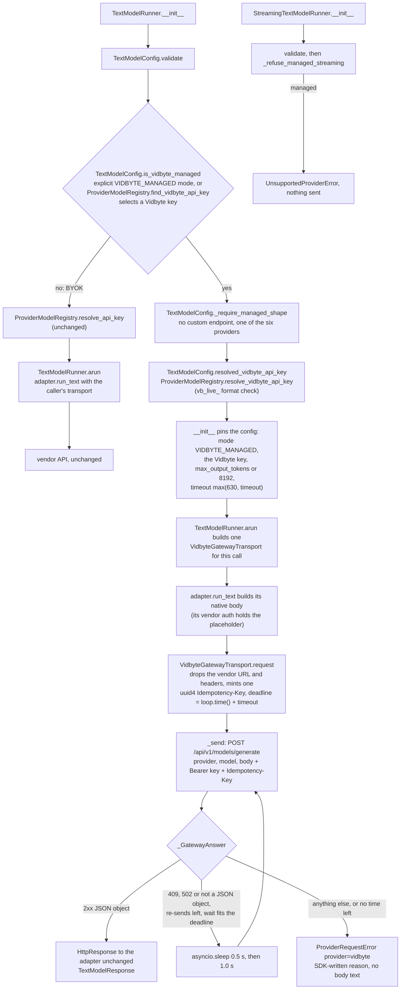

feat(lib): add a Vidbyte-managed mode that sends text calls through POST /api/v1/models/generate
## Motivation

The 2% markup on generative tokens can only be collected on calls that pass through a gateway holding Vidbyte's own provider keys. Before this PR, every SDK text adapter posted straight to the vendor with the caller's key, and a developer with only `VIDBYTE_API_KEY` got `Missing API key for provider openai. Pass api_key or set OPENAI_API_KEY.` The backend half, cerredz/Vidbyte#672, adds the route and does the billing. This PR is the SDK half. As the user asked, it stays in the lib layer: every production change is under `vidbyte/lib/`.

## Summary

Text calls now have a Vidbyte-managed mode: when the key a call would use is a Vidbyte key (an explicit `vb_live_` key, a `vb_live_` value in the provider's env var, or `VIDBYTE_API_KEY` when the provider has no key of its own), or when `mode=TextModelMode.VIDBYTE_MANAGED` is set, the call goes to Vidbyte's one route, `POST https://vidbyte-backend.onrender.com/api/v1/models/generate`, with the caller's Vidbyte key instead of to the vendor. The backend pays the provider and bills provider cost plus 2%; the SDK holds no price, fee or markup. The design choice that matters most is that the routing is one transport decorator, `VidbyteGatewayTransport`, so no provider adapter changes: the adapters still build their native request, and the decorator drops the vendor URL and headers, wraps the body as `{provider, model, body}`, and posts it with a bearer key and one `Idempotency-Key` per call. It re-sends a 409, a 502 or an answer that is not a JSON object with the same key while the call's own timeout lasts, and turns any failure into an SDK-worded `ProviderRequestError` that never repeats a response body. Spec: `docs/spec/managed-generative-models/spec.md` (r5).

## How to use what this PR introduces

```python
# Environment: VIDBYTE_API_KEY=vb_live_<your key>; OPENAI_API_KEY is not set.
from vidbyte.lib.config import TextModelConfig, TextModelMode
from vidbyte.lib.runners import TextModelRunner

runner = TextModelRunner(TextModelConfig(provider="openai", model="gpt-5.5"))
response = runner.run("Say hi in one word.")

print(response.provider.value, response.model)  # openai gpt-5.5
print(response.text)                            # the model's answer, e.g. Hi
print(response.usage["output_tokens"])          # from OpenAI's own usage block, e.g. 2

# Force managed mode even when ANTHROPIC_API_KEY is also set:
claude = TextModelRunner(TextModelConfig(provider="anthropic", model="claude-sonnet-5", mode=TextModelMode.VIDBYTE_MANAGED))
```

I ran this snippet exactly as written, in-process. A fake transport (the feature pack's `ScriptedGateway`, patched in where `TextModelRunner` looks up `HttpTransport`) stood in for the network, with a fake `vb_live_` key. No live call was made. Output, and the one request the fake recorded:

```text
openai gpt-5.5
Hi
2
--- recorded by the fake transport ---
requests: 1
POST https://vidbyte-backend.onrender.com/api/v1/models/generate
headers: ['authorization', 'content-type', 'idempotency-key'] | idempotency-key is 32 hex: True
{"provider": "openai", "model": "gpt-5.5", "body": {"model": "gpt-5.5", "input": "Say hi in one word.", "max_output_tokens": 8192}}
timeout_seconds: 630.0
```

The AC-1 test runs the same snippet and asserts these lines: `1 passed`. Building the `claude` runner sends nothing. With only a Vidbyte key, the developer writes the same code as with their own key and no longer needs a provider account or provider key for OpenAI, Anthropic, Gemini, xAI, DeepSeek or Kimi.

## Flow



All validation happens once, in `TextModelRunner.__init__`. `validate()` decides BYOK or managed for this provider. In managed state, it refuses a custom endpoint, an unmanaged provider and a malformed key before anything is sent. The only state change is the pinned config the runner keeps, so a later environment change does not move a managed runner off the gateway. On each call, the unchanged adapter builds its native body, and the gateway transport replaces the URL and headers and runs the retry loop. Failures are caught in `_send`, which keeps only the exception's class. Every error is raised after the `except` block, so neither a response body nor a chained exception can carry the key.

## What changed

| File | Change |
|---|---|
| `vidbyte/lib/enums/text_model.py` (new) | `TextModelMode` enum: `AUTO` and `VIDBYTE_MANAGED`. |
| `vidbyte/lib/enums/__init__.py` | Exports `TextModelMode`. |
| `vidbyte/lib/config/__init__.py` | Re-exports `TextModelMode`, as it already does `DecisionModelMode`. |
| `vidbyte/lib/constants/jev.py` | Eight managed-gateway constants: the key prefix (the one owner lint C020 wants), the key pattern, the env var name, the gateway URL, the six providers, the 8,192 default cap, the 630 s timeout floor and the `vidbyte-managed` placeholder. Header updated. |
| `vidbyte/lib/registries/models.py` | `find_vidbyte_api_key` (the AUTO key fall-through) and `resolve_vidbyte_api_key` (the live-key check, shared with Jev). `resolve_api_key` is unchanged. |
| `vidbyte/lib/dataclasses/model_configs.py` | `TextModelConfig` changes: a `mode` field (last), `api_key` hidden from repr, `__post_init__` checks of the mode and of the explicit-managed shape, `is_vidbyte_managed()`, `resolved_vidbyte_api_key()`, the placeholder from `resolved_api_key()` in managed state, and a managed branch in `validate()`. `DecisionModelConfig` now delegates its managed key check to the shared resolver. |
| `vidbyte/lib/http/vidbyte_gateway.py` (new) | `VidbyteGatewayTransport` builds the envelope and the managed headers, re-sends with the same key under one deadline, and raises credential-safe errors. It is not re-exported from `vidbyte.lib.http`. |
| `vidbyte/lib/runners/text.py` | Pins a managed config at construction, and wraps each managed call in a new `VidbyteGatewayTransport`. |
| `vidbyte/lib/runners/streaming_text.py` | Refuses managed state at construction with `UnsupportedProviderError`. |
| `lint/contracts/vidbyte-platform-contract.json` | Byte copy from backend `ceabda93`, which adds the `models.generate` route. |
| `lint/contracts/README.md` | Provenance row and Change Log line for that copy. |
| `lint/baseline.json` | C020 ratcheted from 4 to 2: the two inline `vb_live_` sites in `DecisionModelConfig` are gone. |
| `README.md` | New "Vidbyte-managed text calls" section: the 2% fee, turning it on and off, the six providers, caps, size limit, refused fields, waits, retries and billing. |
| `tests/test_jev_run_state_relation.py` | One test now blanks `VIDBYTE_API_KEY`, so a developer's real key cannot make it send a live POST (review R-4). No assertion changed. |
| `tests/features/sdk_managed_text/` (8 new files) | Feature pack with 39 tests: acceptance (5), selection (13), wire contract (4), failures (10) and deadline (7), plus `FEATURE.md`, `README.md` and the shared fakes in `managed_text_fixtures.py`. |
| `docs/spec/managed-generative-models/spec.md` | The spec (r5). This PR's last commit sets `status: pr-open`, adds AC-28 and syncs EC-16. |
| `docs/spec/managed-generative-models/test-plan.md` | Test plan; it now names spec r5 and maps EC-38 to the deadline tests. |
| `docs/spec/managed-generative-models/review.md`, `verify-log.md` | Review findings with their fixing commits, and the gate matrix. |
| `docs/spec/managed-generative-models/request.md`, `pipeline.md`, `context/code-map.md`, `reports/*.md` (12 reports) | The request capture, the pipeline state, the repo recon and each stage's report. |
| `docs/spec/managed-generative-models/pr-body.md` | This description. |

## Compatibility

**Behavior that changes for existing callers**
- **`VIDBYTE_API_KEY` now turns on billed text calls.** In AUTO mode (the default), the key for a text call is chosen in this order:
  1. the explicit `api_key`;
  2. the provider's own env var;
  3. `VIDBYTE_API_KEY`, for the six managed providers only.

  The call is managed when the chosen key is a Vidbyte key. A process with `VIDBYTE_API_KEY` set and no OpenAI key used to fail with "Missing API key for provider openai…". Its OpenAI calls now succeed, and Vidbyte bills them at provider cost plus 2%. The backend charges this; the SDK holds no rate. The rule applies per provider, so it also covers agents, their fallback, fork and aggregation children, and every runner that `Runner.build` creates. JevAgent users usually have this variable set already.
- **A `vb_live_` key passed as `api_key`, or placed in a provider's env var,** now goes to the gateway, not to the vendor. For a provider outside the six, it is refused with `UnsupportedProviderError` before any request.
- **Test suites.** Take a test that builds a real `TextModelRunner` with no provider key, in a shell where `VIDBYTE_API_KEY` is set. Such a test used to fail with a missing-key error. Once the route is deployed, it sends a live, billable POST instead. One test in this repo needed a fix for this (R-4), and downstream suites may need one too: blank the variable in such tests.
- **Managed calls wait longer and always cap output.** A managed runner raises the timeout of each attempt to at least 630 s. With re-sends, the worst case is about 21 minutes. When `max_output_tokens` is not set, it sends 8,192. Anthropic BYOK calls keep their 1,024 default.
- **Streaming refuses managed mode** at construction with `UnsupportedProviderError`, and nothing is sent. BYOK streaming beside a Vidbyte key is unchanged.
- **Managed errors** are `ProviderRequestError` with `provider="vidbyte"`, the HTTP status and no `response_excerpt`. Their messages are written by the SDK and never quote a response body. A 404 from a host where the route is not yet deployed reads "<provider> returned HTTP 404 through the Vidbyte gateway…" (Deviation 1).

**Unchanged**
- **BYOK.** Traffic whose selected key is not a Vidbyte key is byte-identical to before (the AC-3 goldens), and Vidbyte never bills it.
- **Providers and modalities outside managed mode.** Managed mode serves only OpenAI, Anthropic, Gemini, xAI, DeepSeek and Kimi. The backend excludes GLM, MiniMax, Meta and Mistral, because it maps no credential for any of them and Mistral has no pricebook entry (backend NG-9 and Q-3; review M-3). For those four, for OpenRouter, and for the image, video, audio and embedding configs, `VIDBYTE_API_KEY` alone still gives the existing "Missing API key" error.
- **`DecisionModelConfig` (Jev).** Its results, messages and `error_kind` are unchanged; it now calls the shared resolver.
- **Package surface.** The root `vidbyte.__all__`, `pyproject.toml` and the dependencies are unchanged.

**Public Python surface**
- New: `TextModelMode` (from `vidbyte.lib.enums` and `vidbyte.lib.config`); `TextModelConfig.mode`, `.is_vidbyte_managed()` and `.resolved_vidbyte_api_key()`; `ProviderModelRegistry.find_vidbyte_api_key()` and `.resolve_vidbyte_api_key()`.
- `TextModelConfig.mode` is the last field, so positional use of the first 20 fields is unchanged. It must be a `TextModelMode`: the plain string `"vidbyte_managed"` raises `ConfigurationError`.
- `repr(TextModelConfig)` no longer shows `api_key`.
- In managed state, `TextModelConfig.resolved_api_key()` returns the non-secret placeholder `vidbyte-managed`. An adapter called directly with a managed config therefore sends the placeholder to the vendor, which answers 401. It never sends the Vidbyte key.

**Known limitation from the backend (its RR-1)**
- #672 refuses OpenAI's `gpt-5.6` family with 422 `model_gateway_unbillable_request`, because its pinned SDK cannot price `gpt-5.6` cache writes. The SDK's own default OpenAI model is `gpt-5.6-sol` (`ProviderModelRegistry.DEFAULT_PROVIDER_MODELS`, `vidbyte/lib/registries/models.py:67`), which is in that family. So a managed OpenAI call that uses the default, or any `gpt-5.6*` model, gets a 422 until both of these land:
  - an OpenAI `cache_write_tokens` usage parser in this repo;
  - a backend SDK pin bump.

  Callers who name another model are unaffected; `gpt-5.5`, used in the snippet above, is an example.

## Merge order

- This PR depends on cerredz/Vidbyte#672, which adds the route. **Merge and deploy #672 first.** Until the route is live on `vidbyte-backend.onrender.com`, every managed call fails with a 404 or a network error.
- `lint/contracts/vidbyte-platform-contract.json` is a byte copy of the file on backend branch `feat/generative-model-gateway` at commit `ceabda93ea8f782d0d91f897c05b0ee974f2c5a3` (blob `56d4d0b3`). #672's current head, `69a1836a`, carries the same blob.
  - If #672 is merged with a merge commit, nothing more is needed.
  - If #672 is squash-merged, re-vendor the file from the squash commit on backend `main` before merging this PR, and update the Provenance row in `lint/contracts/README.md`.
- Lint would not catch a stale copy. The contract loader checks only `schema_version`, `source.repository`, the format of `source.commit` and `source.generator` (`lint/core/platform_contract.py:190-194`). It does not check which backend commit the file came from.

## Acceptance criteria → proof

Test files are under `tests/features/sdk_managed_text/`: **A** = `test_managed_text_acceptance.py`, **S** = `test_managed_text_selection.py`, **W** = `test_managed_text_wire_contract.py`, **F** = `test_managed_text_failures.py`, **D** = `test_managed_text_deadline.py`. Every name below exists on this branch.

| AC | What it checks (plain words) | Proven by |
|---|---|---|
| AC-1 | The snippet works with only `VIDBYTE_API_KEY` set and sends one gateway POST. | A `test_readme_snippet_with_only_vidbyte_key_sends_one_gateway_post_and_prints_the_provider_answer` |
| AC-2 | Each of the six providers sends its own BYOK body once, inside the envelope, with exactly three headers. | A `test_each_managed_provider_posts_its_byok_body_once_to_the_gateway_and_parses_the_answer` |
| AC-3 | A provider key keeps the vendor request byte-identical, even with `VIDBYTE_API_KEY` set. | A `test_provider_key_keeps_its_byok_request_byte_identical_while_keyless_providers_go_managed`; S `test_key_fall_through_sends_byok_to_the_vendor_or_vidbyte_keys_to_the_gateway_in_inv4_order` |
| AC-4 | Explicit managed mode uses the Vidbyte key and never reads the provider env var. | S `test_explicit_managed_mode_uses_the_vidbyte_key_and_never_reads_the_provider_env_var` |
| AC-5 | A missing, malformed or non-string Vidbyte key fails with a tagged `ConfigurationError`, and nothing is sent. | S `test_managed_credential_failures_raise_tagged_configuration_errors_before_any_request` |
| AC-6 | Managed state refuses a custom endpoint; a BYOK proxy still works. | S `test_managed_state_refuses_a_custom_endpoint_while_a_byok_proxy_still_works` |
| AC-7 | Managed state refuses any provider outside the six, and nothing is sent. | S `test_managed_state_refuses_every_provider_the_gateway_does_not_serve` |
| AC-8 | Every managed body carries the output cap, 8,192 or the caller's value; a cap override in `extra_body` passes through unchanged. | W `test_managed_body_carries_the_default_cap_or_the_callers_exact_value_in_each_dialects_field`; W `test_extra_body_generation_config_and_completion_cap_reach_the_gateway_unchanged` |
| AC-9 | Each attempt's timeout is at least 630 s, and a NaN timeout becomes 630 s. | W `test_each_managed_attempt_gets_the_630_second_floor_and_a_nan_timeout_resolves_to_the_floor` |
| AC-10 | Gateway errors carry no body text; a 502 makes three POSTs, every other status one. | F `test_gateway_errors_raise_credential_safe_errors_after_one_post_or_three_for_a_502`; F `test_gateway_error_messages_state_the_remedy_section_9_2_binds_for_each_status` |
| AC-11 | A relayed provider error names the provider and status and withholds the provider's text. | F `test_relayed_provider_errors_name_the_provider_and_status_and_withhold_its_message` |
| AC-12 | No response gives one POST and a "may already have billed" message; a non-JSON answer is re-sent, then reported as a transient edge failure. | F `test_a_missing_response_is_raised_after_one_post_and_says_vidbyte_may_already_have_billed`; F `test_an_answer_that_is_not_a_json_object_is_retried_then_raised_as_a_transient_edge_failure` |
| AC-13 | Streaming refuses managed state; BYOK streaming beside a Vidbyte key still streams. | S `test_streaming_refuses_managed_state_but_still_streams_byok_beside_a_vidbyte_key` |
| AC-14 | Jev's managed key check is shared and unchanged, and C020 drops to 2. | S `test_decision_and_text_share_one_managed_key_resolver_with_unchanged_messages`; `tests/test_jev_managed_gateway.py`; `python lint/run.py` → `C020 api-key-prefix-contract 2 2 RATCHETED` (ratchet `26ff83e3`) |
| AC-15 | `repr(TextModelConfig)` hides the key. | S `test_text_config_repr_hides_the_api_key` |
| AC-16 | Adapters see only the placeholder key in managed state, even when called directly. | S `test_adapters_see_only_the_placeholder_key_in_managed_state_even_when_called_directly` |
| AC-17 | The full local gate passes with C017 0, C018 1, C019 0 and C020 2. | `run_ci.py --stage source` at this head and `--stage package` at `90459fb8` (Verification); contract re-vendored in `bbbb87a6` |
| AC-18 | The README states the fee and the limits, and its numbers match the constants. | A `test_readme_managed_section_states_the_fee_and_the_limits_that_match_the_constants` (one stale streaming line: RR-2 in Follow-ups) |
| AC-19 | Production code changes only under `vidbyte/lib/`. | `git diff --name-only origin/main...HEAD`: 9 production `.py` files, all under `vidbyte/lib/`; none under `vidbyte/providers/` or `vidbyte/agents/` |
| AC-20 | Two calls send two different `Idempotency-Key`s, and concurrent calls keep their own. | F `test_two_identical_calls_on_one_runner_send_two_different_keys`; F `test_concurrent_calls_each_keep_their_own_key_across_their_own_retries` |
| AC-21 | A managed runner stays managed after the environment changes; a BYOK runner never sends the Vidbyte key. | S `test_managed_runner_stays_managed_and_byok_runner_never_sends_the_vidbyte_key_after_env_changes` |
| AC-22 | `VIDBYTE_API_KEY` alone does not affect image, video, audio or embedding configs. | S `test_vidbyte_key_alone_manages_text_but_not_image_video_audio_or_embedding` |
| AC-23 | A managed Gemini answer is parsed from `usageMetadata`, as in BYOK. | A `test_each_managed_provider_posts_its_byok_body_once_to_the_gateway_and_parses_the_answer` (gemini subtest) |
| AC-24 | An agent's model turn goes through the gateway. | A `test_agent_model_turn_with_only_vidbyte_key_goes_through_the_gateway` |
| AC-25 | An unexpected exception becomes a `ProviderRequestError` without its text, and cancellation propagates unchanged. | F `test_an_unexpected_exception_is_raised_once_without_any_of_its_text`; F `test_cancellation_from_the_send_or_the_retry_wait_propagates_unchanged` |
| AC-26 | A managed body uses only keys on the gateway's allowed list for its dialect. | W `test_managed_body_emits_only_the_keys_on_each_dialects_allowed_list` |
| AC-27 | Same-key re-sends: the right POST counts, waits of 0.5 s and 1.0 s, one key and one envelope; answers that are not retryable are sent once. | F `test_a_retryable_answer_followed_by_success_returns_the_provider_answer_unchanged`, plus the AC-10, AC-11 and AC-12 (a) tests |
| AC-28 | Re-sends stop at one deadline per call, each attempt keeps its full timeout, and the last attempt decides the error. | D `test_a_fast_502_is_re_sent_twice_and_the_error_counts_two_re_sends`; D `test_a_502_after_600_s_is_re_sent_once_with_the_full_630_s_timeout`; D `test_a_502_that_leaves_exactly_the_first_wait_is_not_re_sent`; D `test_a_422_after_a_502_raises_the_422_and_its_remedy`; D `test_a_missing_response_after_a_502_raises_the_no_response_error` |

## Verification

All commands ran from the worktree root with `env -u DEEPSEEK_API_KEY -u VIDBYTE_API_KEY PYTHONPATH=$(pwd)` unless noted. "This head" means `6bedcc7d` plus this PR's docs-only finalize commit.

| Gate | Command | Result |
|---|---|---|
| Feature pack | `python -m pytest tests/features/sdk_managed_text -q -p no:cacheprovider` | this head: `39 passed in 0.90s` |
| AC-1 snippet | the same, with `-k test_readme_snippet_with_only_vidbyte_key_sends_one_gateway_post_and_prints_the_provider_answer` | this head: `1 passed, 38 deselected in 0.68s` |
| Full suite | `python -m pytest tests -q -p no:cacheprovider` | this head: `3011 passed, 1 skipped in 15.82s` |
| Full suite, network blocked | the full suite with a fake live-format `VIDBYTE_API_KEY` and a socket-blocking plugin | `90459fb8` (verify-log): `3011 passed, 1 skipped in 16.85s`; blocked attempts: 0 |
| Lint | `python lint/run.py` | this head: `A002 intent-comments 652 703 IMPROVED` … `C017 platform-route-contract 0 0 CLEAN`, `C018 canonical-api-host 1 1 RATCHETED`, `C019 platform-error-code-contract 0 0 CLEAN`, `C020 api-key-prefix-contract 2 2 RATCHETED`, `S064 retry-overall-deadline 4 4 RATCHETED` / `SDK-LINT: PASS` |
| CI source stage | `python scripts/run_ci.py --stage source` | this head: `3011 passed, 1 skipped in 15.51s` / `CI passed.` |
| CI package stage | `python scripts/run_ci.py --stage package` (PYTHONPATH unset) | `90459fb8` (verify-log): `No broken requirements found.` / `Installed vidbyte-sdk 0.2.1 passed smoke checks.` / `CI passed.` Not re-run here because it installs the package; only docs have changed since. |
| Semgrep | `pysemgrep scan --error --config .semgrep/typed-mapping-boundary-policy.yml vidbyte --metrics=off` | `90459fb8` (verify-log): `Findings: 0 (0 blocking)` / `Ran 1 rule on 872 files: 0 findings.` |
| Remote checks | `gh pr checks https://github.com/cerredz/Vidbyte-SDK/pull/759` | `no checks reported on the 'feat/managed-generative-models' branch` |

Automatic GitHub Actions triggers are disabled in this repo; `ci.yml` and `static-policy.yml` run on `workflow_dispatch` only. So `gh pr checks` shows no checks, and the local gate matrix above is the evidence. A manual dispatch exists (`gh workflow run ci.yml --ref feat/managed-generative-models`, and the same for `static-policy.yml`). It was not run, because it would spend the owner's Actions minutes on workflows they disabled.

- [x] Existing repository checks pass. (Local gates as above; remote workflows not dispatched.)
- [x] New or changed package assets are present in the built wheel. (This PR adds no package data. The two new modules are in existing packages that `[tool.setuptools.packages.find] include = ["vidbyte*"]` collects, and the package stage built, installed and smoke-tested the wheel.)
- [ ] Documentation and examples reflect the change. (Not ticked. The README section exists and its facts are tested (AC-18), but `README.md:269-270` still tells gemini, xai, deepseek and kimi users to set their own key to stream, which leads to a second refusal: RR-2.)
- [x] No credentials, private data, generated bytecode, build output, or unrelated changes are included. (Test keys are synthetic, built as `"vb_live_" + "a" * 32`. A scan of the added lines finds no key-shaped literal and no bytecode or build output.)

## Adversarial review

Three lenses (spec conformance, repo conventions, engineering) raised findings, and an independent verifier confirmed 6 of them: 1 Blocker and 5 Major. All 6 are fixed; 0 were waived. Of the 14 Minor findings, 8 are fixed (M-1, M-2, the M-3 citation, M-4, M-5, M-7, M-9 and M-14) and 6 are follow-ups. The post-repair re-review came back SOUND with 0 Blocker, 0 Major and 3 Minor. That report labels its Minors R-C1 to R-C3; this body calls them RR-1 to RR-3, in the same order, to avoid a clash with review.md's ids. Full record: `docs/spec/managed-generative-models/review.md`.

| ID | Finding | Fixed in |
|---|---|---|
| R-1 (Blocker) | Three main-function `@intent` blocks sat at the top of their method, away from the code they explain. This is the shape the owner rejected on #690. | `92d3d690` |
| R-2 (Major) | `validate()` → `resolved_api_key()` → `is_vidbyte_managed()` was a two-level call chain (AGENTS.md style 1), and it ran the key fall-through twice. | `745f8efe` |
| R-3 (Major) | The new deadline test file would push S020 above its baseline unless the pack README's File Index listed it. | `8eea0362` |
| R-4 (Major) | With a developer's `VIDBYTE_API_KEY` set, `test_legacy_mode_keeps_per_run_begin_semantics` sent a live, billable POST to the production gateway. | `15eb286e` |
| R-5 (Major) | Each of the 16 new `@intent` markers came after a summary comment line, not on its own first line. | `23a5e87c` |
| R-6 (Major) | No test covered the r5 cumulative retry deadline or the re-send count in messages; five mutants survived. | `8eea0362` (test); spec AC-28 and test-plan sync in this PR's finalize commit |

## Deviations from the spec

1. **EC-26 wording.** A 404 `{"detail":"Not Found"}` from a host without the route is a JSON object with no top-level `"error": true`, so §9.2 row 6 decides it. The message is "<provider> returned HTTP 404 through the Vidbyte gateway; the provider's message is withheld, and the call was not billed", not "Vidbyte returned HTTP 404". The spec was updated to match in `15203ae4`.
2. **Contract copy contents.** The copy from `ceabda93` already contains backend main's agent-run routes and four `agent_run_*` error codes, which the spec expected a branch copy to lack. The SDK calls none of them, and C017–C020 pass.
3. **README example.** The README keeps the §4 calls, with two differences. It moves the comments off column 0, because the AC-18 test ends the section at the first line that starts with `# `. And it prints `response.text, response.usage` instead of §4's three lines.
4. **Re-send wording.** Per r5, the edge, 409 and 502 messages state the re-sends made: "the SDK re-sent it with the same Idempotency-Key (re-sends in this call: N)". When the deadline left no time for the first wait, they say instead "the SDK did not re-send it, because the call's <timeout> s timeout left no time for another attempt".
5. **The backend contract moved past spec A-1.** The SDK spec was built on backend spec r3. The final #672 contract adds four refusals:
   - the `gpt-5.6` family;
   - a required `max_tokens` for DeepSeek;
   - a `cache_control` TTL rule;
   - a Gemini `responseModalities` rule.

   The SDK needs no change for the last three: in managed mode its DeepSeek body always carries `max_tokens`, and no adapter emits `cache_control` or `responseModalities`. The first is the known limitation under Compatibility.

## Follow-ups

**Needs the user, in this repo (outside this PR)**
- (a) An OpenAI `cache_write_tokens` usage parser, so `OpenAIUsage` prices `input_tokens_details.cache_write_tokens`. This is the backend's R-1 full fix. After it lands, the backend bumps its SDK pin and re-enables `gpt-5.6`.
- (b) Merge SDK branch `fix/xai-reasoning-token-cost` (commit `c4494365`), so the backend can bump its pin and retire its xAI reasoning fold (the backend's R-2).

**Re-review Minors (RR-1 to RR-3)**
- RR-1, production part: the TESTS line of the `vidbyte/lib/http/vidbyte_gateway.py:9` header omits `test_managed_text_deadline.py`. The spec and test-plan parts are done in this PR.
- RR-2: `README.md:269-270` still tells gemini, xai, deepseek and kimi users to "set the provider's own key to stream", which leads to a second refusal. Smallest fix: "or, for OpenAI and Anthropic, set the provider's own key to stream". The comments at `vidbyte/lib/runners/streaming_text.py:27-28` and `:58-59` are stale in the same way. The EC-16 part is done in this PR.
- RR-3: every deadline test uses a timeout equal to the 630 s floor, so a deadline taken from the floor constant instead of the call's own timeout passes all 39 tests. Fix: add a case with a 900 s timeout and a 700 s step that expects 2 POSTs.

**Review Minors not fixed (by decision)**
- M-6: `_GatewayAnswer` is a mutable record that uses exception classes as tags. A frozen dataclass plus an enum would exceed the spec's class budget.
- M-8: the managed-endpoint check is an inline copy of `DecisionModelConfig`'s. One shared owner needs public surface beyond the budget.
- M-10: the row-2 message drops even the exception's class, so a local `TypeError` reads like a possible billing event. The fix needs an S2 test assertion change.
- M-11: a `vb_live_` key placed in `OPENAI_API_KEY` still reaches api.openai.com from the embedding and image configs, because `resolve_api_key` is unchanged on purpose (INV-18).
- M-12: the 630 s timeout also covers connect and pool, so a request that never connected is still reported as "may already have billed".
- M-13: same-key re-sends leave no operator trace: no log, and no `Idempotency-Key` in the error `details`.

**Known limitations and next PRs**
- Serving GLM, MiniMax, Meta or Mistral needs backend credentials and pricebook entries first (M-3, scope-adding).
- Neither the README nor the SDK's 422 message names the backend's `gpt-5.6` refusal. The message covers it only as "an unmanaged or unpriced provider or model".
- Branch freshness: origin/main is 23 commits past this branch's merge base, `00cbd6db`. `git merge-tree` shows a clean merge, and none of those commits touch this PR's files, `lint/baseline.json` or `lint/contracts/`. The branch was not merged or rebased here; updating it is the user's call.

🤖 Generated with [Claude Code](https://claude.com/claude-code)
