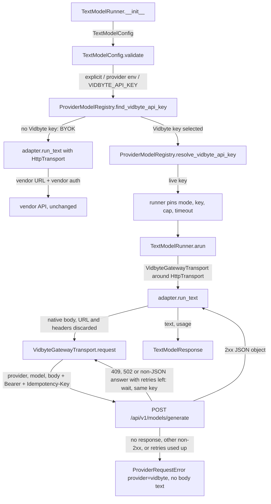
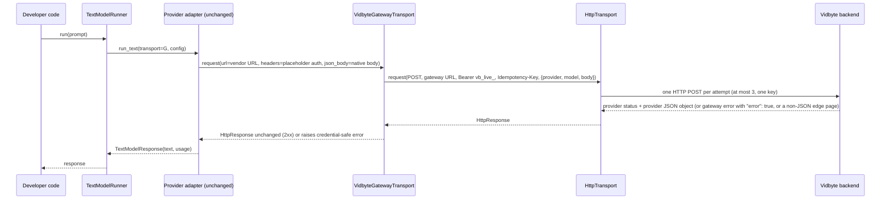

# Spec: Vidbyte-managed mode for generative model calls (lib layer)

> **TL;DR** — With only `VIDBYTE_API_KEY` set (or `mode=TextModelMode.VIDBYTE_MANAGED`), every non-streaming text call from `TextModelRunner`, and so from every agent, goes through Vidbyte's one gateway route, `POST /api/v1/models/generate`, where the backend pays the provider with its own key and bills the call at a 2% markup, while bring-your-own-key users see no change. The key design choice is a transport decorator in `vidbyte.lib.http`, `VidbyteGatewayTransport`, which `TextModelRunner` puts in front of the existing transport. It wraps the adapter's provider-native body in the gateway envelope and sends it to the single gateway URL with the Vidbyte bearer key, so none of the provider adapters change.

## §0 User prompts

### 0.1 Invoking request (verbatim)
great so the way I want to handle this is 1) I want 1 route in the vidbyte/ repo, and then handle the underlying api requests in a orchestrator/server layer for the different routes to the different providers. and then 2) the sdk changes we can handle in the lib layer of the repo. lets achieve this 2% markup on generative tokens

### 0.2 User replies during the run
_None yet. The orchestrator appends any reply the user sends during the run here verbatim, labeled with the revision it produced._

---

## Part A — Framing

## §1 Goal

**Why now.** The 2% markup can only be collected on tokens that pass through a Vidbyte-controlled gateway that holds the provider keys (request.md §C "Billing is enforced only on the server"). Today the SDK has no route for a generative call to reach such a gateway:
- Every text adapter posts straight to the vendor. Examples are `f"{config.resolved_endpoint()}/responses"` with the caller's own key at `vidbyte/providers/openai.py:30`, and `/messages` with `x-api-key` at `anthropic.py:25`/`:58`.
- `TextModelConfig` has no managed mode (`vidbyte/lib/dataclasses/model_configs.py:45-115`).
- A user who holds only `VIDBYTE_API_KEY` gets `ConfigurationError("Missing API key for provider openai. Pass api_key or set OPENAI_API_KEY.")` (`vidbyte/lib/registries/models.py:161`).

The backend PR (`generative-model-gateway`) adds the route. This PR makes the SDK use it.

| ID | Goal (outcome) | How we will know | Source |
|---|---|---|---|
| G-1 | Every non-streaming generative text call made through the SDK in managed mode is sent to Vidbyte's one gateway route, where the backend bills it at 2%. This covers all six providers the gateway serves, and covers agents as well as direct runner use. | AC-1, AC-2, AC-24: a managed call produces exactly one `POST https://vidbyte-backend.onrender.com/api/v1/models/generate` with the contract envelope, and no request goes to a vendor host. | §0 ("2% markup on generative tokens"); request.md §A Prompt 2 ("all of the generative model calls"), §D |
| G-2 | A developer with only a Vidbyte key needs no provider key and no code change. Setting `VIDBYTE_API_KEY` is enough. | AC-1: the §4 snippet works with only `VIDBYTE_API_KEY` set. | request.md §C SDK scope ("key fall-through") |
| G-3 | Developers who bring their own keys (BYOK) see no change, and the other modalities are untouched. | AC-3, AC-22: BYOK requests and errors are byte-identical to `base_commit`. | request.md §C ("BYOK traffic stays unbilled by design") |
| G-4 | From the SDK side, managed mode cannot be turned into a way around the fee or a way to leak the key. The Vidbyte key only ever travels to the gateway, cannot be pointed at another host, and never appears in errors or repr. | AC-6, AC-7, AC-10–AC-16 | request.md §A Prompt 1 ("no workarounds"), §C constraints |

## §2 Objective

When this PR merges, the repository contains the following:
- **A managed mode on `TextModelConfig`.** It is a new last field, `mode: TextModelMode = TextModelMode.AUTO`, with a new enum `TextModelMode` and a key hidden from repr. In managed mode the config:
  - requires a live `vb_live_` key;
  - refuses a custom endpoint;
  - refuses providers that the gateway does not serve.
- **A key fall-through in `ProviderModelRegistry`.** The order is explicit key, then the provider's env var, then `VIDBYTE_API_KEY`. A Vidbyte key selected anywhere in that order switches the config to managed mode.
- **A new `VidbyteGatewayTransport`** in the module `vidbyte.lib.http.vidbyte_gateway` (not re-exported from the package, R-10). It is the one place that builds the managed headers (bearer `vb_live_` key plus one fresh `Idempotency-Key` per call). It wraps the adapter's native body as `{provider, model, body}`, posts it to the single gateway URL, re-sends a 409, a 502 or an answer that is not a JSON object up to twice with the same key while the call's own timeout leaves time for the wait, and turns every remaining failure into a credential-safe `ProviderRequestError`.
- **`TextModelRunner` wiring.** The runner fixes managed mode at construction. It fills in a default output-token cap (the gateway refuses calls without one) and a client timeout of at least 630 s, above the gateway's 600 s total upstream deadline. Each call is then routed through the gateway transport.
- **A clear refusal of managed mode in `StreamingTextModelRunner`.**
- **One owner constant for the `vb_live_` prefix**, as lint C020 requires, with `DecisionModelConfig` delegating its managed-key check to the shared resolver. C020 drops from 4 to 2.
- **The re-vendored platform contract** containing the new route, copied from the backend branch commit that regenerates it.
- **A README section** that states the 2% fee plainly, the per-provider BYOK rule, the request fields the gateway refuses, and that managed calls run under Vidbyte's provider accounts.

This is the SDK slice. The route, metering, admission and daily cap are the backend PR's slice. Run ids, cost display and streaming are deferred (§3).

## §3 Non-goals

- **NG-1** — Run ids and close-run summaries on generative calls (`X-Vidbyte-Run-Id`, `/runs/{id}/close`). — *Why not:* request.md §C defers them, and backend §9.2.2 ignores `X-Vidbyte-Run-Id` on this route.
- **NG-2** — Per-call fee accrual and runs that mix Jev and generative calls. — *Why not:* this is deferred, and it is the backend's concern.
- **NG-3** — Showing the marked-up cost in the SDK's local usage tracker, or recording managed calls in the usage ledger. — *Why not:* deferred by request.md §C. `TextModelRunner` does not write the ledger today (`lib/runners/text.py:34-49`).
- **NG-4** — A streaming relay. Managed streaming is refused instead (FR-7). — *Why not:* deferred. Backend §9.2.7 refuses streaming.
- **NG-5** — Managed mode for OpenRouter, GLM, MiniMax, Meta, Mistral, Codex, or the image, video, audio and embedding modalities. — *Why not:* request.md §C excludes them, and backend §9.2.8 does not dispatch them.
- **NG-6** — Client-side token counting, metering or enforcement. — *Why not:* request.md §C rejects it, because a fork can remove it.
- **NG-7** — Any edit under `vidbyte/providers/` or `vidbyte/agents/`. That covers the adapters, the TypeSafe redaction regex sites (`providers/typesafe.py:255`, `:271`), the key-crossing guards (`agents/settings/fallback.py:147-155`, `agents/fork.py:85-95`, `agents/aggregation.py:331-349`) and the runtime retry loop (`agents/runtime.py:607-690`). — *Why not:* Prompt 5 puts the SDK changes in "the lib layer". D-1 needs no adapter edits.
- **NG-8** — Moving or renaming the Jev constants (`JEV_IDEMPOTENCY_KEY_HEADER`, `JEV_MANAGED_RUN_ID_HEADER`), or changing `VIDBYTE_JEV_GATEWAY_ENDPOINT`. — *Why not:* none of it is needed, and tests pin the Jev host (`tests/test_jev_managed_gateway.py:120,154,163`; `tests/test_jev_managed_runs.py:23,32`).
- **NG-9** — Reusing one `Idempotency-Key` across agent-runtime retries. — *Why not:* it needs an edit in `vidbyte/agents/runtime.py`, outside lib (Q-1).
- **NG-10** — A "direct only" text mode that refuses managed billing. — *Why not:* nobody asked for it (Q-3).
- **NG-11** — Counting `VIDBYTE_API_KEY` in `ProviderModelRegistry.resolve_active` (the multi-provider grader). — *Why not:* nobody asked for it (Q-6).
- **NG-12** — The backend route, metering, wallet admission and daily cap. — *Why not:* they are the sibling PR, `generative-model-gateway`.
- ~~**NG-13** — Transport-level retries for managed calls, including the same-key retry that backend r3 §9.2.5–§9.2.6 calls safe after a 409, a 502 or a non-JSON edge answer.~~ **Withdrawn r4** (orchestrator decision, Q-7 resolved yes): managed calls now re-send a 409, a 502 or an answer that is not a JSON object with the same key, inside `VidbyteGatewayTransport` (D-10, INV-16).
- **NG-14** — Client-side checks of `extra_body` against the gateway's allowed body fields or cap rules. — *Why not:* the gateway checks the final body and refuses with 422 (backend §9.2.4 step 4). A second copy of the allowed lists in the SDK would drift (NG-6). See Q-8.

## §4 Developer usage

```python
# Environment: VIDBYTE_API_KEY=vb_live_<your key>; OPENAI_API_KEY is not set.
from vidbyte.lib.config import TextModelConfig, TextModelMode
from vidbyte.lib.runners import TextModelRunner

runner = TextModelRunner(TextModelConfig(provider="openai", model="gpt-5.5"))
response = runner.run("Say hi in one word.")

print(response.provider.value, response.model)  # openai gpt-5.5
print(response.text)                            # the model's answer, e.g. Hi
print(response.usage["output_tokens"])          # from OpenAI's own usage block, e.g. 2

# The one request the SDK sent:
#   POST https://vidbyte-backend.onrender.com/api/v1/models/generate
#   authorization: Bearer vb_live_<your key>
#   content-type: application/json
#   Idempotency-Key: <32 lowercase hex characters, new for every call>
#   {"provider": "openai", "model": "gpt-5.5",
#    "body": {"model": "gpt-5.5", "input": "Say hi in one word.", "max_output_tokens": 8192}}

# Force managed mode even when ANTHROPIC_API_KEY is also set:
claude = TextModelRunner(TextModelConfig(provider="anthropic", model="claude-sonnet-5", mode=TextModelMode.VIDBYTE_MANAGED))
```

The developer writes the same code as with their own key. Only the environment changed, and the response is the provider's own answer parsed by the same adapter. Developers no longer need a provider account or a provider key for any of the six managed providers. A managed call may wait up to 630 s (10.5 minutes), because the gateway allows a long generation up to 600 s before it gives up. If the gateway or its hosting edge answers with a 409, a 502 or a page that is not JSON, the SDK re-sends the call up to twice with the same `Idempotency-Key` while the call's own 630 s budget lasts, so the gateway never bills it twice; in the worst case a call then takes about 21 minutes. An agent timeout shorter than 630 s, such as the 120 s prosecutor/defender/judge stage default, can cancel a call that Vidbyte still completes and bills (EC-35).

## §5 Flow diagram





1. Validation happens at runner construction. `TextModelConfig.validate()` resolves the key and settles on BYOK or managed. In managed state it checks the live-key format, refuses a custom endpoint, and refuses unmanaged providers. The runner then fixes the managed fields on its stored config, which is the only state change.
2. On each call the adapter builds its provider-native body exactly as in BYOK. The gateway transport throws away the adapter's vendor URL and its auth headers, which carry only a non-secret placeholder in managed state. It then sends one POST to the gateway; step 3 covers retries.
3. Failures are caught in the gateway transport. A 409, a 502 or an answer that is not a JSON object (a transient platform-edge failure) is first re-sent up to twice with the same `Idempotency-Key`, so the gateway replays an answer it already billed instead of paying again. Re-sends stop at one deadline per call, the call's own timeout counted from its first POST. A network failure or timeout is not retried. Whatever failure remains, and every other non-2xx answer, becomes a `ProviderRequestError` with `provider="vidbyte"` and no response text. The error is raised outside any `except` block, so it carries no chained exception. A 2xx JSON object goes back to the adapter unchanged, so text and usage are parsed exactly as in BYOK.

---

## Part B — Behavior (this is the spec; everything else is framing)

## §6 Behavior

### 6.1 Invariants

- **INV-1** (1 route, "all tokens") — In managed state, each `TextModelRunner.arun`/`run` call sends one HTTP request, plus at most `JEV_DEFAULT_RETRY_COUNT` (2) same-key retries when the answer is retryable (INV-16). Every one of them is `POST VIDBYTE_GENERATIVE_GATEWAY_ENDPOINT` (`https://vidbyte-backend.onrender.com/api/v1/models/generate`). No request goes to a vendor host, and none goes to any other Vidbyte path. This holds for all six managed providers, through the same transport.
- **INV-2** (envelope) — The managed request's JSON body has exactly the keys `provider`, `model` and `body`:
  - `provider` is `config.normalized_provider().value`: one of `openai`, `anthropic`, `gemini`, `xai`, `deepseek`, `kimi`.
  - `model` is `config.model`.
  - `body` is the provider-native payload that the adapter passed as `json_body`, unchanged. It equals the BYOK body for the same pinned config. The SDK adds no field of its own. Without `extra_body`, every top-level key (and, for Gemini, every `generationConfig` key) is one the adapters emit (§9.2 "Keys the SDK emits"), and all of them are on backend r3's allowed lists. In particular the SDK never sends `service_tier`, `previous_response_id`, `conversation`, a Gemini body `model`, or a snake_case Gemini key other than the `function_declarations` tool key.
- **INV-3** (headers, "the same" gateway convention as Jev) — The managed request's headers are exactly these three, and no `X-Vidbyte-Run-Id`, `x-api-key`, `x-goog-api-key`, `anthropic-version` or other header is sent:
  - `authorization: Bearer <vb_live_ key>`;
  - `content-type: application/json`;
  - `Idempotency-Key: <uuid4 hex>` (32 lowercase hex characters), new for every `arun` call and identical on that call's retries (INV-16).
- **INV-4** (fall-through) — With `mode=AUTO`, the key is selected in this order:
  1. a non-blank explicit `api_key`;
  2. otherwise a non-blank provider env var (`API_KEY_ENV_VARS`);
  3. otherwise, only for the six managed providers, a non-blank `VIDBYTE_API_KEY`.

  The config is managed when the key chosen in step 1 or 2 starts with `VIDBYTE_API_KEY_PREFIX` after stripping, or when step 3 chose the key. Otherwise the config is BYOK, with today's behavior.
- **INV-5** (explicit managed) — With `mode=VIDBYTE_MANAGED`, the key is the explicit `api_key`, or else `VIDBYTE_API_KEY`. The provider env var is never read. The key must fullmatch `VIDBYTE_API_KEY_PATTERN`. Failures raise `ConfigurationError` with `details["error_kind"] == VIDBYTE_MANAGED_CREDENTIAL_ERROR_KIND`, using the existing Decision message texts.
- **INV-6** ("no workarounds", key safety) — The `vb_live_` key never appears in any of these places:
  - a request to a non-Vidbyte host;
  - a header that a provider adapter builds (`TextModelConfig.resolved_api_key()` returns `VIDBYTE_MANAGED_KEY_PLACEHOLDER` in managed state);
  - `repr(TextModelConfig)`;
  - any exception message, `details` or `response_excerpt` raised by managed mode, or reachable from it through `__cause__` or `__context__`.
- **INV-7** — A managed config never accepts a custom endpoint. `TextModelConfig.resolved_endpoint()` never returns a Vidbyte origin, in any mode.
- **INV-8** — Managed mode serves exactly `VIDBYTE_MANAGED_TEXT_PROVIDERS` (the six providers above). A managed config for any other provider raises `UnsupportedProviderError` before any request is sent.
- **INV-9** — Every managed request carries the dialect's output-token cap: the caller's `max_output_tokens` when set, otherwise `VIDBYTE_MANAGED_DEFAULT_MAX_OUTPUT_TOKENS` (8,192). An explicit caller value always wins. The guarantee holds unless `extra_body` supplies or replaces the dialect's cap container. A Gemini `generationConfig` in `extra_body` replaces the one the adapter built, and a chat-dialect `max_completion_tokens` in `extra_body` sits beside `max_tokens`. Those cases are EC-8, and the gateway decides them (backend §9.2.4 step 4.6).
- **INV-10** — The SDK's own transport timeout for a managed request is at least `VIDBYTE_GATEWAY_TIMEOUT_FLOOR_SECONDS` (630.0). It is computed floor first, as `max(VIDBYTE_GATEWAY_TIMEOUT_FLOOR_SECONDS, config.timeout_seconds)`, so a NaN timeout, which `TextModelConfig` accepts, resolves to 630.0. The SDK's transport therefore never times out before the gateway's 600 s total upstream deadline (backend §9.2.4 step 11). An outer caller timeout below 630 s, set by an agent or multi-agent layer outside `vidbyte/lib/`, can still cancel a call that Vidbyte completes and bills (EC-35). The floor applies to each attempt, and an attempt is never shortened to the time left, because a cut-short attempt could time out while the gateway is still finishing a call it bills. A missing answer, including a transport timeout, is never retried, so no retry stacks a second 630 s wait on a timed-out attempt. Re-sends share one cumulative deadline per call (lint S064): `deadline = loop.time() + timeout_seconds`, taken once before the first POST from the floored timeout. Before each retry wait, the transport stops re-sending when `loop.time() + wait >= deadline` and raises the last answer per its §9.2 row. One call makes at most three attempts, and its worst case is about twice the timeout (about 21 minutes at the floor): no re-send starts after the deadline, but a re-send that starts just before it may still use its full timeout. A slow 502 at the gateway's deadline therefore gets at most one re-send (EC-38).
- **INV-11** — When a managed call fails, `VidbyteGatewayTransport.request` raises `ProviderRequestError` with `provider="vidbyte"`, `status_code` set to the HTTP status (or `None` when no response arrived) and `response_excerpt` left as `None`. The first matching class decides (§9.2 failure mapping):
  1. no response: the inner send raised;
  2. a body that is not a JSON object, at any status: a transient failure at the hosting edge in front of the gateway, because the gateway relays only JSON objects (backend §9.2.5);
  3. a non-2xx JSON object with top-level `"error": true`: a gateway error;
  4. any other non-2xx JSON object: a relayed provider error.

  A retryable answer is first re-sent (INV-16), and the last attempt's outcome decides. The error is raised after the `except` block that caught the failure has ended, so `__cause__` and `__context__` are both `None` (D-17). Its message is written by the SDK, names the provider and the status, and contains no byte of the response body.
- **INV-12** ("simply read the response") — On a managed 2xx, the adapter receives the gateway's `HttpResponse` unchanged and parses it with the same code as BYOK. `TextModelResponse.text` and `.usage` come from the provider's own JSON (`usage`, or `usageMetadata` for Gemini).
- **INV-13** — `StreamingTextModelRunner` raises `UnsupportedProviderError` at construction when the config is in managed state, and sends zero requests.
- **INV-14** — A managed `TextModelRunner`'s mode is decided once, at construction. Environment changes after construction do not switch a managed runner back to BYOK. A BYOK runner is not pinned, because pinning would change BYOK behavior (INV-17). Its `resolved_api_key()` still reads the environment on each call, so it can switch to the placeholder but never to the gateway and never to the Vidbyte key (AC-21, EC-19).
- **INV-15** ("2% markup") — The SDK sends no price, fee, markup or usage figure, and holds no markup constant. The 2% is applied only by the backend, from the provider response it observed.
- **INV-16** — Managed retries happen only inside `VidbyteGatewayTransport` (D-10). One `arun` call makes at most 1 + `JEV_DEFAULT_RETRY_COUNT` (3) POSTs, all with the same `Idempotency-Key` and a byte-identical envelope, waiting 0.5 s and then 1.0 s between them. It re-sends only an answer whose status is 409 or 502, whatever the body, or whose body is not a JSON object, whatever the status, and only while the call's cumulative deadline (INV-10) leaves time for the wait; past it, the last answer is raised per its §9.2 row, and its message states how many re-sends the call made. A missing answer (network failure or transport timeout) and every other status are raised after one POST. Because the key is reused, the gateway answers a retry from its replay when an earlier attempt completed, instead of paying again; the one exception is a replay store outage (EC-39). Two separate calls with identical prompts send two different keys.

**Must not regress:**
- **INV-17** — BYOK text calls are byte-identical to `base_commit`. This covers a config whose selected key lacks the prefix (explicit, or from the provider env var), and covers URL, headers, body, timeout and errors. Today's paths: `providers/openai.py:30`, `anthropic.py:25`, `gemini.py:26-27`, `compatible.py:32`. One exception: `repr(TextModelConfig)` no longer shows `api_key` (FR-10).
- **INV-18** — `ProviderModelRegistry.resolve_api_key`, and the Image, Video, Audio and Embedding configs that use it, are unchanged. A user with only `VIDBYTE_API_KEY` still gets the existing "Missing API key …" error for those configs (`registries/models.py:152-161`).
- **INV-19** — `DecisionModelConfig` behaves exactly as before:
  - managed key resolution, its three error messages, `error_kind`, `resolved_endpoint()` and `resolved_run_close_url()` (`model_configs.py:341-431`);
  - `VIDBYTE_JEV_GATEWAY_ENDPOINT` keeps its value;
  - the positional field order is unchanged.
- **INV-20** — `TextModelConfig`'s first 20 fields keep their order and defaults. Constructing a config with `mode=AUTO` raises nothing new, except for a `mode` that is not a `TextModelMode`.
- **INV-21** — For a text config with no key, when `VIDBYTE_API_KEY` is unset or the provider is not managed, the error stays `"Missing API key for provider <p>. Pass api_key or set <ENV>."`.
- **INV-22** — BYOK streaming (`StreamingTextModelRunner` with a non-Vidbyte key) is unchanged, including the existing provider refusal (`lib/runners/streaming_text.py:51-58`).
- **INV-23** — The agent key-crossing guards and their behavior are unchanged. They drop only an explicit key across providers.

### 6.2 Acceptance criteria

| ID | Given | When | Then | Priority | Proof |
|---|---|---|---|---|---|
| AC-1 | a clean checkout of this branch, only `VIDBYTE_API_KEY` set, a transport that answers 200 with an OpenAI Responses body | the §4 snippet runs | it produces exactly the shown result: `openai gpt-5.5`, the answer text, and usage from the provider body. Exactly one request is recorded, with the URL, headers and envelope shown in the §4 comment. | P0 | `tests/features/sdk_managed_text/test_managed_text_acceptance.py::ManagedTextAcceptanceTests::test_readme_snippet_with_only_vidbyte_key_sends_one_gateway_post_and_prints_the_provider_answer` |
| AC-2 | only `VIDBYTE_API_KEY` set, for each of `openai`, `anthropic`, `gemini`, `xai`, `deepseek`, `kimi` | `TextModelRunner(...).run(prompt)` | exactly one request goes to `VIDBYTE_GENERATIVE_GATEWAY_ENDPOINT` with method POST and the three headers of INV-3. The body is `{"provider": <value>, "model": <config.model>, "body": <BYOK body>}`. Gemini's `body` carries `generationConfig.maxOutputTokens` and no `model` key. | P0 | `tests/features/sdk_managed_text/test_managed_text_acceptance.py::ManagedTextAcceptanceTests::test_each_managed_provider_posts_its_byok_body_once_to_the_gateway_and_parses_the_answer` |
| AC-3 | a non-`vb_live_` key passed explicitly or set in the provider env var, with `VIDBYTE_API_KEY` also set | a text call runs | URL, headers, body and timeout equal `base_commit`'s BYOK request exactly, and no gateway request is sent | P0 | `tests/features/sdk_managed_text/test_managed_text_acceptance.py::ManagedTextAcceptanceTests::test_provider_key_keeps_its_byok_request_byte_identical_while_keyless_providers_go_managed`; `tests/features/sdk_managed_text/test_managed_text_selection.py::KeySelectionTests::test_key_fall_through_sends_byok_to_the_vendor_or_vidbyte_keys_to_the_gateway_in_inv4_order` |
| AC-4 | `mode=VIDBYTE_MANAGED`, a non-Vidbyte `OPENAI_API_KEY` set, and `VIDBYTE_API_KEY` set | a call runs | the gateway request uses the `VIDBYTE_API_KEY` value, and the provider env var is never used | P0 | `tests/features/sdk_managed_text/test_managed_text_selection.py::KeySelectionTests::test_explicit_managed_mode_uses_the_vidbyte_key_and_never_reads_the_provider_env_var` |
| AC-5 | managed state with (a) no Vidbyte key, (b) a key that does not match the live format, (c) a non-string `api_key` | `TextModelRunner` is constructed | `ConfigurationError` with `details["error_kind"] == "vidbyte_managed_credentials"`. Messages: (a) "Missing Vidbyte API key. Pass api_key or set VIDBYTE_API_KEY.", (b) "The managed Vidbyte API key must be a live key in the vb_live_ format.". Zero requests are sent. | P0 | `tests/features/sdk_managed_text/test_managed_text_selection.py::KeySelectionTests::test_managed_credential_failures_raise_tagged_configuration_errors_before_any_request` |
| AC-6 | managed state (explicit mode, or AUTO with a Vidbyte key) and a non-blank `endpoint` | the config is built (explicit mode) or the runner is constructed (AUTO) | `ConfigurationError`, and zero requests | P0 | `tests/features/sdk_managed_text/test_managed_text_selection.py::KeySelectionTests::test_managed_state_refuses_a_custom_endpoint_while_a_byok_proxy_still_works` |
| AC-7 | an explicit `vb_live_` key, or `mode=VIDBYTE_MANAGED`, with provider `openrouter` (or any provider outside the six) | the config is built (explicit mode) or the runner is constructed (explicit key) | `UnsupportedProviderError` naming the managed providers, and zero requests | P0 | `tests/features/sdk_managed_text/test_managed_text_selection.py::KeySelectionTests::test_managed_state_refuses_every_provider_the_gateway_does_not_serve` |
| AC-8 | managed state with (a) `max_output_tokens` unset, (b) `max_output_tokens` set to N, (c) provider `gemini` and `extra_body={"generationConfig": {"temperature": 0.2}}`, (d) provider `xai` and `extra_body={"max_completion_tokens": 2000}` | a call runs | (a) and (b): the native body carries 8,192, or N, at the dialect's cap field (`max_output_tokens`, `max_tokens`, or `generationConfig.maxOutputTokens`). (c): the body's `generationConfig` is the `extra_body` one, with no `maxOutputTokens`, and the request is still sent once. (d): the body carries both `max_tokens: 8192` and `max_completion_tokens: 2000`. In (c) and (d) the SDK adds and removes nothing (NG-14). | P0 | `tests/features/sdk_managed_text/test_managed_text_wire_contract.py::OutputCapTests::test_managed_body_carries_the_default_cap_or_the_callers_exact_value_in_each_dialects_field`; `tests/features/sdk_managed_text/test_managed_text_wire_contract.py::OutputCapTests::test_extra_body_generation_config_and_completion_cap_reach_the_gateway_unchanged` |
| AC-9 | managed state with `timeout_seconds` of 60.0, 30.0, 120.0, 900.0 or `float("nan")` | a call runs | the inner transport receives 630.0, 630.0, 630.0, 900.0 or 630.0 respectively | P1 | `tests/features/sdk_managed_text/test_managed_text_wire_contract.py::TimeoutFloorTests::test_each_managed_attempt_gets_the_630_second_floor_and_a_nan_timeout_resolves_to_the_floor` |
| AC-10 | the gateway answers 401, 402, 403, 413, 422, 429, 500, 502 or 503 with a body containing `"error": true` and a string that looks like a key | a managed call runs | `ProviderRequestError` with `provider == "vidbyte"`, the matching `status_code` and `response_excerpt is None`. `__cause__` and `__context__` are `None`. The message contains no substring of the body. A 502 is raised after three POSTs with one key (AC-27); every other status after one POST. | P0 | `tests/features/sdk_managed_text/test_managed_text_failures.py::GatewayErrorTests::test_gateway_errors_raise_credential_safe_errors_after_one_post_or_three_for_a_502`; `tests/features/sdk_managed_text/test_managed_text_failures.py::GatewayErrorTests::test_gateway_error_messages_state_the_remedy_section_9_2_binds_for_each_status` |
| AC-11 | the gateway relays a provider error (for example 400 or 429) whose JSON object body has no top-level `"error": true` | a managed call runs | `ProviderRequestError(provider="vidbyte")` with the relayed status and `response_excerpt is None`. `__cause__` and `__context__` are `None`. The message names the provider and the status and says that the provider's message is withheld. No body text appears. | P0 | `tests/features/sdk_managed_text/test_managed_text_failures.py::GatewayErrorTests::test_relayed_provider_errors_name_the_provider_and_status_and_withhold_its_message` |
| AC-12 | (a) the inner transport raises `ProviderRequestError(provider="http")` (network failure or timeout); (b) every attempt answers 200, 502 or 503 with a body that is not a JSON object (an HTML page, an empty body, or a JSON array) | a managed call runs | `ProviderRequestError(provider="vidbyte")` with `status_code` (a) `None` or (b) the answered status. `response_excerpt is None`, and `__cause__` and `__context__` are `None`. (a): the message says no response arrived and that Vidbyte may already have billed the call. (b): after three POSTs with one key, the message says Vidbyte's hosting edge answered instead of the gateway, that the SDK retried, and that the failure is usually transient. Neither message contains body text. | P0 | `tests/features/sdk_managed_text/test_managed_text_failures.py::TransportFailureTests::test_a_missing_response_is_raised_after_one_post_and_says_vidbyte_may_already_have_billed`; `tests/features/sdk_managed_text/test_managed_text_failures.py::TransportFailureTests::test_an_answer_that_is_not_a_json_object_is_retried_then_raised_as_a_transient_edge_failure` |
| AC-13 | only `VIDBYTE_API_KEY` set, or `mode=VIDBYTE_MANAGED` | `StreamingTextModelRunner(...)` is constructed | `UnsupportedProviderError` whose message names the managed-mode limitation and the fix, and zero requests | P0 | `tests/features/sdk_managed_text/test_managed_text_selection.py::KeySelectionTests::test_streaming_refuses_managed_state_but_still_streams_byok_beside_a_vidbyte_key` |
| AC-14 | the Jev managed configuration of `base_commit` | `DecisionModelConfig` resolves keys and endpoints in managed and direct mode | results, messages and `error_kind` are identical to `base_commit`, and `python lint/run.py --rule C020` reports 2 | P0 | `tests/features/sdk_managed_text/test_managed_text_selection.py::KeyHygieneTests::test_decision_and_text_share_one_managed_key_resolver_with_unchanged_messages`; `tests/test_jev_managed_gateway.py`; gate `python lint/run.py --rule C020` reports 2 (S3: ratchet `26ff83e3`, resolver delegation `d0e84a53`) |
| AC-15 | a `TextModelConfig` with `api_key="vb_live_…"` | `repr(config)` is called | the key does not appear | P0 | `tests/features/sdk_managed_text/test_managed_text_selection.py::KeyHygieneTests::test_text_config_repr_hides_the_api_key` |
| AC-16 | managed state | the provider adapter builds its headers (`resolved_api_key()`) | the value is `VIDBYTE_MANAGED_KEY_PLACEHOLDER`, never the `vb_live_` key, even when an adapter is called directly with a plain transport | P0 | `tests/features/sdk_managed_text/test_managed_text_selection.py::KeyHygieneTests::test_adapters_see_only_the_placeholder_key_in_managed_state_even_when_called_directly` |
| AC-17 | the contract re-vendored per §12.5 | `python scripts/run_ci.py` (source stage with `PYTHONPATH`, then the package stage without it) runs | every stage passes, with C017 0, C018 1, C019 0 and C020 2, and no rule above its baseline | P0 | gate `python scripts/run_ci.py` (source stage with `PYTHONPATH`, then package stage); final lines quoted by S3/S5 (S3: both stages "CI passed." at `0bc85ac8`; contract re-vendored in `bbbb87a6`) |
| AC-18 | the merged README | a reader opens the managed-mode section | it states: the 2% fee over provider cost; how to switch on (`VIDBYTE_API_KEY`) and off (set a provider key); that BYOK applies per provider, so with `VIDBYTE_API_KEY` set any managed provider without its own key is billed through Vidbyte, including fallback, fork and aggregation children; the six providers; the default cap of 8,192, and that a `generationConfig` passed in `extra_body` must include `maxOutputTokens` while chat-dialect caps belong in `max_output_tokens`; that a managed call can wait up to 10.5 minutes (630 s) per attempt; that a 409, a 502 or an answer that is not a JSON object is re-sent up to twice with the same `Idempotency-Key`, so a retry is never billed twice, and that re-sends stop once the call's own timeout (630 s at the floor) has run out, so the worst case is about 21 minutes, while network failures and timeouts are not retried; that an outer agent timeout below 630 s (such as the 120 s prosecutor/defender/judge stage default) can cancel a call that Vidbyte still completes and bills; that requests over 2,000,000 bytes (measured as JSON with non-ASCII characters escaped) are refused; that streaming is refused; the request fields the gateway refuses (hosted tools, any service tier, fields outside its allowed lists, Gemini snake_case keys, a Gemini body `model`, OpenAI `previous_response_id` and `conversation`); that managed calls run under Vidbyte's provider accounts, where provider-side stored state such as OpenAI stored responses and Gemini cached content lives; and that BYOK calls are not billed | P1 | `tests/features/sdk_managed_text/test_managed_text_acceptance.py::ManagedTextAcceptanceTests::test_readme_managed_section_states_the_fee_and_the_limits_that_match_the_constants`; full fact list checked in S4 review |
| AC-19 | the PR diff | the changed files are listed | every production `.py` change is under `vidbyte/lib/`. Nothing under `vidbyte/providers/` or `vidbyte/agents/` changes. | P0 | diff review: `git diff --name-only c0752931...HEAD` shows production `.py` only under `vidbyte/lib/` (S4). S3: that range also lists the main merge `e91cf822`, so the branch's own changes are `git diff --name-only e91cf822..HEAD`; at `0bc85ac8` its production `.py` files are all under `vidbyte/lib/` |
| AC-20 | two managed `arun` calls with identical arguments on one runner, each answered 200 | both run | exactly two POSTs are sent, one per call, with two different `Idempotency-Key` values | P0 | `tests/features/sdk_managed_text/test_managed_text_failures.py::OneKeyPerCallTests::test_two_identical_calls_on_one_runner_send_two_different_keys`; `tests/features/sdk_managed_text/test_managed_text_failures.py::OneKeyPerCallTests::test_concurrent_calls_each_keep_their_own_key_across_their_own_retries` |
| AC-21 | (a) a runner built with only `VIDBYTE_API_KEY` set; (b) a BYOK runner built with `OPENAI_API_KEY=sk-…` and `VIDBYTE_API_KEY` both set | (a) `OPENAI_API_KEY` is set afterwards; (b) `OPENAI_API_KEY` is unset afterwards; then a call runs | (a): the call still goes to the gateway. (b): the request keeps the vendor URL, its bearer is `VIDBYTE_MANAGED_KEY_PLACEHOLDER`, the vendor's 401 surfaces as a vendor `ProviderRequestError`, and the `vb_live_` key appears in no request. | P1 | `tests/features/sdk_managed_text/test_managed_text_selection.py::KeySelectionTests::test_managed_runner_stays_managed_and_byok_runner_never_sends_the_vidbyte_key_after_env_changes` |
| AC-22 | only `VIDBYTE_API_KEY` set | an Image, Video, Audio or Embedding config validates, or `ProviderModelRegistry.resolve_api_key("openai", None)` runs | the existing "Missing API key for provider …" `ConfigurationError` is raised | P0 | `tests/features/sdk_managed_text/test_managed_text_selection.py::KeySelectionTests::test_vidbyte_key_alone_manages_text_but_not_image_video_audio_or_embedding` |
| AC-23 | a managed Gemini call answered 200 with `usageMetadata` | the response is parsed | `TextModelResponse.usage` equals the `usageMetadata` object and `.text` equals the BYOK extraction | P0 | `tests/features/sdk_managed_text/test_managed_text_acceptance.py::ManagedTextAcceptanceTests::test_each_managed_provider_posts_its_byok_body_once_to_the_gateway_and_parses_the_answer` |
| AC-24 | only `VIDBYTE_API_KEY` set, and an agent configured with `provider="openai"` | the agent runs one model turn | its model request goes to the gateway (agents use `Runner.build` → `TextModelRunner`) | P1 | `tests/features/sdk_managed_text/test_managed_text_acceptance.py::ManagedAgentTests::test_agent_model_turn_with_only_vidbyte_key_goes_through_the_gateway` |
| AC-25 | managed state, and the inner transport raises (a) an `Exception` that is not a `ProviderRequestError` (for example a `TypeError` for a body value that cannot be encoded), or (b) `asyncio.CancelledError` (from the inner send, or from the wait before a retry) | a managed call runs | (a): `ProviderRequestError(provider="vidbyte", status_code=None)`, `response_excerpt is None`, `__cause__` and `__context__` are `None`, and the message contains no text of the original exception. (b): `CancelledError` propagates unchanged. | P1 | `tests/features/sdk_managed_text/test_managed_text_failures.py::TransportFailureTests::test_an_unexpected_exception_is_raised_once_without_any_of_its_text`; `tests/features/sdk_managed_text/test_managed_text_failures.py::OneKeyPerCallTests::test_cancellation_from_the_send_or_the_retry_wait_propagates_unchanged` |
| AC-27 | managed state, and a scripted inner transport that answers in order: (a) 502 with a gateway error body, then 200 with a provider body; (b) 503 with an HTML body, then 409 with a gateway error body, then 200; (c) 502 three times; (d) one of 401, 402, 403, 413, 422, 429, 500 or 503 with a gateway error body, or a relayed 400 or 429; (e) a raised `ProviderRequestError(provider="http")` | a managed call runs | (a) two POSTs, (b) three POSTs, (c) three POSTs, (d) one POST, (e) one POST. All POSTs of one call carry the same `Idempotency-Key` header and `idempotency_key` argument and an identical envelope, and leave `retry_count` at its default. The waits before the second and third POST are 0.5 s and 1.0 s (`JEV_RETRY_BACKOFF_SECONDS` times the retry number). (a), (b): the 200 response reaches the adapter unchanged. (c): `ProviderRequestError(status_code=502)` after the third POST. (d), (e): the matching error after the single POST. | P0 | `tests/features/sdk_managed_text/test_managed_text_failures.py::SameKeyRetryTests::test_a_retryable_answer_followed_by_success_returns_the_provider_answer_unchanged`; `tests/features/sdk_managed_text/test_managed_text_failures.py::GatewayErrorTests::test_gateway_errors_raise_credential_safe_errors_after_one_post_or_three_for_a_502`; `tests/features/sdk_managed_text/test_managed_text_failures.py::GatewayErrorTests::test_relayed_provider_errors_name_the_provider_and_status_and_withhold_its_message`; `tests/features/sdk_managed_text/test_managed_text_failures.py::TransportFailureTests::test_a_missing_response_is_raised_after_one_post_and_says_vidbyte_may_already_have_billed` |
| AC-26 | for each of the four adapters (OpenAI, Anthropic, Gemini, OpenAI-compatible), a managed config with every optional `TextModelConfig` field the adapter maps set, including tools and run metadata, and no `extra_body` | the native body is built | every top-level key, and for Gemini every `generationConfig` key, is in that dialect's row of the §9.2 "Keys the SDK emits" table. No `service_tier`, `previous_response_id`, `conversation` or Gemini `model` key appears. For Gemini, every top-level key and every direct key of `generationConfig` is camelCase, except the `function_declarations` key inside each `tools` entry. Nested user-supplied values (schemas, parameter names, the contents of `thinkingConfig`) are not checked. | P0 | `tests/features/sdk_managed_text/test_managed_text_wire_contract.py::EmittedKeyTests::test_managed_body_emits_only_the_keys_on_each_dialects_allowed_list` |

### 6.3 Edge cases and failure modes

| ID | Trigger (input + state) | System behavior | User sees | Guarded by (INV-/D-) |
|---|---|---|---|---|
| EC-1 | `OPENAI_API_KEY=sk-…` and `VIDBYTE_API_KEY=vb_live_…` are both set, AUTO mode | BYOK: the provider key wins. Without the guard, existing BYOK users would be silently billed. | Today's behavior | INV-4, INV-17 |
| EC-2 | Only `VIDBYTE_API_KEY` set, provider `openrouter` | Step 3 is skipped for unmanaged providers, so the config stays BYOK | `Missing API key for provider openrouter. Pass api_key or set OPENROUTER_API_KEY.` | INV-4, INV-21 |
| EC-3 | An explicit `api_key="vb_live_…"` with provider `openrouter` | Managed state, then refused before any request. Without the guard, the Vidbyte key would go to OpenRouter. | `UnsupportedProviderError` listing the six managed providers | INV-8, INV-6 |
| EC-4 | `VIDBYTE_API_KEY` is malformed (`vb_test_…`, too short, or wrong characters) and no provider key is set | Step 3 selects it, so the config is managed, and the format check fails | `ConfigurationError` "…must be a live key in the vb_live_ format." with `error_kind` | INV-4, INV-5 |
| EC-5 | `OPENAI_API_KEY` holds a `vb_live_` key | Step 2 finds the prefix, so the config is managed and that key is the bearer. Without the guard, the Vidbyte key would be sent to api.openai.com. | The call goes to the gateway | INV-4, INV-6 |
| EC-6 | `mode=VIDBYTE_MANAGED` with `endpoint="https://proxy"` | Rejected in `__post_init__` | `ConfigurationError` at construction | INV-7 |
| EC-7 | AUTO with only `VIDBYTE_API_KEY`, plus `endpoint` set | Rejected in `validate()` | `ConfigurationError` at runner construction | INV-7 |
| EC-8 | Managed state with `extra_body` that (a) sets `stream: true`, a different `model`, any Gemini `model`, `"max_output_tokens": 0`, a `service_tier`, `previous_response_id`, or any key outside the dialect's allowed list; (b) replaces Gemini `generationConfig` without `maxOutputTokens`; or (c) adds chat-dialect `max_completion_tokens` | The adapter merges `extra_body` last, and the SDK sends the body unchanged (NG-14). (a) and (b): the gateway refuses with 422 `model_gateway_unbillable_request` before paying upstream. (c): the gateway takes the larger cap (8,192 by default) for admission and the hold, so a small wallet or daily cap answers 402 or 429 sooner, and the vendor may reject the two fields together (relayed 400). | (a), (b): `ProviderRequestError(provider="vidbyte", status_code=422)` whose message lists the refusal causes. (c): a 402, a 429 or a relayed 400. The README gives both cap rules. | server-side (backend §9.2.4 step 4); INV-9 (scoped), INV-11; accepted (Q-8) |
| EC-9 | The model is not catalogued for the provider in the backend pricebook (strict match: an exact id, an alias, or a dated snapshot suffix, so `gemini-3.5-flash-image` is refused), the model string fails `^[A-Za-z0-9._:-]+$`, or the provider is not managed server-side | Gateway 422 `model_gateway_unsupported_model`, or `harness_validation_failed` for the pattern | Credential-safe 422 message naming an unmanaged or unpriced model as one cause | server-side (backend §9.2.3), INV-11 |
| EC-10 | The wallet cannot cover the worst case | Gateway 402, which only ever means the caller's own wallet (a provider 402 becomes a 502) | Message: the wallet balance is too low; top up or use your own provider key | server-side, INV-11 |
| EC-11 | The key's daily cap is reached, or its request quota is exhausted | Gateway 429 (no `Retry-After` for the cap) | Message naming the quota or daily spend cap | server-side, INV-11 |
| EC-12 | The provider rejects the body: 400 because the cap exceeds the model's maximum (for example the 8,192 default on a model whose output limit is below 8,192), or because an Anthropic thinking budget is ≥ the cap | The relayed 400 is not billed (backend §9.2.5) | "anthropic returned HTTP 400 through the Vidbyte gateway; provider message withheld". The developer sets `max_output_tokens`. | accepted (D-8, D-11, Q-2) |
| EC-13 | Gateway 502 (one code for every upstream cause: network, the 600 s deadline, a missing Vidbyte credential, or the provider refusing Vidbyte's own key or account with 401, 402 or 403), 503 (gatekeeper or gateway state) or 500 | A 502 is re-sent up to twice with the same key while the call's deadline lasts (INV-16). A persistent cause fails again at no cost to the caller, and a deadline cause forwards again (EC-38). A JSON 503 or 500 is raised after one POST. A gateway non-2xx is never billed. | 5xx message: the gateway or the provider behind it is unavailable or refused Vidbyte's account, the cause is not known, and for a 502 how many times the SDK re-sent it | INV-11, INV-16 |
| EC-14 | An agent-runtime retry (outside `vidbyte/lib/`) after the SDK raised, when the gateway had already paid and billed a 2xx. The SDK raised either because no response arrived (a network drop, or a client timeout of 630 s or more, which the SDK never retries) or because a retryable answer persisted after its two same-key retries | The runtime retry sends a new POST with a new key and is billed again. The SDK's own retries reuse one key and are answered from the replay (INV-16). | The message says no response arrived, or names the last answer, and says that Vidbyte may already have billed the call | accepted limitation for runtime-level retries only (D-10, NG-9, Q-1). The 630 s floor (INV-10) is above the gateway's 600 s total deadline, so the SDK's own transport no longer times out while the gateway is still waiting on the provider. Outer caller timeouts are EC-35. |
| EC-15 | The answer, at any status, is not a JSON object: an HTML 502, 503 or 504 page from the platform edge during a deploy or restart, a proxy cut, an empty body, or a JSON array | Classified as an edge failure before the 2xx and `"error": true` checks, and re-sent up to twice with the same key while the call's deadline lasts (INV-16). If the gateway had completed the call, the retry gets the saved answer from the replay and nothing is billed again. If it is still running, the retry gets 409 (EC-37). After the last attempt the outcome is raised credential-safe. | `ProviderRequestError(provider="vidbyte", status_code=<status>)`, no excerpt. The message says the hosting edge answered, how many times the SDK re-sent it, and that the failure is usually transient. | INV-11, INV-16, D-17 |
| EC-16 | `StreamingTextModelRunner` with only `VIDBYTE_API_KEY` set | Refused after `validate()` and before the provider check | `UnsupportedProviderError`: streaming is not available in Vidbyte-managed mode. Use `TextModelRunner`, or set `<PROVIDER>_API_KEY` to stream with your own key. | INV-13 |
| EC-17 | `StreamingTextModelRunner` with `OPENAI_API_KEY=sk-…` and `VIDBYTE_API_KEY` | BYOK streaming | Today's behavior | INV-22 |
| EC-18 | `mode="vidbyte_managed"` passed as a plain string (for example from YAML options) | Rejected, mirroring `DecisionModelConfig` (`model_configs.py:364-365`) | `ConfigurationError("mode must be a TextModelMode value.")` | INV-20, accepted |
| EC-19 | The environment changes after the runner is built | A managed runner keeps managed mode. A BYOK runner is not pinned: if its provider key is removed while `VIDBYTE_API_KEY` is set, its next call keeps the vendor URL and sends the placeholder, so the vendor answers 401. The Vidbyte key never leaves. | Same routing as at construction, or a vendor 401 in the removed-key case | INV-14, INV-6, accepted |
| EC-20 | Managed state with `timeout_seconds=30` | Raised to 630.0. A shorter client timeout cannot stop a paid upstream call, which may run up to 600 s. | The call waits up to 630 s (10.5 minutes) per attempt (EC-38) | INV-10, accepted |
| EC-21 | A developer calls an adapter directly (`ModelProviders.text(config).run_text(transport=HttpTransport())`) with a managed config | The vendor receives the placeholder key and answers 401. The Vidbyte key never leaves. | A vendor 401 `ProviderRequestError` | INV-6, accepted |
| EC-22 | A parent agent passes an explicit `vb_live_` key, and a fallback, fork or aggregation child uses another provider | The existing guard drops the explicit key. The child resolves through its env: managed if `VIDBYTE_API_KEY` is set, otherwise a missing-key error (fails closed). | Missing-key error, or a managed child | INV-23, accepted (Q-4) |
| EC-23 | The multi-provider grader runs with only `VIDBYTE_API_KEY` and no `provider_models` | `_resolve_from_environment` still ignores `VIDBYTE_API_KEY` | "No model providers have API keys configured in the environment." | accepted (NG-11, Q-6) |
| EC-24 | Concurrent `arun` calls on one runner | Each call builds its own `VidbyteGatewayTransport` and mints its own key, with no shared mutable state | Independent calls | INV-16 |
| EC-25 | The same prompt is sent twice on purpose | Two keys are sent, so both calls are answered and billed. Content-addressed keys would replay a stale answer. | Two answers | INV-16, D-10 |
| EC-26 | The SDK is released before the backend route is deployed, or Render is down | 404, an edge page, or a network error | For a 404 `{"detail":"Not Found"}`, the §9.2 row 6 message: "<provider> returned HTTP 404 through the Vidbyte gateway; the provider's message is withheld, and the call was not billed" (orchestrator decision, §17 deviation 1). Otherwise the edge message or the no-response message | merge order (§15), INV-11 |
| EC-27 | A JevAgent user already has `VIDBYTE_API_KEY` set but no provider key | Text calls used to fail with a missing-key error. They now run managed and are billed at 2%. | Calls succeed, and the README states the fee | accepted behavior change (§9.4, AC-18, Q-3); the mixed case is EC-30 |
| EC-28 | An explicit key with whitespace, such as `" key "` | Stripped before the prefix check. It has no prefix, so the config stays BYOK. | Today's behavior (`tests/test_config_validation.py:12-16`) | INV-17 |
| EC-29 | `api.vidbyte.pro` is still `planned` | The SDK uses the live Render host | Requests succeed against the live host | D-4 |
| EC-30 | A BYOK user with `OPENAI_API_KEY=sk-…` and `VIDBYTE_API_KEY` set (for example a JevAgent user) calls a managed provider they hold no key for: directly, or through a fallback, fork or aggregation child, or a utility runner built by `Runner.build` | INV-4 runs per provider, so step 3 selects `VIDBYTE_API_KEY` for that provider and the call runs managed. At `base_commit` it failed with "Missing API key". | The call succeeds and is billed at provider cost plus 2%. To keep that provider unbilled, set its key; unsetting `VIDBYTE_API_KEY` would also stop Jev calls. | accepted behavior change: the settled fall-through (INV-4), README per-provider rule (AC-18), Q-3, Q-9 |
| EC-31 | A managed Gemini call with `cached_content` set | Sent as `cachedContent`, which the gateway allows. The name resolves in Vidbyte's Gemini project, not the developer's: the developer's own caches are not found (relayed 4xx), and a leaked cache name of another tenant resolves under Vidbyte's key. | A relayed Gemini error, or an answer built on that cache | accepted limitation (T-7; backend T-4a and Q-8; Q-10) |
| EC-32 | Vidbyte's own provider account or key fails with a status other than 401, 402 or 403 (OpenAI 429 `insufficient_quota`, Anthropic 400 "credit balance is too low", Gemini 400 `API_KEY_INVALID`) | Relayed unchanged and not billed (backend §9.2.5, backend EC-46). The SDK handles it like any relayed provider error. | "<provider> returned HTTP 429 (or 400) through the Vidbyte gateway; provider message withheld". The developer cannot tell that the account is Vidbyte's. | accepted limitation (backend EC-46), INV-11 |
| EC-33 | The inner send raises an `Exception` that is not a `ProviderRequestError` (for example a `TypeError` for a body value that cannot be JSON-encoded) | Caught by the one guarded try and classified as no response | `ProviderRequestError(provider="vidbyte", status_code=None)`. The message says the request failed before an answer arrived and that, if it reached Vidbyte, it may have been billed. | INV-11, D-17 |
| EC-34 | The managed call is cancelled (`asyncio.CancelledError`, for example by agent cancellation) or interrupted (`KeyboardInterrupt`) during the send or during the wait before a retry | Not caught: only `Exception` is caught, never `BaseException`, so the cancellation propagates unchanged | The cancellation, as in BYOK | D-17 |
| EC-35 | A managed call runs under an outer timeout shorter than 630 s. On by default: the prosecutor/defender/judge stage limit `DebateStageSettings.timeout_seconds`, 120 s for a stage of up to four model calls (`vidbyte/context/algorithms/prosecutor_defender_judge.py:67`, enforced by `asyncio.timeout` at `vidbyte/agents/algorithms/prosecutor_defender_judge.py:494`). Opt-in, default `None`: `per_proposer_timeout`, `run_timeout_seconds` and `worker_timeout_seconds` (`vidbyte/lib/dataclasses/multi_agent.py:127,399,401`) | The outer timeout cancels the runner, and the cancellation propagates through the transport (D-17). The gateway still completes the upstream call and bills it. Multi-agent dispatcher retries send a new POST with a new key, so each attempt can be billed. BYOK has the same economics, because the vendor bills an abandoned call too. | A stage, proposer, run or worker timeout instead of an answer, and the call may still be billed. The README states this. | accepted limitation: those settings live outside `vidbyte/lib/` (INV-10 scope, AC-18, Q-11) |
| EC-36 | The forwarded body exceeds 2,000,000 bytes, measured as `json.dumps` output with non-ASCII characters escaped (up to 6 bytes per character), for example a long agent context that worked under BYOK | Gateway 413 `model_gateway_request_too_large` before any upstream call; nothing is billed | Message: the request exceeds the gateway's 2,000,000-byte limit; shorten the context or use your own provider key | server-side (backend §9.2.4 step 5), INV-11 |
| EC-37 | A same-key retry finds the first attempt still running at the gateway (a pending claim, up to 660 s), for example after an edge page cut off the first answer | Gateway 409 `model_gateway_idempotency_in_progress`. The SDK re-sends it after the remaining wait (1.0 s), so the retries usually end in 409. | `ProviderRequestError(status_code=409)`: an earlier attempt of this call is still running at Vidbyte and may still complete and be billed; sending a new request now may pay twice | INV-16, D-10, accepted |
| EC-38 | A 502 after the gateway's 600 s total deadline (backend EC-38), re-sent by the SDK | The claim was released, so a same-key retry forwards again: Vidbyte may pay the provider again, and the caller is billed only for a 2xx. Each attempt has its own timeout of at least 630 s (INV-10), but no re-send starts once the call's cumulative deadline (its own timeout, counted from the first POST) cannot cover the wait, so a slow 502 gets at most one re-send. | Up to about 21 minutes in the worst case (2 × 630 s), then the 502 message with the number of re-sends | INV-10, INV-16, accepted |
| EC-39 | The backend's replay store is down when a same-key retry arrives | The backend proceeds without a claim (backend §9.2.4 step 8), so a retry after an edge page can be forwarded and billed again even though the first attempt completed | A normal answer, possibly billed twice | server-side (backend replay service), accepted limitation |

**Rollback of the user action:**
- A developer leaves managed mode by setting a provider key (BYOK wins, EC-1), or by unsetting `VIDBYTE_API_KEY` and dropping `mode=VIDBYTE_MANAGED`.
- Calls already billed stay billed. The SDK holds no state to undo.
- An operator rolls back by reverting this PR. The backend route stays harmless with no SDK callers.

## §7 Requirements

**Functional**
| ID | Requirement | Priority | Source (request.md / G-) | Verified by |
|---|---|---|---|---|
| FR-1 | Add `TextModelMode` (`AUTO`, `VIDBYTE_MANAGED`) and `TextModelConfig.mode` (last field, default `AUTO`). A `mode` that is not a `TextModelMode` raises `ConfigurationError`. | P0 | §C SDK scope; G-2 | INV-20, AC-4, EC-18 |
| FR-2 | Implement the key fall-through of INV-4 without changing `resolve_api_key`. | P0 | §C "key fall-through"; G-2, G-3 | INV-4, INV-18, AC-1, AC-3, AC-22 |
| FR-3 | Managed key resolution: explicit key, then `VIDBYTE_API_KEY`, a live-format check, and `error_kind`. It is shared by `TextModelConfig` and `DecisionModelConfig`. | P0 | §C "requires a live Vidbyte key (mirroring DecisionModelConfig)" | INV-5, INV-19, AC-5, AC-14 |
| FR-4 | `VidbyteGatewayTransport` sends one POST per attempt to the single gateway URL, with the envelope of INV-2 and the headers of INV-3. It is the only managed header builder, and the only place that retries managed calls, with one key per call (INV-16). The body is the adapter's body unchanged, and every key the adapters emit is on backend r3's allowed lists. | P0 | §0 "1 route"; §C "one shared header builder", "the SDK sends the Idempotency-Key header"; G-1; backend r3 §9.2.4 | INV-1–INV-3, INV-16, AC-1, AC-2, AC-20, AC-26, AC-27 |
| FR-5 | At construction, `TextModelRunner` fixes managed mode, the key, the default cap and the timeout floor, and routes each call through `VidbyteGatewayTransport`. | P0 | §C "pins the gateway host"; backend r3 §9.2.4 steps 4.6 and 11; G-1 | INV-9, INV-10, INV-14, AC-8, AC-9, AC-21 |
| FR-6 | All managed failures are credential-safe `ProviderRequestError`s, with a gateway, provider and edge distinction, no body text and no chained exception. | P0 | §C "never echo gateway or upstream bodies"; G-4; backend r3 §9.2.5 | INV-11, AC-10–AC-12, AC-25 |
| FR-7 | `StreamingTextModelRunner` refuses managed state with a clear `UnsupportedProviderError`. | P0 | §C "managed streaming rejected with a clear error" | INV-13, AC-13 |
| FR-8 | Managed mode serves exactly the six providers of backend §9.2.8 and refuses any other provider before any request. | P0 | §C exclusions; G-4 | INV-8, AC-7 |
| FR-9 | Managed mode refuses a custom endpoint. | P0 | §C "Managed mode rejects a custom endpoint" | INV-7, AC-6 |
| FR-10 | `TextModelConfig.api_key` is hidden from repr (`field(default=None, repr=False)`). | P0 | §C (mirror Decision); G-4 | INV-6, AC-15 |
| FR-11 | One owner constant, `VIDBYTE_API_KEY_PREFIX`. No new `vb_live_` literal. `DecisionModelConfig` delegates to the shared resolver, and C020 is ratcheted from 4 to 2. | P0 | lint C020 (repo gate) | AC-14, AC-17 |
| FR-12 | A README managed-mode section stating the 2% fee and the limitations. | P1 | request.md §E.3 step 15 ("states the fee plainly") | AC-18 |
| FR-13 | Re-vendor `lint/contracts/vidbyte-platform-contract.json` from the backend branch commit that regenerates it (backend §12.3 row 20) and update its Provenance row. | P0 | lint C017/C018 (repo gate); backend §9.2.10 | AC-17 |
| FR-14 | `resolved_api_key()` returns `VIDBYTE_MANAGED_KEY_PLACEHOLDER` in managed state. | P0 | G-4 | INV-6, AC-16 |

**Non-functional**
| ID | Requirement | Priority | Target |
|---|---|---|---|
| NFR-1 | "all tokens" / "all of the generative model calls": in managed state, every non-streaming text call that goes through `TextModelRunner` reaches the gateway. This includes every agent call built by `Runner.build` (`lib/runners/utility.py:72-74`). | P0 | 100% of managed calls through the six providers. Zero code paths inside `vidbyte/lib/` send a managed call elsewhere (INV-1, AC-2, AC-24). |
| NFR-2 | "no workarounds" from the SDK side: the Vidbyte key reaches only the gateway, and every request the gateway cannot bill is refused before it is sent (streaming) or refused by the server (§10). The SDK does not claim to stop a fork; the backend enforces billing. | P0 | INV-6, INV-7, INV-8, INV-13, INV-15. T-1–T-7 each name a server-side control. |
| NFR-3 | "all we have to do" / "simply": the smallest SDK change that works. | P0 | ≤ 2 new files, 0 dependencies, 0 adapter edits, and the §8.4 budget |
| NFR-4 | "the lib layer": production code changes only under `vidbyte/lib/`. | P0 | AC-19 |
| NFR-5 | Gates stay green with no baseline raised. | P0 | `python scripts/run_ci.py` passes. C017=0, C018=1, C019=0, C020=2, and every other rule ≤ its baseline (AC-17). |
| NFR-6 | No new dependency, and no network in tests. | P0 | `pyproject.toml` unchanged |
| NFR-7 | Managed overhead: no extra HTTP round trip when the first answer is not retryable, at most one extra JSON parse of each answer, and one `uuid4` per call. | P1 | One request per call, plus at most 2 same-key retries of a retryable answer (INV-1, INV-16) |
| NFR-8 | "2% markup": the SDK carries no rate. The README states 2%, and the backend applies it. | P0 | INV-15, AC-18 |

---

## Part C — Design

## §8 Architecture and decisions

### 8.1 Decisions
| ID | Decision | Deciding reason | Runner-up | Flips if |
|---|---|---|---|---|
| D-1 | Managed routing is a transport decorator, `VidbyteGatewayTransport` in lib http, which `TextModelRunner` places around its transport. Adapters keep building native bodies, and the decorator discards their URL and headers. | One route (INV-1) with zero adapter edits (NFR-4). The adapters' `run_text` methods (OpenAI, Anthropic, Gemini, OpenAI-compatible) append four different suffixes to `resolved_endpoint()`, so an endpoint-only redirect cannot reach one route. | Change `TextModelConfig.resolved_endpoint()` and have adapters call a lib header builder (request.md §E.2/E.3 step 12) | The backend serves per-dialect routes, or adapters must change for another reason |
| D-2 | Envelope `{"provider": provider.value, "model": config.model, "body": json_body}` | Backend §9.2.3 requires exactly these keys. Backend §9.2.4 step 4.3 refuses a body `model` that differs from `model`, and refuses any body `model` for Gemini. `config.model` is the single source: the adapters put it in the OpenAI, Anthropic and chat bodies, and only in the URL for Gemini, so a Gemini body has no `model`. The model must also match `^[A-Za-z0-9._:-]+$` and be catalogued (EC-9). | Read `model` from `json_body["model"]`, which a Gemini body lacks | The backend contract changes |
| D-3 | "One shared header builder" means the single managed-header construction inside `VidbyteGatewayTransport`: `HttpResponseParser().bearer_headers(key)`, then `headers[JEV_IDEMPOTENCY_KEY_HEADER] = key`, the same shape as `_TypeSafeCallBuilder.decision`. Every managed provider call passes through it. | No adapter addresses the gateway under D-1, so a builder the adapters call would have no caller (request.md §C asked for "one shared header builder"). The subscript-assignment shape is the one C017 already accepts in `providers.typesafe._TypeSafeCallBuilder.decision`. | A lib header builder called from each adapter's header method | Adapters address the gateway themselves |
| D-4 | A new constant on the live host: `VIDBYTE_GENERATIVE_GATEWAY_ENDPOINT = "https://vidbyte-backend.onrender.com/api/v1/models/generate"` | The vendored platform contract marks `api.vidbyte.pro` `planned` and `vidbyte-backend.onrender.com` `live`. C018's repair text: "only the live origin may appear in SDK code"; "a second non-live host is a second outage". | Derive it from `VIDBYTE_JEV_GATEWAY_ENDPOINT` (`api.vidbyte.pro`) | The re-vendored contract marks `api.vidbyte.pro` `live` |
| D-5 | The fall-through lives in two new `ProviderModelRegistry` classmethods, `find_vidbyte_api_key` and `resolve_vidbyte_api_key`. `resolve_api_key` is untouched. | `resolve_api_key` is shared by the Image, Video, Audio, Embedding and Decision-direct configs (each `resolved_api_key()` in `lib.dataclasses.model_configs`). A fall-through there would send a `vb_live_` key to vendors (INV-18). | Add `VIDBYTE_API_KEY` as a third step inside `resolve_api_key` (request.md §E.2) | Other modalities get managed mode |
| D-6 | A new enum, `TextModelMode {AUTO, VIDBYTE_MANAGED}` | `DecisionModelMode.TYPESAFE` means nothing for text, and the AGENTS.md enum rule says closed sets are enums, so a bool is out | Reuse `DecisionModelMode` | Text and decision modes converge |
| D-7 | All new constants go in the `vidbyte.lib.constants.jev` module | C020's `RECOMMENDED_HOME` is this module, "beside the other managed-gateway constants" (lint rule C020, `RECOMMENDED_HOME` and its repair text). The managed-provider set cannot live in `model_configs.py`, because the registry needs it and `model_configs` imports the registry. The file is 694 lines at `base_commit` and 712 on SDK origin/main, so it reaches about 720 to 738 lines (§11 drift note). | A new `vidbyte/lib/constants/vidbyte_gateway.py` | The file nears 1,000 lines (AGENTS.md style 3) |
| D-8 | Default cap of 8,192 output tokens, applied in managed state only, when `max_output_tokens` is unset, for all six providers | The backend injects no cap and refuses a body without one (backend r3 §9.2.4 step 4.6). The OpenAI, Gemini and OpenAI-compatible adapters omit the cap when `max_output_tokens` is unset, so every such managed call would get a 422. One rule beats a per-dialect table. | A per-dialect default that keeps the Anthropic adapter's 1,024, or raise when the cap is unset | Review wants managed bodies identical to BYOK bodies |
| D-9 | Managed timeout = `max(630.0, timeout_seconds)`, floor first so a NaN timeout resolves to 630.0 | Backend r3 §9.2.4 step 11: the upstream call has a 600 s total deadline, and "the SDK's managed client timeout for this route must exceed 600 s (e.g. 630 s)". A shorter timeout gives up on a call the gateway may still complete and bill. 30 s of headroom covers the gatekeeper, admission, the hold and metering (backend A-11). The floor bounds each attempt of the SDK's own transport (retries: D-10); outer agent timeouts are EC-35. `max(nan, 630.0)` is NaN, while `max(630.0, nan)` is 630.0. | 90 s (r1, against the backend's earlier 60 s) | The backend's total deadline changes |
| D-10 | One fresh `uuid.uuid4().hex` `Idempotency-Key` per `arun` call, sent as a header and passed as `idempotency_key=`. `VidbyteGatewayTransport` re-sends a 409, a 502 or an answer that is not a JSON object up to `JEV_DEFAULT_RETRY_COUNT` (2) times, with that key and an identical envelope, after waits of `n × JEV_RETRY_BACKOFF_SECONDS` (0.5 s, 1.0 s), and only while one cumulative deadline per call, `loop.time() + timeout_seconds` taken before the first POST, leaves time for the wait; otherwise the last answer is raised. Each attempt keeps its full `timeout_seconds`. A response that never arrived (network failure or transport timeout) is not retried, nor is any other status. Each attempt leaves the inner `retry_count` at 0. | Orchestrator decision r4 (Q-7 yes). Orchestrator decision r5: lint S064 (added on main after `base_commit`) requires a sleeping retry loop to stop at a cumulative deadline; the call's own timeout is that deadline, so no new setting or constant is added, raising the S064 baseline is refused, and an attempt is never shortened, because a cut-short attempt could abandon a call the gateway still bills. request.md §C asks for "idempotent replay on retries reusing the existing replay mechanism (the SDK sends the `Idempotency-Key` header)", and §E.4 accepts "SDK retries a timed-out call and you pay twice \| Reuse existing, send the header". The Jev managed path does the same (`JEV_DEFAULT_RETRY_COUNT`, one key per call). Backend r3 §9.2.5–§9.2.6 calls a same-key retry safe for a 409, a 502 and an answer that is not a JSON object. §9.2.5 covers answers, not a missing answer, and `HttpTransport.request` never retries after a connection failure or timeout either. A retry after a 630 s timeout would add another 630 s while the claim is still pending (409 until 660 s, backend INV-22), so it buys time, not an answer. The decorator owns the loop because `HttpTransport` retries by status only and cannot tell that a body is not a JSON object; retrying in both layers would multiply attempts. Reusing a key across runtime retries needs `agents/runtime.py` (NG-9, Q-1). Content-addressed keys would replay a stale answer for a repeated prompt (EC-25). The waits equal `HttpTransport`'s doubling backoff for two retries, with no new constant (A007). | No transport retries and a fresh key per POST (r1–r3) | The backend changes which answers are safe to retry with the same key, or documents a missing answer as safe to retry |
| D-11 | Every managed failure is credential-safe: messages are written by the SDK from the status and the `"error": true` discriminator, and no body text is used, not even the gateway `code`. No `model_gateway_*` literals, so C019 is unaffected. | request.md §C "never echo gateway or upstream bodies in managed error messages", and the precedent `providers.typesafe._TypeSafeFailures.managed_transport_error` | Relay a redacted provider message or the gateway `code` (Q-2) | Q-2 is answered yes |
| D-12 | `TextModelConfig.resolved_api_key()` returns the non-secret `VIDBYTE_MANAGED_KEY_PLACEHOLDER` in managed state | Every adapter builds vendor auth from it inside `run_text`. Returning the real key would put it into headers that reach a vendor on direct adapter use (EC-21). Raising would break the runner path. | Return the `vb_live_` key (the decorator discards it) | Adapters stop calling `resolved_api_key()` |
| D-13 | `TextModelRunner.__init__` replaces its config with a fixed one: `mode=VIDBYTE_MANAGED`, `api_key=<resolved Vidbyte key>`, the cap and the timeout | The cap must exist before the adapter builds the body, and fixing the mode makes routing deterministic (INV-14). Fixing the key keeps EC-5 working after the mode becomes explicit. | Decide on every call | — |
| D-14 | `DecisionModelConfig`'s managed branch delegates to `ProviderModelRegistry.resolve_vidbyte_api_key`. Its own non-string check line stays. | `field-guide/vidbyte-sdk/strict-config-dataclasses.md`: "Two independent inline copies of the same rule drift silently". It removes the two C020 sites in `DecisionModelConfig.resolved_api_key`. | Leave Decision untouched and duplicate the logic | Review wants Decision untouched. C020 then stays 4, which is not a regression. |
| D-15 | Managed streaming is refused with `UnsupportedProviderError` at construction, after `validate()` and before `_validate_streaming_provider` | The same error type as the existing streaming refusal (`StreamingTextModelRunner._validate_streaming_provider`). REPO_MAP lib/errors: "reuse an existing error type". | `ConfigurationError` | — |
| D-16 | `VidbyteGatewayTransport` subclasses `HttpTransport`. It overrides `request` with keyword-only `method, url, headers, json_body, timeout_seconds` and `**transport_options: object`. The default for `timeout_seconds` is a named constant. | `run_text(transport: HttpTransport)` needs the subtype for mypy (S009). Copying the base defaults (`60.0, 0.5, 2.0, (408, …)` on `HttpTransport.request`) would add A007 findings. A replica of this override passed `mypy 2.3.1 --strict` (A-4). | Composition without subclassing, which fails mypy at the `run_text` call | — |
| D-17 | Failure classification and raise shape. One guarded try around the inner send catches `Exception`, never `BaseException`. The body is decoded with `json.loads` in its own narrow try. A body that is not a JSON object is an edge failure at any status. The 2xx test is `HTTPStatus.OK <= status < HTTPStatus.MULTIPLE_CHOICES`. Each `except` block only records the status and the classification in local variables, and the error is raised after the block has ended. `HttpResponseParser.parse_json_response` is not used. | A `raise … from None` inside `except` leaves `__context__` set to an error whose `response_excerpt` holds the body, and `parse_json_response` copies the body into `response_excerpt` on every failure path (R-2). Backend r3 §9.2.5 relays only JSON objects, so anything else came from the edge. `HTTPStatus` members are not numeric literals (A007), and a ninth constant would exceed §8.4 (R-8). Catching `BaseException` would swallow cancellation (S019, R-12). | Reuse `parse_json_response` and raise `from None` inside `except` (r1), as the TypeSafe precedent does | Python changes exception chaining, or the backend starts relaying bodies that are not JSON objects |

### 8.2 Patterns inherited
- **Managed mode on a model config** — mode enum, hidden key, live-key check, pinned host, custom endpoint refused. — `vidbyte/lib/dataclasses/model_configs.py:DecisionModelConfig` (`:341-431`).
- **Managed headers and credential-safe errors** — bearer headers plus subscript-added gateway headers, `provider="vidbyte"`, no excerpt, status-based reasons. Its raise inside `except` (`:432`) is not copied: the raise comes after the block (D-17). — `vidbyte/providers/typesafe.py:_TypeSafeCallBuilder.decision` (`:162-177`), `_TypeSafeFailures.managed_transport_error`/`managed_failure_reason` (`:222-245`).
- **Transport injection** — runners accept a `transport` and pass it to `run_text`. — `vidbyte/lib/runners/text.py:TextModelRunner.__init__`/`arun`.
- **A closed provider set as a typed frozenset** — `vidbyte/lib/dataclasses/model_configs.py:DECISION_SUPPORTED_PROVIDERS` (module level); `vidbyte/lib/runners/streaming_text.py:StreamingTextModelRunner.STREAMING_SUPPORTED_PROVIDERS` (a class attribute).
- **Refusal at construction in the streaming runner** — `vidbyte/lib/runners/streaming_text.py:_validate_streaming_provider`.
- **A str-valued mode enum with an A001 header** — `vidbyte/lib/enums/decision_model.py:DecisionModelMode`.
- **Same-key retries on a managed gateway** — one key per call, re-used by the transport's retries, with the Jev retry count and backoff. — `vidbyte/providers/typesafe.py:_TypeSafeCallBuilder.decision` (`:162-177`); `vidbyte/lib/constants/jev.py:JEV_DEFAULT_RETRY_COUNT`, `JEV_RETRY_BACKOFF_SECONDS`.
- **Status-code constants for messages** — `vidbyte/lib/constants/jev.py:VIDBYTE_STATUS_*`, `JEV_STATUS_UNPROCESSABLE`, `JEV_STATUS_SERVER_ERROR_FLOOR`.

### 8.3 Smaller design rejected
**The rejected design.** The simplest design is request.md §E.2's. In managed state:
- `TextModelConfig.resolved_endpoint()` returns a gateway root (plus the provider name);
- `resolved_api_key()` returns the `vb_live_` key.

It needs no new transport and no new file.

**Why it fails.** The adapters append their own suffixes, so one managed call per dialect would hit `…/responses`, `…/messages`, `…/models/{m}:generateContent` or `…/chat/completions`:
- **INV-1** — four paths, not the one route Prompt 5 asks for. C017 would also fail, because none of those paths is a contract route.
- **INV-3** — Anthropic and Gemini would send `x-api-key` and `x-goog-api-key`. The `vb_live_` key would ride in a vendor-specific header, and Gemini's header is not one the gatekeeper reads.
- **INV-2** — there would be no `{provider, model, body}` envelope, which the backend requires (§9.2.3).

**The second smaller design** puts `VIDBYTE_API_KEY` inside `resolve_api_key`. It fails **INV-18**, because image, video, audio and embedding configs would send a `vb_live_` key to vendors.

### 8.4 Complexity budget
| Item | Count | Justification for each |
|---|---|---|
| New files | 2 | Module `vidbyte.lib.http.vidbyte_gateway`: the decorator (D-1), whose layer owns outbound HTTP (REPO_MAP lib/http). Module `vidbyte.lib.enums.text_model`: `TextModelMode` (D-6), where AGENTS.md requires every enum to live. |
| New classes/modules | 3 | `VidbyteGatewayTransport` (D-1). `TextModelMode` (D-6). At most one module-private helper class in `vidbyte.lib.http.vidbyte_gateway` that classifies failures and looks up the reason for a status, in separate small methods (AGENTS.md style 3; S008). It is optional. |
| New dependencies | 0 | — |
| New config keys | 1 field + 8 constants + 0 env vars | Field: `TextModelConfig.mode` (FR-1). Constants (§9.3): `VIDBYTE_API_KEY_PREFIX` (C020 owner), `VIDBYTE_API_KEY_PATTERN` and `VIDBYTE_API_KEY_ENV_VAR` (each used by the registry in two or more places), `VIDBYTE_GENERATIVE_GATEWAY_ENDPOINT` (D-4), `VIDBYTE_MANAGED_TEXT_PROVIDERS` (FR-8), `VIDBYTE_MANAGED_DEFAULT_MAX_OUTPUT_TOKENS` (D-8), `VIDBYTE_GATEWAY_TIMEOUT_FLOOR_SECONDS` (D-9), `VIDBYTE_MANAGED_KEY_PLACEHOLDER` (D-12). The `VIDBYTE_API_KEY` env var already exists (read today by `DecisionModelConfig`). |
| New collections/tables | 0 | — |
| New public endpoints/commands | 0 | Public library surface added: 1 enum, 2 registry classmethods, 2 config methods, 1 config field (§8.5). `VidbyteGatewayTransport` stays in its module and is not re-exported from `vidbyte.lib.http` (R-10). |

_The implementer may not exceed this budget without stopping and reporting BLOCKED._

### 8.5 Key interfaces

```python
# vidbyte.lib.enums (new module text_model)
class TextModelMode(str, Enum):
    AUTO = "auto"                       # BYOK unless the selected key is a Vidbyte key (INV-4)
    VIDBYTE_MANAGED = "vidbyte_managed" # always the gateway; key = explicit api_key or VIDBYTE_API_KEY (INV-5)

# vidbyte.lib.constants.jev (new constants)
VIDBYTE_API_KEY_PREFIX: str = "vb_live_"
VIDBYTE_API_KEY_PATTERN: str  # built from VIDBYTE_API_KEY_PREFIX + "[A-Za-z0-9_-]{32,}"; no second "vb_live_" literal
VIDBYTE_API_KEY_ENV_VAR: str = "VIDBYTE_API_KEY"
VIDBYTE_GENERATIVE_GATEWAY_ENDPOINT: str = "https://vidbyte-backend.onrender.com/api/v1/models/generate"
VIDBYTE_MANAGED_TEXT_PROVIDERS: frozenset[ModelProvider]  # {OPENAI, ANTHROPIC, GEMINI, XAI, DEEPSEEK, KIMI}
VIDBYTE_MANAGED_DEFAULT_MAX_OUTPUT_TOKENS: int = 8_192
VIDBYTE_GATEWAY_TIMEOUT_FLOOR_SECONDS: float = 630.0  # backend generative total upstream deadline 600 s + 30 s
VIDBYTE_MANAGED_KEY_PLACEHOLDER: str = "vidbyte-managed"

# vidbyte.lib.registries.models.ProviderModelRegistry (new classmethods)
@classmethod
def find_vidbyte_api_key(cls, provider: ModelProvider | str, explicit_key: str | None) -> str | None:
    """INV-4 steps 1-3: the stripped Vidbyte key the AUTO fall-through selects, or None for BYOK.
    Steps 1-2 count only when the key starts with VIDBYTE_API_KEY_PREFIX; step 3 (VIDBYTE_API_KEY)
    runs only for VIDBYTE_MANAGED_TEXT_PROVIDERS and returns any non-blank value. Never raises for a
    known provider; a non-str explicit_key returns None (BYOK path keeps today's behavior)."""
@classmethod
def resolve_vidbyte_api_key(cls, explicit_key: str | None) -> str:
    """Stripped explicit key, else stripped VIDBYTE_API_KEY; must fullmatch VIDBYTE_API_KEY_PATTERN.
    Raises ConfigurationError(details={"error_kind": VIDBYTE_MANAGED_CREDENTIAL_ERROR_KIND}) with the
    exact messages "Missing Vidbyte API key. Pass api_key or set VIDBYTE_API_KEY." and
    "The managed Vidbyte API key must be a live key in the vb_live_ format." (built from constants)."""

# vidbyte.lib.dataclasses.model_configs.TextModelConfig (changed)
@dataclass(frozen=True, slots=True)
class TextModelConfig:
    provider: ModelProvider | str
    model: str
    api_key: str | None = field(default=None, repr=False)   # was: = None
    # ... the 17 existing fields, unchanged, in order ...
    timeout_seconds: float = 60.0
    mode: TextModelMode = TextModelMode.AUTO                 # new, last
    def __post_init__(self) -> None: ...      # mode type; explicit VIDBYTE_MANAGED: no endpoint, managed provider only
    def is_vidbyte_managed(self) -> bool: ...  # mode is VIDBYTE_MANAGED, or find_vidbyte_api_key(...) is not None
    def resolved_vidbyte_api_key(self) -> str: ...  # VIDBYTE_MANAGED: resolve_vidbyte_api_key(api_key) (INV-5);
    #   AUTO: resolve_vidbyte_api_key(find_vidbyte_api_key(...)) (INV-4); AUTO with no Vidbyte key selected:
    #   ConfigurationError(error_kind) saying the config is not in Vidbyte-managed mode
    def resolved_api_key(self) -> str: ...     # managed: VIDBYTE_MANAGED_KEY_PLACEHOLDER; BYOK: unchanged
    def resolved_endpoint(self) -> str: ...    # unchanged; never a Vidbyte origin
    def validate(self) -> None: ...            # managed: shape checks + resolved_vidbyte_api_key(); BYOK: unchanged

# vidbyte.lib.http.vidbyte_gateway (new module; not re-exported from vidbyte.lib.http)
class VidbyteGatewayTransport(HttpTransport):
    def __init__(self, inner: HttpTransport, *, provider: ModelProvider, model: str, api_key: str) -> None: ...
    async def request(
        self, *, method: str, url: str, headers: Mapping[str, str],
        json_body: Mapping[str, object] | None = None,
        timeout_seconds: float = VIDBYTE_GATEWAY_TIMEOUT_FLOOR_SECONDS,
        **transport_options: object,
    ) -> HttpResponse:
        """Ignores method/url/headers/transport_options. Mints one uuid4-hex key and POSTs
        {"provider": provider.value, "model": model, "body": dict(json_body or {})} to
        VIDBYTE_GENERATIVE_GATEWAY_ENDPOINT via inner.request(..., timeout_seconds=timeout_seconds,
        idempotency_key=key), with the key also in the Idempotency-Key header. A 409, a 502 or a body
        that is not a JSON object is re-sent with the same key and envelope, at most
        JEV_DEFAULT_RETRY_COUNT times, after n * JEV_RETRY_BACKOFF_SECONDS, while the call's deadline
        (loop.time() + timeout_seconds, taken once) leaves time for the wait (D-10); a missing response
        is not retried. Returns the HttpResponse unchanged when the status is 2xx and the body
        decodes to a JSON object; otherwise raises ProviderRequestError(provider="vidbyte",
        status_code=<status or None>) after the except block has ended, so __cause__ and __context__
        are None (D-17). Catches Exception only; cancellation propagates."""

# vidbyte.lib.runners.text.TextModelRunner (changed behavior, same signatures)
#   __init__: validate(); if config.is_vidbyte_managed(): config = replace(config,
#       mode=TextModelMode.VIDBYTE_MANAGED, api_key=config.resolved_vidbyte_api_key(),
#       max_output_tokens=config.max_output_tokens or VIDBYTE_MANAGED_DEFAULT_MAX_OUTPUT_TOKENS,
#       timeout_seconds=max(VIDBYTE_GATEWAY_TIMEOUT_FLOOR_SECONDS, config.timeout_seconds))  # floor first: NaN -> 630.0
#   arun (async): managed -> run_text(transport=VidbyteGatewayTransport(self._transport, provider=...,
#       model=call_config.model, api_key=call_config.resolved_vidbyte_api_key()), ...)
#   imports VidbyteGatewayTransport from vidbyte.lib.http.vidbyte_gateway; BYOK configs are not pinned
# vidbyte.lib.runners.streaming_text.StreamingTextModelRunner.__init__: managed -> UnsupportedProviderError
```

## §9 Data, API, configuration, migration

### 9.1 Data model
- No persistence, collection, table or index.
- The only changed record is the in-memory, frozen `TextModelConfig`:
  - `api_key` becomes `repr=False`;
  - new last field `mode: TextModelMode`, optional, default `AUTO`.
- Its lifecycle is per construction. `TextModelRunner` derives one fixed copy at construction (D-13), and `arun` derives a per-call copy with `dataclasses.replace`, which re-runs `__post_init__`. `__post_init__` must therefore stay cheap: no environment reads and no key resolution in AUTO mode.

### 9.2 API and interface surface

**Public library surface (new or changed)**

| Symbol | Shape | Validation at the boundary | Errors |
|---|---|---|---|
| `TextModelMode` | `str, Enum`: `AUTO`, `VIDBYTE_MANAGED` | — | — |
| `TextModelConfig.mode` | field, default `AUTO` | `__post_init__`: it must be a `TextModelMode`. With explicit `VIDBYTE_MANAGED`, a non-blank `endpoint` and a provider outside `VIDBYTE_MANAGED_TEXT_PROVIDERS` are refused. | `ConfigurationError("mode must be a TextModelMode value.")`; `ConfigurationError` (endpoint); `UnsupportedProviderError(details={"provider": …})` (provider) |
| `TextModelConfig.validate()` | unchanged signature | Managed state: the endpoint and provider checks above, then `resolved_vidbyte_api_key()`. BYOK: unchanged. | As above, plus credential errors |
| `TextModelConfig.resolved_vidbyte_api_key()` | `-> str` | With explicit `VIDBYTE_MANAGED`, a non-string `api_key` → `ConfigurationError("api_key must be a string in VIDBYTE_MANAGED text mode.", error_kind)`. In AUTO mode with no Vidbyte key selected (BYOK state) → `ConfigurationError` (with `error_kind`) saying the config is not in Vidbyte-managed mode. | `ConfigurationError` with `error_kind` |
| `TextModelConfig.is_vidbyte_managed()` | `-> bool` | Never raises for a valid provider | — |
| `ProviderModelRegistry.find_vidbyte_api_key` / `resolve_vidbyte_api_key` | §8.5 | §8.5 | §8.5 |
| `VidbyteGatewayTransport` | §8.5; module `vidbyte.lib.http.vidbyte_gateway`, not re-exported (R-10) | It trusts its constructor inputs: its only package caller, `TextModelRunner`, passes a validated key and provider. | See the failure table below |
| `TextModelRunner` / `StreamingTextModelRunner` | signatures unchanged | §8.5 comments | `UnsupportedProviderError` from streaming in managed state |
| `vidbyte.lib.config.TextModelMode` | re-export, as with `DecisionModelMode` | — | — |

**Wire request (consumed verbatim from backend spec r3 §9.2, commit `a14b37e7e`, approved)**
```http
POST https://vidbyte-backend.onrender.com/api/v1/models/generate
authorization: Bearer vb_live_<32+ chars of [A-Za-z0-9_-]>
content-type: application/json
Idempotency-Key: 0f8c2b6d9a4e4c1fb3a7d5e6c9b8a1f2

{"provider": "anthropic", "model": "claude-sonnet-5",
 "body": {"model": "claude-sonnet-5", "max_tokens": 8192, "messages": [{"role": "user", "content": "…"}]}}
```

- **Success.** The provider's status and JSON object are relayed, re-encoded and JSON-equal. The SDK hands a 2xx JSON object to the adapter unchanged.
- **Access and scope.** API_KEY access with scope `models:invoke`, enforced by the backend gatekeeper.
- **Model.** 1–128 characters matching `^[A-Za-z0-9._:-]+$`, and catalogued for the provider (an exact id, an alias, or a dated snapshot suffix). Otherwise 422 (EC-9).
- **`Idempotency-Key`.** The SDK's 32 lowercase hex characters meet the 1–128 character `^[A-Za-z0-9._:-]+$` rule. Each `arun` call mints one key, and that call's retries reuse it (INV-16). The gateway answers a same-key retry from its replay when an earlier attempt completed (kept 900 s), with 409 `model_gateway_idempotency_in_progress` while it is still pending (up to 660 s), and forwards it again after the claim was released (a 502 after the deadline). The SDK never sends one key with two envelopes, so it never meets 422 `model_gateway_idempotency_key_reused`.
- **Cap field per dialect** (backend §9.2.4 step 4.6; the SDK always sends one, INV-9): `max_output_tokens` (openai), `max_tokens` (anthropic), `max_tokens` or `max_completion_tokens` (xai, deepseek, kimi; the larger wins), `generationConfig.maxOutputTokens` (gemini). A missing cap, or one that is not a JSON integer ≥ 1, gets 422.

**Keys the SDK emits per dialect** (no `extra_body`; checked against the adapters at `base_commit`; backend r3 built its lists from the same adapters). Each SDK row is a subset of backend r3's allowed list (backend §9.2.4 step 4.4). Inside those keys only the backend's value rules apply: the OpenAI adapter forwards a non-function tool in `tools` unchanged, and the gateway refuses it with 422.

| Dialect (adapter) | Keys the adapter can emit | On the backend list but never emitted by the SDK |
|---|---|---|
| `openai` (Responses) | `model`, `input`, `instructions`, `temperature`, `top_p`, `max_output_tokens`, `tools`, `tool_choice`, `text`, `metadata` | `reasoning`, `parallel_tool_calls`, `store`, `user`, `safety_identifier`, `prompt_cache_key`, `truncation`, `stream`\*, `background`\* |
| `anthropic` (Messages) | `model`, `messages`, `max_tokens`, `system`, `temperature`, `top_p`, `stop_sequences`, `tools`, `tool_choice`, `thinking`, `metadata`, `output_config` | `top_k`, `stream`\* |
| `gemini` top level | `contents`, `systemInstruction`, `generationConfig`, `tools` (each `{"function_declarations": [...]}`), `toolConfig`, `safetySettings`, `cachedContent`, `labels` (built from run metadata) | — |
| `gemini` keys of `generationConfig` | `temperature`, `topP`, `maxOutputTokens`, `responseMimeType`, `responseSchema`, `thinkingConfig` | `topK`, `candidateCount`, `stopSequences`, `responseModalities` |
| `xai`, `deepseek`, `kimi` (OpenAI-compatible chat) | `model`, `messages`, `temperature`, `top_p`, `max_tokens`, `stop`, `tools`, `tool_choice`, `response_format`, `metadata` | `max_completion_tokens`, `n`, `frequency_penalty`, `presence_penalty`, `seed`, `user`, `parallel_tool_calls`, `reasoning_effort`, `stream`\* |

\* allowed only as `false` or `null`. The SDK never sends `service_tier`, `previous_response_id`, `conversation`, a Gemini body `model`, or a snake_case Gemini key other than the `function_declarations` tool key. In managed mode, `extra_body` may carry only listed keys; the gateway checks the final body after the merge (NG-14, EC-8).

**Failure mapping in `VidbyteGatewayTransport.request`** (D-17). Message form: `"Vidbyte managed <provider> request failed: <reason>."`, mirroring `providers.typesafe._TypeSafeFailures.managed_transport_error`. The exact wording is the implementer's. The facts in the right-hand column are binding. Rows are checked in order, and the first match decides.

| # | Response | Classified as | Reason must state (no body text, ever) |
|---|---|---|---|
| 1 | the inner send raised `ProviderRequestError` (network failure or timeout; status `None`) | transport failure | no response arrived (network failure, or the `<timeout>` s timeout elapsed), and Vidbyte may already have billed the call |
| 2 | the inner send raised any other `Exception` (status `None`) | transport failure | the request failed before an answer arrived, and if it reached Vidbyte it may have been billed. No text of the original exception. |
| 3 | any status, and the body does not decode to a JSON object (an HTML edge page, an empty body, invalid JSON, an array) | edge failure | Vidbyte's hosting edge answered instead of the gateway (usually during a deploy or restart), how many times the SDK re-sent it with the same key in this call (none when the deadline left no time for a wait), the failure is usually transient, and Vidbyte may already have billed the call |
| 4 | 2xx, and the body is a JSON object | success | — the `HttpResponse` goes back to the adapter unchanged |
| 5 | non-2xx JSON object with top-level `"error": true` | gateway error | per status. 401: key rejected, check `VIDBYTE_API_KEY`. 402: the caller's own wallet balance is too low; top up, or use your own provider key (402 never means a provider's billing). 403: the key lacks the `models:invoke` scope. 409: an earlier attempt of this call is still running at Vidbyte and may still complete and be billed, how many times the SDK re-sent it in this call, and to wait before sending the request again, because a new request may pay twice. 413: the request exceeds the gateway's 2,000,000-byte limit (measured as JSON with non-ASCII characters escaped); shorten the context or use your own provider key. 422: the request cannot be managed. The causes to list are an unmanaged or unpriced provider or model, a malformed model name, streaming, a missing or invalid output-token limit, a body model that differs from the model (or any body model for Gemini), a hosted (non-function) tool, a service tier, a previous-response or conversation reference, and a body field outside the gateway's allowed list, including Gemini snake_case keys. 429: the key's request quota or its daily managed spend cap. ≥ 500: the gateway, or the provider behind it, is unavailable or refused Vidbyte's own account, and the cause is not known; for a 502, how many times the SDK re-sent it with the same key in this call. Otherwise: "Vidbyte returned HTTP <status>". |
| 6 | non-2xx, any other JSON object | relayed provider error | `<provider> returned HTTP <status> through the Vidbyte gateway`, the provider's message is withheld, and the call was not billed. A relayed 409 or 502 is re-sent first (D-10), and its message also states how many times. |

- **Retries (binding, D-10).** `request` makes at most 1 + `JEV_DEFAULT_RETRY_COUNT` (3) attempts with one key and one envelope, and classifies each outcome with rows 1–6. It re-sends only when the answer's status is 409 (`HTTPStatus.CONFLICT`) or 502 (`HTTPStatus.BAD_GATEWAY`), whatever the body, or when the body is not a JSON object (row 3), whatever the status. Before retry n (1 or 2) it waits `n × JEV_RETRY_BACKOFF_SECONDS` through `asyncio.sleep`. Before the first POST it takes one deadline from the event loop clock, `deadline = loop.time() + timeout_seconds`, using the already-floored timeout; before each retry wait it stops re-sending when `loop.time() + wait >= deadline` (lint S064), and the last answer is raised per its row with the number of re-sends made. No attempt's `timeout_seconds` is shortened to the time left. No new constant, setting or class is added. It never re-sends after rows 1–2 (no response, including a transport timeout), a 2xx JSON object, or any other status: 401, 402, 403, 413, 422, 429, a JSON 500 or 503, or another relayed status. After the last attempt the last outcome is raised per its row. Each attempt is one `inner.request(...)` with `timeout_seconds` and `idempotency_key` and the default `retry_count` of 0, so the inner transport adds no retries of its own. Passing `idempotency_key` also satisfies `HttpTransport`'s POST retry guard.
- **Raise shape (binding, D-17).** Every failure row raises `ProviderRequestError(message, provider="vidbyte", status_code=<status or None>)` with no `response_excerpt`. Each `except` block only stores the status and the classification in local variables. The `raise` comes after the block has ended, so `__cause__` and `__context__` are both `None`, and B904 (S002) does not apply. Do not bind `except … as exc` when the name is unused, because S001 runs Ruff `F` (F841).
- **Decoding.** The body is decoded with `json.loads` inside its own narrow `try` that catches `ValueError`, which also ends before the raise. `HttpResponseParser.parse_json_response` is not used, because it copies the body into `response_excerpt`.
- **Status tests.** The success test is `HTTPStatus.OK <= status < HTTPStatus.MULTIPLE_CHOICES`, whose stdlib enum members are not numeric literals (A007). The status constants reused are `VIDBYTE_STATUS_UNAUTHORIZED`, `VIDBYTE_STATUS_PAYMENT_REQUIRED`, `VIDBYTE_STATUS_FORBIDDEN`, `VIDBYTE_STATUS_RATE_LIMITED`, `JEV_STATUS_UNPROCESSABLE` and `JEV_STATUS_SERVER_ERROR_FLOOR`. The 413 reason uses `HTTPStatus.REQUEST_ENTITY_TOO_LARGE`, because `vidbyte.lib.constants.jev` has no 413 constant. The retry test and the 409 reason use `HTTPStatus.CONFLICT` and `HTTPStatus.BAD_GATEWAY`.
- **Cancellation.** The guarded try catches `Exception`, never `BaseException`, so `asyncio.CancelledError` and `KeyboardInterrupt` propagate unchanged (S019).
- **Shape for S008.** Classification (rows 1–6), the retry decision and the status-to-reason lookup for row 5 are separate small methods, so no function exceeds the ruff C901, PLR0912 or PLR0915 limits.

### 9.3 Configuration and flags
| Variable / key | Required | Default | Purpose | Lives in |
|---|---|---|---|---|
| `VIDBYTE_API_KEY` (env) | no | unset | Existing Jev variable. It is now also step 3 of the text fall-through and the managed text key. | process environment; name in `VIDBYTE_API_KEY_ENV_VAR` |
| `TextModelConfig.mode` | no | `TextModelMode.AUTO` | Forces managed mode | `vidbyte.lib.dataclasses.model_configs` |
| `VIDBYTE_API_KEY_PREFIX` | — | `"vb_live_"` | C020 owner; equals contract `api_key_prefix` | `vidbyte.lib.constants.jev` |
| `VIDBYTE_API_KEY_PATTERN` | — | prefix + `[A-Za-z0-9_-]{32,}` | Live-key format (backend §9.2.2) | same |
| `VIDBYTE_API_KEY_ENV_VAR` | — | `"VIDBYTE_API_KEY"` | Env var name, read and named in messages | same |
| `VIDBYTE_GENERATIVE_GATEWAY_ENDPOINT` | — | `https://vidbyte-backend.onrender.com/api/v1/models/generate` | The one route (D-4) | same |
| `VIDBYTE_MANAGED_TEXT_PROVIDERS` | — | the six providers | Backend §9.2.8 dispatch table | same |
| `VIDBYTE_MANAGED_DEFAULT_MAX_OUTPUT_TOKENS` | — | `8_192` | Default cap (D-8) | same |
| `VIDBYTE_GATEWAY_TIMEOUT_FLOOR_SECONDS` | — | `630.0` | Timeout floor above the gateway's 600 s total deadline (D-9) | same |
| `VIDBYTE_MANAGED_KEY_PLACEHOLDER` | — | `"vidbyte-managed"` | Non-secret value for adapter-built auth (D-12) | same |

There is no feature flag. Managed mode switches on per call from the key or the mode.

### 9.4 Migrations and compatibility
- **Data.** None.
- **Behavior change (EC-27, EC-30).** A process with `VIDBYTE_API_KEY` set and no provider key for a managed provider used to fail with "Missing API key…" for that provider. Its text calls to that provider now succeed in managed mode and are billed at 2% plus provider cost. The rule is per provider: a provider whose own key is set stays BYOK (INV-17), while every other managed provider is billed through Vidbyte, including fallback, fork and aggregation children. The README states this (FR-12).
- **`repr(TextModelConfig)`** no longer shows `api_key`. That is intended, and there are no known dependents (a search of the test suite for `repr(` finds no `TextModelConfig` use; §11).
- **The field is appended**, so positional construction of the first 20 fields is unchanged. `git grep` found no positional `TextModelConfig(` use (code-map §4.11).
- **Public contracts.** The root `vidbyte.__all__` is unchanged, so the published public-API contract checked by C016 is unchanged. `vidbyte.lib.enums` and `vidbyte.lib.config` gain exports, which is additive. `vidbyte.lib.http` gains none (R-10).
- **Cross-repo order.** This PR re-vendors the contract from the backend branch commit that regenerates it (backend §12.3 row 20, FR-13). The copy lands in phase P2 together with the endpoint constant and the gateway request, so C017 is green in every phase (§12.6). The backend PR merges and deploys first, and this PR merges after it (§15 merge-order note).

## §10 Security and tenancy
| ID | Attacker | Shortest path to harm | Control | Where the control sits |
|---|---|---|---|---|
| T-1 | Careless user | Sends `stream: true`, a huge cap, a hosted tool or an unlisted field in `extra_body`, or runs fan-out that drains a wallet | Gateway refuses streaming, unlisted fields and unbillable bodies with 422, admits only when the worst case fits the wallet (402), and enforces a per-key daily spend cap (429). SDK convenience: the streaming runner refuses managed mode (INV-13), a default cap is set (INV-9), and errors are clear (INV-11). | server-side (backend §9.2.4 steps 4, 9, 10); SDK convenience only |
| T-2 | Hostile user | Forks the SDK to strip the cap, report zero usage, point the key at its own host, or hand-roll requests | Billing comes only from the upstream usage the gateway observed. Body rules, pricebook refusal, wallet admission and the daily cap apply to every request whatever sent it. The idempotency claim is bound to the canonical envelope. SDK checks are not a security boundary. | server-side (backend §9.2.4, §9.2.9) |
| T-3 | Compromised teammate / leaked credential | Uses a leaked `vb_live_` key to buy provider tokens on Vidbyte's bill | Per-key daily spend cap (429), wallet admission (402), gatekeeper revocation (401) and `models:invoke` scope (403). SDK: the key is hidden from repr (INV-6), never in errors (INV-11), and never sent to a non-Vidbyte host (INV-6/INV-7). | server-side (gatekeeper, backend §9.2.4 steps 1, 9, 10); SDK hygiene |
| T-4 | Another tenant | Replays or guesses another tenant's `Idempotency-Key` to read a cached answer | The claim is scoped to (user, API key, key value) (backend §9.2.2). The SDK mints unguessable `uuid4` keys, one per call, reused only by that call's retries. | server-side (replay service scope) |
| T-5 | A provider or gateway body that reflects a credential | The error text echoes a bearer key into logs or traces | The backend never forwards caller headers upstream and turns upstream 401/402/403 into 502 with no body relayed (backend §9.2.2, §9.2.5, §9.2.6). The SDK never copies body text into errors, and its errors carry no chained exception (INV-11, D-11, D-17). | server-side plus SDK |
| T-6 | BYOK user avoiding the fee | Calls the vendor directly with their own key | Vidbyte-paid tokens exist only behind the gateway, whose provider keys are held only in the backend credential loader. BYOK tokens are outside billing by design (request.md §C). This is a stated limitation, not a defect. | server-side (credential loader) |
| T-7 | Another tenant, or anyone holding a leaked provider-side id (accepted limitation) | Managed calls run under Vidbyte's provider accounts. OpenAI stores Responses calls in Vidbyte's org by default, so an `item_reference` input item can resolve another tenant's stored item by id. A Gemini `cachedContent` name (the SDK sends `TextModelConfig.cached_content` as `cachedContent`) resolves in Vidbyte's Gemini project (EC-31). Managed prompts stay in Vidbyte's provider logs for the provider's retention period. | Partly: the gateway's allowed list refuses `previous_response_id` and `conversation`. Forcing `store: false` and refusing `cachedContent` are backend Q-8 and SDK Q-10, both not built. The README states that managed calls run under Vidbyte's provider accounts. The SDK adds no control, since a fork could send the same fields. | server-side (backend allowed list; backend T-4a, EC-41, Q-8) |

- **Auth.** There is no new SDK endpoint. The gateway route is API_KEY plus `models:invoke` (backend).
- **Tenancy.** Tenant isolation is the backend's, through the key → user mapping.
- **Secrets.** Secrets follow the repo's conventions:
  - `repr=False` on key fields, following the Decision precedent;
  - credential-safe managed errors, following the `@intent managed-error-output-never-echoes-gateway-body` precedent;
  - one prefix owner constant (C020);
  - keys never in URLs (the providers README's Contract Invariants).

## §11 Codebase grounding

- **Rules read:**
  - `AGENTS.md`: Repository Map (read the folder README; `docs/` is opaque; `python scripts/run_ci.py` is the full gate), Style 1–4, Placement Rules (dataclasses in `vidbyte/lib/dataclasses/`, enums in `vidbyte/lib/enums/` and exported, constants in `vidbyte/lib/constants/`), and Existing code.
  - `REPO_MAP.md`: lib, lib/constants, lib/enums, lib/errors, lib/http.
  - `vidbyte/lib/README.md` is the nearest README for lib/http, lib/runners, lib/constants, lib/enums and lib/dataclasses. It has no Notes for agents. `vidbyte/lib/registries/README.md` covers pricing citations only. `lint/contracts/README.md` gives the re-vendor procedure. `vidbyte/providers/README.md` gives the Contract Invariants, read only.
- **Field-guide entries applied** (`C:/Users/422mi/vidbyte-repos/field-guide/vidbyte-sdk/`):
  - `strict-config-dataclasses.md` — "Two independent inline copies of the same rule drift silently" (D-14). Keep reusable bounds in `vidbyte/lib/constants/` (§9.3).
  - `provider-api-contracts.md` — one guarded try per provider call, rewriting `ProviderRequestError` per status into a message that names the fix (§9.2 failure mapping).
  - `blocking-lint-invariants.md` — "S012 flags any method named `request` as an outbound call without a timeout": the inner call always passes `timeout_seconds`, and failure helpers are not named `request`.
  - `local-ci-verification.md` — worktree `PYTHONPATH` split; semgrep scans only tracked files.
  - `class-bound-helpers.md` — keep helpers on one class, not free functions.
- **Stack (from manifests):** Python package `vidbyte` (`pyproject.toml`). Runtime HTTP is `httpx` (`lib/http/transport.py`). Tests use pytest with unittest-style classes (`pyproject.toml:78-80`, `testpaths = ["tests"]`, `--strict-config --strict-markers`). Lint is the in-repo `lint/run.py` ratchet. mypy 2.3.1 is installed locally. There is no database.
- **Commands (exact, from `context/code-map.md` §1.2 / AGENTS.md):**
  - Install: `python -m pip install -e ".[dev]"`
  - Lint: `python lint/run.py` (one rule: `python lint/run.py --rule C017`, plus `--all` to list every finding)
  - Typecheck: part of `python lint/run.py` (S009, package-wide mypy ratchet via `lint/mypy.ini`)
  - Test (focused): `python -m pytest tests/test_text_model_runner.py`. Area: `python -m pytest tests/test_jev_managed_gateway.py tests/test_jev_managed_runs.py tests/test_text_model_runner.py tests/test_config_validation.py tests/test_model_registry.py tests/test_streaming_text_runner.py tests/test_sync_runner_default_transport.py`
  - Test (full): `python -m pytest`
  - Full local gate: `python scripts/run_ci.py`. From this worktree, in Bash: `PYTHONPATH=$(pwd) python scripts/run_ci.py --stage source`, then `python scripts/run_ci.py --stage package` with no `PYTHONPATH`. In PowerShell: `$env:PYTHONPATH=(Get-Location).Path`, then `python scripts/run_ci.py --stage source`, then `Remove-Item Env:PYTHONPATH`, then `python scripts/run_ci.py --stage package`.
  - Remote-only checks: `semgrep scan --error --config .semgrep/typed-mapping-boundary-policy.yml vidbyte` with `semgrep==1.170.1` (`.github/workflows/static-policy.yml`); the `AGENTS.md placement` workflow (`.github/workflows/agents-md-placement.yml`).
- **Baseline on clean `origin/main`:** not run at S1, because this stage runs no gate that writes files. The `lint/baseline.json` ratchet values that bind this change are A001 643, A002 703, A006 34, A007 255, C006 104, C007 16, C008 45, C017 0, C018 1, C019 0, C020 4, S002 0, S008 19, S009 350, S010 5, S012 0, S014 0, S017 79, S019 5 and S054 3. The C018 1 is the Jev constant on `api.vidbyte.pro`. The C020 4 are `model_configs.py:401,402` and `providers/typesafe.py:255,271`.
- **Drift since `base_commit`:** SDK origin/main has moved past this branch's base. For example, `vidbyte/lib/constants/jev.py` is 694 lines at `base_commit` and 712 on origin/main. Every line citation in this spec is at `base_commit`. Before each phase the implementer checks the files that phase touches with `git diff c07529316a5325bce986f84868ecbabb3b7f3056..origin/main -- <file>`. If the branch is rebased, the implementer re-checks the cited lines and the baseline values above.
- **Directory layout relevant to this change:**
  ```
  vidbyte/lib/
    constants/jev.py            (modify: 8 constants, header)
    dataclasses/model_configs.py (modify: TextModelConfig, DecisionModelConfig managed branch)
    enums/text_model.py         (new) ; enums/__init__.py (modify)
    config/__init__.py          (modify: re-export)
    registries/models.py        (modify: 2 classmethods)
    http/vidbyte_gateway.py     (new; not re-exported, http/__init__.py unchanged)
    runners/text.py, runners/streaming_text.py (modify)
  lint/contracts/vidbyte-platform-contract.json, lint/contracts/README.md, lint/baseline.json
  README.md
  ```
- **Nearest sibling feature (the template to copy):**
  - `vidbyte/lib/dataclasses/model_configs.py:DecisionModelConfig` — the managed mode, the `@intent` comments and the messages.
  - `vidbyte/providers/typesafe.py:_TypeSafeCallBuilder.decision`, `_TypeSafeFailures.managed_transport_error`, `managed_failure_reason` — the header shape and the credential-safe status messages.
  - `vidbyte/lib/enums/decision_model.py` — the enum file and its A001 header.
- **Reusable pieces:**
  - `vidbyte/lib/http/parser.py:HttpResponseParser.bearer_headers` — managed auth and content type.
  - Not reused: `HttpResponseParser.parse_json_response`, because it copies the body into `response_excerpt` (D-17). The decorator decodes with `json.loads` and tests 2xx with `http.HTTPStatus`.
  - `vidbyte/lib/http/transport.py:HttpTransport.request` — the inner send, with `timeout_seconds` and `idempotency_key`.
  - `vidbyte/lib/constants/jev.py:JEV_IDEMPOTENCY_KEY_HEADER`, `VIDBYTE_MANAGED_CREDENTIAL_ERROR_KIND`, `VIDBYTE_STATUS_*`, `JEV_STATUS_UNPROCESSABLE`, `JEV_STATUS_SERVER_ERROR_FLOOR`, `JEV_DEFAULT_RETRY_COUNT` (2) and `JEV_RETRY_BACKOFF_SECONDS` (0.5) (D-10).
  - `vidbyte/lib/registries/models.py:ProviderModelRegistry.get_api_key_env_var` — step 2 of the fall-through, and the streaming refusal message.
  - `vidbyte/lib/errors:ConfigurationError`, `UnsupportedProviderError`, `ProviderRequestError(message, *, provider, status_code=None, response_excerpt=None)` (`lib/errors/base.py:250`).
- **Code-style exemplar** (`vidbyte/lib/dataclasses/model_configs.py:409-418`):
  ```python
      def resolved_endpoint(self) -> str:
          # Pins managed credentials to Vidbyte while preserving direct provider endpoint overrides.
          # @intent managed-key-stays-on-vidbyte-host
          # Direct TypeSafe proxies remain configurable, but the Vidbyte bearer credential never follows a caller URL.
          if self.mode is DecisionModelMode.VIDBYTE_MANAGED:
              return VIDBYTE_JEV_GATEWAY_ENDPOINT
          # @intent explicit-endpoint-wins-over-default
          # Proxies and test servers remain available for direct TypeSafe calls.
          return ProviderModelRegistry.resolve_endpoint(self.normalized_provider(), self.endpoint)
  ```
- **Domain glossary:**
  - *Managed state*: a `TextModelConfig` with `mode=VIDBYTE_MANAGED`, or an AUTO config whose fall-through selects a Vidbyte key.
  - *BYOK*: the caller's own provider key, sent directly to the vendor and unbilled.
  - *Gateway*: the backend route `POST /api/v1/models/generate`.
  - *Envelope*: `{provider, model, body}`.
  - *Dialect cap*: the provider's output-token limit field.
  - *Placeholder*: the non-secret `VIDBYTE_MANAGED_KEY_PLACEHOLDER`.
  - *Re-vendor*: refreshing `lint/contracts/vidbyte-platform-contract.json` byte for byte from cerredz/Vidbyte.
- **Prior specs / design docs / ADRs that constrain this:** `C:/Users/422mi/vidbyte-repos/worktrees/vidbyte-generative-model-gateway/docs/spec/generative-model-gateway/spec.md` (r3, approved, commit `a14b37e7e`): §9.2, which is the wire contract; §10 T-4a; §6.3 EC-41 and EC-46; §12.3 row 20 (the contract regeneration commit); §15 Q-8. Also its author report's "SDK obligations that follow from r3".
- **Conflicts between house style and AGENTS.md:** none for this change. AGENTS.md style 3 calls lib the bottom layer, while `lib/runners/*.py` already import `vidbyte.providers`. A006 treats lib and providers as one tier (code-map §4.7). This change adds no new upward import: `lib/http` imports only `lib/constants`, `lib/enums`, `lib/errors` and the stdlib (`json`, `uuid`, `http`).

## §12 Work breakdown — everything this PR has to do

### 12.1 Feature list
| ID | Feature (capability this PR adds) | Serves | Visible to |
|---|---|---|---|
| W-1 | `TextModelMode` enum and the `TextModelConfig.mode` field. `api_key` hidden from repr. | FR-1, FR-10; AC-4, AC-15 | developer |
| W-2 | Key fall-through and shared managed-key resolution in `ProviderModelRegistry` | FR-2, FR-3; AC-1, AC-3, AC-5, AC-22 | developer |
| W-3 | Managed-state shape checks (endpoint, provider), the placeholder `resolved_api_key()`, and `is_vidbyte_managed()`/`resolved_vidbyte_api_key()` | FR-8, FR-9, FR-14; AC-6, AC-7, AC-16 | developer |
| W-4 | `VidbyteGatewayTransport`: envelope with the adapter's unchanged body, managed headers, one route, same-key retries, credential-safe failures | FR-4, FR-6; AC-1, AC-2, AC-10, AC-11, AC-12, AC-20, AC-23, AC-25, AC-26, AC-27 | developer |
| W-5 | `TextModelRunner` managed wiring: fixed mode, key, cap and timeout, plus gateway routing | FR-5; AC-1, AC-8, AC-9, AC-21, AC-24 | developer |
| W-6 | Managed streaming refusal | FR-7; AC-13 | developer |
| W-7 | `VIDBYTE_API_KEY_PREFIX` owner. Decision delegates to the shared resolver. C020 ratcheted to 2. | FR-11; AC-14, AC-17 | operator (lint) |
| W-8 | Re-vendored platform contract and Provenance row | FR-13; AC-17 | operator (lint) |
| W-9 | README managed-mode section | FR-12; AC-18 | developer |
| W-10 | Lib-only change set, verified by the gate | NFR-4, NFR-5; AC-19, AC-17 | reviewer |

### 12.2 Folder and module map
| Folder | Kind of code (per repo rules) | New? | README / header obligation | May import from |
|---|---|---|---|---|
| `vidbyte/lib/enums/` | closed-set enums only (AGENTS.md Placement) | no | A001 header on the new module; export in `__init__.py` | stdlib only (enums are leaves today) |
| `vidbyte/lib/constants/` | values needed in more than one place (REPO_MAP) | no | update the `jev.py` A001 header text | `vidbyte.lib.enums` (precedent `constants/codex.py:16`) |
| `vidbyte/lib/registries/` | name-based registries and resolution | no | `vidbyte/lib/registries/README.md`, no change. Add the new classmethods to the `models.py` header's "Key Functions" inventory. | `vidbyte.lib.constants`, `vidbyte.lib.enums`, `vidbyte.lib.errors`, existing imports |
| `vidbyte/lib/dataclasses/` | validated dataclasses (Placement) | no | Keep the old-style header, and add the new `TextModelConfig` methods to its "Key Functions" inventory (no header rewrite) | `vidbyte.lib.constants`, `.enums`, `.errors`, `.registries` (existing) |
| `vidbyte/lib/http/` | outbound HTTP substrate (REPO_MAP: "Nothing else … should reach for an HTTP client directly") | no | no README exists. A001 header on the new module. `__init__.py` is unchanged (R-10). | `vidbyte.lib.constants`, `vidbyte.lib.enums`, `vidbyte.lib.errors`, `vidbyte.lib.http.*`, stdlib |
| `vidbyte/lib/runners/` | runner handles | no | none | `vidbyte.lib.*`, `vidbyte.providers` (existing) |
| `vidbyte/lib/config/` | config re-exports | no | none | `vidbyte.lib.enums` (existing) |
| `lint/contracts/` | vendored byte copies, never hand-edited | no | update the Provenance row and Change Log | — |

### 12.3 File-by-file actions
| # | Action | Path | Kind of code | What exactly changes (symbols, signatures, exports, registrations) | Governing standard (AGENTS.md § / placement rule / field-guide file / lint rule ID) | Serves | Phase |
|---|---|---|---|---|---|---|---|
| 1 | CREATE | `vidbyte/lib/enums/text_model.py` | enum | `class TextModelMode(str, Enum)` with `AUTO = "auto"` and `VIDBYTE_MANAGED = "vidbyte_managed"`. `__all__ = ["TextModelMode"]`. Header copied in shape from `decision_model.py`: FILE/PURPOSE/ROLE IN CODEBASE/ARCHITECTURE NOTE/COMMON MODIFICATION PATTERNS/KNOWN EDGE CASES/RELATED DOCS/TESTS. | AGENTS.md Placement "Enums go in `vidbyte/lib/enums/`"; A001 | FR-1, W-1 | P1 |
| 2 | MODIFY | `vidbyte/lib/enums/__init__.py` | export | `from vidbyte.lib.enums.text_model import TextModelMode`, with `"TextModelMode"` added to `__all__` | AGENTS.md "every public enum is added to the export list" | FR-1, W-1 | P1 |
| 3 | MODIFY | `vidbyte/lib/constants/jev.py` | constants | Add 7 of the 8 constants of §8.5 (`VIDBYTE_API_KEY_PREFIX`, `VIDBYTE_API_KEY_PATTERN`, `VIDBYTE_API_KEY_ENV_VAR`, `VIDBYTE_MANAGED_TEXT_PROVIDERS`, `VIDBYTE_MANAGED_DEFAULT_MAX_OUTPUT_TOKENS`, `VIDBYTE_GATEWAY_TIMEOUT_FLOOR_SECONDS`, `VIDBYTE_MANAGED_KEY_PLACEHOLDER`) next to the managed-gateway block (`:47-52`). `VIDBYTE_GENERATIVE_GATEWAY_ENDPOINT` is added by row 15 in P2. Each gets a one-line comment giving its reason (8,192 per D-8, 630.0 per D-9). `VIDBYTE_API_KEY_PATTERN` is built by f-string from `VIDBYTE_API_KEY_PREFIX`. Import `ModelProvider` from `vidbyte.lib.enums.model_provider`. Update the PURPOSE and ROLE header lines to mention the managed generative gateway. | AGENTS.md "a constant in `vidbyte/lib/constants/jev.py`"; C020 owner rule; A007 (named numbers); A001 | FR-4, FR-5, FR-8, FR-11, W-2, W-4, W-5, W-7 | P1 |
| 4 | MODIFY | `vidbyte/lib/registries/models.py` | registry | Add classmethods `find_vidbyte_api_key(cls, provider, explicit_key) -> str \| None` and `resolve_vidbyte_api_key(cls, explicit_key) -> str` (§8.5), with `# @intent` comments. Import the constants. `resolve_api_key`, `API_KEY_ENV_VARS`, `resolve_active` and `_resolve_from_environment` are unchanged. Add both classmethods to the module header's "Key Functions" inventory. | D-5; AGENTS.md style 2 (update comments in the same edit); S014 (no `API_KEY_ENV_VARS` change); A002; C020 (messages via f-strings, no `vb_live_` literal); semgrep typed-mapping policy (parameters typed `str \| None`, not `object`) | FR-2, FR-3, W-2 | P1 |
| 5 | MODIFY | `vidbyte/lib/dataclasses/model_configs.py` | dataclass | **TextModelConfig:** `api_key` becomes `field(default=None, repr=False)`. Append `mode: TextModelMode = TextModelMode.AUTO`. Add `__post_init__`, `is_vidbyte_managed()` and `resolved_vidbyte_api_key()`. Managed branches go in `resolved_api_key()` (placeholder) and `validate()` (shape checks plus the managed key). **DecisionModelConfig.resolved_api_key:** keep the non-string check (`:395-396`), and replace `:397-403` with `return ProviderModelRegistry.resolve_vidbyte_api_key(self.api_key)`. Remove the `os` and `re` imports: their only uses are the delegated lines (`:398`, `:401`), and an unused import would regress S001 (Ruff `F`). Import `TextModelMode` and the new constants. Add `is_vidbyte_managed` and `resolved_vidbyte_api_key` to the module header's "Key Functions" inventory (no header rewrite). | AGENTS.md style 4 (`__post_init__` validation), style 1 (one-level call chains), style 2 (narration); D-12, D-14; C008 (no new `_validate_<primitive>` helpers); C020; A002 (`@intent` on the managed branches, mirroring `:392`, `:411`); S060 (no `dict[str, Any]` signatures); S001 (Ruff `F`: no unused imports) | FR-1, FR-3, FR-8, FR-9, FR-10, FR-11, FR-14, W-1, W-3, W-7 | P1 |
| 6 | CREATE | `vidbyte/lib/http/vidbyte_gateway.py` | service (transport decorator) | `class VidbyteGatewayTransport(HttpTransport)`: `__init__(inner, *, provider, model, api_key)` stores typed attributes. `async request(...)` has the §8.5 signature: build the envelope, build the headers (bearer plus `JEV_IDEMPOTENCY_KEY_HEADER` by subscript assignment), make each attempt one `inner.request(method="POST", url=VIDBYTE_GENERATIVE_GATEWAY_ENDPOINT, headers=..., json_body=..., timeout_seconds=timeout_seconds, idempotency_key=...)` inside one guarded try that catches `Exception` only, decode the body with `json.loads` in a narrow try, classify per the §9.2 failure mapping, re-send a retryable answer per the §9.2 retry rules (same key and envelope, at most `JEV_DEFAULT_RETRY_COUNT` retries, waits of `n × JEV_RETRY_BACKOFF_SECONDS` through `asyncio.sleep`, no re-send once `loop.time() + wait >= deadline` for the one per-call deadline `loop.time() + timeout_seconds`, inner `retry_count` left at 0), raise after the `except` block has ended (D-17) without binding an unused `except … as exc`, and return the response. `parse_json_response` is not used. Optionally one module-private class that classifies outcomes, decides retries and looks up the reason for a status, in separate methods. Imports the existing `JEV_DEFAULT_RETRY_COUNT` and `JEV_RETRY_BACKOFF_SECONDS`; rows 3 and 15 add no retry constant. `__all__ = ["VidbyteGatewayTransport"]`. Full A001 header. | D-10 (retries); REPO_MAP lib/http; AGENTS.md style 1–3; field guide `provider-api-contracts.md` (one guarded try, never `BaseException`); `blocking-lint-invariants.md` S012 (always pass `timeout_seconds`; helpers not named `request`); S017 (no caught-exception text in messages); S001 (Ruff `F`: no unused `as exc` binding, F841); S002 (raise outside `except`); S008 (split classifier and lookup); S019 (cancellation propagates); A002 (`@intent` near request, headers and failure helpers); A007 (no bare numbers; `HTTPStatus` for the 2xx test); C017 (inner call traced to the contract route); C019 (no `model_gateway_*` literals); S009 (override typing per D-16) | FR-4, FR-6, W-4 | P2 |
| ~~7~~ | ~~MODIFY~~ | ~~`vidbyte/lib/http/__init__.py`~~ | — | **Withdrawn r2 (R-10).** `VidbyteGatewayTransport` is not re-exported. The runner imports it from `vidbyte.lib.http.vidbyte_gateway`, and `vidbyte/lib/http/__init__.py` is not touched. | — | — | — |
| 8 | MODIFY | `vidbyte/lib/runners/text.py` | runner | `TextModelRunner.__init__`: after `config.validate()`, fix managed configs per §8.5 and set `self._managed`. `TextModelRunner.arun`: when managed, pass `transport=VidbyteGatewayTransport(self._transport, provider=call_config.normalized_provider(), model=call_config.model, api_key=call_config.resolved_vidbyte_api_key())`, imported from `vidbyte.lib.http.vidbyte_gateway`. Build it **inside async `arun`**. BYOK configs are not pinned (INV-14). Add narration comments to both main functions. Signatures are unchanged. | S010 (do not pass `self._transport` from a sync method); AGENTS.md style 2; A002; A007 | FR-5, W-5 | P3 |
| 9 | MODIFY | `vidbyte/lib/runners/streaming_text.py` | runner | `StreamingTextModelRunner.__init__`: after `config.validate()`, if `config.is_vidbyte_managed()` raise `UnsupportedProviderError(<clear message naming managed mode, TextModelRunner and the provider env var>, details={"provider": ..., "mode": TextModelMode.VIDBYTE_MANAGED.value})` before `_validate_streaming_provider` | D-15; REPO_MAP lib/errors (reuse the error type); A002 | FR-7, W-6 | P3 |
| 10 | MODIFY | `vidbyte/lib/config/__init__.py` | export | Re-export `TextModelMode` (import from `vidbyte.lib.enums`, add to `__all__`), as is done for `DecisionModelMode` (`:15`) | none found — looked in AGENTS.md Placement Rules, REPO_MAP lib/config and `lint/rules/`; follow the `DecisionModelMode` re-export precedent, which the §4 import relies on | FR-1, W-1 | P1 |
| 11 | MODIFY | `lint/contracts/vidbyte-platform-contract.json` | config (vendored) | A byte-for-byte copy of cerredz/Vidbyte `contracts/vidbyte-platform-contract.json` at the backend branch `feat/generative-model-gateway` commit that regenerates it (backend §12.3 row 20), per §12.5. Never hand-edited. It lands in the same commit as rows 15 and 6, so C017 sees the endpoint constant, its traced request and the route together. | `lint/contracts/README.md` "Refreshing"; C017–C020 | FR-13, W-8 | P2 |
| 12 | MODIFY | `lint/contracts/README.md` | doc | Update the Provenance row with the backend branch commit, the blob and `source.commit`, and add a dated Change Log line | `lint/contracts/README.md` ("update the Provenance row … in the same pull request") | FR-13, W-8 | P2 |
| 13 | MODIFY | `lint/baseline.json` | config | `C020` goes from 4 to 2, only through `python lint/run.py --rule C020 --update-baseline` after the IMPROVED verdict that row 5 produces | AGENTS.md Command Deck ratchet; never raise a baseline | FR-11, W-7 | P1 |
| 14 | MODIFY | `README.md` | doc | New `### Vidbyte-managed text calls` subsection under `## Agents and Runner Inference` (after line 213). It covers everything AC-18 lists: the 2% fee over provider cost, how to switch on and off, the per-provider BYOK rule (EC-30), the six providers, the default cap and the two `extra_body` cap rules, the wait of up to 630 s (10.5 minutes) per attempt, the same-key retries of a 409, a 502 or a non-JSON answer (none after a network failure or timeout; none once the call's own timeout has run out, so about 21 minutes in the worst case), and that outer agent timeouts below 630 s may cancel calls that are still billed (EC-35), the 2,000,000-byte request limit (EC-36), refused streaming, the request fields the gateway refuses, that managed calls run under Vidbyte's provider accounts (T-7), unbilled BYOK, and a short §4-style example. | request.md §E.3 step 15; A009 (root README exempt from the cap) | FR-12, W-9 | P4 |
| 15 | MODIFY | `vidbyte/lib/constants/jev.py` | constants | Add `VIDBYTE_GENERATIVE_GATEWAY_ENDPOINT = "https://vidbyte-backend.onrender.com/api/v1/models/generate"` beside row 3's constants, with a one-line comment (D-4). It is added in P2 and not P1 because C017 flags a Vidbyte URL literal that no traced request uses, and a request to a route the vendored contract lacks. The constant, its request (row 6) and the contract (rows 11–12) therefore land in one commit. | AGENTS.md "a constant in `vidbyte/lib/constants/jev.py`"; C017; C018 (live host only) | FR-4, W-4 | P2 |

### 12.4 Standards checklist for this change
- [ ] Every new enum lives in `vidbyte/lib/enums/<domain>.py` and is exported from `vidbyte/lib/enums/__init__.py`. — *source:* AGENTS.md Placement Rules
- [ ] No new dataclass is created (`TextModelConfig` is edited in place). Any record added later goes in `vidbyte/lib/dataclasses/`. — *source:* AGENTS.md Placement Rules, "Existing code"
- [ ] Both new modules open with the full A001 header: FILE, PURPOSE, ROLE IN CODEBASE, ARCHITECTURE NOTE, COMMON MODIFICATION PATTERNS, KNOWN EDGE CASES, RELATED DOCS, TESTS. — *source:* lint A001; `vidbyte/lib/enums/decision_model.py`
- [ ] `TextModelRunner.__init__`/`arun`, `VidbyteGatewayTransport.request` and `StreamingTextModelRunner.__init__` are narrated in plain English, and the comments are updated wherever steps changed. — *source:* AGENTS.md style 2
- [ ] Call chains stay one level deep inside each class. Calls into `ProviderModelRegistry`, `HttpResponseParser` and `HttpTransport` are calls to another class. — *source:* AGENTS.md style 1
- [ ] Every function that handles keys, requests, providers or retries has a `# @intent <slug>` within 20 lines. — *source:* lint A002
- [ ] There are no bare numeric literals in timeout, status, token or limit contexts. Use the named constants, and reuse the existing `VIDBYTE_STATUS_*`/`JEV_STATUS_*`. — *source:* lint A007
- [ ] No string literal under `vidbyte/` spells `vb_live_`, except `VIDBYTE_API_KEY_PREFIX`. This includes error messages and regexes. — *source:* lint C020
- [ ] The only new Vidbyte URL literal is on the live host (`vidbyte-backend.onrender.com`). — *source:* lint C018
- [ ] The gateway request is traceable: the inner call takes the URL straight from the constant, `method="POST"` as a literal, and headers from `bearer_headers(...)` plus subscript assignment. The endpoint constant lands in the same commit as its request and the re-vendored contract (§12.6). — *source:* lint C017 (`lint/core/url_flow.py`)
- [ ] No `model_gateway_*` code literal appears in SDK code. — *source:* lint C019
- [ ] No new `_validate_<primitive>` helper (positive int, timeout, limit, temperature…) is added outside `vidbyte/lib/dataclasses/validation.py`. — *source:* lint C008
- [ ] The `VidbyteGatewayTransport.request` override type-checks. No `# type: ignore` is added. — *source:* lint S009, `lint/mypy.ini`
- [ ] The gateway wrapper is built inside async `arun`. `self._transport` is never passed from a sync method. — *source:* lint S010
- [ ] Every outbound `.request(` call passes `timeout_seconds`, and no non-transport helper is named `request`. — *source:* lint S012; field guide `blocking-lint-invariants.md`
- [ ] No caught-exception text (`str(exc)`, `exc.message`, `exc.response_excerpt`) reaches a raised message. — *source:* lint S017; `providers/typesafe.py:224-227`
- [ ] Each `except` block in `VidbyteGatewayTransport` only records locals, and the `ProviderRequestError` is raised after the block, so it carries no `__context__`. — *source:* lint S002 (B904, baseline 0); D-17
- [ ] No unused import and no unused `except … as exc` binding: `os` and `re` leave `model_configs.py` after the delegation, and D-17 code binds an exception name only when it uses it. — *source:* lint S001 (Ruff `F`: F401, F841)
- [ ] The guarded try catches `Exception`, never `BaseException`, so cancellation propagates. — *source:* lint S019 (baseline 5); field guide `provider-api-contracts.md`
- [ ] The 2xx test uses `HTTPStatus.OK` and `HTTPStatus.MULTIPLE_CHOICES`, not the literals 200 and 300. — *source:* lint A007; D-17
- [ ] Failure classification, the retry decision and the status-to-reason lookup are separate small methods, so no function exceeds ruff C901 (10), PLR0912 (12) or PLR0915. — *source:* lint S008 (baseline 19)
- [ ] Retries live only in `VidbyteGatewayTransport`. Each attempt passes `timeout_seconds` and `idempotency_key` and leaves `retry_count` at 0. The attempt count comes from `JEV_DEFAULT_RETRY_COUNT`, and the waits are `n × JEV_RETRY_BACKOFF_SECONDS`, with no numeric literal for a multiplier. The loop compares `loop.time() + wait` with one per-call deadline before each wait. — *source:* D-10; lint A007, S012, S064
- [ ] `API_KEY_ENV_VARS` is unchanged. — *source:* lint S014
- [ ] No new `dict[str, Any]` signature appears in `vidbyte/lib/dataclasses/`. — *source:* lint S060; field guide `blocking-lint-invariants.md`
- [ ] Parameters of the new registry and config methods are typed (`str | None`, `ModelProvider | str`), not `object`/`Any`. — *source:* `.semgrep/typed-mapping-boundary-policy.yml`
- [ ] Nothing in `vidbyte/lib/` imports from a layer above it. `lib/http` imports only `lib/constants`, `lib/enums`, `lib/errors`, `lib/http` and the stdlib. — *source:* AGENTS.md style 3; lint A006
- [ ] Every touched file stays below 1,000 lines (`jev.py` ≈ 720). — *source:* AGENTS.md style 3
- [ ] `TextModelConfig.__post_init__` does no environment read and no key resolution in AUTO mode. — *source:* §9.1; `lib/runners/text.py:36` re-runs it per call
- [ ] A new failure mode reuses `ConfigurationError`, `UnsupportedProviderError` or `ProviderRequestError`. No new error class is added. — *source:* REPO_MAP lib/errors; lint A003

### 12.5 Non-code actions
- **Re-vendor the platform contract from the backend branch, in phase P2.** — `lint/contracts/vidbyte-platform-contract.json` — *source:* `lint/contracts/README.md` "Refreshing"; backend §12.3 row 20
  - The source is the backend branch `feat/generative-model-gateway`, at the commit that regenerates the contract (backend §12.3 row 20, which adds the `models.generate` route row). The backend implementation stage produces it before the SDK implementation stage. `lint/core/platform_contract.py` checks only the repository, a 40-hex commit, the schema version and the generator, so a branch copy passes C017–C020.
  - Run it from Git Bash, not PowerShell, because `>` in PowerShell 5.1 re-encodes bytes. `lint/core/platform_contract.py:175` decodes the vendored file as strict UTF-8, so a byte-order mark makes C017–C020 report ERRORED.
  - Use the absolute backend checkout, because `../vidbyte` does not exist relative to this worktree. The backend worktree shares that repository, so the local branch ref resolves there. First run `git -C C:/Users/422mi/vidbyte-repos/vidbyte fetch origin`.
  - Find the commit among the branch's own commits only: `git -C C:/Users/422mi/vidbyte-repos/vidbyte log -1 --format=%H origin/main..feat/generative-model-gateway -- contracts/vidbyte-platform-contract.json`. Empty output means the backend has not regenerated the contract on its branch: STOP (§14). Without the `origin/main..` range, the command returns the pre-branch main commit (`bbeef425`) that is already vendored.
  - Before copying, check that this commit's contract lists the new route by name and by path (backend §9.2.1: route rule id `models.generate`, path `/api/v1/models/generate`; backend §12.3 row 20 adds that route row): `git -C C:/Users/422mi/vidbyte-repos/vidbyte show <commit>:contracts/vidbyte-platform-contract.json | grep -q '"models.generate"'`, and the same with `'"/api/v1/models/generate"'`. No match means STOP (§14). Backend P1 row 5 also regenerates the contract, adding only the two new error codes, so until row 20 lands the lookup returns the row-5 commit and this check fails. The right copy is the latest branch commit whose contract lists the route.
  - Copy with `git -C C:/Users/422mi/vidbyte-repos/vidbyte show <commit>:contracts/vidbyte-platform-contract.json > lint/contracts/vidbyte-platform-contract.json`.
  - The blobs must match: compare `git -C C:/Users/422mi/vidbyte-repos/vidbyte rev-parse <commit>:contracts/vidbyte-platform-contract.json` with `git hash-object lint/contracts/vidbyte-platform-contract.json`.
  - Then run `python lint/run.py --rule C017`, `C018`, `C019` and `C020`.
  - The copy must contain the route `models.generate`. A refresh may surface unrelated contract changes; fix the code, never a baseline.
  - Record the branch commit in the Provenance row (row 12).
- **Update the Provenance row and the Change Log line.** — `lint/contracts/README.md` — *source:* same
- **Tighten the C020 ratchet from 4 to 2** in P1, with `python lint/run.py --rule C020 --update-baseline`. — `lint/baseline.json` — *source:* AGENTS.md Command Deck
- **Add the managed-mode README section** stating the fee plainly. — `README.md` — *source:* request.md §E.3 step 15
- **Exports:** `TextModelMode` (enums and config `__init__`). `VidbyteGatewayTransport` is not exported (row 7 withdrawn, R-10). — §12.3 rows 2, 10 — *source:* AGENTS.md Placement
- **Not required:**
  - `llms.txt` and `artifacts/file_index.md`: no rule or check found (`grep` of `scripts/` and `lint/rules/`).
  - `REPO_MAP.md`: the folder entries stay accurate and the JEV table is unaffected.
  - `.env.example`: none exists.
  - `contracts/sdk-public-api.json`: the root `__all__` is unchanged.
  - A `vidbyte/lib/http/README.md`: no rule requires one.
  - `vidbyte/lib/http/__init__.py`: unchanged (R-10).
- **After this PR merges (not part of it):** if the backend PR was squash-merged, re-vendor the contract from backend `main` in a follow-up SDK PR (§15 merge-order note).

### 12.6 Phases and dependency order
Every phase passes the full lint gate.

**P1 — Config and resolution** (ships: `TextModelMode`, the key fall-through, managed validation, the placeholder and the C020 ratchet; BYOK unchanged; no new URL literal): rows 1, 2, 3, 4, 5, 10, 13
**P2 — Gateway transport and contract** (ships: `VidbyteGatewayTransport` with its endpoint constant and the re-vendored contract, in one commit, so C017 sees the constant, its request and the route together): rows 15, 6, 11, 12
**P3 — Runner wiring** (ships: end-to-end managed text calls and the streaming refusal): rows 8, 9
**P4 — Docs** (ships: the README section): row 14

**Dependency order:**
- 3 → 4 → 5 → 13. Row 1 → rows 2, 10, 5.
- 3 → 15 → 6 → 8. Rows 15, 6, 11 and 12 land in one commit. Row 5 → rows 8, 9.
- Row 11 needs the backend branch commit whose contract lists the `models.generate` route (backend §12.3 row 20). If the §12.5 lookup prints nothing, or its commit's contract lacks the route, stop (§14 Ask first).

**Independent:** row 14, and rows 1 and 3 with each other.

## §13 Test seams (facts for the test author — no tests here)

- **Framework:** pytest, configured in `pyproject.toml:78-80` (`testpaths = ["tests"]`, `--strict-config`, `--strict-markers`). Test classes are `unittest.TestCase` / `unittest.IsolatedAsyncioTestCase`. `tests/test_sync_runner_default_transport.py` uses plain pytest with `monkeypatch`. There is no `tests/conftest.py`.
- **Layout and naming:**
  - Tests are flat: `tests/test_<area>.py`.
  - The Jev tests use the `FILE:/PURPOSE:/…/TESTS:` docstring header (`tests/test_jev_managed_gateway.py:1-10`).
  - Focused scripts live at `scripts/test-*.py`.
  - Test files are outside lint scope for C020, so a `vb_live_` literal is fine in tests. Precedent: `VIDBYTE_KEY = "vb_live_" + "a" * 32` (`tests/test_jev_managed_gateway.py:39`).
- **Prior art to copy:**
  - `tests/test_jev_managed_gateway.py` — `ScriptedTransport` records `request(**kwargs)`; `patch.dict(os.environ, …, clear=True)`; messages asserted by regex; `error_kind` assertions.
  - `tests/test_text_model_runner.py` — `FakeTransport.request(*, method, url, headers, json_body, timeout_seconds, **kwargs)` at `:12-36`, with sync `runner.run(...)` and vendor URL and header assertions.
- **Fixtures / factories:**
  - `tests/agent_test_support.py` (`bind_test_runner`) for agent paths.
  - No shared transport fixture: each file defines its own fake.
  - The `HttpResponse(status_code, body: str, headers, raw_bytes=None, attempts=1)` constructor builds scripted answers (`vidbyte/lib/http/transport.py:29`).
- **Real seams (do not mock):**
  - `TextModelConfig`, `ProviderModelRegistry` and the provider adapters are pure. Inject only the transport (`TextModelRunner(..., transport=fake)`; in managed state the runner wraps the fake, so the fake receives the gateway request). `VidbyteGatewayTransport` is imported from `vidbyte.lib.http.vidbyte_gateway`; it is not exported from `vidbyte.lib.http`.
  - The environment goes through `patch.dict(os.environ, …, clear=True)`.
  - The agent path builds its own `HttpTransport`, so patch the class where it is looked up, as `tests/test_jev_managed_runs.py:35` does with `patch("vidbyte.lib.runners.decision.HttpTransport", new=…)`. For text, the lookup site is `vidbyte.lib.runners.text.HttpTransport`.
  - No test touches the network.
- **Environment sensitivity:** `tests/test_model_registry.py:57-61` does not clear the environment. It stays valid because `resolve_api_key` is unchanged (D-5). Any test that expects a missing-key error from a `TextModelConfig` without `clear=True` changes outcome on a machine with `VIDBYTE_API_KEY` set. CI sets no `*_API_KEY` (`.github/workflows/*.yml`).
- **Pinned facts the suite already asserts:**
  - The Jev host `https://api.vidbyte.pro/api/v1/models/typesafe` (`tests/test_jev_managed_gateway.py:120,154,163`).
  - The positional order of `DecisionModelConfig` (`:125-132`).
  - `tests/test_config_validation.py:24-29` asserts only that a `ConfigurationError` is raised for a text config with no key, not the message text. The INV-21 message has no existing coverage.
  - The streaming provider refusal at init (`tests/test_streaming_text_runner.py:175-187`).
- **Exception chaining:** `raise X from None` inside an `except` block still sets `__context__` (only `__suppress_context__` becomes True). The D-17 shape raises after the block, so both `__cause__` and `__context__` are `None`.
- **Scripted answers for edge failures:** `HttpResponse` takes any string `body`, so an HTML page or an empty body (neither decodes to a JSON object) can be scripted at any status.
- **Retries:** the decorator calls `inner.request` once per attempt, so a scripted transport that returns a list of answers in order sees one call per attempt, each with the same `idempotency_key` argument and `Idempotency-Key` header. The waits go through `asyncio.sleep` looked up in `vidbyte.lib.http.vidbyte_gateway`, so a test can patch it there to avoid real delays.
- **NaN timeouts:** `TextModelConfig` accepts `timeout_seconds=float("nan")`, because `_validate_positive_float` tests `value <= 0` (`vidbyte/lib/dataclasses/model_configs.py:112-115`). `max(nan, 630.0)` is `nan`, while `max(630.0, nan)` is `630.0`.
- **Per-area config:** none.
- **Run one file:** `python -m pytest tests/test_text_model_runner.py` · **Run all:** `python -m pytest`. From this worktree, set `PYTHONPATH` to the worktree first, or the editable install imports the canonical checkout (`field-guide/vidbyte-sdk/local-ci-verification.md`).

## §14 Agent boundaries
- **Always:**
  - Run the new tests after each phase.
  - Run `python scripts/run_ci.py` (source stage with `PYTHONPATH`, then the package stage without it) before declaring done.
  - Keep edits inside the worktree and inside the §12.3 rows.
  - Cite IDs (`W-n`, `FR-n`, `AC-n`) in commit messages.
  - `git add` new files before trusting a semgrep run.
  - Keep the names in §4/§8.5/§12.3 exactly as written.
  - Before each phase, check drift between `base_commit` and SDK origin/main for the files that phase touches (§11 drift note).
- **Ask first (stop and report BLOCKED):**
  - **Never modify a test file.** This covers every existing test and the S2 tests. If one seems wrong, stop and report.
  - Touching any file outside §12.3, including anything under `vidbyte/providers/` or `vidbyte/agents/`.
  - Exceeding the §8.4 budget.
  - Adding a dependency.
  - Changing a public contract not in §9.2.
  - Changing any existing message text, or `VIDBYTE_JEV_GATEWAY_ENDPOINT`.
  - The §12.5 lookup prints no commit, or that commit's contract lacks the `models.generate` route (backend §12.3 row 20 is not done yet), or the copied contract changes the envelope, the headers or the host status.
  - C017 fails in any phase although the §12.6 order was followed.
  - mypy rejects the D-16 override shape.
- **Never:**
  - Commit secrets, or a real `vb_live_` key in docs.
  - Delete, skip or weaken tests.
  - Raise a lint baseline or add a suppression, `# noqa` or `# type: ignore`.
  - Hand-edit the vendored contract.
  - Push to `main`.
  - Implement anything in §3 or not in §12.
  - Echo any gateway or provider response body in an SDK error.

## §15 Assumptions and open questions
**Assumptions** (stand unless the user corrects them):
- **A-1** — The wire contract is backend spec r3 §9.2 at commit `a14b37e7e`, approved and final: route, envelope, headers, the `"error": true` discriminator, the six providers, the allowed body fields and value rules, the cap fields, the 600 s total upstream deadline, the rule that a response that is not a JSON object comes from the edge, and 402 meaning only the caller's wallet. — *If wrong:* the §8.5 constants, the §9.2 tables and D-2/D-3/D-9/D-11/D-17 follow the revised backend spec. The design (D-1) holds for any single-route contract.
- **A-2** — C017 traces `VidbyteGatewayTransport`'s inner call as `POST /api/v1/models/generate` with API_KEY credentials once the contract is re-vendored. This was read from `lint/core/url_flow.py:175-200`: `HttpTransport.request` forwards its own `url`, so the call is re-evaluated per caller. TypeSafe passes C017 through the same mechanism. The adapters' calls stay vendor-origin. — *If wrong:* C017 regresses, and the implementer stops (§14 Ask first).
- **A-3** — The D-16 override is accepted by the repo's mypy configuration. A replica of the exact signature shape passed `mypy 2.3.1 --strict` in a scratch directory, but the real `lint/mypy.ini` run was not done. — *If wrong:* S009 regresses. Fallback: also spell the remaining base keyword parameters, with defaults taken from new named constants (which grows §8.4, so ask first).
- **A-4** — The override's only default is a named constant, so A007 adds no finding (`lint/rules/a007_operational_constants.py:_parameter_defaults` flags numeric defaults only). — *If wrong:* the implementer adds a named constant, within budget.
- **A-5** — Ruff S105 (inside S054) does not flag `VIDBYTE_MANAGED_KEY_PLACEHOLDER` or `VIDBYTE_API_KEY_PREFIX`, because their names contain no password, token or secret word. — *If wrong:* rename within the same budget and update §8.5 through a spec revision.
- **A-6** — 8,192 output tokens is within the output limit of the six providers' current default models (`registries/models.py:57-64`: `gpt-5.6-sol`, `claude-sonnet-5`, `gemini-3.5-flash`, `grok-4.5`, `deepseek-v4-pro`, `kimi-k2.7-code`). This was not checked against vendor docs. — *If wrong:* those models return a relayed 400 until the caller sets `max_output_tokens` (EC-12). Lower the constant.
- **A-7** — `https://vidbyte-backend.onrender.com` serves `/api/v1/models/generate` once the backend PR is deployed. — *If wrong:* every managed call fails with 404 or a network error (EC-26).
- **A-8** — The backend's model check uses `config.model` exactly as the adapters send it, and the six default model ids are catalogued in the backend pricebook under its strict match (an exact id, an alias, or a dated snapshot suffix). Gemini quotes the same string into the URL (`providers/gemini.py:26-27`). — *If wrong:* the backend answers 422 `model_gateway_unsupported_model` for those models (EC-9), and D-2 is revisited.
- **A-9** — C020 drops by exactly the two `model_configs.py` sites (`:401`, `:402`) to 2. — *If wrong:* ratchet to whatever IMPROVED reports, never upward.
- **A-10** — Omitting `X-Vidbyte-Run-Id` is correct: generative calls always bill into the key's daily session (backend §9.2.2). — *If wrong:* run ids become in scope (NG-1).
- **A-11** — No caller constructs `TextModelConfig` positionally beyond its first fields (`git grep`, code-map §4.11). — *If wrong:* appending `mode` is still safe, because it is last.
- **A-12** — "lib layer" means `vidbyte/lib/` (request.md §C Terminology), and lint/README/contract edits are repo-gate work, not production code. — *If wrong:* the scope of NFR-4 changes.
- **A-13** — Both `gpt-5.5` (§4) and `claude-sonnet-5` are priced at the backend's SDK pin. They are priced in this repo (`registries/pricing.py:93,102`). — *If wrong:* the §4 call gets a 422 from the live backend. AC-1 uses a scripted transport and is unaffected.
- **A-14** — Backend r3's allowed lists contain every key in the §9.2 "Keys the SDK emits" table. Both were read for r2: backend r3 built its lists from the SDK adapters, and the Gemini `generationConfig` keys were checked at `providers/gemini.py:118-168`. — *If wrong:* every managed call that uses that feature gets a 422, and the spec is revised.

**Merge order.** The backend PR merges, and deploys to the onrender host, first; this PR merges after it. Backend `origin/main` mixes merge commits and squash merges. If the backend PR is merged with a merge commit, the branch commit in the Provenance row is on backend `main`, and nothing more is needed. If it is squash-merged, that commit is not on `main`, so the contract is re-vendored from backend `main` afterwards as a follow-up SDK PR with a new Provenance row.

**Risk note (no change of plan).** The vendored copy, taken from backend branch commit `ceabda93` (blob `56d4d0b3`), already contains backend main's agent-run routes and four `agent_run_*` error codes (§17 deviation 2), so it does not lack them, as r3 expected it would. The SDK calls none of those routes.

**Open questions** (max 5 blocking — none are blocking):
| ID | Question | Blocking? | Default if unanswered |
|---|---|---|---|
| Q-1 | Should one `Idempotency-Key` be reused across agent-runtime retries of the same model call? It needs an edit in `vidbyte/agents/runtime.py`, outside lib, and would close EC-14's double billing for runtime-level retries. The SDK's own transport retries already reuse one key (D-10). | non-blocking | **No.** A fresh key per call. EC-14 is an accepted limitation for runtime-level retries. |
| Q-2 | Should managed errors include the provider's error message (redacted) or the gateway's `code`? | non-blocking | **No.** SDK-authored status messages only (D-11). |
| Q-3 | Should there be a text mode that refuses managed billing, so a `VIDBYTE_API_KEY` holder can never be billed for text calls? | non-blocking | **No.** A provider key keeps BYOK only for that provider (EC-1). Every other managed provider is billed through Vidbyte while `VIDBYTE_API_KEY` is set (EC-30), and the README states this per-provider rule. |
| Q-4 | Should an explicit `vb_live_` key cross providers in the fallback, fork and aggregation guards? It needs `vidbyte/agents/` edits. | non-blocking | **No.** The guards are unchanged, and the env path already works (EC-22). |
| Q-5 | Is 8,192 the right managed default output cap for all six providers, Anthropic included (BYOK default 1,024)? | non-blocking | **Yes**, 8,192 for all (D-8). |
| Q-6 | Should `resolve_active` (multi-provider grader) treat `VIDBYTE_API_KEY` as making the managed providers active? | non-blocking | **No** (NG-11). |
| Q-7 | ~~Should managed calls retry at the transport level with the same key, as Jev does (`JEV_DEFAULT_RETRY_COUNT = 2`)?~~ **Resolved r4 by the orchestrator: Yes.** | resolved | Same-key retries inside `VidbyteGatewayTransport` for a 409, a 502 or an answer that is not a JSON object, at most `JEV_DEFAULT_RETRY_COUNT` (D-10, INV-16). A missing response is not retried. NG-13 is withdrawn. |
| Q-8 | *(optional, scope-adding)* Should managed `validate()` refuse `extra_body` keys outside the gateway's allowed list, or an `extra_body` that drops or doubles the dialect cap (EC-8)? | non-blocking | **No, not built.** The gateway checks the final body (NG-14), and the README states the cap rules. |
| Q-9 | *(optional, scope-adding)* Should the SDK log a one-time warning when step 3 of the fall-through (`VIDBYTE_API_KEY`) is selected while another provider's key is set (EC-30)? | non-blocking | **No, not built.** The README states the per-provider rule. |
| Q-10 | *(optional, scope-adding)* Should managed state refuse `TextModelConfig.cached_content` (EC-31, T-7)? | non-blocking | **No, not built.** Accepted limitation, mirroring backend Q-8. |
| Q-11 | *(optional, scope-adding)* Should managed mode change or override outer agent timeouts below 630 s, such as the 120 s `DebateStageSettings.timeout_seconds` default (EC-35)? Those settings live outside `vidbyte/lib/`. | non-blocking | **No, not built.** Stated as a limitation in INV-10, EC-35 and the README. |

## §16 Review log
| Round | ID | Severity | Section | Finding (one line) | Disposition | Change made / reason |
|---|---|---|---|---|---|---|
| 1 | R-1 | Blocker | INV-10, D-9, §8.5, §9.3, AC-9, EC-14, EC-20, AC-18 | The 90 s timeout floor is below the backend's 600 s upstream deadline | Accept | Floor 630.0 (INV-10, D-9, §8.5, §9.3). AC-9: 60/30/120/900 → 630/630/630/900. EC-14 and EC-20 rewritten. AC-18 and the README say "up to 10.5 minutes". A-1 rebased to r3 `a14b37e7e`. |
| 1 | R-2 | Major | INV-11, AC-10–AC-12, §9.2, row 6 | `from None` inside `except` leaves `__context__` holding the body | Accept | New D-17 raise shape: record locals in `except`, raise after the block, `json.loads` in a narrow try, no `parse_json_response`. AC-11 and AC-12 assert `__context__ is None`. INV-6 covers chained exceptions. |
| 1 | R-3 | Major | §9.4, §12.3, §12.5, §12.6, §14, §15 | C017 is red from P1, and a branch copy of the contract passes every gate | Accept, per orchestrator decision | Endpoint constant moved to new row 15. P2 = rows 15, 6, 11, 12 in one commit, copied from the backend row-20 branch commit. C020 ratchet moved to P1. "Not ready until re-vendored from main" removed. §15 merge-order note (squash-merge follow-up). §14 Ask-first when the row-20 commit is missing. No main or merge-base gate, per the orchestrator. |
| 1 | R-4 | Major | INV-9, AC-8, EC-8 | `extra_body` can drop or double the cap | Accept | INV-9 scoped. AC-8 cases (c) and (d). EC-8 rewritten. README cap rules (AC-18). NG-14, plus optional Q-8 (not built). |
| 1 | R-5 | Major | §9.2, §6.3, AC-18, A-1 | Unpriced-feature refusals and the allowlist are missing, and the emitted keys are not recorded | Accept | §9.2 "Keys the SDK emits" table, checked as a subset of the r3 lists. AC-26 and A-14. Widened 422 reason. README list. D-2: no Gemini body `model`. 402 means only the wallet; 502 is ambiguous. |
| 1 | R-6 | Major | EC-1, EC-27, §9.4, Q-3 | A BYOK user with `VIDBYTE_API_KEY` is billed for managed providers they hold no key for | Accept (fall-through settled) | EC-30. Per-provider rule in §9.4, AC-18 and the README. Q-3 rationale corrected. Optional Q-9 warning (not built). |
| 1 | R-7 | Major | §10, AC-18 | Provider-side state under Vidbyte's provider accounts is missing | Accept | T-7 (backend T-4a, EC-41, Q-8). EC-31. README line (AC-18). Optional Q-10 (not built). |
| 1 | R-8 | Minor | §9.2, §8.4, §12.4 | The 2xx test needs a literal, and S008 is missing | Accept | `HTTPStatus.OK <= status < HTTPStatus.MULTIPLE_CHOICES` (D-17). S008, S002 and S019 added to §12.4, with the classifier and the lookup split. |
| 1 | R-9 | Minor | AC-17 | C018's baseline is 1, not 0 | Accept | AC-17: C017 0, C018 1, C019 0, C020 2. |
| 1 | R-10 | Minor | §8.4, §9.2, row 7 | `VidbyteGatewayTransport` is exported publicly | Accept | Row 7 withdrawn. The runner imports from the module. §2, §8.4, §8.5, §9.2, §9.4, §11, §12.2, §12.5 and §13 updated. |
| 1 | R-11 | Minor | INV-14, AC-21, EC-19 | BYOK runners are not pinned | Accept | INV-14 narrowed to managed runners. AC-21 (b) reverse case. EC-19. BYOK stays unpinned (INV-17). |
| 1 | R-12 | Minor | §9.2 | Other exceptions and cancellation are unspecified | Accept | §9.2 rows 1–2 and the `Exception`-only rule (D-17). AC-25. EC-33, EC-34. |
| 1 | R-13 | Minor | §12.2, rows 4–5 | Old-style header inventories go stale | Accept | Rows 4 and 5 add the new methods to "Key Functions". §12.2 updated. |
| 1 | R-14 | Minor | NFR-1, §8.2, §11, §13 | Citation and command corrections | Accept | `utility.py:72-74`. `STREAMING_SUPPORTED_PROVIDERS` is a class attribute. `test_config_validation.py:24-29` asserts only the type. `Remove-Item Env:PYTHONPATH` before the package stage. |
| 1 | — | contract (backend r3) | INV-2, FR-4, §9.2, AC-26 | Allowed lists. `extra_body` only for listed fields. Never `service_tier`, `previous_response_id` or `conversation`. Gemini camelCase except `function_declarations`. No Gemini body `model`. | Accept | INV-2 body bullet, the §9.2 emitted-keys table, NG-14, D-2, README list |
| 1 | — | contract (backend r3) | INV-11, §9.2 row 3, EC-15, AC-12 | An answer that is not a JSON object, at any status, is a transient edge failure | Accept | Classified before the 2xx and `"error": true` checks. §5 updated. |
| 1 | — | contract (backend r3) | EC-9, A-8, §9.2 | Strict model catalogue and the model pattern | Accept | EC-9, A-8 and the §9.2 model bullet updated |
| 1 | — | contract (backend r3) | EC-10, EC-13, T-5, §9.2 row 5 | 402 is only the caller's wallet. Upstream 401/402/403 become 502. Every 502 shares one code. | Accept | 402 and ≥ 500 reasons, EC-10, EC-13, T-5 |
| 1 | — | contract (backend r3) | EC-32 | A relayed 429 or 400 can describe Vidbyte's own provider account | Accept as a limitation | EC-32 |
| 1 | — | contract (backend r3) | NG-13, Q-7, §9.2 | A same-key retry is safe after a 409, a 502 or an edge answer; a pending claim lives 660 s | Accept; retries stay unbuilt | NG-13 and Q-7 updated. A 409 cannot arise, because every call sends a fresh key. |
| 1 | — | contract (backend r3) | D-9, INV-10 | 600 s is now a total upstream deadline | Accept | D-9 and INV-10 cite the total deadline |
| 2 | r2-1 (R-1) | Major | INV-10, D-9, §8.5, EC-14, AC-9, AC-18, row 14 | INV-10's "never gives up" promise is broken by outer agent timeouts (the 120 s debate-stage default), and `max(nan, 630.0)` is NaN | Accept | INV-10 now covers only the SDK's own transport. The floor comes first: `max(VIDBYTE_GATEWAY_TIMEOUT_FLOOR_SECONDS, config.timeout_seconds)` (INV-10, D-9, §8.5). AC-9 adds a NaN case. EC-35 names the 120 s default and the three opt-in limits. README line (AC-18, row 14) and a §4 sentence. Changing `DebateStageSettings` or other agent timeouts is outside lib: optional Q-11, not built. |
| 2 | r2-2 (R-2) | Minor | §12.5, §12.6, §14, §15 | The row-20 lookup can never print nothing, and today it returns the main commit that is already vendored | Accept | Lookup scoped to `origin/main..feat/generative-model-gateway`; empty output means STOP. A pre-copy check requires `"models.generate"` and `"/api/v1/models/generate"` in that commit's contract (backend §9.2.1, §12.3 row 20); the backend row-5 regeneration fails it. §12.6 and §14 triggers updated. §15 risk note on backend-main-only routes (`6dfc4d20`). |
| 2 | r2-3 (R-3) | Minor | §9.2 row 5, AC-18, row 14 | The 2,000,000-byte request cap (413) has no reason and no README line | Accept | 413 reason in row 5, using `HTTPStatus.REQUEST_ENTITY_TOO_LARGE`. EC-36. README line (AC-18, row 14). |
| 2 | r2-4 (R-4) | Minor | AC-26 | The camelCase clause can be read as a recursive check | Accept | AC-26 checks only top-level keys and direct `generationConfig` keys. Nested user-supplied values are not checked. |
| 2 | — | orchestrator facts | §9.2, §12.3 rows 5–6, §12.4, §12.5 | Strict UTF-8 decode at `platform_contract.py:175`; S001 runs Ruff `F` | Accept | BOM fact in §12.5. Row 5 removes `os` and `re` outright. The §9.2 raise-shape bullet, row 6 and §12.4 forbid an unused `except … as exc`. |
| 2 | — | orchestrator facts | §11, §14, D-7 | SDK origin/main has moved past the base (`jev.py` 694 → 712 lines) | Accept | §11 drift note, a §14 Always check, and D-7 line counts. |
| r5 | orchestrator decision r5 (S064) | decision | §2, §4, §5, INV-10, INV-16, AC-18, EC-13, EC-15, EC-38, D-10, §8.5, §9.2 rows 3, 5, 6 and Retries, §12.3 rows 6 and 14, §12.4 | Lint S064, added on main after `base_commit`, rejects a sleeping retry loop with no cumulative deadline, so the r4 fixed three-attempt loop regressed S064 from 4 to 5 | Applied (S3 BLOCKED, option A) | One deadline per call, `loop.time() + timeout_seconds` taken before the first POST; no re-send starts when `loop.time() + wait >= deadline`; each attempt keeps its full timeout; messages state the actual number of re-sends. The worst case falls from about 32 to about 21 minutes, and a slow 502 gets at most one re-send. Baseline raise (B) and detector evasion (C) refused. |
| r4 | orchestrator decision r4 (Q-7) | decision | §2, NG-13, §4, §5, INV-1, INV-3, INV-10, INV-11, INV-16, AC-10, AC-12, AC-18, AC-20, AC-25, AC-27, EC-13–EC-15, EC-20, EC-34, EC-37–EC-39, FR-4, NFR-7, D-9, D-10, §8.2, §8.5, §9.2, T-4, §11, §12.1, §12.3 rows 6 and 14, §12.4, §13, Q-1, Q-7 | Managed calls retry at the transport level with the same `Idempotency-Key`, mirroring `JEV_DEFAULT_RETRY_COUNT` | Applied; Q-7 resolved yes | Up to 2 same-key retries inside `VidbyteGatewayTransport`, only for a 409, a 502 or an answer that is not a JSON object (backend §9.2.5–§9.2.6). Waits are 0.5 s and 1.0 s (`n × JEV_RETRY_BACKOFF_SECONDS`). Reuses `JEV_DEFAULT_RETRY_COUNT`, so there is no new constant and the §8.4 budget holds. A missing response, including a transport timeout, is not retried: §9.2.5 covers answers only, `HttpTransport` never retries a connection failure, and a retry after 630 s would only meet 409. INV-10 applies per attempt (worst case about 32 minutes). NG-13 struck. EC-14 narrowed to runtime-level retries, and Q-1 stays No. |

## §17 Revision history
| Revision | Date | Stage | Summary |
|---|---|---|---|
| r1 | 2026-10-10 | S1 spec | Initial spec |
| r2 | 2026-10-10 | S1 spec (revision round 1) | Applied S1 review R-1..R-14 and the backend r3 wire contract (`a14b37e7e`). Changes: 630 s floor; D-17 raise shape; emitted-keys table and widened 422 reason; INV-9 and INV-14 scoped; contract re-vendored in P2 from the backend branch commit, with a merge-order note; row 7 withdrawn and row 15 added; EC-30..EC-34, T-7, AC-25, AC-26 and Q-8..Q-10 added. Status stays draft. |
| r3 | 2026-10-10 | S1 spec (revision round 2, final) | Applied S1 review round 2 (r2-1..r2-4) and the orchestrator facts: INV-10 limited to the SDK's transport, with the floor first in `max`; EC-35 (outer timeouts) and EC-36 (413); the row-20 lookup limited to branch commits, plus a route check; AC-26 wording; S001, BOM and drift notes; Q-11. Status approved. |
| r4 | 2026-10-10 | S1 spec (orchestrator decision) | Q-7 resolved yes: same-key transport retries of a 409, a 502 or an answer that is not a JSON object, at most `JEV_DEFAULT_RETRY_COUNT`, with no retry of a missing response; NG-13 withdrawn; INV-1/3/10/11/16, D-10, §9.2 retry rules, AC-27, EC-37..EC-39 and the README line updated. Status stays approved. |
| r5 | 2026-10-10 | S3 implement (orchestrator decision) | S064 cumulative retry deadline replaces the fixed three-attempt worst case |
| r5 | 2026-10-10 | S3 implement | Implemented every §12.3 row (row 7 withdrawn) in phase order: P1 `cc1702df`, `6a903355`, `1613b899`, `75853d3c`, `d0e84a53`, `0baef4e1`, `26ff83e3`; spec r5 `b3df024d`; P2 `bbbb87a6`; P3 `b8a46cda`, `632dfcc1`; P4 `0bc85ac8`. 32/32 pack tests, full suite, `python lint/run.py` (S064 4, C017 0, C018 1, C019 0, C020 2), both `run_ci.py` stages and semgrep pass. Draft PR #759. Status implemented. Deviations below. |

### Implementation deviations (S3)

1. **EC-26 wording.** A 404 `{"detail":"Not Found"}` from a host where the route is not deployed is a non-2xx JSON object without a top-level `"error": true`, so §9.2 row 6 decides it. The message reads "Vidbyte managed <provider> request failed: <provider> returned HTTP 404 through the Vidbyte gateway; the provider's message is withheld, and the call was not billed.", not "Vidbyte returned HTTP 404". No failure-mapping row was added for it.
2. **Contract copy contents.** The vendored copy from `ceabda93` (blob `56d4d0b3`, `source.commit` `74b6b015`) already contains backend main's agent_runs routes and four agent_run error codes, which the §15 risk note expected the branch copy to lack. The envelope, headers and host status are unchanged, and C017–C020 pass.
3. **README example layout.** The README example keeps the §4 calls but moves its comments off column 0 (prose before the block, an inline comment for the managed-mode runner), because the AC-18 test ends the section at the first line that starts with `# `.
4. **Re-send wording.** Per r5, the row 3, 409 and 502 messages state the re-sends made as "the SDK re-sent it with the same Idempotency-Key (re-sends in this call: N)", or, when the deadline left no time for the first wait, "the SDK did not re-send it, because the call's <timeout> s timeout left no time for another attempt".
