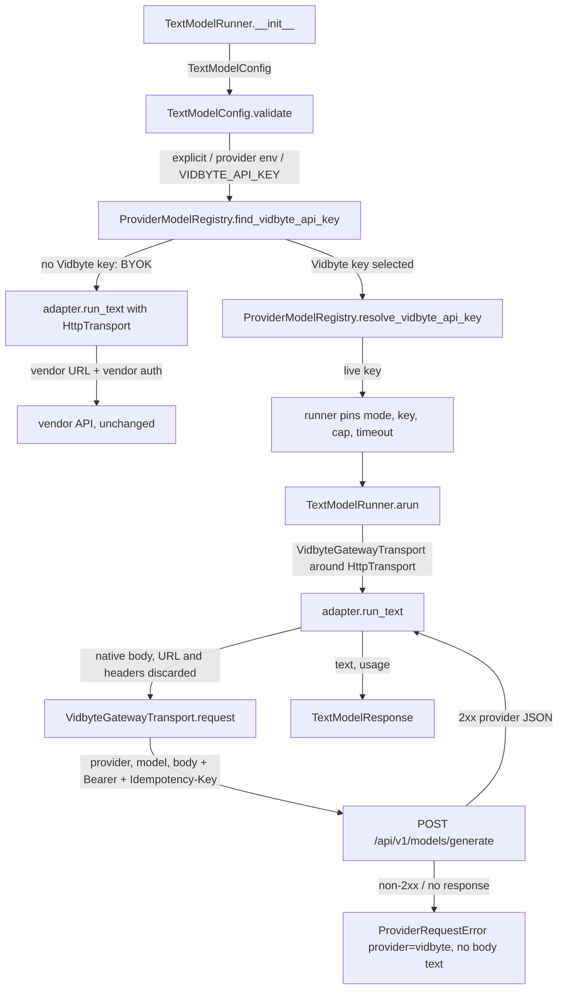
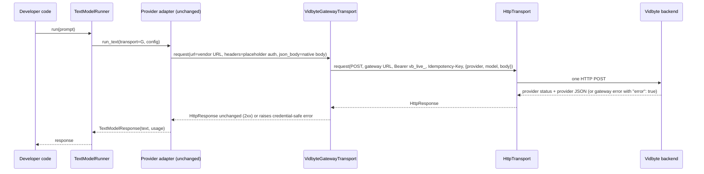

# Spec: Vidbyte-managed mode for generative model calls (lib layer)

> **TL;DR** — With only `VIDBYTE_API_KEY` set (or `mode=TextModelMode.VIDBYTE_MANAGED`), every non-streaming text call from `TextModelRunner`, and so from every agent, goes through Vidbyte's one gateway route, `POST /api/v1/models/generate`, where the backend pays the provider with its own key and bills the call at a 2% markup, while bring-your-own-key users see no change. The key design choice is a transport decorator in `vidbyte.lib.http`, `VidbyteGatewayTransport`, which `TextModelRunner` puts in front of the existing transport. It wraps the adapter's provider-native body in the gateway envelope and sends it to the single gateway URL with the Vidbyte bearer key, so none of the provider adapters change.

## §0 User prompts

### 0.1 Invoking request (verbatim)
great so the way I want to handle this is 1) I want 1 route in the vidbyte/ repo, and then handle the underlying api requests in a orchestrator/server layer for the different routes to the different providers. and then 2) the sdk changes we can handle in the lib layer of the repo. lets achieve this 2% markup on generative tokens

### 0.2 User replies during the run
_None yet. The orchestrator appends any reply the user sends during the run here verbatim, labeled with the revision it produced._

---

## Part A — Framing

## §1 Goal

**Why now.** The 2% markup can only be collected on tokens that pass through a Vidbyte-controlled gateway that holds the provider keys (request.md §C "Billing is enforced only on the server"). Today the SDK has no route for a generative call to reach such a gateway:
- Every text adapter posts straight to the vendor. Examples are `f"{config.resolved_endpoint()}/responses"` with the caller's own key at `vidbyte/providers/openai.py:30`, and `/messages` with `x-api-key` at `anthropic.py:25`/`:58`.
- `TextModelConfig` has no managed mode (`vidbyte/lib/dataclasses/model_configs.py:45-115`).
- A user who holds only `VIDBYTE_API_KEY` gets `ConfigurationError("Missing API key for provider openai. Pass api_key or set OPENAI_API_KEY.")` (`vidbyte/lib/registries/models.py:161`).

The backend PR (`generative-model-gateway`) adds the route. This PR makes the SDK use it.

| ID | Goal (outcome) | How we will know | Source |
|---|---|---|---|
| G-1 | Every non-streaming generative text call made through the SDK in managed mode is sent to Vidbyte's one gateway route, where the backend bills it at 2%. This covers all six providers the gateway serves, and covers agents as well as direct runner use. | AC-1, AC-2, AC-24: a managed call produces exactly one `POST https://vidbyte-backend.onrender.com/api/v1/models/generate` with the contract envelope, and no request goes to a vendor host. | §0 ("2% markup on generative tokens"); request.md §A Prompt 2 ("all of the generative model calls"), §D |
| G-2 | A developer with only a Vidbyte key needs no provider key and no code change. Setting `VIDBYTE_API_KEY` is enough. | AC-1: the §4 snippet works with only `VIDBYTE_API_KEY` set. | request.md §C SDK scope ("key fall-through") |
| G-3 | Developers who bring their own keys (BYOK) see no change, and the other modalities are untouched. | AC-3, AC-22: BYOK requests and errors are byte-identical to `base_commit`. | request.md §C ("BYOK traffic stays unbilled by design") |
| G-4 | From the SDK side, managed mode cannot be turned into a way around the fee or a way to leak the key. The Vidbyte key only ever travels to the gateway, cannot be pointed at another host, and never appears in errors or repr. | AC-6, AC-7, AC-10–AC-16 | request.md §A Prompt 1 ("no workarounds"), §C constraints |

## §2 Objective

When this PR merges, the repository contains the following:
- **A managed mode on `TextModelConfig`.** It is a new last field, `mode: TextModelMode = TextModelMode.AUTO`, with a new enum `TextModelMode` and a key hidden from repr. In managed mode the config:
  - requires a live `vb_live_` key;
  - refuses a custom endpoint;
  - refuses providers that the gateway does not serve.
- **A key fall-through in `ProviderModelRegistry`.** The order is explicit key, then the provider's env var, then `VIDBYTE_API_KEY`. A Vidbyte key selected anywhere in that order switches the config to managed mode.
- **A new `VidbyteGatewayTransport`** in `vidbyte.lib.http`. It is the one place that builds the managed headers (bearer `vb_live_` key plus a fresh `Idempotency-Key`). It wraps the adapter's native body as `{provider, model, body}`, posts it to the single gateway URL, and turns every failure into a credential-safe `ProviderRequestError`.
- **`TextModelRunner` wiring.** The runner fixes managed mode at construction. It fills in a default output-token cap (the gateway refuses calls without one) and a timeout above the gateway's 60 s upstream timeout. Each call is then routed through the gateway transport.
- **A clear refusal of managed mode in `StreamingTextModelRunner`.**
- **One owner constant for the `vb_live_` prefix**, as lint C020 requires, with `DecisionModelConfig` delegating its managed-key check to the shared resolver. C020 drops from 4 to 2.
- **The re-vendored platform contract** containing the new route.
- **A README section** that states the 2% fee plainly.

This is the SDK slice. The route, metering, admission and daily cap are the backend PR's slice. Run ids, cost display and streaming are deferred (§3).

## §3 Non-goals

- **NG-1** — Run ids and close-run summaries on generative calls (`X-Vidbyte-Run-Id`, `/runs/{id}/close`). — *Why not:* request.md §C defers them, and backend §9.2.2 ignores `X-Vidbyte-Run-Id` on this route.
- **NG-2** — Per-call fee accrual and runs that mix Jev and generative calls. — *Why not:* this is deferred, and it is the backend's concern.
- **NG-3** — Showing the marked-up cost in the SDK's local usage tracker, or recording managed calls in the usage ledger. — *Why not:* deferred by request.md §C. `TextModelRunner` does not write the ledger today (`lib/runners/text.py:34-49`).
- **NG-4** — A streaming relay. Managed streaming is refused instead (FR-7). — *Why not:* deferred. Backend §9.2.7 refuses streaming.
- **NG-5** — Managed mode for OpenRouter, GLM, MiniMax, Meta, Mistral, Codex, or the image, video, audio and embedding modalities. — *Why not:* request.md §C excludes them, and backend §9.2.8 does not dispatch them.
- **NG-6** — Client-side token counting, metering or enforcement. — *Why not:* request.md §C rejects it, because a fork can remove it.
- **NG-7** — Any edit under `vidbyte/providers/` or `vidbyte/agents/`. That covers the adapters, the TypeSafe redaction regex sites (`providers/typesafe.py:255`, `:271`), the key-crossing guards (`agents/settings/fallback.py:147-155`, `agents/fork.py:85-95`, `agents/aggregation.py:331-349`) and the runtime retry loop (`agents/runtime.py:607-690`). — *Why not:* Prompt 5 puts the SDK changes in "the lib layer". D-1 needs no adapter edits.
- **NG-8** — Moving or renaming the Jev constants (`JEV_IDEMPOTENCY_KEY_HEADER`, `JEV_MANAGED_RUN_ID_HEADER`), or changing `VIDBYTE_JEV_GATEWAY_ENDPOINT`. — *Why not:* none of it is needed, and tests pin the Jev host (`tests/test_jev_managed_gateway.py:120,154,163`; `tests/test_jev_managed_runs.py:23,32`).
- **NG-9** — Reusing one `Idempotency-Key` across agent-runtime retries. — *Why not:* it needs an edit in `vidbyte/agents/runtime.py`, outside lib (Q-1).
- **NG-10** — A "direct only" text mode that refuses managed billing. — *Why not:* nobody asked for it (Q-3).
- **NG-11** — Counting `VIDBYTE_API_KEY` in `ProviderModelRegistry.resolve_active` (the multi-provider grader). — *Why not:* nobody asked for it (Q-6).
- **NG-12** — The backend route, metering, wallet admission and daily cap. — *Why not:* they are the sibling PR, `generative-model-gateway`.
- **NG-13** — Transport-level retries for managed calls. — *Why not:* BYOK text calls do not retry today (`retry_count` defaults to 0, `lib/http/transport.py:40`). See Q-7.

## §4 Developer usage

```python
# Environment: VIDBYTE_API_KEY=vb_live_<your key>; OPENAI_API_KEY is not set.
from vidbyte.lib.config import TextModelConfig, TextModelMode
from vidbyte.lib.runners import TextModelRunner

runner = TextModelRunner(TextModelConfig(provider="openai", model="gpt-5.5"))
response = runner.run("Say hi in one word.")

print(response.provider.value, response.model)  # openai gpt-5.5
print(response.text)                            # the model's answer, e.g. Hi
print(response.usage["output_tokens"])          # from OpenAI's own usage block, e.g. 2

# The one request the SDK sent:
#   POST https://vidbyte-backend.onrender.com/api/v1/models/generate
#   authorization: Bearer vb_live_<your key>
#   content-type: application/json
#   Idempotency-Key: <32 lowercase hex characters, new for every call>
#   {"provider": "openai", "model": "gpt-5.5",
#    "body": {"model": "gpt-5.5", "input": "Say hi in one word.", "max_output_tokens": 8192}}

# Force managed mode even when ANTHROPIC_API_KEY is also set:
claude = TextModelRunner(TextModelConfig(provider="anthropic", model="claude-sonnet-5", mode=TextModelMode.VIDBYTE_MANAGED))
```

The developer writes the same code as with their own key. Only the environment changed, and the response is the provider's own answer parsed by the same adapter. Developers no longer need a provider account or a provider key for any of the six managed providers.

## §5 Flow diagram





1. Validation happens at runner construction. `TextModelConfig.validate()` resolves the key and settles on BYOK or managed. In managed state it checks the live-key format, refuses a custom endpoint, and refuses unmanaged providers. The runner then fixes the managed fields on its stored config, which is the only state change.
2. On each call the adapter builds its provider-native body exactly as in BYOK. The gateway transport throws away the adapter's vendor URL and its auth headers, which carry only a non-secret placeholder in managed state. It then sends one POST to the gateway.
3. Failures are caught in the gateway transport. Every non-2xx answer, every network failure, and every unreadable answer becomes a `ProviderRequestError` with `provider="vidbyte"` and no response text. A 2xx answer goes back to the adapter unchanged, so text and usage are parsed exactly as in BYOK.

---

## Part B — Behavior (this is the spec; everything else is framing)

## §6 Behavior

### 6.1 Invariants

- **INV-1** (1 route, "all tokens") — In managed state, each `TextModelRunner.arun`/`run` call sends exactly one HTTP request. That request is `POST VIDBYTE_GENERATIVE_GATEWAY_ENDPOINT` (`https://vidbyte-backend.onrender.com/api/v1/models/generate`). No request goes to a vendor host, and none goes to any other Vidbyte path. This holds for all six managed providers, through the same transport.
- **INV-2** (envelope) — The managed request's JSON body has exactly the keys `provider`, `model` and `body`:
  - `provider` is `config.normalized_provider().value`: one of `openai`, `anthropic`, `gemini`, `xai`, `deepseek`, `kimi`.
  - `model` is `config.model`.
  - `body` is the provider-native payload that the adapter passed as `json_body`, unchanged. It equals the BYOK body for the same pinned config.
- **INV-3** (headers, "the same" gateway convention as Jev) — The managed request's headers are exactly these three, and no `X-Vidbyte-Run-Id`, `x-api-key`, `x-goog-api-key`, `anthropic-version` or other header is sent:
  - `authorization: Bearer <vb_live_ key>`;
  - `content-type: application/json`;
  - `Idempotency-Key: <uuid4 hex>` (32 lowercase hex characters), new for every request.
- **INV-4** (fall-through) — With `mode=AUTO`, the key is selected in this order:
  1. a non-blank explicit `api_key`;
  2. otherwise a non-blank provider env var (`API_KEY_ENV_VARS`);
  3. otherwise, only for the six managed providers, a non-blank `VIDBYTE_API_KEY`.

  The config is managed when the key chosen in step 1 or 2 starts with `VIDBYTE_API_KEY_PREFIX` after stripping, or when step 3 chose the key. Otherwise the config is BYOK, with today's behavior.
- **INV-5** (explicit managed) — With `mode=VIDBYTE_MANAGED`, the key is the explicit `api_key`, or else `VIDBYTE_API_KEY`. The provider env var is never read. The key must fullmatch `VIDBYTE_API_KEY_PATTERN`. Failures raise `ConfigurationError` with `details["error_kind"] == VIDBYTE_MANAGED_CREDENTIAL_ERROR_KIND`, using the existing Decision message texts.
- **INV-6** ("no workarounds", key safety) — The `vb_live_` key never appears in any of these places:
  - a request to a non-Vidbyte host;
  - a header that a provider adapter builds (`TextModelConfig.resolved_api_key()` returns `VIDBYTE_MANAGED_KEY_PLACEHOLDER` in managed state);
  - `repr(TextModelConfig)`;
  - any exception message, `details` or `response_excerpt` raised by managed mode.
- **INV-7** — A managed config never accepts a custom endpoint. `TextModelConfig.resolved_endpoint()` never returns a Vidbyte origin, in any mode.
- **INV-8** — Managed mode serves exactly `VIDBYTE_MANAGED_TEXT_PROVIDERS` (the six providers above). A managed config for any other provider raises `UnsupportedProviderError` before any request is sent.
- **INV-9** — Every managed request carries the dialect's output-token cap: the caller's `max_output_tokens` when set, otherwise `VIDBYTE_MANAGED_DEFAULT_MAX_OUTPUT_TOKENS` (8,192). An explicit caller value always wins.
- **INV-10** — The timeout of a managed request is at least `VIDBYTE_GATEWAY_TIMEOUT_FLOOR_SECONDS` (90.0): `max(config.timeout_seconds, floor)`.
- **INV-11** — When a managed call fails, `VidbyteGatewayTransport.request` raises `ProviderRequestError` with `provider="vidbyte"`, `status_code` set to the HTTP status (or `None` when no response arrived) and `response_excerpt` left as `None`. This covers a non-2xx status, a network failure or timeout, and a 2xx body that is not a JSON object. The error is raised with `__cause__` and `__context__` suppressed (`from None`). Its message is written by the SDK, names the provider and the status, tells a gateway error (top-level `"error": true`) from a relayed provider error, and contains no byte of the response body.
- **INV-12** ("simply read the response") — On a managed 2xx, the adapter receives the gateway's `HttpResponse` unchanged and parses it with the same code as BYOK. `TextModelResponse.text` and `.usage` come from the provider's own JSON (`usage`, or `usageMetadata` for Gemini).
- **INV-13** — `StreamingTextModelRunner` raises `UnsupportedProviderError` at construction when the config is in managed state, and sends zero requests.
- **INV-14** — A `TextModelRunner`'s mode is decided once, at construction. Environment changes after construction do not switch an existing runner between BYOK and managed.
- **INV-15** ("2% markup") — The SDK sends no price, fee, markup or usage figure, and holds no markup constant. The 2% is applied only by the backend, from the provider response it observed.
- **INV-16** — Managed calls make no transport-level retry: one POST per `arun`, with `retry_count` left at 0. Two calls with identical prompts send two different `Idempotency-Key` values.

**Must not regress:**
- **INV-17** — BYOK text calls are byte-identical to `base_commit`. This covers a config whose selected key lacks the prefix (explicit, or from the provider env var), and covers URL, headers, body, timeout and errors. Today's paths: `providers/openai.py:30`, `anthropic.py:25`, `gemini.py:26-27`, `compatible.py:32`. One exception: `repr(TextModelConfig)` no longer shows `api_key` (FR-10).
- **INV-18** — `ProviderModelRegistry.resolve_api_key`, and the Image, Video, Audio and Embedding configs that use it, are unchanged. A user with only `VIDBYTE_API_KEY` still gets the existing "Missing API key …" error for those configs (`registries/models.py:152-161`).
- **INV-19** — `DecisionModelConfig` behaves exactly as before:
  - managed key resolution, its three error messages, `error_kind`, `resolved_endpoint()` and `resolved_run_close_url()` (`model_configs.py:341-431`);
  - `VIDBYTE_JEV_GATEWAY_ENDPOINT` keeps its value;
  - the positional field order is unchanged.
- **INV-20** — `TextModelConfig`'s first 20 fields keep their order and defaults. Constructing a config with `mode=AUTO` raises nothing new, except for a `mode` that is not a `TextModelMode`.
- **INV-21** — For a text config with no key, when `VIDBYTE_API_KEY` is unset or the provider is not managed, the error stays `"Missing API key for provider <p>. Pass api_key or set <ENV>."`.
- **INV-22** — BYOK streaming (`StreamingTextModelRunner` with a non-Vidbyte key) is unchanged, including the existing provider refusal (`lib/runners/streaming_text.py:51-58`).
- **INV-23** — The agent key-crossing guards and their behavior are unchanged. They drop only an explicit key across providers.

### 6.2 Acceptance criteria

| ID | Given | When | Then | Priority | Proof |
|---|---|---|---|---|---|
| AC-1 | a clean checkout of this branch, only `VIDBYTE_API_KEY` set, a transport that answers 200 with an OpenAI Responses body | the §4 snippet runs | it produces exactly the shown result: `openai gpt-5.5`, the answer text, and usage from the provider body. Exactly one request is recorded, with the URL, headers and envelope shown in the §4 comment. | P0 | |
| AC-2 | only `VIDBYTE_API_KEY` set, for each of `openai`, `anthropic`, `gemini`, `xai`, `deepseek`, `kimi` | `TextModelRunner(...).run(prompt)` | exactly one request goes to `VIDBYTE_GENERATIVE_GATEWAY_ENDPOINT` with method POST and the three headers of INV-3. The body is `{"provider": <value>, "model": <config.model>, "body": <BYOK body>}`. Gemini's `body` carries `generationConfig.maxOutputTokens`. | P0 | |
| AC-3 | a non-`vb_live_` key passed explicitly or set in the provider env var, with `VIDBYTE_API_KEY` also set | a text call runs | URL, headers, body and timeout equal `base_commit`'s BYOK request exactly, and no gateway request is sent | P0 | |
| AC-4 | `mode=VIDBYTE_MANAGED`, a non-Vidbyte `OPENAI_API_KEY` set, and `VIDBYTE_API_KEY` set | a call runs | the gateway request uses the `VIDBYTE_API_KEY` value, and the provider env var is never used | P0 | |
| AC-5 | managed state with (a) no Vidbyte key, (b) a key that does not match the live format, (c) a non-string `api_key` | `TextModelRunner` is constructed | `ConfigurationError` with `details["error_kind"] == "vidbyte_managed_credentials"`. Messages: (a) "Missing Vidbyte API key. Pass api_key or set VIDBYTE_API_KEY.", (b) "The managed Vidbyte API key must be a live key in the vb_live_ format.". Zero requests are sent. | P0 | |
| AC-6 | managed state (explicit mode, or AUTO with a Vidbyte key) and a non-blank `endpoint` | the config is built (explicit mode) or the runner is constructed (AUTO) | `ConfigurationError`, and zero requests | P0 | |
| AC-7 | an explicit `vb_live_` key, or `mode=VIDBYTE_MANAGED`, with provider `openrouter` (or any provider outside the six) | the config is built (explicit mode) or the runner is constructed (explicit key) | `UnsupportedProviderError` naming the managed providers, and zero requests | P0 | |
| AC-8 | managed state with `max_output_tokens` unset, or set to N | a call runs | the native body carries 8,192, or N, at the dialect's cap field (`max_output_tokens`, `max_tokens`, or `generationConfig.maxOutputTokens`) | P0 | |
| AC-9 | managed state with `timeout_seconds` of 60.0, 30.0 or 120.0 | a call runs | the transport receives 90.0, 90.0 or 120.0 respectively | P1 | |
| AC-10 | the gateway answers 401, 402, 403, 413, 422, 429, 500, 502 or 503 with a body containing `"error": true` and a string that looks like a key | a managed call runs | `ProviderRequestError` with `provider == "vidbyte"`, the matching `status_code` and `response_excerpt is None`. `__cause__` and `__context__` are `None`. The message contains no substring of the body. | P0 | |
| AC-11 | the gateway relays a provider error (for example 400 or 429) whose body has no top-level `"error": true` | a managed call runs | `ProviderRequestError(provider="vidbyte")`. The message names the provider and the status and says that the provider's message is withheld. No body text appears. | P0 | |
| AC-12 | the inner transport raises `ProviderRequestError(provider="http")` (network failure or timeout), or the gateway answers 200 with a body that is not a JSON object | a managed call runs | `ProviderRequestError(provider="vidbyte")`, with `status_code` `None` or 200 respectively. The excerpt is empty, and the message says no usable answer arrived. | P0 | |
| AC-13 | only `VIDBYTE_API_KEY` set, or `mode=VIDBYTE_MANAGED` | `StreamingTextModelRunner(...)` is constructed | `UnsupportedProviderError` whose message names the managed-mode limitation and the fix, and zero requests | P0 | |
| AC-14 | the Jev managed configuration of `base_commit` | `DecisionModelConfig` resolves keys and endpoints in managed and direct mode | results, messages and `error_kind` are identical to `base_commit`, and `python lint/run.py --rule C020` reports 2 | P0 | |
| AC-15 | a `TextModelConfig` with `api_key="vb_live_…"` | `repr(config)` is called | the key does not appear | P0 | |
| AC-16 | managed state | the provider adapter builds its headers (`resolved_api_key()`) | the value is `VIDBYTE_MANAGED_KEY_PLACEHOLDER`, never the `vb_live_` key, even when an adapter is called directly with a plain transport | P0 | |
| AC-17 | the contract re-vendored per §12.5 | `python scripts/run_ci.py` (source stage with `PYTHONPATH`, then the package stage) runs | every stage passes. C017, C018 and C019 stay at 0, no rule rises above its baseline, and C020 is ratcheted to 2. | P0 | |
| AC-18 | the merged README | a reader opens the managed-mode section | it states the 2% fee over provider cost, how to switch on (`VIDBYTE_API_KEY`) and off (set a provider key), the six providers, the default cap of 8,192, the 90 s floor, that streaming is refused, and that BYOK calls are not billed | P1 | |
| AC-19 | the PR diff | the changed files are listed | every production `.py` change is under `vidbyte/lib/`. Nothing under `vidbyte/providers/` or `vidbyte/agents/` changes. | P0 | |
| AC-20 | two managed `arun` calls with identical arguments on one runner | both run | exactly two POSTs are sent, with two different `Idempotency-Key` values, and each POST is sent once with no retry | P0 | |
| AC-21 | a runner built with only `VIDBYTE_API_KEY` set | `OPENAI_API_KEY` is set afterwards and a call runs | the call still goes to the gateway, and the reverse case stays BYOK | P1 | |
| AC-22 | only `VIDBYTE_API_KEY` set | an Image, Video, Audio or Embedding config validates, or `ProviderModelRegistry.resolve_api_key("openai", None)` runs | the existing "Missing API key for provider …" `ConfigurationError` is raised | P0 | |
| AC-23 | a managed Gemini call answered 200 with `usageMetadata` | the response is parsed | `TextModelResponse.usage` equals the `usageMetadata` object and `.text` equals the BYOK extraction | P0 | |
| AC-24 | only `VIDBYTE_API_KEY` set, and an agent configured with `provider="openai"` | the agent runs one model turn | its model request goes to the gateway (agents use `Runner.build` → `TextModelRunner`) | P1 | |

### 6.3 Edge cases and failure modes

| ID | Trigger (input + state) | System behavior | User sees | Guarded by (INV-/D-) |
|---|---|---|---|---|
| EC-1 | `OPENAI_API_KEY=sk-…` and `VIDBYTE_API_KEY=vb_live_…` are both set, AUTO mode | BYOK: the provider key wins. Without the guard, existing BYOK users would be silently billed. | Today's behavior | INV-4, INV-17 |
| EC-2 | Only `VIDBYTE_API_KEY` set, provider `openrouter` | Step 3 is skipped for unmanaged providers, so the config stays BYOK | `Missing API key for provider openrouter. Pass api_key or set OPENROUTER_API_KEY.` | INV-4, INV-21 |
| EC-3 | An explicit `api_key="vb_live_…"` with provider `openrouter` | Managed state, then refused before any request. Without the guard, the Vidbyte key would go to OpenRouter. | `UnsupportedProviderError` listing the six managed providers | INV-8, INV-6 |
| EC-4 | `VIDBYTE_API_KEY` is malformed (`vb_test_…`, too short, or wrong characters) and no provider key is set | Step 3 selects it, so the config is managed, and the format check fails | `ConfigurationError` "…must be a live key in the vb_live_ format." with `error_kind` | INV-4, INV-5 |
| EC-5 | `OPENAI_API_KEY` holds a `vb_live_` key | Step 2 finds the prefix, so the config is managed and that key is the bearer. Without the guard, the Vidbyte key would be sent to api.openai.com. | The call goes to the gateway | INV-4, INV-6 |
| EC-6 | `mode=VIDBYTE_MANAGED` with `endpoint="https://proxy"` | Rejected in `__post_init__` | `ConfigurationError` at construction | INV-7 |
| EC-7 | AUTO with only `VIDBYTE_API_KEY`, plus `endpoint` set | Rejected in `validate()` | `ConfigurationError` at runner construction | INV-7 |
| EC-8 | `extra_body={"stream": True}`, a different `model`, or `"max_output_tokens": 0` in managed state | The adapter merges `extra_body` last. The gateway refuses with 422 (`model_gateway_unbillable_request`) before paying upstream. | `ProviderRequestError(provider="vidbyte", status_code=422)` with SDK guidance | server-side (backend §9.2.4), INV-11 |
| EC-9 | The model is not in the backend pricebook, or the provider is not managed server-side | Gateway 422 `model_gateway_unsupported_model` | Credential-safe 422 message | server-side, INV-11 |
| EC-10 | The wallet cannot cover the worst case | Gateway 402 | Message: top up the wallet or use your own provider key | server-side, INV-11 |
| EC-11 | The key's daily cap is reached, or its request quota is exhausted | Gateway 429 (no `Retry-After` for the cap) | Message naming the quota or daily spend cap | server-side, INV-11 |
| EC-12 | The provider rejects the body: 400 because the cap exceeds the model's maximum (for example the 8,192 default on a model whose output limit is below 8,192), or because an Anthropic thinking budget is ≥ the cap | The relayed 400 is not billed (backend §9.2.5) | "anthropic returned HTTP 400 through the Vidbyte gateway; provider message withheld". The developer sets `max_output_tokens`. | accepted (D-8, D-11, Q-2) |
| EC-13 | Gateway 502 (upstream failure, missing Vidbyte credential, or upstream 401/403) or 503 | Raised once. The SDK does not retry, and agent middleware may retry with a new key. A non-2xx is never billed. | 5xx message: the call may be retried | INV-11, INV-16 |
| EC-14 | A network drop or client timeout after the gateway has paid and billed a 2xx | Raised. An agent-runtime retry sends a new POST with a new key and is billed again. | The message says no response arrived and that Vidbyte may already have billed the call | accepted limitation (D-10, NG-9, Q-1). The 90 s floor (INV-10) closes the 60 s timeout race. |
| EC-15 | The gateway answers 200 with a body that is not JSON, or is a JSON array | Rewritten, credential-safe | `ProviderRequestError(provider="vidbyte", status_code=200)`, no excerpt | INV-11 |
| EC-16 | `StreamingTextModelRunner` with only `VIDBYTE_API_KEY` set | Refused after `validate()` and before the provider check | `UnsupportedProviderError`: streaming is not available in Vidbyte-managed mode. Use `TextModelRunner`, or set `<PROVIDER>_API_KEY` to stream with your own key. | INV-13 |
| EC-17 | `StreamingTextModelRunner` with `OPENAI_API_KEY=sk-…` and `VIDBYTE_API_KEY` | BYOK streaming | Today's behavior | INV-22 |
| EC-18 | `mode="vidbyte_managed"` passed as a plain string (for example from YAML options) | Rejected, mirroring `DecisionModelConfig` (`model_configs.py:364-365`) | `ConfigurationError("mode must be a TextModelMode value.")` | INV-20, accepted |
| EC-19 | The environment changes after the runner is built | The runner keeps the mode it chose at construction | Same routing as at construction | INV-14 |
| EC-20 | Managed state with `timeout_seconds=30` | Raised to 90.0. A shorter client timeout cannot stop a paid upstream call. | The call waits up to 90 s | INV-10, accepted |
| EC-21 | A developer calls an adapter directly (`ModelProviders.text(config).run_text(transport=HttpTransport())`) with a managed config | The vendor receives the placeholder key and answers 401. The Vidbyte key never leaves. | A vendor 401 `ProviderRequestError` | INV-6, accepted |
| EC-22 | A parent agent passes an explicit `vb_live_` key, and a fallback, fork or aggregation child uses another provider | The existing guard drops the explicit key. The child resolves through its env: managed if `VIDBYTE_API_KEY` is set, otherwise a missing-key error (fails closed). | Missing-key error, or a managed child | INV-23, accepted (Q-4) |
| EC-23 | The multi-provider grader runs with only `VIDBYTE_API_KEY` and no `provider_models` | `_resolve_from_environment` still ignores `VIDBYTE_API_KEY` | "No model providers have API keys configured in the environment." | accepted (NG-11, Q-6) |
| EC-24 | Concurrent `arun` calls on one runner | Each call builds its own `VidbyteGatewayTransport` and mints its own key, with no shared mutable state | Independent calls | INV-16 |
| EC-25 | The same prompt is sent twice on purpose | Two keys are sent, so both calls are answered and billed. Content-addressed keys would replay a stale answer. | Two answers | INV-16, D-10 |
| EC-26 | The SDK is released before the backend route is deployed, or Render is down | 404 or a network error | "Vidbyte returned HTTP 404", or the no-response message | merge order (§12.6), INV-11 |
| EC-27 | A JevAgent user already has `VIDBYTE_API_KEY` set but no provider key | Text calls used to fail with a missing-key error. They now run managed and are billed at 2%. | Calls succeed, and the README states the fee | accepted behavior change (§9.4, AC-18, Q-3) |
| EC-28 | An explicit key with whitespace, such as `" key "` | Stripped before the prefix check. It has no prefix, so the config stays BYOK. | Today's behavior (`tests/test_config_validation.py:12-16`) | INV-17 |
| EC-29 | `api.vidbyte.pro` is still `planned` | The SDK uses the live Render host | Requests succeed against the live host | D-4 |

**Rollback of the user action:**
- A developer leaves managed mode by setting a provider key (BYOK wins, EC-1), or by unsetting `VIDBYTE_API_KEY` and dropping `mode=VIDBYTE_MANAGED`.
- Calls already billed stay billed. The SDK holds no state to undo.
- An operator rolls back by reverting this PR. The backend route stays harmless with no SDK callers.

## §7 Requirements

**Functional**
| ID | Requirement | Priority | Source (request.md / G-) | Verified by |
|---|---|---|---|---|
| FR-1 | Add `TextModelMode` (`AUTO`, `VIDBYTE_MANAGED`) and `TextModelConfig.mode` (last field, default `AUTO`). A `mode` that is not a `TextModelMode` raises `ConfigurationError`. | P0 | §C SDK scope; G-2 | INV-20, AC-4, EC-18 |
| FR-2 | Implement the key fall-through of INV-4 without changing `resolve_api_key`. | P0 | §C "key fall-through"; G-2, G-3 | INV-4, INV-18, AC-1, AC-3, AC-22 |
| FR-3 | Managed key resolution: explicit key, then `VIDBYTE_API_KEY`, a live-format check, and `error_kind`. It is shared by `TextModelConfig` and `DecisionModelConfig`. | P0 | §C "requires a live Vidbyte key (mirroring DecisionModelConfig)" | INV-5, INV-19, AC-5, AC-14 |
| FR-4 | `VidbyteGatewayTransport` sends one POST to the single gateway URL, with the envelope of INV-2 and the headers of INV-3. It is the only managed header builder. | P0 | §0 "1 route"; §C "one shared header builder", "the SDK sends the Idempotency-Key header"; G-1 | INV-1–INV-3, INV-16, AC-1, AC-2, AC-20 |
| FR-5 | At construction, `TextModelRunner` fixes managed mode, the key, the default cap and the timeout floor, and routes each call through `VidbyteGatewayTransport`. | P0 | §C "pins the gateway host"; backend Q-4, Q-5; G-1 | INV-9, INV-10, INV-14, AC-8, AC-9, AC-21 |
| FR-6 | All managed failures are credential-safe `ProviderRequestError`s, with a gateway-versus-provider distinction and no body text. | P0 | §C "never echo gateway or upstream bodies"; G-4 | INV-11, AC-10–AC-12 |
| FR-7 | `StreamingTextModelRunner` refuses managed state with a clear `UnsupportedProviderError`. | P0 | §C "managed streaming rejected with a clear error" | INV-13, AC-13 |
| FR-8 | Managed mode serves exactly the six providers of backend §9.2.8 and refuses any other provider before any request. | P0 | §C exclusions; G-4 | INV-8, AC-7 |
| FR-9 | Managed mode refuses a custom endpoint. | P0 | §C "Managed mode rejects a custom endpoint" | INV-7, AC-6 |
| FR-10 | `TextModelConfig.api_key` is hidden from repr (`field(default=None, repr=False)`). | P0 | §C (mirror Decision); G-4 | INV-6, AC-15 |
| FR-11 | One owner constant, `VIDBYTE_API_KEY_PREFIX`. No new `vb_live_` literal. `DecisionModelConfig` delegates to the shared resolver, and C020 is ratcheted from 4 to 2. | P0 | lint C020 (repo gate) | AC-14, AC-17 |
| FR-12 | A README managed-mode section stating the 2% fee and the limitations. | P1 | request.md §E.3 step 15 ("states the fee plainly") | AC-18 |
| FR-13 | Re-vendor `lint/contracts/vidbyte-platform-contract.json` from the merged backend and update its Provenance row. | P0 | lint C017/C018 (repo gate); backend §9.2.10 | AC-17 |
| FR-14 | `resolved_api_key()` returns `VIDBYTE_MANAGED_KEY_PLACEHOLDER` in managed state. | P0 | G-4 | INV-6, AC-16 |

**Non-functional**
| ID | Requirement | Priority | Target |
|---|---|---|---|
| NFR-1 | "all tokens" / "all of the generative model calls": in managed state, every non-streaming text call that goes through `TextModelRunner` reaches the gateway. This includes every agent call built by `Runner.build` (`lib/runners/utility.py:44-45`). | P0 | 100% of managed calls through the six providers. Zero code paths inside `vidbyte/lib/` send a managed call elsewhere (INV-1, AC-2, AC-24). |
| NFR-2 | "no workarounds" from the SDK side: the Vidbyte key reaches only the gateway, and every request the gateway cannot bill is refused before it is sent (streaming) or refused by the server (§10). The SDK does not claim to stop a fork; the backend enforces billing. | P0 | INV-6, INV-7, INV-8, INV-13, INV-15. T-1–T-6 each name a server-side control. |
| NFR-3 | "all we have to do" / "simply": the smallest SDK change that works. | P0 | ≤ 2 new files, 0 dependencies, 0 adapter edits, and the §8.4 budget |
| NFR-4 | "the lib layer": production code changes only under `vidbyte/lib/`. | P0 | AC-19 |
| NFR-5 | Gates stay green with no baseline raised. | P0 | `python scripts/run_ci.py` passes. C017=0, C018=1, C019=0, C020=2, and every other rule ≤ its baseline (AC-17). |
| NFR-6 | No new dependency, and no network in tests. | P0 | `pyproject.toml` unchanged |
| NFR-7 | Managed overhead: no extra HTTP round trip, at most one extra JSON parse of the response per call, and one `uuid4` per call. | P1 | Exactly one request per call (INV-1) |
| NFR-8 | "2% markup": the SDK carries no rate. The README states 2%, and the backend applies it. | P0 | INV-15, AC-18 |

---

## Part C — Design

## §8 Architecture and decisions

### 8.1 Decisions
| ID | Decision | Deciding reason | Runner-up | Flips if |
|---|---|---|---|---|
| D-1 | Managed routing is a transport decorator, `VidbyteGatewayTransport` in lib http, which `TextModelRunner` places around its transport. Adapters keep building native bodies, and the decorator discards their URL and headers. | One route (INV-1) with zero adapter edits (NFR-4). The adapters' `run_text` methods (OpenAI, Anthropic, Gemini, OpenAI-compatible) append four different suffixes to `resolved_endpoint()`, so an endpoint-only redirect cannot reach one route. | Change `TextModelConfig.resolved_endpoint()` and have adapters call a lib header builder (request.md §E.2/E.3 step 12) | The backend serves per-dialect routes, or adapters must change for another reason |
| D-2 | Envelope `{"provider": provider.value, "model": config.model, "body": json_body}` | Backend §9.2.3 requires exactly these keys. Backend §9.2.4 refuses a body `model` that differs from `model`, so `config.model` (which the adapters also put in the body and the Gemini URL) is the single source. | Read `model` from `json_body["model"]` | The backend contract changes |
| D-3 | "One shared header builder" means the single managed-header construction inside `VidbyteGatewayTransport`: `HttpResponseParser().bearer_headers(key)`, then `headers[JEV_IDEMPOTENCY_KEY_HEADER] = key`, the same shape as `_TypeSafeCallBuilder.decision`. Every managed provider call passes through it. | No adapter addresses the gateway under D-1, so a builder the adapters call would have no caller (request.md §C asked for "one shared header builder"). The subscript-assignment shape is the one C017 already accepts in `providers.typesafe._TypeSafeCallBuilder.decision`. | A lib header builder called from each adapter's header method | Adapters address the gateway themselves |
| D-4 | A new constant on the live host: `VIDBYTE_GENERATIVE_GATEWAY_ENDPOINT = "https://vidbyte-backend.onrender.com/api/v1/models/generate"` | The vendored platform contract marks `api.vidbyte.pro` `planned` and `vidbyte-backend.onrender.com` `live`. C018's repair text: "only the live origin may appear in SDK code"; "a second non-live host is a second outage". | Derive it from `VIDBYTE_JEV_GATEWAY_ENDPOINT` (`api.vidbyte.pro`) | The re-vendored contract marks `api.vidbyte.pro` `live` |
| D-5 | The fall-through lives in two new `ProviderModelRegistry` classmethods, `find_vidbyte_api_key` and `resolve_vidbyte_api_key`. `resolve_api_key` is untouched. | `resolve_api_key` is shared by the Image, Video, Audio, Embedding and Decision-direct configs (each `resolved_api_key()` in `lib.dataclasses.model_configs`). A fall-through there would send a `vb_live_` key to vendors (INV-18). | Add `VIDBYTE_API_KEY` as a third step inside `resolve_api_key` (request.md §E.2) | Other modalities get managed mode |
| D-6 | A new enum, `TextModelMode {AUTO, VIDBYTE_MANAGED}` | `DecisionModelMode.TYPESAFE` means nothing for text, and the AGENTS.md enum rule says closed sets are enums, so a bool is out | Reuse `DecisionModelMode` | Text and decision modes converge |
| D-7 | All new constants go in the `vidbyte.lib.constants.jev` module | C020's `RECOMMENDED_HOME` is this module, "beside the other managed-gateway constants" (lint rule C020, `RECOMMENDED_HOME` and its repair text). The managed-provider set cannot live in `model_configs.py`, because the registry needs it and `model_configs` imports the registry. The file grows from 694 to about 720 lines. | A new `vidbyte/lib/constants/vidbyte_gateway.py` | The file nears 1,000 lines (AGENTS.md style 3) |
| D-8 | Default cap of 8,192 output tokens, applied in managed state only, when `max_output_tokens` is unset, for all six providers | Backend Q-5 injects no cap, and a cap is required. The OpenAI, Gemini and OpenAI-compatible adapters omit the cap when `max_output_tokens` is unset, so every such managed call would get a 422. One rule beats a per-dialect table. | A per-dialect default that keeps the Anthropic adapter's 1,024, or raise when the cap is unset | Review wants managed bodies identical to BYOK bodies |
| D-9 | Managed timeout = `max(timeout_seconds, 90.0)` | Backend Q-4: the gateway's upstream timeout is 60 s, and "the SDK should set its own managed timeout above 60 s". 30 s of headroom covers admission and metering. | Keep 60 s | The backend timeout changes |
| D-10 | A fresh `uuid.uuid4().hex` `Idempotency-Key` per request, sent as a header and also passed as `idempotency_key=`. `retry_count` stays 0. | request.md §C says the SDK sends the header, and backend A-7. Reusing a key across runtime retries needs `agents/runtime.py` (NG-9). Content-addressed keys would replay a stale answer for a repeated prompt (EC-25). `HttpTransport.request` retries only on statuses. | Jev-style `retry_count=2` reusing one key (Q-7) | Q-1 or Q-7 is answered yes |
| D-11 | Every managed failure is credential-safe: messages are written by the SDK from the status and the `"error": true` discriminator, and no body text is used, not even the gateway `code`. No `model_gateway_*` literals, so C019 is unaffected. | request.md §C "never echo gateway or upstream bodies in managed error messages", and the precedent `providers.typesafe._TypeSafeFailures.managed_transport_error` | Relay a redacted provider message or the gateway `code` (Q-2) | Q-2 is answered yes |
| D-12 | `TextModelConfig.resolved_api_key()` returns the non-secret `VIDBYTE_MANAGED_KEY_PLACEHOLDER` in managed state | Every adapter builds vendor auth from it inside `run_text`. Returning the real key would put it into headers that reach a vendor on direct adapter use (EC-21). Raising would break the runner path. | Return the `vb_live_` key (the decorator discards it) | Adapters stop calling `resolved_api_key()` |
| D-13 | `TextModelRunner.__init__` replaces its config with a fixed one: `mode=VIDBYTE_MANAGED`, `api_key=<resolved Vidbyte key>`, the cap and the timeout | The cap must exist before the adapter builds the body, and fixing the mode makes routing deterministic (INV-14). Fixing the key keeps EC-5 working after the mode becomes explicit. | Decide on every call | — |
| D-14 | `DecisionModelConfig`'s managed branch delegates to `ProviderModelRegistry.resolve_vidbyte_api_key`. Its own non-string check line stays. | `field-guide/vidbyte-sdk/strict-config-dataclasses.md`: "Two independent inline copies of the same rule drift silently". It removes the two C020 sites in `DecisionModelConfig.resolved_api_key`. | Leave Decision untouched and duplicate the logic | Review wants Decision untouched. C020 then stays 4, which is not a regression. |
| D-15 | Managed streaming is refused with `UnsupportedProviderError` at construction, after `validate()` and before `_validate_streaming_provider` | The same error type as the existing streaming refusal (`StreamingTextModelRunner._validate_streaming_provider`). REPO_MAP lib/errors: "reuse an existing error type". | `ConfigurationError` | — |
| D-16 | `VidbyteGatewayTransport` subclasses `HttpTransport`. It overrides `request` with keyword-only `method, url, headers, json_body, timeout_seconds` and `**transport_options: object`. The default for `timeout_seconds` is a named constant. | `run_text(transport: HttpTransport)` needs the subtype for mypy (S009). Copying the base defaults (`60.0, 0.5, 2.0, (408, …)` on `HttpTransport.request`) would add A007 findings. A replica of this override passed `mypy 2.3.1 --strict` (A-4). | Composition without subclassing, which fails mypy at the `run_text` call | — |

### 8.2 Patterns inherited
- **Managed mode on a model config** — mode enum, hidden key, live-key check, pinned host, custom endpoint refused. — `vidbyte/lib/dataclasses/model_configs.py:DecisionModelConfig` (`:341-431`).
- **Managed headers and credential-safe errors** — bearer headers plus subscript-added gateway headers, `provider="vidbyte"`, no excerpt, `from None`, status-based reasons. — `vidbyte/providers/typesafe.py:_TypeSafeCallBuilder.decision` (`:162-177`), `_TypeSafeFailures.managed_transport_error`/`managed_failure_reason` (`:222-245`).
- **Transport injection** — runners accept a `transport` and pass it to `run_text`. — `vidbyte/lib/runners/text.py:TextModelRunner.__init__`/`arun`.
- **A closed provider set as a typed frozenset** — `vidbyte/lib/dataclasses/model_configs.py:DECISION_SUPPORTED_PROVIDERS`; `vidbyte/lib/runners/streaming_text.py:STREAMING_SUPPORTED_PROVIDERS`.
- **Refusal at construction in the streaming runner** — `vidbyte/lib/runners/streaming_text.py:_validate_streaming_provider`.
- **A str-valued mode enum with an A001 header** — `vidbyte/lib/enums/decision_model.py:DecisionModelMode`.
- **Status-code constants for messages** — `vidbyte/lib/constants/jev.py:VIDBYTE_STATUS_*`, `JEV_STATUS_UNPROCESSABLE`, `JEV_STATUS_SERVER_ERROR_FLOOR`.

### 8.3 Smaller design rejected
**The rejected design.** The simplest design is request.md §E.2's. In managed state:
- `TextModelConfig.resolved_endpoint()` returns a gateway root (plus the provider name);
- `resolved_api_key()` returns the `vb_live_` key.

It needs no new transport and no new file.

**Why it fails.** The adapters append their own suffixes, so one managed call per dialect would hit `…/responses`, `…/messages`, `…/models/{m}:generateContent` or `…/chat/completions`:
- **INV-1** — four paths, not the one route Prompt 5 asks for. C017 would also fail, because none of those paths is a contract route.
- **INV-3** — Anthropic and Gemini would send `x-api-key` and `x-goog-api-key`. The `vb_live_` key would ride in a vendor-specific header, and Gemini's header is not one the gatekeeper reads.
- **INV-2** — there would be no `{provider, model, body}` envelope, which the backend requires (§9.2.3).

**The second smaller design** puts `VIDBYTE_API_KEY` inside `resolve_api_key`. It fails **INV-18**, because image, video, audio and embedding configs would send a `vb_live_` key to vendors.

### 8.4 Complexity budget
| Item | Count | Justification for each |
|---|---|---|
| New files | 2 | Module `vidbyte.lib.http.vidbyte_gateway`: the decorator (D-1), whose layer owns outbound HTTP (REPO_MAP lib/http). Module `vidbyte.lib.enums.text_model`: `TextModelMode` (D-6), where AGENTS.md requires every enum to live. |
| New classes/modules | 3 | `VidbyteGatewayTransport` (D-1). `TextModelMode` (D-6). At most one module-private helper class in `vidbyte.lib.http.vidbyte_gateway` that maps failures to messages (AGENTS.md style 3: small single-purpose classes). It is optional. |
| New dependencies | 0 | — |
| New config keys | 1 field + 8 constants + 0 env vars | Field: `TextModelConfig.mode` (FR-1). Constants (§9.3): `VIDBYTE_API_KEY_PREFIX` (C020 owner), `VIDBYTE_API_KEY_PATTERN` and `VIDBYTE_API_KEY_ENV_VAR` (each used by the registry in two or more places), `VIDBYTE_GENERATIVE_GATEWAY_ENDPOINT` (D-4), `VIDBYTE_MANAGED_TEXT_PROVIDERS` (FR-8), `VIDBYTE_MANAGED_DEFAULT_MAX_OUTPUT_TOKENS` (D-8), `VIDBYTE_GATEWAY_TIMEOUT_FLOOR_SECONDS` (D-9), `VIDBYTE_MANAGED_KEY_PLACEHOLDER` (D-12). The `VIDBYTE_API_KEY` env var already exists (read today by `DecisionModelConfig`). |
| New collections/tables | 0 | — |
| New public endpoints/commands | 0 | Public library surface added: 1 class, 1 enum, 2 registry classmethods, 2 config methods, 1 config field (§8.5) |

_The implementer may not exceed this budget without stopping and reporting BLOCKED._

### 8.5 Key interfaces

```python
# vidbyte.lib.enums (new module text_model)
class TextModelMode(str, Enum):
    AUTO = "auto"                       # BYOK unless the selected key is a Vidbyte key (INV-4)
    VIDBYTE_MANAGED = "vidbyte_managed" # always the gateway; key = explicit api_key or VIDBYTE_API_KEY (INV-5)

# vidbyte.lib.constants.jev (new constants)
VIDBYTE_API_KEY_PREFIX: str = "vb_live_"
VIDBYTE_API_KEY_PATTERN: str  # built from VIDBYTE_API_KEY_PREFIX + "[A-Za-z0-9_-]{32,}"; no second "vb_live_" literal
VIDBYTE_API_KEY_ENV_VAR: str = "VIDBYTE_API_KEY"
VIDBYTE_GENERATIVE_GATEWAY_ENDPOINT: str = "https://vidbyte-backend.onrender.com/api/v1/models/generate"
VIDBYTE_MANAGED_TEXT_PROVIDERS: frozenset[ModelProvider]  # {OPENAI, ANTHROPIC, GEMINI, XAI, DEEPSEEK, KIMI}
VIDBYTE_MANAGED_DEFAULT_MAX_OUTPUT_TOKENS: int = 8_192
VIDBYTE_GATEWAY_TIMEOUT_FLOOR_SECONDS: float = 90.0
VIDBYTE_MANAGED_KEY_PLACEHOLDER: str = "vidbyte-managed"

# vidbyte.lib.registries.models.ProviderModelRegistry (new classmethods)
@classmethod
def find_vidbyte_api_key(cls, provider: ModelProvider | str, explicit_key: str | None) -> str | None:
    """INV-4 steps 1-3: the stripped Vidbyte key the AUTO fall-through selects, or None for BYOK.
    Steps 1-2 count only when the key starts with VIDBYTE_API_KEY_PREFIX; step 3 (VIDBYTE_API_KEY)
    runs only for VIDBYTE_MANAGED_TEXT_PROVIDERS and returns any non-blank value. Never raises for a
    known provider; a non-str explicit_key returns None (BYOK path keeps today's behavior)."""
@classmethod
def resolve_vidbyte_api_key(cls, explicit_key: str | None) -> str:
    """Stripped explicit key, else stripped VIDBYTE_API_KEY; must fullmatch VIDBYTE_API_KEY_PATTERN.
    Raises ConfigurationError(details={"error_kind": VIDBYTE_MANAGED_CREDENTIAL_ERROR_KIND}) with the
    exact messages "Missing Vidbyte API key. Pass api_key or set VIDBYTE_API_KEY." and
    "The managed Vidbyte API key must be a live key in the vb_live_ format." (built from constants)."""

# vidbyte.lib.dataclasses.model_configs.TextModelConfig (changed)
@dataclass(frozen=True, slots=True)
class TextModelConfig:
    provider: ModelProvider | str
    model: str
    api_key: str | None = field(default=None, repr=False)   # was: = None
    # ... the 17 existing fields, unchanged, in order ...
    timeout_seconds: float = 60.0
    mode: TextModelMode = TextModelMode.AUTO                 # new, last
    def __post_init__(self) -> None: ...      # mode type; explicit VIDBYTE_MANAGED: no endpoint, managed provider only
    def is_vidbyte_managed(self) -> bool: ...  # mode is VIDBYTE_MANAGED, or find_vidbyte_api_key(...) is not None
    def resolved_vidbyte_api_key(self) -> str: ...  # VIDBYTE_MANAGED: resolve_vidbyte_api_key(api_key) (INV-5);
    #   AUTO: resolve_vidbyte_api_key(find_vidbyte_api_key(...)) (INV-4); AUTO with no Vidbyte key selected:
    #   ConfigurationError(error_kind) saying the config is not in Vidbyte-managed mode
    def resolved_api_key(self) -> str: ...     # managed: VIDBYTE_MANAGED_KEY_PLACEHOLDER; BYOK: unchanged
    def resolved_endpoint(self) -> str: ...    # unchanged; never a Vidbyte origin
    def validate(self) -> None: ...            # managed: shape checks + resolved_vidbyte_api_key(); BYOK: unchanged

# vidbyte.lib.http (new module vidbyte_gateway, exported from vidbyte.lib.http)
class VidbyteGatewayTransport(HttpTransport):
    def __init__(self, inner: HttpTransport, *, provider: ModelProvider, model: str, api_key: str) -> None: ...
    async def request(
        self, *, method: str, url: str, headers: Mapping[str, str],
        json_body: Mapping[str, object] | None = None,
        timeout_seconds: float = VIDBYTE_GATEWAY_TIMEOUT_FLOOR_SECONDS,
        **transport_options: object,
    ) -> HttpResponse:
        """Ignores method/url/headers/transport_options; one POST of
        {"provider": provider.value, "model": model, "body": dict(json_body or {})} to
        VIDBYTE_GENERATIVE_GATEWAY_ENDPOINT via inner.request(..., timeout_seconds=timeout_seconds,
        idempotency_key=<uuid4 hex>); returns the HttpResponse unchanged on 2xx JSON-object bodies;
        otherwise raises ProviderRequestError(provider="vidbyte", status_code=...) from None."""

# vidbyte.lib.runners.text.TextModelRunner (changed behavior, same signatures)
#   __init__: validate(); if config.is_vidbyte_managed(): config = replace(config,
#       mode=TextModelMode.VIDBYTE_MANAGED, api_key=config.resolved_vidbyte_api_key(),
#       max_output_tokens=config.max_output_tokens or VIDBYTE_MANAGED_DEFAULT_MAX_OUTPUT_TOKENS,
#       timeout_seconds=max(config.timeout_seconds, VIDBYTE_GATEWAY_TIMEOUT_FLOOR_SECONDS))
#   arun (async): managed -> run_text(transport=VidbyteGatewayTransport(self._transport, provider=...,
#       model=call_config.model, api_key=call_config.resolved_vidbyte_api_key()), ...)
# vidbyte.lib.runners.streaming_text.StreamingTextModelRunner.__init__: managed -> UnsupportedProviderError
```

## §9 Data, API, configuration, migration

### 9.1 Data model
- No persistence, collection, table or index.
- The only changed record is the in-memory, frozen `TextModelConfig`:
  - `api_key` becomes `repr=False`;
  - new last field `mode: TextModelMode`, optional, default `AUTO`.
- Its lifecycle is per construction. `TextModelRunner` derives one fixed copy at construction (D-13), and `arun` derives a per-call copy with `dataclasses.replace`, which re-runs `__post_init__`. `__post_init__` must therefore stay cheap: no environment reads and no key resolution in AUTO mode.

### 9.2 API and interface surface

**Public library surface (new or changed)**

| Symbol | Shape | Validation at the boundary | Errors |
|---|---|---|---|
| `TextModelMode` | `str, Enum`: `AUTO`, `VIDBYTE_MANAGED` | — | — |
| `TextModelConfig.mode` | field, default `AUTO` | `__post_init__`: it must be a `TextModelMode`. With explicit `VIDBYTE_MANAGED`, a non-blank `endpoint` and a provider outside `VIDBYTE_MANAGED_TEXT_PROVIDERS` are refused. | `ConfigurationError("mode must be a TextModelMode value.")`; `ConfigurationError` (endpoint); `UnsupportedProviderError(details={"provider": …})` (provider) |
| `TextModelConfig.validate()` | unchanged signature | Managed state: the endpoint and provider checks above, then `resolved_vidbyte_api_key()`. BYOK: unchanged. | As above, plus credential errors |
| `TextModelConfig.resolved_vidbyte_api_key()` | `-> str` | With explicit `VIDBYTE_MANAGED`, a non-string `api_key` → `ConfigurationError("api_key must be a string in VIDBYTE_MANAGED text mode.", error_kind)`. In AUTO mode with no Vidbyte key selected (BYOK state) → `ConfigurationError` (with `error_kind`) saying the config is not in Vidbyte-managed mode. | `ConfigurationError` with `error_kind` |
| `TextModelConfig.is_vidbyte_managed()` | `-> bool` | Never raises for a valid provider | — |
| `ProviderModelRegistry.find_vidbyte_api_key` / `resolve_vidbyte_api_key` | §8.5 | §8.5 | §8.5 |
| `VidbyteGatewayTransport` | §8.5; exported from `vidbyte.lib.http` | It trusts its constructor inputs: its only package caller passes a validated key and provider. | See the failure table below |
| `TextModelRunner` / `StreamingTextModelRunner` | signatures unchanged | §8.5 comments | `UnsupportedProviderError` from streaming in managed state |
| `vidbyte.lib.config.TextModelMode` | re-export, as with `DecisionModelMode` | — | — |

**Wire request (consumed verbatim from backend spec r1 §9.2, commit `263ed4e0e`)**
```http
POST https://vidbyte-backend.onrender.com/api/v1/models/generate
authorization: Bearer vb_live_<32+ chars of [A-Za-z0-9_-]>
content-type: application/json
Idempotency-Key: 0f8c2b6d9a4e4c1fb3a7d5e6c9b8a1f2

{"provider": "anthropic", "model": "claude-sonnet-5",
 "body": {"model": "claude-sonnet-5", "max_tokens": 8192, "messages": [{"role": "user", "content": "…"}]}}
```

- **Success.** The provider's status and JSON are relayed. The SDK hands a 2xx JSON object to the adapter unchanged.
- **Access and scope.** API_KEY access with scope `models:invoke`, enforced by the backend gatekeeper.
- **Cap field per dialect** (backend §9.2.4; the SDK always sends one, INV-9): `max_output_tokens` (openai), `max_tokens` (anthropic, xai, deepseek, kimi), `generationConfig.maxOutputTokens` (gemini).

**Failure mapping in `VidbyteGatewayTransport.request`.** Message form: `"Vidbyte managed <provider> request failed: <reason>."`, mirroring `providers.typesafe._TypeSafeFailures.managed_transport_error`. The exact wording is the implementer's. The facts in the right-hand column are binding.

| Response | Classified as | Reason must state (no body text, ever) |
|---|---|---|
| no response (inner `ProviderRequestError`, status `None`) | transport failure | no response arrived (network failure, or the `<timeout>` s timeout elapsed), and Vidbyte may already have billed the call |
| 2xx, body not a JSON object | unreadable answer | the gateway's answer was not a JSON object |
| non-2xx, body is a JSON object with top-level `"error": true` | gateway error | per status. 401: key rejected, check `VIDBYTE_API_KEY`. 402: wallet balance. 403: missing `models:invoke` scope. 422: provider or model not managed or priced, or the body is not billable (streaming, a missing or invalid output-token limit, or a body model that differs). 429: the key's request quota or daily managed spend cap. ≥ 500: the gateway or upstream provider is unavailable, retry later. Otherwise: "Vidbyte returned HTTP <status>". |
| non-2xx, anything else | relayed provider error | `<provider> returned HTTP <status> through the Vidbyte gateway`, and the provider's message is withheld |

Every row raises `ProviderRequestError(message, provider="vidbyte", status_code=<status or None>)` with no `response_excerpt`, `from None`. The status constants reused are `VIDBYTE_STATUS_UNAUTHORIZED`, `VIDBYTE_STATUS_PAYMENT_REQUIRED`, `VIDBYTE_STATUS_FORBIDDEN`, `VIDBYTE_STATUS_RATE_LIMITED`, `JEV_STATUS_UNPROCESSABLE` and `JEV_STATUS_SERVER_ERROR_FLOOR`. The success check reuses `HttpResponseParser.parse_json_response`, so no 2xx literal is added (A007).

### 9.3 Configuration and flags
| Variable / key | Required | Default | Purpose | Lives in |
|---|---|---|---|---|
| `VIDBYTE_API_KEY` (env) | no | unset | Existing Jev variable. It is now also step 3 of the text fall-through and the managed text key. | process environment; name in `VIDBYTE_API_KEY_ENV_VAR` |
| `TextModelConfig.mode` | no | `TextModelMode.AUTO` | Forces managed mode | `vidbyte.lib.dataclasses.model_configs` |
| `VIDBYTE_API_KEY_PREFIX` | — | `"vb_live_"` | C020 owner; equals contract `api_key_prefix` | `vidbyte.lib.constants.jev` |
| `VIDBYTE_API_KEY_PATTERN` | — | prefix + `[A-Za-z0-9_-]{32,}` | Live-key format (backend §9.2.2) | same |
| `VIDBYTE_API_KEY_ENV_VAR` | — | `"VIDBYTE_API_KEY"` | Env var name, read and named in messages | same |
| `VIDBYTE_GENERATIVE_GATEWAY_ENDPOINT` | — | `https://vidbyte-backend.onrender.com/api/v1/models/generate` | The one route (D-4) | same |
| `VIDBYTE_MANAGED_TEXT_PROVIDERS` | — | the six providers | Backend §9.2.8 dispatch table | same |
| `VIDBYTE_MANAGED_DEFAULT_MAX_OUTPUT_TOKENS` | — | `8_192` | Default cap (D-8) | same |
| `VIDBYTE_GATEWAY_TIMEOUT_FLOOR_SECONDS` | — | `90.0` | Timeout floor (D-9) | same |
| `VIDBYTE_MANAGED_KEY_PLACEHOLDER` | — | `"vidbyte-managed"` | Non-secret value for adapter-built auth (D-12) | same |

There is no feature flag. Managed mode switches on per call from the key or the mode.

### 9.4 Migrations and compatibility
- **Data.** None.
- **Behavior change (EC-27).** A process with `VIDBYTE_API_KEY` set and no provider key for a managed provider used to fail with "Missing API key…". Its text calls now succeed in managed mode and are billed at 2% plus provider cost. BYOK users (any provider key set) are unaffected (INV-17). The README states this (FR-12).
- **`repr(TextModelConfig)`** no longer shows `api_key`. That is intended, and there are no known dependents (a search of the test suite for `repr(` finds no `TextModelConfig` use; §11).
- **The field is appended**, so positional construction of the first 20 fields is unchanged. `git grep` found no positional `TextModelConfig(` use (code-map §4.11).
- **Public contracts.** The root `vidbyte.__all__` is unchanged, so the published public-API contract checked by C016 is unchanged. `vidbyte.lib.http`, `vidbyte.lib.enums` and `vidbyte.lib.config` gain exports, which is additive.
- **Cross-repo order.** The backend PR merges and deploys first. This PR then re-vendors the regenerated contract (FR-13) and merges. Before the re-vendor, C017 reports the gateway request as an unknown route, so this PR cannot be green earlier (code-map §4.1).

## §10 Security and tenancy
| ID | Attacker | Shortest path to harm | Control | Where the control sits |
|---|---|---|---|---|
| T-1 | Careless user | Sends `stream: true` or a huge cap in `extra_body`, or runs fan-out that drains a wallet | Gateway refuses streaming and unbillable bodies with 422, admits only when the worst case fits the wallet (402), and enforces a per-key daily spend cap (429). SDK convenience: the streaming runner refuses managed mode (INV-13), a default cap is set (INV-9), and errors are clear (INV-11). | server-side (backend §9.2.4 steps 4, 9, 10); SDK convenience only |
| T-2 | Hostile user | Forks the SDK to strip the cap, report zero usage, point the key at its own host, or hand-roll requests | Billing comes only from the upstream usage the gateway observed. Body rules, pricebook refusal, wallet admission and the daily cap apply to every request whatever sent it. The idempotency claim is bound to the canonical envelope. SDK checks are not a security boundary. | server-side (backend §9.2.4, §9.2.9) |
| T-3 | Compromised teammate / leaked credential | Uses a leaked `vb_live_` key to buy provider tokens on Vidbyte's bill | Per-key daily spend cap (429), wallet admission (402), gatekeeper revocation (401) and `models:invoke` scope (403). SDK: the key is hidden from repr (INV-6), never in errors (INV-11), and never sent to a non-Vidbyte host (INV-6/INV-7). | server-side (gatekeeper, backend §9.2.4 steps 1, 9, 10); SDK hygiene |
| T-4 | Another tenant | Replays or guesses another tenant's `Idempotency-Key` to read a cached answer | The claim is scoped to (user, API key, key value) (backend §9.2.2). The SDK mints unguessable `uuid4` keys. | server-side (replay service scope) |
| T-5 | A provider or gateway body that reflects a credential | The error text echoes a bearer key into logs or traces | The backend never forwards caller headers upstream and turns upstream 401/403 into 502 (backend §9.2.2, §9.2.5). The SDK never copies body text into errors (INV-11, D-11). | server-side plus SDK |
| T-6 | BYOK user avoiding the fee | Calls the vendor directly with their own key | Vidbyte-paid tokens exist only behind the gateway, whose provider keys are held only in the backend credential loader. BYOK tokens are outside billing by design (request.md §C). This is a stated limitation, not a defect. | server-side (credential loader) |

- **Auth.** There is no new SDK endpoint. The gateway route is API_KEY plus `models:invoke` (backend).
- **Tenancy.** Tenant isolation is the backend's, through the key → user mapping.
- **Secrets.** Secrets follow the repo's conventions:
  - `repr=False` on key fields, following the Decision precedent;
  - credential-safe managed errors, following the `@intent managed-error-output-never-echoes-gateway-body` precedent;
  - one prefix owner constant (C020);
  - keys never in URLs (the providers README's Contract Invariants).

## §11 Codebase grounding

- **Rules read:**
  - `AGENTS.md`: Repository Map (read the folder README; `docs/` is opaque; `python scripts/run_ci.py` is the full gate), Style 1–4, Placement Rules (dataclasses in `vidbyte/lib/dataclasses/`, enums in `vidbyte/lib/enums/` and exported, constants in `vidbyte/lib/constants/`), and Existing code.
  - `REPO_MAP.md`: lib, lib/constants, lib/enums, lib/errors, lib/http.
  - `vidbyte/lib/README.md` is the nearest README for lib/http, lib/runners, lib/constants, lib/enums and lib/dataclasses. It has no Notes for agents. `vidbyte/lib/registries/README.md` covers pricing citations only. `lint/contracts/README.md` gives the re-vendor procedure. `vidbyte/providers/README.md` gives the Contract Invariants, read only.
- **Field-guide entries applied** (`C:/Users/422mi/vidbyte-repos/field-guide/vidbyte-sdk/`):
  - `strict-config-dataclasses.md` — "Two independent inline copies of the same rule drift silently" (D-14). Keep reusable bounds in `vidbyte/lib/constants/` (§9.3).
  - `provider-api-contracts.md` — one guarded try per provider call, rewriting `ProviderRequestError` per status into a message that names the fix (§9.2 failure mapping).
  - `blocking-lint-invariants.md` — "S012 flags any method named `request` as an outbound call without a timeout": the inner call always passes `timeout_seconds`, and failure helpers are not named `request`.
  - `local-ci-verification.md` — worktree `PYTHONPATH` split; semgrep scans only tracked files.
  - `class-bound-helpers.md` — keep helpers on one class, not free functions.
- **Stack (from manifests):** Python package `vidbyte` (`pyproject.toml`). Runtime HTTP is `httpx` (`lib/http/transport.py`). Tests use pytest with unittest-style classes (`pyproject.toml:78-80`, `testpaths = ["tests"]`, `--strict-config --strict-markers`). Lint is the in-repo `lint/run.py` ratchet. mypy 2.3.1 is installed locally. There is no database.
- **Commands (exact, from `context/code-map.md` §1.2 / AGENTS.md):**
  - Install: `python -m pip install -e ".[dev]"`
  - Lint: `python lint/run.py` (one rule: `python lint/run.py --rule C017`, plus `--all` to list every finding)
  - Typecheck: part of `python lint/run.py` (S009, package-wide mypy ratchet via `lint/mypy.ini`)
  - Test (focused): `python -m pytest tests/test_text_model_runner.py`. Area: `python -m pytest tests/test_jev_managed_gateway.py tests/test_jev_managed_runs.py tests/test_text_model_runner.py tests/test_config_validation.py tests/test_model_registry.py tests/test_streaming_text_runner.py tests/test_sync_runner_default_transport.py`
  - Test (full): `python -m pytest`
  - Full local gate: `python scripts/run_ci.py`. From this worktree, in Bash: `PYTHONPATH=$(pwd) python scripts/run_ci.py --stage source`, then `python scripts/run_ci.py --stage package` with no `PYTHONPATH`. In PowerShell: `$env:PYTHONPATH=(Get-Location).Path` then `python scripts/run_ci.py --stage source`.
  - Remote-only checks: `semgrep scan --error --config .semgrep/typed-mapping-boundary-policy.yml vidbyte` with `semgrep==1.170.1` (`.github/workflows/static-policy.yml`); the `AGENTS.md placement` workflow (`.github/workflows/agents-md-placement.yml`).
- **Baseline on clean `origin/main`:** not run at S1, because this stage runs no gate that writes files. The `lint/baseline.json` ratchet values that bind this change are A001 643, A002 703, A006 34, A007 255, C006 104, C007 16, C008 45, C017 0, C018 1, C019 0, C020 4, S009 350, S010 5, S012 0, S014 0, S017 79 and S054 3. The C018 1 is the Jev constant on `api.vidbyte.pro`. The C020 4 are `model_configs.py:401,402` and `providers/typesafe.py:255,271`.
- **Directory layout relevant to this change:**
  ```
  vidbyte/lib/
    constants/jev.py            (modify: 8 constants, header)
    dataclasses/model_configs.py (modify: TextModelConfig, DecisionModelConfig managed branch)
    enums/text_model.py         (new) ; enums/__init__.py (modify)
    config/__init__.py          (modify: re-export)
    registries/models.py        (modify: 2 classmethods)
    http/vidbyte_gateway.py     (new) ; http/__init__.py (modify)
    runners/text.py, runners/streaming_text.py (modify)
  lint/contracts/vidbyte-platform-contract.json, lint/contracts/README.md, lint/baseline.json
  README.md
  ```
- **Nearest sibling feature (the template to copy):**
  - `vidbyte/lib/dataclasses/model_configs.py:DecisionModelConfig` — the managed mode, the `@intent` comments and the messages.
  - `vidbyte/providers/typesafe.py:_TypeSafeCallBuilder.decision`, `_TypeSafeFailures.managed_transport_error`, `managed_failure_reason` — the header shape and the credential-safe status messages.
  - `vidbyte/lib/enums/decision_model.py` — the enum file and its A001 header.
- **Reusable pieces:**
  - `vidbyte/lib/http/parser.py:HttpResponseParser.bearer_headers` — managed auth and content type.
  - `HttpResponseParser.parse_json_response` — success and JSON-object check in the decorator.
  - `vidbyte/lib/http/transport.py:HttpTransport.request` — the inner send, with `timeout_seconds` and `idempotency_key`.
  - `vidbyte/lib/constants/jev.py:JEV_IDEMPOTENCY_KEY_HEADER`, `VIDBYTE_MANAGED_CREDENTIAL_ERROR_KIND`, `VIDBYTE_STATUS_*`, `JEV_STATUS_UNPROCESSABLE`, `JEV_STATUS_SERVER_ERROR_FLOOR`.
  - `vidbyte/lib/registries/models.py:ProviderModelRegistry.get_api_key_env_var` — step 2 of the fall-through, and the streaming refusal message.
  - `vidbyte/lib/errors:ConfigurationError`, `UnsupportedProviderError`, `ProviderRequestError(message, *, provider, status_code=None, response_excerpt=None)` (`lib/errors/base.py:250`).
- **Code-style exemplar** (`vidbyte/lib/dataclasses/model_configs.py:409-418`):
  ```python
      def resolved_endpoint(self) -> str:
          # Pins managed credentials to Vidbyte while preserving direct provider endpoint overrides.
          # @intent managed-key-stays-on-vidbyte-host
          # Direct TypeSafe proxies remain configurable, but the Vidbyte bearer credential never follows a caller URL.
          if self.mode is DecisionModelMode.VIDBYTE_MANAGED:
              return VIDBYTE_JEV_GATEWAY_ENDPOINT
          # @intent explicit-endpoint-wins-over-default
          # Proxies and test servers remain available for direct TypeSafe calls.
          return ProviderModelRegistry.resolve_endpoint(self.normalized_provider(), self.endpoint)
  ```
- **Domain glossary:**
  - *Managed state*: a `TextModelConfig` with `mode=VIDBYTE_MANAGED`, or an AUTO config whose fall-through selects a Vidbyte key.
  - *BYOK*: the caller's own provider key, sent directly to the vendor and unbilled.
  - *Gateway*: the backend route `POST /api/v1/models/generate`.
  - *Envelope*: `{provider, model, body}`.
  - *Dialect cap*: the provider's output-token limit field.
  - *Placeholder*: the non-secret `VIDBYTE_MANAGED_KEY_PLACEHOLDER`.
  - *Re-vendor*: refreshing `lint/contracts/vidbyte-platform-contract.json` byte for byte from cerredz/Vidbyte.
- **Prior specs / design docs / ADRs that constrain this:** `C:/Users/422mi/vidbyte-repos/worktrees/vidbyte-generative-model-gateway/docs/spec/generative-model-gateway/spec.md` (r1, commit `263ed4e0e`), §9.2, which is the wire contract, and §15 A-6, A-7, Q-4 and Q-5.
- **Conflicts between house style and AGENTS.md:** none for this change. AGENTS.md style 3 calls lib the bottom layer, while `lib/runners/*.py` already import `vidbyte.providers`. A006 treats lib and providers as one tier (code-map §4.7). This change adds no new upward import: `lib/http` imports only `lib/constants`, `lib/enums` and `lib/errors`.

## §12 Work breakdown — everything this PR has to do

### 12.1 Feature list
| ID | Feature (capability this PR adds) | Serves | Visible to |
|---|---|---|---|
| W-1 | `TextModelMode` enum and the `TextModelConfig.mode` field. `api_key` hidden from repr. | FR-1, FR-10; AC-4, AC-15 | developer |
| W-2 | Key fall-through and shared managed-key resolution in `ProviderModelRegistry` | FR-2, FR-3; AC-1, AC-3, AC-5, AC-22 | developer |
| W-3 | Managed-state shape checks (endpoint, provider), the placeholder `resolved_api_key()`, and `is_vidbyte_managed()`/`resolved_vidbyte_api_key()` | FR-8, FR-9, FR-14; AC-6, AC-7, AC-16 | developer |
| W-4 | `VidbyteGatewayTransport`: envelope, managed headers, one route, credential-safe failures | FR-4, FR-6; AC-1, AC-2, AC-10, AC-11, AC-12, AC-20, AC-23 | developer |
| W-5 | `TextModelRunner` managed wiring: fixed mode, key, cap and timeout, plus gateway routing | FR-5; AC-1, AC-8, AC-9, AC-21, AC-24 | developer |
| W-6 | Managed streaming refusal | FR-7; AC-13 | developer |
| W-7 | `VIDBYTE_API_KEY_PREFIX` owner. Decision delegates to the shared resolver. C020 ratcheted to 2. | FR-11; AC-14, AC-17 | operator (lint) |
| W-8 | Re-vendored platform contract and Provenance row | FR-13; AC-17 | operator (lint) |
| W-9 | README managed-mode section | FR-12; AC-18 | developer |
| W-10 | Lib-only change set, verified by the gate | NFR-4, NFR-5; AC-19, AC-17 | reviewer |

### 12.2 Folder and module map
| Folder | Kind of code (per repo rules) | New? | README / header obligation | May import from |
|---|---|---|---|---|
| `vidbyte/lib/enums/` | closed-set enums only (AGENTS.md Placement) | no | A001 header on the new module; export in `__init__.py` | stdlib only (enums are leaves today) |
| `vidbyte/lib/constants/` | values needed in more than one place (REPO_MAP) | no | update the `jev.py` A001 header text | `vidbyte.lib.enums` (precedent `constants/codex.py:16`) |
| `vidbyte/lib/registries/` | name-based registries and resolution | no | `vidbyte/lib/registries/README.md`, no change | `vidbyte.lib.constants`, `vidbyte.lib.enums`, `vidbyte.lib.errors`, existing imports |
| `vidbyte/lib/dataclasses/` | validated dataclasses (Placement) | no | none (existing old-style header kept) | `vidbyte.lib.constants`, `.enums`, `.errors`, `.registries` (existing) |
| `vidbyte/lib/http/` | outbound HTTP substrate (REPO_MAP: "Nothing else … should reach for an HTTP client directly") | no | no README exists. A001 header on the new module. | `vidbyte.lib.constants`, `vidbyte.lib.enums`, `vidbyte.lib.errors`, `vidbyte.lib.http.*` |
| `vidbyte/lib/runners/` | runner handles | no | none | `vidbyte.lib.*`, `vidbyte.providers` (existing) |
| `vidbyte/lib/config/` | config re-exports | no | none | `vidbyte.lib.enums` (existing) |
| `lint/contracts/` | vendored byte copies, never hand-edited | no | update the Provenance row and Change Log | — |

### 12.3 File-by-file actions
| # | Action | Path | Kind of code | What exactly changes (symbols, signatures, exports, registrations) | Governing standard (AGENTS.md § / placement rule / field-guide file / lint rule ID) | Serves | Phase |
|---|---|---|---|---|---|---|---|
| 1 | CREATE | `vidbyte/lib/enums/text_model.py` | enum | `class TextModelMode(str, Enum)` with `AUTO = "auto"` and `VIDBYTE_MANAGED = "vidbyte_managed"`. `__all__ = ["TextModelMode"]`. Header copied in shape from `decision_model.py`: FILE/PURPOSE/ROLE IN CODEBASE/ARCHITECTURE NOTE/COMMON MODIFICATION PATTERNS/KNOWN EDGE CASES/RELATED DOCS/TESTS. | AGENTS.md Placement "Enums go in `vidbyte/lib/enums/`"; A001 | FR-1, W-1 | P1 |
| 2 | MODIFY | `vidbyte/lib/enums/__init__.py` | export | `from vidbyte.lib.enums.text_model import TextModelMode`, with `"TextModelMode"` added to `__all__` | AGENTS.md "every public enum is added to the export list" | FR-1, W-1 | P1 |
| 3 | MODIFY | `vidbyte/lib/constants/jev.py` | constants | Add the 8 constants of §8.5 (`VIDBYTE_API_KEY_PREFIX`, `VIDBYTE_API_KEY_PATTERN`, `VIDBYTE_API_KEY_ENV_VAR`, `VIDBYTE_GENERATIVE_GATEWAY_ENDPOINT`, `VIDBYTE_MANAGED_TEXT_PROVIDERS`, `VIDBYTE_MANAGED_DEFAULT_MAX_OUTPUT_TOKENS`, `VIDBYTE_GATEWAY_TIMEOUT_FLOOR_SECONDS`, `VIDBYTE_MANAGED_KEY_PLACEHOLDER`) next to the managed-gateway block (`:47-52`). Each gets a one-line comment giving its reason (8,192 per D-8, 90.0 per D-9). `VIDBYTE_API_KEY_PATTERN` is built by f-string from `VIDBYTE_API_KEY_PREFIX`. Import `ModelProvider` from `vidbyte.lib.enums.model_provider`. Update the PURPOSE and ROLE header lines to mention the managed generative gateway. | AGENTS.md "a constant in `vidbyte/lib/constants/jev.py`"; C020 owner rule; C018 (live host only); A007 (named numbers); A001 | FR-4, FR-5, FR-8, FR-11, W-2, W-4, W-5, W-7 | P1 |
| 4 | MODIFY | `vidbyte/lib/registries/models.py` | registry | Add classmethods `find_vidbyte_api_key(cls, provider, explicit_key) -> str \| None` and `resolve_vidbyte_api_key(cls, explicit_key) -> str` (§8.5), with `# @intent` comments. Import the constants. `resolve_api_key`, `API_KEY_ENV_VARS`, `resolve_active` and `_resolve_from_environment` are unchanged. | D-5; S014 (no `API_KEY_ENV_VARS` change); A002; C020 (messages via f-strings, no `vb_live_` literal); semgrep typed-mapping policy (parameters typed `str \| None`, not `object`) | FR-2, FR-3, W-2 | P1 |
| 5 | MODIFY | `vidbyte/lib/dataclasses/model_configs.py` | dataclass | **TextModelConfig:** `api_key` becomes `field(default=None, repr=False)`. Append `mode: TextModelMode = TextModelMode.AUTO`. Add `__post_init__`, `is_vidbyte_managed()` and `resolved_vidbyte_api_key()`. Managed branches go in `resolved_api_key()` (placeholder) and `validate()` (shape checks plus the managed key). **DecisionModelConfig.resolved_api_key:** keep the non-string check (`:395-396`), and replace `:397-403` with `return ProviderModelRegistry.resolve_vidbyte_api_key(self.api_key)`. Remove the `os`/`re` imports if they are left unused. Import `TextModelMode` and the new constants. | AGENTS.md style 4 (`__post_init__` validation), style 1 (one-level call chains), style 2 (narration); D-12, D-14; C008 (no new `_validate_<primitive>` helpers); C020; A002 (`@intent` on the managed branches, mirroring `:392`, `:411`); S060 (no `dict[str, Any]` signatures) | FR-1, FR-3, FR-8, FR-9, FR-10, FR-11, FR-14, W-1, W-3, W-7 | P1 |
| 6 | CREATE | `vidbyte/lib/http/vidbyte_gateway.py` | service (transport decorator) | `class VidbyteGatewayTransport(HttpTransport)`: `__init__(inner, *, provider, model, api_key)` stores typed attributes. `async request(...)` has the §8.5 signature: build the envelope, build the headers (bearer plus `JEV_IDEMPOTENCY_KEY_HEADER` by subscript assignment), make one `inner.request(method="POST", url=VIDBYTE_GENERATIVE_GATEWAY_ENDPOINT, headers=..., json_body=..., timeout_seconds=timeout_seconds, idempotency_key=...)`, check the result with `parse_json_response`, map failures per the §9.2 table, and return the response. Optionally one module-private failure-message class. `__all__ = ["VidbyteGatewayTransport"]`. Full A001 header. | REPO_MAP lib/http; AGENTS.md style 1–3; field guide `provider-api-contracts.md` (one guarded try); `blocking-lint-invariants.md` S012 (always pass `timeout_seconds`; helpers not named `request`); S017 (no caught-exception text in messages); A002 (`@intent` near request, headers and failure helpers); A007 (no bare numbers); C017 (inner call traced to the contract route); C019 (no `model_gateway_*` literals); S009 (override typing per D-16) | FR-4, FR-6, W-4 | P2 |
| 7 | MODIFY | `vidbyte/lib/http/__init__.py` | export | Import `VidbyteGatewayTransport` from `vidbyte.lib.http.vidbyte_gateway` and add it to `__all__` | none found — looked in AGENTS.md, REPO_MAP lib/http and `lint/rules/`; follow the file's existing import-plus-`__all__` pattern | FR-4, W-4 | P2 |
| 8 | MODIFY | `vidbyte/lib/runners/text.py` | runner | `TextModelRunner.__init__`: after `config.validate()`, fix managed configs per §8.5 and set `self._managed`. `TextModelRunner.arun`: when managed, pass `transport=VidbyteGatewayTransport(self._transport, provider=call_config.normalized_provider(), model=call_config.model, api_key=call_config.resolved_vidbyte_api_key())`. Build it **inside async `arun`**. Add narration comments to both main functions. Signatures are unchanged. | S010 (do not pass `self._transport` from a sync method); AGENTS.md style 2; A002; A007 | FR-5, W-5 | P3 |
| 9 | MODIFY | `vidbyte/lib/runners/streaming_text.py` | runner | `StreamingTextModelRunner.__init__`: after `config.validate()`, if `config.is_vidbyte_managed()` raise `UnsupportedProviderError(<clear message naming managed mode, TextModelRunner and the provider env var>, details={"provider": ..., "mode": TextModelMode.VIDBYTE_MANAGED.value})` before `_validate_streaming_provider` | D-15; REPO_MAP lib/errors (reuse the error type); A002 | FR-7, W-6 | P3 |
| 10 | MODIFY | `vidbyte/lib/config/__init__.py` | export | Re-export `TextModelMode` (import from `vidbyte.lib.enums`, add to `__all__`), as is done for `DecisionModelMode` (`:15`) | none found — looked in AGENTS.md Placement Rules, REPO_MAP lib/config and `lint/rules/`; follow the `DecisionModelMode` re-export precedent, which the §4 import relies on | FR-1, W-1 | P1 |
| 11 | MODIFY | `lint/contracts/vidbyte-platform-contract.json` | config (vendored) | A byte-for-byte copy of cerredz/Vidbyte `contracts/vidbyte-platform-contract.json` after the backend PR merges. Never hand-edited. | `lint/contracts/README.md` "Refreshing"; C017–C020 | FR-13, W-8 | P4 |
| 12 | MODIFY | `lint/contracts/README.md` | doc | Update the Provenance row (commit, blob, `source.commit`) and add a dated Change Log line | `lint/contracts/README.md` ("update the Provenance row … in the same pull request") | FR-13, W-8 | P4 |
| 13 | MODIFY | `lint/baseline.json` | config | `C020` goes from 4 to 2, only through `python lint/run.py --rule C020 --update-baseline` after the IMPROVED verdict | AGENTS.md Command Deck ratchet; never raise a baseline | FR-11, W-7 | P4 |
| 14 | MODIFY | `README.md` | doc | New `### Vidbyte-managed text calls` subsection under `## Agents and Runner Inference` (after line 213). It covers the 2% fee over provider cost, how to switch on and off, the six providers, the default cap and timeout, refused streaming, unbilled BYOK, and a short §4-style example. | request.md §E.3 step 15; A009 (root README exempt from the cap) | FR-12, W-9 | P4 |

### 12.4 Standards checklist for this change
- [ ] Every new enum lives in `vidbyte/lib/enums/<domain>.py` and is exported from `vidbyte/lib/enums/__init__.py`. — *source:* AGENTS.md Placement Rules
- [ ] No new dataclass is created (`TextModelConfig` is edited in place). Any record added later goes in `vidbyte/lib/dataclasses/`. — *source:* AGENTS.md Placement Rules, "Existing code"
- [ ] Both new modules open with the full A001 header: FILE, PURPOSE, ROLE IN CODEBASE, ARCHITECTURE NOTE, COMMON MODIFICATION PATTERNS, KNOWN EDGE CASES, RELATED DOCS, TESTS. — *source:* lint A001; `vidbyte/lib/enums/decision_model.py`
- [ ] `TextModelRunner.__init__`/`arun`, `VidbyteGatewayTransport.request` and `StreamingTextModelRunner.__init__` are narrated in plain English, and the comments are updated wherever steps changed. — *source:* AGENTS.md style 2
- [ ] Call chains stay one level deep inside each class. Calls into `ProviderModelRegistry`, `HttpResponseParser` and `HttpTransport` are calls to another class. — *source:* AGENTS.md style 1
- [ ] Every function that handles keys, requests, providers or retries has a `# @intent <slug>` within 20 lines. — *source:* lint A002
- [ ] There are no bare numeric literals in timeout, status, token or limit contexts. Use the named constants, and reuse the existing `VIDBYTE_STATUS_*`/`JEV_STATUS_*`. — *source:* lint A007
- [ ] No string literal under `vidbyte/` spells `vb_live_`, except `VIDBYTE_API_KEY_PREFIX`. This includes error messages and regexes. — *source:* lint C020
- [ ] The only new Vidbyte URL literal is on the live host (`vidbyte-backend.onrender.com`). — *source:* lint C018
- [ ] The gateway request is traceable: the inner call takes the URL straight from the constant, `method="POST"` as a literal, and headers from `bearer_headers(...)` plus subscript assignment. — *source:* lint C017 (`lint/core/url_flow.py`)
- [ ] No `model_gateway_*` code literal appears in SDK code. — *source:* lint C019
- [ ] No new `_validate_<primitive>` helper (positive int, timeout, limit, temperature…) is added outside `vidbyte/lib/dataclasses/validation.py`. — *source:* lint C008
- [ ] The `VidbyteGatewayTransport.request` override type-checks. No `# type: ignore` is added. — *source:* lint S009, `lint/mypy.ini`
- [ ] The gateway wrapper is built inside async `arun`. `self._transport` is never passed from a sync method. — *source:* lint S010
- [ ] Every outbound `.request(` call passes `timeout_seconds`, and no non-transport helper is named `request`. — *source:* lint S012; field guide `blocking-lint-invariants.md`
- [ ] No caught-exception text (`str(exc)`, `exc.message`, `exc.response_excerpt`) reaches a raised message. — *source:* lint S017; `providers/typesafe.py:224-227`
- [ ] `API_KEY_ENV_VARS` is unchanged. — *source:* lint S014
- [ ] No new `dict[str, Any]` signature appears in `vidbyte/lib/dataclasses/`. — *source:* lint S060; field guide `blocking-lint-invariants.md`
- [ ] Parameters of the new registry and config methods are typed (`str | None`, `ModelProvider | str`), not `object`/`Any`. — *source:* `.semgrep/typed-mapping-boundary-policy.yml`
- [ ] Nothing in `vidbyte/lib/` imports from a layer above it. `lib/http` imports only `lib/constants`, `lib/enums`, `lib/errors` and `lib/http`. — *source:* AGENTS.md style 3; lint A006
- [ ] Every touched file stays below 1,000 lines (`jev.py` ≈ 720). — *source:* AGENTS.md style 3
- [ ] `TextModelConfig.__post_init__` does no environment read and no key resolution in AUTO mode. — *source:* §9.1; `lib/runners/text.py:36` re-runs it per call
- [ ] A new failure mode reuses `ConfigurationError`, `UnsupportedProviderError` or `ProviderRequestError`. No new error class is added. — *source:* REPO_MAP lib/errors; lint A003

### 12.5 Non-code actions
- **Re-vendor the platform contract after the backend PR merges.** — `lint/contracts/vidbyte-platform-contract.json` — *source:* `lint/contracts/README.md` "Refreshing"
  - Run it from Git Bash, not PowerShell, because `>` in PowerShell 5.1 re-encodes bytes.
  - Use the absolute backend checkout, because `../vidbyte` does not exist relative to this worktree: `git -C C:/Users/422mi/vidbyte-repos/vidbyte fetch origin`, then `git -C C:/Users/422mi/vidbyte-repos/vidbyte show origin/main:contracts/vidbyte-platform-contract.json > lint/contracts/vidbyte-platform-contract.json`.
  - The blobs must match: compare `git -C C:/Users/422mi/vidbyte-repos/vidbyte rev-parse origin/main:contracts/vidbyte-platform-contract.json` with `git hash-object lint/contracts/vidbyte-platform-contract.json`.
  - Then run `python lint/run.py --rule C017`, `C018`, `C019` and `C020`.
  - The copy must contain the route `models.generate`. A refresh may surface unrelated contract changes; fix the code, never a baseline.
- **Update the Provenance row and the Change Log line.** — `lint/contracts/README.md` — *source:* same
- **Tighten the C020 ratchet from 4 to 2** with `python lint/run.py --rule C020 --update-baseline`. — `lint/baseline.json` — *source:* AGENTS.md Command Deck
- **Add the managed-mode README section** stating the fee plainly. — `README.md` — *source:* request.md §E.3 step 15
- **Exports:** `TextModelMode` (enums and config `__init__`) and `VidbyteGatewayTransport` (http `__init__`). — §12.3 rows 2, 7, 10 — *source:* AGENTS.md Placement
- **Not required:**
  - `llms.txt` and `artifacts/file_index.md`: no rule or check found (`grep` of `scripts/` and `lint/rules/`).
  - `REPO_MAP.md`: the folder entries stay accurate and the JEV table is unaffected.
  - `.env.example`: none exists.
  - `contracts/sdk-public-api.json`: the root `__all__` is unchanged.
  - A `vidbyte/lib/http/README.md`: no rule requires one.

### 12.6 Phases and dependency order
**P1 — Config and resolution** (ships: `TextModelMode`, the key fall-through, managed validation and the placeholder; BYOK unchanged): rows 1, 2, 3, 4, 5, 10
**P2 — Gateway transport** (ships: `VidbyteGatewayTransport`, usable on its own): rows 6, 7
**P3 — Runner wiring** (ships: end-to-end managed text calls and the streaming refusal; C017 reports the new request as an unknown route until P4): rows 8, 9
**P4 — Contract, ratchet, docs** (ships: green gate and README): rows 11, 12, 13, 14

**Dependency order:**
- 3 → 4 → 5. Row 1 → rows 2, 10, 5.
- 3 → 6 → 7 → 8. Row 5 → rows 8, 9.
- Row 11 needs the backend PR merged into cerredz/Vidbyte `main`. Until then, a provisional copy may be taken from the backend branch `feat/generative-model-gateway`, for local verification only, from the backend commit that regenerates the contract. This PR may not be marked ready until row 11 is re-done from `main`.
- Row 13 comes after row 5.

**Independent:** row 14, and rows 1 and 3 with each other.

## §13 Test seams (facts for the test author — no tests here)

- **Framework:** pytest, configured in `pyproject.toml:78-80` (`testpaths = ["tests"]`, `--strict-config`, `--strict-markers`). Test classes are `unittest.TestCase` / `unittest.IsolatedAsyncioTestCase`. `tests/test_sync_runner_default_transport.py` uses plain pytest with `monkeypatch`. There is no `tests/conftest.py`.
- **Layout and naming:**
  - Tests are flat: `tests/test_<area>.py`.
  - The Jev tests use the `FILE:/PURPOSE:/…/TESTS:` docstring header (`tests/test_jev_managed_gateway.py:1-10`).
  - Focused scripts live at `scripts/test-*.py`.
  - Test files are outside lint scope for C020, so a `vb_live_` literal is fine in tests. Precedent: `VIDBYTE_KEY = "vb_live_" + "a" * 32` (`tests/test_jev_managed_gateway.py:39`).
- **Prior art to copy:**
  - `tests/test_jev_managed_gateway.py` — `ScriptedTransport` records `request(**kwargs)`; `patch.dict(os.environ, …, clear=True)`; messages asserted by regex; `error_kind` assertions.
  - `tests/test_text_model_runner.py` — `FakeTransport.request(*, method, url, headers, json_body, timeout_seconds, **kwargs)` at `:12-36`, with sync `runner.run(...)` and vendor URL and header assertions.
- **Fixtures / factories:**
  - `tests/agent_test_support.py` (`bind_test_runner`) for agent paths.
  - No shared transport fixture: each file defines its own fake.
  - The `HttpResponse(status_code, body: str, headers, raw_bytes=None, attempts=1)` constructor builds scripted answers (`vidbyte/lib/http/transport.py:29`).
- **Real seams (do not mock):**
  - `TextModelConfig`, `ProviderModelRegistry` and the provider adapters are pure. Inject only the transport (`TextModelRunner(..., transport=fake)`; in managed state the runner wraps the fake, so the fake receives the gateway request).
  - The environment goes through `patch.dict(os.environ, …, clear=True)`.
  - The agent path builds its own `HttpTransport`, so patch the class where it is looked up, as `tests/test_jev_managed_runs.py:35` does with `patch("vidbyte.lib.runners.decision.HttpTransport", new=…)`. For text, the lookup site is `vidbyte.lib.runners.text.HttpTransport`.
  - No test touches the network.
- **Environment sensitivity:** `tests/test_model_registry.py:57-61` does not clear the environment. It stays valid because `resolve_api_key` is unchanged (D-5). Any test that expects a missing-key error from a `TextModelConfig` without `clear=True` changes outcome on a machine with `VIDBYTE_API_KEY` set. CI sets no `*_API_KEY` (`.github/workflows/*.yml`).
- **Pinned facts the suite already asserts:**
  - The Jev host `https://api.vidbyte.pro/api/v1/models/typesafe` (`tests/test_jev_managed_gateway.py:120,154,163`).
  - The positional order of `DecisionModelConfig` (`:125-132`).
  - The existing missing-key message for text configs (`tests/test_config_validation.py:24-29`).
  - The streaming provider refusal at init (`tests/test_streaming_text_runner.py:175-187`).
- **Per-area config:** none.
- **Run one file:** `python -m pytest tests/test_text_model_runner.py` · **Run all:** `python -m pytest`. From this worktree, set `PYTHONPATH` to the worktree first, or the editable install imports the canonical checkout (`field-guide/vidbyte-sdk/local-ci-verification.md`).

## §14 Agent boundaries
- **Always:**
  - Run the new tests after each phase.
  - Run `python scripts/run_ci.py` (source stage with `PYTHONPATH`, then the package stage without it) before declaring done.
  - Keep edits inside the worktree and inside the §12.3 rows.
  - Cite IDs (`W-n`, `FR-n`, `AC-n`) in commit messages.
  - `git add` new files before trusting a semgrep run.
  - Keep the names in §4/§8.5/§12.3 exactly as written.
- **Ask first (stop and report BLOCKED):**
  - **Never modify a test file.** This covers every existing test and the S2 tests. If one seems wrong, stop and report.
  - Touching any file outside §12.3, including anything under `vidbyte/providers/` or `vidbyte/agents/`.
  - Exceeding the §8.4 budget.
  - Adding a dependency.
  - Changing a public contract not in §9.2.
  - Changing any existing message text, or `VIDBYTE_JEV_GATEWAY_ENDPOINT`.
  - The backend contract is not yet available, or the re-vendored contract lacks `models.generate` or changes the envelope, the headers or the host status.
  - C017 still fails after the re-vendor.
  - mypy rejects the D-16 override shape.
- **Never:**
  - Commit secrets, or a real `vb_live_` key in docs.
  - Delete, skip or weaken tests.
  - Raise a lint baseline or add a suppression, `# noqa` or `# type: ignore`.
  - Hand-edit the vendored contract.
  - Push to `main`.
  - Implement anything in §3 or not in §12.
  - Echo any gateway or provider response body in an SDK error.

## §15 Assumptions and open questions
**Assumptions** (stand unless the user corrects them):
- **A-1** — The wire contract is backend spec r1 §9.2 at commit `263ed4e0e`: route, envelope, headers, the `"error": true` discriminator, the six providers, cap fields, 60 s upstream timeout. A backend review is in progress. — *If wrong:* the §8.5 constants, the §9.2 table and D-2/D-3/D-11 follow the revised backend spec. The design (D-1) holds for any single-route contract.
- **A-2** — C017 traces `VidbyteGatewayTransport`'s inner call as `POST /api/v1/models/generate` with API_KEY credentials once the contract is re-vendored. This was read from `lint/core/url_flow.py:175-200`: `HttpTransport.request` forwards its own `url`, so the call is re-evaluated per caller. TypeSafe passes C017 through the same mechanism. The adapters' calls stay vendor-origin. — *If wrong:* C017 regresses, and the implementer stops (§14 Ask first).
- **A-3** — The D-16 override is accepted by the repo's mypy configuration. A replica of the exact signature shape passed `mypy 2.3.1 --strict` in a scratch directory, but the real `lint/mypy.ini` run was not done. — *If wrong:* S009 regresses. Fallback: also spell the remaining base keyword parameters, with defaults taken from new named constants (which grows §8.4, so ask first).
- **A-4** — The override's only default is a named constant, so A007 adds no finding (`lint/rules/a007_operational_constants.py:_parameter_defaults` flags numeric defaults only). — *If wrong:* the implementer adds a named constant, within budget.
- **A-5** — Ruff S105 (inside S054) does not flag `VIDBYTE_MANAGED_KEY_PLACEHOLDER` or `VIDBYTE_API_KEY_PREFIX`, because their names contain no password, token or secret word. — *If wrong:* rename within the same budget and update §8.5 through a spec revision.
- **A-6** — 8,192 output tokens is within the output limit of the six providers' current default models (`registries/models.py:57-64`: `gpt-5.6-sol`, `claude-sonnet-5`, `gemini-3.5-flash`, `grok-4.5`, `deepseek-v4-pro`, `kimi-k2.7-code`). This was not checked against vendor docs. — *If wrong:* those models return a relayed 400 until the caller sets `max_output_tokens` (EC-12). Lower the constant.
- **A-7** — `https://vidbyte-backend.onrender.com` serves `/api/v1/models/generate` once the backend PR is deployed. — *If wrong:* every managed call fails with 404 or a network error (EC-26).
- **A-8** — The backend's model check uses `config.model` exactly as the adapters send it. Gemini quotes the same string into the URL (`providers/gemini.py:26-27`). — *If wrong:* the backend answers 422 for aliased models, and D-2 is revisited.
- **A-9** — C020 drops by exactly the two `model_configs.py` sites (`:401`, `:402`) to 2. — *If wrong:* ratchet to whatever IMPROVED reports, never upward.
- **A-10** — Omitting `X-Vidbyte-Run-Id` is correct: generative calls always bill into the key's daily session (backend §9.2.2). — *If wrong:* run ids become in scope (NG-1).
- **A-11** — No caller constructs `TextModelConfig` positionally beyond its first fields (`git grep`, code-map §4.11). — *If wrong:* appending `mode` is still safe, because it is last.
- **A-12** — "lib layer" means `vidbyte/lib/` (request.md §C Terminology), and lint/README/contract edits are repo-gate work, not production code. — *If wrong:* the scope of NFR-4 changes.
- **A-13** — Both `gpt-5.5` (§4) and `claude-sonnet-5` are priced at the backend's SDK pin. They are priced in this repo (`registries/pricing.py:93,102`). — *If wrong:* the §4 call gets a 422 from the live backend. AC-1 uses a scripted transport and is unaffected.

**Open questions** (max 5 blocking — none are blocking):
| ID | Question | Blocking? | Default if unanswered |
|---|---|---|---|
| Q-1 | Should one `Idempotency-Key` be reused across agent-runtime retries of the same model call? It needs an edit in `vidbyte/agents/runtime.py`, outside lib, and would close EC-14's double billing on network drops. | non-blocking | **No.** A fresh key per request. EC-14 is an accepted limitation. |
| Q-2 | Should managed errors include the provider's error message (redacted) or the gateway's `code`? | non-blocking | **No.** SDK-authored status messages only (D-11). |
| Q-3 | Should there be a text mode that refuses managed billing, so a `VIDBYTE_API_KEY` holder can never be billed for text calls? | non-blocking | **No.** AUTO plus a provider key already keeps BYOK (EC-1). |
| Q-4 | Should an explicit `vb_live_` key cross providers in the fallback, fork and aggregation guards? It needs `vidbyte/agents/` edits. | non-blocking | **No.** The guards are unchanged, and the env path already works (EC-22). |
| Q-5 | Is 8,192 the right managed default output cap for all six providers, Anthropic included (BYOK default 1,024)? | non-blocking | **Yes**, 8,192 for all (D-8). |
| Q-6 | Should `resolve_active` (multi-provider grader) treat `VIDBYTE_API_KEY` as making the managed providers active? | non-blocking | **No** (NG-11). |
| Q-7 | Should managed calls retry at the transport level on 429/502/503 with the same key, as Jev does (`JEV_DEFAULT_RETRY_COUNT = 2`)? | non-blocking | **No.** It matches BYOK text (`retry_count` 0, D-10). |

## §16 Review log
| Round | ID | Severity | Section | Finding (one line) | Disposition | Change made / reason |
|---|---|---|---|---|---|---|

## §17 Revision history
| Revision | Date | Stage | Summary |
|---|---|---|---|
| r1 | 2026-10-10 | S1 spec | Initial spec |
