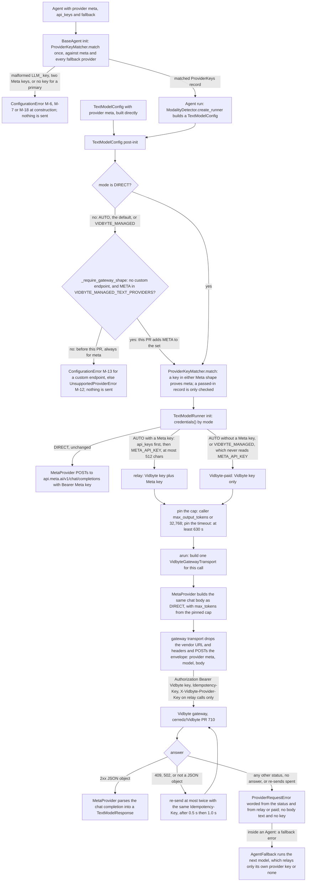

feat(gateway): send Muse through the Vidbyte gateway, and match Meta's LLM_ keys only to Meta

This PR merges only after cerredz/Vidbyte#710 is deployed, after ops has provisioned the backend's `META_API_KEY`, and after the pre-merge live check described in this PR has passed.

## Motivation

**Merge prerequisites, in order.** None holds yet (2026-10-17). Tick each one when it holds.

- [ ] **cerredz/Vidbyte#710 is deployed.** It is open and still a draft, at head `36c5a628`. Until it is deployed, the gateway answers every `meta` call in a gateway mode with a 422. Nothing is billed, but Muse in `AUTO` cannot run (spec EC-15).
- [ ] **Ops has provisioned the backend's `META_API_KEY`.** Until then, every Vidbyte-paid `meta` call gets a 502, which the SDK sends 3 times. Relay calls still work (EC-2). This has to gate the merge, not only the release, for two reasons:
  - A release is a separate manual dispatch from a tag (`.github/workflows/publish.yml`).
  - Any release cut from main after this merge sends `meta` calls to the gateway.
- [ ] **The pre-merge live check has passed.** It is described under Verification below. It has not run yet: it needs #710 deployed, a real Vidbyte key, and a real Meta key, and the pipeline that wrote this PR holds no real key.

**Problem.** Today the SDK refuses provider `meta` in both gateway modes. In the default `AUTO` mode, `TextModelConfig(provider="meta", model="muse-spark-1.1")` raises at construction, as observed at the merge base `845a4d9b`:

```
UnsupportedProviderError: The Vidbyte gateway serves only: anthropic, deepseek, gemini, kimi, openai, xai. Use mode=TextModelMode.DIRECT to call meta with your own key.
```

So the only SDK path to Muse is `TextModelMode.DIRECT`, straight to `api.meta.ai`, and Vidbyte earns no 2% fee on Muse traffic. cerredz/Vidbyte#710 adds `meta` to the gateway as a seventh provider. This PR is the SDK half: it sends Muse calls there, with the caller's own Meta key relayed (Meta bills the tokens, Vidbyte bills its 2% fee) or Vidbyte-paid (provider cost plus 2%).

**A second defect blocks the same goal: Meta's own key shape.** Meta's authentication page documents keys this way:

> API keys start with `LLM_`, followed by a numeric ID and the secret, separated by underscores

That is https://dev.meta.ai/docs/authentication, re-fetched 2026-10-17 22:24 UTC; the older `LLM|` form appears 0 times on the page. Meta's error page gives the valid format as `LLM_{numeric_id}_{secret}` (https://dev.meta.ai/docs/error-handling).

The SDK's key matcher proves only the older `LLM|<id>|<secret>` form, and it does not reserve the `LLM_` prefix. So a real Meta key in `api_keys` has one of two outcomes:
- It is refused at construction with M-6. This is what the snippet below hits.
- Beside a Kimi, DeepSeek, Mistral, GLM or MiniMax model, it is bound to that model by elimination and relayed to that vendor.

This bug has been on SDK main since #1027 (`72a4ade1`). It is not on PyPI: the latest release, 0.3.0, predates #1027 (`git merge-base --is-ancestor 72a4ade1 v0.3.0` exits 1).

**A standalone hotfix is possible.** The key-shape fix also exists as self-contained commits on `fix/meta-llm-key-shape`:
- T `22fe9fc5` is tests only.
- P' `c6d88e88` is a `cherry-pick -x` of P `9309eed0`, byte-identical to it.

They are merged forward into this branch at `db5ad22b`, and that merge leaves the tree unchanged. The coordinator may open that branch as a standalone hotfix PR and merge it ahead of this one, because the misroute does not wait on #710. Two cases follow:
- *Hotfix merged with a merge commit:* no conflict arises here.
- *Hotfix squash-merged:* six pack files conflict the next time main is merged into this branch (FEATURE.md, README.md, fixtures, agents, matching and modes, all under `sdk_provider_keys`). Resolve each to this branch's side, which is a superset (S5 hotfix-split report).

## Changes

### How to use

This is the spec's §4 snippet, run verbatim. The runner reads the snippet out of `spec.md` at run time, so the text was not retyped. Fake keys are built by concatenation. Only the inner HTTP transport is faked, and it answers each gateway POST with a Meta chat completion.

```python
import os

from vidbyte import Agent
from vidbyte.lib.config import TextModelConfig, TextModelMode
from vidbyte.lib.runners import TextModelRunner

# AUTO (the default): your Meta key sits in a mixed list, and the SDK
# matches it to meta by its prefix. Meta issues keys shaped
#   "LLM" + "_" + <numeric id> + "_" + <secret>
# and the older "LLM" + "|" + <app id> + "|" + <secret> form matches too.
muse = Agent(
    name="muse",
    system_prompt="Answer in one word.",
    provider="meta",
    model_name="muse-spark-1.1",
    vidbyte_api_key=os.environ["VIDBYTE_API_KEY"],
    api_keys=[os.environ["ANTHROPIC_API_KEY"], os.environ["META_API_KEY"]],
    fallback=["anthropic/claude-sonnet-5"],
)
print(muse.run("Say hi.").content)  # relays the Meta key; Meta bills you, Vidbyte bills its 2% fee

# VIDBYTE_MANAGED: Vidbyte's own Meta key; Vidbyte bills provider cost plus 2%.
paid = TextModelRunner(TextModelConfig(provider="meta", model="muse-spark-1.1", mode=TextModelMode.VIDBYTE_MANAGED))
print(paid.run("Say hi.").text)
```

**On this branch** (`75187327`), `META_API_KEY` was run once in each Meta shape. Both shapes give the same report, shown here for the documented `LLM_<id>_<secret>` shape:

```
snippet stdout: ['Hi', 'Hello']
raised: nothing
requests sent: 2
- agent call: POST https://vidbyte-backend.onrender.com/api/v1/models/generate
    header names: ['authorization', 'content-type', 'idempotency-key', 'x-vidbyte-provider-key']
    authorization bearer: the Vidbyte key
    X-Vidbyte-Provider-Key: the Meta key
    envelope provider/model: meta/muse-spark-1.1; body max_tokens: 32768; max_completion_tokens in body: False; timeout_seconds: 630.0
    Anthropic key anywhere in request: False; Meta key outside the relay header: False
- VIDBYTE_MANAGED call: POST https://vidbyte-backend.onrender.com/api/v1/models/generate
    header names: ['authorization', 'content-type', 'idempotency-key']
    authorization bearer: the Vidbyte key
    X-Vidbyte-Provider-Key: absent
    envelope provider/model: meta/muse-spark-1.1; body max_tokens: 32768; max_completion_tokens in body: False; timeout_seconds: 630.0
    Anthropic key anywhere in request: False; Meta key outside the relay header: False
verdict: PASS
RESULT: section 4 snippet runs as written in both Meta key shapes
```

**At the merge base** (`845a4d9b`), the same runner sends 0 requests in either shape:

```
LLM_<id>_<secret> (documented): ConfigurationError: api_keys[1] (53 characters) has no prefix that proves its provider, and none of the providers configured here (meta, anthropic) can take such a key. Add the model that uses it, or set that provider's own API key environment variable instead.
LLM|<id>|<secret> (older):      AgentExecutionError: Agent 'muse' failed to generate a reply.
```

The `LLM|` run fails because building the Muse runner raises `UnsupportedProviderError` (M-12). Its Anthropic fallback never runs.

### Flow as shipped

This is the actual path on this branch. Only the set membership and the key rule are new; every other box is unchanged code that `meta` now reaches.



### What changed

There are 22 files outside `docs/`, with +906 and -85 lines. Four of them are product files; the rest are the two feature-test packs. No file is new, no dependency is added, and no public name changes.

**Product (4 files)**

| File | +/- | Change | Commits |
|---|---|---|---|
| `vidbyte/lib/constants/jev.py` | +5 -2 | `ModelProvider.META` joins `VIDBYTE_MANAGED_TEXT_PROVIDERS`, which grows from 6 to 7 providers. This set is the one gate on the gateway path: `_require_gateway_shape` (M-12) and the M-18 fallback wording both read it. The comment above the set now cites cerredz/Vidbyte#710's meta-muse-gateway spec r4 §9.2 at commit `c395349bd`. | `b2306206` |
| `vidbyte/lib/registries/provider_keys.py` | +7 -3 | The `KEY_FORMATS` Meta row (`:59`). Prefixes go from `("LLM\|",)` to `("LLM\|", "LLM_")`. The pattern goes from `LLM\\|[0-9]+\\|[A-Za-z0-9_-]+` to `LLM(?:\\|[0-9]+\\|[A-Za-z0-9_-]+\|_[0-9]+_[A-Za-z0-9_-]+)`. The existing code reserves every literal prefix in a row to that row's provider, and META already takes no key it cannot prove, so a malformed `LLM_` key is refused with M-6 and reaches no vendor. The row's comment quotes Meta's 2026-10-17 sentence and keeps the 2026-10-15 `LLM\|` source (spec Q-7). No other row, no row order, and no message changed. | `9309eed0` (hotfix copy `c6d88e88`) |
| `vidbyte/lib/registries/README.md` | +1 -1 | Table F's `meta` row now gives both patterns. It quotes Meta's authentication sentence and the error-handling page, and it keeps #1027's 2026-10-15 `LLM\|` text, noting that today's page no longer shows that form. | `9309eed0` |
| `README.md` | +7 -7 | Three bullets change in "Vidbyte-managed text calls". The Providers bullet adds Meta. The output-cap bullet now reads "For xAI, DeepSeek, Kimi, and Meta, set the cap with `max_output_tokens`". The Prefixes bullet adds "`LLM_` or `LLM\|` (Meta)" (`:292`). | `98b91e11`, `874890bd` |

**Tests (18 files, two packs).** Every fake Meta key is built by concatenation. The new fake in the documented shape is `K_META_DOC = "LLM" + "_" + "1" * 16 + "_" + "m" * 32`.

| File | +/- | Change | Commits |
|---|---|---|---|
| `sdk_provider_keys/test_provider_keys_acceptance.py` | +110 -2 | Three new tests: `SnippetAcceptanceTests::test_meta_muse_snippet_relays_the_meta_key_for_the_agent_and_sends_the_paid_call_without_it` (both shapes), plus `TextCallAcceptanceTests::test_vidbyte_managed_meta_never_reads_meta_api_key_or_sends_a_meta_key` and `test_meta_in_direct_sends_base_commits_request_and_both_gateway_envelopes_wrap_that_body_with_the_cap` | `856e3c0a` `23c4e9c4` `4af4d8e0` |
| `sdk_provider_keys/test_provider_keys_wire_contract.py` | +67 -3 | New class `MetaRelayTests` (relay order and the three paid headers). Meta joins the per-provider key table, and the cap table with `max_tokens`. | `856e3c0a` `23c4e9c4` `4af4d8e0` |
| `sdk_provider_keys/test_provider_keys_agents.py` | +106 -2 | New class `MetaAgentTests`, with four tests. (1) A relayed 401 falls back to anthropic. (2) `test_a_fork_to_muse_relays_meta_api_key_or_goes_vidbyte_paid_and_never_carries_the_parents_anthropic_key`. (3) `test_the_multi_provider_grader_adds_a_muse_member_that_relays_only_meta_api_key`. (4) `test_a_meta_key_in_either_shape_never_rides_on_a_kimi_fallback_that_holds_no_key_of_its_own`. | `856e3c0a` `23c4e9c4` `4af4d8e0` |
| `sdk_provider_keys/test_provider_keys_failures.py` | +103 -8 | New class `MetaGatewayFailureTests`. It covers the 422 for an unserved id, a 502 sent three times, and a relayed 401 and 429. | `856e3c0a` `4af4d8e0` |
| `sdk_provider_keys/test_provider_keys_matching.py` | +170 -5 | Six new tests on the Meta shapes. (1) `test_every_meta_shaped_key_is_reserved_to_meta_and_no_provider_takes_it_unproven`. (2) `test_a_meta_key_in_either_shape_goes_to_meta_beside_every_provider_that_takes_unproven_keys`. (3) `test_two_meta_keys_in_different_shapes_are_refused_and_the_same_documented_key_twice_is_one_key`. (4) `test_a_malformed_llm_key_is_refused_at_construction_on_every_root_whatever_its_providers`. (5) `test_m18_offers_vidbytes_own_meta_account_for_a_meta_primary_whose_list_holds_only_another_providers_key`. (6) `test_a_lone_meta_key_for_a_provider_that_takes_unproven_keys_is_refused_with_m18`. The table F samples gain three `LLM_` keys. | `856e3c0a` `23c4e9c4` `4af4d8e0` |
| `sdk_provider_keys/test_provider_keys_modes.py` | +55 -14 | `test_meta_builds_in_both_gateway_modes_and_still_refuses_a_custom_endpoint_and_streaming`. Meta moves from the refused-provider loop into `SERVED`, a change made by design. `UnsendableKeyTests` runs in both shapes. | `856e3c0a` `23c4e9c4` `4af4d8e0` |
| `sdk_provider_keys/test_provider_keys_contract.py` | +80 -2 | `test_the_meta_row_is_the_section_8_5_row_and_every_other_row_keeps_its_rule`, plus new class `KeyFormatSourceTests` (two tests: the source comment and the registries README row) | `23c4e9c4` |
| `sdk_provider_keys/test_provider_keys_security.py` | +49 -2 | `test_every_meta_gateway_failure_logs_and_raises_no_key_canary_or_key_shaped_body_text` | `856e3c0a` `4af4d8e0` |
| `sdk_provider_keys/test_provider_keys_property.py` | +5 -4 | `K_META_DOC` joins the proven-key pool | `23c4e9c4` `4af4d8e0` |
| `sdk_provider_keys/provider_keys_fixtures.py` | +14 -3 | `K_META_2` and `K_META_DOC` | `856e3c0a` `23c4e9c4` `4af4d8e0` |
| `sdk_provider_keys/FEATURE.md`, `README.md` | +21 -10, +3 -0 | The scenarios and the modification-pattern lines for Meta | `856e3c0a` `23c4e9c4` `4af4d8e0` |
| `sdk_managed_text/test_managed_text_acceptance.py` | +67 -5 | `test_readme_managed_section_names_meta_as_served_in_the_chat_cap_guidance_and_by_its_llm_prefix`. Meta gets an oracle key, and joins the README name lists. | `856e3c0a` `23c4e9c4` `4af4d8e0` |
| `sdk_managed_text/test_managed_text_wire_contract.py` | +16 -4 | Meta joins the per-dialect tables: an oracle key, cap field `max_tokens`, the chat keys the body may carry, and a tools case | `856e3c0a` `23c4e9c4` `4af4d8e0` |
| `sdk_managed_text/managed_text_fixtures.py` | +11 -4 | `ModelProvider.META: "muse-spark-1.1"` joins `MANAGED_MODELS`, and Meta joins `_CHAT_PROVIDERS`, which marks providers that answer in the chat-completions shape | `856e3c0a` `4af4d8e0` |
| `sdk_managed_text/test_managed_text_deadline.py` | +4 -2 | `"meta"` in `MANAGED_PROVIDERS` | `856e3c0a` `4af4d8e0` |
| `sdk_managed_text/FEATURE.md`, `README.md` | +2 -1, +3 -1 | Pack headers and modification patterns | `856e3c0a` `23c4e9c4` `4af4d8e0` |

### Why the cap field stays `max_tokens`

Every gateway call sends `max_tokens`. Its value is the caller's `max_output_tokens`, or 32,768 when the caller sets none. That default is the constant `VIDBYTE_MANAGED_DEFAULT_MAX_OUTPUT_TOKENS` (`vidbyte/lib/constants/jev.py:87`), which `TextModelRunner.__init__` applies to every gateway call (`vidbyte/lib/runners/text.py:57-62`). `OpenAICompatibleProvider` then writes the cap as `payload["max_tokens"]` (`vidbyte/providers/compatible.py:87`).

Meta documents that this field caps reasoning as well as visible output. Both quotes were re-fetched 2026-10-17:
- https://dev.meta.ai/docs/reasoning: "`max_tokens` (Chat Completions) and `max_output_tokens` (Responses API) cap reasoning tokens plus visible output tokens combined."
- https://dev.meta.ai/docs/protocols/chat-completions: "The deprecated alias `max_tokens` is still accepted."

The gateway accepts either field. Switching to `max_completion_tokens` would change `DIRECT` bodies, or would make the adapter learn the mode (spec D-2). `MetaProvider` is unchanged.

### Deviations from the spec

1. **INV-16, AC-17 (iii), EC-8, EC-17 and §9.4 say M-6 "in every mode"** (S5 re-review R-C1, Minor). Their stated reason is that "matching runs before the mode is used". That is true for agents, which match keys at construction. It is not true for a `TextModelConfig` built directly in a gateway mode. There, `_require_gateway_shape` runs first (`vidbyte/lib/dataclasses/model_configs.py:95-96`, before the match at `:100`). So a malformed `LLM_` key on an openrouter, mistral, glm or minimax config raises `UnsupportedProviderError` (M-12), not M-6. Both refusals happen at construction, both send nothing, and neither puts key text in the message. The same config in `DIRECT` gets M-6. The code is right and the spec text is loose. No code or test changes.
2. **Where the merge sentence sits.** AC-15 asks for it first in Motivation. Here it is the body's first line, directly above Motivation, so it is the first thing a reviewer reads. The wording is identical, character for character, to all 7 copies in `spec.md`.
3. **Spec §5, documentation only.** Its flowchart is replaced with the chart above. The old chart left out where agents match keys (at construction) and the order inside `_require_gateway_shape` (endpoint check first). Its sequence diagram is kept. Spec §17 records the change.

## Compatibility

**Billing changes.**

1. **Muse calls that used to raise now bill (EC-11).** A `meta` config or agent in `AUTO` (the default) or `VIDBYTE_MANAGED` now sends its calls to the gateway, and they bill. Before, building it raised `UnsupportedProviderError`. This includes Muse fallbacks, forks, and handoffs (`vidbyte/agents/fork.py:68`, `vidbyte/agents/handoff.py:68`). A fork or handoff child keeps its parent's matched keys, without an M-18 check. So when the parent holds no Meta key, the child relays `META_API_KEY` if it is set, and is otherwise Vidbyte-paid.
2. **Compositions now run Muse members they used to skip (EC-16).** These are compositions that tolerate a failed member or stage. A Muse member they used to drop silently now runs. Each such member is one agent loop of one or more billed calls, billed even when its result is not used. Examples, not a closed list:
   - the multi-provider grader with `provider_models` unset while `META_API_KEY` is set (it then adds `muse-spark-1.1` on its own);
   - aggregate proposers and fanout members that name Muse;
   - an independent critic or a prosecutor/defender/judge stage that names Muse under `failure_policy=RETURN_CANDIDATE`;
   - a Jev run-brief writer that names Muse;
   - a multi-agent team worker that names Muse. Before, its failed dispatch was recorded as a retryable `dispatch_boundary_error` blocker and nothing was billed (`vidbyte/agents/multi/dispatcher.py:69-70`, `:118-124`; S4 R-9).
3. **Meta keys in the `LLM_` form now go only to Meta (EC-17, EC-8).** In every mode, a key in Meta's documented shape is proven `meta`. Before, in `api_keys`, it was refused when no configured provider could take it. When a Kimi, DeepSeek, Mistral, GLM or MiniMax model was configured, it bound to that model and was sent to that vendor. Two cases are now refused at construction:
   - A list whose only key is a Meta key, for a Kimi or DeepSeek primary, now gets M-18 instead of the silent misroute.
   - A key that starts with `LLM_` but does not fully match gets M-6. If a real key is refused this way, putting it in `META_API_KEY` still works, because that variable is trusted by its name (EC-18).

**Who pays.** In `AUTO` with a Meta key, from `api_keys` or `META_API_KEY`, the call relays it: Meta bills the tokens and Vidbyte bills its 2% fee. In `AUTO` with no Meta key, and always in `VIDBYTE_MANAGED`, the call is Vidbyte-paid at provider cost plus 2%. `VIDBYTE_MANAGED` never reads `META_API_KEY`.

**To opt out:** leave Muse out of member and stage settings, set the grader's `provider_models`, or use `mode=TextModelMode.DIRECT` (`model_mode=` on an agent).

**`DIRECT` is unchanged.** Every key the merge base accepted produces the same request to `https://api.meta.ai/v1/chat/completions` (INV-11). A key in the documented `LLM_` shape, which the merge base refused with M-6, now reaches Meta in that same request shape.

**Served Muse ids.** At backend pin `54a8e1a5`, the gateway serves only `muse-spark-1.1` and its dated snapshots. `muse-spark-1.2`, `muse-spark-1.3` and the `-contributor` ids go out unchanged and get the gateway's 422. Nothing is billed and the 422 is not re-sent (EC-1). This holds until Run A's Q-1 hotfix, and `DIRECT` is the way to call those ids today. The SDK keeps no list of Muse ids of its own (spec D-4).

**Early release (EC-15).** If an SDK release with this change ships before #710 is deployed, every gateway-mode Muse call gets that same 422.

**Risk: the output cap (A-2).** Every gateway call without `max_output_tokens` sends `max_tokens: 32768`, and an `Agent` cannot set the cap. Meta publishes no output limit for `muse-spark-1.1`. It gives every Muse Spark version a 1,048,576-token context window, and `output 131072` for `muse-spark-1.3`. If 1.1's configured maximum is below 32,768, two things happen:
- every capless `meta` gateway call gets Meta's 400;
- every `Agent` call on Muse in a gateway mode fails, the snippet above included (EC-3).

Call (a) of the live check tests this before merge.

**Price.** Unchanged. `muse-spark-1.1` costs $1.25 input, $4.25 output and $0.15 cached input per 1M tokens (https://dev.meta.ai/docs/pricing-rate-limits, Standard mode, re-fetched 2026-10-17). That matches `vidbyte/lib/registries/pricing.py:284`. This PR changes 0 lines in `pricing.py` and in `lint/pricebook_vintage_lock.json`.

**Messages.** These are real outputs from this branch:
- M-12 now lists seven providers: "The Vidbyte gateway serves only: anthropic, deepseek, gemini, kimi, meta, openai, xai. Use mode=TextModelMode.DIRECT to call openrouter with your own key."
- M-18 for a `meta` primary now ends "… or pass no provider keys to use META_API_KEY or Vidbyte's own meta account." It used to end "… to use META_API_KEY."

**Public API.** No signature, field, default, or export changes. Streaming still refuses every gateway mode, `meta` included.

## Verification

### Gates

Only `docs/` has changed since the full gate ran at `8033c08c`, and since the PR author's own runs at `75187327`. At this PR's head, `git diff --stat 8033c08c HEAD -- . ':!docs'` prints nothing.

| Gate | Command | Run by, at | Final lines |
|---|---|---|---|
| The 25 acceptance proof nodes | `PYTHONPATH=$(pwd) env -u DEEPSEEK_API_KEY py -3.11 -m pytest <the 25 node ids in the table below> -q -p no:cacheprovider` | PR author, `75187327` | `25 passed in 1.36s` |
| Feature area | `PYTHONPATH=$(pwd) env -u DEEPSEEK_API_KEY py -3.11 -m pytest tests/features/sdk_managed_text tests/features/sdk_provider_keys -q -p no:cacheprovider` | PR author, `75187327` | `192 passed in 2.24s` |
| Lint | `py -3.11 lint/run.py` | PR author, `75187327` | `S064 RATCHETED: 4 known finding(s). Inspect with: python lint/run.py --rule S064 --all` / `SDK-LINT: PASS` (exit 0; 0 regressed, 0 errored) |
| Full gate, source stage | `PYTHONPATH=$(pwd) py -3.11 scripts/run_ci.py --stage source` | S5 repair, same source tree | `FAILED tests/features/harness_threads/test_harness_threads_surface.py::test_failure_codes_keep_main_and_append_exactly_the_28_harness_codes` / `=========== 1 failed, 6269 passed, 16 skipped in 118.49s (0:01:58) ============` / `CI failed: Command failed with exit code 1: …` |
| Full gate, independent re-run | the same command | orchestrator, `8033c08c` | `1 failed, 6269 passed, 16 skipped, 1 warning in 135.91s`, failing on the same test |
| Full gate, proof run | `py -3.11 scripts/run_ci.py` (PYTHONPATH unset) | S5 repair, same source tree | `E       AssertionError: assert 148 == 120` / `=========== 1 failed, 6269 passed, 16 skipped in 123.56s (0:02:03) ============` / `CI failed: …` |
| Package stage | `py -3.11 scripts/run_ci.py --stage package` (PYTHONPATH unset) | S5 repair, same source tree | `No broken requirements found.` / `Installed vidbyte-sdk 0.3.0 passed smoke checks.` / `CI passed.` |
| Known red at the merge base | that one test in a detached worktree at `845a4d9b` | S5 repair | `E       AssertionError: assert 148 == 120` / `1 failed in 1.89s` |
| Semgrep | none | — | Remote only. It is not a `run_ci.py` step, and it cannot run locally (an mcp 2.x import error). |

**The one red test was already failing on main.** `tests/features/harness_threads/test_harness_threads_surface.py::test_failure_codes_keep_main_and_append_exactly_the_28_harness_codes` fails at the merge base `845a4d9b` (`148 == 120`) and at origin/main `6f5a7310` (`167 == 120`). This PR touches nothing it reads. Open PR #1147 changes that test file (+65 -22).

**Remote checks: none.** CI triggers are paused, so no check attaches to this PR. Output of `gh pr checks 1180 --repo cerredz/Vidbyte-SDK`:

```
no checks reported on the 'feat/meta-muse-managed-text' branch
```

**Independent checks.** Each was run by the PR author, separately from the test suite.
- **The snippet** ran verbatim in both key shapes on this branch, and failed at the merge base (see How to use).
- **Meta's first-party pages were re-fetched** with curl on 2026-10-17 at 22:24 UTC (sha256 prefixes in parentheses):
  - `authentication.md` (`065bf421ea2c`): the `LLM_` sentence is at `:13`, and `LLM|` appears 0 times. The S5 re-review's fetch has the same hash.
  - `pricing-rate-limits.md`: `muse-spark-1.1` at $1.25, $4.25 and $0.15.
  - `reasoning.md`: the cap sentence is at `:390`.
  - `protocols/chat-completions.md`: the alias sentence is at `:405`.
- **Scope.** In `vidbyte/`, only `jev.py`, `registries/README.md` and `provider_keys.py` changed. The lint baseline, the pricebook lock and `pricing.py` have 0 changed lines.
- **Key literals.** A key literal means `LLM` followed by `_` or `|` and then a digit. There are 0 in the branch diff and 0 in the branch's commit messages.
- **Files that should not be committed.** There are 0 bytecode or build files in the diff.
- **The mermaid block** above parses with mermaid 11.4.1 as `flowchart-v2`. A deliberately broken control chart is rejected, which shows the parser is really checking.

**Template checklist**

- [ ] Existing repository checks pass. *Not ticked.* The full gate is red on one test that was already red on main (named above). `CONTRIBUTING.md:72` says a change is not ready while any local gate is red, which is one reason this PR stays a draft.
- [ ] New or changed package assets are present in the built wheel. *N/A:* no package asset changes. `--stage package` passes.
- [x] Documentation and examples reflect the change. The changes are the root README's managed-mode bullets, the registries README's table F row, and the source comments. `test_readme_managed_section_names_meta_as_served_in_the_chat_cap_guidance_and_by_its_llm_prefix` and `KeyFormatSourceTests` bind them. (One gap remains; see the S5 R-C2 follow-up.)
- [x] No credentials, private data, generated bytecode, build output, or unrelated changes are included. The checks above found 0 key literals, 0 bytecode or build files, and nothing outside the spec's file list.

### Acceptance criteria → proof

Paths are under `tests/features/sdk_provider_keys/` unless they start with `mt/`, which is short for `tests/features/sdk_managed_text/`. Every node below exists on this branch, and all 25 pass.

| AC | What it pins | Proof |
|---|---|---|
| AC-1 | The §4 snippet works in both Meta key shapes | `test_provider_keys_acceptance.py::SnippetAcceptanceTests::test_meta_muse_snippet_relays_the_meta_key_for_the_agent_and_sends_the_paid_call_without_it` |
| AC-2 | `AUTO` relays exactly the Meta key, in exactly four headers | `test_provider_keys_wire_contract.py::RelayHeaderTests::test_each_served_provider_relays_its_own_key_in_the_header_and_nowhere_else`; `test_provider_keys_wire_contract.py::MetaRelayTests::test_a_meta_call_relays_the_lists_meta_key_before_meta_api_key_stripped_and_no_other_key` |
| AC-3 | `AUTO` without a Meta key sends the three Vidbyte-paid headers | `test_provider_keys_wire_contract.py::MetaRelayTests::test_a_meta_call_without_a_meta_key_sends_exactly_the_three_vidbyte_paid_headers` |
| AC-4 | `VIDBYTE_MANAGED` never reads or sends a Meta key | `test_provider_keys_acceptance.py::TextCallAcceptanceTests::test_vidbyte_managed_meta_never_reads_meta_api_key_or_sends_a_meta_key` |
| AC-5 | `max_tokens` is 32,768 or the caller's exact value, with no `max_completion_tokens` | `mt/test_managed_text_wire_contract.py::OutputCapTests::test_managed_body_carries_the_default_cap_or_the_callers_exact_value_in_each_dialects_field`; `test_provider_keys_wire_contract.py::RelayCapAndFloorTests::test_a_relay_body_carries_the_default_cap_or_the_callers_exact_value` |
| AC-6 | The gateway body equals the `DIRECT` body plus the cap | `test_provider_keys_acceptance.py::TextCallAcceptanceTests::test_meta_in_direct_sends_base_commits_request_and_both_gateway_envelopes_wrap_that_body_with_the_cap`; `test_provider_keys_wire_contract.py::RelayHeaderTests::test_the_relay_envelope_body_is_the_direct_body_with_the_gateway_cap` |
| AC-7 | An unserved Muse id gets one POST and the 422 wording | `test_provider_keys_failures.py::MetaGatewayFailureTests::test_a_muse_id_the_gateway_does_not_serve_is_sent_unchanged_once_and_gets_the_422_wording` |
| AC-8 | A 502 is sent 3 times, worded by who pays | `test_provider_keys_failures.py::MetaGatewayFailureTests::test_a_meta_502_is_sent_three_times_with_one_key_and_worded_for_who_pays` |
| AC-9 | A relayed 401 names the caller's own Meta key; a 429's message is withheld | `test_provider_keys_failures.py::MetaGatewayFailureTests::test_a_relayed_meta_401_names_the_callers_own_meta_key_and_a_relayed_429_is_withheld` |
| AC-10 | Unserved providers are still refused, and M-12 lists seven | `test_provider_keys_modes.py::GatewayShapeTests::test_every_unserved_provider_and_any_endpoint_is_refused_at_construction_in_both_gateway_modes`; `mt/test_managed_text_selection.py::KeySelectionTests::test_managed_state_refuses_every_provider_the_gateway_does_not_serve` |
| AC-11 | A Muse 401 falls back to Anthropic, and each call carries only its own key | `test_provider_keys_agents.py::MetaAgentTests::test_a_relayed_meta_401_falls_back_to_anthropic_and_each_call_carries_only_its_own_providers_key` |
| AC-12 | `DIRECT` is byte-identical to the merge base | `test_provider_keys_acceptance.py::TextCallAcceptanceTests::test_meta_in_direct_sends_base_commits_request_and_both_gateway_envelopes_wrap_that_body_with_the_cap` (DIRECT half); `test_provider_keys_modes.py::UnsendableKeyTests::test_a_meta_key_from_a_mixed_list_reaches_meta_unchanged_in_direct` |
| AC-13 | The README names Meta as served, in the cap guidance, and by prefix | `mt/test_managed_text_acceptance.py::ManagedTextAcceptanceTests::test_readme_managed_section_names_meta_as_served_in_the_chat_cap_guidance_and_by_its_llm_prefix` (binds the `LLM\|` half; the `LLM_` half was checked by hand, see Follow-ups) |
| AC-14 | No key, canary, or key-shaped body text appears in any error or log | `test_provider_keys_security.py::LeakScenarioTests::test_every_meta_gateway_failure_logs_and_raises_no_key_canary_or_key_shaped_body_text` |
| AC-15 | This PR body: the template, the merge sentence, EC-11, EC-16 and EC-17, and the live check | This body. The pre-merge live check is listed as an open merge prerequisite (below). |
| AC-16 | A key in the documented `LLM_` shape works from `api_keys`, from `META_API_KEY`, and in `DIRECT` | The AC-1 test, subTest `shape="LLM_"`. `MetaRelayTests::test_a_meta_call_relays_the_lists_meta_key_before_meta_api_key_stripped_and_no_other_key`, cases "LLM_ key in a mixed list beats META_API_KEY" and "LLM_ META_API_KEY with no list". `UnsendableKeyTests::test_a_meta_key_from_a_mixed_list_reaches_meta_unchanged_in_direct`, subTest `shape="LLM_"`. `test_provider_keys_matching.py::TableFAndATests::test_each_table_f_sample_proves_its_provider_and_every_unsourced_shape_is_unproven`. |
| AC-17 | A Meta key never reaches another vendor; malformed keys are refused | `test_provider_keys_agents.py::MetaAgentTests::test_a_meta_key_in_either_shape_never_rides_on_a_kimi_fallback_that_holds_no_key_of_its_own`; `test_provider_keys_matching.py::ConfiguredPrimaryTests::test_a_lone_meta_key_for_a_provider_that_takes_unproven_keys_is_refused_with_m18`; `test_provider_keys_matching.py::UniqueAssignmentTests::test_a_malformed_llm_key_is_refused_at_construction_on_every_root_whatever_its_providers`; `test_provider_keys_matching.py::TableFAndATests::test_every_meta_shaped_key_is_reserved_to_meta_and_no_provider_takes_it_unproven` |
| AC-18 | The source comment and the registries README cite Meta's page | `test_provider_keys_contract.py::KeyFormatSourceTests::test_the_comment_above_the_meta_row_names_the_llm_shape_and_cites_metas_page`; `test_provider_keys_contract.py::KeyFormatSourceTests::test_the_registries_readme_meta_row_quotes_metas_llm_sentence_and_keeps_the_older_source` |

The tests went in first, and they failed for the reasons the spec predicts. At the merge base, the S2 tests (`856e3c0a`) were red exactly where `meta` was still refused. At the S3 head, the r4 tests (`23c4e9c4`) were red exactly where an `LLM_` key was unproven or misrouted. On the hotfix branch, T alone gives `12 failed, 126 passed`, and T plus P' gives `138 passed`.

### Adversarial review

The S4 review used three lenses (conformance, engineering, conventions) and a findings verifier. Its verdict was **NEEDS REWORK**:
- 11 findings were confirmed: 1 Blocker, 1 Major, and 9 Minor or notes.
- 0 were refused.
- Conformance R-C2 (a Meta key relayed on a Kimi call) was merged into R-1, because it has the same root cause.

The S5 conformance re-review gave **SOUND**. It confirmed 10 of 10 fixes, with R-8 open by design, and raised 2 new Minors.

| Finding | Severity | What it found | Fixed by |
|---|---|---|---|
| S4 R-1 | Blocker | Meta documents `LLM_<numeric id>_<secret>`, but the Meta row neither proved nor reserved `LLM_`. So the user's real key got M-6, or was relayed to Kimi or DeepSeek. | `9309eed0` (key rule and registries README), `874890bd` (root README), with tests in `23c4e9c4`. Hotfix copies: T `22fe9fc5`, P' `c6d88e88`, merged at `db5ad22b`. |
| S4 R-2 | Major | 52 added test-comment lines were wider than 72 columns | `4af4d8e0` |
| S4 R-3 | Minor | No test failed if a Meta key rode on a keyless non-meta call | `23c4e9c4` (the AC-17 (i) test kills that mutant) |
| S4 R-4 | Minor | The merge sentence pointed at "(§12.5)", which means nothing in a PR body | `04729669` (spec r4) |
| S4 R-5 | Minor | Stale `jev.py` line citations in the spec | `04729669` |
| S4 R-6 | Minor | The pack modification-pattern lines did not name every per-provider table | `4af4d8e0` |
| S4 R-7 | Minor | An E302 in `test_provider_keys_agents.py`, and constants placed mid-file in `test_provider_keys_failures.py` | `4af4d8e0` |
| S4 R-8 | Minor | The README-section extraction block is copied three times across the tests | Open: a follow-up |
| S4 R-9 | Minor | The billing disclosure left out multi-agent team workers | `04729669`, and Compatibility item 2 above |
| S4 R-10 | Minor | The live check never verified merge prerequisite 2 end to end | `04729669` (call (d) below) |
| S4 R-11 | Note | Run A's wire contract calls `LLM\|` "Meta's documented key shape" | Recorded in spec §9.2 (`04729669`). Run A updated #710 in `d82e75eab` and `36c5a6289`. |
| S5 R-C1 | Minor | The spec says M-6 "in every mode", but a directly built `TextModelConfig` in a gateway mode gets M-12 first | Deviation 1 above. Spec text only, no code change. |
| S5 R-C2 | Minor | No test binds the `LLM_` half of the README Prefixes bullet | Open: a follow-up |

### Pre-merge live check

*Status: open, not yet run.* This is merge prerequisite 3. It verifies only, and adds no product surface.

- **Who and when:** the user or ops, after #710 is deployed, with their own Vidbyte key and their own Meta key in the shape Meta issues.
- **Where:** a checkout of this branch. The released `vidbyte-sdk` 0.3.0 refuses `meta` in `AUTO`.
- **What it leaves behind:** it commits nothing and writes no file.
- **Setup:** set `VIDBYTE_API_KEY` and `META_API_KEY`. Each call below runs `muse-spark-1.1`.

- [ ] **(a) Capless relay, which tests A-2.** `TextModelRunner(TextModelConfig(provider="meta", model="muse-spark-1.1")).run("Say hi.")` relays `META_API_KEY`, and its body carries `max_tokens: 32768`.
- [ ] **(b) Control.** The same call with `max_output_tokens=1024`.
- [ ] **(c) The key through `api_keys`, which tests A-6.** `TextModelRunner(TextModelConfig(provider="meta", model="muse-spark-1.1", api_keys=[os.environ["META_API_KEY"]], max_output_tokens=1024)).run("Say hi.")`. This is the only call whose key goes through the new Meta rule. Calls (a) and (b) relay `META_API_KEY`, which is trusted by its name.
- [ ] **(d) Vidbyte-paid, which tests the backend's `META_API_KEY`.** `TextModelRunner(TextModelConfig(provider="meta", model="muse-spark-1.1", mode=TextModelMode.VIDBYTE_MANAGED, max_output_tokens=1024)).run("Say hi.")`. Vidbyte bills it to the runner's own Vidbyte account, for at most 1,024 output tokens.

**Verdict.**
- *Pass:* all four calls return.
- *A-2 is false:* (a) raises `ProviderRequestError` with `status_code` 400 while (b) returns. The SDK withholds Meta's message, so the control call is what isolates the cap as the cause.
- *A-6 is false:* (c) raises `ConfigurationError` at construction (M-6, "has no prefix that proves its provider") while (b) returns.
- *Prerequisite 2 is not met:* (d) raises `ProviderRequestError` with `status_code` 502 and the words "Vidbyte's own account" while (b) returns. Ops then provisions the key, and (d) runs again.
- *Anything else* is a setup problem, not a verdict: a 422, 401 or 402 on any call, or (b) failing. Fix the setup and run again.

**If A-2 or A-6 is false, the PR stays unmerged.**
- If A-2 is false, the fix adds a per-provider default cap in `jev.py`, read in `text.py`. That exceeds the spec's budget, so it needs the user's approval and a spec revision.
- If A-6 is false, the fix widens the `LLM_` branch's secret class to `[!-~]+`. That needs a spec revision.

**Recording the result.** Post the four statuses here, and tick each call when it returns. For a refused call (c), write "ConfigurationError at construction". Never post a key or an answer body.

## Follow-ups

- **Run A's Q-1, the Muse 1.2 and 1.3 hotfix.** It lets the backend pin serve `muse-spark-1.2` and `muse-spark-1.3`. Until then those ids get the gateway's 422 from the SDK, and `DIRECT` is the way to call them.
- **A-2 and A-6 stay open until the pre-merge live check runs.** A-2: Meta publishes no output limit for `muse-spark-1.1`. A-6: no Meta source states which characters a key's secret uses.
- **The standalone hotfix PR** from `fix/meta-llm-key-shape` (T `22fe9fc5` and P' `c6d88e88`) is the coordinator's call. If it lands first by squash merge, resolve the six conflicting pack files to this branch's side.
- **S5 R-C2.** No test binds the `LLM_` half of the README Prefixes bullet (`README.md:292`). Only "`LLM|` (Meta)" is asserted, at `tests/features/sdk_managed_text/test_managed_text_acceptance.py:256`. Under a test-change grant, add an assertion that `prefixes` contains "`LLM_` or `LLM|` (Meta)".
- **S4 R-8.** The README-section extraction block is copied three times across the test packs. A shared helper would remove that duplication.
- **Record R-1 as a regression.** Both packs' FEATURE.md files (`tests/features/sdk_managed_text/FEATURE.md:73` and `tests/features/sdk_provider_keys/FEATURE.md:96`) still say "Historical Regressions: None yet". They should record R-1, the misrouted `LLM_` key, along with the tests that now protect it (AC-16 and AC-17).
- **Open questions Q-1..Q-7.** Each keeps its default until the user answers:
  - Q-1: append a 502 body's `subtitle` to the error message. Default **no**.
  - Q-2: refuse unserved Muse ids in the SDK. Default **no**.
  - Q-3: refuse `-contributor` ids on Vidbyte-paid calls. Default **no**.
  - Q-4: add `sk-svcacct-` to the README Prefixes bullet. Default **no**.
  - Q-5: fix the `vidbyte/providers/README.md` and `skills/usage/create_agent.md` Meta gaps. Default **no**.
  - Q-6: leave a newly served provider out of the grader's trials. Default **no**.
  - Q-7: stop accepting the `LLM|` form. Default **no**, so both forms are kept.
- **The known red test** `test_failure_codes_keep_main_and_append_exactly_the_28_harness_codes` belongs to main, not to this PR. Open PR #1147 changes its file.

🤖 Generated with [Claude Code](https://claude.com/claude-code)
