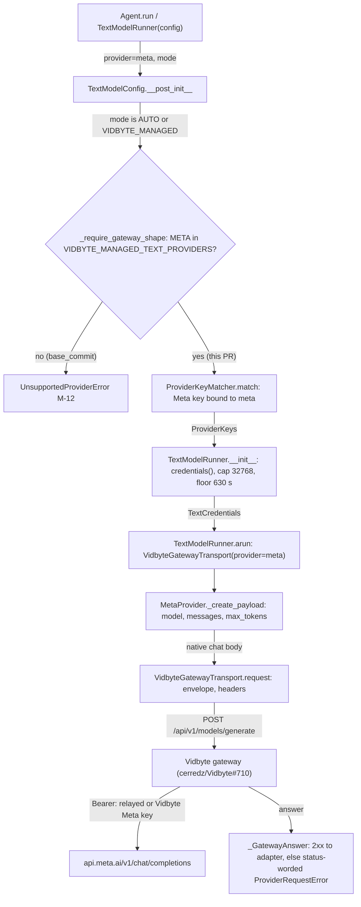
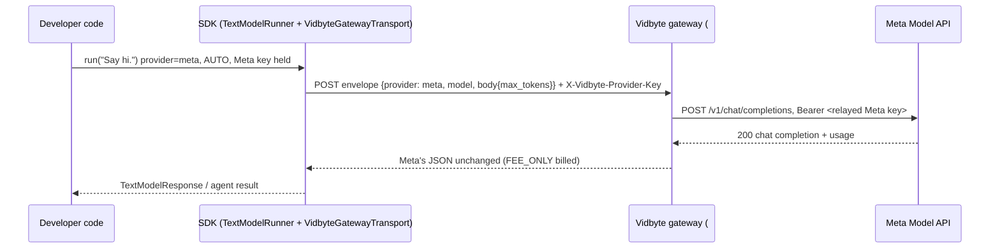

# Spec: Let the SDK's gateway text modes (AUTO and VIDBYTE_MANAGED) use provider meta

> **TL;DR** — `ModelProvider.META` joins `VIDBYTE_MANAGED_TEXT_PROVIDERS`, the one set that decides which providers the SDK sends through the Vidbyte gateway. With that, a Muse call in the default `TextModelMode.AUTO` relays the developer's own Meta key in `X-Vidbyte-Provider-Key` (Meta bills them, Vidbyte bills its 2% fee), and a call without a Meta key, or in `VIDBYTE_MANAGED`, is Vidbyte-paid. No adapter, runner, or transport code changes. That was traced end to end and confirmed with an in-memory probe. The decision that matters most: keep `max_tokens` as Meta's cap field, because Meta documents it as an accepted alias that caps "reasoning tokens plus visible output tokens combined". The change also turns some Muse calls that fail today into billed calls: fallbacks, forks, and handoffs to Muse (EC-11), and compositions that tolerate a failed member or stage, for example the multi-provider grader when `META_API_KEY` is set (EC-16). There, a Muse member that was silently skipped now runs as an agent loop of one or more billed calls. The PR body discloses this. This PR merges only after cerredz/Vidbyte#710 is deployed, after ops has provisioned the backend's `META_API_KEY`, and after the pre-merge live check (§12.5) has passed.

## §0 User prompts

### 0.1 Invoking request (verbatim)

````
launch a subagent with teh "spec-pipeline" skill for each of the following: 1. [ ] Launch Muse through the Vidbyte gateway, both Vidbyte-paid and with the user's own key — the gateway refuses meta today, so Muse users skip Vidbyte's 2% fee entirely. Builds on: agents can now pick a Meta key out of a mixed key list. First step: scope adding Meta to the backend's provider list and the price table. Want users to be able to use muse models with their meta/muse api keys: 7. [ ] Spin up a provider-onboarding agent — it researches a new vendor's key format, endpoint and prices from first-party sources, then opens the PR that adds them. Builds on: this session's source-backed, mutation-tested method. First step: turn this session's method into a skill. (ask Claude). Can you run number 7 as a continuous, 24/7 run that creates a new pr per provider that it adds?
````

This run is the SDK half of item #1 only. The coordinator's Run B assignment, which scopes it, is quoted verbatim in `docs/spec/meta-muse-managed-text/request.md` §A. Item #7 is a separate run.

### 0.2 User replies during the run
_None yet. The orchestrator appends any reply the user sends during the run here verbatim, labeled with the revision it produced._

---

## Part A — Framing

## §1 Goal

Today the SDK refuses provider `meta` in both gateway modes. `TextModelConfig(provider="meta", model="muse-spark-1.1")` in the default `AUTO` mode raises at construction: "The Vidbyte gateway serves only: anthropic, deepseek, gemini, kimi, openai, xai. Use mode=TextModelMode.DIRECT to call meta with your own key." (observed at `base_commit`; the refusal is `_require_gateway_shape`, which reads `VIDBYTE_MANAGED_TEXT_PROVIDERS`). The only way to call Muse from the SDK is therefore `TextModelMode.DIRECT`, straight to `api.meta.ai` with no Vidbyte key, so Vidbyte earns nothing on Muse traffic ("the gateway refuses meta today, so Muse users skip Vidbyte's 2% fee entirely", §0). The backend half, cerredz/Vidbyte#710, adds `meta` to the gateway as a seventh provider. This PR is the SDK half: it lets the SDK send Muse calls there.

| ID | Goal (outcome) | How we will know | Source |
|---|---|---|---|
| G-1 | A developer with their own Meta key runs a Vidbyte SDK agent on Muse through the Vidbyte gateway in the default mode. Meta bills them for tokens, and Vidbyte bills only its 2% fee. | AC-1, AC-2: one gateway POST per attempt with `provider: "meta"` and the Meta key in `X-Vidbyte-Provider-Key` | §0 ("with the user's own key", "use muse models with their meta/muse api keys") |
| G-2 | A developer without a Meta key, or who asks for `VIDBYTE_MANAGED`, runs Muse Vidbyte-paid (provider cost plus 2%). | AC-3, AC-4: a gateway POST for `meta` with no relay header | §0 ("both Vidbyte-paid") |
| G-3 | Muse traffic in the SDK's default mode stops bypassing Vidbyte's fee, with no new key ever sent to a vendor it was not matched to, no price invented, and no secret logged. | FR-1..FR-3 hold; INV-4, INV-9, INV-15 hold; NFR-1, NFR-2 | §0, request.md §D |

## §2 Objective

When this PR merges, `VIDBYTE_MANAGED_TEXT_PROVIDERS` in `vidbyte.lib.constants.jev` holds `ModelProvider.META` beside the six providers it holds today. Every existing gateway mechanism then applies to `meta` unchanged:
- construction-time shape checks;
- key matching and the relay header;
- the 32,768 output cap, sent as `max_tokens`;
- the 630 s timeout floor;
- same-key re-sends;
- status-only, credential-safe failure wording.

The README's managed-mode section names Meta among the served providers and in the output-cap guidance. The comment above the set cites #710 as the source for `meta`. The two existing feature-test packs extend their per-provider tables to `meta`, and their two assertions that `meta` is refused change by design; S2 owns that work (§13). The PR body states the merge prerequisites (§12.5): This PR merges only after cerredz/Vidbyte#710 is deployed, after ops has provisioned the backend's `META_API_KEY`, and after the pre-merge live check (§12.5) has passed.

## §3 Non-goals

- **NG-1** — Any backend change (gateway, pricebook pin, error copy). — *Why not:* Run A (#710) owns the backend (request.md §C "Rejected alternatives"). A backend gap found here becomes a `Q-n` note for Run A.
- **NG-2** — Adding or changing a Muse price row, `PRICING_AS_OF`, or `lint/pricebook_vintage_lock.json`. — *Why not:* "Never invent a price" (request.md §D). The existing `muse-spark-1.1` row already matches Meta's first-party page (§11), and Muse 1.2 and 1.3 serving is Run A's Q-1 hotfix on the backend's pinned SDK branch.
- **NG-3** — Switching Meta's cap field to `max_completion_tokens`, which Run A recommends. — *Why not:* D-2. Meta documents `max_tokens` as an accepted alias that caps reasoning plus output. Switching would change `DIRECT` bodies or make the adapter learn the mode.
- **NG-4** — An SDK-side list of the Muse ids the gateway serves, or a pre-request refusal of `muse-spark-1.2`, `muse-spark-1.3`, or the `-contributor` ids in gateway modes. — *Why not:* no served provider has such a list (D-4), and it would drift from the backend pin. Q-2 and Q-3 offer it, with default no.
- **NG-5** — Appending a gateway 502 body's `subtitle` to the SDK's error message. — *Why not:* Run A marks it a recommendation, not an obligation, and no SDK path surfaces body text (`managed-failures-never-echo-a-response-body`). Q-1 offers it, with default no.
- **NG-6** — Streaming `meta` through the gateway. — *Why not:* every gateway mode refuses streaming (`StreamingTextModelRunner._refuse_gateway_streaming`), and the gateway refuses `stream: true`.
- **NG-7** — Editing `docs/spec/byok-api-keys/spec.md` (its EC-15 lists `meta` as refused, and its M-12 facts say "the six providers"). — *Why not:* AGENTS.md says `docs/` design documents "are … not kept in sync with the implementation". No rule requires editing another feature's spec.
- **NG-8** — Fixing older doc gaps outside the managed-mode provider facts:
  - `vidbyte/providers/README.md:45` leaves Meta out of the `compatible.py` list;
  - its Meta section at `:362` covers Llama, not Muse;
  - `skills/usage/create_agent.md:33` leaves `meta` out of its provider list;
  - the README "Prefixes" bullet leaves out `sk-svcacct-` (OpenAI service-account keys). (r2: its missing `LLM|` is now required by §12.3 row 2(c), R-4.)

  *Why not:* none of them is the served-provider list that `jev.py`'s COMMON MODIFICATION PATTERNS ties to this change. Q-4 and Q-5 offer them, with default no.
- **NG-9** — Filtering request fields that Muse refuses (`stop` on reasoning models, `n > 1`, `reasoning_effort: "none"`). — *Why not:* not requested. `DIRECT` sends the same fields today. EC-7 accepts the limitation.
- **NG-10** — The provider-onboarding agent (item #7 of §0). — *Why not:* a separate run.

## §4 Developer usage

```python
import os

from vidbyte import Agent
from vidbyte.lib.config import TextModelConfig, TextModelMode
from vidbyte.lib.runners import TextModelRunner

# AUTO (the default): your Meta key, LLM|<your Meta app id>|<your Meta
# secret>, sits in a mixed list; the SDK matches it to meta by its prefix.
muse = Agent(
    name="muse",
    system_prompt="Answer in one word.",
    provider="meta",
    model_name="muse-spark-1.1",
    vidbyte_api_key=os.environ["VIDBYTE_API_KEY"],
    api_keys=[os.environ["ANTHROPIC_API_KEY"], os.environ["META_API_KEY"]],
    fallback=["anthropic/claude-sonnet-5"],
)
print(muse.run("Say hi.").content)  # relays the Meta key; Meta bills you, Vidbyte bills its 2% fee

# VIDBYTE_MANAGED: Vidbyte's own Meta key; Vidbyte bills provider cost plus 2%.
paid = TextModelRunner(TextModelConfig(provider="meta", model="muse-spark-1.1", mode=TextModelMode.VIDBYTE_MANAGED))
print(paid.run("Say hi.").text)
```

Both calls reach Vidbyte's one gateway route instead of raising `UnsupportedProviderError`. The first carries the Meta key in `X-Vidbyte-Provider-Key` and never the Anthropic key. The second carries no provider key, although `META_API_KEY` is set. The developer no longer has to switch Muse to `TextModelMode.DIRECT`.

## §5 Flow diagram





Validation happens at construction. `_require_gateway_shape` admits `meta` only because the set now holds it, and it still refuses a custom endpoint. `ProviderKeyMatcher.match` binds a key with the `LLM|` prefix only to `meta`, and `credentials()` checks that the key can be sent and is at most 512 characters. State is pinned once, in `TextModelRunner.__init__`: the keys, the 32,768 cap, and the 630 s floor. `MetaProvider` builds the same body it builds for `DIRECT`, and `VidbyteGatewayTransport` replaces the vendor URL and headers with the gateway's. Failures are caught in `_GatewayAnswer`: a 409, a 502, or an answer that is not JSON is re-sent with the same `Idempotency-Key`, and every failure is worded from its status alone.

---

## Part B — Behavior (this is the spec; everything else is framing)

## §6 Behavior

### 6.1 Invariants

- **INV-1** — A `TextModelConfig` with provider `meta` (as `ModelProvider.META` or the string `"meta"`) and mode `AUTO` or `VIDBYTE_MANAGED`, with no custom endpoint, is built without raising `UnsupportedProviderError`. The same holds for an agent, fallback, fork, or child whose model is a Muse model.
- **INV-2** — In `AUTO`, a `meta` call whose credentials hold a Meta key sends each attempt as exactly one POST to `VIDBYTE_GENERATIVE_GATEWAY_ENDPOINT` with exactly four headers: `authorization: Bearer <Vidbyte key>`, `content-type`, `Idempotency-Key`, and `X-Vidbyte-Provider-Key`. The last header's value is exactly the stripped Meta key, taken from `api_keys` first and from `META_API_KEY` second. The Meta key appears nowhere else in the request.
- **INV-3** — A `meta` call relays no key in two cases: in `AUTO` with no Meta key, and always in `VIDBYTE_MANAGED`. Both send exactly three headers (`authorization`, `content-type`, `Idempotency-Key`). In `VIDBYTE_MANAGED`, resolving the call's credentials never reads `META_API_KEY`, and the call never sends a key from `api_keys`. (A composition may still read `META_API_KEY` to choose its members before any call is built; see EC-16.)
- **INV-4** — A Meta key that matching bound to `meta` from `api_keys` is sent only on a request whose envelope `provider` is `"meta"`. A `meta` request relays only that key or, when `api_keys` holds none, the value of `META_API_KEY`. No key that matching bound to another provider is ever sent on a `meta` request, whether in the relay header, the envelope, or the body. *Accepted exception (byok EC-14, unchanged):* `META_API_KEY` is trusted by its name, so whatever it holds is relayed on `meta` calls, even another vendor's key. Some values are refused before any request: a Vidbyte key (M-14, EC-9; `models.py:172-194`), and a value that cannot be sent in a header or is longer than 512 characters (M-21, EC-10; `models.py:172-194` and `TextModelConfig.credentials`).
- **INV-5** — Every `meta` gateway body carries the output cap as a JSON integer in `max_tokens`. The value is the caller's `max_output_tokens` exactly when one is set. Otherwise it is 32,768: `VIDBYTE_MANAGED_DEFAULT_MAX_OUTPUT_TOKENS` (`vidbyte/lib/constants/jev.py:84`), which `TextModelRunner.__init__` applies to every gateway call (`text.py:57-62`). Every `Agent` call is the otherwise case, because an agent has no output-cap setting (§13). The SDK never adds `max_completion_tokens`, which appears only when the caller puts it in `extra_body`. *One exception:* when the caller sets `max_tokens` in `extra_body`, the SDK forwards that value unchanged, even `None`, because `extra_body` is merged last (`compatible.py:131-134`).
- **INV-6** — The envelope is exactly `{"provider": "meta", "model": <config model>, "body": <body>}`. `<body>` equals the body `MetaProvider` sends in `DIRECT` for the same config, plus the INV-5 cap. The relay header changes headers only, never the envelope.
- **INV-7** — Each `meta` gateway attempt waits at least 630 s (`VIDBYTE_GATEWAY_TIMEOUT_FLOOR_SECONDS`), and a NaN timeout becomes the floor. Every attempt of one call carries the same `Idempotency-Key` and identical headers. Two calls, concurrent or not, never share an `Idempotency-Key`.
- **INV-8** — A failed `meta` gateway call raises `ProviderRequestError(provider="vidbyte")` with the status and a reason chosen from its status alone (byok table G). The error holds no response excerpt, no chained exception, and no byte of the gateway's or Meta's body. A 409, a 502, or a non-JSON answer is re-sent at most twice, and no other answer is re-sent, a 422 included.
- **INV-9** — Neither the Meta key nor the Vidbyte key ever appears in an exception message, its `details`, its `repr`, its chained `__cause__` or `__context__`, or any log record the SDK emits during the call (captured at DEBUG on the root logger; seam in §13). Trace payloads are outside this spec's checks: the change adds no trace or log call, the Meta key travels only in a header (INV-2), and redaction of that header stays covered by byok INV-22 and its pack (`test_provider_keys_security.py:236`).
- **INV-10** — The M-12 message, which still refuses an unserved provider in a gateway mode, lists `meta` among the served providers. The M-18 message for a `meta` primary offers "Vidbyte's own meta account" as the fallback.

**Must not regress:**
- **INV-11** — In `DIRECT`, a `meta` request stays byte-identical to `base_commit`: `POST https://api.meta.ai/v1/chat/completions`, `authorization: Bearer <Meta key>`, the same body (no `max_tokens` unless configured), and the caller's timeout. The behavior lives in `vidbyte/providers/compatible.py:OpenAICompatibleProvider` and `vidbyte/lib/dataclasses/model_configs.py:TextModelConfig.credentials`.
- **INV-12** — `openrouter`, `glm`, `minimax`, and `mistral` are still refused at construction in both gateway modes with `UnsupportedProviderError`, whose message names `TextModelMode.DIRECT` (`model_configs.py:TextModelConfig._require_gateway_shape`). A custom endpoint is still refused for every provider, `meta` included.
- **INV-13** — Requests for the six providers already served are unchanged byte for byte (`vidbyte/lib/http/vidbyte_gateway.py:VidbyteGatewayTransport.request`).
- **INV-14** — `StreamingTextModelRunner` still refuses `meta` in both gateway modes with `UnsupportedProviderError` at construction (`vidbyte/lib/runners/streaming_text.py:_refuse_gateway_streaming`; `meta` is not in its `STREAMING_SUPPORTED_PROVIDERS`).
- **INV-15** — The Muse price rows are unchanged. `ModelPricingRegistry.default().resolve(ModelProvider.META, "muse-spark-1.1")` returns 1.25 input, 4.25 output, and 0.15 cache read per 1M tokens (`vidbyte/lib/registries/pricing.py:284`). No row is added or edited.

### 6.2 Acceptance criteria

| ID | Given | When | Then | Priority | Proof |
|---|---|---|---|---|---|
| AC-1 | a clean checkout of this branch; `VIDBYTE_API_KEY`, `ANTHROPIC_API_KEY`, and `META_API_KEY` set to fake keys of their providers' shapes, built by concatenation; an inner transport that answers each gateway POST with a Meta chat completion | the §4 snippet runs | It prints the answers. Every request goes to the gateway route. Each agent attempt has envelope `provider: "meta"`, `model: "muse-spark-1.1"`, and `X-Vidbyte-Provider-Key` equal to the Meta key, and its body's `max_tokens` is 32,768. The `VIDBYTE_MANAGED` call has no `X-Vidbyte-Provider-Key`. The Anthropic key appears in no request. No `UnsupportedProviderError` is raised. | P0 | `tests/features/sdk_provider_keys/test_provider_keys_acceptance.py::SnippetAcceptanceTests::test_meta_muse_snippet_relays_the_meta_key_for_the_agent_and_sends_the_paid_call_without_it` |
| AC-2 | `AUTO`, a Vidbyte key, and a Meta key, alone or in a mixed list with another provider's key | a `meta` text call runs | Exactly one POST goes to the gateway. It carries exactly the four INV-2 headers, the relay header equals the stripped Meta key, and the Meta key appears nowhere else. | P0 | `tests/features/sdk_provider_keys/test_provider_keys_wire_contract.py::RelayHeaderTests::test_each_served_provider_relays_its_own_key_in_the_header_and_nowhere_else` (meta subtest); `tests/features/sdk_provider_keys/test_provider_keys_wire_contract.py::MetaRelayTests::test_a_meta_call_relays_the_lists_meta_key_before_meta_api_key_stripped_and_no_other_key` |
| AC-3 | `AUTO`, a Vidbyte key, no Meta key in `api_keys`, and `META_API_KEY` unset or blank | a `meta` text call runs | One gateway POST with exactly the three INV-3 headers and envelope `provider: "meta"` (Vidbyte-paid). | P0 | `tests/features/sdk_provider_keys/test_provider_keys_wire_contract.py::MetaRelayTests::test_a_meta_call_without_a_meta_key_sends_exactly_the_three_vidbyte_paid_headers` |
| AC-4 | `VIDBYTE_MANAGED`, a Vidbyte key, a Meta key in `api_keys`, and `META_API_KEY` set | a `meta` text call runs | No `X-Vidbyte-Provider-Key` is sent, `META_API_KEY` is never read, and the Meta key appears in no request. | P0 | `tests/features/sdk_provider_keys/test_provider_keys_acceptance.py::TextCallAcceptanceTests::test_vidbyte_managed_meta_never_reads_meta_api_key_or_sends_a_meta_key` |
| AC-5 | a gateway-mode `meta` call with `max_output_tokens` unset, 100, and 40,000 | each call runs | The body's `max_tokens` is the integer 32,768, 100, and 40,000 respectively, and the body has no `max_completion_tokens`. | P0 | `tests/features/sdk_managed_text/test_managed_text_wire_contract.py::OutputCapTests::test_managed_body_carries_the_default_cap_or_the_callers_exact_value_in_each_dialects_field` (meta subtests); `tests/features/sdk_provider_keys/test_provider_keys_wire_contract.py::RelayCapAndFloorTests::test_a_relay_body_carries_the_default_cap_or_the_callers_exact_value` (meta subtests) |
| AC-6 | the same `meta` config built in `AUTO` (with and without a Meta key) and in `DIRECT` | each call runs | The gateway envelope's `body` equals the `DIRECT` body plus `max_tokens` at the INV-5 value. The relay and paid envelopes are identical. | P0 | `tests/features/sdk_provider_keys/test_provider_keys_acceptance.py::TextCallAcceptanceTests::test_meta_in_direct_sends_base_commits_request_and_both_gateway_envelopes_wrap_that_body_with_the_cap`; `tests/features/sdk_provider_keys/test_provider_keys_wire_contract.py::RelayHeaderTests::test_the_relay_envelope_body_is_the_direct_body_with_the_gateway_cap` (meta subtest) |
| AC-7 | `AUTO` with a Meta key, model `muse-spark-1.3`, and a gateway answering 422 with `"error": true` | the call runs | One POST and no re-send. `ProviderRequestError` has `status_code` 422, a message naming "unmanaged or unpriced provider or model" and `TextModelMode.DIRECT`, and no body text. | P0 | `tests/features/sdk_provider_keys/test_provider_keys_failures.py::MetaGatewayFailureTests::test_a_muse_id_the_gateway_does_not_serve_is_sent_unchanged_once_and_gets_the_422_wording` |
| AC-8 | a Vidbyte-paid `meta` call and a relay `meta` call, each answered 502 by the gateway | each call runs | Each is sent three times with one `Idempotency-Key` and waits of 0.5 s then 1.0 s. The paid message says "unavailable or refused Vidbyte's own account". The relay message says "unavailable" and does not say "Vidbyte's own account". Neither contains body text. | P1 | `tests/features/sdk_provider_keys/test_provider_keys_failures.py::MetaGatewayFailureTests::test_a_meta_502_is_sent_three_times_with_one_key_and_worded_for_who_pays` |
| AC-9 | a relay `meta` call that Meta refuses with 401 (the gateway relays Meta's own `{"error": {...}}` body) | the call runs | The message names meta and "your own meta key", says the provider's message is withheld and that Vidbyte did not bill the call, and is not re-sent. | P1 | `tests/features/sdk_provider_keys/test_provider_keys_failures.py::MetaGatewayFailureTests::test_a_relayed_meta_401_names_the_callers_own_meta_key_and_a_relayed_429_is_withheld` |
| AC-10 | a gateway mode | a config for `openrouter`, `glm`, `minimax`, or `mistral` is built | It raises `UnsupportedProviderError`. The message lists all seven served providers (`meta` among them) and names `TextModelMode.DIRECT`. | P0 | `tests/features/sdk_provider_keys/test_provider_keys_modes.py::GatewayShapeTests::test_every_unserved_provider_and_any_endpoint_is_refused_at_construction_in_both_gateway_modes`; `tests/features/sdk_managed_text/test_managed_text_selection.py::KeySelectionTests::test_managed_state_refuses_every_provider_the_gateway_does_not_serve` |
| AC-11 | an agent whose primary is `meta`, whose `api_keys` hold a Meta key and an Anthropic key, and whose fallback is `anthropic/claude-sonnet-5` | the `meta` call runs, and then the fallback call runs | The `meta` request relays only the Meta key, and the Anthropic request relays only the Anthropic key. Neither key appears in the other's request. | P0 | `tests/features/sdk_provider_keys/test_provider_keys_agents.py::MetaAgentTests::test_a_relayed_meta_401_falls_back_to_anthropic_and_each_call_carries_only_its_own_providers_key` |
| AC-12 | `DIRECT`, a Meta key in `api_keys`, and a Vidbyte key in the environment | a `meta` call runs | The request is byte-identical to `base_commit`'s (INV-11), and the gateway is not contacted. | P0 | `tests/features/sdk_provider_keys/test_provider_keys_acceptance.py::TextCallAcceptanceTests::test_meta_in_direct_sends_base_commits_request_and_both_gateway_envelopes_wrap_that_body_with_the_cap` (DIRECT half); `tests/features/sdk_provider_keys/test_provider_keys_modes.py::UnsendableKeyTests::test_a_meta_key_from_a_mixed_list_reaches_meta_unchanged_in_direct` |
| AC-13 | the README on this branch | the "Vidbyte-managed text calls" section is read | It names Meta among the gateway-served providers and among the providers whose cap is set with `max_output_tokens`. Its "Prefixes" bullet lists `LLM|` (Meta) among the key prefixes that prove a provider. Every fact the two existing README tests bind is still present. | P1 | `tests/features/sdk_managed_text/test_managed_text_acceptance.py::ManagedTextAcceptanceTests::test_readme_managed_section_names_meta_as_served_in_the_chat_cap_guidance_and_by_its_llm_prefix` |
| AC-14 (negative) | any `meta` gateway failure (422, 502, relayed 400, relayed 401, network failure) whose bodies carry a key-shaped string and a canary | the error is raised | Neither the Meta key, the Vidbyte key, the key-shaped string, nor the canary appears in `str(error)`, `error.details`, `repr(error)`, `__cause__`, `__context__`, or any log record captured at DEBUG on the root logger during the call. | P0 | `tests/features/sdk_provider_keys/test_provider_keys_security.py::LeakScenarioTests::test_every_meta_gateway_failure_logs_and_raises_no_key_canary_or_key_shaped_body_text` |
| AC-15 | the draft PR | its body is read | It follows `.github/pull_request_template.md` (Motivation, Changes, Compatibility, Verification, Follow-ups). Its Motivation section states first, word for word: "This PR merges only after cerredz/Vidbyte#710 is deployed, after ops has provisioned the backend's `META_API_KEY`, and after the pre-merge live check (§12.5) has passed." Its Compatibility section names the behavior changes in EC-11 and EC-16. Its Verification section gives both statuses of the pre-merge live check (§12.5), or lists that check as an open merge prerequisite. | P0 | PR body (S6; not a pytest test) |

### 6.3 Edge cases and failure modes

| ID | Trigger (input + state) | System behavior | User sees | Guarded by (INV-/D-) |
|---|---|---|---|---|
| EC-1 | `muse-spark-1.2`, `muse-spark-1.3` (Meta's own example id), or a `-contributor` id, in `AUTO` or `VIDBYTE_MANAGED`; the backend pin `54a8e1a5` serves only `muse-spark-1.1` and its dated snapshots | The config builds; the agent catalog accepts the id. One POST goes out, the gateway answers 422 `model_gateway_unsupported_model`, nothing is billed, and the 422 is not re-sent. | `ProviderRequestError` (422): "the gateway cannot manage this request … an unmanaged or unpriced provider or model … use TextModelMode.DIRECT …" | INV-8, D-4 (accepted: Q-2 default no) |
| EC-2 | a Vidbyte-paid call (`VIDBYTE_MANAGED`, or `AUTO` with no Meta key) on any Muse id while the backend holds no `META_API_KEY`, either before ops provisions it or after a rollback blanks it | The gateway answers 502 (step 5 precedes the pricebook check, so an unlisted id also gets 502, not 422). The SDK re-sends twice after 0.5 s and 1.0 s; that is 3 refusals with no I/O, nothing billed, and 3 server errors on the backend's status page (Run A EC-30). | "… unavailable or refused Vidbyte's own account (HTTP 502), and the cause is not known; the SDK re-sent it … (re-sends in this call: 2)." The missing-key remedy in the body is not shown. A relay call is not affected. | merge prerequisite 2, ops has provisioned the backend key (§12.5, FR-8, AC-15); D-5 (Q-1 default no) |
| EC-3 | Muse's configured maximum output for `muse-spark-1.1` turns out to be below 32,768, and a gateway call does not set `max_output_tokens` | Meta answers 400 ("Requesting more than the model's configured maximum returns `HTTP 400`"), which the gateway relays, and nothing is billed. Without the assumption, every capless `meta` gateway call would fail. | Relay: "meta returned HTTP 400 through the Vidbyte gateway … check your own meta key in api_keys or META_API_KEY" (a misleading hint). Paid: the same without the hint. Workaround: `TextModelRunner` and `TextModelConfig` users set `max_output_tokens`. `Agent` users have no cap setting: `BaseAgent`'s `max_tokens` is the loop budget (`base.py:317-321`), and an agent passes only `timeout_seconds` to its runner (`base.py:1662`). So every agent Muse call in a gateway mode, the §4 path included, fails, and the agent's only way out is `model_mode=TextModelMode.DIRECT`. | A-2, D-3 (flip condition); the pre-merge live check (§12.5, FR-8) tests A-2 before merge |
| EC-4 | input tokens plus 32,768 exceed Muse's 1,048,576-token context window | Meta answers a 400 context-length error. The gateway's 2,000,000-byte body limit makes this rare. | The relayed-400 wording, as in EC-3. Shorten the context, or lower `max_output_tokens` (`TextModelRunner` and config users only; EC-3). | accepted limitation: the cap is shared by all served providers (D-3) |
| EC-5 | `extra_body={"max_completion_tokens": N}` on a `meta` gateway call | The body carries both `max_tokens` (32,768 or the caller's cap) and `max_completion_tokens: N`. Both fields are on the gateway's allowed list (wire contract §9.2), which does not say which one the hold is sized from, and Meta does not document how it treats both together. | Possibly a larger hold than the caller expects. The README tells chat-dialect users to set the cap with `max_output_tokens` instead. | INV-5; README cap bullet (FR-7); accepted, as for xAI, DeepSeek, and Kimi today |
| EC-6 | an agent whose `api_keys` hold another provider's key but no Meta key, with a `meta` primary | The matcher refuses the list at construction (M-18). The message now ends "… or pass no provider keys to use META_API_KEY or Vidbyte's own meta account." | M-18. Without the guard, Muse calls would silently go Vidbyte-paid while the user believes they relay. | INV-10; `provider_keys.py:ProviderKeyMatcher._require_primary_keys` |
| EC-7 | a `meta` gateway call with `stop_sequences` set (Meta: `stop` is "Not supported on reasoning models"), or `extra_body` carrying `n > 1` or `reasoning_effort: "none"` | The gateway admits these fields, Meta answers 400, the gateway relays it, and nothing is billed. `DIRECT` behaves the same today. | The relayed-400 wording. On a relay call it adds the wrong-key hint, which misleads in this case. | accepted limitation (NG-9) |
| EC-8 | a key that starts with `LLM|` but does not fully match (a non-digit app id), passed in `api_keys` | Unproven and reserved to `meta`, which takes no unproven key, so the list is refused at construction. | M-6, with no key text | `provider_keys.py:ProviderKeyMatcher.accepts_unproven` (unchanged) |
| EC-9 | `META_API_KEY` holds a Vidbyte key (`vb_live_…`) in `AUTO` | Refused when `credentials()` reads it, before any request. | M-14 | `models.py:ProviderModelRegistry.find_provider_api_key` (unchanged) |
| EC-10 | a Meta key longer than 512 characters, or one with an inner space, in `AUTO` | Refused before any request (M-21). The gateway bounds the relay header at the same 1 to 512 characters, and Meta's documented `LLM|<app id>|<secret>` shape passes (wire contract §9.2). | M-21, naming `TextModelMode.DIRECT` | `model_configs.py:TextModelConfig.credentials` (unchanged) |
| EC-11 | an agent in a gateway mode, built before this PR, whose fallback chain lists a Muse model, or that forks or hands off to a Muse model (`vidbyte/agents/fork.py:68`, `vidbyte/agents/handoff.py:68`) | Before: building the `meta` runner raised `UnsupportedProviderError` (M-12), so the call never left the SDK. After: the call reaches Meta through the gateway and can bill. A fork or handoff child gets the parent's already-matched `ProviderKeys` record, which `ProviderKeyMatcher.match` passes through without re-matching and without the M-18 check (`provider_keys.py:124-135`). So when the parent holds no Meta key, the child's Muse call relays `META_API_KEY` if it is set, and otherwise is Vidbyte-paid (TOTAL). The S1 review probe saw this: `Agent.fork` to meta sent no relay header and `max_tokens` 32,768. | Muse fallbacks, forks, and handoffs start working, and billing, in the default mode. This is intended, and the PR body's Compatibility section names it. | INV-1; FR-8; AC-15 |
| EC-12 | concurrent `meta` gateway calls on one runner, each answered 502 then 200 | Each call keeps its own `Idempotency-Key` across its re-send. No key is shared, and no call is double-billed. | Each caller gets its own answer. | INV-7 |
| EC-13 | a relay call that Meta answers 429, relayed with Meta's own `{"error": {...}}` body | Read as a relayed provider status, not the gateway's `"error": true`. It is not re-sent, and nothing is billed. | "meta returned HTTP 429 through the Vidbyte gateway; the provider's message is withheld, and the call was not billed" | INV-8 (existing wording) |
| EC-14 | `TextModelConfig(model="meta/muse-spark-1.1")` built directly in a gateway mode | The envelope `model` fails the gateway's model pattern, which answers 422 `harness_validation_failed`. `DIRECT` would send the same id to Meta, which answers 404. | The 422 wording. This is the same for every provider. | accepted limitation (outside this request) |
| EC-15 | this SDK release reaches users before #710 is deployed | The gateway answers 422 `model_gateway_unsupported_model` for `provider: "meta"`. Nothing is billed, and the 422 is not re-sent. | The EC-1 422 wording on every Muse call in a gateway mode. | merge prerequisite 1, #710 is deployed (§12.5, FR-8, AC-15); A-1 |
| EC-16 | a gateway-mode composition that tolerates a failed member or stage (it works at `base_commit`). Verified examples, not a closed list:<br>• *Concurrent:* the multi-provider agentic grader with `provider_models` unset. `ProviderModelRegistry.resolve_active(None, …)` resolves every provider whose key variable is set (`models.py:418-428`), so `meta` joins with `muse-spark-1.1` whenever `META_API_KEY` is set.<br>• *Concurrent:* `AggregateAgent` proposers that name a Muse model.<br>• *Concurrent:* `context_minimal_fanout` members that name a Muse model (`return_exceptions = True` by default, `paradigms/context_minimal_fanout/types.py:486`).<br>• *Sequential:* an independent critic with `reviewer_provider="meta"` and `failure_policy=RETURN_CANDIDATE`. Its reviewer runner is built inside the stage's `try` (`independent_critic.py:79-85`, `:211`).<br>• *Sequential:* a prosecutor/defender/judge stage with `provider="meta"` and `failure_policy=RETURN_CANDIDATE`. The stage runner is built in preflight (`prosecutor_defender_judge.py:250`, `:494-496`), and the failure is returned as the candidate (`:457-466`, `:539-541`).<br>• *Sequential:* a Jev run-brief writer with `JevRunBriefSettings(provider="meta")`. `JevRunBriefWriter.write` catches `VidbyteSdkError` and returns `None` (`vidbyte/agents/jev/brief/writer.py:146`, `:160`). | Before: the `meta` member raised `UnsupportedProviderError` when its runner was built, and the composition dropped it or carried on without it. Concurrent members fail inside `asyncio.gather(..., return_exceptions=True)` (`multi_provider_agentic_grader.py:87`, skipped at `:121`; `aggregation.py:97`, `:129`). Sequential stages fail inside their failure policy. The run succeeded without it.<br>After: the `meta` member runs. Each member is a full agent loop (`multi_provider_agentic_grader.py:96`), so it makes one or more billed gateway calls, billed even when its result is then not used. In `AUTO` with a Meta key, it relays that key, so Meta bills the user and Vidbyte bills its 2% fee. In `VIDBYTE_MANAGED` it is Vidbyte-paid (TOTAL).<br>Probes:<br>• Grader (`s1_grader_probe.py`, re-run in S1 r2): base sends 2 `anthropic` requests; widened adds 1 `meta` request relaying `META_API_KEY` with `max_tokens` 32,768.<br>• Critic (`s1r2_critic_probe.py`, re-run in S1 r3): base sends 1 `anthropic` request, and the critic reports `review_failed`; widened adds 4 `meta` requests relaying `META_API_KEY`, and with the probe's fake answers the critic still reports `review_failed`. | The same run succeeds, with one more Muse member run, which is an agent loop of one or more billed calls. The grader may pick a different winner, and a critic or judge may now review the candidate. The user's Meta key reaches Vidbyte's backend in a run whose configuration may never have named `meta` (the grader). To opt out, leave Muse out of member and stage settings, set the grader's `provider_models`, or use `TextModelMode.DIRECT`. | accepted behavior change, disclosed in the PR body's Compatibility section (FR-8, AC-15, §12.5); Q-6 offers a grader exclusion (default no) |

**Rollback of the user action:**
- *A developer* who wants the old vendor-direct path sets `mode=TextModelMode.DIRECT` (or `model_mode=` on an agent). No Vidbyte key is read, and nothing is billed by Vidbyte.
- *An operator* reverts this PR's one-line set change. `meta` in a gateway mode then raises `UnsupportedProviderError` at construction again. No SDK state persists. Calls already completed stay billed by the backend under its own records.
- *For Vidbyte-paid calls only,* the backend rolls back by blanking its `META_API_KEY` (Run A). Relay calls keep working, and Vidbyte-paid calls get EC-2.

## §7 Requirements

**Functional**
| ID | Requirement | Priority | Source (request.md / G-) |
|---|---|---|---|
| FR-1 | Both gateway modes accept provider `meta`. `VIDBYTE_MANAGED_TEXT_PROVIDERS` contains `ModelProvider.META`, so a `meta` config in `AUTO` or `VIDBYTE_MANAGED` is built without `UnsupportedProviderError`. | P0 | coordinator assignment ("must let `TextModelMode.AUTO` and `VIDBYTE_MANAGED` use provider `meta`"); G-1, G-2 |
| FR-2 | In `AUTO`, a `meta` call whose agent or config holds a Meta key relays that key, and only that key, in `X-Vidbyte-Provider-Key` to the gateway route (FEE_ONLY). | P0 | §0 "use muse models with their meta/muse api keys"; request.md §C key decision 2; G-1 |
| FR-3 | A `meta` call in `AUTO` with no Meta key, or in `VIDBYTE_MANAGED`, is sent to the gateway Vidbyte-paid, with no relay header. | P0 | §0 "both Vidbyte-paid and with the user's own key"; G-2 |
| FR-4 | Every `meta` gateway body carries an integer output cap of 1 or more in `max_tokens`, which the wire contract accepts (§9.2 "Body"). The value is the caller's `max_output_tokens`, else 32,768. | P0 | wire contract §9.2 (cap required); request.md §C; D-2 |
| FR-5 | A Muse id the gateway does not serve is sent unchanged. The gateway's answer is worded by the existing status-only reasons, with no new SDK mechanism. | P1 | request.md §C ("must not hide or invent anything"); D-4 |
| FR-6 | M-12 lists `meta` as served, and M-18 offers "Vidbyte's own meta account" for a `meta` primary. Both follow from FR-1 with no message code change. | P1 | byok spec table M (M-12, M-18 facts); FR-1 |
| FR-7 | The README section "Vidbyte-managed text calls" names Meta in its served-provider list, in its cap bullet, and, as `LLM|` (Meta), in its key "Prefixes" bullet. The comment above `VIDBYTE_MANAGED_TEXT_PROVIDERS` states the new count and cites #710's spec r4 §9.2 at commit `c395349bd` for `meta`. | P1 | `vidbyte/lib/constants/jev.py:6` COMMON MODIFICATION PATTERNS (change the provider set "together with the README managed-mode section") |
| FR-8 | The PR body follows the repo's pull-request template. It states the merge prerequisites (§12.5) word for word: "This PR merges only after cerredz/Vidbyte#710 is deployed, after ops has provisioned the backend's `META_API_KEY`, and after the pre-merge live check (§12.5) has passed." It also states the EC-11 and EC-16 behavior changes, and it carries the result of the pre-merge live check, or lists that check as an open merge prerequisite. | P0 | coordinator assignment ("PR body must say it merges only after Run A is deployed"); request.md §C; Run A A-7; `CONTRIBUTING.md:75-83` ("Use the pull-request template"); review R-1, R-2, R-3 |

**Non-functional**
| ID | Requirement | Priority | Target |
|---|---|---|---|
| NFR-1 | Secrets are never logged or echoed. | P0 | 0 occurrences of the Meta key, the Vidbyte key, or gateway or vendor body text in any raised error, its `repr`, its chained cause or context, or any log record captured during the call (INV-9, AC-14). Trace redaction stays with byok INV-22, unchanged. |
| NFR-2 | Never invent a price. | P0 | 0 changed lines in `vidbyte/lib/registries/pricing.py` and `lint/pricebook_vintage_lock.json` (INV-15) |
| NFR-3 | No real key shape is committed as one literal. | P0 | Every fake Meta key in the diff is built by concatenation (as `K_META` is). The §4 snippet reads keys from the environment only. |
| NFR-4 | Add no new header, field, endpoint, mode, or wire contract; reuse #1027's relay. | P0 | 0 new constants or public names; the diff adds no header name (§8.4) |
| NFR-5 | The full local gate passes. | P0 | `py -3.11 scripts/run_ci.py` (PYTHONPATH unset): lint ends `SDK-LINT: PASS`. pytest fails only on the pre-existing red test named in §11, and `--stage package` passes. |
| NFR-6 | No added runtime cost. | P1 | No new request, retry, I/O, or allocation per call. Membership in a frozenset of 7 replaces membership in a frozenset of 6. |

---

## Part C — Design

## §8 Architecture and decisions

### 8.1 Decisions
| ID | Decision | Deciding reason | Runner-up | Flips if |
|---|---|---|---|---|
| D-1 | Serve `meta` by adding `ModelProvider.META` to `VIDBYTE_MANAGED_TEXT_PROVIDERS`, and change no other production code. | The set is the only provider-specific gate on the gateway path. Its three readers are `TextModelConfig._require_gateway_shape`, M-18 in `ProviderKeyMatcher._require_primary_keys`, and the declaration. The runner, the transport, and `MetaProvider` are provider-generic; `MetaProvider` is a bare subclass, like `KimiProvider`. An in-memory probe that widened only this set produced the full relay, paid, managed, 422, 502, M-12, and M-18 behavior. This is the flip byok D-11 itself names: "The backend serves more providers. Then widen `VIDBYTE_MANAGED_TEXT_PROVIDERS`." | A per-provider gateway capability table (cap field, served models) | A second provider-specific gateway rule appears, such as a provider that needs a different cap field or a pre-checked model list. Then a table keyed by provider replaces the set. |
| D-2 | Meta's gateway cap stays `max_tokens`, as `OpenAICompatibleProvider._attach_sampling` writes it from the runner's pinned cap. `MetaProvider` stays unchanged. | Meta documents that `max_tokens` is an alias that caps reasoning tokens plus visible output: "The deprecated alias `max_tokens` is still accepted" (https://dev.meta.ai/docs/protocols/chat-completions), and "`max_tokens` (Chat Completions) and `max_output_tokens` (Responses API) cap reasoning tokens plus visible output tokens combined" (https://dev.meta.ai/docs/reasoning). That settles Run A's A-3 for SDK traffic. The gateway accepts either field (wire contract §9.2). Emitting `max_completion_tokens` would change `DIRECT` bodies (INV-11) or force the adapter to learn the mode. It would also contradict the managed-text pack's rule that no managed body carries `max_completion_tokens`, and the README's guidance to chat-dialect users. | Override `_attach_sampling` in `MetaProvider` to emit `max_completion_tokens` (Run A's recommendation) | Meta stops accepting `max_tokens` (it is marked "Deprecated in favor of `max_completion_tokens`", https://dev.meta.ai/docs/api-reference/chat-completions/schemas), or Meta documents that `max_tokens` does not bound reasoning. Then `MetaProvider` emits `max_completion_tokens` in every mode, as a contract change approved by the user. |
| D-3 | `meta` uses the shared gateway default cap of 32,768: `VIDBYTE_MANAGED_DEFAULT_MAX_OUTPUT_TOKENS` at `vidbyte/lib/constants/jev.py:84`, applied by `TextModelRunner.__init__` (`text.py:57-62`) to every gateway call that has no `max_output_tokens`. The caller's `max_output_tokens` still wins, but only `TextModelRunner` and `TextModelConfig` users can set it; an `Agent` always sends 32,768 (EC-3). | Meta gives every Muse Spark version a 1,048,576-token context window shared by input and output (https://dev.meta.ai/docs/models). It publishes `output 131072` for `muse-spark-1.3` in its own coding-agent setup (https://dev.meta.ai/docs/quickstart). It publishes no smaller limit for `muse-spark-1.1`. One shared default is the existing mechanism, and `text.py:6` says a new gateway requirement is pinned in `__init__`. The six providers already served get the same default with no per-model clamp. | A per-provider default-cap table | Meta documents, or a live call shows, a configured maximum output below 32,768 for a served Muse id (A-2). The §12.5 pre-merge live check is that live call. Then add a per-provider default beside `VIDBYTE_MANAGED_DEFAULT_MAX_OUTPUT_TOKENS` in `jev.py`, read in `TextModelRunner.__init__`. |
| D-4 | An unserved Muse id goes to the gateway unchanged, and its 422 is worded by the existing status-only reason. There is no SDK-side model list. | No served provider has an SDK-side model list in gateway mode: `TextModelConfig.validate()` checks only that the model is not empty, and catalog validation accepts all five Muse ids. The served set is whatever the backend pin prices (wire contract §9.2). That pin moves without an SDK release, so an SDK list would refuse ids the backend later serves (Run A Q-1). | A frozen SDK allowlist of served Muse ids (Q-2) | The user wants a refusal before any request, and accepts that each backend pin bump needs an SDK release. |
| D-5 | Gateway failure wording for `meta` stays status-only; no `subtitle` is appended. | Every reason is written by the SDK and no body text is copied (`_GatewayAnswer.failure_reason`, `@intent managed-failures-never-echo-a-response-body`). The fixtures plant a canary to prove it. Run A calls the append a recommendation only. | Append the 502 body's `subtitle` when `"error": true` (Q-1) | The user answers Q-1 yes. |
| D-6 | The merge prerequisites (§12.5) live only in the PR body. | They are deploy facts with no code site (code-map §4 note 14). The SDK cannot see whether #710 is deployed, whether the backend holds a Meta key, or what Muse's output limit is. | A runtime check of the backend | never, for this change |
| D-7 | The docs change only where a rule ties them to the provider set: in the README section, the provider bullet, the cap bullet, and `LLM|` in the key Prefixes bullet (r2, R-4); plus the comment above the set. No other spec, README, map, or skill changes. | `jev.py:6` names the README managed-mode section and the two test packs. The Prefixes bullet sits in that same section (`README.md:290-293`), and without `LLM|` it implies a Meta key binds by elimination like a Kimi key. In fact META is format-bound and takes no unproven key (`provider_keys.py:55`, `:60`), so adding `LLM|` documents existing behavior. AGENTS.md treats `docs/` as unsynced. `REPO_MAP.md`, `llms.txt`, and `artifacts/file_index.md` have no gateway entry (grep at `base_commit`). | Also fix the Prefixes bullet's `sk-svcacct-` gap and the `vidbyte/providers/README.md` gaps (Q-4, Q-5) | The user answers Q-4 or Q-5 yes. |

### 8.2 Patterns inherited
- **Allowlist widened when the upstream contract widens** — the gateway's served set is a closed allowlist, and refusing at construction keeps the Vidbyte key from following an unserved provider. Repo use: `vidbyte/lib/dataclasses/model_configs.py:TextModelConfig._require_gateway_shape` (byok INV-8, D-11, D-23).
- **Decorator transport, one per call** — the provider adapter builds its native body, and a per-call decorator replaces the URL and headers. Repo use: `vidbyte/lib/http/vidbyte_gateway.py:VidbyteGatewayTransport`, built in `vidbyte/lib/runners/text.py:TextModelRunner.arun`.
- **Idempotency key per call, reused across retries** — re-sends are answered from the gateway's replay. Repo use: `VidbyteGatewayTransport.request` (`Idempotency-Key`, `JEV_DEFAULT_RETRY_COUNT`).
- **Format-bound key routing** — a key whose documented prefix proves its vendor is bound only to that vendor. Repo use: `vidbyte/lib/registries/provider_keys.py:ProviderKeyMatcher.KEY_FORMATS` (Meta rule) and `FORMAT_BOUND_PROVIDERS`.
- **Nearest sibling: Kimi** — a bare `OpenAICompatibleProvider` subclass served through the generic gateway path. Repo use: `vidbyte/providers/compatible.py:KimiProvider`, `MetaProvider`.

### 8.3 Smaller design rejected

The smallest imaginable change is to edit nothing in the repo: Run A deploys, and developers reach Muse through `DIRECT`. It fails FR-1 and G-3, because `TextModelConfig(provider="meta", mode=AUTO)` still raises (`model_configs.py:204-209`), and Muse traffic keeps bypassing the fee. The next smallest is the constant change alone, with no README or comment edit. It fails FR-7, which `jev.py:6` requires: the README would keep telling users the gateway serves six providers and refuses Meta. The design here is that constant change, plus the docs the repo rule names, plus the test-table extensions the packs' own COMMON MODIFICATION PATTERNS require (§13).

### 8.4 Complexity budget
| Item | Count | Justification for each |
|---|---|---|
| New files | 0 | — |
| New classes/modules | 0 | — |
| New dependencies | 0 | — |
| New config keys | 0 | `META_API_KEY` already exists client-side (`jev.py:113`). The backend's `META_API_KEY` belongs to Run A and ops. |
| New collections/tables | 0 | — |
| New public endpoints/commands | 0 | — |

_The implementer may not exceed this budget without stopping and reporting BLOCKED._

### 8.5 Key interfaces

No new name. These existing names are the contract the tests import, and their shapes do not change. Only the membership of the set changes.

```python
# vidbyte.lib.constants.jev
VIDBYTE_MANAGED_TEXT_PROVIDERS: frozenset[ModelProvider]  # after: {OPENAI, ANTHROPIC, GEMINI, XAI, DEEPSEEK, KIMI, META}
VIDBYTE_MANAGED_DEFAULT_MAX_OUTPUT_TOKENS: int = 32_768   # unchanged
VIDBYTE_PROVIDER_KEY_HEADER: str = "X-Vidbyte-Provider-Key"  # unchanged

# vidbyte.lib.config (re-exported) / vidbyte.lib.dataclasses.model_configs
class TextModelConfig:  # frozen dataclass, unchanged fields
    provider: ModelProvider | str          # "meta" / ModelProvider.META now valid in AUTO and VIDBYTE_MANAGED
    model: str                              # e.g. "muse-spark-1.1"
    api_keys: ProviderKeys | Iterable[str | None] | None
    max_output_tokens: int | None
    mode: TextModelMode = TextModelMode.AUTO
    vidbyte_api_key: str | None
    def credentials(self) -> TextCredentials: ...

# vidbyte.lib.runners (vidbyte/lib/runners/text.py:35-43, :108)
class TextModelRunner:
    def __init__(self, config: TextModelConfig | None = None, *, provider: ModelProvider | str | None = None,
                 model: str | None = None, transport: HttpTransport | None = None, **config_options: Any) -> None: ...
    def run(self, prompt: str, *, system: str | None = None, metadata: Mapping[str, object] | None = None, ...) -> TextModelResponse: ...
# TextModelResponse (vidbyte/lib/runners/types.py:12): provider, model, text, raw, usage

# vidbyte: Agent = BaseAgent (vidbyte/agents/__init__.py:306; vidbyte/agents/base.py:91-129).
# Only the keywords the §4 snippet uses are shown; all are keyword-only and unchanged.
class BaseAgent:
    def __init__(self, *, name: str, system_prompt: str, ...,
                 api_keys: ProviderKeys | Iterable[str | None] | None = None,
                 vidbyte_api_key: str | None = None,
                 model_mode: TextModelMode = TextModelMode.AUTO,
                 provider: ModelProvider | str | None = None,
                 model_name: str | None = None, ...,
                 fallback: Sequence[str | FallbackModel] | AgentFallbackSettings | None = None, ...) -> None: ...
    def run(self, message: str | AgentInput, **options: Any) -> AgentMessage: ...  # AgentMessage.content: str

# Wire (cerredz/Vidbyte#710 §9.2), produced unchanged by VidbyteGatewayTransport + MetaProvider
# POST https://vidbyte-backend.onrender.com/api/v1/models/generate
# headers: authorization: Bearer <vb_live_ key>; content-type; Idempotency-Key; [X-Vidbyte-Provider-Key: <Meta key>]
# json: {"provider": "meta", "model": "<id>", "body": {"model": "<id>", "messages": [...], "max_tokens": <int>, ...}}
```

## §9 Data, API, configuration, migration

### 9.1 Data model
N/A — no stored entity changes. The SDK persists nothing for a text call, and session checkpoints already exclude keys (byok INV-4).

### 9.2 API and interface surface
- **Public library surface:** `TextModelConfig`, `TextModelRunner`, and `Agent` with every agent kind built on it now accept provider `meta` in `TextModelMode.AUTO` (the default) and `TextModelMode.VIDBYTE_MANAGED`. At `base_commit` these raised `UnsupportedProviderError` (M-12). No signature, field, default, or export changes.
- **Validation at the boundary:** unchanged. Construction refuses a custom endpoint in a gateway mode (M-13). Matching binds keys with the `LLM|` prefix only to `meta`, and `meta` takes no unproven key. `credentials()` refuses a Meta key that cannot be sent or is longer than 512 characters (M-21), and a Vidbyte key in `META_API_KEY` (M-14).
- **Wire contract** (consumed, not changed): cerredz/Vidbyte#710 spec §9.2, copied in `context/wire-contract.md`. The SDK's `meta` body uses only fields on the gateway's Meta allowlist: `model`, `messages`, `temperature`, `top_p`, `max_tokens`, `stop`, `tools`, `tool_choice`, `response_format` (never sent: META is `PROMPT_ONLY`), and `metadata`. Meta's own schema lists `metadata` as an optional object (https://dev.meta.ai/docs/api-reference/chat-completions/schemas).
- **Error responses:** unchanged table G wording, keyed by status. The Meta-specific outcomes are the 422 for an unserved id (EC-1), the 502 for a missing backend key (EC-2), Meta's own 400 (EC-3, EC-4, EC-7), and the relayed 401 for a bad key. Meta answers a missing or invalid key with 401 `authentication_error` / `invalid_api_key` (https://dev.meta.ai/docs/error-handling).

### 9.3 Configuration and flags
| Variable / key | Required | Default | Purpose | Lives in |
|---|---|---|---|---|
| `META_API_KEY` (client) | no | unset | Existing. The developer's own Meta key. `AUTO` now relays it when `api_keys` holds no Meta key. `DIRECT` sends it to Meta as before. `VIDBYTE_MANAGED` never reads it. | process environment; named in `PROVIDER_API_KEY_ENV_VARS` (`jev.py:113`) |
| `VIDBYTE_API_KEY` | yes in gateway modes | unset | Existing. The gateway bearer. | process environment |

No new key. The backend's own `META_API_KEY` belongs to Run A (wire contract §9.3) and is an ops prerequisite (FR-8), not SDK configuration.

### 9.4 Migrations and compatibility
- **No data migration.**
- **Behavior change:** configs and agents that use `meta` in a gateway mode used to raise `UnsupportedProviderError` and now send calls to the gateway, and those calls bill. This includes Muse fallbacks, forks, and handoffs (EC-11). No `DIRECT` call changes (INV-11), and no single-provider call that succeeded at `base_commit` changes. Compositions that tolerate a failed member or stage do change. A `meta` member that was silently skipped now runs: one more Muse member run, which is an agent loop of one or more billed calls. Examples, not a closed list, are the multi-provider grader with `provider_models` unset while `META_API_KEY` is set, aggregate proposers, fanout members, an independent critic or prosecutor/defender/judge stage under `RETURN_CANDIDATE`, and a Jev run-brief writer (EC-16).
- **Merge prerequisites (§12.5):** This PR merges only after cerredz/Vidbyte#710 is deployed, after ops has provisioned the backend's `META_API_KEY`, and after the pre-merge live check (§12.5) has passed. The three guard against EC-15, EC-2, and EC-3 respectively.
- **Reversal:** a one-line revert.
- **Public contract:** no public type changes. The observable contract change is one more member of the served set, which M-12 lists.

## §10 Security and tenancy
| ID | Attacker | Shortest path to harm | Control | Where the control sits |
|---|---|---|---|---|
| T-1 | Careless user | They put a Meta key and an OpenAI key in one `api_keys` list and run an `openai` model, and the Meta key goes to OpenAI. Or they set a Meta key as `OPENAI_API_KEY`. | Matching binds an `LLM|`-prefixed key only to `meta`, and `ProviderKeys.key_for` matches the provider exactly, so the relay header carries only the call provider's key. An environment variable is trusted by its name (byok EC-14, unchanged). On a `provider: "meta"` envelope, the gateway sends the relayed key only to `https://api.meta.ai/v1/chat/completions` (wire contract §9.2 "Upstream"). | SDK: `provider_keys.py:ProviderKeyMatcher.KEY_FORMATS` and `FORMAT_BOUND_PROVIDERS`, and `agents.py:ProviderKeys.key_for`. Server-side: the #710 gateway dispatch. |
| T-2 | Hostile user | They use Vidbyte-paid Muse beyond their means, or name a `-contributor` id so that Vidbyte's own key grants Meta training rights on their prompts. | An id outside the pinned pricebook, every contributor id at pin `54a8e1a5` included, answers 422 before any I/O (check step 6). The wallet check (402) and, on a Vidbyte-paid call, the daily spend cap (429) run before the call to Meta (step 8). | Server-side: the #710 `GenerativeModelGatewayOrchestrator.generate`, checks 6 and 8 of wire contract §9.2. The SDK adds no control (Q-3 default no). |
| T-3 | Compromised teammate / leaked credential | A Meta key surfaces through an SDK error, `repr`, log, or trace that echoes a Meta or gateway body. | Errors are worded from the status alone, no body text is copied, and the raised error carries no `__cause__`. Keys are `repr=False`, and the relay key travels only in its header. | SDK: `vidbyte_gateway.py:_GatewayAnswer.failure_reason` (`@intent managed-failures-never-echo-a-response-body`) and `VidbyteGatewayTransport._send`, and `model_configs.py` (`repr=False`). |
| T-4 | Another tenant | They replay another caller's `Idempotency-Key` to obtain that caller's Muse answer, or have a relayed key reused for their own call. | The SDK mints a fresh, unguessable `uuid4` key per call and shares none between calls (INV-7), so another caller cannot name it. On the server, a replay ignores the relay header, and a key reused for another body answers 422 `model_gateway_idempotency_key_reused` (wire contract §9.2). | SDK: `VidbyteGatewayTransport.request` (`uuid.uuid4().hex`, `vidbyte_gateway.py:181`). Server-side: the #710 idempotency claim (check step 7). |

There is no new endpoint and no new query. Secrets follow the existing conventions: `repr=False` fields on `TextModelConfig`, `TextCredentials`, and `ProviderKeys`, the credential guards byok INV-22 lists, and the status-only gateway errors.

## §11 Codebase grounding

- **Rules read:**
  - `AGENTS.md` (81 lines, read in full). It binds this change in four places:
    - Read `REPO_MAP.md` before moving or creating a file. No file is created.
    - `docs/` is opaque and not kept in sync.
    - Run the full local gate, `python scripts/run_ci.py`; "none of the narrow verification scripts beside it substitutes for it".
    - Style: do not rewrite untouched code. A gateway constant belongs in `vidbyte/lib/constants/jev.py` ("a constant in `vidbyte/lib/constants/jev.py`", Placement Rules › New JEV code; `jev.py:3` places "The Vidbyte-managed generative gateway values" there).
  - `vidbyte/lib/constants/jev.py:6`, COMMON MODIFICATION PATTERNS: "Change a managed generative gateway value (… provider set …) only when the backend gateway contract changes, together with the README managed-mode section, tests/features/sdk_managed_text/, and tests/features/sdk_provider_keys/."
  - `vidbyte/lib/README.md` (no `## Notes for agents`, nothing to change).
  - `CONTRIBUTING.md:75-83` ("Use the pull-request template and include: The problem and intended outcome. Compatibility or migration implications. Commands run and relevant output. Documentation changes. Any follow-up work that is intentionally out of scope.") and `.github/pull_request_template.md`. The template's sections are Motivation, Changes, Compatibility, Verification (with a four-item checklist), and Follow-ups. Added in r2 (R-3).
  - `vidbyte/lib/constants/`, `vidbyte/lib/dataclasses/`, `vidbyte/lib/http/`, and `vidbyte/lib/runners/` have no README of their own.
- **Field-guide entries applied** (`C:/Users/422mi/vidbyte-repos/field-guide/vidbyte-sdk/`):
  - `comment-format.md`: a multi-line `#` comment is a PEP 8 block of at most 72 columns, directly above the code it explains.
  - `local-ci-verification.md`: run the source stage with `PYTHONPATH=$(pwd)` and the package stage without it. `git add` new files before semgrep (none here).
  - `provider-api-contracts.md`: mirror the vendor's own reference; the versioned id resolves to a price (INV-15).
  - `review-scope.md`: keep the diff to the request.
  - `operation-pricebook-rates.md`: no rate is touched (NG-2).
  - `blocking-lint-invariants.md`: no new class, import edge, or error class, so A003, A006, S012, and C002 cannot move.
  - `strict-config-dataclasses.md` and `declarative-config-resolution.md`: not applicable (no config dataclass or YAML change).
- **Stack (from manifests):**
  - Python `>=3.11` (`pyproject.toml:10`), run as `py -3.11` (3.11.0 on this machine).
  - pytest 8.3.5 and pytest-asyncio 1.3.0 (`pyproject.toml:48-49`), with `testpaths = ["tests"]` (`pyproject.toml:78-79`).
  - Tests are `unittest.TestCase` classes collected by pytest.
  - No database.
- **Commands (exact, from `context/code-map.md` §1 and §3 and AGENTS.md; `py -3.11` replaces `python` on this machine):**
  - Install: `py -3.11 -m pip install -e ".[dev]"` (once; already installed here)
  - Import check: `PYTHONPATH=$(pwd) py -3.11 -c "import vidbyte,inspect;print(inspect.getfile(vidbyte))"` must print the worktree path (verified: prints `…\worktrees\vidbyte-sdk-meta-muse-managed-text\vidbyte\__init__.py`).
  - Lint: `py -3.11 lint/run.py` (focus with `--rule <ID>`, `--all`). Its final line reads `SDK-LINT: PASS`; the gates file's "AGENT-LINT" spelling is wrong for this repo (observed).
  - Comment width: `awk 'length($0) > 72' vidbyte/lib/constants/jev.py | grep -E '^\s*#'`. This prints pre-existing wide lines, so the check is that no line inside the edited block (`jev.py:72-81` region) appears.
  - Typecheck: inside lint (S009 staged-mypy-contracts); no separate command.
  - Test (one file): `PYTHONPATH=$(pwd) py -3.11 -m pytest <file>`
  - Test (area): `PYTHONPATH=$(pwd) py -3.11 -m pytest tests/features/sdk_managed_text tests/features/sdk_provider_keys`, with `DEEPSEEK_API_KEY` unset
  - Test (full): `PYTHONPATH=$(pwd) py -3.11 -m pytest`
  - Full local gate, in order:
    1. `PYTHONPATH=$(pwd) py -3.11 scripts/run_ci.py --stage source`
    2. `py -3.11 scripts/run_ci.py --stage package`, with no PYTHONPATH
    3. The proof run, `py -3.11 scripts/run_ci.py`, with PYTHONPATH unset

    Never export PYTHONPATH before a full run: its clean-install step then skips the wheel, and the smoke step fails. The proof run still tests the worktree's code because its pytest runs from the worktree. The import check run with no PYTHONPATH also prints the worktree path (observed); run it again before the proof run.
  - Remote-only checks: the GitHub "Static policy" workflow runs `semgrep scan --error --config .semgrep/typed-mapping-boundary-policy.yml vidbyte` (semgrep 1.170.1). Locally, the `semgrep` CLI fails at import on this machine (`ModuleNotFoundError: No module named 'mcp.server.fastmcp'`, mcp 2.x), and it is not part of `run_ci.py`. Do not install or upgrade anything to fix it. SDK CI does not attach to PRs (request.md §C), so the local gate is the proof.
- **Baseline on clean `origin/main`.** This worktree's code is byte-identical to `845a4d9b`; all runs were on 2026-10-16:
  - The area command: `168 passed in 2.00s`.
  - `py -3.11 scripts/run_ci.py` (PYTHONPATH unset) has four parts:
    - Lint ends `SDK-LINT: PASS`. It reports IMPROVED for A002 (703 → 562), C011, S009, S010, S025, S061, and S063; these are pre-existing and not this PR's ratchet.
    - compileall and the three `check_*` scripts pass.
    - pytest: `1 failed, 6245 passed, 16 skipped in 98.83s`. The one failure is `tests/features/harness_threads/test_harness_threads_surface.py::test_failure_codes_keep_main_and_append_exactly_the_28_harness_codes` (`assert 148 == 120`). It is pre-existing and still red at `845a4d9b`.
    - So `run_ci.py` exits 1 before its package stage.
  - `py -3.11 scripts/run_ci.py --stage package` (PYTHONPATH unset): `Installed vidbyte-sdk 0.3.0 passed smoke checks.` / `CI passed.`
  - `tests/test_mcp_stdio_transport.py::McpStdioTransportHardeningTests::test_cancelled_waiter_does_not_break_transport`: 3 of 3 runs passed (a known Windows timing flake; it did not reproduce).
- **Directory layout relevant to this change:**
  ```
  vidbyte/lib/constants/jev.py            # the served set (the only production edit)
  vidbyte/lib/dataclasses/model_configs.py  # reads it: _require_gateway_shape (read-only here)
  vidbyte/lib/registries/provider_keys.py   # reads it: M-18 (read-only here)
  vidbyte/lib/runners/text.py              # pins cap/floor, builds the gateway transport (read-only)
  vidbyte/lib/http/vidbyte_gateway.py      # envelope, relay header, re-sends, wording (read-only)
  vidbyte/providers/compatible.py          # MetaProvider (read-only)
  README.md                                # "### Vidbyte-managed text calls" (:236)
  tests/features/sdk_managed_text/         # S2
  tests/features/sdk_provider_keys/        # S2
  ```
- **Nearest sibling feature (the template to copy):** Kimi, served by the gateway since #759. Copy three things:
  - its gateway shape, a bare adapter subclass (`vidbyte/providers/compatible.py:KimiProvider`, `:239-240`, the same as `MetaProvider`, `:243-244`);
  - its membership in `VIDBYTE_MANAGED_TEXT_PROVIDERS` (`jev.py:80`);
  - its rows in the two test packs' per-provider tables (§13).

  No commit has ever widened the set (it was born with six in `0d24f286`, #759), so the pattern comes from `jev.py:6` and the test packs' COMMON MODIFICATION PATTERNS lines, not from a diff.
- **Reusable pieces** (all reused unchanged):
  - `vidbyte/lib/dataclasses/model_configs.py:TextModelConfig._require_gateway_shape` admits `meta` once the set holds it.
  - `TextModelConfig.credentials` resolves the Vidbyte key and the Meta key per mode (table R).
  - `vidbyte/lib/registries/models.py:ProviderModelRegistry.find_provider_api_key` (`:172`) reads the matched Meta key first, then `META_API_KEY`, checking the Vidbyte prefix and that the key can be sent.
  - `vidbyte/lib/registries/provider_keys.py:ProviderKeyMatcher` holds the Meta rule `LLM\|[0-9]+\|[A-Za-z0-9_-]+` (`:55`), and META is format-bound (`:60`).
  - `vidbyte/lib/runners/text.py:TextModelRunner.__init__` (`:57-62`) pins the cap of 32,768 and the 630 s floor for every gateway mode.
  - `vidbyte/lib/http/vidbyte_gateway.py:VidbyteGatewayTransport` builds the envelope (`:195`) and sets the relay header (`:191-192`). Its re-send loop is `:208-216`, and `_GatewayAnswer.gateway_reason` (`:107-136`) words failures.
  - `vidbyte/providers/compatible.py:OpenAICompatibleProvider._attach_sampling` writes `max_tokens` (`:86-87`).
- **Code-style exemplar** (`vidbyte/lib/constants/jev.py:69-81`):
  ```python
  # The one generative route, on the contract's live host (C018), which
  # every managed text call posts to whatever its provider.
  VIDBYTE_GENERATIVE_GATEWAY_ENDPOINT: str = "https://vidbyte-backend.onrender.com/api/v1/models/generate"
  # The six providers the generative gateway dispatches: cerredz/Vidbyte
  # backend spec r3 section 9.2.8 at commit a14b37e7e (spec.md A-1).
  VIDBYTE_MANAGED_TEXT_PROVIDERS: frozenset[ModelProvider] = frozenset({
      ModelProvider.OPENAI,
      ModelProvider.ANTHROPIC,
      ModelProvider.GEMINI,
      ModelProvider.XAI,
      ModelProvider.DEEPSEEK,
      ModelProvider.KIMI,
  })
  ```
- **First-party Meta facts** (fetched 2026-10-16 from Meta's own Markdown docs, `https://dev.meta.ai/docs/<page>.md`):
  - *`max_tokens` alias.* `protocols/chat-completions`: "`max_completion_tokens` … Maximum number of tokens to generate. … The deprecated alias `max_tokens` is still accepted." `reasoning`: "`max_tokens` (Chat Completions) and `max_output_tokens` (Responses API) cap reasoning tokens plus visible output tokens combined", and "Reasoning tokens count toward your output-token budget (`max_tokens` on Chat Completions …)". `api-reference/chat-completions/schemas`: `max_tokens` is "Deprecated in favor of `max_completion_tokens`", and `max_completion_tokens` counts "both visible output and reasoning tokens".
  - *Output limit.* `models`: "Muse Spark comes in three versions. All … have a 1,048,576-token context window." `quickstart`: "Model: \"muse-spark-1.3\" … Limits: context 1048576, output 131072". `protocols/chat-completions`: "Requesting more than the model's configured maximum returns `HTTP 400`." No page states a maximum output for `muse-spark-1.1` (A-2).
  - *Price.* `pricing-rate-limits`: "Models: `muse-spark-1.3`, `muse-spark-1.2`, and `muse-spark-1.1` in Standard mode", with the Standard column "Cached input | $0.15", "Input | $1.25", "Output | $4.25" per 1M tokens. These equal `pricing.py:284`.
  - *Other request fields.* `protocols/chat-completions`: "`stop` | Not supported on reasoning models", and "Only `n=1` is supported".
  - *Errors.* `error-handling`: a missing or invalid key returns 401 `authentication_error` / `invalid_api_key`.
- **Domain glossary:**
  - *Muse:* Meta's model family on `api.meta.ai`, with ids `muse-spark-*`.
  - *provider `meta`:* the SDK and backend id for Muse (`ModelProvider.META`).
  - *gateway modes:* `TextModelMode.AUTO` (gateway; relay when a provider key is held, else Vidbyte-paid) and `TextModelMode.VIDBYTE_MANAGED` (gateway, always Vidbyte-paid). `DIRECT` goes straight to the vendor.
  - *relay:* the caller's key in `X-Vidbyte-Provider-Key`; the provider bills the caller and Vidbyte bills FEE_ONLY (200 bps).
  - *Vidbyte-paid:* the backend's own provider key; Vidbyte bills TOTAL (cost plus 200 bps).
  - *M-12, M-18, table G:* message rows in `docs/spec/byok-api-keys/spec.md` §9.2.
  - *#1027:* the SDK PR that added `api_keys`, matching, and the relay.
  - *#710 / Run A:* the backend PR that serves `meta`.
- **Prior specs / design docs / ADRs that constrain this:**
  - `docs/spec/byok-api-keys/spec.md`: §6.1 INV-1 to INV-8, INV-20, and INV-21; EC-15; D-11; table R; table M (M-12, M-18); table G.
  - `context/wire-contract.md`: #710 spec §9.2-§9.4.
  - #710 spec §15 (A-3, A-7, Q-1, Q-4), EC-24, EC-27, EC-29, and EC-30, read from `C:/Users/422mi/vidbyte-repos/worktrees/vidbyte-meta-muse-gateway/docs/spec/meta-muse-gateway/spec.md`.
  - `docs/spec/managed-generative-models/spec.md` is cited by code headers but was not named for reading. Not read.
- **Conflicts between house style and AGENTS.md:** none. House style asks for narration and small functions; no function changes here.

## §12 Work breakdown — everything this PR has to do

### 12.1 Feature list
| ID | Feature (capability this PR adds) | Serves | Visible to |
|---|---|---|---|
| W-1 | The SDK's gateway modes serve provider `meta`: Muse calls relay the developer's Meta key in `AUTO`, or go Vidbyte-paid in `AUTO` without a key and in `VIDBYTE_MANAGED`. | FR-1..FR-6; AC-1..AC-12, AC-14 | developer |
| W-2 | The README's managed-mode section and the constant's comment state that Meta is served. | FR-7; AC-13 | developer, next agent |
| W-3 | The two feature-test packs cover `meta` as a served provider, and their two meta-is-refused assertions are updated (S2, §13). | AC-1..AC-14 (proof) | maintainer |
| W-4 | The PR body follows the repo's template and carries the merge prerequisites, the behavior changes (EC-11, EC-16), and the pre-merge live check's result (§12.5). | FR-8; AC-15 | reviewer, operator |

### 12.2 Folder and module map
| Folder | Kind of code (per repo rules) | New? | README / header obligation | May import from |
|---|---|---|---|---|
| `vidbyte/lib/constants/` | lib-layer constants (gateway values live in `jev.py`, AGENTS.md Placement Rules) | no | No folder README exists. `jev.py` keeps its A001 header unchanged; its COMMON MODIFICATION PATTERNS already describes this change. | `vidbyte.lib.enums` only (unchanged) |
| repository root | `README.md` (the PyPI page; exempt from A009) | no | Keep every fact the two README tests bind (§13). | — |
| `tests/features/sdk_managed_text/`, `tests/features/sdk_provider_keys/` | feature test packs (S2) | no | Their `FEATURE.md` and `README.md` prose that says "six" (§13) | the SDK, unchanged |

### 12.3 File-by-file actions
| # | Action | Path | Kind of code | What exactly changes (symbols, signatures, exports, registrations) | Governing standard (AGENTS.md § / placement rule / field-guide file / lint rule ID) | Serves | Phase |
|---|---|---|---|---|---|---|---|
| 1 | MODIFY | `vidbyte/lib/constants/jev.py` | constant | (a) In `VIDBYTE_MANAGED_TEXT_PROVIDERS` (`:74-81`), add the member `ModelProvider.META,` after `ModelProvider.KIMI,`. The annotation stays `frozenset[ModelProvider]`; no string member; no other line changes. (b) Rewrite the comment at `:72-73` to state that the gateway dispatches seven providers. Keep the source citation for the original six (backend spec r3 §9.2.8 at `a14b37e7e`, spec.md A-1). Cite `meta` to a pushed commit, as the precedent does: cerredz/Vidbyte#710 meta-muse-gateway spec r4 §9.2 at commit `c395349bd` (`context/wire-contract.md:3`; §9.2 is byte-identical through Run A's final head `da96273c0`). Example, with every line within 72 columns (measured 67, 67, 69, 42): `# The seven providers the generative gateway dispatches: the six of` / `# cerredz/Vidbyte backend spec r3 section 9.2.8 at commit a14b37e7e` / `# (spec.md A-1), plus meta from cerredz/Vidbyte#710 meta-muse-gateway` / `# spec r4 section 9.2 at commit c395349bd.` (c) Do not touch `__all__` (it lists only `JEV_*`; byok D-22), the header, or any other constant. | AGENTS.md Placement Rules › New JEV code ("a constant in `vidbyte/lib/constants/jev.py`"); `jev.py:6` COMMON MODIFICATION PATTERNS; AGENTS.md style ("Do not rewrite untouched code"); field-guide `comment-format.md` (72 columns, block directly above); lint A001 (header stays valid) | FR-1, FR-6, FR-7; W-1, W-2 | P1 |
| 2 | MODIFY | `README.md` | doc | In `### Vidbyte-managed text calls` › **What the gateway serves and refuses**: (a) the **Providers** bullet (`:337-339`) becomes "OpenAI, Anthropic, Gemini, xAI, DeepSeek, Kimi, and Meta." The rest of the bullet is unchanged. (b) In the **Output cap** bullet (`:343-345`), "For xAI, DeepSeek, and Kimi, set the cap with `max_output_tokens`, not `max_completion_tokens` in `extra_body`." becomes "For xAI, DeepSeek, Kimi, and Meta, …". (c) *(r2, R-4)* In the **Prefixes** bullet (`:290-293`), add "`LLM|` (Meta)" after "`xai-` (xAI)", so the list reads "… `xai-` (xAI), `LLM|` (Meta), and `AIza` or `AQ.` (Gemini)." Leave `sk-svcacct-` out (Q-4). Re-wrap only the edited lines, to the section's existing width of about 78 columns. Change nothing else in the README. | `jev.py:6` ("together with the README managed-mode section"); (c) documents the existing matcher rule (`provider_keys.py:55`, `:60`); no test binds the Prefixes bullet (grep of tests that read `README.md`); facts bound by `tests/features/sdk_managed_text/test_managed_text_acceptance.py:189-194` and `tests/features/sdk_provider_keys/test_provider_keys_acceptance.py:298-305` stay present; A009 (the root README is exempt); field-guide `review-scope.md` | FR-7; AC-13; W-2 | P1 |
| 3 | MODIFY (S2 only) | `tests/features/sdk_managed_text/*`, `tests/features/sdk_provider_keys/*` | fixture / test / test-pack doc | Owned by the S2 test author. Facts are in §13. The implementer never edits these files. | the packs' own COMMON MODIFICATION PATTERNS lines (`managed_text_fixtures.py:7`, `test_provider_keys_wire_contract.py:6`, `test_managed_text_acceptance.py:6`, `test_managed_text_selection.py:6`, `test_managed_text_wire_contract.py:6`); `jev.py:6` | AC-1..AC-14; W-3 | P0 (S2) |

**Read, verified, and not changed.** The implementer must not edit these files. Each needs no change because it reads the set or is provider-generic. The probe that widened only the set showed the full behavior.
- `vidbyte/lib/dataclasses/model_configs.py`: `_require_gateway_shape` builds M-12 from the sorted set, so `meta` appears automatically.
- `vidbyte/lib/registries/provider_keys.py`: M-18 tests membership in the set.
- `vidbyte/lib/runners/text.py`: cap and floor for every gateway mode.
- `vidbyte/lib/http/vidbyte_gateway.py`: no provider branch.
- `vidbyte/providers/compatible.py`: `MetaProvider` is a bare subclass (D-2).
- `vidbyte/lib/registries/pricing.py` and `lint/pricebook_vintage_lock.json` (NG-2).
- `vidbyte/lib/runners/streaming_text.py`: still refuses every gateway mode.
- `REPO_MAP.md`, `llms.txt`, and `artifacts/file_index.md`: no gateway entry (grep for `gateway`, `VIDBYTE_MANAGED`, `TextModelMode`, `relay` found none).
- `vidbyte/lib/README.md`: no provider list.
- `docs/spec/byok-api-keys/spec.md` (NG-7).

### 12.4 Standards checklist for this change
- [ ] Only `vidbyte/lib/constants/jev.py` changes in `vidbyte/`. `git diff --stat origin/main -- vidbyte` lists one file with about 5 changed lines. — *source:* §8.4 budget; D-1; field-guide `review-scope.md`
- [ ] `ModelProvider.META` is added as an enum member, never as the string `"meta"`, and the set stays a `frozenset[ModelProvider]` literal. — *source:* AGENTS.md "type any field whose value comes from a small, closed set as an enum"; the `jev.py:74-81` exemplar
- [ ] The rewritten comment directly above the set is a PEP 8 block of at most 72 columns. Inside the edited block, `awk 'length($0) > 72' vidbyte/lib/constants/jev.py | grep -E '^\s*#'` prints no line. — *source:* field-guide `comment-format.md`
- [ ] The comment cites #710's meta-muse-gateway spec r4 section 9.2 at commit `c395349bd` as the source for `meta`, and keeps the original citation for the six. — *source:* the `jev.py:72-73` precedent (source-cited provider set); field-guide `provider-api-contracts.md`
- [ ] `jev.py`'s `__all__`, its header, and every other constant are byte-identical to `base_commit`. — *source:* AGENTS.md "Do not rewrite untouched code"; byok D-22
- [ ] The README edit changes only the three named bullets (Providers, Output cap, Prefixes). Every fact the two README tests bind is still in the section: `2%`, `VIDBYTE_API_KEY`, `Idempotency-Key`, `maxOutputTokens`, `max_output_tokens`, `previous_response_id`, `2,000,000`, `32,768`, `630`, the six provider names, stream, service tier, snake case, `api_keys`, `vidbyte_api_key`, `TextModelMode.DIRECT`, relay, and match. The section never contains `ProviderKeys`. — *source:* `test_managed_text_acceptance.py:189-197`, `test_provider_keys_acceptance.py:298-305`
- [ ] No Meta key shape appears as a single literal anywhere in the diff, the PR body, or the commit messages. Use `LLM|<your Meta app id>|<your Meta secret>` in prose and concatenation in tests. — *source:* request.md §C, §D; `provider_keys_fixtures.py:8`
- [ ] No production file other than `jev.py` changes, and specifically not `MetaProvider`, `_attach_sampling`, `VidbyteGatewayTransport`, or `TextModelRunner`. — *source:* D-1, D-2; §8.4
- [ ] No change to `vidbyte/lib/registries/pricing.py`, `PRICING_AS_OF`, or `lint/pricebook_vintage_lock.json`. — *source:* request.md §D "Never invent a price"; field-guide `operation-pricebook-rates.md`
- [ ] `py -3.11 lint/run.py` ends `SDK-LINT: PASS`. No number in `lint/baseline.json` is raised. The pre-existing IMPROVED verdicts (A002, C011, S009, S010, S025, S061, S063) are not ratcheted in this PR, because this PR makes none of those improvements. — *source:* vidbyte-gates.md:29 "**Never** raise a number in `lint/baseline.json`"; :30 "tightened only after a genuine source improvement"
- [ ] The import check prints the worktree path before any test run. — *source:* field-guide `local-ci-verification.md`
- [ ] The full gate runs in the §11 order and passes. The only allowed red is the pre-existing `test_failure_codes_keep_main_and_append_exactly_the_28_harness_codes` (`148 == 120`); the PR body states it and quotes its line. `--stage package` is then run separately and passes. — *source:* AGENTS.md (full gate); field-guide `local-ci-verification.md`; request.md §C
- [ ] The implementer never modifies a test file or a test-pack doc. — *source:* §14
- [ ] No file under `docs/` changes except this run's own `docs/spec/meta-muse-managed-text/` artifacts. — *source:* AGENTS.md (`docs/` opaque and unsynced); NG-7

### 12.5 Non-code actions
- **Merge prerequisites (canonical)** *(r3, round-2 R-1)*. Every other section repeats this sentence word for word: "This PR merges only after cerredz/Vidbyte#710 is deployed, after ops has provisioned the backend's `META_API_KEY`, and after the pre-merge live check (§12.5) has passed." The three items, in order:
  1. #710 is deployed. Before that, every `meta` gateway call answers 422 (EC-15).
  2. Ops has provisioned the backend's `META_API_KEY`. Before that, Vidbyte-paid `meta` calls answer 502, which the SDK sends 3 times, while relay calls work (EC-2; Run A A-7, EC-30). This is a merge gate, not only a release gate: releasing is a separate manual dispatch from a tag (`.github/workflows/publish.yml`), and any release cut from main after this merge routes `meta`. So merge is the last point at which this PR can enforce Run A's A-7 order.
  3. The pre-merge live check below has passed (EC-3, A-2).

  The PR author records each item's state in the PR, and the draft PR stays unmerged until all three hold. — *source:* coordinator assignment (request.md §A: "merges only after Run A is deployed"); request.md §C key decisions (Run A spec A-7); `.github/workflows/publish.yml`
- **PR body: use the repo's template** *(r2, R-3; r3, round-2 R-4)*. Fill `.github/pull_request_template.md`, as `CONTRIBUTING.md:75-83` requires ("Use the pull-request template"). Put each bullet of this section in its template section:
  - *Motivation:* first the canonical merge-prerequisites sentence, then the fee gap (§1).
  - *Changes:* the set member, the comment, the three README bullets, and the cap evidence.
  - *Compatibility:* the behavior changes (EC-11, EC-16), the served Muse ids, and EC-15 for an early release.
  - *Verification:* the gate commands with their final lines, the pre-existing red test, the separate `--stage package` pass, and the pre-merge live check's two statuses. Tick a checklist item only when it holds:
    - Leave "Existing repository checks pass" unticked, and name the known red test beside it. It is pre-existing on main, and `CONTRIBUTING.md:72` says a change is not ready for review while any local gate is red, which is one reason the PR stays a draft.
    - Mark "New or changed package assets are present in the built wheel" N/A, because no package asset changes.
  - *Follow-ups:* Run A's Q-1 hotfix (Muse 1.2 and 1.3), this spec's Q-1 to Q-6, and A-2 while the live check has not run.

  — *source:* `CONTRIBUTING.md:72`, `:75-83`; FR-8
- **Pre-merge live check of A-2** *(r2, R-2; r3, round-2 R-3)*. This is merge prerequisite 3. It only verifies and adds no product surface.
  - **Who and when:** the user or ops, after #710 is deployed, with their own Vidbyte key and Meta key.
  - **Where:** a checkout of this PR's branch, so the code under test is this change. The released `vidbyte-sdk` 0.3.0 refuses `meta` in `AUTO` when the config is built. The check commits nothing and writes no file.
  - **What:** two `AUTO` relay calls on `muse-spark-1.1` with the same keys (`VIDBYTE_API_KEY` and `META_API_KEY` set):
    - (a) *Capless:* `TextModelRunner(TextModelConfig(provider="meta", model="muse-spark-1.1")).run("Say hi.")`. Its body carries `max_tokens: 32768`.
    - (b) *Control:* the same call with `max_output_tokens=1024`.
  - **Verdict:**
    - *Pass:* call (a) returns.
    - *A-2 is false:* call (a) raises `ProviderRequestError` with `status_code` 400 while call (b) returns. The SDK withholds Meta's message (INV-8), so the control call, not the message text, isolates the cap as the cause.
    - *Any other outcome* (a 422, 401, 402, or 502, or both calls failing) is a setup problem, not a verdict on A-2. Fix the setup and run again.
  - **Record:** whoever runs the check posts both statuses, and never a key or an answer body, in the PR's Verification section.
  - **If A-2 is false:** the PR stays unmerged. The D-3 flip adds a constant to `jev.py` and changes `text.py`, which exceeds §8.4 and falls under §14 "Ask first". So it needs the user's approval and a spec revision.
  - **Until it runs:** the pipeline cannot run this check, because it holds no real key and #710 is not yet deployed. The PR lists the check as an open merge prerequisite.

  — *source:* A-2; EC-3; D-3; INV-8
- **PR body: behavior change** (in the template's Compatibility section). State these things:
  - *Muse calls that used to raise now bill.* A `meta` config or agent in a gateway mode, including Muse fallbacks, forks, and handoffs, now sends calls to the gateway and bills. Before, it raised `UnsupportedProviderError` (EC-11). A fork or handoff child keeps its parent's matched keys with no M-18 check. So when the parent holds no Meta key, the child relays `META_API_KEY` if it is set, and otherwise is Vidbyte-paid (TOTAL).
  - *Skipped Muse members now run.* Compositions that tolerate a failed member or stage now run a Muse member they used to skip silently (EC-16). That is one more Muse member run, which is an agent loop of one or more billed calls. It is billed even when the member's result is not used. Examples, not a closed list:
    - the multi-provider grader with `provider_models` unset while `META_API_KEY` is set;
    - aggregate proposers and fanout members that name Muse;
    - an independent critic or a prosecutor/defender/judge stage that names Muse under `failure_policy=RETURN_CANDIDATE`;
    - a Jev run-brief writer that names Muse.
  - *Who pays:* in `AUTO` with a Meta key (from `api_keys` or `META_API_KEY`), the member relays it, so Meta bills the user and Vidbyte bills its 2% fee. In `VIDBYTE_MANAGED`, it is Vidbyte-paid (TOTAL).
  - *How to opt out:* leave Muse out of member and stage settings, set the grader's `provider_models`, or use `DIRECT`.
  - *`DIRECT` is unchanged.*

  — *source:* FR-8; §9.4; review R-1 (round 1) and R-2 (round 2)
- **PR body: served Muse ids** (Compatibility). At backend pin `54a8e1a5`, only `muse-spark-1.1` and its dated snapshots are served. Other Muse ids get the 422 (EC-1) until Run A's Q-1 hotfix. Name `DIRECT` as the way to call those ids today. — *source:* wire contract §9.2; D-4
- **PR body: cap evidence** (Changes). Quote D-2's Meta sentences so a reviewer sees why `max_tokens` stays. — *source:* D-2
- **PR body: pre-existing red** (Verification). Name the harness_threads failure and the separate `--stage package` pass, with their final lines. — *source:* request.md §C
- **No** README changes outside row 2 (a)-(c). **No** `llms.txt`, `REPO_MAP.md`, or `artifacts/file_index.md` entry (none mentions the gateway). **No** `.env.example` change (no new variable). **No** export change. **No** lint-baseline change. **No** design doc (the repo requires none beyond `docs/spec/<slug>/`). — *source:* grep at `base_commit`; AGENTS.md

### 12.6 Phases and dependency order
**P0 — Tests (S2)** (ships: the packs extended to `meta`, red against `base_commit` exactly where `meta` is still refused): row 3.
**P1 — Serve meta** (ships: Muse through the gateway in both modes, documented): rows 1 and 2.

**Dependency order:** row 3 (S2) → row 1 → row 2 → the full gate. **Independent:** rows 1 and 2 touch different files and can land in one commit. Row 1 alone makes the code complete; row 2 alone changes no behavior.

## §13 Test seams (facts for the test author — no tests here)

- **Framework:** pytest 8.3.5 with pytest-asyncio 1.3.0 (`pyproject.toml:48-49`), `testpaths = ["tests"]` (`pyproject.toml:78-79`). The packs use `unittest.TestCase` and `unittest.IsolatedAsyncioTestCase` classes collected by pytest.
- **Layout and naming:** feature packs under `tests/features/<pack>/`, each with `FEATURE.md`, `README.md`, a `<pack>_fixtures.py`, and `test_<pack>_<layer>.py` files. Every test module opens with the structured header (`FILE:`, `PURPOSE:`, …, `TESTS:`). The two packs that own this behavior are `tests/features/sdk_managed_text/` and `tests/features/sdk_provider_keys/`.
- **Prior art to copy:**
  - `tests/features/sdk_provider_keys/test_provider_keys_wire_contract.py` (relay header, body, cap, re-sends, per served provider);
  - `tests/features/sdk_managed_text/test_managed_text_acceptance.py` (per-provider end to end against a `DIRECT` oracle);
  - `tests/features/sdk_provider_keys/test_provider_keys_modes.py:378-389` (a Meta key from a mixed list, in `DIRECT`).
- **Fixtures / factories:**
  - `tests/features/sdk_managed_text/managed_text_fixtures.py`: `ScriptedGateway`, `BackoffRecorder`, `answer`, `provider_answer`, `provider_usage`, `gateway_error`, `relayed_provider_error`, `edge_page`, `header`, `idempotency_key`, `VIDBYTE_KEY`, `LEAKED_KEY`, `BODY_CANARY`, `GATEWAY_URL`, `SLEEP_TARGET`, `RUNNER_TRANSPORT_TARGET`, `MANAGED_MODELS`, `UNMANAGED_TEXT_PROVIDERS`.
  - `tests/features/sdk_provider_keys/provider_keys_fixtures.py`: `K_META` (`:39`, already built by concatenation), `K_ANTHROPIC`, `K_UNPROVEN`, `ProviderRouter`, `RecordingEnviron`, `flat`, `key_view`, `provider_key_header`, `RELAY_HEADER`, `done_answer`/`chat_done`, and `VENDOR_BASES` (which already maps `https://api.meta.ai/` to META).
- **Real seams (do not mock):**
  - The only fakes allowed are the inner HTTP transport (`transport=` on `TextModelRunner`, or patching `RUNNER_TRANSPORT_TARGET`), the retry wait (`SLEEP_TARGET`), and `os.environ` (`patch.dict(..., clear=True)`, or `RecordingEnviron` via `patch.object(os, "environ", …)`).
  - Never mock `TextModelConfig.credentials()`, `ProviderModelRegistry`, `ProviderKeyMatcher`, `ProviderKeys`, the adapters, `TextModelRunner`, or `VidbyteGatewayTransport`; both fixture modules' `ROLE IN CODEBASE` lines say these "all run unmocked" (`managed_text_fixtures.py:4`, `provider_keys_fixtures.py:4`).
  - Tests never touch the network.
  - Fixture modules must not import feature symbols at module level.
- **Facts that bear on the tests:**
  - **Tests that fail by design once `meta` is served.** Measured by running the whole suite at `base_commit` with the set widened in memory: `3 failed, 6243 passed, 16 skipped`. Two of the failures are by design:
    - `tests/features/sdk_provider_keys/test_provider_keys_modes.py::GatewayShapeTests::test_every_unserved_provider_and_any_endpoint_is_refused_at_construction_in_both_gateway_modes`, through its `("meta", "llama-4")` row (`:223`). Its `SERVED` tuple (`:47`) lists six providers.
    - `tests/features/sdk_managed_text/test_managed_text_selection.py::KeySelectionTests::test_managed_state_refuses_every_provider_the_gateway_does_not_serve` (`:245-261`), through `UNMANAGED_TEXT_PROVIDERS`, which holds `ModelProvider.META` (`managed_text_fixtures.py:53`).

    The third is the pre-existing harness_threads test (§11).
  - **Comments that become false:** `test_provider_keys_modes.py:379` ("the gateway does not serve meta, so a Muse call is DIRECT"). The test itself still passes.
  - **Per-provider tables the packs say to extend when the gateway serves a new provider:**
    - `managed_text_fixtures.py:7`: `MANAGED_MODELS` (`:40-47`), `provider_answer`, `relayed_provider_error`.
    - `test_provider_keys_wire_contract.py:6`: `RELAY_KEYS` (`:58-65`), `CAP_FIELD` (`:67`).
    - `test_managed_text_acceptance.py:6`: `MANAGED_MODELS`.
    - `test_managed_text_wire_contract.py:6`: `EMITTED_KEYS`, "from the spec's section 9.2 table, never from the adapter's current output". For `meta` that table is the #710 Meta allowlist in §9.2 above.
    - Also present, with no `meta` entry: `ORACLE_KEYS` (`test_managed_text_acceptance.py:45-52` and `test_managed_text_wire_contract.py:29-36`), `CAP_FIELD` (`test_managed_text_wire_contract.py:38-44`), `FULL_CONFIG` (`:63-78`), `MANAGED_PROVIDERS` (`test_managed_text_deadline.py:47`), and `SERVED` (`test_provider_keys_modes.py:47`).
  - **KeyError trap:** the per-provider acceptance test iterates `MANAGED_MODELS` and indexes `ORACLE_KEYS[provider]` (`test_managed_text_acceptance.py:102`). Adding META to `MANAGED_MODELS` without an oracle key raises `KeyError`. The wire-contract `byok_body`/`direct_body` helpers index `ORACLE_KEYS`/`RELAY_KEYS` the same way.
  - **Oracle key shape:** META is format-bound (`provider_keys.py:60`), so a `DIRECT` oracle for `meta` needs a key that fully matches `LLM\|[0-9]+\|[A-Za-z0-9_-]+`. An unproven string like the `"k-oracle"` used for Kimi is refused at matching (M-6).
  - **Usage shape:** `_CHAT_PROVIDERS` (`managed_text_fixtures.py:58`) is `{XAI, DEEPSEEK, KIMI}`, so `provider_answer(ModelProvider.META)` returns the `input_tokens`/`output_tokens` usage shape. Meta's documented chat usage is `prompt_tokens`/`completion_tokens` (Meta schemas), and META's SDK usage class is `ChatCompletionUsage` (`vidbyte/lib/enums/model_provider.py:72`).
  - **Body shape:** `MetaProvider` emits only the chat-completions keys `{model, messages, temperature, top_p, max_tokens, stop, tools, tool_choice, response_format, metadata}`, the same `_CHAT_KEYS` set as xAI, DeepSeek, and Kimi. It never emits `response_format` for META, which is `PROMPT_ONLY` (`vidbyte/lib/configs/structured_output.py:47`); the schema goes into the system prompt instead.
  - **Relayed error body:** Meta's relayed error body is OpenAI-style (`{"error": {"message", "type", "code"}}`; a bad key is 401 `authentication_error` / `invalid_api_key`). `relayed_provider_error`'s default branch already emits that nesting.
  - **README tests:** both read the section by the heading regex `^(#{2,4}) [^\n]*\bvidbyte[- ]managed\b[^\n]*$`, and the managed-text test checks provider names case-insensitively.
  - **Prose that says "six":** `tests/features/sdk_managed_text/FEATURE.md:76`, `tests/features/sdk_managed_text/README.md:12`, `managed_text_fixtures.py:39`, and `test_managed_text_acceptance.py:3`.
  - **Agents have no output-cap setting (EC-3, AC-1):**
    - `BaseAgent`'s `max_tokens` is the loop budget (`vidbyte/agents/base.py:317-321`), not an output cap.
    - `_runner_for_model` passes only `timeout_seconds` to the runner (`base.py:1662`).
    - So every agent gateway body carries `max_tokens` 32,768. In the S1 review probe, `Agent(..., max_tokens=100)` still forwarded 32,768.
  - **`extra_body` is merged last (INV-5 exception):** `extra_body` goes into the body after the cap (`compatible.py:131-134`). So `extra_body={"max_tokens": None}` forwards `None`, and `extra_body={"max_completion_tokens": 50}` forwards both fields (EC-5).
  - **Forks and handoffs are never re-matched (EC-11):**
    - `AgentForker` and the handoff pass the parent's matched record (`fork.py:68`, `handoff.py:68`).
    - `ProviderKeyMatcher.match` step 1 returns a `ProviderKeys` record unchanged, after a per-key check and with no M-18 check (`provider_keys.py:124-135`).
  - **Composition seam (EC-16):**
    - The grader picks its trials with `ProviderModelRegistry.resolve_active(self.algorithm.provider_models, …)` (`vidbyte/agents/algorithms/multi_provider_agentic_grader.py:61`). With `provider_models` unset, that is `_resolve_from_environment` (`models.py:418-428`), which reads each provider's key variable.
    - The grader builds each trial's runner with `ModalityDetector.create_runner(modality=TEXT, provider=…, model=…, api_keys=handle.api_keys, mode=handle.model_mode)` (`:93`). That builds a `TextModelRunner`, so patching `RUNNER_TRANSPORT_TARGET` with a transport that answers by the envelope's `provider` drives the whole grader with no other fake.
    - The trials run under `asyncio.gather(..., return_exceptions=True)` (`:87`), and `_collect_candidates` skips exceptions (`:121`).
    - The S1 review's scratchpad probe `s1_grader_probe.py` (re-run in S1 r2) drives it this way: an `anthropic` `Agent` with `algorithm=ContextWindowAlgorithm(name="multi_provider_agentic_grader", multi_provider_agentic_grader=MultiProviderAgenticGraderAlgorithm(grader_provider="anthropic", grader_model="claude-sonnet-5"))` (`vidbyte/context/algorithms/multi_provider_agentic_grader.py`), with `VIDBYTE_API_KEY`, `ANTHROPIC_API_KEY`, and `META_API_KEY` set.
    - Probe result: 2 requests at base, 3 widened. The extra one is `provider: "meta"`, relays `META_API_KEY`, and carries `max_tokens` 32,768.
    - `AggregateAgent` gathers proposers the same way (`vidbyte/agents/aggregation.py:97`, `:129`), and `ContextMinimalFanoutSettings.return_exceptions` defaults to `True` (`vidbyte/paradigms/context_minimal_fanout/types.py:486`).
    - Two sequential stages build their runners with `ModalityDetector.create_runner`: the independent critic (`vidbyte/agents/algorithms/independent_critic.py:211`, caught at `:79-85`) and the prosecutor/defender/judge stage (`prosecutor_defender_judge.py:250`, caught at `:457-466`). The Jev run-brief writer is an agent of its own, whose runner comes from `BaseAgent._runner_for_model` (`base.py:1659`); its failure is caught at `writer.py:146` and `:160`. All three end in a `TextModelRunner`, so the same `RUNNER_TRANSPORT_TARGET` patch drives them.
    - The S1 round-2 probe `s1r2_critic_probe.py` uses `IndependentCriticAlgorithm(reviewer_provider="meta", reviewer_model="muse-spark-1.1", failure_policy=CriticFailurePolicy.RETURN_CANDIDATE)`. Re-run in S1 r3: 1 request at base, 5 widened, of which 4 are `meta` relaying `META_API_KEY`. Count member runs, not requests: a member is an agent loop.
  - **Log seam (INV-9, AC-14):** `tests/features/sdk_provider_keys/test_provider_keys_security.py` has `LeakScenarioTests.run_scenario` (`:106-121`). It attaches `RecordingHandler` (`:50-60`) to the root logger at DEBUG for one scenario and returns the captured lines and any raised error. The pack has no trace-payload seam.
  - **Environment:** run with `DEEPSEEK_API_KEY` unset (`tests/features/sdk_provider_keys/FEATURE.md:101`).
- **Per-area config:** none. The root `pyproject.toml` `[tool.pytest.ini_options]` applies.
- **Run one file:** `PYTHONPATH=$(pwd) py -3.11 -m pytest tests/features/sdk_provider_keys/test_provider_keys_wire_contract.py` · **Run the area:** `PYTHONPATH=$(pwd) py -3.11 -m pytest tests/features/sdk_managed_text tests/features/sdk_provider_keys` · **Run all:** `PYTHONPATH=$(pwd) py -3.11 -m pytest`

## §14 Agent boundaries
- **Always:**
  - Work only inside the worktree.
  - Run the import check before the first test run.
  - Run the area command after each change and the full gate (§11 order) before handing off.
  - Cite FR-, AC-, and W- IDs in commit messages, and end each commit with the attribution line the session gives.
  - Quote the final lines of every gate you claim passed.
- **Ask first (stop and report BLOCKED):**
  - modifying any test file or test-pack doc (S2 owns them);
  - touching any file not in §12.3 rows 1-2;
  - exceeding the §8.4 budget;
  - changing `MetaProvider`, the cap field, the runner, the transport, or any message text;
  - adding a constant, a header, a field, or a public name;
  - changing a price row or the pricebook lock;
  - editing anything under `docs/` other than this run's folder;
  - any `lint/baseline.json` change.
- **Never:**
  - commit a key shape as one literal, or any real key;
  - delete, skip, xfail, or weaken a failing test or check;
  - raise a lint baseline or add a suppression;
  - export `PYTHONPATH` before a full `run_ci.py`;
  - use bare `git stash`;
  - touch `C:/Users/422mi/vidbyte-repos/vidbyte-sdk` or `C:/Users/422mi/vidbyte-repos/vidbyte`;
  - push to main, merge the PR, or mark it ready;
  - implement anything in §3 or in an unanswered `Q-n`.

## §15 Assumptions and open questions
**Assumptions** (stand unless the user corrects them):
- **A-1** — #710 is deployed with the §9.2 contract in `context/wire-contract.md` before this PR merges, at backend pin `54a8e1a5`, so `muse-spark-1.1` (the SDK's default META model, `models.py:82`) is served. — *If wrong:* every `meta` gateway call gets the 422 (EC-15). Nothing is billed, but Muse users in gateway modes cannot run until it is deployed.
- **A-2** — `muse-spark-1.1`'s configured maximum output is at least 32,768 tokens. Meta publishes no figure for 1.1. It gives all Muse Spark versions a 1,048,576-token context window and `output 131072` for `muse-spark-1.3`. — *If wrong:* every `meta` gateway call without `max_output_tokens` gets Meta's 400 (EC-3). That includes every `Agent` call, because an agent cannot set the cap. D-3 then flips to a per-provider default cap. *Checked by:* the §12.5 pre-merge live check (merge prerequisite 3), which the user or ops runs from this branch after #710 is deployed. It makes a capless call and a control call with `max_output_tokens=1024`. If A-2 is false, the PR stays unmerged until the user approves a spec revision for the D-3 flip.
- **A-3** — The merge prerequisites hold before merge (§12.5): This PR merges only after cerredz/Vidbyte#710 is deployed, after ops has provisioned the backend's `META_API_KEY`, and after the pre-merge live check (§12.5) has passed. Run A's A-7 asks only that ops provision the key before any SDK release routes `meta`. This spec makes it a merge gate, because releasing is a separate manual dispatch from a tag (`.github/workflows/publish.yml`), so merge is the last point this PR can enforce A-7's order. — *If wrong* (merged before ops acts): Vidbyte-paid `meta` calls get the 502, sent 3 times (EC-2). Relay calls work.
- **A-4** — Meta keeps accepting the deprecated `max_tokens` alias on Chat Completions. — *If wrong:* `meta` calls in every mode, `DIRECT` included, fail on the cap field, and D-2 flips.
- **A-5** — The gateway forwards Meta's 2xx body unchanged, so `MetaProvider`'s existing parser reads it (wire contract §9.2, first row of "What a client sees"). — *If wrong:* a successful call would raise `ProviderResponseError` in the adapter. That would be a #710 defect, reported to Run A.

**Open questions** (max 5 blocking; none blocks):
| ID | Question | Blocking? | Default if unanswered |
|---|---|---|---|
| Q-1 | *[scope-adding; Run A recommendation]* When a gateway 502 body carries top-level `"error": true`, append its `subtitle` to the SDK's message, so the missing-key remedy reaches SDK users (EC-2)? It would be the first SDK path that copies body text, against `@intent managed-failures-never-echo-a-response-body`. | non-blocking | **No.** Status-only wording (D-5). The deploy order in the PR body is the mitigation. |
| Q-2 | *[scope-adding]* Refuse Muse ids the gateway does not serve (`muse-spark-1.2`, `muse-spark-1.3`, the `-contributor` ids) in gateway modes before any request, with a message naming `DIRECT`? No served provider has such a list, and it would drift from the backend pin. | non-blocking | **No** (D-4). The gateway's 422 answers first and bills nothing. |
| Q-3 | *[scope-adding; note for Run A Q-4]* Refuse `-contributor` ids on Vidbyte-paid `meta` calls in the SDK, so Vidbyte's key can never grant Meta training rights on a customer's prompt? Pin `54a8e1a5` serves no contributor id, so today this is a backend pin-bump concern. | non-blocking | **No.** Run A's Q-4 and its `client.py` header warning own it. |
| Q-4 | *[scope-adding]* Add `sk-svcacct-` (OpenAI service-account keys, already matched by `provider_keys.py:47`) to the README "Prefixes" bullet (`README.md:290-293`), which predates this PR? (r2: the bullet's `LLM|` half is now required by §12.3 row 2(c), per R-4.) | non-blocking | **No** (D-7). |
| Q-5 | *[scope-adding]* Fix `vidbyte/providers/README.md:45` (`compatible.py` list without Meta), its `:362` Meta section (Llama, not Muse), and `skills/usage/create_agent.md:33` (provider list without `meta`)? | non-blocking | **No** (NG-8). |
| Q-6 | *[scope-adding; r2, R-1]* Exclude a provider the gateway newly serves (`meta`) from the multi-provider grader's trials when `provider_models` is unset? Then EC-16 could not add a billed Muse call, or send `META_API_KEY` to Vidbyte, in a run whose configuration never named `meta`. It would add a control to `ProviderModelRegistry._resolve_from_environment` or to the grader, and it would make the grader skip a provider the user holds a key for. | non-blocking | **No.** EC-16 is accepted and disclosed in the PR body; `provider_models` is the opt-out. |

## §16 Review log
| Round | ID | Severity | Section | Finding (one line) | Disposition | Change made / reason |
|---|---|---|---|---|---|---|
| 1 | R-1 | Major | §9.4, EC-11, §12.5 | Widening the set adds billed Muse calls to fan-outs that drop a failed member today, and §9.4 says no working call changes | Accepted | Re-ran `s1_grader_probe.py` (base: 2 anthropic requests; widened: plus 1 meta relaying `META_API_KEY`) and checked `models.py:418-428`, `multi_provider_agentic_grader.py:61/87/93/121`, `aggregation.py:97/129`, `types.py:486`, `fork.py:68`, `handoff.py:68`, and `provider_keys.py:124-135`. Changes: §9.4 sentence replaced; EC-11 extended to forks and handoffs; EC-16 added; INV-3 scoped to credential resolution; FR-8, AC-15, and the §12.5 behavior-change bullet extended; §13 composition and pass-through facts; Q-6 (default no); TL;DR. |
| 1 | R-2 | Major | EC-3, A-2, §12.5 | Agents cannot set the cap, so A-2 decides every Agent call, and nothing checks A-2 before merge | Accepted | Checked `base.py:317-321`, `:1662`. Changes: EC-3 workaround split by user (agents: `DIRECT` only); EC-4 qualified; D-3 states that only runner and config users can set the cap; A-2 gains its check; §12.5 pre-merge live check (user or ops, after #710; status only); FR-8 and AC-15 carry its result; §13 fact. |
| 1 | R-3 | Major | §12.5 | §12.5 omits the PR template that `CONTRIBUTING.md:75-83` requires | Accepted | Checked `CONTRIBUTING.md:75-83` and `.github/pull_request_template.md`. Changes: a §12.5 template bullet mapping content to Motivation, Changes, Compatibility, Verification, and Follow-ups; FR-8 and AC-15 require the template; §11 lists both files. |
| 1 | R-4 | Minor | NG-8, Q-4 | The section that will name Meta as served omits `LLM|` from its key Prefixes bullet | Accepted | Checked `README.md:290-297` and `provider_keys.py:55`, `:60`; no test binds the bullet. Changes: §12.3 row 2(c); FR-7, AC-13, D-7, and the §12.4 count; NG-8 and Q-4 keep only `sk-svcacct-`. |
| 1 | R-5 | Minor | INV-4, INV-5, INV-9, AC-1 | Three invariants are worded more absolutely than the code allows, and AC-1 does not pin the cap | Accepted | Changes: INV-4 scoped to matched keys, with byok EC-14 named as the exception; INV-5 gains the `extra_body` `max_tokens` exception and cites `jev.py:84` and `text.py:57-62`; INV-9 narrowed to errors and log records, with the log seam named in §13 and the trace clause handed to byok INV-22; AC-14 checks log records; AC-1 asserts `max_tokens` 32,768; NFR-1 target aligned. |
| 1 | R-6 | Minor | §12.3 row 1(b) | The new comment cites a draft PR with no commit | Accepted | Verified in the Run A worktree that `c395349bd` is on `origin/feat/meta-muse-gateway` and that §9.2-9.4 are identical through `da96273c0`. Changes: row 1(b) cites "spec r4 section 9.2 at commit c395349bd" (lines measured 67, 67, 69, 42 columns); FR-7 and §12.4 updated. |
| 1 | coordinator | — | INV-5, D-2, D-3 | Confirm the cap facts are cited accurately | Done | INV-5 and D-3 now cite `VIDBYTE_MANAGED_DEFAULT_MAX_OUTPUT_TOKENS` at `vidbyte/lib/constants/jev.py:84`, applied by `text.py:57-62`. D-2 already quotes https://dev.meta.ai/docs/reasoning: "`max_tokens` (Chat Completions) and `max_output_tokens` (Responses API) cap reasoning tokens plus visible output tokens combined" (reasoning.md:390, re-checked). |
| 2 | R-1 | Major | TL;DR, §2, §9.4, FR-8, AC-15, §12.5, A-3 | Three different lists of merge prerequisites; AC-15 (P0) contradicts §12.5 | Accepted (the stricter list) | Checked `.github/workflows/publish.yml` (manual `workflow_dispatch`, tag-validated, so merge and release are separate events) and Run A A-7. Added one canonical §12.5 "Merge prerequisites" bullet: #710 deployed, then ops has provisioned the backend's `META_API_KEY`, then the live check has passed. The TL;DR, §2, §9.4, FR-8, AC-15, and A-3 repeat its sentence word for word. EC-2, EC-15, D-6, and W-4 point to it. The old merge-order and ops-prerequisite bullets were folded in. |
| 2 | R-2 | Major | EC-16, §9.4, §12.5 | The billing disclosure is a closed list that misses three fail-open paths, undercounts calls, omits the paid case, misstates fork and handoff payment, and gives only the grader's opt-out | Accepted | Read `independent_critic.py:79-85`, `:211`; `prosecutor_defender_judge.py:250`, `:457-466`, `:494-496`, `:539-541`; `writer.py:146`, `:160`; and the grader's `:96` agent loop. Re-ran `s1r2_critic_probe.py`: base 1 request; widened plus 4 `meta` relays. EC-16 now covers compositions that "tolerate a failed member or stage", gives examples that are not a closed list, and counts "one Muse member run, an agent loop of one or more billed calls"; §9.4 matches. The §12.5 bullet says "Examples, not a closed list", names `VIDBYTE_MANAGED` as Vidbyte-paid, states fork and handoff payment as EC-11 does, and gives the general opt-out. §13 gains sequential-stage seam facts. Q-6 unchanged. |
| 2 | R-3 | Minor | §12.5 live check, A-2, EC-3 | The check's failure rule cannot be applied from what the SDK shows; where to run it and what it leaves behind are unstated | Accepted | Confirmed that a relayed 400 withholds Meta's message (`vidbyte_gateway.py:100-104`). The check now runs from this branch and commits or writes nothing. It makes a capless call and a control call (`max_output_tokens=1024`): pass means the capless call returns; A-2 is false on a capless 400 while the control returns; any other status is a setup problem. Whoever runs it posts both statuses. A false A-2 keeps the PR unmerged, and the flip needs user approval and a spec revision (§8.4, §14). A-2 updated. |
| 2 | R-4 | Minor | §12.5 template mapping | "Tick … only for what was run" allows a false tick on "Existing repository checks pass" | Accepted | Checked `CONTRIBUTING.md:72`. Changed to "only when it holds": the first item stays unticked with the known red test named beside it, and the wheel item is marked N/A. Served Muse ids map to Compatibility, cap evidence to Changes, and pre-existing red to Verification. |
| 2 | R-5 | Minor | INV-4 | "Whatever it holds is relayed" is broader than the code | Accepted | Checked `models.py:172-194` (Vidbyte prefix and sendable pattern) and the 512-character check in `TextModelConfig.credentials`. INV-4's exception now names M-14 (EC-9) and M-21 (EC-10) as refused before any request. |

## §17 Revision history
| Revision | Date | Stage | Summary |
|---|---|---|---|
| r1 | 2026-10-16 | S1 spec | Initial spec: serve `meta` by widening `VIDBYTE_MANAGED_TEXT_PROVIDERS`; keep `max_tokens` (Meta first-party alias evidence); README and comment updates; S2 owns pack tables. |
| r2 | 2026-10-17 | S1 spec (review round 1) | All six review findings accepted (3 Major, 3 Minor; 0 Blocker). Added: EC-16 (fan-outs that drop a failed member now bill a Muse call); forks and handoffs in EC-11; a pre-merge live check of A-2 (Agents cannot set the cap); the repo PR template; `LLM|` in the README Prefixes bullet; invariant scoping (INV-3, INV-4, INV-5, INV-9); the #710 citation pinned to `c395349bd`; Q-6 (default no); `jev.py:84` cited for the cap default. No design change; budget unchanged. |
| r3 | 2026-10-17 | S1 spec (review round 2, final) | All five round-2 findings accepted (2 Major, 3 Minor; 0 Blocker), all text only. One canonical merge-prerequisites sentence (#710 deployed, then ops has provisioned the backend's `META_API_KEY`, then the live check has passed), repeated word for word in the TL;DR, §2, §9.4, FR-8, AC-15, A-3, and §12.5. EC-16 broadened to compositions that tolerate a failed member or stage (adding the critic, judge, and brief writer), counted as agent-loop member runs, and disclosed with the paid case and a general opt-out. A two-call live check with a control call, run from this branch. Checklist ticks only for what holds. INV-4 names M-14 and M-21. Status set to approved. Design and budget unchanged (one constant, 0 new files). |
