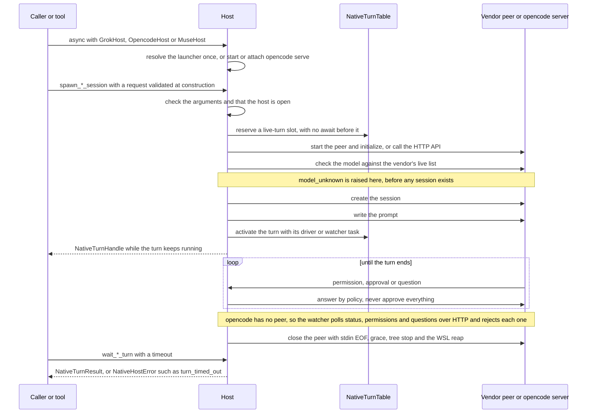
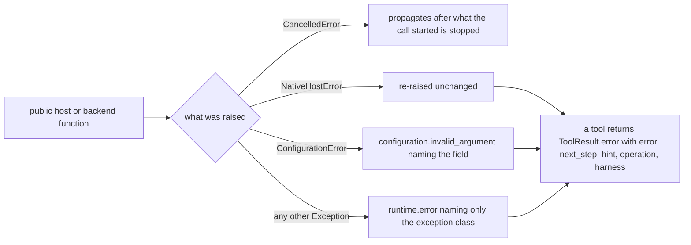

feat(native-hosts): GrokHost, OpencodeHost and MuseHost plus GLM and DeepSeek backend profiles, each failing with one typed error

## Summary

The SDK can now drive three coding agents that run on the user's own machine, and can point Claude Code or opencode at GLM or DeepSeek. Before this PR, `vidbyte/harnesses/native/` did not exist and none of this was possible.

User request, verbatim: "great, can you focus on implementing grok, glm, deepseek, meta, and opencode harnesses for now. Make sure to extensively handle errors for every single function."

What now exists:
- **`GrokHost`** (`vidbyte.harnesses.native.grok`) drives Grok Build. Each turn runs on its own `grok agent --no-leader [--model=…] [--reasoning-effort=…] stdio` process over ACP (JSON-RPC on stdio). One-shot and fork runs use `grok --single` through the new `CliRunner`. It has 10 functions; `run_grok_once` also exists as a module function that opens a host of its own.
- **`OpencodeHost`** (`vidbyte.harnesses.native.opencode`) drives `opencode serve` over HTTP, and has 18 functions.
  - With no `server_url`, the host starts its own server with `serve --hostname 127.0.0.1 --port 0`. The server gets a fresh random basic-auth password, which exists only in the child's environment.
  - With a `server_url`, the host attaches to that server instead.
  - A turn is sent with `prompt_async`. A watcher then polls the session status, the messages, the permissions and the questions.
- **`MuseHost`** (`vidbyte.harnesses.native.muse`) drives Meta's Muse Code through `muse serve` over MSP 1.0.1, and has 12 functions. On Windows it runs `wsl.exe -d <distro> -e <muse_path> serve` and gives each peer a random `VIDBYTE_PEER_MARK`. After a turn it kills the process tree carrying that mark inside the distro.
- **Backends** (`vidbyte.harnesses.native.backends`): a GLM (Z.ai) profile and a DeepSeek profile, with six functions: `list_harness_backends`, `build_claude_backend_env`, `check_backend_ready`, `check_backend_compat`, `get_deepseek_balance` and `build_opencode_backend_provider`.
- **One way to fail.** A public function raises only these:
  - `NativeHostError`, a new `AgentExecutionError` subclass in `vidbyte.lib.errors`;
  - `asyncio.CancelledError`;
  - `ConfigurationError`, and only while a request or settings record is being built.

  The error carries `failure_code` (one of 53 new `<host>.<problem>` `FailureCode` members, each with a default next step), `operation`, `next_step` and `context`. Vendor text is scrubbed by `HarnessRedactor`, with every secret the host injected replaced, and then capped.
- **Tools.** There are 43 tools in 4 toolsets: `GrokTools`, `OpencodeTools`, `MuseTools` and `HarnessBackendTools`.
  - Tools that start a turn or spend money are WRITE, so the default `PermissionPolicy` denies them.
  - `read_only(host)` returns the READ subset, for exposure over MCP.
  - A tool never raises. A failure becomes `ToolResult.error`, and its metadata holds `error`, `next_step`, `hint`, `operation` and `harness`.
- **Shared plumbing.**
  - `McpStdioTransport` gets an opt-in extension: `on_message`, `notify`, `respond`, a per-call `timeout_seconds`, `exit_grace_seconds`, `stop_process_tree` and a read-only `returncode`. Left at its defaults, the transport behaves as it did before for every call that is not cancelled (deviation 14).
  - A new canonical package, `vidbyte.lib.process`, holds `CliRunner`, `ManagedProcess` and `ProcessStopper`.
- **No approve-everything setting exists anywhere.**
  - Grok answers `allow_once` only for a tool kind the request allows, and `reject_once` for any other.
  - opencode answers every permission and question from the turn's session tree with `reject`.
  - Muse sessions start with `approvalMode: denyUnmatched`. The host answers every approval `denied`, scoped `once`, and cancels every user-input request.

Scope is the catalog's ★ functions plus `build_opencode_backend_provider`. Out of scope (spec §3):
- the non-★ functions;
- a public `AcpHost`;
- new dependencies;
- any change to `pyproject.toml` or `contracts/`;
- root `vidbyte` exports;
- MCP-server permission changes;
- live vendor smoke tests.

Size against `main` (8387d666): 143 files.
- SDK code: 67 files, +11,699 / −38.
- Tests: 49 files, +14,023.
- `REPO_MAP.md`: +8.
- Spec docs: 26 files under `docs/spec/native-grok-opencode-meta-hosts/`.

The spec is `docs/spec/native-grok-opencode-meta-hosts/spec.md`, revision r8.

## How to use what this PR introduces

```python
import asyncio
from pathlib import Path

from vidbyte.harnesses.native.grok import GrokHost
from vidbyte.lib.dataclasses.grok import GrokHostSettings, GrokTurnRequest
from vidbyte.lib.errors import NativeHostError


async def main() -> None:
    settings = GrokHostSettings(workspace=Path.cwd())
    try:
        async with GrokHost(settings) as host:
            # Returns as soon as Grok has the prompt; the turn keeps running.
            handle = await host.spawn_grok_session(GrokTurnRequest(prompt="List the top-level folders."))
            result = await host.wait_grok_turn(handle, timeout_seconds=600)
            print(result.status.value, result.text)
    except NativeHostError as error:
        print(error.failure_code.value, "->", error.next_step)


asyncio.run(main())
```

**What it prints.** When Grok completes the turn, it prints `completed <text>`. With no Grok installed, it prints `grok.not_installed -> Install Grok Build 1.0.13 or newer, or set GrokHostSettings.grok_command.`

**Proof.** The snippet runs through its two AC-1 tests in `tests/features/grok_host/test_grok_host_acceptance.py`, which use a fake ACP peer, not the real Grok CLI. Re-run for this PR on Windows with CPython 3.11.0, they give `2 passed in 2.24s`.
- The first test expects `completed alpha-beta` from the fake.
- The second expects the `grok.not_installed` line above.
- On POSIX, the fake is a `grok` script on `PATH`. On Windows, the test passes `grok_command=(sys.executable, "-u", <fake>, <scenario>)`, because the host refuses a `.cmd` or `.bat` launcher (EC-157).

**Windows.** For real use, Grok must be `grok.exe`, found on `PATH` or at `~/.grok/bin/grok.exe`, or named in `grok_command`. A `.cmd` or `.bat` shim is refused with `grok.not_installed`, because `cmd.exe` would run parts of a prompt as commands.

**The other entry points** follow the same pattern:
- **opencode and Muse.** `OpencodeHost(OpencodeHostSettings(workspace=…))` and `MuseHost(MuseHostSettings(workspace=…, wsl_distro=…))` have the same shape. `spawn_*_session` returns a `NativeTurnHandle` at once, and `wait_*_turn` returns a `NativeTurnResult`. `interrupt_*_turn` returns `NativeInterruptResult(was_running=…)`, and `steer_muse_turn` exists on Muse only.
- **opencode with GLM or DeepSeek.** Set `OpencodeHostSettings(…, backends=(HarnessBackendName.GLM,))`. The host checks the key before anything starts, and passes it to the owned server's environment under the variable opencode reads.
- **Claude Code with GLM or DeepSeek.** `build_claude_backend_env(HarnessBackendName.DEEPSEEK).as_environ()` returns the environment for a Claude Code child. Its `repr` hides the key.
- **Refusing unsupported requests.** `check_backend_compat(backend, BackendCompatRequest(harness=…, features=…))` refuses an unsupported harness or feature without any network call.
- **Tools.** Give an agent `GrokTools(host)`, or `GrokTools.read_only(host)` for MCP; opencode and Muse work the same way. `HarnessBackendTools()` holds three READ tools.
- **Errors.** A host method raises `NativeHostError`; read `error.failure_code`, `error.next_step` and `error.context`. A tool returns the output `<code>: <message> Next step: <next_step>`.

## Flow (mermaid)



Every public method uses one `try` with the same four handlers.



## What changed (table)

| Area | Files | Lines | What it adds |
|---|---|---|---|
| `vidbyte/harnesses/native/__init__.py` | 1 | +10 | The shared package file, byte-exact. SHA-256 `0374a2c8…497a` (INV-19), shared with the parallel Codex and Claude PRs |
| `vidbyte/harnesses/native/grok/` | 5 | +1,424 | `GrokHost`, `run_grok_once`, `GrokCli` (argv; launcher resolved at `__aenter__`, batch launchers refused on win32), `GrokWire` (ACP codec and error mapping), `GrokTurnDriver`. A host closed during spawn or continue cancels the unread `session/prompt` answer (R-24) |
| `vidbyte/harnesses/native/opencode/` | 6 | +2,015 | `OpencodeHost`, `OpencodeServer` (owned or attached), `OpencodeClient`, `OpencodeWire`, `OpencodeTurnWatcher` (polling, tree-scoped `reject`, ceiling and EC-158 abort) |
| `vidbyte/harnesses/native/muse/` | 5 | +1,717 | `MuseHost`, `MuseLauncher` (WSL argv, peer mark, in-distro reap), `MusePathTranslator`, `MuseWire` (MSP 1.0.1), `MuseTurnDriver`. `_forget_driver` marks a failed turn's error as seen, and `wait_muse_turn` still raises it (R-22) |
| `vidbyte/harnesses/native/hostkit/` | 4 | +444 | `NativeErrorFactory` (scrub, cap, next steps), `NativeTurnTable` (synchronous reservation; Grok and Muse ids lower-cased, opencode exact), `NativePeer`, `NativeChildEnvironment` (the caller's environment plus a host overlay) |
| `vidbyte/harnesses/native/backends/` | 2 | +371 | `HarnessBackends` and the six backend functions |
| `vidbyte/lib/process/` | 3 | +424 | `CliRunner` (bounded, capped output, stdin piped or `DEVNULL`), `ManagedProcess`, `ProcessStopper` (POSIX `killpg` TERM then KILL; Windows `taskkill /T /F`) |
| `vidbyte/tools/mcp/transport.py` | 1 | +230 / −36 | The opt-in transport extension. A frame that has `method` never resolves a pending request (INV-18's one exception). A write with an explicit deadline goes through `_drain_within`, which raises when stdin is closing (CI-1). The default path keeps the plain `drain()` (R-3). On CPython 3.11, the bounded drains and the answer wait compare the task's `cancelling()` count before and after `wait_for` and re-raise a cancel it dropped, and a cancelled request write pops and cancels its pending future (R-25) |
| `vidbyte/lib/errors/` | 2 | +54 | `NativeHostError(AgentExecutionError)` with `failure_code`, `operation`, `next_step` and `context` |
| `vidbyte/lib/enums/` | 5 | +274 | 53 `FailureCode` members (Grok 13, opencode 16, Muse 15, backend 9); `harness_backends.py`, `native_hosts.py` and `process.py` enums; append-only exports |
| `vidbyte/lib/dataclasses/` | 7 | +1,920 | Validated frozen records for settings, requests, results and inbound wire data, plus `validation.py` (`RecordFieldValidator`, `RecordFieldConverter`) |
| `vidbyte/lib/constants/native_hosts.py`, `vidbyte/lib/configs/` | 3 | +313 | Bounds, timeouts, next-step texts (`NATIVE_HOST_NEXT_STEPS`), the two backend profiles |
| `vidbyte/tools/builtins/native_host_tool.py` | 1 | +222 | `NativeHostTool` base, `NativeToolArguments`, `NativeResultEncoder` |
| `vidbyte/tools/builtins/{grok,opencode,muse,harness_backends}/` | 13 | +1,990 | 43 tools (Grok 10, opencode 18, Muse 12, backend 3 READ) with model-facing descriptions |
| `vidbyte/tools/toolsets/` | 5 | +267 | `GrokTools`, `OpencodeTools`, `MuseTools` (each with `read_only(host)`), `HarnessBackendTools` |
| READMEs and `REPO_MAP.md` | 5 | +32 / −2 | Append-only entries in `REPO_MAP.md` and in the READMEs of `vidbyte/harnesses/`, `vidbyte/lib/`, `vidbyte/tools/` and `vidbyte/tools/mcp/`. The MCP README entry covers the transport options; the harnesses entry carries the T-5 note |
| `tests/features/{grok_host,opencode_host,muse_host,native_backends}/` | 49 | +14,023 | Four packs with fake ACP and MSP peers, a fake opencode server, a fake `wsl.exe` and fake backend HTTP. Grok 4,961 lines, opencode 3,677, Muse 3,906, backends 1,479. The R-25 cases are in `test_grok_host_process_bounds.py`; R-22 and R-24 are in the two `*_turns.py` files. `fake_grok_peer.py` and `fake_muse_peer.py` log each `sent` frame under the writer lock, and their stdin-EOF exit takes that lock first (`7e1f770b`) |
| `docs/spec/native-grok-opencode-meta-hosts/` | 26 | docs only | Spec r8, request, test plan, review, verify log, pipeline log, stage reports, this body |

These were not touched: `pyproject.toml`, `contracts/`, `lint/`, `.semgrep/`, `vidbyte/__init__.py`, `vidbyte/tools/builtins/__init__.py` and `vidbyte/mcp_server/`. Their diff against `main` is empty (INV-22). The existing `tests/test_mcp_stdio_transport.py` and `tests/test_mcp_studio_server.py` are identical to `main`.

## Acceptance criteria → proof (all 20 ACs)

S6 re-ran all 73 proof test ids below at `319d714f`, on Windows with CPython 3.11.0, against the fakes. They expand to 780 parametrized cases: `778 passed, 2 skipped in 117.57s`. The 2 skips are POSIX-only liveness checks, one in AC-3 and one in AC-9. They run in the Linux CI jobs, which pass on 3.11 and 3.12 (see Verification). Test paths are under `tests/features/`.

| AC | What is proven | Proof (tests) | Result |
|---|---|---|---|
| AC-1 | The §4 snippet prints `completed T` against a fake Grok, and prints the `grok.not_installed` line when there is no Grok. The launcher is never a batch file | `grok_host/test_grok_host_acceptance.py::test_snippet_prints_completed_text_when_grok_is_the_fake`, `::test_snippet_prints_not_installed_line_when_no_grok_exists` | pass |
| AC-2 | Every §6.3 error row raises `NativeHostError` with the row's code, a next step containing the row's token, and no secret. The matching tool returns `ToolResult.error` with `metadata["error"] == code` and does not raise | `grok_host/test_grok_host_errors.py::test_grok_error_row`; `opencode_host/test_opencode_host_errors.py::test_opencode_error_row`, `::test_aenter_error_row`; `muse_host/test_muse_host_errors.py::test_muse_error_row`; `native_backends/test_native_backends_errors.py::test_backend_error_row` (every row in host mode and in tool mode) | pass |
| AC-3 | A peer or server that never answers raises `<host>.server_unreachable` within its timeout plus the stop bound (9 s for a peer with the defaults), and everything the call started is reaped | `grok_host/test_grok_host_process_bounds.py::test_unresponsive_peer_raises_server_unreachable_within_the_bound`, `::test_unresponsive_peer_bound_holds_with_default_timings`, `::test_unresponsive_peer_is_reaped_before_the_error_is_raised` (POSIX only); `opencode_host/test_opencode_host_acceptance.py::test_unresponsive_server_raises_server_unreachable_within_the_timeout`, `::test_unresponsive_server_fails_aenter_within_the_timeout`; `muse_host/test_muse_host_process_bounds.py::test_unresponsive_peer_raises_server_unreachable_within_the_bound`, `::test_unresponsive_peer_bound_holds_with_default_timings` | pass (1 POSIX-only skip on Windows) |
| AC-4 | A cancelled call propagates `CancelledError` and stops what it started. A cancelled `wait_*` leaves the turn running, and a later wait returns its result | `grok_host/test_grok_host_process_bounds.py::test_cancelling_a_call_propagates_and_stops_what_it_started`, `::test_cancelling_a_wait_leaves_the_turn_running`; `opencode_host/test_opencode_host_acceptance.py::test_cancelling_a_call_propagates_and_releases_its_reservation`, `::test_cancelling_a_wait_leaves_the_turn_running`; `opencode_host/test_opencode_host_owned_server.py::test_cancelling_aenter_stops_the_server_it_started`; `muse_host/test_muse_host_process_bounds.py::test_cancelling_a_call_propagates_and_stops_what_it_started`, `::test_cancelling_a_wait_leaves_the_turn_running`; `native_backends/test_native_backends_balance.py::test_cancelling_a_balance_call_propagates` | pass |
| AC-5 | A secret the host injected (API key, server password, MCP env value or header) never appears in an error, a tool result or argv; `<redacted>` stands in its place | `opencode_host/test_opencode_host_security.py::test_attached_server_password_in_a_vendor_error_is_redacted`, `::test_owned_server_password_in_a_vendor_error_is_redacted`, `::test_backend_key_in_a_vendor_error_is_redacted`, `::test_mcp_environment_value_in_a_failed_status_is_redacted`, `::test_mcp_header_value_in_a_vendor_error_is_redacted`; `native_backends/test_native_backends_security.py::test_error_body_echoing_the_key_is_redacted_in_the_error`, `::test_error_body_echoing_the_key_is_redacted_in_the_tool_result` | pass |
| AC-6 | `spawn_*_session` returns a handle while the turn is still `RUNNING`, and `wait_*_turn` returns once the turn ends | `grok_host/test_grok_host_acceptance.py::test_spawn_returns_a_handle_while_the_turn_is_still_running`; `opencode_host/test_opencode_host_acceptance.py::test_spawn_returns_a_handle_while_the_turn_is_still_running`; `muse_host/test_muse_host_acceptance.py::test_spawn_returns_a_handle_while_the_turn_is_still_running` | pass |
| AC-7 | An unknown model raises `<host>.model_unknown` with `context["available_models"]`, and the fake received no session or prompt call | `grok_host/test_grok_host_errors.py::test_grok_error_row` (EC-25, EC-37), `::test_model_unknown_context_names_the_models_grok_offers`; `opencode_host/test_opencode_host_acceptance.py::test_unknown_model_is_refused_before_any_turn_starts`; `muse_host/test_muse_host_errors.py::test_muse_error_row` (EC-108), `::test_model_unknown_context_names_the_models_muse_offers` | pass |
| AC-8 | A Grok `edit` permission gets `reject_once` with no allowed kinds and `allow_once` with `{EDIT}`, never an `*_always` option, and both are recorded in `decisions` | `grok_host/test_grok_host_turns.py::test_edit_permission_is_rejected_then_allowed_by_policy`, `::test_permission_without_a_reject_option_is_answered_cancelled` | pass |
| AC-9 | The owned `opencode serve` runs on `127.0.0.1 --port 0` with a fresh password in its environment only, and is stopped and reaped on exit. A provider's `key` and `options` never reach a result | `opencode_host/test_opencode_host_owned_server.py::test_owned_server_starts_on_loopback_with_a_fresh_password_in_its_environment_only`, `::test_each_owned_server_gets_its_own_password`, `::test_owned_server_and_its_tree_are_stopped_on_exit_within_the_bound` (POSIX only), `::test_owned_server_exit_returns_within_the_bound`; `opencode_host/test_opencode_host_security.py::test_provider_key_and_options_never_reach_a_result` | pass (1 POSIX-only skip on Windows) |
| AC-10 | On win32, Muse runs `wsl.exe -d <distro> -e /usr/local/bin/muse serve` through the path `shutil.which` returned, never a `.cmd` shim, and sends `workspaceRoot` as `/mnt/c/…`. A fake `wsl.exe` stands in, and no real distro is launched | `muse_host/test_muse_host_wsl.py::test_to_wsl_maps_a_drive_path_under_mnt`, `::test_wsl_turn_peer_launch_workspace_overlay_and_reap` | pass |
| AC-11 | `wait_*_turn` past its deadline raises `<host>.turn_timed_out`, and a later wait returns the result | `grok_host/test_grok_host_acceptance.py::test_wait_times_out_then_returns_the_result`; `opencode_host/test_opencode_host_acceptance.py::test_wait_times_out_then_returns_the_result`; `muse_host/test_muse_host_acceptance.py::test_wait_times_out_without_touching_the_turn_and_a_later_wait_returns` | pass |
| AC-12 | Interrupting a finished turn twice returns `was_running=False` both times, without raising | `grok_host/test_grok_host_acceptance.py::test_interrupting_a_finished_turn_twice_reports_not_running`; `opencode_host/test_opencode_host_acceptance.py::test_interrupting_a_finished_turn_twice_reports_not_running`; `muse_host/test_muse_host_acceptance.py::test_interrupting_a_finished_turn_twice_reports_not_running` | pass |
| AC-13 | `build_claude_backend_env(DEEPSEEK)` returns exactly the spec keys and hides the key from `repr`. With the key unset, it raises `backend.not_signed_in` naming `DEEPSEEK_API_KEY` | `native_backends/test_native_backends_profiles.py::test_deepseek_env_has_exactly_the_spec_keys_and_hides_the_value` | pass |
| AC-14 | `check_backend_compat` refuses DeepSeek with `MCP_SERVERS` (`backend.feature_unsupported`), then GLM with harness `GROK` (`backend.harness_not_allowed`), with no network call | `native_backends/test_native_backends_profiles.py::test_compat_refuses_unsupported_features_then_disallowed_harness_without_network` | pass |
| AC-15 | Under the default `PermissionPolicy`, a WRITE tool is denied and a READ tool runs. Every backend tool runs | `grok_host/test_grok_host_tools.py::test_default_policy_denies_the_write_tool_and_runs_the_read_tool`; `opencode_host/test_opencode_host_tools.py::…` (same name); `muse_host/test_muse_host_tools.py::…` (same name); `native_backends/test_native_backends_tools.py::test_default_policy_runs_every_backend_tool` | pass |
| AC-16 | The existing MCP tests pass unchanged, the `native/__init__.py` hash matches INV-19, and `python scripts/run_ci.py` passes | `grok_host/test_grok_host_shared_contract.py::test_native_package_init_matches_the_fixed_bytes`; `grok_host/test_grok_transport_extension.py` (all of it); `tests/test_mcp_stdio_transport.py` and `tests/test_mcp_studio_server.py` identical to `main`; the `run_ci.py` source and package stages (Verification) | pass |
| AC-17 | `NATIVE_HOST_NEXT_STEPS` has an entry for each of the 53 new codes and the 2 existing ones it uses, and every new code starts with its host prefix | `grok_host/test_grok_host_shared_contract.py::test_next_steps_hold_every_code_verbatim`, `::test_every_new_code_starts_with_its_host_prefix`, `::test_the_53_new_members_follow_rule_evaluation_failed_in_catalog_order` | pass |
| AC-18 | `import vidbyte` starts no process and loads no vendor SDK | `grok_host/test_grok_host_shared_contract.py::test_import_vidbyte_starts_no_process_and_loads_no_vendor_sdk` | pass |
| AC-19 | No record field, tool parameter, argv or wire frame can carry an approve-everything value. The opencode rule `*` / `*` / `ALLOW` raises `ConfigurationError` | `grok_host/test_grok_host_tools.py::test_no_grok_tool_offers_an_approve_everything_or_directory_parameter`; `grok_host/test_grok_host_reads.py::test_one_shot_argv_carries_every_value_in_name_value_form`; `grok_host/test_grok_host_turns.py::test_turn_peer_wire_shapes`; `grok_host/test_grok_host_shared_contract.py::test_grok_permission_mode_has_no_approve_everything_member`; `opencode_host/test_opencode_host_records.py::test_the_allow_everything_rule_is_refused`; `opencode_host/test_opencode_host_security.py::test_no_allow_everything_rule_is_ever_sent`; `opencode_host/test_opencode_host_tools.py::test_no_opencode_tool_offers_a_permission_directory_or_mcp_shape_parameter`; `muse_host/test_muse_host_records.py::test_no_request_or_settings_field_can_carry_an_approve_everything_value`; `muse_host/test_muse_host_wire.py::test_no_frame_or_argv_carries_an_approve_everything_value`; `muse_host/test_muse_host_tools.py::test_no_muse_tool_offers_an_approval_launcher_or_directory_parameter` | pass |
| AC-20 | Each of the seven entry modules imports first in a fresh interpreter, and all of them import in reverse order | `grok_host/test_grok_host_shared_contract.py::test_each_entry_module_imports_first_in_a_fresh_interpreter`, `::test_all_entry_modules_import_in_reverse_order` | pass |

## Verification (gate table)

The last commit to product code is `3917b49a`. The last commit outside `docs/` is `7e1f770b`, a test-fake fix. The gates below come from verify-log iteration 8 at `3917b49a`, plus the S6 runs at `319d714f`. The final remote runs are on `6d68effa`, the last head that contains code or tests: it holds every code and test commit. Every later commit touches only `docs/spec/native-grok-opencode-meta-hosts/`, so it was not dispatched again. CI here is dispatch-only (`workflow_dispatch`), so `gh pr checks` lists no checks.

| Gate | Head | Result |
|---|---|---|
| Final remote `ci.yml` run 38479268619 | `6d68effa` | Succeeded on attempt 1 (3.11, 3.12 and package smoke). 3.11: `5676 passed, 39 skipped in 164.28s` / `CI passed.`; 3.12: `5676 passed, 39 skipped, 19 warnings in 195.98s` / `CI passed.`; package: `Installed vidbyte-sdk 0.2.1 passed smoke checks.` |
| Final remote `static-policy.yml` run 38479272007 | `6d68effa` | success, `Ran 1 rule on 949 files: 0 findings.` |
| R-25 regression tests, 10 runs | `3917b49a` | `7 passed, 15 deselected`, 10 of 10 runs (`in 4.41s` on run 10) |
| AC-4 cancel test, 30 runs | `3917b49a` | `4 passed`, 30 of 30 runs |
| RACE-1 and R-19 regression tests | `3917b49a` | `12 passed, 63 deselected in 4.00s` |
| R-22 and R-24 regression tests, fresh processes | `3917b49a`, then `7e1f770b` | 89 of 90 runs at `3917b49a`. The one failure was a race in the Muse test fake, fixed in `7e1f770b`. After that fix, R-22 passed 60 of 60 runs and R-24 30 of 30 |
| Four feature packs | `3917b49a`, then `7e1f770b` | `1668 passed, 19 skipped in 182.38s (0:03:02)`; 1668 passed and 19 skipped again after the fake fix |
| `main`'s MCP transport tests (stdio, studio, bridge), unchanged | `3917b49a` | `59 passed in 2.26s` |
| `python lint/run.py` | `3917b49a` | `S064 RATCHETED: 4 known finding(s).` / `SDK-LINT: PASS`. No count rose: A001 643/643, A007 255/255, S019 5/5, S024 25/25, S039 5/5, S045 2/2, S062 889/889, A002 577 (579 on `main`) |
| `python scripts/run_ci.py --stage source` | `3917b49a` | `5683 passed, 32 skipped in 200.06s (0:03:20)` / `CI passed.` |
| `python scripts/run_ci.py --stage package` | `3917b49a` | `Installed vidbyte-sdk 0.2.1 passed smoke checks.` / `CI passed.` |
| Semgrep | `3917b49a` | `Ran 1 rule on 949 files: 0 findings.` |
| Public API contract | `3917b49a` | `contracts/sdk-public-api.json is current … (vidbyte-sdk 0.2.1, 606 exports).` |
| Remote `ci.yml` runs 38475662280 and 38475671014 | `3917b49a` | Both succeeded on attempt 1 (3.11, 3.12 and package smoke). 3.11: `5676 passed, 39 skipped`; 3.12: `5676 passed, 39 skipped, 19 warnings` |
| Remote `static-policy.yml` run 38475673751 | `3917b49a` | success, `Ran 1 rule on 949 files: 0 findings.` |
| INV-19 and INV-22 | `3917b49a`; re-checked at `319d714f` in S6 | `native/__init__.py` SHA-256 `0374a2c8…497a`; the protected-file diff against `main` is empty |
| The 20 ACs' 73 proof test ids (S6) | `319d714f` | `778 passed, 2 skipped in 117.57s` on Windows; the 2 skips are POSIX-only |
| R-25, R-22 and R-24 regression tests (S6) | `319d714f` | `7 passed, 15 deselected in 3.79s`; `2 passed in 1.24s` |

## Adversarial review

A Blocker or Major counted only after a verifier had reproduced it or confirmed it against the code.

| Stage | Head reviewed | Blocker / Major confirmed | Minor | Outcome |
|---|---|---|---|---|
| S4: conformance, conventions and engineering lenses, plus a findings verifier | `de5b7c4c` | 2 Blockers (R-1, R-2) and 13 Majors (R-3 to R-15) | 9 (R-M1 to R-M9) | NEEDS REWORK. 0 refuted. The verifier downgraded two Blockers to Major (R-9, R-15) and one Major to Minor (R-M4) |
| CI-1, from remote CI on Linux 3.12 | `9d51a3fb` | 1 code defect | — | The verifier called it a test defect. The orchestrator ruled it a code defect: on 3.12 a bare `drain()` swallowed EPIPE. Fixed at `eea8cf36` |
| Re-review, round 1 | `b0e35a32` (code `af3e05e8`) | 2 Majors (R-16, R-17) | 2 (R-M10, R-M11) | MERGEABLE AFTER FIXES. All 21 earlier fixes held |
| Re-review, round 2 (the last allowed) | `71be15fd` (code `45ad54ec`) | 0 | 1 (R-RR2-1) | SOUND. All 3 fixes from round 1 held |
| RACE-1, found by remote CI run 38437336454 (attempt 1, Linux 3.11) after round 2 | `df9566fa` | 1 Major (R-18) | 3 (R-19, R-20, R-21) | Fixed in repair iteration 6 |
| Post-S6 verifier: S6's two open items, plus a blind-spot sweep | `5c22c2f9` (code `e4210fc3`) | 0 | 2 (R-22, R-24) | The verdict stays SOUND. Item (B), the `DEEPSEEK_API_KEY` literal, was refuted: EC-127 requires that exact text, and only DeepSeek can reach the line. R-22 and R-24 were fixed in repair iteration 7 |
| R-25, found by the full suite in repair iteration 7 | `19582f13` | 1 Major (R-25) | — | Fixed in repair iteration 8, the last allowed |

**No third re-review checked the fixes made after re-review round 2.** That covers RACE-1 (R-18 to R-21), R-22, R-24 and R-25. The cap of 2 re-review rounds was used up, and repair used all 8 of its 8 iterations. Instead, each of these fixes was checked in two ways: by blind, deterministic regression tests that were red before the fix and green after it, and by the orchestrator's own verification.
- **RACE-1.** Tests at `ba70578e`. 8 of the 12 cases were red before the fix, and all 12 passed 10 of 10 runs after it.
- **R-22 and R-24.** Tests at `c1599d0b`. Both were red before the fix and passed 20 of 20 after it. A race in the Muse test fake then failed R-22's precondition about once in 30 to 90 runs. `7e1f770b` fixed the order in which the fakes write, log and exit, with no product-code change. After that fix, R-22 passed 60 of 60 fresh-process runs and R-24 30 of 30.
- **R-25.** Tests at `5e4c3c34` and `15fd9332`: 7 cases that force the window, each red 5 of 5 before the fix (`7 failed, 15 deselected` when reproduced in iteration 8). All 7 passed 70 of 70 runs after it.

Totals:
- **Blocker and Major:** 19 confirmed, 19 fixed.
- **CI-1:** one code defect, fixed.
- **Minor:** 17 in all. 12 are fixed, 5 are follow-ups, and none was waived.
- **Refuted:** one item, (B), the candidate R-23.

| ID | What was wrong | Fixed at |
|---|---|---|
| R-1 (Blocker) | Grok mapped a `-32602` answer without a cursor to `grok.protocol_mismatch`, but EC-16 requires `grok.api_error` | `749b7583` |
| R-2 (Blocker) | On Windows, a `.cmd` or `.bat` Grok launcher let a prompt, a model id or a rule from a tool argument run as a shell command | `137fa778` (spec r8 added EC-157) |
| R-3 | The transport's default `request()` path bounded `stdin.drain()`, changing default behavior (INV-18) | `a9223a02` |
| CI-1 | On Linux 3.12, a cancel write to a dead Grok peer did not raise | `eea8cf36` |
| R-4 | Tool parameter descriptions did not name every enum value | `54d5c17b` |
| R-5 | `MuseHost.__aexit__` waited with no bound behind a silent peer | `93c42f68` |
| R-6 | An opencode turn failed locally on one poll error and sent no abort, so the server turn kept spending | `1e62494b` (EC-158) |
| R-7 | Muse read peers in WSL did not forward `META_API_KEY` | `a4d74982` |
| R-8 | An upper-cased session id slipped past the busy check and started a second live turn | `e70be132` |
| R-9 | Bounds were kept outside `lib/constants`, and some were duplicated | `616e8a0f` |
| R-10 | `lib/process` repeated its own launch logic | `0f93301a` |
| R-11 | The hosts' next-step texts were copied per host and had drifted | `7f61f927`, `3c896557` |
| R-12 | Helpers called helpers, against AGENTS.md principle 1 | `5a7e09de` |
| R-13 | The A002 count rose against the real `main` | `4f243bc9`, `af3e05e8` |
| R-14 | Code comments cited spec ids | `f067088d` |
| R-15 | Comment lines ran past 72 columns | `f067088d`, `96705dfd` |
| R-16 | A vendor-returned upper-case Grok or Muse session id was bound verbatim and slipped past the busy check | `1768c3d5` |
| R-17 | Grok and Muse approval titles were not scrubbed | `1a9bc056` |
| R-18 | A Muse interrupt that lost the race to `turn/completed` raised `process_exited` | `0284ffe1` |
| R-25 | On CPython 3.11, `asyncio.wait_for` could drop a cancel (gh-86296) at the transport's two bounded drains and at its answer wait. A cancelled call then waited out its timeout or received a result, against AC-4 and INV-2 | `f5a2c74a`, `3917b49a` |
| R-22 (Minor) | A failed Muse turn that nobody waited on logged "Task exception was never retrieved" | `48e9343a` |
| R-24 (Minor) | A Grok host closed during spawn or continue left the `session/prompt` answer future unretrieved | `19582f13` |
| R-M1, R-M6, R-M9, R-M11, R-RR2-1, R-19, R-20, R-21 (Minor) | Wrapping, header and wording fixes, missing regression tests, and three races | `87217940`, `04be59fa`, `96df0b45`, `45ad54ec`, `df9566fa`, `0e900159`, `85788217`, `241f1966` |
| R-M2, R-M3 (Minor) | Docs only | spec r8 (`e377b7c2`) |

review.md's S4 heading reads "Confirmed findings — 13". That counts the 2 Blockers and 11 Majors confirmed as raised; the table holds all 15 rows, R-9 and R-15 included.

## Deviations from the spec

**Recorded in spec §17**, as shipped:
1. `NATIVE_INVALID_ARGUMENT_NEXT_STEP` names the bad argument. To use it, each host method's `try` has a fourth handler, for `ConfigurationError`.
2. New converters: `RecordFieldConverter.to_enum` and `to_decimal`, for JSON tool arguments and wire bodies.
3. The backend functions use `NativeHarness.CLAUDE_CODE` as their error-factory label. Their own errors use explicit `backend.*` codes.
4. `from_unexpected` produces `"<operation> failed with an unexpected <ErrorType>."`, which names no host.
5. The Claude `ANTHROPIC_DEFAULT_*_MODEL` slots are a private map in `backends/profiles.py`, not a field of `HarnessBackend`.
6. The opencode tools share an `OpencodeHostTool` base in `tools/builtins/opencode/read_tools.py`.
7. opencode tools wrap a tuple result in an object keyed `models`, `providers`, `sessions` or `files`, while `list_harness_backends` returns a bare JSON array.
8. `list_harness_backends` has no `try`, because it only returns a constant.
9. `OpencodeHost.mcp_servers` is a read-only property that §8.5 does not list. The `add_opencode_mcp_server` tool uses it.
10. `GrokWire.check_fork_result` also raises `grok.protocol_mismatch` when the forked session id differs from the requested `new_session_id`, comparing ids without regard to case. EC-39 now records this.

**Found in S6 and not recorded in the spec:**

11. `require_url` lives on `RecordFieldConverter` (`vidbyte/lib/dataclasses/validation.py:220`), not on `RecordFieldValidator`, because a test pins the validator at 13 public methods.
12. Spec T-6 places the control for vendor prompt injection in `NativeResultEncoder`, as "scrubbed of the host's secrets". §8.5 defines that encoder as static, and in the code it does not scrub. Turn text is returned without scrubbing at `grok/turn.py:121`, `muse/turn.py:300` and `opencode/turn.py:350`. Errors and approval titles are scrubbed. Listed as follow-up 6.

**Corrected in the spec in S6 (`16078049`):**

13. The §5 diagrams had drifted from the code. They now say the following:
    - Children get the caller's environment plus a host overlay (D-18), not an "allowlisted env".
    - The launcher is resolved once in `__aenter__`, not at spawn.
    - opencode is either owned or attached, and its turns are polled.
    - Grok's `session/prompt` is written before the driver task starts.

**Found after S6, in repair iteration 8, and not recorded in the spec:**

14. INV-18 says that, with default options, `McpStdioTransport` behaves exactly as at `base_commit`, with the dispatch fix as the one exception. Since R-25, a default `request()` that is cancelled also differs; see follow-up 14.

**Not a deviation:** Muse and opencode approval titles are cut at 200 characters, the §8.4 record cap. S3 had cut them at 128, and repair corrected this.

## Follow-ups (including Known limitations)

None of these is fixed in this PR. Each one was left open by decision.
1. **R-M10.** In the opencode tree walk, a 404 from a descendant's `children` call ends the turn as `session_not_found` and sends no EC-158 abort (`opencode/turn.py:251`). This needs a spec sentence first. The verifier proposed this wording:
   - change EC-158's exemption to "a 404 for the turn's own session (EC-86, EC-90)";
   - add to EC-154: "A 404 from the `children` call of a descendant, not the turn's own session, means that descendant was deleted during the walk; the watcher leaves it out of the tree and goes on, and the poll does not fail."
2. **R-M4.** Grok and Muse pick failure codes by free-text `.code(problem)` (`hostkit/errors.py:80`), while opencode uses enum members. A typo would surface as `runtime.error` when the code runs.
3. **R-M5.** `MuseWire` uses a module-level `_ERRORS` factory (`muse/wire.py:53`). A secret registered on the host later would not be scrubbed from errors built in the wire.
4. **R-M7.** The Muse driver caps its decision list only when it builds the result. A peer that floods unique approval ids grows that list until the turn ends.
5. **R-M8** (scope-adding). Each opencode watcher request opens a new `httpx.AsyncClient`.
6. **T-6 against §8.5.** Either scrub turn text, or correct T-6 to say that only errors and approval titles are scrubbed (deviation 12).
7. **No test pins opencode's exact session-id comparison** (INV-14). Only a scratch probe in re-review round 2 proved it.
8. **No test covers EC-157 case (iii)**, the Windows fallback to `~/.grok/bin/grok.exe` when `PATH` holds only a `.cmd` shim. Testing it needs a real `.exe` peer.
9. **Iteration-6 observation (Grok).** Suppose the peer exits without answering `session/prompt` and the driver is still closing. `interrupt_grok_turn` then returns `was_running=True` and sends nothing. The turn still records `process_exited`.
10. **Iteration-6 observation (Muse).** An earlier stop's grace period can close the peer with no `turn/completed`. A steer or second interrupt still pending then raises `process_exited`. EC-96 and EC-115 do not settle which answer is right.
11. **Optional INV-13 sentence** (review.md): "`was_running` reports what the host found before sending; an interrupt sent to a running turn raises nothing when the turn ends before the interrupt's write or answer completes, and EC-51 and EC-96 apply only when the peer stopped before the turn's end was reported."
12. **Optional opencode hardening.** Re-check `driver.done()` after the session probe in `interrupt_opencode_turn` (`opencode/host.py:605`). The RACE-1 verifier found opencode not affected.
13. **Close-path waits.** On CPython 3.11, the close path's `asyncio.wait_for(process.wait(), …)` calls can still drop a cancel (`vidbyte/tools/mcp/transport.py:511`, `:537` and `:547`). They were left alone on purpose. Cleanup should finish, and re-raising in the middle of a close could leave a child process unreaped.
14. **INV-18 nuance** (deviation 14). With default options, `request()` now differs from `main` only for a call that is cancelled:
    - its pending answer future is popped and cancelled;
    - on 3.11, the `cancelling()` check raises `CancelledError` where `main` returned the answer.

    A caller that is not cancelled sees no difference, and `main`'s 59 transport tests (stdio, studio, bridge) pass unchanged. INV-18 still needs a sentence that records this.
15. **Inherited flake from `main`.** `tests/test_mcp_stdio_transport.py::McpStdioTransportHardeningTests::test_cancelled_waiter_does_not_break_transport` also fails on slow runners for branches based on `main`: it appeared in 17 failed `ci.yml` runs on 15 other branches. It hit one 3.11 attempt here (run 38465574661, attempt 1), and `rerun --failed` was green. The test file is identical to `main`.
16. **R-24 narrow edge.** Suppose the `session/prompt` answer future has already failed when `_launch` finds the host closed. Then `answer.cancel()` does nothing, and that exception stays unread. No test reaches this window.

**Known limitations** (spec §10 and §15):
- **T-1.** A host dropped without `__aexit__` leaves its peers running until the interpreter exits. Always use `async with`.
- **T-2.** opencode follows the user's own opencode permission config: an action the user's config already allows runs without a prompt, as it would in their terminal. Grok one-shot runs rely on A-5. A `grok_command` that wraps Grok in a shell reopens argument injection, because the host recognises batch files only by name.
- **T-3 and T-4.** A process running as the same OS user can read a child's environment, and so the owned server's password.
- **T-5.** Passing a full toolset over MCP grants WRITE access, because `McpStudioServer` applies no `PermissionPolicy`. Use `read_only(host)`.
- **T-6.** The calling agent may still follow instructions in returned vendor text.
- **T-7.** Some processes may survive a stop:
  - a POSIX grandchild that calls `setsid`;
  - an in-distro process that drops the mark and loses its parent link;
  - on Windows, a grandchild of a peer that has already exited.

  A Job Object would stop the Windows case. It is Q-19, and is not built.
- **A-5.** A headless `grok --single --permission-mode default` run is assumed to refuse a tool that needs approval. This cannot be verified without sending a prompt.
- **A-7.** opencode `revert` and `unrevert` are assumed to restore files through snapshots. This is unverified.
- **A-9.** The in-distro reap was verified only while Muse was idle.
- No live vendor test runs in CI, which has no vendor credentials. Every test runs against fakes.

🤖 Generated with [Claude Code](https://claude.com/claude-code)
