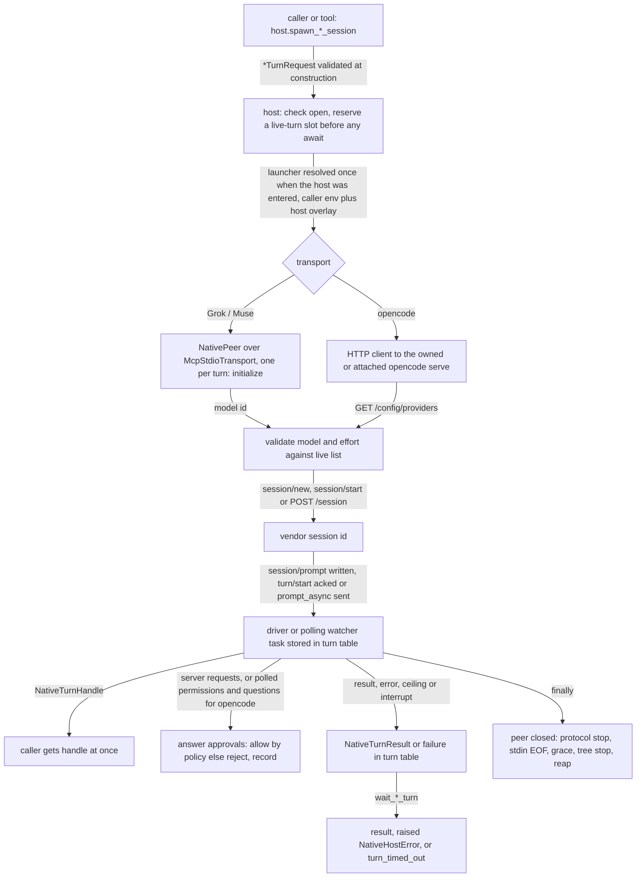
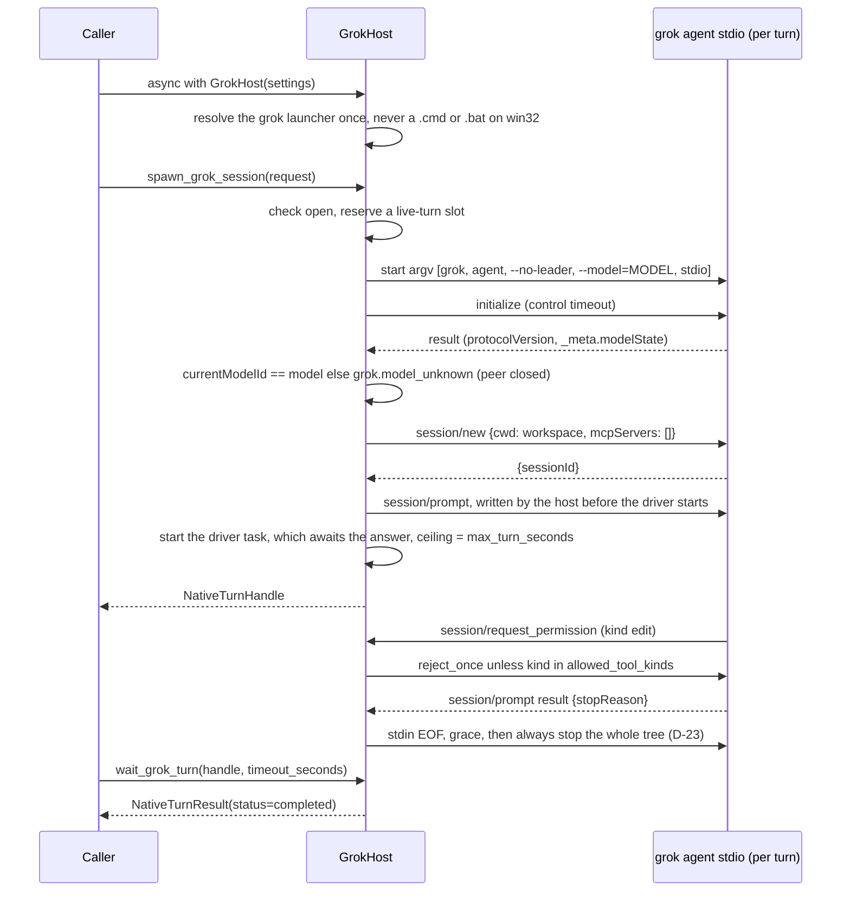

# Spec: Native Grok, opencode and Muse hosts, plus GLM and DeepSeek backend profiles

> **TL;DR** — This PR adds three host classes. `GrokHost` drives Grok Build over ACP and its CLI, `OpencodeHost` drives `opencode serve` over HTTP, and `MuseHost` drives Meta's Muse Code over MSP, through WSL on Windows. Together they provide the catalog's 40 ★ functions. The PR also adds GLM and DeepSeek backend profiles (6 functions) and 43 tools in 4 toolsets.
>
> The decision that matters most: **every function fails in one way only.** It raises a single `NativeHostError` that carries a `<host>.<problem>` `FailureCode` and a next step. Inputs are checked before any process starts or money is spent. Every process is stopped and reaped on every path, including cancellation. Tools turn the same error into an error `ToolResult` and never raise.

## §0 User prompts

### 0.1 Invoking request (verbatim)
great, can you focus on implementing grok, glm, deepseek, meta, and opencode harnesses for now. Make sure to extensively handle errors for every single function.

### 0.2 User replies during the run
_None yet. The orchestrator appends any reply the user sends during the run here verbatim, labeled with the revision it produced._

---

## Part A — Framing

## §1 Goal

Today the SDK cannot drive any of these five targets. `vidbyte/harnesses/native/` does not exist at `base_commit` (code-map §2), so nothing in the SDK can do the following:
- start a Grok, opencode or Muse turn and get a handle back;
- wait for, interrupt or steer a turn;
- list or read sessions;
- point a harness at GLM or DeepSeek.

The nearest reusable piece is the MCP stdio client. It cannot carry ACP or MSP traffic as written:
- it drops every notification (`vidbyte/tools/mcp/transport.py:416-418`);
- it misroutes server requests (`:419-450`);
- it has no per-call timeout (`:222-226`).

The user asked for the five targets and set error handling as the bar: "Make sure to extensively handle errors for every single function." (§0.1).

| ID | Goal (outcome) | How we will know | Source |
|---|---|---|---|
| G-1 | From Python or from a tool, a developer can run a Grok Build, opencode or Muse Code turn. Spawning returns at once with a handle. The developer can then wait for, interrupt or (on Muse) steer the turn, continue or fork its session, list and read sessions, and read token and dollar usage. | The 40 host functions in §8.5 exist with the §4 names and behave per §6 against the fake peers in §13. | request.md §C "Key decisions"; §0.1 |
| G-2 | A developer can point Claude Code (through the env mapping) or opencode (through `OpencodeHost`) at GLM or DeepSeek with one call. A request the backend cannot honour is refused before any money is spent. | The 6 backend functions behave per §6.3.6. `OpencodeHost(settings with backends=(GLM,))` can run model `zai-coding-plan/glm-5.3`. | request.md §C "GLM / DeepSeek routes" |
| G-3 | Every failure of every function reaches the caller in one form: one `<host>.<problem>` code with a next step, raised as `NativeHostError` or returned as an error `ToolResult`. Nothing raw escapes. No process outlives the call or host that started it. No secret leaks. | Every row of the §6.3 error tables can be produced and reports its code and the token its next step requires. INV-1 to INV-10 hold. | §0.1 "extensively handle errors for every single function"; request.md §D |
| G-4 | Agents (`BaseAgent`, Codex dynamic tools, the MCP server) can use these functions as tools with safe defaults. Tools that spend money need WRITE permission granted explicitly. | 43 tools across 4 toolsets. Under the default `PermissionPolicy`, WRITE tools are denied and READ tools run. | request.md §C "Tool permissions" |

## §2 Objective

When this PR merges, the repo gains:
- `vidbyte.harnesses.native` (the byte-exact shared `__init__.py`).
- Three host packages: `vidbyte.harnesses.native.grok` (`GrokHost`, `run_grok_once`), `vidbyte.harnesses.native.opencode` (`OpencodeHost`) and `vidbyte.harnesses.native.muse` (`MuseHost`). They expose exactly the 10, 18 and 12 ★ functions named in request.md §C.
- `vidbyte.harnesses.native.backends`, with six functions over two declared profiles (GLM through Z.ai, and DeepSeek): `list_harness_backends`, `build_claude_backend_env`, `check_backend_ready`, `check_backend_compat`, `get_deepseek_balance` and `build_opencode_backend_provider`.
- One error type, `NativeHostError`, in `vidbyte.lib.errors`, plus 53 new `FailureCode` members and a default next step for each.
- An additive extension of `McpStdioTransport`: a message callback, `notify`, `respond`, a per-call timeout and an exit grace period.
- A canonical process helper package, `vidbyte.lib.process`, with `CliRunner`, `ManagedProcess` and `ProcessStopper`.
- Validated records, enums and constants under `vidbyte/lib/`, including a canonical field validator.
- 43 tools under `vidbyte/tools/builtins/{grok,opencode,muse,harness_backends}/`, sharing one base module.
- 4 toolsets (`GrokTools`, `OpencodeTools`, `MuseTools`, `HarnessBackendTools`), exported from `vidbyte.tools.toolsets`.
- Append-only entries in `REPO_MAP.md` and `vidbyte/harnesses/README.md`.

This PR is the first slice. The non-★ catalog functions, a public `AcpHost` and further backend profiles are later slices (§3).

## §3 Non-goals

- **NG-1** — The catalog's non-★ functions. Examples: `stream_*`, `set_*_model`, `compact_*`, `rename_*`, `run_opencode_once`, `run_muse_once`, `steer_opencode_session`, every `*_mcp_*` function except `add_opencode_mcp_server`, and the pty, worktree and TUI functions. — *Why not:* request.md Q-1 defaults to ★ only. 46 functions plus 43 tools is already a large PR.
- **NG-2** — A public generic `AcpHost` and the `*_acp_*` functions. — *Why not:* Prompt 2 says "for now", and the upstream ledger rejects a base class with one implementation (request.md:121,150). The ACP message handling here names no Grok-specific fields except `_meta` reads in Grok's own `wire.py`.
- **NG-3** — Any import of `vidbyte.harnesses.native.codex` or `vidbyte.harnesses.native.claude`, and any change to `vidbyte/agents/codex/`. — *Why not:* parallel PRs (request.md:163,289).
- **NG-4** — Backend profiles for Kimi, MiniMax, Qwen, the Meta Model API and xAI; ZCode and `dsh` as hosts; a Kilo profile. — *Why not:* outside "grok, glm, deepseek, meta, and opencode … for now" (request.md:156).
- **NG-5** — New dependencies (`agent-client-protocol`, `muse-code-sdk`, `jsonschema`) and any `pyproject.toml` change. — *Why not:* request.md Q-2 default. `pyproject.toml` is reserved for the Claude PR (request.md:202).
- **NG-6** — A readiness check that spends money, such as a one-token test call. — *Why not:* request.md Q-10. A direct call on a GLM Coding Plan key happens outside the tools Z.ai allows.
- **NG-7** — Live smoke tests behind an environment flag. — *Why not:* request.md Q-11 defaults to no, and CI has no vendor credentials (request.md:213).
- **NG-8** — "Approve everything" settings at any level, as a tool argument or a Python field. That covers Grok `--always-approve`, `_meta.yoloMode` and `bypassPermissions`; Grok's `auto` permission mode; opencode `--dangerously-skip-permissions` and an allow-all rule; Muse `--yolo` and approval mode `allowAll`. Also excluded: caller-chosen Muse approval modes and policies. — *Why not:* request.md:142-147 and Q-12. Grok `auto` approves on the vendor's judgement, which this PR cannot bound. Muse runs with the fixed mode `denyUnmatched` (D-11).
- **NG-9** — A per-request working directory. — *Why not:* one host serves one workspace (D-1). A model-facing tool must never redirect a harness to another directory (§10 T-2).
- **NG-10** — Two Grok lookup routes:
  - Resuming a Grok session by title. Titles are not unique, and `--resume <title>` fails as ambiguous (grok help, research file :110-111).
  - Searching Grok summaries and first prompts. `grok sessions search` goes to a remote service and prints plain text (live probe 2026-10-12).

  — *Why not:* both are follow-ups. `search_grok_sessions` matches ACP session titles only (§6.3.3).
- **NG-11** — Three exposure routes:
  - Exporting host tools from `vidbyte.tools.builtins` (YAML declaration).
  - Adding host names to the root `vidbyte/__init__.py` or `contracts/sdk-public-api.json`.
  - Changing `vidbyte/mcp_server/`, including MCP permission enforcement.

  — *Why not:* D-15 and D-21.
- **NG-12** — These opencode features:
  - file, agent and subtask prompt parts;
  - the per-turn `tools` on/off map;
  - `variant`, `parentID` and the structured-output `format`;
  - the v2 staged-revert routes;
  - SSE event streaming.

  — *Why not:* none is a ★ function, and each adds wire surface that would need its own error rows.
- **NG-13** — These Grok one-shot flags and bridges: `--json-schema`, `--prompt-file`, `--prompt-json`, `--agents`, `--rules`, `--system-prompt-override`, `--sandbox`, `--tools` and `--disallowed-tools`, plus the ACP fs, terminal and elicitation bridges. — *Why not:* none is ★. The host advertises no fs or terminal capability (request.md Q-4 default).
- **NG-14** — Muse 1.4-only methods (`usage/read`, `session/rename`, `setReasoningEffort` and the rest). — *Why not:* request.md Q-9 uses version floor 1.0.1. Muse cost is therefore always `None`.
- **NG-15** — ~~Killing a process tree for long-lived ACP and MSP peers.~~ *Withdrawn in r2 (review R-4).* request.md Q-8's default asks for a tree kill and then a kill inside the distro, so both are built (D-23, EC-10).
- **NG-16** — Rewriting stale `REPO_MAP.md` text, such as the toolsets entry that says "one such bundle". — *Why not:* indexes are append-only (request.md:200).
- **NG-17** — A failure-classification table for the new codes. — *Why not:* only `codex.*` codes are required to have one (`tests/test_codex_failure_recovery.py:192-202`; code-map §4.4).

## §4 Developer usage

```python
import asyncio
from pathlib import Path

from vidbyte.harnesses.native.grok import GrokHost
from vidbyte.lib.dataclasses.grok import GrokHostSettings, GrokTurnRequest
from vidbyte.lib.errors import NativeHostError


async def main() -> None:
    settings = GrokHostSettings(workspace=Path.cwd())
    try:
        async with GrokHost(settings) as host:
            # Returns as soon as Grok has the prompt; the turn keeps running.
            handle = await host.spawn_grok_session(GrokTurnRequest(prompt="List the top-level folders."))
            result = await host.wait_grok_turn(handle, timeout_seconds=600)
            print(result.status.value, result.text)
    except NativeHostError as error:
        print(error.failure_code.value, "->", error.next_step)


asyncio.run(main())
```

The developer gets the turn's text and status, or one line naming the problem and what to do next. For example, with no Grok installed the line reads `grok.not_installed -> Install Grok Build 1.0.13 or newer, or set GrokHostSettings.grok_command.`

On Windows, Grok must start as a program, not a batch file. The host uses `grok.exe`, found on `PATH` or at the installer's `~/.grok/bin/grok.exe`, or the program named in `grok_command`. It refuses a `.cmd` or `.bat` launcher with `grok.not_installed`, because `cmd.exe` would run parts of a prompt as commands (EC-157).

The developer no longer has to:
- launch, reap or kill `grok`;
- answer its permission prompts;
- parse ACP;
- catch vendor, `OSError` or timeout exceptions.

`OpencodeHost` and `MuseHost` have the same shape. The backend functions are plain module functions: `from vidbyte.harnesses.native.backends import build_claude_backend_env`.

## §5 Flow diagram





The two diagrams walk through these steps:
1. **Validation** runs in two places, before any process starts or any money is spent. Request records validate themselves when constructed (INV-5). Each host then checks the model and the live-turn cap.
2. **State changes** only in the host's turn table. A turn moves from `RUNNING` to `COMPLETED`, `INTERRUPTED` or `FAILED` exactly once.
3. **Failures** are caught at two boundaries:
   - each host method's single `try`, which turns any exception into a `NativeHostError` and re-raises `CancelledError` after reaping;
   - the turn driver's `finally`, which records the outcome and always closes the peer.

   `wait_*_turn` reads the recorded outcome, and tools convert `NativeHostError` into an error `ToolResult`.

---

## Part B — Behavior (this is the spec; everything else is framing)

## §6 Behavior

### 6.1 Invariants

**Error contract (from "extensively handle errors for every single function")**
- **INV-1** — A public host method, a backend function, the module-level `run_grok_once`, and each host's `__aenter__` and `__aexit__` may raise only these:
  - `NativeHostError`;
  - `ConfigurationError`, and only while a request or settings record is being constructed, never from inside a host method;
  - `asyncio.CancelledError`.

  No other exception escapes, including `OSError`, `TimeoutError`, `KeyError`, `json.JSONDecodeError`, `httpx.*`, `ProviderRequestError` and `McpProtocolError`. A failure with no specific row becomes `NativeHostError(FailureCode.RUNTIME_ERROR)` naming only the exception class (EC-4).
- **INV-2** — `asyncio.CancelledError` is never swallowed. Every `except CancelledError`, `except BaseException` or bare `except` in new code re-raises (S019). Before re-raising, the cancelled call stops and reaps every process it started that does not belong to a live turn (INV-4).
- **INV-3** — Every I/O operation has a deadline:
  - a JSON-RPC control request uses `control_timeout_seconds`;
  - a turn's prompt request uses `max_turn_seconds`;
  - `notify` and `respond` use `control_timeout_seconds`;
  - an HTTP call uses `request_timeout_seconds`, or `BACKEND_HTTP_TIMEOUT_SECONDS` for backends;
  - a CLI run uses its invocation's `timeout_seconds`;
  - server startup uses `startup_timeout_seconds`;
  - a peer stop uses `NATIVE_STOP_GRACE_SECONDS` after stdin EOF and `NATIVE_KILL_WAIT_SECONDS` for each wait after a signal; a CLI run or the owned server uses `NATIVE_KILL_WAIT_SECONDS` for each wait of its tree stop; the in-distro reap uses `MUSE_REAP_TIMEOUT_SECONDS` (NFR-2 sums these);
  - `wait_*_turn` uses its `timeout_seconds`.

  Every poll loop compares against a deadline taken from the clock (S064).
- **INV-4** — Every process a host starts is reaped on every path: success, raised error, timeout, cancellation, turn end and host exit. That covers a turn peer, a short-lived control peer, a CLI run, and the owned `opencode serve`. Reaped means the process's exit status was collected.
  - A turn peer is closed when its turn ends.
  - A short-lived peer is closed before the method that started it returns or raises.
  - A Grok or Muse peer stops in this order (D-23): the protocol interrupt when a turn is live, stdin EOF, up to `NATIVE_STOP_GRACE_SECONDS` for the peer to exit by itself, then a stop of the peer's whole process tree, which on POSIX runs even when the peer itself has already exited, with every wait bounded by `NATIVE_KILL_WAIT_SECONDS`. After a Muse turn peer launched through WSL closes, the host also kills, inside the distro, every process carrying that peer's mark, and their descendants.
  - `__aexit__` interrupts every live turn, waits at most `NATIVE_STOP_GRACE_SECONDS`, then closes every peer concurrently, or stops the owned server. It does this even when `__aexit__` runs because of cancellation. NFR-2 states the time bound.
- **INV-5** — Inputs are checked before any process starts or any request that can spend money:
  - Records check fields, types, ranges and closed sets in `__post_init__`.
  - Host methods check primitive arguments first.
  - The model and reasoning effort are checked against the vendor's live list before any of `session/new`, `session/start`, `POST /session` or `prompt_async`.
  - Session existence and busy state are checked before any prompt is sent.

  A failed check makes zero vendor calls that can start a turn.
- **INV-6** — No secret appears in argv, an error message, `NativeHostError.context`, `ToolResult` output or metadata, a `repr`, or a log record. That covers API keys, the opencode server password, MCP env values and MCP headers.
  - Secrets travel only through child environment variables.
  - Any vendor text a host surfaces has been through `HarnessRedactor.safe_error_message` and is capped at `NATIVE_VENDOR_MESSAGE_MAX_CHARS` characters.
  - Every exact occurrence of a secret value the host itself injected is replaced with `<redacted>`.
  - opencode `Provider.key` and `Provider.options` are never copied into a result.
  - New modules add no logging calls.
- **INV-7** — A tool's `execute` never raises anything except `asyncio.CancelledError`. Every failure becomes `ToolResult.error(tool_name, output, metadata=...)`. The metadata holds `error` (the code value), `next_step`, `hint` (the same text as `next_step`, because `ToolsFormatter` forwards `hint`, `retryable` and `detail` as structured fields), `operation` and `harness`, plus `retryable` (a bool) when the vendor reported one (`context["retryable"]`). The output is `"<code>: <message> Next step: <next_step>"`.
- **INV-8** — Every `NativeHostError` has a non-empty `next_step`. Its `failure_code` is one of the 53 codes in §6.3.1, `configuration.invalid_argument` or `runtime.error`. `NATIVE_HOST_NEXT_STEPS` holds a default next step for each of the 53 codes and for both existing ones. Every new code value starts with `grok.`, `opencode.`, `muse.` or `backend.`.

**Safety and liveness**
- **INV-9** — No approve-everything setting is ever sent to a vendor, in argv, a wire field or a config. That covers:
  - `--always-approve`, `_meta.yoloMode`, `bypassPermissions` and `auto`;
  - `--dangerously-skip-permissions`, and the opencode rule with permission `*`, pattern `*` and action `allow`;
  - `--yolo` and `allowAll`.
- **INV-10** — No live turn waits on an approval nobody will answer. The host answers every vendor request inside the turn within `control_timeout_seconds` of receiving it:
  - ACP `session/request_permission`;
  - opencode permission and question requests for the turn's session and its descendant sessions (EC-154);
  - MSP `approval/requested`, an `approval/updated` that names a requirement not yet decided (each requirement is decided at most once, D-11), and `userInput/requested`;
  - any other server request, which gets JSON-RPC error -32601.

  The host never chooses an "always" or "session" scope. It records every answer in the turn result, keeping at most `NATIVE_MAX_RECORDED_DECISIONS` and counting any overflow.
- **INV-11** — `spawn_*_session` and `continue_*_session` return a `NativeTurnHandle` once the vendor has the prompt, without waiting for the turn to finish. "Has the prompt" means:
  - **Grok:** the `session/prompt` frame is written and drained;
  - **opencode:** `prompt_async` returned 204;
  - **Muse:** `turn/start` returned `accepted`.
- **INV-12** — `wait_*_turn` never changes the turn. A timeout raises `<host>.turn_timed_out` and the turn keeps running. Cancelling the wait leaves the turn running. A later wait on the same handle returns the outcome.
- **INV-13** — Each turn reaches exactly one terminal state, `COMPLETED`, `INTERRUPTED` or `FAILED`, recorded once. `interrupt_*_turn` on a finished turn returns `was_running=False` and raises nothing. A turn the host fails on its own is also stopped at the vendor, so it does not keep running after it is reported failed. Grok and Muse do this by closing the turn's peer (INV-4). opencode sends one abort first (EC-158).
- **INV-14** — A host runs at most one live turn per session. A second spawn, continue or fork against a session with a live turn raises `<host>.session_busy` before anything is sent. Grok and Muse session ids are UUIDs, so every comparison of them ignores letter case, in this busy check and in the fork id checks (EC-32, EC-35, EC-36, EC-39). An id and its upper-cased form name the same session. This matches `require_uuid`, which accepts either case (r8, review R-8). opencode session ids (`OPENCODE_SESSION_ID_PATTERN`) are case-sensitive vendor ids and are compared exactly.
- **INV-15** — Unknown usage is `None`, never `0`. A field is set only when the vendor reported it. `total_tokens` is never computed from other fields; it is set only when the vendor reports a total. A sum over several vendor reports, such as an opencode turn's replies (D-14), sets a field when at least one report has it.
- **INV-16** — Memory stays bounded:
  - result text is capped at `NATIVE_RESULT_TEXT_MAX_CHARS` (with `text_truncated`);
  - recorded decisions are capped;
  - the finished-turn table keeps the last `NATIVE_FINISHED_TURN_LIMIT` turns (first in, first out);
  - live turns are capped at `max_live_turns`;
  - list and page limits are at most `NATIVE_LIST_MAX_LIMIT`;
  - HTTP bodies are capped at `OPENCODE_MAX_RESPONSE_BYTES` or `BACKEND_MAX_RESPONSE_BYTES`;
  - CLI output is capped at `GROK_CLI_MAX_OUTPUT_BYTES`;
  - tool output is clipped at `NATIVE_TOOL_OUTPUT_MAX_BYTES` UTF-8 bytes.
- **INV-17** — Handles are host-scoped. A handle whose `harness` does not match the host, or whose `turn_id` was never issued by this host or has since been evicted, raises `<host>.turn_not_found`.

**Must not regress:**
- **INV-18** — `McpStdioTransport` behaves exactly as at `base_commit` when the new options are left at their defaults (`on_message=None`, `exit_grace_seconds=None`, `stop_process_tree=False`, and `request(...)` without `timeout_seconds`). The one exception is the dispatch fix: a frame with a `method` member is never used to resolve a pending request. The read-only `returncode` property (r6) is new and changes no existing behavior, so it is not an exception. Every existing test in `tests/test_mcp_stdio_transport.py` and `tests/test_mcp_studio_server.py` passes unchanged. *Today:* `vidbyte/tools/mcp/transport.py:112-473`.
- **INV-19** — `vidbyte/harnesses/native/__init__.py` matches the bytes at request.md:175-186 exactly. The committed blob's SHA-256 is `0374a2c899318e4fdb31c065d951266feaffff5aa736ecde616c4a66942f497a`.
- **INV-20** — Existing `FailureCode` members and their order are unchanged. Every value contains `.` (`tests/test_session_failures.py:139`). No `codex.*` code is added, so `tests/test_codex_failure_recovery.py:192-202` is unaffected.
- **INV-21** — `import vidbyte` imports no vendor SDK and starts no process. It imports the new toolsets and, through them, the host modules: plain Python built only on `vidbyte.lib`, `vidbyte.tools` and `vidbyte.harnesses.serialization`. *Today:* `vidbyte/__init__.py:611`.
- **INV-22** — `vidbyte/__init__.py`, `contracts/sdk-public-api.json`, `vidbyte/tools/builtins/__init__.py`, `pyproject.toml`, `lint/` and `vidbyte/mcp_server/` are byte-identical to `base_commit`.
- **INV-23** — The full local gate `python scripts/run_ci.py` passes, and no count in `lint/baseline.json` rises.

### 6.2 Acceptance criteria

| ID | Given | When | Then | Priority | Proof |
|---|---|---|---|---|---|
| AC-1 | a clean checkout of this branch | the §4 snippet runs | it produces exactly the shown result. With the Grok launcher resolving to a fake ACP peer (§13) that completes the turn with text `T`, it prints `completed T`. The launcher that reaches the fake is never a batch file (EC-157). On POSIX it is `grok` on PATH, an executable script. On win32, for this outcome only, the snippet's settings line also passes `grok_command` set to the §13 seam: `sys.executable`, `"-u"`, the fake peer script and any arguments the fake itself needs. Nothing else in the snippet changes. With no `grok` on PATH and none at `~/.grok/bin`, it prints `grok.not_installed -> Install Grok Build 1.0.13 or newer, or set GrokHostSettings.grok_command.` | P0 | `grok_host/test_grok_host_acceptance.py::test_snippet_prints_completed_text_when_grok_is_the_fake`; `grok_host/test_grok_host_acceptance.py::test_snippet_prints_not_installed_line_when_no_grok_exists` |
| AC-2 | any row of the §6.3 error tables, with its trigger reproduced through the §13 fakes | the row's function is called | it raises `NativeHostError` whose `failure_code` equals the row's code, whose `next_step` contains the row's required token, and whose message and context contain no secret. The matching tool returns `ToolResult.error` with `metadata["error"] == code` and does not raise. | P0 | `grok_host/test_grok_host_errors.py::test_grok_error_row`; `opencode_host/test_opencode_host_errors.py::test_opencode_error_row`; `opencode_host/test_opencode_host_errors.py::test_aenter_error_row`; `muse_host/test_muse_host_errors.py::test_muse_error_row`; `native_backends/test_native_backends_errors.py::test_backend_error_row` (each row in host mode and tool mode) |
| AC-3 | a fake peer or server that accepts the connection but never answers | any host function that talks to it is called | it raises `<host>.server_unreachable` within its configured timeout plus the NFR-2 stop bound for what it started (9 s for a peer with the defaults). Every process it started has exited and been reaped. | P0 | `grok_host/test_grok_host_process_bounds.py::test_unresponsive_peer_raises_server_unreachable_within_the_bound`; `grok_host/test_grok_host_process_bounds.py::test_unresponsive_peer_bound_holds_with_default_timings`; `grok_host/test_grok_host_process_bounds.py::test_unresponsive_peer_is_reaped_before_the_error_is_raised`; `opencode_host/test_opencode_host_acceptance.py::test_unresponsive_server_raises_server_unreachable_within_the_timeout`; `opencode_host/test_opencode_host_acceptance.py::test_unresponsive_server_fails_aenter_within_the_timeout`; `muse_host/test_muse_host_process_bounds.py::test_unresponsive_peer_raises_server_unreachable_within_the_bound`; `muse_host/test_muse_host_process_bounds.py::test_unresponsive_peer_bound_holds_with_default_timings` |
| AC-4 | a fake peer that holds a turn open | the calling task is cancelled during `spawn_*`, `continue_*`, `check_*`, a list function or `wait_*` | `CancelledError` propagates. For every call except `wait_*`, all processes it started have exited. For `wait_*`, the turn is still running and a later `wait_*` returns its result. | P0 | `grok_host/test_grok_host_process_bounds.py::test_cancelling_a_call_propagates_and_stops_what_it_started`; `grok_host/test_grok_host_process_bounds.py::test_cancelling_a_wait_leaves_the_turn_running`; `opencode_host/test_opencode_host_acceptance.py::test_cancelling_a_call_propagates_and_releases_its_reservation`; `opencode_host/test_opencode_host_acceptance.py::test_cancelling_a_wait_leaves_the_turn_running`; `opencode_host/test_opencode_host_owned_server.py::test_cancelling_aenter_stops_the_server_it_started`; `muse_host/test_muse_host_process_bounds.py::test_cancelling_a_call_propagates_and_stops_what_it_started`; `muse_host/test_muse_host_process_bounds.py::test_cancelling_a_wait_leaves_the_turn_running`; `native_backends/test_native_backends_balance.py::test_cancelling_a_balance_call_propagates` |
| AC-5 | a fake peer whose error message contains the exact value of a secret the host injected (API key, server password, MCP env value) | the error is raised and turned into a tool result | the value appears nowhere in the error's message, `next_step` or context, or in the tool's output or metadata, and `<redacted>` stands where the vendor text was copied: in the message or in a context value such as `vendor_error`. Metadata carries no vendor text (§9.2), so it only has to lack the value. No argv the host builds contains the value. | P0 | `opencode_host/test_opencode_host_security.py::test_attached_server_password_in_a_vendor_error_is_redacted`; `opencode_host/test_opencode_host_security.py::test_owned_server_password_in_a_vendor_error_is_redacted`; `opencode_host/test_opencode_host_security.py::test_backend_key_in_a_vendor_error_is_redacted`; `opencode_host/test_opencode_host_security.py::test_mcp_environment_value_in_a_failed_status_is_redacted`; `opencode_host/test_opencode_host_security.py::test_mcp_header_value_in_a_vendor_error_is_redacted`; `native_backends/test_native_backends_security.py::test_error_body_echoing_the_key_is_redacted_in_the_error`; `native_backends/test_native_backends_security.py::test_error_body_echoing_the_key_is_redacted_in_the_tool_result` |
| AC-6 | a fake peer that keeps a turn open until told to finish | `spawn_*_session` is called | it returns a handle while the turn is still `RUNNING`. `wait_*_turn` returns once the peer finishes. | P0 | `grok_host/test_grok_host_acceptance.py::test_spawn_returns_a_handle_while_the_turn_is_still_running`; `opencode_host/test_opencode_host_acceptance.py::test_spawn_returns_a_handle_while_the_turn_is_still_running`; `muse_host/test_muse_host_acceptance.py::test_spawn_returns_a_handle_while_the_turn_is_still_running` |
| AC-7 | a requested model missing from the vendor's live list | `spawn_*_session` or `continue_*_session` is called | it raises `<host>.model_unknown`, whose `context["available_models"]` lists the available ids. The fake received no `session/new`, `session/prompt`, `POST /session`, `prompt_async`, `session/start` or `turn/start`. | P0 | `grok_host/test_grok_host_errors.py::test_grok_error_row` (EC-25, EC-37); `grok_host/test_grok_host_errors.py::test_model_unknown_context_names_the_models_grok_offers`; `opencode_host/test_opencode_host_acceptance.py::test_unknown_model_is_refused_before_any_turn_starts`; `muse_host/test_muse_host_errors.py::test_muse_error_row` (EC-108); `muse_host/test_muse_host_errors.py::test_model_unknown_context_names_the_models_muse_offers` |
| AC-8 | a fake ACP peer that sends `session/request_permission` with tool kind `edit` | the turn runs with `allowed_tool_kinds` empty, and then with `{EDIT}` | the host selects the `reject_once` option, and then the `allow_once` option. It never selects an `*_always` option. `result.decisions` records both, with kind and outcome. | P0 | `grok_host/test_grok_host_turns.py::test_edit_permission_is_rejected_then_allowed_by_policy`; `grok_host/test_grok_host_turns.py::test_permission_without_a_reject_option_is_answered_cancelled` |
| AC-9 | `OpencodeHost` started without `server_url` | the host enters and exits | `opencode serve` was started with `--hostname 127.0.0.1 --port 0`, `OPENCODE_SERVER_USERNAME` and a fresh random `OPENCODE_SERVER_PASSWORD` in its environment only, and is stopped and reaped on exit. Provider results contain no `key` or `options`. | P0 | `opencode_host/test_opencode_host_owned_server.py::test_owned_server_starts_on_loopback_with_a_fresh_password_in_its_environment_only`; `opencode_host/test_opencode_host_owned_server.py::test_each_owned_server_gets_its_own_password`; `opencode_host/test_opencode_host_owned_server.py::test_owned_server_and_its_tree_are_stopped_on_exit_within_the_bound`; `opencode_host/test_opencode_host_owned_server.py::test_owned_server_exit_returns_within_the_bound`; `opencode_host/test_opencode_host_security.py::test_provider_key_and_options_never_reach_a_result` |
| AC-10 | `MuseHostSettings(workspace=W, wsl_distro="MuseUbuntu1")` on win32, where `W` is an existing directory such as `C:\w\repo` (§9.1 requires the workspace to exist) | a turn is spawned | the peer argv is `wsl.exe -d MuseUbuntu1 -e /usr/local/bin/muse serve`, where `wsl.exe` is the path `shutil.which("wsl.exe")` returned (D-19), never the `.cmd` shim. `workspaceRoot` on the wire is `MusePathTranslator.to_wsl(W)`: `/mnt/c/w/repo` for `C:\w\repo`. | P0 | `muse_host/test_muse_host_wsl.py::test_to_wsl_maps_a_drive_path_under_mnt`; `muse_host/test_muse_host_wsl.py::test_wsl_turn_peer_launch_workspace_overlay_and_reap` (a fake `wsl.exe` and distro; the real `MuseUbuntu1` is never launched) |
| AC-11 | a running turn | `wait_*_turn(handle, timeout_seconds=t)` passes its deadline, and the turn later finishes | the first call raises `<host>.turn_timed_out` and the second returns the result | P0 | `grok_host/test_grok_host_acceptance.py::test_wait_times_out_then_returns_the_result`; `opencode_host/test_opencode_host_acceptance.py::test_wait_times_out_then_returns_the_result`; `muse_host/test_muse_host_acceptance.py::test_wait_times_out_without_touching_the_turn_and_a_later_wait_returns` |
| AC-12 | a finished turn | `interrupt_*_turn(handle)` is called twice | both calls return `was_running=False` without raising | P1 | `grok_host/test_grok_host_acceptance.py::test_interrupting_a_finished_turn_twice_reports_not_running`; `opencode_host/test_opencode_host_acceptance.py::test_interrupting_a_finished_turn_twice_reports_not_running`; `muse_host/test_muse_host_acceptance.py::test_interrupting_a_finished_turn_twice_reports_not_running` |
| AC-13 | `DEEPSEEK_API_KEY` set, then unset | `build_claude_backend_env(HarnessBackendName.DEEPSEEK)` is called | it first returns a `ClaudeBackendEnv` whose `as_environ()` has exactly the §9.1 keys and whose `repr` omits the key value. It then raises `backend.not_signed_in` with token `DEEPSEEK_API_KEY`. | P0 | `native_backends/test_native_backends_profiles.py::test_deepseek_env_has_exactly_the_spec_keys_and_hides_the_value` |
| AC-14 | the declared profiles | `check_backend_compat` is called with DeepSeek and `{BackendFeature.MCP_SERVERS}`, and then with GLM and harness `GROK` | it raises `backend.feature_unsupported`, and then `backend.harness_not_allowed`. No network call is made. | P0 | `native_backends/test_native_backends_profiles.py::test_compat_refuses_unsupported_features_then_disallowed_harness_without_network` |
| AC-15 | a `ToolExecutor` with the default `PermissionPolicy` | a WRITE tool (for example `spawn_grok_session`) and a READ tool (for example `list_grok_sessions`) are executed | the WRITE tool is denied by the executor and the READ tool runs | P0 | `grok_host/test_grok_host_tools.py::test_default_policy_denies_the_write_tool_and_runs_the_read_tool`; `opencode_host/test_opencode_host_tools.py::test_default_policy_denies_the_write_tool_and_runs_the_read_tool`; `muse_host/test_muse_host_tools.py::test_default_policy_denies_the_write_tool_and_runs_the_read_tool`; `native_backends/test_native_backends_tools.py::test_default_policy_runs_every_backend_tool` |
| AC-16 | the branch head | the existing MCP transport and studio-server tests, `git show HEAD:vidbyte/harnesses/native/__init__.py \| sha256sum`, and `python scripts/run_ci.py` are run | the tests pass unchanged, the hash equals INV-19's, and the gate passes | P0 | `grok_host/test_grok_host_shared_contract.py::test_native_package_init_matches_the_fixed_bytes`; `tests/test_mcp_stdio_transport.py` and `tests/test_mcp_studio_server.py` unedited; `grok_host/test_grok_transport_extension.py` (all); the `python scripts/run_ci.py` gate runs at the implementation and verification stages |
| AC-17 | the new codes | the vocabulary is inspected | `NATIVE_HOST_NEXT_STEPS` has a non-empty entry for every one of the 53 new codes and for both existing ones. Every new value starts with its host prefix. | P0 | `grok_host/test_grok_host_shared_contract.py::test_next_steps_hold_every_code_verbatim`; `grok_host/test_grok_host_shared_contract.py::test_every_new_code_starts_with_its_host_prefix`; `grok_host/test_grok_host_shared_contract.py::test_the_53_new_members_follow_rule_evaluation_failed_in_catalog_order` |
| AC-18 | a fresh interpreter | `import vidbyte` runs | no child process starts and no vendor SDK module (`acp`, `muse_code_sdk`, `opencode_ai`) is in `sys.modules` | P1 | `grok_host/test_grok_host_shared_contract.py::test_import_vidbyte_starts_no_process_and_loads_no_vendor_sdk` |
| AC-19 | the §6.1 invariant INV-9 | each request record, the toolset parameters and each host's argv and wire builders are checked | no field, parameter or argv can carry an approve-everything value. Constructing an opencode rule with permission `*`, pattern `*` and action `ALLOW` raises `ConfigurationError`. | P0 | `grok_host/test_grok_host_tools.py::test_no_grok_tool_offers_an_approve_everything_or_directory_parameter`; `grok_host/test_grok_host_reads.py::test_one_shot_argv_carries_every_value_in_name_value_form`; `grok_host/test_grok_host_turns.py::test_turn_peer_wire_shapes`; `grok_host/test_grok_host_shared_contract.py::test_grok_permission_mode_has_no_approve_everything_member`; `opencode_host/test_opencode_host_records.py::test_the_allow_everything_rule_is_refused`; `opencode_host/test_opencode_host_security.py::test_no_allow_everything_rule_is_ever_sent`; `opencode_host/test_opencode_host_tools.py::test_no_opencode_tool_offers_a_permission_directory_or_mcp_shape_parameter`; `muse_host/test_muse_host_records.py::test_no_request_or_settings_field_can_carry_an_approve_everything_value`; `muse_host/test_muse_host_wire.py::test_no_frame_or_argv_carries_an_approve_everything_value`; `muse_host/test_muse_host_tools.py::test_no_muse_tool_offers_an_approval_launcher_or_directory_parameter` |
| AC-20 | the branch head, with each module below imported first in its own fresh interpreter | `import vidbyte`, `import vidbyte.agents`, `import vidbyte.tools.toolsets`, `import vidbyte.harnesses.native.grok`, `import vidbyte.harnesses.native.opencode`, `import vidbyte.harnesses.native.muse` and `import vidbyte.harnesses.native.backends` each run | every import succeeds, whatever the order in which the package chain `vidbyte.agents` → `vidbyte.tools.toolsets` → `vidbyte.tools.builtins.<host>` → `vidbyte.harnesses` → `vidbyte.sessions` → `vidbyte.agents.types` is entered (D-3) | P0 | `grok_host/test_grok_host_shared_contract.py::test_each_entry_module_imports_first_in_a_fresh_interpreter`; `grok_host/test_grok_host_shared_contract.py::test_all_entry_modules_import_in_reverse_order` |

### 6.3 Edge cases and failure modes

**How to read §6.3.** These tables are the error contract that "extensively handle errors for every single function" asks for.

- **Rows.** Every row names a trigger (input plus state), what the system does, what the user sees and the guard.
- **Codes.** "Raises `X`" means `NativeHostError` with `failure_code` `X`. The one exception is a row marked *record*: that row raises `ConfigurationError` while the request record is constructed, and tools report it as `configuration.invalid_argument`.
- **Next steps.** "User sees" gives the next step. *default* means the code's default text in §6.3.1. The **required token** is a substring the `next_step` must contain, and the test author asserts it.
- **Section structure.** Each function lists its own rows and names the shared and host-wide rows that also apply. The tool for each function is listed in §6.3.7, with its extra rows.

Without these guards a call goes wrong in one of three ways: a raw exception (`FileNotFoundError`, `TimeoutError`, `KeyError`, `httpx.ConnectError`, `McpProtocolError`) escapes, the call hangs, or the turn silently runs against the wrong model or session.

#### 6.3.1 Code catalog (the 53 new `FailureCode` members and the 2 reused ones)

Member names are the upper-case form of the value with `.` replaced by `_`, for example `GROK_NOT_INSTALLED = "grok.not_installed"`. `NATIVE_HOST_NEXT_STEPS` maps each value to the default next step below, verbatim, with two exceptions: markdown backticks are not part of the text, and the parenthesized notes to the implementer that end the `grok.turn_timed_out` and `backend.not_signed_in` cells are left out.

| Code | Meaning | Default next step (verbatim) | Required token |
|---|---|---|---|
| `grok.not_installed` | No runnable Grok Build executable; on Windows a batch launcher does not count (EC-157) | Install Grok Build 1.0.13 or newer, or set GrokHostSettings.grok_command. | `GrokHostSettings.grok_command` |
| `grok.version_unsupported` | Grok Build is older than 1.0.13 | Update Grok Build to 1.0.13 or newer with `grok update`. | `grok update` |
| `grok.not_signed_in` | Grok has no valid login | Run `grok login` in a terminal, then retry. | `grok login` |
| `grok.model_unknown` | The requested model is not offered | Pick a model id returned by list_grok_models. | `list_grok_models` |
| `grok.capability_missing` | Grok lacks an ACP capability or the model lacks an option the call needs | Update Grok Build with `grok update`, or pick an option that list_grok_models shows for this model. | `list_grok_models` |
| `grok.session_not_found` | The session id is unknown in this host's workspace | Use list_grok_sessions to find a session id in this host's workspace. | `list_grok_sessions` |
| `grok.session_busy` | The session already has a live turn here, or the host is at its live-turn limit | Wait for or interrupt the live turn with wait_grok_turn or interrupt_grok_turn, then retry. | `interrupt_grok_turn` |
| `grok.api_error` | Grok reported an error this SDK does not classify further | Retry later; if it repeats, report error.context['vendor_code'] to xAI support. | `vendor_code` |
| `grok.process_exited` | A Grok process stopped before answering, or the host is not open | Run check_grok_ready; if the host was closed, open a new GrokHost. | `check_grok_ready` |
| `grok.protocol_mismatch` | Grok's output lacks what this SDK relies on | Run check_grok_ready and use a Grok Build release this SDK supports (1.0.13 or newer). | `check_grok_ready` |
| `grok.server_unreachable` | The Grok agent process did not answer within the control timeout | Retry, or raise GrokHostSettings.control_timeout_seconds if the machine is slow. | `control_timeout_seconds` |
| `grok.turn_timed_out` | A wait or a one-shot run passed its deadline | The turn is still running: call wait_grok_turn again or interrupt_grok_turn. (One-shot rows override this.) | `wait_grok_turn` |
| `grok.turn_not_found` | The handle names no turn this host knows | Use a handle returned by this host's spawn_grok_session or continue_grok_session; finished turns are kept for the last 64 turns only. | `spawn_grok_session` |
| `opencode.not_installed` | No runnable opencode executable | Install opencode 1.18.31 or newer, or set OpencodeHostSettings.opencode_command. | `opencode_command` |
| `opencode.version_unsupported` | The server is older than 1.18.31 | Upgrade opencode to 1.18.31 or newer with `opencode upgrade`. | `opencode upgrade` |
| `opencode.not_signed_in` | No connected provider, a provider auth failure, or server credentials rejected | Connect a provider with `opencode auth login`, or check server_username and server_password for an attached server. | `opencode auth login` |
| `opencode.model_unknown` | The provider or model is not configured on the server | Pick a provider/model id returned by list_opencode_models. | `list_opencode_models` |
| `opencode.session_not_found` | The session id is unknown on this server | Use list_opencode_sessions to find a session id on this server. | `list_opencode_sessions` |
| `opencode.message_not_found` | The message id is unknown in an existing session | Use get_opencode_session_messages to find a message id in this session. | `get_opencode_session_messages` |
| `opencode.session_busy` | The session is running a turn, or the host is at its live-turn limit | Wait for or interrupt the running turn with wait_opencode_turn or interrupt_opencode_turn, then retry. | `interrupt_opencode_turn` |
| `opencode.usage_limited` | The model provider rate-limited or capped the account | The provider rate-limited or capped this account; wait for the limit to reset, then retry. | `reset` |
| `opencode.billing_error` | The model provider refused for billing | Add credit or fix billing with the model provider, then retry. | `billing` |
| `opencode.api_error` | opencode or its provider reported an error this SDK does not classify further | Retry later; if it repeats, inspect error.context['vendor_error']. | `vendor_error` |
| `opencode.mcp_server_failed` | opencode could not connect the MCP server | Fix the MCP server command or URL and add it again; servers that need OAuth are not supported here. | `OAuth` |
| `opencode.process_exited` | The owned server stopped, or the host is not open | The opencode server stopped; open a new OpencodeHost. | `OpencodeHost` |
| `opencode.protocol_mismatch` | A response lacks what this SDK relies on | Run check_opencode_ready and use opencode 1.18.31 or newer. | `check_opencode_ready` |
| `opencode.server_unreachable` | The server did not start or did not answer in time | Check that the opencode server is running, or raise OpencodeHostSettings.request_timeout_seconds. | `request_timeout_seconds` |
| `opencode.turn_timed_out` | A wait passed its deadline | The turn is still running: call wait_opencode_turn again or interrupt_opencode_turn. | `wait_opencode_turn` |
| `opencode.turn_not_found` | The handle names no turn this host knows | Use a handle returned by this host's spawn_opencode_session or continue_opencode_session; finished turns are kept for the last 64 turns only. | `spawn_opencode_session` |
| `muse.not_installed` | No runnable `muse` in the distro or on PATH | Install Muse Code 1.0.1 or newer in the distro, or set MuseHostSettings.muse_path. | `muse_path` |
| `muse.wsl_unavailable` | WSL or the named distro is missing | Install WSL and the Muse distro, then set MuseHostSettings.wsl_distro to a name from `wsl.exe -l -q`. | `wsl_distro` |
| `muse.version_unsupported` | Muse is older than 1.0.1 | Upgrade Muse Code to 1.0.1 or newer. | `1.0.1` |
| `muse.model_unknown` | The requested model is not offered | Pick a model id returned by list_muse_models. | `list_muse_models` |
| `muse.capability_missing` | This Muse release lacks a method or capability | This Muse Code release lacks the method; upgrade Muse Code. | `upgrade` |
| `muse.session_not_found` | The session id is unknown | Use list_muse_sessions to find a session id in this workspace. | `list_muse_sessions` |
| `muse.session_busy` | The session is running a turn, or the host is at its live-turn limit | Wait for or interrupt the running turn with wait_muse_turn or interrupt_muse_turn, then retry. | `interrupt_muse_turn` |
| `muse.budget_exhausted` | The turn hit Muse's step limit | The turn hit Muse's step limit; continue the session with continue_muse_session and a narrower prompt. | `continue_muse_session` |
| `muse.sandbox_not_ready` | Muse's OS sandbox failed | Run `muse sandbox` inside the distro to check the OS sandbox, then retry. | `muse sandbox` |
| `muse.api_error` | Muse reported an error this SDK does not classify further | Retry later; if it repeats, inspect error.context['vendor_error']. | `vendor_error` |
| `muse.process_exited` | The Muse process stopped before answering, or the host is not open | Run check_muse_ready; if the host was closed, open a new MuseHost. | `check_muse_ready` |
| `muse.protocol_mismatch` | Muse's output lacks what this SDK relies on | Run check_muse_ready and use Muse Code 1.0.1 or newer. | `check_muse_ready` |
| `muse.server_unreachable` | `muse serve` did not answer within the control timeout | Retry, or raise MuseHostSettings.control_timeout_seconds; WSL start-up can be slow. | `control_timeout_seconds` |
| `muse.turn_timed_out` | A wait passed its deadline | The turn is still running: call wait_muse_turn again or interrupt_muse_turn. | `wait_muse_turn` |
| `muse.turn_not_found` | The handle names no turn this host can act on | Use a handle returned by this host's spawn_muse_session or continue_muse_session; finished turns are kept for the last 64 turns only. | `spawn_muse_session` |
| `backend.not_signed_in` | The backend's key variable is missing, or the endpoint rejected the key | Set the backend's API key environment variable (GLM_API_KEY or DEEPSEEK_API_KEY) to a valid key. (Rows put the backend's own variable first.) | the backend's `auth_env_var` |
| `backend.model_unknown` | The model is not declared for this backend | Pick a model listed in HarnessBackend.claude_models from list_harness_backends. | `list_harness_backends` |
| `backend.feature_unsupported` | The request uses features the endpoint silently ignores | Remove the listed features from the request or pick another backend; this endpoint silently ignores them. | `features` |
| `backend.harness_not_allowed` | The backend's terms do not allow this harness | Use this backend only with a harness in HarnessBackend.allowed_harnesses. | `allowed_harnesses` |
| `backend.billing_error` | The account has no usable balance | Top up the DeepSeek account balance, then retry. | `balance` |
| `backend.usage_limited` | The endpoint rate-limited the call | Wait for the provider's rate limit to reset, then retry. | `reset` |
| `backend.api_error` | The endpoint reported an error this SDK does not classify further | Retry later; if it repeats, inspect error.context['vendor_error']. | `vendor_error` |
| `backend.server_unreachable` | The endpoint could not be reached in time | Check network access to the backend endpoint, then retry. | `network` |
| `backend.protocol_mismatch` | The endpoint's response lacks what this SDK relies on | The endpoint returned an unexpected response; check the backend's API status. | `API status` |
| `configuration.invalid_argument` (existing) | An argument failed validation before any I/O | Fix the argument named in the message and call again. | the argument's name |
| `runtime.error` (existing) | A defect: an exception no row covers | This is a defect in the SDK host; report it with error.context['error_type']. | `error_type` |

**Why the vocabulary grew.** request.md:396 allows a new problem only "when no listed one fits", and requires a reason. This PR adds two problems:
- **`turn_not_found` (all three hosts).** None of the shared names fits a handle that this host never issued, or has since dropped from its table. `session_not_found` is wrong here: it would send the caller to list sessions, when the session may still exist.
- **`opencode.message_not_found`.** Fork, revert, get-message and diff all take a message id. `session_not_found` would point the caller at the wrong id.

This PR also reuses an existing name in a new place, without adding a problem: **`server_unreachable` covers an unresponsive Grok or Muse peer.** Both peers are servers (`grok agent stdio`, `muse serve`), and the caller's response is the same as for opencode: retry, or allow more time.

The upstream vocabulary also has `auth_mode_unsupported`, `checkpointing_disabled`, `permission_denied` and `schema_violation`. This PR **does not use them**, because no in-scope function can detect those conditions:
- Permission denials are recorded in results (INV-10).
- No in-scope function sends a schema (NG-12, NG-13).

Nor are these codes added: Grok `usage_limited` and `billing_error`, and Muse `not_signed_in`. Neither ACP 1 nor MSP 1.0.1 carries a structured signal for them (A-1, A-10). They surface as `grok.api_error` or `muse.api_error`, with the vendor's code in the error's context.

#### 6.3.2 Shared rows (every host function)

| ID | Trigger (input + state) | System behavior | User sees | Guarded by |
|---|---|---|---|---|
| EC-1 | A primitive argument to a host method fails its check. Examples: a session id that does not match the vendor format (Grok and Muse use UUIDs; opencode uses `OPENCODE_SESSION_ID_PATTERN`, `OPENCODE_MESSAGE_ID_PATTERN` or `OPENCODE_PART_ID_PATTERN`); `timeout_seconds` that is a bool, NaN, ±inf, ≤ 0 or > `NATIVE_WAIT_MAX_SECONDS`; `limit` outside 1..`NATIVE_LIST_MAX_LIMIT`; text that is empty or over its cap; a cursor that is empty or over 512 characters; a value of the wrong type, such as a `str` where a `NativeTurnHandle` is required. | Raises `configuration.invalid_argument` before any I/O. The message names the argument and its type. It includes the value only when the value is not secret and is at most 80 characters. | *default*; token = the argument's name | INV-5, D-8 |
| EC-2 | A method is called on a host that was never entered, has already exited, or whose `__aenter__` failed. A failed `__aenter__` first stops and reaps whatever it started, and the host stays closed, so a second `__aenter__` raises EC-3. | Raises `<host>.process_exited` without starting anything. | "Open the host with `async with` and call it inside the block."; token `async with` | INV-1 |
| EC-3 | `__aenter__` is called on a host that is already open or was closed. A host is used once. | Raises `configuration.invalid_argument`. | "Create a new host object for each `async with` block."; token `new host` | INV-1 |
| EC-4 | The calling task is cancelled while a method is waiting. | The call stops and reaps every process it started that does not belong to a live turn. If `spawn_*` or `continue_*` is cancelled after the vendor has the prompt but before the handle is returned, the host interrupts that turn and closes its peer, because the caller can never reach it. `CancelledError` then propagates. | `CancelledError` | INV-2, INV-4 |
| EC-5 | An exception that no row covers reaches a method's outer `except Exception`. This is a defect. | Raises `runtime.error` with `context["error_type"]` set to the class name only, chained `from exc`. The processes the call started are stopped first. | *default*; token `error_type` | INV-1 |
| EC-6 | A peer sends a frame that is not UTF-8 JSON, is not an object, or has neither `id` nor `method`. | The frame is dropped, as `McpStdioTransport` already does. If a control request is left unanswered as a result, it fails at its deadline with `<host>.server_unreachable`. | that row's error, if any | INV-3 |
| EC-7 | A peer sends a notification or `session/update` variant the host does not know. | The host ignores it: vendor vocabularies are open, and MSP marks its enums `open`. | nothing | D-13 |
| EC-8 | `__aexit__` runs while turns are live, on success, error or cancellation. | The host interrupts each live turn, waits at most `NATIVE_STOP_GRACE_SECONDS`, then closes every peer concurrently, or stops the owned server, and reaps them, within the NFR-2 bound. Each such turn finishes as `INTERRUPTED` with source `HOST_CLOSED`. `__aexit__` never raises anything except `CancelledError`, and never suppresses the exception it was given. | later calls raise EC-2 | INV-4 |
| EC-9 | Two tasks call methods on the same host at once. | Allowed. The host reserves the session and live-turn slot synchronously before its first `await`, and releases them if the call fails. So two `continue_*` calls on one session cannot both pass the busy check. | the second caller gets `<host>.session_busy` | INV-14 |
| EC-10 | A Grok or Muse peer is still running when the grace period after stdin EOF ends, for example because a tool's shell is mid-command; or the peer has exited while a grandchild in its process group still runs. | The transport always stops the peer's whole process tree with `ProcessStopper.stop_tree`, whether or not the peer itself is still running (POSIX: `killpg` on the peer's own process group, TERM then KILL, even after the leader exited; Windows: `taskkill /T /F`). It bounds the TERM wait and the post-kill wait by `shutdown_timeout` (`NATIVE_KILL_WAIT_SECONDS` for a peer), and then closes the pipes, so a grandchild holding a pipe cannot block the close. For a Muse turn peer launched through WSL, the host then runs the in-distro reap (D-23): every process carrying the peer's random mark, and every descendant of one, is killed. A failed or timed-out reap is not raised, because closing never raises. Residual: a POSIX grandchild that left the process group (`setsid`), an in-distro process that both dropped the mark and lost its parent link before the reap, or, on Windows, a grandchild of a peer that had already exited (`taskkill /T` follows parent ids only from a live process; Q-19) may survive (A-9, T-7). | nothing; the turn's own outcome | INV-4, D-23 |

#### 6.3.3 GrokHost

**Host-wide rows.** These apply to every Grok function that starts a `grok` process: a turn peer, a short-lived peer or a CLI run.

| ID | Trigger (input + state) | System behavior | User sees | Guarded by |
|---|---|---|---|---|
| EC-11 | There is no Grok executable to run. Either `grok_command` is unset and neither `shutil.which("grok")` nor `~/.grok/bin/grok` (`grok.exe` on Windows) exists, which is checked at `__aenter__`; or a launch raises `FileNotFoundError`. A batch file found on win32 is EC-157, not this row. | Raises `grok.not_installed`. | *default*; token `GrokHostSettings.grok_command` | INV-1 |
| EC-12 | A launch raises any other `OSError`. Or a peer exits, closes stdout, or stops accepting stdin before the awaited answer (`McpProtocolError` reasons `process_exited`, `closed`, `stdin_write_failed`, `reader_failed`). | The peer is closed and reaped. Raises `grok.process_exited` with `context["reason"]`. | *default*; token `check_grok_ready` | INV-4 |
| EC-13 | A control request (`initialize`, `session/new`, `session/resume`, `session/list`) gets no answer within `control_timeout_seconds` (reason `timeout`). | The peer is closed and reaped. Raises `grok.server_unreachable`. | *default*; token `control_timeout_seconds` | INV-3 |
| EC-14 | Any of these: `initialize` returns a `protocolVersion` other than `1`; a result this host reads is not an object or lacks a member it relies on; the peer answers -32700 or -32600; CLI stdout is not a JSON object with string `text`, `stopReason` and `sessionId`; CLI stdout reached `GROK_CLI_MAX_OUTPUT_BYTES`. | Raises `grok.protocol_mismatch`, with `context["field"]` naming what was missing. | *default*; token `check_grok_ready` | D-13 |
| EC-15 | Any request is answered with JSON-RPC error -32000, or a CLI run exits non-zero with stderr containing an entry of `GROK_NOT_SIGNED_IN_MARKERS` (`not authenticated`, `auth token is invalid or expired`, `grok login`; seen live on 1.0.52). | Raises `grok.not_signed_in`. | *default*; token `grok login` | A-1 |
| EC-16 | A request is answered with -32601 (method not found); or any other JSON-RPC error; or a CLI run exits non-zero without a known marker. | -32601 raises `grok.capability_missing` with `context["method"]`, following request.md's ACP mapping table. Everything else raises `grok.api_error`, whose context holds `vendor_code` (the JSON-RPC code or the exit code) and `vendor_error` (the scrubbed vendor message or stderr tail, capped). | *default*; token `list_grok_models` for -32601, `vendor_code` otherwise | INV-6 |
| EC-17 | `initialize` reports `_meta.agentVersion`, and it parses as lower than `GROK_MIN_VERSION` (1.0.13). | The peer is closed. Raises `grok.version_unsupported`, with `context["version"]`. | *default*; token `grok update` | INV-5 |

**`GrokHost.__aenter__` / `__aexit__`.** Shared rows: EC-3, EC-4, EC-5 and EC-8. Host-wide row: EC-11. `__aenter__` resolves the launcher (D-19) and starts no process. It has one row of its own, EC-157, which applies on win32 only (added in r8, review R-2). A host that passed `__aenter__` keeps the program it checked, so EC-157 cannot arise in a later call.

| ID | Trigger | System behavior | User sees | Guarded by |
|---|---|---|---|---|
| EC-157 | On win32, the program the Grok launcher would start is a batch file. That program is the first element of `grok_command` when it is set, and otherwise what `shutil.which("grok")` returns. It is looked up through `PATH` and `PATHEXT` the way a launch looks it up. It counts as a batch file when its name ends in `.cmd` or `.bat`, in any letter case, once trailing dots and spaces are dropped. Windows drops them too, so `grok.cmd.` still runs the batch file. Two examples: a `grok.cmd` shim on `PATH`, which `shutil.which` reports as `grok.CMD`; and `grok_command=("grok",)` when that name resolves to such a shim. | If `grok_command` is unset and `~/.grok/bin/grok.exe` is a file, the host uses that file instead; this is not an error. In every other case, `__aenter__` starts no process, leaves the host closed (EC-2) and raises `grok.not_installed`, and the message names the batch file. An explicit `grok_command` is never replaced by another program. Reason: Windows starts a batch file through `cmd.exe`, which re-reads the whole command line, so a prompt, model id or rule on the argv would run as a command (T-2). On POSIX this row does not apply, because a file named `grok.cmd` there is an ordinary program. | "On Windows this host does not start a .cmd or .bat launcher; install Grok Build so that ~/.grok/bin/grok.exe exists, or set GrokHostSettings.grok_command to the path of a grok.exe."; token `GrokHostSettings.grok_command` | T-2, D-19 |

**`check_grok_ready()` → `GrokReadiness`.** Shared rows: EC-2, EC-4 and EC-5. Host-wide rows: EC-11 to EC-16. The check runs in this order and raises the first blocking problem:
1. `grok --version`, through `CliRunner`.
2. A short-lived peer `initialize`.
3. `grok models`, for sign-in.

| ID | Trigger | System behavior | User sees | Guarded by |
|---|---|---|---|---|
| EC-18 | `grok --version` prints a version below 1.0.13. | Raises `grok.version_unsupported` with `context["version"]`. No peer starts. | *default*; token `grok update` | INV-5 |
| EC-19 | `grok --version` exits 0, but stdout does not match `GROK_VERSION_PATTERN` (`grok (\d+)\.(\d+)\.(\d+)`). | Raises `grok.protocol_mismatch`. | *default* | D-13 |
| EC-20 | The `initialize` result lacks `agentCapabilities.sessionCapabilities.list` or `.resume`. | Raises `grok.capability_missing`. | "Update Grok Build with `grok update`; this SDK needs ACP session/list and session/resume."; token `grok update` | INV-5 |
| EC-21 | `grok models` stdout contains `GROK_SIGNED_OUT_LINE` (`You are not authenticated.`, verified on 1.0.52 with exit 0), or its stderr contains a sign-in marker. | Raises `grok.not_signed_in`. | *default*; token `grok login` | A-1 |

**`list_grok_models()` → `GrokModelCatalog`.** Shared rows: EC-2, EC-4 and EC-5. Host-wide rows: EC-11 to EC-17. The function uses a short-lived peer's `initialize`, which works while signed out (verified).

| ID | Trigger | System behavior | User sees | Guarded by |
|---|---|---|---|---|
| EC-22 | `result._meta.modelState` is missing, `availableModels` is not a list, an entry lacks a string `modelId`, or `currentModelId` is missing. | Raises `grok.protocol_mismatch`. (`_meta.modelState` is a Grok extension, verified on 1.0.52.) | *default* | D-12 |

**`spawn_grok_session(request: GrokTurnRequest)` → `NativeTurnHandle`.** Shared rows: EC-2, EC-4, EC-5 and EC-9. Host-wide rows: EC-11 to EC-17. If the call fails after the peer started, the peer is closed and reaped before the error is raised.

| ID | Trigger | System behavior | User sees | Guarded by |
|---|---|---|---|---|
| EC-23 | *record*: `GrokTurnRequest` is built with any of these: a prompt that is empty, whitespace or longer than `NATIVE_PROMPT_MAX_CHARS`; a `model` or `reasoning_effort` that is empty, longer than 128 characters, contains whitespace or starts with `-`; a `max_turn_seconds` that is a bool, NaN or ±inf, or not in (0, `NATIVE_TURN_MAX_SECONDS`]; or `allowed_tool_kinds` that is not a `set` or `frozenset` of `AcpToolKind` members (value strings are refused; a `set` is stored as a `frozenset`). | `ConfigurationError` names the field. No host call is made. | the field name | INV-5 |
| EC-24 | The host already has `max_live_turns` live turns. | Raises `grok.session_busy` with `context["live_turns"]`. No process starts. | "This host already runs its maximum number of live turns; wait for or interrupt one with interrupt_grok_turn, then retry."; token `interrupt_grok_turn` | INV-16 |
| EC-25 | `request.model` is set, and the turn peer, launched as `grok agent --no-leader --model=<model> stdio`, reports a `currentModelId` other than that model after `initialize`. Grok silently falls back to its default for an unknown id; this was verified on 2026-10-12. | The peer is closed and `session/new` is never sent. Raises `grok.model_unknown`, with `context["available_models"]` holding at most 20 ids. | *default*; token `list_grok_models` | INV-5, D-12 |
| EC-26 | `request.reasoning_effort` is set, the selected model's `_meta.reasoningEfforts` list is present, and the list lacks that effort. Grok accepts any `--reasoning-effort` value silently, as verified. | The peer is closed. Raises `grok.capability_missing`. | "Pick a reasoning effort list_grok_models shows for this model."; token `list_grok_models` | INV-5 |
| EC-27 | `session/new` succeeds, but the `session/prompt` write fails because the peer exited. | The peer is closed. Raises `grok.process_exited`. The session created by `session/new` stays in Grok's history, as described under Rollback below. | *default* | INV-4 |

**`continue_grok_session(session_id: str, request: GrokTurnRequest)` → `NativeTurnHandle`.** Shared rows: EC-1, EC-2, EC-4, EC-5 and EC-9. Host-wide rows: EC-11 to EC-17. Rows EC-23 to EC-27 also apply.

| ID | Trigger | System behavior | User sees | Guarded by |
|---|---|---|---|---|
| EC-28 | `session_id` is not a canonical UUID string. Grok treats UUID-shaped values as ids (grok help, `--resume`). | Raises `configuration.invalid_argument` before any process starts. | token `session_id` | INV-5 |
| EC-29 | This host already has a live turn on `session_id`. | Raises `grok.session_busy` before any process starts. | *default*; token `interrupt_grok_turn` | INV-14 |
| EC-30 | The turn peer's `initialize` lacks `sessionCapabilities.resume`. | The peer is closed. Raises `grok.capability_missing`. | "Update Grok Build with `grok update`; continuing needs ACP session/resume."; token `grok update` | INV-5 |
| EC-31 | `session/resume` with `cwd` set to the workspace returns -32002, or returns -32603 with `error.data.code == "FS_NOT_FOUND"` (verified on 1.0.52 for a missing id). That includes a session that belongs to another directory (A-11). | The peer is closed, and no prompt is sent. Raises `grok.session_not_found`. | *default*; token `list_grok_sessions` | INV-5 |

**`fork_grok_session(session_id: str, request: GrokOneShotRequest, *, new_session_id: str | None = None)` → `GrokOneShotResult`.** Shared rows: EC-1, EC-2, EC-4 and EC-5. Host-wide rows: EC-11 to EC-17.

The fork is a CLI run that spends money:

```text
grok --resume=<id> --fork-session [--session-id=<new>] --single=<prompt> --output-format=json --cwd=<workspace> --permission-mode=<mode> [--model=<id>] [--reasoning-effort=<effort>] [--allow=<rule>]… [--deny=<rule>]… [--max-turns=<n>]
```

`run_grok_once` runs the same argv without `--resume`, `--fork-session` and `--session-id`. Every flag that takes a value is one `--name=value` element, the host-fixed `--output-format`, `--cwd` and `--permission-mode` included (T-2). `<mode>` is the request's `GrokPermissionMode` value. Each allow or deny rule is its own `--allow=` or `--deny=` element, in the record's order; the flag names are those of the Grok 1.0.13 help (`--allow <RULE>`, `--deny <RULE>`, `--max-turns <N>`).

Before spending, the host checks existence with a short-lived peer's `session/list`.

| ID | Trigger | System behavior | User sees | Guarded by |
|---|---|---|---|---|
| EC-32 | `session_id` or `new_session_id` is not a UUID, or `new_session_id` equals `session_id` ignoring letter case (INV-14). | Raises `configuration.invalid_argument`. | the argument's name | INV-5 |
| EC-33 | *record*: `GrokOneShotRequest` is built with any of these: a prompt that is empty or longer than `GROK_ARGV_PROMPT_MAX_CHARS` (the argv limit); an allow or deny rule that is empty, longer than 200 characters, contains a control character or starts with `-`; more than `GROK_MAX_RULES` rules; a `max_turns` that is a bool, ≤ 0 or > `GROK_MAX_TURNS_LIMIT`; a `permission_mode` that is not a `GrokPermissionMode`; or model, effort or `max_turn_seconds` failing the EC-23 checks. | `ConfigurationError` | the field name | INV-5, INV-9 |
| EC-34 | This host has a live turn on `session_id`. | Raises `grok.session_busy`. | *default* | INV-14 |
| EC-35 | `session_id` is not among the `session/list` results for the workspace within `GROK_LIST_MAX_PAGES` pages, compared ignoring letter case (INV-14). | Raises `grok.session_not_found` with `context["truncated"]`. Nothing is spent. | *default*; token `list_grok_sessions` | INV-5 |
| EC-36 | `new_session_id` already appears in that listing, compared ignoring letter case (INV-14). | Raises `configuration.invalid_argument`, because Grok refuses an existing id. | token `new_session_id` | INV-5 |
| EC-37 | `request.model` or `request.reasoning_effort` fails the live check (a short-lived peer launched with `--model=<model>`), as in EC-25 and EC-26. | Raises `grok.model_unknown` or `grok.capability_missing`. | *default* | INV-5 |
| EC-38 | The CLI run takes longer than `request.max_turn_seconds`. | `ProcessStopper` stops and reaps the process tree. Raises `grok.turn_timed_out`. The fork may or may not exist (and A-18 applies). | "The one-shot run was stopped at max_turn_seconds; raise it or use spawn_grok_session for long work."; token `max_turn_seconds` | INV-3, INV-4 |
| EC-39 | The output JSON lacks `sessionId`; or its `sessionId` equals `session_id`; or the caller passed `new_session_id` and the returned `sessionId` differs from it. Every comparison ignores letter case (INV-14). | Raises `grok.protocol_mismatch`. The run has already spent money, but the host still refuses a result that names the wrong session, because the caller would act on that id. | *default* | D-13 |

**`run_grok_once(request: GrokOneShotRequest)` → `GrokOneShotResult`.** This exists both as a method and as the module function `run_grok_once(request, *, settings)`. Shared rows: EC-2, EC-4 and EC-5, plus EC-3, EC-8, EC-11 and EC-157 for the module function's own host. Host-wide rows: EC-11 to EC-17. Rows EC-33, EC-37 and EC-38 also apply. If `text` is longer than `NATIVE_RESULT_TEXT_MAX_CHARS`, it is cut and `text_truncated=True`; this is not an error.

**`list_grok_sessions(cursor: str | None = None)` → `GrokSessionPage`.** Shared rows: EC-1, EC-2, EC-4 and EC-5. Host-wide rows: EC-11 to EC-17. The function uses a short-lived peer and sends `session/list` with `cwd` set to the workspace.

| ID | Trigger | System behavior | User sees | Guarded by |
|---|---|---|---|---|
| EC-40 | The `initialize` result lacks `sessionCapabilities.list`. | Raises `grok.capability_missing`. | "Update Grok Build with `grok update`; listing needs ACP session/list."; token `grok update` | INV-5 |
| EC-41 | `session/list` answers -32602 for a non-null `cursor`, such as a stale or foreign cursor. | Raises `configuration.invalid_argument`. | "Call list_grok_sessions without a cursor to start again."; token `without a cursor` | INV-5 |
| EC-42 | The result lacks a `sessions` list, or an entry lacks a string `sessionId` or `cwd`. | Raises `grok.protocol_mismatch`. | *default* | D-13 |

**`search_grok_sessions(query: str, limit: int = 20)` → `GrokSessionSearch`.** Shared rows: EC-1, EC-2, EC-4 and EC-5. Host-wide rows: EC-11 to EC-17. Rows EC-40 and EC-42 also apply. The function pages through `session/list` for up to `GROK_LIST_MAX_PAGES` pages, keeping titles that contain the query when both are casefolded. EC-1 includes a `query` that is empty, whitespace or longer than 200 characters, and a `limit` outside 1..100. Two outcomes are not errors: no match returns an empty `sessions`, and reaching the page cap sets `truncated=True`.

**`wait_grok_turn(handle: NativeTurnHandle, timeout_seconds: float = NATIVE_WAIT_DEFAULT_SECONDS)` → `NativeTurnResult`.** Shared rows: EC-1, EC-2 and EC-4. EC-4 is special here: cancelling a wait leaves the turn running (INV-12).

| ID | Trigger | System behavior | User sees | Guarded by |
|---|---|---|---|---|
| EC-43 | `handle.harness` is not `GROK`, or `handle.turn_id` is in neither the live table nor the finished table. | Raises `grok.turn_not_found`. | *default*; token `spawn_grok_session` | INV-17 |
| EC-44 | The turn is still `RUNNING` at the deadline. | Raises `grok.turn_timed_out`. The turn is not touched. | *default*; token `wait_grok_turn` | INV-12 |
| EC-45 | The turn failed because `session/prompt` was answered with -32000. | Raises `grok.not_signed_in`, with the session and turn ids in the context. | *default*; token `grok login` | D-9 |
| EC-46 | The turn failed because `session/prompt` was answered with -32002, or with -32603 and `FS_NOT_FOUND` (the session was deleted mid-turn). | Raises `grok.session_not_found`. | *default* | D-9 |
| EC-47 | The turn failed because `session/prompt` was answered with any other JSON-RPC error. | Raises `grok.api_error` with `vendor_code` and the scrubbed `vendor_error`. | *default* | D-9, INV-6 |
| EC-48 | The turn failed because the peer exited or closed stdout before answering `session/prompt`. | Raises `grok.process_exited`. | *default* | D-9 |
| EC-49 | The turn failed because the `session/prompt` result lacks a string `stopReason`. | Raises `grok.protocol_mismatch`. | *default* | D-9 |
| EC-50 | Not an error: `stopReason` is `end_turn`, `max_tokens`, `max_turn_requests` or `refusal`; or `cancelled`, a -32800 answer, the ceiling passing, or the host closing. | Returns `NativeTurnResult`. The first group gives status `COMPLETED` with the vendor `stop_reason`; the second gives `INTERRUPTED` with source `CALLER`, `DEADLINE` or `HOST_CLOSED`. `usage` comes from `PromptResponse.usage`, or else the latest `usage_update`, or else is `None`. | the result | INV-13, INV-15 |

A failed turn raises the same error on every wait, until the turn is evicted from the finished table.

**`interrupt_grok_turn(handle: NativeTurnHandle)` → `NativeInterruptResult`.** Shared rows: EC-1, EC-2, EC-4 and EC-5. Row EC-43 also applies.

| ID | Trigger | System behavior | User sees | Guarded by |
|---|---|---|---|---|
| EC-51 | The turn is `RUNNING`, but writing `session/cancel` fails because the peer has already exited. | Raises `grok.process_exited`. The driver records the turn's outcome, which `wait_grok_turn` reports. | *default* | INV-13 |
| EC-52 | Not an error: the turn has already finished. | Returns `was_running=False`. Nothing is sent. | the result | INV-13 |
| EC-53 | Not an error: the turn is `RUNNING`. | Sends the `session/cancel` notification and records source `CALLER`, then returns `was_running=True` at once. If the turn has not ended `NATIVE_STOP_GRACE_SECONDS` after the cancel, the driver closes the peer and the turn ends `INTERRUPTED`. | the result | INV-3, INV-13 |

#### 6.3.4 OpencodeHost

**Host-wide rows.** These apply to every opencode function, since every one makes HTTP calls to the server.

| ID | Trigger (input + state) | System behavior | User sees | Guarded by |
|---|---|---|---|---|
| EC-54 | Owned mode, at `__aenter__`: `opencode_command` is unset and `shutil.which("opencode")` returns `None`, or the launch raises `FileNotFoundError`. | Raises `opencode.not_installed`. | *default*; token `opencode_command` | INV-1 |
| EC-55 | Any of these: the owned server prints no `opencode server listening on http://127.0.0.1:<port>` line on stdout within `startup_timeout_seconds` (verified format); an HTTP call fails before any response (`ProviderRequestError` with `status_code` set to `None`, from a connect error or timeout); HTTP 503; or `/global/health` reports `healthy` false. | A server that never became ready is stopped and reaped. Raises `opencode.server_unreachable`. | *default*; token `request_timeout_seconds` | INV-3, INV-4 |
| EC-56 | The owned server exits before printing its address, or is found to have exited when an HTTP call fails, or the launch raises another `OSError`. | Raises `opencode.process_exited` with `context["exit_code"]`. | *default*; token `OpencodeHost` | INV-4 |
| EC-57 | HTTP 401. The verified body is empty, and this only happens with an attached server or a password mismatch. | Raises `opencode.not_signed_in`. | "The opencode server rejected the host's credentials; check server_username and server_password."; token `server_password` | INV-6 |
| EC-58 | Any of these: a 2xx body is not JSON or lacks a member this host reads; the body is larger than `OPENCODE_MAX_RESPONSE_BYTES` (`ProviderRequestError` with `status_code` set); or a 404 on a route whose own table does not give 404 a meaning. | Raises `opencode.protocol_mismatch`. | *default*; token `check_opencode_ready` | INV-16 |
| EC-59 | Any other non-2xx status, for example 400 validation or 500 `UnknownError`. | Raises `opencode.api_error`, with `status_code` and `vendor_error` (the response `name` plus the scrubbed `data.message`) in the context. | *default*; token `vendor_error` | INV-6 |
| EC-60 | The `version` from `GET /global/health` parses as lower than 1.18.31. This is checked at `__aenter__` and by `check_opencode_ready`. | An owned server is stopped. Raises `opencode.version_unsupported`. | *default*; token `opencode upgrade` | INV-5 |

**`OpencodeHost.__aenter__` / `__aexit__`.** Shared rows: EC-3, EC-4, EC-5 and EC-8. Host-wide rows: EC-54 to EC-60. If `__aenter__` fails, the owned server is stopped and reaped before the error is raised.

| ID | Trigger | System behavior | User sees | Guarded by |
|---|---|---|---|---|
| EC-61 | `settings.backends` names a backend whose source key variable (`GLM_API_KEY` or `DEEPSEEK_API_KEY`) is unset or blank. This is checked before the server starts. | Raises `backend.not_signed_in`. No process starts. | "Set GLM_API_KEY …" (or DEEPSEEK_API_KEY) in the environment; token = the variable name | INV-5, D-16 |
| EC-62 | `settings.backends` names a backend whose `allowed_harnesses` lacks `OPENCODE`. Neither declared profile does, but the check runs. | Raises `backend.harness_not_allowed`. | *default* | D-16 |

**`check_opencode_ready()` → `OpencodeReadiness`.** Shared rows: EC-2, EC-4 and EC-5. Host-wide rows: EC-55 to EC-60.

| ID | Trigger | System behavior | User sees | Guarded by |
|---|---|---|---|---|
| EC-63 | `GET /provider` returns an empty `connected` list. | Raises `opencode.not_signed_in`. | "Connect a provider with `opencode auth login`."; token `opencode auth login` | INV-5 |

**`list_opencode_models(provider_id: str | None = None)` → `tuple[OpencodeModel, ...]`.** Shared rows: EC-1, EC-2, EC-4 and EC-5. Host-wide rows: EC-55 to EC-59. The data comes from `GET /config/providers`, which lists only connected providers (verified).

| ID | Trigger | System behavior | User sees | Guarded by |
|---|---|---|---|---|
| EC-64 | `provider_id` is empty, longer than 64 characters, or contains `/`. | Raises `configuration.invalid_argument`. | token `provider_id` | INV-5 |
| EC-65 | `provider_id` is not a provider in `GET /config/providers`. | Raises `opencode.model_unknown` with `context["available_providers"]`. | "Pick a provider id returned by list_opencode_providers."; token `list_opencode_providers` | D-12 |

**`list_opencode_providers()` → `tuple[OpencodeProvider, ...]`.** Shared rows: EC-2, EC-4 and EC-5. Host-wide rows: EC-55 to EC-59. The data comes from `GET /provider`, which returns `all`, `connected` and `default`. EC-58 applies when `all` is missing. `key` and `options` are never read into the result (INV-6).

**`get_opencode_provider_auth()` → `tuple[OpencodeProviderAuth, ...]`.** Shared rows: EC-2, EC-4 and EC-5. Host-wide rows: EC-55 to EC-59. The data comes from `GET /provider/auth`. Method `type` and `label` are copied verbatim, because the vendor's set of method types is open.

**`spawn_opencode_session(request: OpencodeSpawnRequest)` → `NativeTurnHandle`.** Shared rows: EC-2, EC-4, EC-5 and EC-9. Host-wide rows: EC-55 to EC-59.

| ID | Trigger | System behavior | User sees | Guarded by |
|---|---|---|---|---|
| EC-66 | *record*: `OpencodePromptRequest` or `OpencodeSpawnRequest` is built with any of these: a prompt that is empty or longer than `NATIVE_PROMPT_MAX_CHARS`; a `model` that is not `<provider>/<model>`, with both parts non-empty and at most 128 characters; an `agent` or `title` that is empty or longer than 128 characters; a `system` longer than `OPENCODE_SYSTEM_MAX_CHARS`; a `max_turn_seconds` out of range; more than `OPENCODE_MAX_PERMISSION_RULES` rules; a rule whose `permission` or `pattern` is empty or longer than 200 characters; or the allow-everything rule (`*`, `*`, `ALLOW`). | `ConfigurationError` | the field name | INV-5, INV-9 |
| EC-67 | The host has reached its live-turn cap. | Raises `opencode.session_busy`. | "This host already runs its maximum number of live turns; wait for or interrupt one with interrupt_opencode_turn, then retry."; token `interrupt_opencode_turn` | INV-16 |
| EC-68 | The model's provider is not in `GET /config/providers`, or the model id is not among that provider's models. This is checked before `POST /session`. | Raises `opencode.model_unknown`, with `context["available_models"]` holding the available ids, at most `NATIVE_CONTEXT_LIST_MAX_ITEMS` (20). | *default*; token `list_opencode_models` | INV-5, D-12 |
| EC-69 | `POST /session` returns non-2xx, for example 400 for an unknown agent. | Raises `opencode.api_error`. Nothing was created. | *default* | INV-1 |
| EC-70 | `prompt_async` returns non-2xx (other than 404) after the session was created. | Raises `opencode.api_error` with `context["session_id"]`. The empty session stays, as described under Rollback. | *default* | INV-1 |

**`continue_opencode_session(session_id: str, request: OpencodePromptRequest)` → `NativeTurnHandle`.** Shared rows: EC-1, EC-2, EC-4, EC-5 and EC-9. Host-wide rows: EC-55 to EC-59. Rows EC-66 to EC-68 and EC-70 also apply.

| ID | Trigger | System behavior | User sees | Guarded by |
|---|---|---|---|---|
| EC-71 | `session_id` does not match `OPENCODE_SESSION_ID_PATTERN` (`^ses[0-9A-Za-z_-]{1,128}$`). opencode answers 500 for malformed ids, as verified. | Raises `configuration.invalid_argument`. | token `session_id` | INV-5 |
| EC-72 | `GET /session/{id}` returns 404, or `prompt_async` returns 404 because the session was deleted between the check and the send. | Raises `opencode.session_not_found`. | *default*; token `list_opencode_sessions` | INV-5 |
| EC-73 | This host has a live turn on the session, or `GET /session/status` lists the session as `busy` or `retry` (request.md Q-7). | Raises `opencode.session_busy`. No prompt is sent. | *default* | INV-14 |

**`fork_opencode_session(session_id: str, message_id: str | None = None)` → `OpencodeSession`.** Shared rows: EC-1, EC-2, EC-4 and EC-5. Host-wide rows: EC-55 to EC-59. Rows EC-71 to EC-73 also apply.

| ID | Trigger | System behavior | User sees | Guarded by |
|---|---|---|---|---|
| EC-74 | `message_id` does not match `OPENCODE_MESSAGE_ID_PATTERN` (`^msg[0-9A-Za-z_-]{1,128}$`). | Raises `configuration.invalid_argument`. | token `message_id` | INV-5 |
| EC-75 | `message_id` is given, the session exists, and `GET /session/{id}/message/{message_id}` returns 404. | Raises `opencode.message_not_found`. | *default*; token `get_opencode_session_messages` | INV-5 |
| EC-76 | `POST /session/{id}/fork` returns non-2xx. A 404 here means the session was deleted after the check, so it is mapped to EC-72. | Raises `opencode.api_error` (or `opencode.session_not_found` for 404). | *default* | INV-1 |

**`revert_opencode_session(session_id: str, message_id: str, part_id: str | None = None)` → `OpencodeSession`.** Shared rows: EC-1, EC-2, EC-4 and EC-5. Host-wide rows: EC-55 to EC-59. Rows EC-71, EC-72, EC-74 and EC-75 also apply.

| ID | Trigger | System behavior | User sees | Guarded by |
|---|---|---|---|---|
| EC-77 | `part_id` does not match `OPENCODE_PART_ID_PATTERN` (`^prt[0-9A-Za-z_-]{1,128}$`). | Raises `configuration.invalid_argument`. | token `part_id` | INV-5 |
| EC-78 | This host has a live turn on the session, `GET /session/status` lists it, or `POST …/revert` returns 409 `SessionBusyError`. | Raises `opencode.session_busy`. | *default* | INV-14 |
| EC-79 | Not an error: the vendor's revert succeeds. | Returns the session, with its `revert` block as the vendor reports it. Whether files are restored is unverified (A-7). | the result | A-7 |

**`unrevert_opencode_session(session_id: str)` → `OpencodeSession`.** Shared rows: EC-1, EC-2, EC-4 and EC-5. Host-wide rows: EC-55 to EC-59. Rows EC-71, EC-72 and EC-78 apply, with EC-78's 409 coming from `POST …/unrevert`. If there is nothing to unrevert, the session comes back unchanged; this is not an error (A-7).

**`list_opencode_sessions(limit: int = 50)` → `tuple[OpencodeSession, ...]`.** Shared rows: EC-1 (a `limit` outside 1..`NATIVE_LIST_MAX_LIMIT`), EC-2, EC-4 and EC-5. Host-wide rows: EC-55 to EC-59. The function calls `GET /session` with `limit` in the `urlencode` query, so the server returns at most `limit` sessions; its OpenAPI says the list is "sorted by most recently updated". The host still sorts the result by `time.updated`, newest first. Without the server-side `limit`, a user with hundreds of sessions would exceed `OPENCODE_MAX_RESPONSE_BYTES`.

**`get_opencode_session(session_id: str)` → `OpencodeSession`.** Shared rows: EC-1, EC-2, EC-4 and EC-5. Host-wide rows: EC-55 to EC-59. Rows EC-71 and EC-72 also apply.

**`get_opencode_session_messages(session_id: str, limit: int = 50, before: str | None = None)` → `OpencodeMessagePage`.** Shared rows: EC-1, EC-2, EC-4 and EC-5. Host-wide rows: EC-55 to EC-59. Rows EC-71 and EC-72 also apply; for a missing session, 404 was verified. EC-74 applies to `before`. The query string is built with `urllib.parse.urlencode`.

**`get_opencode_message(session_id: str, message_id: str)` → `OpencodeMessage`.** Shared rows: EC-1, EC-2, EC-4 and EC-5. Host-wide rows: EC-55 to EC-59. Rows EC-71, EC-72, EC-74 and EC-75 also apply. `GET /session/{id}` runs first, because a missing session and a missing message both answer 404.

**`get_opencode_session_diff(session_id: str, message_id: str | None = None)` → `tuple[OpencodeFileDiff, ...]`.** Shared rows: EC-1, EC-2, EC-4 and EC-5. Host-wide rows: EC-55 to EC-59. Rows EC-71, EC-72, EC-74 and EC-75 also apply. EC-72 is checked before the diff call, because the diff route answers `200 []` for a missing session (verified). Any `patch` longer than `OPENCODE_PATCH_MAX_CHARS` is cut and `patch_truncated=True`.

**`wait_opencode_turn(handle: NativeTurnHandle, timeout_seconds: float = NATIVE_WAIT_DEFAULT_SECONDS)` → `NativeTurnResult`.** Shared rows: EC-1, EC-2 and EC-4. The failure rows below are recorded by the turn's watcher task and raised by `wait`.

| ID | Trigger | System behavior | User sees | Guarded by |
|---|---|---|---|---|
| EC-80 | `handle.harness` is not `OPENCODE`, or the turn id is unknown or has been evicted. | Raises `opencode.turn_not_found`. | *default* | INV-17 |
| EC-81 | The turn is still `RUNNING` at the deadline. | Raises `opencode.turn_timed_out`. The turn is not touched. | *default*; token `wait_opencode_turn` | INV-12 |
| EC-82 | The turn's assistant message has `error.name == "ProviderAuthError"`, or `APIError` with `statusCode` 401 or 403. | Raises `opencode.not_signed_in`. | *default*; token `opencode auth login` | D-9 |
| EC-83 | `APIError` with `statusCode` 429. | Raises `opencode.usage_limited`. | *default*; token `reset` | D-9 |
| EC-84 | `APIError` with `statusCode` 402. | Raises `opencode.billing_error`. | *default*; token `billing` | D-9 |
| EC-85 | Any of these: any other assistant `error.name` on the turn's newest reply, except `MessageAbortedError` and `MessageOutputLengthError`; the session is idle for `OPENCODE_IDLE_CONFIRMATIONS` polls in a row after the turn's user message (or a `busy` or `retry` status) was seen, with no assistant message whose `parentID` is that user message; or neither the user message nor a `busy` or `retry` status is seen within `request_timeout_seconds` after `prompt_async` answered 204. The turn's user message is the first `user` message newer than the snapshot the host took before `prompt_async` (§8.5, `OpencodeTurnWatcher`), so a reply to an earlier turn is never taken for this turn's reply. The turn's replies are every assistant message whose `parentID` is the turn's user message, one per model step; only the newest one's `error` decides this row, so an earlier step's state never does. | Raises `opencode.api_error` with `vendor_error`, and `context["reason"]` set to `no_reply` or `prompt_not_seen` for the last two cases. | *default* | D-9 |
| EC-86 | A watcher poll gets 404 for the session, because it was deleted mid-turn. | Raises `opencode.session_not_found`. | *default* | D-9 |
| EC-87 | The watcher's polls fail as in EC-55 or EC-56 for `OPENCODE_POLL_FAILURE_LIMIT` polls in a row. Only those failures count. Any other poll failure ends the turn at once as `FAILED`, with its own row's code. A 500 gives EC-59's `opencode.api_error`. An answer that fails EC-58, such as a `GET /session/status` body that is not a map, gives `opencode.protocol_mismatch`, because a malformed answer does not heal by polling again. In every one of these cases, EC-158's abort is sent before the turn is recorded. The abort is not a poll, so its outcome never changes the count or the code. | Raises `opencode.server_unreachable` or `opencode.process_exited`. | *default* | INV-3 |
| EC-88 | Not an error: `MessageAbortedError`, the ceiling passing (the watcher sends `POST …/abort`), or the host closing. | Returns `INTERRUPTED`, with the source the host recorded when it sent the abort (`CALLER`, `DEADLINE`, `HOST_CLOSED` or `POLICY`), or `CALLER` for an abort the host did not send, such as one from another opencode client. | the result | INV-13 |
| EC-89 | Not an error: the assistant has `MessageOutputLengthError`. | Returns `COMPLETED` with `stop_reason="output_length"`. | the result | D-9 |
| EC-154 | A pending permission or question request names a child session of the turn's session. opencode's `task` tool runs a subagent in a child session whose `parentID` is the turn's session, and the request carries the child's `sessionID`. | The watcher keeps the turn's session tree: the turn's session plus its descendants from `GET /session/{id}/children`, walked breadth-first and refreshed only when a pending request names a session id that is neither in the tree nor already known, for this turn, to be outside it. Each id still outside after a refresh is remembered for the rest of the turn and never causes another walk: a session's parent is fixed when it is created, so an outside session never becomes a descendant. It rejects requests from any session in the tree exactly as for the turn's own session, and records each answer. Requests from sessions outside every live turn's tree are left alone, because on an attached server they may belong to the user. If the tree would pass `OPENCODE_MAX_SESSION_TREE` sessions, the watcher sends `POST …/abort`, and the turn ends `INTERRUPTED` with source `POLICY`. A failed `children` call counts as a failed poll (EC-87). | the result's decisions | INV-10, D-11 |
| EC-155 | `GET /session/status` shows the turn's session as `retry` with `attempt` ≥ `OPENCODE_RETRY_ATTEMPT_LIMIT`, for example a provider answering 429 in opencode's retry loop. | The watcher sends `POST …/abort` and records the turn as `FAILED`: `opencode.usage_limited` when the retry `message` or `action.reason`, casefolded, contains an entry of `OPENCODE_RATE_LIMIT_MARKERS` (A-17); otherwise `opencode.api_error`. The context carries `retry_attempt`, `reason` (the verbatim `action.reason`, when present) and the scrubbed retry message as `vendor_error`. | *default*; token `reset` for `usage_limited` | D-9, INV-3 |
| EC-158 | An opencode turn whose `prompt_async` answered 204 is about to end `FAILED` because of a failure the host raised itself, not one the server reported for the turn. That covers:<ul><li>a watcher poll that fails as in EC-55, EC-56, EC-58 or EC-59, whether it ends the turn at once or as EC-87's last counted failure;</li><li>EC-85's third case, where the prompt is never seen;</li><li>EC-155's retry limit;</li><li>an unexpected exception in the watcher (EC-5).</li></ul>It does not cover an end the server reported: the newest reply's `error` (EC-82 to EC-85), EC-85's idle confirmations with no reply, or a 404 for the session (EC-86, EC-90). The ceiling and host exit are not failures; EC-88 already aborts them. (Added in r8, review R-6.) | Before the turn is recorded as `FAILED`, the watcher sends one `POST /session/{id}/abort` for the turn's session. It sends none if the server already answered an abort the host sent for this turn (the ceiling, EC-154's tree limit, or the caller's interrupt).<br>The abort is best effort and bounded by `request_timeout_seconds`, like every opencode call (D-5). If it fails or times out, that failure is dropped, as EC-155 drops its own. It never replaces the turn's code, context or next step.<br>Without the abort, the server-side turn keeps running and spending. Nobody answers its permission requests (INV-10), `interrupt_opencode_turn` reports `was_running=False`, and `continue_opencode_session` stays refused as busy. | the error of the row that failed the turn, unchanged | INV-13, G-3 |

**`interrupt_opencode_turn(handle: NativeTurnHandle)` → `NativeInterruptResult`.** Shared rows: EC-1, EC-2, EC-4 and EC-5. Host-wide rows: EC-55 to EC-59. Row EC-80 also applies. A finished turn returns `was_running=False`.

| ID | Trigger | System behavior | User sees | Guarded by |
|---|---|---|---|---|
| EC-90 | The turn is `RUNNING`, and `GET /session/{id}` returns 404 before the abort. The check is needed because `POST …/abort` answers `200 true` even for a missing session (verified). | Raises `opencode.session_not_found`. The turn is recorded as `FAILED` with that code. | *default* | INV-13 |

**`track_opencode_session_usage(session_id: str)` → `NativeSessionUsage`.** Shared rows: EC-1, EC-2, EC-4 and EC-5. Host-wide rows: EC-55 to EC-59. Rows EC-71 and EC-72 also apply. If the session has more than `OPENCODE_TURN_MESSAGE_LIMIT` messages, the per-message list is cut and `truncated=True`; the totals still come from the Session object. This is not an error.

**`add_opencode_mcp_server(config: OpencodeMcpServerConfig)` → `OpencodeMcpStatus`.** Shared rows: EC-2, EC-4 and EC-5. Host-wide rows: EC-55 to EC-59.

| ID | Trigger | System behavior | User sees | Guarded by |
|---|---|---|---|---|
| EC-91 | *record*: `OpencodeMcpServerConfig` is built with any of these: a `name` that does not match `^[A-Za-z0-9_-]{1,64}$`; `LOCAL` without a `command`, with a `url`, or with an argv item that is empty or contains NUL; `REMOTE` without a `url`, with a `command`, with a scheme other than https, or with http to a non-loopback host; an env or header key that does not match `^[A-Za-z_][A-Za-z0-9_-]{0,127}$`; or a `timeout_ms` outside 1..`OPENCODE_MCP_TIMEOUT_MAX_MS`. | `ConfigurationError` names the field and never includes a value from `environment` or `headers`. | the field name | INV-5, INV-6 |
| EC-92 | `POST /mcp` returns 2xx, and the status for `name` is `failed` (scrubbed `error` in the context), `needs_auth`, `needs_client_registration` or `disabled`; or the returned map lacks `name`. | Raises `opencode.mcp_server_failed` with `context["status"]`. | *default*; token `OAuth` | INV-6 |
| EC-93 | `POST /mcp` returns non-2xx, for example 400 for an invalid config. | Raises `opencode.api_error`. | *default* | INV-1 |

#### 6.3.5 MuseHost

**Host-wide rows.** These apply to every Muse function that starts a process.

| ID | Trigger (input + state) | System behavior | User sees | Guarded by |
|---|---|---|---|---|
| EC-94 | Any of these: on win32, `muse_command` and `wsl_distro` are both unset (at `__aenter__`); `shutil.which("wsl.exe")` returns `None`; `wsl.exe -l -q`, decoded as UTF-16-LE and run once per host at `__aenter__`, does not list `wsl_distro`; or a process prints `WSL_E_DISTRO_NOT_FOUND` (verified text). | Raises `muse.wsl_unavailable` with `context["distros"]` (the names listed). | *default*; token `wsl_distro` | INV-5, D-19 |
| EC-95 | In native mode, `shutil.which("muse")` returns `None` or the launch raises `FileNotFoundError`. In WSL mode, the process exits before answering, with exit code 127 or stderr containing `No such file or directory` (verified for a missing in-distro path). | The process is reaped. Raises `muse.not_installed`. | *default*; token `muse_path` | INV-4 |
| EC-96 | A launch raises another `OSError`, or the peer exits, closes stdout or stops accepting stdin before the awaited answer. | The peer is closed and reaped. Raises `muse.process_exited`. | *default*; token `check_muse_ready` | INV-4 |
| EC-97 | A control request gets no answer within `control_timeout_seconds`. | The peer is closed and reaped. Raises `muse.server_unreachable`. | *default*; token `control_timeout_seconds` | INV-3 |
| EC-98 | Any of these: the `initialize` result lacks `schema.version == 1` or a string `serverInfo.version`; a result, or a notification the host parses such as `item/completed`, lacks a member this host reads or carries it with the wrong type; or the peer answers -32700, or -32600 (including `notInitialized` after `initialized` was sent). | Raises `muse.protocol_mismatch`. | *default*; token `check_muse_ready` | D-13 |
| EC-99 | `initialize` reports a `serverInfo.version` below 1.0.1. | The peer is closed. Raises `muse.version_unsupported`. | *default* | INV-5 |
| EC-100 | The peer answers -32601 `methodNotFound` or -32010 `capabilityRequired`. | Raises `muse.capability_missing`. | *default*; token `upgrade` | INV-5 |
| EC-101 | The peer answers -32002 `inputTooLarge` to `turn/start` or `turn/steer`. | Raises `configuration.invalid_argument`. Muse accepted nothing. | "Shorten the prompt; Muse rejected its size."; token `prompt` | INV-5 |
| EC-102 | Any other JSON-RPC error, such as -32001 `overloaded`, -32031 `backpressured`, -32030 `commandRejected`, -32022 `sessionAmbiguous`, -32050 to -32057, or -32603. | Raises `muse.api_error` with `vendor_code`, `vendor_kind` (`error.data.kind`), `retryable` and the scrubbed `vendor_error`. | *default*; token `vendor_error` | INV-6 |

**`MuseHost.__aenter__` / `__aexit__`.** Shared rows: EC-3, EC-4, EC-5 and EC-8. Host-wide rows: EC-94 and EC-95 (the native `which` check). `__aenter__` runs only the distro listing; it starts no `muse` process.

**`check_muse_ready()` → `MuseReadiness`.** Shared rows: EC-2, EC-4 and EC-5. Host-wide rows: EC-94 to EC-102. The function runs `<launcher> --version` through `CliRunner`, then a short-lived peer's `initialize`, and then sends `initialized`.

| ID | Trigger | System behavior | User sees | Guarded by |
|---|---|---|---|---|
| EC-103 | `--version` prints a version below 1.0.1. The pattern is `MUSE_VERSION_PATTERN`, `Muse Code (\d+)\.(\d+)\.(\d+)` (verified output: `Muse Code 1.0.1 (1.0.1-R2006.1)`). | Raises `muse.version_unsupported`. | *default* | INV-5 |
| EC-104 | `--version` exits 0, but its output does not match the pattern. | Raises `muse.protocol_mismatch`. | *default* | D-13 |
| EC-105 | Not an error: MSP 1.0.1 has no sign-in status. | `signed_in` is `None` (A-10). | the result | INV-15 |

**`list_muse_models()` → `MuseModelCatalog`.** Shared rows: EC-2, EC-4 and EC-5. Host-wide rows: EC-94 to EC-102. EC-98 applies when `models` is not a list. An empty list is not an error; it was verified, with source `bundledCatalog`.

**`spawn_muse_session(request: MuseTurnRequest)` → `NativeTurnHandle`.** Shared rows: EC-2, EC-4, EC-5 and EC-9. Host-wide rows: EC-94 to EC-102. If the call fails after the peer started, the peer is closed and reaped.

| ID | Trigger | System behavior | User sees | Guarded by |
|---|---|---|---|---|
| EC-106 | *record*: `MuseTurnRequest` is built with any of these: a prompt that is empty or longer than `NATIVE_PROMPT_MAX_CHARS`; a `model` that is empty, longer than 128 characters or contains whitespace; a `reasoning_effort` that is not a `MuseReasoningEffort`; or a `max_turn_seconds` out of range. | `ConfigurationError` | the field name | INV-5 |
| EC-107 | The host has reached its live-turn cap. | Raises `muse.session_busy`. | "This host already runs its maximum number of live turns; wait for or interrupt one with interrupt_muse_turn, then retry."; token `interrupt_muse_turn` | INV-16 |
| EC-108 | `request.model` is set, and `model/list` returns a non-empty list that does not contain it. | The peer is closed and `session/start` is never sent. Raises `muse.model_unknown`, with `context["available_models"]` holding at most `NATIVE_CONTEXT_LIST_MAX_ITEMS` of the listed ids. When the list is empty, the host cannot check, and passes the id through (A-12). | *default*; token `list_muse_models` | INV-5, D-12 |
| EC-109 | Not an error: the `turn/start` disposition is `queued` or `steered`, or another value of that open set. | Returns the handle. The driver takes the turn's MSP id from the ack (`MuseTurnAck.turn_id`; the record holds the disposition too), never from the `commandId`, and uses it for steer, interrupt, and matching `turn/completed` and `item/completed`. A `queued` turn runs when Muse starts it. A `steered` input joined a turn that was already running, for example one the user started from another client, so the result is that turn's outcome and text. | the result | INV-11 |

**`continue_muse_session(session_id: str, request: MuseTurnRequest)` → `NativeTurnHandle`.** Shared rows: EC-1, EC-2, EC-4, EC-5 and EC-9. Host-wide rows: EC-94 to EC-102. Rows EC-106 to EC-108 also apply.

| ID | Trigger | System behavior | User sees | Guarded by |
|---|---|---|---|---|
| EC-110 | `session_id` is not a canonical UUID (Muse resumes `<session-uuid>`). | Raises `configuration.invalid_argument`. | token `session_id` | INV-5 |
| EC-111 | `session/resume`, `session/fork`, `session/read` or `view/page` answers -32020 `sessionNotFound` or -32011 `notFound` (verified for -32020). | Raises `muse.session_not_found`. | *default*; token `list_muse_sessions` | INV-5 |
| EC-112 | This host has a live turn on the session; or the resumed `session.status` is `running`, or `activeTurnId` is set; or the peer answers -32021 `sessionInUse`. | The peer is closed and no `turn/start` is sent. Raises `muse.session_busy`. | *default*; token `interrupt_muse_turn` | INV-14 |

**`fork_muse_session(session_id: str, last_turn_id: str | None = None)` → `MuseSession`.** Shared rows: EC-1, EC-2, EC-4 and EC-5. Host-wide rows: EC-94 to EC-102. Rows EC-110 to EC-112 also apply; for EC-112 only the local live-turn check applies. EC-1 also covers a `last_turn_id` that is empty or longer than 128 characters.

| ID | Trigger | System behavior | User sees | Guarded by |
|---|---|---|---|---|
| EC-113 | The peer answers -32023 `forkBoundaryInvalid`. | Raises `configuration.invalid_argument`, saying that `last_turn_id` is not a turn of the session. | token `last_turn_id` | INV-5 |
| EC-114 | Not an error: any session-scoped read (`session/fork`, `session/read`, `view/page`) answers -32024 `sessionNotLoaded`. | The host calls `session/resume` once and retries once. A second -32024 raises `muse.api_error`. | the result | A-8 |

**`list_muse_sessions(cursor: str | None = None, limit: int = 50)` → `MuseSessionPage`.** Shared rows: EC-1, EC-2, EC-4 and EC-5. Host-wide rows: EC-94 to EC-102. The call is `session/list` with `workspaceRoot` set to the translated workspace. A -32602 answer to a non-null cursor raises `configuration.invalid_argument` with the token `without a cursor`. With no cursor, a -32602 answer is not a stale cursor and falls under EC-102 (`muse.api_error` with `vendor_code`).

**`read_muse_session(session_id: str)` → `MuseSession`.** Shared rows: EC-1, EC-2, EC-4 and EC-5. Host-wide rows: EC-94 to EC-102. Rows EC-110, EC-111 and EC-114 also apply. The call is `session/read` with `excludeItems: true`.

**`page_muse_session(session_id: str, cursor: str | None = None, limit: int = 50, direction: MuseViewDirection = MuseViewDirection.FORWARD)` → `MusePage`.** Shared rows: EC-1, EC-2, EC-4 and EC-5. EC-1 covers a `limit` outside 1..`MUSE_PAGE_MAX_LIMIT` and a `direction` that is not the enum. Host-wide rows: EC-94 to EC-102. Rows EC-110, EC-111 and EC-114 also apply. Any event whose `params` serialise to more than `NATIVE_EVENT_MAX_CHARS` is cut and marked `truncated=True`; this is not an error.

**`steer_muse_turn(handle: NativeTurnHandle, text: str)` → `NativeSteerResult`.** Shared rows: EC-1 (a `text` that is empty or longer than `NATIVE_PROMPT_MAX_CHARS`), EC-2, EC-4 and EC-5. Host-wide rows: EC-96, EC-97, EC-101 and EC-102.

| ID | Trigger | System behavior | User sees | Guarded by |
|---|---|---|---|---|
| EC-115 | Any of these: the handle is foreign or unknown; the turn is no longer `RUNNING`; or the peer answers -32030 while the turn's local state shows it has finished. | Raises `muse.turn_not_found`. | "The turn is not running; use continue_muse_session to send a new prompt."; token `continue_muse_session`. This text replaces the §6.3.1 default wherever EC-115 applies, in `interrupt_muse_turn` and `wait_muse_turn` as well. | INV-17 |

**`interrupt_muse_turn(handle: NativeTurnHandle)` → `NativeInterruptResult`.** Shared rows: EC-1, EC-2, EC-4 and EC-5. Host-wide rows: EC-96 and EC-97. EC-115 applies to a foreign or unknown handle only. A finished turn returns `was_running=False`. An answer of -32013 `interrupted` or -32014 `cancelled` counts as success, because the turn is already stopping. As with Grok, the driver closes the peer if `turn/completed` has not arrived `NATIVE_STOP_GRACE_SECONDS` after the interrupt.

**`wait_muse_turn(handle: NativeTurnHandle, timeout_seconds: float = NATIVE_WAIT_DEFAULT_SECONDS)` → `NativeTurnResult`.** Shared rows: EC-1, EC-2 and EC-4. EC-115 applies to a foreign or unknown handle.

| ID | Trigger | System behavior | User sees | Guarded by |
|---|---|---|---|---|
| EC-116 | The turn is still `RUNNING` at the deadline. | Raises `muse.turn_timed_out`. The turn is not touched. | *default*; token `wait_muse_turn` | INV-12 |
| EC-117 | `turn/completed` has `terminal == "failed"` and `error.kind == "stepLimit"`. | Raises `muse.budget_exhausted`. | *default*; token `continue_muse_session` | D-9 |
| EC-118 | `error.kind == "environmentError"`. | Raises `muse.sandbox_not_ready`. | *default*; token `muse sandbox` | D-9 |
| EC-119 | `error.kind` is `modelError`, `configError`, `launchError`, `workflowLaunchError`, `projectionError`, `logError` or an unknown kind. | Raises `muse.api_error` with `vendor_kind`, `retryable` and the scrubbed `vendor_error`. | *default* | D-9, INV-6 |
| EC-120 | The peer exits before `turn/completed` arrives. | Raises `muse.process_exited`. | *default* | D-9 |
| EC-121 | Not an error: `terminal` is `completed` or `cancelled`; or `approval/requested` offers no `denied` choice with scope `once`. | Returns `COMPLETED` or `INTERRUPTED`; a `cancelled` turn the host did not interrupt has source `CALLER`. In the last case the host sends no decide, records one `muse.approval` decision with outcome `CANCELLED`, sends `turn/interrupt`, and the turn ends `INTERRUPTED` with source `POLICY`. | the result | INV-10 |
| EC-156 | `approval/decide` or `userInput/cancel` is answered with a JSON-RPC error other than the two benign ones below (for example -32052 for a choice no longer offered), or gets no answer within `control_timeout_seconds`. Two cases are not this row. A `decide` result with `terminal: false` leaves the approval pending, and the host answers the `approval/updated` that follows with its new `currentRequirementId`. A `decide` answered with -32051 `approvalAlreadyResolved` or -32053 `approvalRequirementStale` lost a benign race: the driver records the decision with outcome `CANCELLED`, the turn goes on, and an update naming a new requirement is answered as usual (D-11). | The driver records the decision with outcome `CANCELLED`, sends `turn/interrupt`, and the turn ends `INTERRUPTED` with source `POLICY`, so it never waits on an approval nobody answered. | the result's decisions | INV-10, D-11 |

**`track_muse_session_usage(session_id: str)` → `NativeSessionUsage`.** Shared rows: EC-1, EC-2, EC-4 and EC-5. Host-wide rows: EC-94 to EC-102. Rows EC-110, EC-111 and EC-114 also apply. If no `session/tokenUsage` event appears within the last `MUSE_USAGE_MAX_PAGES` backward pages, the usage fields are `None` and `truncated=True`. Cost is always `None` (NG-14). Neither case is an error.

#### 6.3.6 Backend profiles

| ID | Trigger (input + state) | System behavior | User sees | Guarded by |
|---|---|---|---|---|
| EC-122 | `backend` is neither a `HarnessBackendName` nor one of its value strings. | Raises `configuration.invalid_argument`. | token `backend` | INV-5 |
| EC-123 | The backend's `auth_env_var` (`GLM_API_KEY` or `DEEPSEEK_API_KEY`) is unset or blank in `os.environ`. | Raises `backend.not_signed_in`. The message names the variable and never the value. | "Set GLM_API_KEY in the environment to a valid key." (or DEEPSEEK_API_KEY); token = the variable | INV-6 |

**`list_harness_backends()` → `tuple[HarnessBackend, ...]`.** This makes no I/O. Only EC-5 applies. Backends come back in `HarnessBackendName` declaration order.

**`build_claude_backend_env(backend: HarnessBackendName | str, model: str | None = None)` → `ClaudeBackendEnv`.** Rows EC-5, EC-122 and EC-123 apply.

| ID | Trigger | System behavior | User sees | Guarded by |
|---|---|---|---|---|
| EC-124 | `model` is empty or longer than 128 characters. | Raises `configuration.invalid_argument`. | token `model` | INV-5 |
| EC-125 | `model` is not in `backend.claude_models`. | Raises `backend.model_unknown` with `context["available_models"]`. | *default*; token `list_harness_backends` | INV-5 |
| EC-126 | `NativeHarness.CLAUDE_CODE` is not in `allowed_harnesses`. | Raises `backend.harness_not_allowed`. | *default*; token `allowed_harnesses` | D-16 |

**`get_deepseek_balance()` → `DeepseekBalance`.** Rows EC-5 and EC-123 apply. The call is `GET https://api.deepseek.com/user/balance` with the key as a Bearer header, through `HttpTransport` with `BACKEND_HTTP_TIMEOUT_SECONDS` and `BACKEND_MAX_RESPONSE_BYTES`.

| ID | Trigger | System behavior | User sees | Guarded by |
|---|---|---|---|---|
| EC-127 | HTTP 401 or 403. | Raises `backend.not_signed_in`. | "DeepSeek rejected DEEPSEEK_API_KEY; set a valid key."; token `DEEPSEEK_API_KEY` | INV-6 |
| EC-128 | HTTP 402. | Raises `backend.billing_error`. | *default*; token `balance` | — |
| EC-129 | HTTP 429. | Raises `backend.usage_limited`. | *default*; token `reset` | — |
| EC-130 | Any other non-2xx status. | Raises `backend.api_error` with `status_code` and a scrubbed `vendor_error`. | *default* | INV-6 |
| EC-131 | `ProviderRequestError` with no status code (connect error or timeout). | Raises `backend.server_unreachable`. | *default*; token `network` | INV-3 |
| EC-132 | Any of these: the body is not JSON; it lacks a bool `is_available` or a list `balance_infos`; an entry lacks a `currency` string or a decimal string for `total_balance`, `granted_balance` or `topped_up_balance`; or the body exceeds `BACKEND_MAX_RESPONSE_BYTES`. | Raises `backend.protocol_mismatch`. | *default*; token `API status` | D-13 |

**`check_backend_ready(backend: HarnessBackendName | str)` → `BackendReadiness`.** Rows EC-5, EC-122 and EC-123 apply. DeepSeek also runs the balance call, so EC-127 to EC-132 apply. GLM makes no remote call (request.md Q-10 default); it returns `remote_verified=False`, which is not an error.

| ID | Trigger | System behavior | User sees | Guarded by |
|---|---|---|---|---|
| EC-133 | DeepSeek's balance answer has `is_available == false`. | Raises `backend.billing_error`, with `context["vendor_error"]` set to `is_available=false; currencies=` followed by the balance entries' `currency` values in answer order, joined with `, ` (for example `is_available=false; currencies=CNY, USD`). | *default*; token `balance` | INV-5 |

**`check_backend_compat(backend: HarnessBackendName | str, request: BackendCompatRequest)` → `None`.** Rows EC-5 and EC-122 apply. This makes no I/O. The harness is checked before the features.

| ID | Trigger | System behavior | User sees | Guarded by |
|---|---|---|---|---|
| EC-134 | *record*: `BackendCompatRequest` is built with a `harness` that is not a `NativeHarness`, or `features` that is not a `set` or `frozenset` of `BackendFeature` members (value strings are refused; a `set` is stored as a `frozenset`). | `ConfigurationError` | the field name | INV-5 |
| EC-135 | `request.harness` is not in `backend.allowed_harnesses`, for example GLM with `GROK` or `MUSE`. | Raises `backend.harness_not_allowed`. | *default*; token `allowed_harnesses` | D-16 |
| EC-136 | `request.features & backend.unsupported_features` is non-empty, for example DeepSeek with `MCP_SERVERS`. | Raises `backend.feature_unsupported`, with `context["features"]` listing every offending value, sorted. | *default*; token `features` | G-2 |

**`build_opencode_backend_provider(backend: HarnessBackendName | str)` → `OpencodeBackendProvider`.** Rows EC-5 and EC-122 apply. This makes no I/O and does not check the key; `OpencodeHost` checks the key at start (EC-61).

| ID | Trigger | System behavior | User sees | Guarded by |
|---|---|---|---|---|
| EC-137 | `NativeHarness.OPENCODE` is not in `allowed_harnesses`. | Raises `backend.harness_not_allowed`. | *default* | D-16 |

#### 6.3.7 Tools

Every function in §9.2's tool table has exactly one tool, named after the function. Each tool's error table has three parts:
- the rows of its function;
- the shared tool rows EC-138 to EC-143;
- any tool-only rows the §9.2 table names for it (EC-144 to EC-147).

| ID | Trigger (input + state) | System behavior | User sees | Guarded by |
|---|---|---|---|---|
| EC-138 | Inside `execute`, turning the tool's arguments into a record or primitive fails: a JSON type is wrong, an enum value is unknown, a value is out of range, record construction raises `ConfigurationError`, or a required parameter is missing because `execute` was called directly. Under `ToolExecutor`, a missing required parameter never reaches `execute`: `BaseTool.validate_call` reports it first, and the executor returns its own `metadata["error"] = "validation_error"` result. That executor behaviour is unchanged. | Returns `ToolResult.error` with `metadata["error"] = "configuration.invalid_argument"` and the parameter's name. | the parameter's name | INV-7 |
| EC-139 | The host raises `NativeHostError`. | Returns `ToolResult.error` carrying that code, message and next step (INV-7). | the row's next step | INV-7 |
| EC-140 | The tool's own code raises any other `Exception`. | Returns `ToolResult.error` with `runtime.error`, naming only the exception class. The text is never built from `str(exc)` (S017). | *default*; token `error_type` | INV-7 |
| EC-141 | The tool call is cancelled. | `CancelledError` propagates. It is the only exception a tool lets through. | cancellation | INV-2 |
| EC-142 | A WRITE tool is run under `ToolExecutor` with the default `PermissionPolicy` (SAFE and READ only). | The executor denies it before `execute`. That executor behaviour is unchanged (`vidbyte/tools/executor.py:53-58`). | `permission_denied` result | G-4 |
| EC-143 | Not an error: the success output is larger than `NATIVE_TOOL_OUTPUT_MAX_BYTES`. | The output is cut at a UTF-8 boundary, with `metadata["truncated"] = True`. | the clipped JSON text | INV-16 |
| EC-144 | `wait_grok_turn`, `wait_opencode_turn` or `wait_muse_turn` gets a `timeout_seconds` above `NATIVE_TOOL_WAIT_MAX_SECONDS` (240); or the `run_grok_once` or `fork_grok_session` tool, which blocks for the whole run, gets a `max_turn_seconds` above it. Those two tools default `max_turn_seconds` to 240. The limit keeps a tool call below Codex's 300 s cutoff (`vidbyte/lib/constants/codex.py:193`). | Returns `configuration.invalid_argument`. | token `timeout_seconds` or `max_turn_seconds` | INV-3 |
| EC-145 | A tool that takes a handle gets a `handle` argument that is not an object with string `harness`, `session_id` and `turn_id`. | Returns `configuration.invalid_argument`. | token `handle` | INV-7 |
| EC-146 | The `add_opencode_mcp_server` tool gets a `name` that is not a key of `OpencodeHostSettings.mcp_servers`. The tool never accepts a command, URL, env value or header (§10 T-2). | Returns `configuration.invalid_argument`. | "Register the MCP server in OpencodeHostSettings.mcp_servers; the tool only adds registered servers."; token `mcp_servers` | INV-6 |
| EC-147 | A backend tool gets a `backend` that is not `glm` or `deepseek`. | Returns `configuration.invalid_argument`. | token `backend` | INV-5 |

#### 6.3.8 Other edge cases

| ID | Trigger (input + state) | System behavior | User sees | Guarded by |
|---|---|---|---|---|
| EC-148 | `wait_*_turn` is called twice on one `FAILED` turn. | Both calls raise the same code. | the same error | INV-13 |
| EC-149 | A 65th turn finishes while 64 finished turns are already kept. | The oldest finished turn is dropped. A wait on its handle raises `<host>.turn_not_found`. | *default* | INV-16 |
| EC-150 | A turn streams more text than `NATIVE_RESULT_TEXT_MAX_CHARS`. | The first `NATIVE_RESULT_TEXT_MAX_CHARS` characters are kept and `text_truncated=True` is set. | the result | INV-16 |
| EC-151 | The system wall clock jumps during a turn. | Deadlines use `loop.time()`, a monotonic clock, so they are unaffected. | nothing | INV-3 |
| EC-152 | `OpencodeHostSettings.server_url` uses `http` to a non-loopback host. | *record*: `ConfigurationError`, because basic-auth credentials would cross the network in clear text. | the field name | INV-6 |
| EC-153 | The owned opencode server dies between turns. | The host does not restart it. Once the host has collected the server's exit, later calls raise EC-56 (`opencode.process_exited` with the exit code). A call whose HTTP request fails before the exit is collected raises EC-55 (`opencode.server_unreachable`) instead. | *default* | INV-4 |

**Rollback of the user action.** The SDK does not undo what a turn did:
- **Sessions:** a spawned session stays in the vendor's history. So does the empty opencode session left by EC-70, and the Grok session left by EC-27. No ★ function deletes sessions.
- **Running turns:** `interrupt_*_turn` stops a running turn.
- **Files:** a turn's file changes are rolled back only through the vendor. For opencode that is `revert_opencode_session` or `unrevert_opencode_session` (file restoration unverified, A-7); in Grok and Muse it means the vendor's own tools, outside this PR.
- **MCP servers:** an MCP server added with `add_opencode_mcp_server` lasts until the server stops. Owned servers stop on host exit.
- **Backends:** `build_claude_backend_env` and `build_opencode_backend_provider` persist nothing.

## §7 Requirements

**Functional**
| ID | Requirement | Priority | Source (request.md / G-) |
|---|---|---|---|
| FR-1 | `GrokHost` provides `check_grok_ready`, `list_grok_models`, `spawn_grok_session`, `run_grok_once`, `continue_grok_session`, `fork_grok_session`, `list_grok_sessions`, `search_grok_sessions`, `wait_grok_turn` and `interrupt_grok_turn`, with the §8.5 signatures and the §6.3.3 behavior. | P0 | request.md:104; G-1 |
| FR-2 | `OpencodeHost` provides its 18 ★ functions, with the §8.5 signatures and the §6.3.4 behavior. | P0 | request.md:105-109; G-1 |
| FR-3 | `MuseHost` provides its 12 ★ functions, with the §8.5 signatures and the §6.3.5 behavior. | P0 | request.md:110-113; G-1 |
| FR-4 | `vidbyte.harnesses.native.backends` provides `list_harness_backends`, `build_claude_backend_env`, `check_backend_ready`, `check_backend_compat`, `get_deepseek_balance` and `build_opencode_backend_provider`, over the two profiles declared in §9.1 (GLM through Z.ai, and DeepSeek). | P0 | request.md:114-117; G-2 |
| FR-5 | Each function in FR-1 to FR-4 has exactly one tool, except the 3 internal backend functions (`build_claude_backend_env`, `check_backend_compat`, `build_opencode_backend_provider`), for 43 tools. The tools carry the catalog's READ or WRITE permission (§9.2) and are bundled in `GrokTools`, `OpencodeTools`, `MuseTools` and `HarnessBackendTools`. | P0 | request.md:92-94,118,140; G-4 |
| FR-6 | Every public function and every tool has an error table in §6.3, and produces only the codes listed for it, each with a next step. ("Make sure to extensively handle errors for every single function.") | P0 | §0.1; request.md:790-797; G-3 |
| FR-7 | No raw exception escapes a public function, and `CancelledError` is never swallowed (INV-1, INV-2). | P0 | request.md:793; G-3 |
| FR-8 | Every I/O operation has a deadline (INV-3). | P0 | request.md:794 |
| FR-9 | Every process and server a host starts is reaped on every exit path, including cancellation (INV-4). | P0 | request.md:795 |
| FR-10 | Inputs are validated before any process starts or any money is spent (INV-5). | P0 | request.md:796, 138 |
| FR-11 | Secrets never appear in argv, errors, tool results or logs (INV-6). | P0 | request.md:223-224, 797 |
| FR-12 | The host answers every approval, permission, question or user-input request during a live turn according to the request's own policy, records each answer, and never leaves a turn waiting (INV-10). | P0 | request.md Q-4 |
| FR-13 | No approve-everything setting is reachable from Python or from a tool (INV-9). | P0 | request.md:142-147, Q-12 |
| FR-14 | `wait_*_turn` and `track_*_session_usage` report tokens, plus dollars where the vendor gives them. Unknown values are `None` (INV-15). | P1 | request.md Q-6; catalog §2.1 "Usage in $" |
| FR-15 | `McpStdioTransport` gains an `on_message` callback, `send_request`, `notify`, `respond`, a per-call `timeout_seconds`, `exit_grace_seconds`, `stop_process_tree` and a read-only `returncode`, without changing its default behavior except for INV-18's one dispatch fix. | P0 | request.md Q-3, Q-8 |
| FR-16 | `vidbyte.lib.process` provides `CliRunner`, `ManagedProcess` and `ProcessStopper`, used for every one-shot CLI run and for the owned opencode server. | P0 | field guide `cli-backed-source-integrations.md`; FR-9 |
| FR-17 | A module-level `run_grok_once(request, *, settings)` wraps the one-shot ★ function. | P1 | request.md:98 |
| FR-18 | `OpencodeHost` owns one `opencode serve` per host. The server is bound to 127.0.0.1 on a free port, uses a random per-host password passed through env, and stops on every exit path. Alternatively the host attaches to `server_url` with credentials. | P0 | request.md Q-5 |
| FR-19 | On Windows, `MuseHost` launches `wsl.exe -d <distro> -e <muse_path> serve` and translates paths with a pure function. It reports `muse.wsl_unavailable` when WSL or the distro is missing. | P0 | request.md Q-8 |
| FR-20 | Version floors are Grok 1.0.13, opencode 1.18.31 and Muse 1.0.1. No Muse 1.4-only method is called. | P0 | request.md Q-9 |
| FR-21 | Every code in §6.3.1 can be produced by at least one row whose trigger the §13 fakes can reproduce. ("Every listed error code has a test that produces it.") | P0 | request.md:797 |

**Non-functional**
| ID | Requirement | Priority | Target |
|---|---|---|---|
| NFR-1 | Default deadlines | P0 | control request 30 s; HTTP 30 s; opencode startup 20 s; backend HTTP 15 s; stop grace 5 s; wait 60 s by default (Python cap 3600 s, tool cap 240 s); turn ceiling 1800 s by default (max 14400 s) |
| NFR-2 | Reaping | P0 | No process started by a call outlives it, except a live turn's peer. When `__aexit__` returns, no process the host started is alive. Each holds within a summed bound, where G is `NATIVE_STOP_GRACE_SECONDS` and K is `NATIVE_KILL_WAIT_SECONDS`. A peer stop takes at most G (after stdin EOF) + K (after TERM) + K (after KILL). A CLI run or the owned server stops within 2 × K. `__aexit__` adds G for its live turns to end (EC-8) and closes peers concurrently. A Muse turn peer launched through WSL adds the reap, at most `MUSE_REAP_TIMEOUT_SECONDS` + 2 × K (D-23). A test allows 2 s on top of each sum: with the defaults, 9 s for a call's peer, 14 s for `__aexit__`, and 26 s for `__aexit__` with a WSL reap. |
| NFR-3 | Bounded memory | P0 | INV-16 caps: result text 100,000 characters; decisions 100; finished turns 64; live turns 4 by default (16 max); list and page limit 200; opencode body 8 MiB; backend body 64 KiB; CLI output 4 MiB; tool output 64,000 bytes |
| NFR-4 | Module size | P0 | Every new module at most 800 lines; no touched file over 1,000 lines (AGENTS.md principle 3) |
| NFR-5 | Dependencies and import cost | P0 | No new dependency. `import vidbyte` starts no process and imports no vendor SDK (INV-21). |
| NFR-6 | Gates | P0 | `python scripts/run_ci.py` passes, `SDK-LINT: PASS`, no `lint/baseline.json` count rises, and Semgrep `typed-mapping-boundary-policy` is clean |
| NFR-7 | Spawn latency (host overhead, under the §13 fakes) | P1 | `spawn_*_session` returns within 2 s when the fake answers immediately |

---

## Part C — Design

## §8 Architecture and decisions

The design has four layers. Lower layers never import higher ones (AGENTS.md principle 3):

1. **Lib (bottom).** `vidbyte.lib`:
   - records in `dataclasses/{native_hosts,grok,opencode,muse,harness_backends,process,validation}`;
   - enums in `enums/{native_hosts,harness_backends,process}`;
   - constants in `constants/native_hosts`;
   - profile declarations in `configs/harness_backends`;
   - `errors.NativeHostError`;
   - the process helpers in `process/`.
2. **Transport.** `vidbyte.tools.mcp.transport.McpStdioTransport`, extended, for ACP and MSP. `vidbyte.lib.http.HttpTransport` for opencode and DeepSeek.
3. **Hosts.** `vidbyte.harnesses.native.{grok,opencode,muse,backends}`. Each host package has the same parts:
   - `host.py`: the public class and its narrated main methods;
   - `turn.py`: the per-turn driver;
   - `wire.py`: builds outgoing wire messages, parses incoming ones into records, and maps vendor errors to codes;
   - one launcher module: `grok.cli`, `opencode.server` or `muse.launcher`.
4. **Tools.** `vidbyte.tools.builtins.{grok,opencode,muse,harness_backends}`, one tool class per function, over a shared `native_host_tool.py`. The toolsets live in `vidbyte.tools.toolsets.{grok,opencode,muse,harness_backends}`.

### 8.1 Decisions

| ID | Decision | Deciding reason | Runner-up | Flips if |
|---|---|---|---|---|
| D-1 | There is one host class per harness: an async context manager used once, serving one workspace directory. Functions are methods named `<verb>_<host>_<noun>`. The one-shot ★ function `run_grok_once` also has a module-level wrapper. Tools cannot choose a directory. | This follows the upstream ledger (request.md:96-101). One workspace per host removes per-request `cwd`, so a tool cannot redirect a harness (T-2). opencode already runs one server per directory (request.md Q-5). "One-shot" in the catalog means the `-p`/`exec`/`run` row (catalog §2.1), and only `run_grok_once` is ★. | Module-level wrappers for every stateless read | the Codex and Claude host PRs merge module-level wrappers for reads; then add matching wrappers in a follow-up |
| D-2 | Grok and Muse start **one peer process per live turn**, plus a short-lived peer for each read. opencode uses **one owned `opencode serve` per host**, or attaches to `server_url`. | Grok picks the model and reasoning effort per process (`grok agent --no-leader --model=X stdio`). Probes on 2026-10-12 showed `currentModelId` follows the model flag, and that unknown ids silently fall back. `--no-leader` is always passed (present on 1.0.13 and 1.0.52): leader mode defaults to the user's `[cli] use_leader` config, and a peer attached to a shared leader would ignore its own model and effort and outlive its own kill. Per-turn peers make reaping, crash isolation and notification routing trivial, and both protocols keep sessions on disk (`sessionDurability: "durable"`; ACP `session/resume`). | One long-lived multiplexed peer per host | measured peer start-up exceeds 5 s per turn, or Grok exposes model choice per session over ACP |
| D-3 | ACP and MSP framing reuse `McpStdioTransport`, extended additively (request.md Q-3, option 1). The extension adds: an `on_message` callback for frames that carry `method`; `send_request()` (returns once the frame is written, so `spawn_grok_session` can return while `session/prompt` is still pending); `notify()` and `respond()`; `request(..., timeout_seconds=)`; `exit_grace_seconds`; `stop_process_tree` (D-23); a read-only `returncode` property (EC-95); and a dispatch fix so a frame with `method` never resolves a pending request.<br>**Package edge.** This makes the dependency between the `tools` and `harnesses` packages two-way, with no module cycle: `vidbyte.harnesses.native` imports `vidbyte.tools.mcp.transport`, while `vidbyte.tools.builtins.<host>` and `vidbyte.tools.toolsets` import `vidbyte.harnesses.native`. Because `vidbyte.agents` imports `vidbyte.tools.toolsets` (through `vidbyte.agents.coding`), `import vidbyte.agents` now also loads the hosts, `vidbyte.harnesses` and `vidbyte.sessions`, and `vidbyte.sessions` imports `vidbyte.agents.types` back. AC-20 proves every entry import works in a fresh interpreter. | AGENTS.md principle 5: extend a close helper rather than copy it. The transport already owns NDJSON framing, id demultiplexing, the bounded stderr buffer, the env allowlist and the Windows launcher. A006 allows `harnesses → tools.mcp` and finds no concrete-module cycle (code-map §1.3). The two-way package edge is accepted because the alternative copies the framing (runner-up). | A JSON-RPC stdio peer in `vidbyte.lib.process`, leaving `McpStdioTransport` untouched | an existing MCP test regresses; the extension grows past about 200 changed lines; or AC-20 cannot pass without a function-level import |
| D-4 | One-shot CLI runs and the owned server run through a new canonical package, `vidbyte.lib.process`. `CliRunner.run` handles timeout, output bound and tree stop on timeout or cancel. `ManagedProcess` handles start, waiting for a matching line, draining output, and stop. `ProcessStopper.stop_tree` uses POSIX `killpg` with `start_new_session=True`, or Windows `taskkill /T /F /PID` followed by `kill()`. | Field guide `cli-backed-source-integrations.md`: "centralize process execution in one library runner". No such runner exists (code-map §2.1). Three hosts need one. | Inline subprocess code in each host | a canonical runner lands on `main` first; then adopt it |
| D-5 | opencode HTTP goes through `HttpTransport.request` with `timeout_seconds=request_timeout_seconds`, `max_response_bytes=OPENCODE_MAX_RESPONSE_BYTES` and `retry_count=0`. Query strings are built with `urllib.parse.urlencode`, and basic auth goes in a header. | S011 forbids importing `httpx` elsewhere (code-map §4.1), so `HttpTransport` is the canonical route. A retry could duplicate a `prompt_async`, `fork` or `revert`, so there are none. | Adding query-param support to `HttpTransport` | a second caller needs query params |
| D-6 | There is one error type: `NativeHostError(AgentExecutionError)` in `vidbyte.lib.errors.base`. It carries `failure_code: FailureCode`, `operation`, `next_step` (defaulting from `NATIVE_HOST_NEXT_STEPS`), `error_type` and `context: Mapping[str, str]`, plus the A003 `DIAGNOSTIC_FIELDS`. | It follows the `CodexAgentError` precedent (`base.py:129-153`). One type gives callers one `except`, and `FailureCode.from_exception` already reads `failure_code` (`failure.py:166-172`). | A class per host under `harnesses/native/` | the Codex or Claude PR lands a shared host error first; then subclass or alias it at merge |
| D-7 | The vocabulary is the 53 `<host>.<problem>` members appended after `RULE_EVALUATION_FAILED` (failure.py:144, insertion spot 1), as listed in §6.3.1. Input errors reuse `configuration.invalid_argument`, and defects reuse `runtime.error`. | It reuses the upstream names exactly (request.md:387-416). The two new problems are justified in §6.3.1. The insertion spot avoids the lines the Codex and Claude PRs touch (code-map §2.2). | A separate `<host>.invalid_input` problem per host | upstream merges an input-error problem name; then alias it |
| D-8 | Validation has three parts:<ul><li>Records validate in `__post_init__` and raise `ConfigurationError`.</li><li>Every numeric, bool, text and enum check goes through one canonical validator, `vidbyte.lib.dataclasses.validation` (`RecordFieldValidator`).</li><li>Host methods validate primitive arguments with the same validator and raise `NativeHostError(configuration.invalid_argument)`.</li></ul> | AGENTS.md principle 4. The validator file is the one place where C008 exempts verb-plus-primitive helpers (`lint/rules/c008…`; code-map §1.3). Inside it the checked variable is called `value`, a name exempt from C002, so no `isinstance(timeout_seconds, bool)` duplicate is created. It also rejects bool, NaN and ±inf first (C006). | Per-record private `_require_*` helpers | — (C008 would flag them) |
| D-9 | `wait_*_turn` returns `NativeTurnResult` for `COMPLETED` and `INTERRUPTED` turns. It raises the turn's mapped code for `FAILED` turns, and raises `<host>.turn_timed_out` when the wait passes its deadline; the turn itself is shielded and unaffected. | A failed turn ("usage limited", "not signed in") is the error the user asked to be told about. Interruption is an outcome the caller requested. `asyncio.shield` keeps the wait from cancelling the turn, including under Codex's 300 s cut (code-map §4.8). | Returning `FAILED` results instead of raising | callers need the partial text of failed turns; then add it to the error's context |
| D-10 | Every live turn has a ceiling, `max_turn_seconds` (default 1800 s, max 14400 s). At the ceiling the host interrupts the turn, waits out the grace period and closes the peer. The result is `INTERRUPTED` with source `DEADLINE`. | INV-3 requires a deadline on the turn's own I/O. Without one, a hung peer holds a process forever. | No ceiling; rely on callers to interrupt | — |
| D-11 | **Approvals.** The host answers every request inside a turn and records each answer.<ul><li>**Grok:** `allow_once` for tool kinds in `request.allowed_tool_kinds`; otherwise `reject_once`, or the `cancelled` outcome when no reject option exists.</li><li>**opencode:** the session is created with the request's `permission_rules`, and the allow-everything rule is refused. The turn's watcher rejects every pending permission (`reply: "reject"`) and question (`/reject`) whose `sessionID` is the turn's session or one of its descendant sessions (EC-154) on each poll.</li><li>**Muse:** fixed `approvalMode: "denyUnmatched"`. The host answers `approval/requested`, and an `approval/updated` that names a new requirement, with `approval/decide` choosing a `denied` choice scoped `once`, and answers `userInput/requested` with `userInput/cancel`; both commands carry every field the schema requires (§8.5). It decides each requirement at most once, keyed by `(approval_id, requirement_approval_id, requirement_source_index)`, and ignores an update that repeats a decided requirement, because `change.kind` is free-form and updates also fire for other reasons. A -32051 or -32053 answer to a decide is a benign race, recorded as `CANCELLED`; any other failed answer stops the turn (EC-156). A `denied` decide that Muse accepts is recorded as `REJECTED`, and an accepted `userInput/cancel` as `CANCELLED`. It returns -32601 for any other server request.</li></ul>Tools never pass permission fields; tool-built requests use the record defaults. | request.md Q-4 default: deny unless the request allows it, record it, and never hang. Tools cannot widen permissions (§10 T-2). `denyUnmatched` keeps the user's own Muse rules and denies everything else. | Per-call policies passed through tools | the user asks for a permission ceiling that developers can set on tool-spawned turns (Q-14) |
| D-12 | The model and effort are checked against the vendor's live list before anything is spent.<ul><li>**Grok:** the turn peer is started with `--model=<id>`, and its `currentModelId` echo must match. `_meta.reasoningEfforts` is checked too.</li><li>**opencode:** `GET /config/providers`.</li><li>**Muse:** `model/list`, when it is non-empty.</li></ul>Model strings are vendor-defined and stay `str` fields on `*Request` records, which are not C012 owner classes. No lint file is edited. | The vendors silently ignore unknown values (verified for Grok). C012 scopes only `Settings`/`Config`/`Configuration`/`Spec`/`Descriptor`/`Options` owners (code-map §1.3), and its strict catalog lacks these vendor ids (code-map §4.14). | Registry validation through `ProviderModelRegistry` | the SDK model registry gains vendor-harness catalogs |
| D-13 | Wire parsing is strict about what the host relies on and tolerant of everything else. Every inbound frame or body is parsed by the host's `*Wire` into a §9.1 record before any decision reads it; that includes the *inbound* records for permission and approval requests, session updates, turn acknowledgements, completed items, turn completions, session statuses and assistant errors. Drivers and watchers dispatch on the frame's `method` string only and never read a raw mapping (field guide `class-bound-helpers.md:47`, `strict-config-dataclasses.md:39`). A missing or wrongly typed relied-on member raises `<host>.protocol_mismatch` in the parser; parsers never silently fall back. Unknown members, notifications and enum values are ignored. Values from open vendor vocabularies (stop reasons, MSP status and kind, opencode auth method types and error names) are kept as verbatim `str`. SDK-owned closed sets are enums. | The Semgrep `typed-mapping-boundary-policy` forbids `if not isinstance(x, Mapping): return …` under `harnesses/` and `tools/builtins/` (code-map §1.3). MSP marks its enums `x-msp-openness: open` (schema), so an enum would break on the vendor's next release. | Enums for vendor values | a vendor publishes a closed, versioned set |
| D-14 | **Usage.** Each source sets only the fields the vendor reports; unknown is `None`.<ul><li>**Grok:** `PromptResponse.usage`, or else the latest `usage_update` (`cost` only when the currency is `USD`).</li><li>**opencode:** `Session.cost` and `tokens`, plus each `AssistantMessage`'s cost and tokens.</li><li>**Muse:** a turn's usage is `turn/completed.usage` (MSP `TokenUsage`). `inputTokens`, `outputTokens` and `reasoningTokens` map to the same-named fields; `cache_read_tokens` is `cacheReadTokens` when present, else `cachedTokens`; `cache_write_tokens` is `cacheWriteTokens` when present. `TokenUsage` has no total, so `total_tokens` stays `None`. `track_muse_session_usage` reads the latest `session/tokenUsage.cumulative`, paging `view/page` backward and stopping at the first page that holds one. Events in a page ascend by `viewCursor` in both directions, so the latest is the last such event in that page. Its `promptTokens` (prompt tokens counted once) maps to `input_tokens`, `outputTokens` to `output_tokens` and `totalTokens` to `total_tokens`. Cost is `None`.</li></ul> | request.md Q-6, Q-9 and INV-15. | Reading `~/.grok/sessions/*/summary.json` | Grok documents usage in ACP stable |
| D-15 | Tools live in `vidbyte.tools.builtins.<host>` but are **not** exported from the `vidbyte.tools.builtins` package. The toolsets are exported from `vidbyte.tools.toolsets`. The root `vidbyte` package's exports are unchanged, so no contract regeneration is needed. | `ComponentRegistry` makes every class exported from `builtins` YAML-declarable (`components.py:101-124`). Host tools need a live `host` argument and cannot be built from YAML. Leaving them out keeps WRITE tools out of YAML. Leaving the root and contract alone avoids the two-commit C016 dance (code-map §4.16). request.md:173 says hosts are imported from their own subpackage. | Exporting from `builtins` and root | the user wants root-level `from vidbyte import GrokHost`; then add exports and regenerate the contract |
| D-16 | **Backends.**<ul><li>Profiles are declared in `vidbyte.lib.configs.harness_backends` as `HARNESS_BACKENDS`.</li><li>The functions are `@staticmethod`s on `HarnessBackends`, re-exported as module functions.</li><li>GLM uses Z.ai's Anthropic-compatible endpoint `https://api.z.ai/api/anthropic` and reads `GLM_API_KEY` (request.md Q-13).</li><li>The opencode route uses opencode's built-in providers: `zai-coding-plan`, where the host copies `GLM_API_KEY` into `ZHIPU_API_KEY` in the server's env, and `deepseek` with `DEEPSEEK_API_KEY`.</li></ul> | Fixed capability data goes in `lib/configs/` (field guide `declarative-config-resolution.md`). A live probe on 2026-10-12 found `zai-coding-plan` (env `ZHIPU_API_KEY`, models `glm-5.3`, `glm-5.3-flash`) and `deepseek` (env `DEEPSEEK_API_KEY`, models `deepseek-flash`, `deepseek-v4-pro`) built into opencode 1.18.31. That needs no guessed base URLs. | A custom provider injected through `OPENCODE_CONFIG_CONTENT` (verified to work) | the built-in provider ignores the env key when `auth.json` has one (A-4); then switch to the custom provider |
| D-17 | Readiness checks never spend money. They check that the key variable is present; DeepSeek also calls `GET /user/balance`. GLM makes no remote call. | request.md Q-10 default; the Coding Plan terms. | A one-token test call | the user opts in to spending checks |
| D-18 | **Secrets and environment.**<ul><li>Vendor processes inherit the caller's environment plus host overlays, as if run in the user's terminal, so vendor env-var auth keeps working. Overlays: the opencode server credentials, backend key copies, and `WSLENV` extended with `META_API_KEY/u` when that variable is set.</li><li>Secrets never go on argv.</li><li>Vendor text is scrubbed with `HarnessRedactor.safe_error_message`, any value the host injected is replaced, and the result is capped.</li><li>`repr=False` is set on secret fields.</li></ul> | request.md:221-224. `build_child_env`'s allowlist exists to protect against third-party MCP servers; here the vendor CLI is the user's own tool. Reusing the #993 redactor follows code-map §2.1. | Allowlisted env, as for MCP | a reviewer shows a vendor process that must not see some variable |
| D-19 | Launchers are argv prefixes in settings: `grok_command`, `opencode_command` and `muse_command`, resolved at `__aenter__`. Defaults:<ul><li>**Grok:** `shutil.which("grok")`, else `~/.grok/bin/grok(.exe)`.</li><li>**opencode:** `shutil.which("opencode")`.</li><li>**Muse on win32:** `wsl.exe -d <wsl_distro> -e <muse_path>`, where `wsl.exe` is the path `shutil.which("wsl.exe")` returned, because `CreateProcess` searches System32 before `PATH`; never the `.cmd` shim, whose `cmd.exe` layer breaks argument passing and reaping (code-map §4.10).</li><li>**Muse elsewhere:** `shutil.which("muse")`.</li></ul>**On win32, Grok never starts through a batch launcher** (added in r8, review R-2):<ul><li>At `__aenter__`, the Grok program, whether explicit or found, is looked up through `PATH` and `PATHEXT` the way a launch looks it up. The host keeps the path it found, so every launch starts the file it checked.</li><li>If that file is a batch file, as EC-157 defines it, the host never starts it. With `grok_command` unset, it falls back to `~/.grok/bin/grok.exe` when that is a file. Otherwise, and always for an explicit `grok_command`, `__aenter__` raises `grok.not_installed` with EC-157's own next step, which names `grok.exe`.</li><li>The §6.3.1 default text is unchanged, because it is right when nothing is installed, and §4 and AC-1 print it word for word.</li><li>The check runs at `__aenter__`, not in `GrokHostSettings`, because a bare name such as `("grok",)` becomes a batch file only through the lookup. EC-11 already reports an explicit launcher that cannot run as `grok.not_installed`, so one code covers both cases.</li></ul> | request.md Q-8 asks for "an explicit launcher … or a full argv prefix". An argv prefix is also the test seam for fake peers (§13). `wsl -e` skips the distro shell (verified).<br>**r8:** Windows starts a batch file through `cmd.exe`, which re-reads the whole command line. A prompt, model id or rule that Grok puts on argv then runs as a command; review R-2 reproduced this through `GrokHost` with values the records accept (T-2). Only Grok puts caller values on argv (§10 T-2). Choosing the launcher is the one step that covers Grok's peers and its CLI runs alike. | Path-only settings. For the r8 rule:<ul><li>escaping every value for `cmd.exe`, which adds a second quoting language whose failure mode is code execution;</li><li>a guard in `CliRunner`, which would miss the peers (they start through `McpStdioTransport`) and would refuse opencode and Muse launchers that carry no caller value.</li></ul> | —. The r8 rule flips if a Grok Build release for Windows ships without `grok.exe`; then start the program the batch file wraps, directly. |
| D-20 | No new dependency; `pyproject.toml` is unchanged. | request.md Q-2 default. `pyproject.toml` is reserved (request.md:202). ACP and MSP are NDJSON JSON-RPC, which the extended transport speaks. | `agent-client-protocol` and `muse-code-sdk` extras | the user asks for the vendor SDKs |
| D-21 | No `vidbyte.mcp_server` change. `McpStudioServer(tools=GrokTools(host))` already serves a toolset. Because the MCP server skips `PermissionPolicy`, this is a documented limitation (T-5): developers expose reads with `Tools.subset(...)`. | request.md:94: "Add code there only if it cannot already serve a toolset". code-map §4.5 confirms that `handlers.py:84-88` has no policy check. | Adding permission enforcement to the MCP server | the user asks for MCP-side enforcement (a separate PR) |
| D-22 | Plumbing that all three hosts need lives once, in `vidbyte.harnesses.native.hostkit`: `NativeErrorFactory` (builds and scrubs errors), `NativeTurnTable` (live and finished turns, session reservations) and `NativePeer` (one JSON-RPC stdio peer with an inbox, used by Grok and Muse). It is internal and exports nothing public. | AGENTS.md principle 5. Three users means it is not a one-implementation base (request.md:150). It cannot go in `vidbyte.lib`, because scrubbing uses `HarnessRedactor` from `vidbyte.harnesses.serialization` and `lib` may not import upward (A006). The folder name belongs to this PR only, so it cannot collide with the Codex or Claude PRs' files under `native/`. | One copy of the turn table and error builder per host | the Codex or Claude PR lands a shared module under `native/` first; then fold `hostkit` into it in a follow-up |
| D-23 | **Peer stop sequence** (added in r2). A Grok or Muse peer stops in this order:<ul><li>the protocol interrupt, when a turn is live (`session/cancel` or `turn/interrupt`);</li><li>stdin EOF;</li><li>up to `NATIVE_STOP_GRACE_SECONDS` for the peer to exit by itself;</li><li>`ProcessStopper.stop_tree` on the peer's whole tree, through the transport option `stop_process_tree=True` (the peer starts in its own session on POSIX; Windows uses `taskkill /T /F`). It runs whether or not the peer has already exited, because a grandchild in the peer's group can outlive it (the `bash.py:202-212` precedent). `NativePeer` sets `shutdown_timeout=NATIVE_KILL_WAIT_SECONDS`, which bounds the TERM wait and the post-kill wait, and the pipes are then closed;</li><li>for a Muse turn peer launched through WSL, the in-distro reap. `MuseLauncher` gives every WSL peer a random mark, `VIDBYTE_PEER_MARK=<uuid4 hex>`, forwarded into the distro through `WSLENV`. After the turn peer closes, it checks the mark against `MUSE_PEER_MARK_PATTERN` and runs `wsl.exe -d <distro> -e sh -s <mark>` through `CliRunner`, with `stdin_text=MUSE_REAP_SCRIPT` (LF line endings only), `MUSE_REAP_TIMEOUT_SECONDS`, and `env=NativeChildEnvironment.build({})`: the caller's environment, never the peer's overlay, so the reap's own processes carry no mark. The script travels on stdin, which the round-1 MSP probes showed `wsl.exe` passes through intact, not as one argv element that `wsl.exe` would re-split. No `--` is passed, so `wsl.exe` cannot take it as its own separator; the mark is validated hex, so it cannot look like an option. The script kills every process in the distro whose environment carries the mark, and every descendant of such a process found through parent ids (`MUSE_REAP_SCRIPT`, §9.3).</li></ul> | request.md Q-8's default: "send MSP interrupt and close, then kill the process tree, then kill inside the distro", to "guarantee no orphaned process inside the distro". A tree stop reaches a tool's shell that a direct kill misses. The mark is random per peer, so the reap cannot hit the user's other Muse sessions; that was r1's objection to an in-distro kill (review R-4). Short-lived read peers run no tools, so they skip the reap. | A direct kill of the peer only (r1) | a reviewer shows the mark reaching a process outside the peer's tree, or Muse adds a kill command for a session's processes |

**request.md open questions, resolved:**

| Request Q | Resolution |
|---|---|
| Q-1 Scope | ★ only, plus `build_opencode_backend_provider` (NG-1) |
| Q-2 Dependencies | none (D-20) |
| Q-3 Framing | extend `McpStdioTransport` (D-3) |
| Q-4 Approvals | D-11 |
| Q-5 opencode server | D-2, FR-18 |
| Q-6 Grok usage | D-14 |
| Q-7 Busy continue | EC-73 |
| Q-8 Muse through WSL | D-19, D-23, FR-19 |
| Q-9 Version floors | FR-20 |
| Q-10 Backend readiness | D-17 |
| Q-11 Live smoke tests | no (NG-7) |
| Q-12 Approve-everything | never (INV-9) |
| Q-13 GLM endpoint | D-16 |

### 8.2 Patterns inherited
- **Error translation in one `try`, with cancellation passed through.** Every host method uses one `try`: `except asyncio.CancelledError: raise`, then `except NativeHostError: raise`, then `except Exception as exc: raise NativeHostError(..., error_type=type(exc).__name__) from exc`. *Source:* `vidbyte/agents/codex/transport.py` (`CodexTransport` operations, code-map §2.1).
- **A bounded stop that never raises.** Kill, `wait_for(process.wait(), GRACE)` under `suppress(TimeoutError)`, and in `finally` close the transport while suppressing `PermissionError`, "because an exception here would replace a propagating CancelledError". *Source:* `vidbyte/tools/builtins/bash.py:_stop` (`:195-234`).
- **Validated frozen slotted records** with `ConfigurationError` in `__post_init__` and wire constructors that read camelCase. *Source:* `vidbyte/lib/dataclasses/codex.py`. Do not copy its `_require_*` helpers (C008).
- **Tool classes with `_TOOL_NAME`, `spec()` built from description constants, and async `execute`.** *Source:* `vidbyte/tools/builtins/sessions/checkpoint.py:28-52`. Do not copy its header style, its raw `{exc}` text or its adjacent-literal descriptions (code-map §4.3).
- **A toolset as a `Tools` subclass** whose `__init__` calls `super().__init__(...)`, with static helpers. *Source:* `vidbyte/tools/toolsets/coding.py:47-79`.
- **A concurrency boundary from a semaphore, not a lock.** `asyncio.Semaphore`, not `asyncio.Lock`, which S039 bans. *Source:* `vidbyte/agents/codex/agent.py:82-86`.
- **The Windows launcher looks the executable up the way a shell would.** *Source:* `vidbyte/tools/mcp/transport.py:197-201`. `CliRunner` and `ManagedProcess` do the same, and Grok's batch-file check (EC-157) uses this same lookup.
- **JSON response parsing and bearer headers.** *Source:* `vidbyte/lib/http/parser.py` (`HttpResponseParser.parse_json_response`, `bearer_headers`), used for DeepSeek balance.
- **Redaction.** *Source:* `vidbyte/harnesses/serialization.py:HarnessRedactor.safe_error_message`.
- **Fixed capability declarations in `lib/configs`.** *Source:* `vidbyte/lib/configs/structured_output.py`.
- **Poll loops with a deadline taken from the clock** (S064). *Source:* `lint/rules/s064_retry_overall_deadline.py:3-5`.
- **Must-not-raise callbacks:** one `try`, typed `except` clauses, and a single `finally`. *Source:* field guide `class-bound-helpers.md`.

### 8.3 Smaller design rejected

The smallest design that touches all five targets is CLI-only. It wraps `grok -p --output-format json`, `opencode run --format json` and `muse exec --json` through `CliRunner`, has no live sessions or handles, and offers backend env builders only. It needs about a third of the files and no transport change.

It fails these requirements:
- **FR-1 to FR-3 and INV-11.** Spawn must return a handle at once (request.md:99, upstream ledger). A blocking one-shot run inside a Codex dynamic tool is cut at 300 s (code-map §4.8).
- **The wait, interrupt and steer functions.** `wait_*`, `interrupt_*` and `steer_muse_turn` have nothing to act on.
- **FR-12.** Prompts during a headless run cannot be answered by policy.
- **`muse exec --json` in particular.** It cannot fork or page sessions.

A second, smaller alternative is the **per-host JSON-RPC client** (request.md Q-3, option 3). It was rejected because it copies the framing that `McpStdioTransport` already owns, against AGENTS.md principle 5.

### 8.4 Complexity budget
| Item | Count | Justification for each |
|---|---|---|
| New files | 56 under `vidbyte/` (test files are the test author's budget); 12 modified (§12.3) | **lib:** 15. Enums 3, dataclasses 7, constants 1, configs 1, `process/` 3.<br>**harnesses/native:** 23. The fixed `__init__`. `hostkit` 4 (`__init__`, `errors`, `turns`, `peers`). Grok 5 (`__init__`, `host`, `turn`, `wire`, `cli`). opencode 6 (`__init__`, `host`, `client`, `server`, `turn`, `wire`). Muse 5 (`__init__`, `host`, `turn`, `wire`, `launcher`). backends 2 (`__init__`, `profiles`).<br>**tools/builtins:** 14. `native_host_tool.py`. Grok 3 (`__init__`, `descriptions`, `tools`). opencode 4 (`__init__`, `descriptions`, `session_tools`, `read_tools`). Muse 3. `harness_backends` 3.<br>**toolsets:** 4.<br>Splits follow the 1,000-line rule and the one-job-per-class rule. |
| New classes/modules | 3 host classes; `HarnessBackends`; `GrokTurnDriver`, `OpencodeTurnWatcher`, `MuseTurnDriver`; `GrokWire`, `OpencodeWire`, `MuseWire`; `GrokCli`, `OpencodeServer`, `OpencodeClient`, `MuseLauncher`, `MusePathTranslator`; `NativeErrorFactory`, `NativeTurnTable`, `NativePeer`, `NativeChildEnvironment`; `CliRunner`, `ManagedProcess`, `ProcessStopper`; `RecordFieldValidator`; `NativeHostError`; `NativeHostTool`, `HarnessBackendTool`, `NativeToolArguments`, `NativeResultEncoder`; 43 tool classes; 4 toolsets; 66 records (§9.1), of which 14 are *inbound* wire records: 12 added in r2 (review R-2) and `MuseTurnAck` and `MuseItemCompleted` in r3 (review R-17, R-18). They go in the existing per-host dataclass modules, so no file is added; 13 enums (§9.1) | One per subsystem (AGENTS.md principle 3). |
| New dependencies | 0 | D-20 |
| New config keys | 0 environment variables owned by the SDK. Settings fields as in §9.3. The host only reads `GLM_API_KEY`, `DEEPSEEK_API_KEY` and `META_API_KEY`, and only sets the child-only `OPENCODE_SERVER_USERNAME`, `OPENCODE_SERVER_PASSWORD`, `ZHIPU_API_KEY`, `WSLENV` and `VIDBYTE_PEER_MARK` (D-23). | the vendors' own variables |
| New collections/tables | 0 persistent. In memory: one turn table per host (live turns plus a 64-entry finished queue). | INV-16 |
| New public endpoints/commands | 46 functions, 43 tools, 4 toolsets, and 0 CLI commands | FR-1 to FR-5 |

_The implementer may not exceed this budget without stopping and reporting BLOCKED._

### 8.5 Key interfaces

These signatures are the contract. Every public name here appears in §4, §6 or §9 with the same spelling, and every module here appears in §12.3. Bodies are not designed here; each behaviour is specified by the §6 rows named. Records are listed field by field in §9.1, constants in §9.3.

**Transport extension** (`vidbyte.tools.mcp.transport`, D-3). Existing parameters and defaults are unchanged.

```python
MessageCallback = Callable[[Mapping[str, Any]], None]

class McpStdioTransport:
    def __init__(
        self,
        command: Sequence[str],
        *,
        env: Mapping[str, str] | None = None,
        request_timeout: float = _DEFAULT_REQUEST_TIMEOUT,
        shutdown_timeout: float = _DEFAULT_SHUTDOWN_TIMEOUT,
        stderr_max_bytes: int = _DEFAULT_STDERR_MAX_BYTES,
        on_message: MessageCallback | None = None,      # NEW: frames that carry "method"
        exit_grace_seconds: float | None = None,        # NEW: wait after stdin EOF before stopping the child
        stop_process_tree: bool = False,                # NEW: own session on POSIX; whole-tree stop at close
    ) -> None: ...

    async def request(
        self, method: str, params: Mapping[str, Any] | None = None, *, timeout_seconds: float | None = None
    ) -> Mapping[str, Any]: ...                         # NEW keyword; None means request_timeout

    async def send_request(
        self, method: str, params: Mapping[str, Any] | None = None, *, timeout_seconds: float | None = None
    ) -> asyncio.Future[Mapping[str, Any]]: ...         # NEW: returns once the frame is written and drained

    async def notify(
        self, method: str, params: Mapping[str, Any] | None = None, *, timeout_seconds: float | None = None
    ) -> None: ...                                      # NEW

    async def respond(
        self,
        request_id: int | str,
        *,
        result: Mapping[str, Any] | None = None,
        error: Mapping[str, Any] | None = None,
        timeout_seconds: float | None = None,
    ) -> None: ...                                      # NEW: exactly one of result / error

    @property
    def returncode(self) -> int | None: ...            # NEW: the child's exit code once it has exited, else None
```

- `request` is `send_request` followed by a bounded wait on the returned future. Errors keep today's `McpProtocolError` and `details["reason"]` values (`closed`, `stdin_write_failed`, `timeout`, `process_exited`, `reader_failed`).
- **Checks on the new values.** A per-call `timeout_seconds` and a non-`None` `exit_grace_seconds` are checked with `RecordFieldValidator.require_number(value, name, maximum=NATIVE_STDIO_MAX_WAIT_SECONDS)`, which rejects bool, NaN, ±inf and values ≤ 0. `stop_process_tree` is checked with `require_bool`. The validator's `ConfigurationError` is re-raised as `McpProtocolError` with reason `invalid_call`, chained with `from`; this includes the constructor. A `respond` call with both or neither of `result` and `error` raises the same. No new inline `isinstance(…, bool)` guard and no `ValueError` is written in the transport, because C002 already counts the bool identity in `vidbyte.workflows.validation`, C006 judges `__init__` guards, and S016 forbids builtin raises under `vidbyte/tools/mcp/`. The existing constructor checks stay as they are.
- `_dispatch_stdout_line`: a JSON object frame with a string `method` goes to `on_message`, or is dropped when `on_message` is `None`. It never resolves a pending request, even when its `id` matches one; today such a frame (a server request whose id collides with a pending client id) fails that request with "MCP response result must be an object". A frame whose `method` member is present but not a string is dropped too. A frame without `method` and with an int `id` resolves the pending request as today. The callback is called inside one `try` under `# @intent mcp-stdio-callback-cannot-kill-reader`; an `Exception` from it drops that frame and the reader keeps going.
- `start()`: when `stop_process_tree` is true, the child starts with `start_new_session=True` on POSIX, so it leads its own process group. Windows needs nothing at start, because `taskkill /T` follows parent ids.
- `close()`, with both new options at their defaults, is today's path unchanged (INV-18). Otherwise:
  - after closing stdin, it waits up to `exit_grace_seconds` (when set) for the child to exit by itself;
  - when `stop_process_tree` is true, it then always calls `ProcessStopper.stop_tree(process, grace_seconds=shutdown_timeout)` without consulting `returncode`, because a grandchild in the child's process group can outlive the child and hold its pipes (EC-10);
  - otherwise, if the child is still running, it uses today's terminate, wait and kill;
  - every wait after a kill is bounded by `shutdown_timeout`, after which the subprocess pipe transport is closed. This is the `vidbyte.tools.builtins.bash` `_stop` pattern: on Python 3.12+ `process.wait()` also waits for the pipes, which a surviving grandchild can hold open forever.

**Error type** (`vidbyte.lib.errors.base`, D-6).

```python
class NativeHostError(AgentExecutionError):
    DIAGNOSTIC_FIELDS = (
        "error_kind", "expected", "actual", "safe_runtime_details",
        "likely_causes", "repair_approaches", "related_docs", "relevant_tests",
    )
    failure_code: FailureCode
    operation: str                 # the public function name, e.g. "spawn_grok_session"
    next_step: str                 # never empty
    error_type: str                # exception class name for runtime.error rows, else ""
    context: Mapping[str, str]     # read-only; every value already scrubbed and capped

    def __init__(
        self,
        message: str,
        *,
        failure_code: FailureCode,
        operation: str,
        next_step: str | None = None,          # None -> NATIVE_HOST_NEXT_STEPS[failure_code.value]
        error_type: str = "",
        context: Mapping[str, str] | None = None,
    ) -> None: ...
```

- Imports: `FailureCode` from the concrete module `vidbyte.lib.enums.failure`, and `NATIVE_HOST_NEXT_STEPS` from `vidbyte.lib.constants.native_hosts`. Neither imports `vidbyte.lib.errors`, so there is no cycle (checked: `lib/enums/*.py` and `lib/constants/*.py` import nothing from `lib.errors`).
- A `failure_code` with no entry in the mapping falls back to the `runtime.error` text, so `next_step` is never empty (INV-8). The constructor never raises.
- `str(error)` is the message. `details` carries the eight diagnostic fields, as `CodexAgentError` does.
- `operation` is the public function the caller called, even when the failure comes from a step that function shares with another one: the DeepSeek balance call inside `check_backend_ready` names `check_backend_ready`. A turn failure that a driver or watcher records is raised only by `wait_<host>_turn`, so it names that function. A failure in `__aenter__` names `__aenter__`.

**Process helpers** (`vidbyte.lib.process`, D-4). They never raise anything except `asyncio.CancelledError`; every failure is a field of the returned record.

```python
class CliRunner:
    async def run(self, invocation: CliInvocation) -> CliOutcome: ...
        # Starts argv with create_subprocess_exec (start_new_session=True on POSIX). stdin is a pipe
        # that receives stdin_text and is then closed when stdin_text is set, and DEVNULL otherwise.
        # Reads stdout/stderr up to max_output_bytes each, and stops the tree at timeout_seconds.
        # On cancellation it stops and reaps the tree, then re-raises.

class ManagedProcess:
    def __init__(self, invocation: CliInvocation) -> None: ...
    async def start(self, ready_pattern: re.Pattern[str]) -> ProcessStartOutcome: ...
        # Starts the process with stdin=DEVNULL (and start_new_session=True on POSIX), and ignores
        # invocation.stdin_text. Reads stdout lines until one matches, the process exits,
        # or invocation.timeout_seconds passes; then keeps draining stdout and stderr into
        # bounded buffers so the child never blocks on a full pipe.
    @property
    def exit_code(self) -> int | None: ...
    async def stop(self) -> int | None: ...           # idempotent; ProcessStopper.stop_tree, then drain tasks

class ProcessStopper:
    @staticmethod
    async def stop_tree(process: asyncio.subprocess.Process, *, grace_seconds: float) -> int | None: ...
        # Precondition: the process was started with start_new_session=True (CliRunner, ManagedProcess,
        # and the transport with stop_process_tree), so its process group id is its pid.
        # POSIX: always killpg(pid, SIGTERM), wait up to grace_seconds, then always killpg(pid, SIGKILL),
        # each under suppress(ProcessLookupError, PermissionError), even when the leader has already
        # exited and been reaped (bash.py:202-212); then process.kill() under the same suppress while
        # returncode is None. POSIX does not reuse a pid while a group of that id has members, so the
        # kill reaches only the process's own group, never the SDK's.
        # Windows: always `taskkill /T /F /PID <pid>` with a grace_seconds deadline, then process.kill().
        # Then a final wait bounded by grace_seconds, then the pipe transport is closed; returns the
        # exit code. CliRunner and ManagedProcess pass grace_seconds=NATIVE_KILL_WAIT_SECONDS.
```

**Standard input.** No child inherits the caller's stdin. When a toolset is served over stdio MCP (D-21), the parent's stdin is the MCP client's JSON-RPC stream; a child that read it would corrupt the session, and a CLI waiting on piped stdin would block until its timeout. JSON-RPC peers get a pipe from the transport, `CliRunner` gets a pipe or `DEVNULL`, and `ManagedProcess` always gets `DEVNULL`.

**Shared host plumbing** (`vidbyte.harnesses.native.hostkit`, D-22). Internal; not re-exported.

```python
class NativeErrorFactory:                       # hostkit/errors.py
    def __init__(self, harness: NativeHarness) -> None: ...
    def register_secret(self, value: str) -> None: ...   # values the host injected (server password, keys, MCP env/headers)
    def scrub(self, text: str) -> str: ...               # HarnessRedactor.safe_error_message, replace registered values, cap
    def build(self, code: FailureCode, message: str, *, operation: str,
              next_step: str | None = None, context: Mapping[str, str] | None = None) -> NativeHostError: ...
    def from_unexpected(self, exc: Exception, *, operation: str) -> NativeHostError: ...      # runtime.error, class name only
    def from_launch_failure(self, failure: ProcessLaunchFailure, *, operation: str) -> NativeHostError: ...
    def from_protocol_error(self, exc: McpProtocolError, *, operation: str) -> NativeHostError: ...  # reason -> EC-12/EC-13 rows

class NativeTurnTable:                          # hostkit/turns.py
    def __init__(self, harness: NativeHarness, *, max_live_turns: int, errors: NativeErrorFactory) -> None: ...
    def reserve(self, session_id: str | None, *, operation: str) -> str: ...   # turn id; session_busy (EC-9, EC-24, EC-29)
        # Grok and Muse session ids match ignoring letter case; opencode ids match exactly (INV-14).
    def bind_session(self, turn_id: str, session_id: str) -> None: ...        # spawn learns the id after session/new
    def activate(self, turn_id: str, driver: asyncio.Task[NativeTurnResult]) -> NativeTurnHandle: ...
    def release(self, turn_id: str) -> None: ...                               # a reservation that never started
    def lookup(self, handle: NativeTurnHandle, *, operation: str) -> asyncio.Task[NativeTurnResult]: ...  # turn_not_found
    def is_session_busy(self, session_id: str) -> bool: ...
    def live_tasks(self) -> tuple[asyncio.Task[NativeTurnResult], ...]: ...
        # A finished driver moves to a first-in-first-out table of NATIVE_FINISHED_TURN_LIMIT entries
        # through its done-callback. The table owns every driver task (S006).

class NativePeer:                               # hostkit/peers.py; Grok and Muse
    def __init__(self, argv: Sequence[str], *, env: Mapping[str, str],
                 control_timeout_seconds: float, errors: NativeErrorFactory) -> None: ...
    inbox: asyncio.Queue[Mapping[str, Any]]                  # frames with "method", in arrival order
    async def start(self, *, operation: str) -> None: ...    # OSError -> not_installed / process_exited
    async def call(self, method: str, params: Mapping[str, Any], *, operation: str,
                   timeout_seconds: float | None = None) -> Mapping[str, Any]: ...
    async def send(self, method: str, params: Mapping[str, Any], *, operation: str,
                   timeout_seconds: float | None = None) -> asyncio.Future[Mapping[str, Any]]: ...
    async def notify(self, method: str, params: Mapping[str, Any], *, operation: str) -> None: ...
    async def answer(self, request_id: int | str, *, result: Mapping[str, Any] | None = None,
                     error: Mapping[str, Any] | None = None) -> None: ...
    async def close(self) -> None: ...                       # never raises; stdin EOF, grace, tree stop, reap (D-23)
    def stderr_tail(self) -> str: ...                        # scrubbed
    @property
    def exit_code(self) -> int | None: ...                   # the transport's returncode; None while running.
                                                             # The Muse host checks == 127 for EC-95.

class NativeChildEnvironment:                   # hostkit/peers.py
    @staticmethod
    def build(overlay: Mapping[str, str]) -> dict[str, str]: ...   # os.environ plus overlay (D-18)
```

`NativePeer` builds its `McpStdioTransport` with `exit_grace_seconds=NATIVE_STOP_GRACE_SECONDS`, `shutdown_timeout=NATIVE_KILL_WAIT_SECONDS` and `stop_process_tree=True` (D-23), so its close takes at most `NATIVE_STOP_GRACE_SECONDS` + 2 × `NATIVE_KILL_WAIT_SECONDS` (NFR-2). Its `inbox` holds the decoded frames exactly as the transport delivers them; the driver passes each one straight to its host's `*Wire` parser and reads only the returned record (D-13). `NativePeer.call` and `send` map a JSON-RPC error answer to nothing themselves. They re-raise it as `McpProtocolError`, and each host's `wire.py` maps `details["error"]["code"]` to a row. Transport failures are mapped through `NativeErrorFactory.from_protocol_error`.

**GrokHost** (`vidbyte.harnesses.native.grok.host`; exported from `vidbyte.harnesses.native.grok`).

```python
class GrokHost:
    def __init__(self, settings: GrokHostSettings) -> None: ...
    async def __aenter__(self) -> GrokHost: ...
    async def __aexit__(self, exc_type: type[BaseException] | None, exc: BaseException | None,
                        traceback: TracebackType | None) -> None: ...
    async def check_grok_ready(self) -> GrokReadiness: ...
    async def list_grok_models(self) -> GrokModelCatalog: ...
    async def spawn_grok_session(self, request: GrokTurnRequest) -> NativeTurnHandle: ...
    async def run_grok_once(self, request: GrokOneShotRequest) -> GrokOneShotResult: ...
    async def continue_grok_session(self, session_id: str, request: GrokTurnRequest) -> NativeTurnHandle: ...
    async def fork_grok_session(self, session_id: str, request: GrokOneShotRequest, *,
                                new_session_id: str | None = None) -> GrokOneShotResult: ...
    async def list_grok_sessions(self, cursor: str | None = None) -> GrokSessionPage: ...
    async def search_grok_sessions(self, query: str, limit: int = GROK_SEARCH_DEFAULT_LIMIT) -> GrokSessionSearch: ...
    async def wait_grok_turn(self, handle: NativeTurnHandle,
                             timeout_seconds: float = NATIVE_WAIT_DEFAULT_SECONDS) -> NativeTurnResult: ...
    async def interrupt_grok_turn(self, handle: NativeTurnHandle) -> NativeInterruptResult: ...

async def run_grok_once(request: GrokOneShotRequest, *, settings: GrokHostSettings) -> GrokOneShotResult: ...
    # Opens a GrokHost, calls run_grok_once, closes it (FR-17).
```

Internal collaborators: `GrokTurnDriver` (`grok.turn`) runs one live turn on its peer: the inbox loop, approvals, text and usage accumulation, the ceiling and the interrupt. `GrokWire` (`grok.wire`) builds ACP params and the `_meta`-free `session/new`, parses results into records, and maps JSON-RPC codes and CLI output to rows. Its inbound parsers are `parse_permission_request(frame) -> GrokPermissionRequest`, `parse_session_update(params) -> GrokSessionUpdate` and `parse_prompt_result(result) -> GrokPromptResult`; each raises `grok.protocol_mismatch` for a missing or wrongly typed relied-on member (D-13). `GrokCli` (`grok.cli`) resolves the launcher at `__aenter__`; on win32 the launcher is never a batch file (D-19, EC-157). It builds the argv for `--version`, `models`, one-shot and fork runs, and runs them through `CliRunner`. Every peer argv is `<grok_command> agent --no-leader [--model=<id>] [--reasoning-effort=<effort>] stdio`; values are always passed in `--name=value` form (T-2).

ACP calls the host makes, and only these: `initialize` (with `protocolVersion: 1`, `clientCapabilities: {fs: {readTextFile: false, writeTextFile: false}, terminal: false}`, `clientInfo`), `session/new` (`cwd`, `mcpServers: []`), `session/resume` (`sessionId`, `cwd`, `mcpServers: []`), `session/list` (`cwd`, `cursor`), `session/prompt` (one text block), `session/cancel` (notification), and responses to `session/request_permission`. `session/new` never carries `_meta` (INV-9).

**OpencodeHost** (`vidbyte.harnesses.native.opencode.host`; exported from `vidbyte.harnesses.native.opencode`).

```python
class OpencodeHost:
    def __init__(self, settings: OpencodeHostSettings) -> None: ...
    async def __aenter__(self) -> OpencodeHost: ...
    async def __aexit__(self, exc_type: type[BaseException] | None, exc: BaseException | None,
                        traceback: TracebackType | None) -> None: ...
    async def check_opencode_ready(self) -> OpencodeReadiness: ...
    async def list_opencode_models(self, provider_id: str | None = None) -> tuple[OpencodeModel, ...]: ...
    async def list_opencode_providers(self) -> tuple[OpencodeProvider, ...]: ...
    async def get_opencode_provider_auth(self) -> tuple[OpencodeProviderAuth, ...]: ...
    async def spawn_opencode_session(self, request: OpencodeSpawnRequest) -> NativeTurnHandle: ...
    async def continue_opencode_session(self, session_id: str, request: OpencodePromptRequest) -> NativeTurnHandle: ...
    async def fork_opencode_session(self, session_id: str, message_id: str | None = None) -> OpencodeSession: ...
    async def revert_opencode_session(self, session_id: str, message_id: str,
                                      part_id: str | None = None) -> OpencodeSession: ...
    async def unrevert_opencode_session(self, session_id: str) -> OpencodeSession: ...
    async def list_opencode_sessions(self, limit: int = NATIVE_LIST_DEFAULT_LIMIT) -> tuple[OpencodeSession, ...]: ...
    async def get_opencode_session(self, session_id: str) -> OpencodeSession: ...
    async def get_opencode_session_messages(self, session_id: str, limit: int = NATIVE_LIST_DEFAULT_LIMIT,
                                            before: str | None = None) -> OpencodeMessagePage: ...
    async def get_opencode_message(self, session_id: str, message_id: str) -> OpencodeMessage: ...
    async def get_opencode_session_diff(self, session_id: str,
                                        message_id: str | None = None) -> tuple[OpencodeFileDiff, ...]: ...
    async def wait_opencode_turn(self, handle: NativeTurnHandle,
                                 timeout_seconds: float = NATIVE_WAIT_DEFAULT_SECONDS) -> NativeTurnResult: ...
    async def interrupt_opencode_turn(self, handle: NativeTurnHandle) -> NativeInterruptResult: ...
    async def track_opencode_session_usage(self, session_id: str) -> NativeSessionUsage: ...
    async def add_opencode_mcp_server(self, config: OpencodeMcpServerConfig) -> OpencodeMcpStatus: ...
```

Internal collaborators: `OpencodeServer` (`opencode.server`) starts and stops the owned `opencode serve` through `ManagedProcess`, or records an attached `server_url`. `OpencodeClient` (`opencode.client`) owns every HTTP call: it builds the URL with `urllib.parse.urlencode` (always including `directory=<workspace>`), adds the basic-auth header, calls `HttpTransport.request` (D-5), and maps transport failures and status codes to the EC-55 to EC-59 rows. `OpencodeTurnWatcher` (`opencode.turn`) polls one turn to its end and answers permissions and questions. It works in this order:
1. Before `prompt_async`, the host records the id of the session's newest message (`GET /session/{id}/message?limit=1`), or none for a new session.
2. Every `OPENCODE_POLL_INTERVAL_SECONDS`, the watcher reads `GET /session/status`, `GET /permission`, `GET /question` and the newest `OPENCODE_WATCH_MESSAGE_LIMIT` messages (A-16).
3. The turn's user message is the first `user` message newer than the snapshot. The turn's replies are every assistant message whose `parentID` is that user message's id: opencode writes one per model step, so a turn that calls tools has several. The watcher accumulates them by `message_id` across polls, keeping the latest version of each, so a reply that has left the newest-`OPENCODE_WATCH_MESSAGE_LIMIT` window still counts. It keeps every reply's usage and only the newest reply's full record.
4. The newest reply (the latest `created_ms`, then the highest `message_id`) gives the result's text, its `finish` as `stop_reason`, and its `error` (EC-85). The result's `usage` is the field-by-field sum over all replies (D-14).
5. Idle confirmations (EC-85) start only once the user message, or a `busy` or `retry` status, has been seen. A poll counts toward them only while the session is idle and either no reply exists yet (the `no_reply` case) or the newest reply has `time.completed` (`OpencodeMessage.completed_ms`). A reply still being written never completes the turn; the turn ceiling (D-10) bounds that wait.
6. Pending requests from the turn's session tree are rejected (EC-154), and a long `retry` loop ends the turn (EC-155).
7. Before it records a failure the host raised itself, the watcher sends one best-effort abort for the turn's session. A failure of that abort is dropped (EC-158, added in r8).

`OpencodeWire` (`opencode.wire`) parses bodies into records and maps assistant `error` objects to rows. Its inbound parsers are `parse_permission_requests(body) -> tuple[OpencodePermissionRequest, ...]`, `parse_question_requests(body) -> tuple[OpencodeQuestionRequest, ...]`, `parse_session_statuses(body) -> tuple[OpencodeSessionStatus, ...]` and `parse_assistant_error(error) -> OpencodeAssistantError`; each raises `opencode.protocol_mismatch` for a missing or wrongly typed relied-on member (D-13).

HTTP routes the host calls, and only these: `GET /global/health`, `GET /provider`, `GET /provider/auth`, `GET /config/providers`, `POST /session`, `GET /session` (`limit`), `GET /session/status`, `GET /session/{id}`, `GET /session/{id}/children`, `POST /session/{id}/prompt_async`, `POST /session/{id}/fork`, `POST /session/{id}/revert`, `POST /session/{id}/unrevert`, `POST /session/{id}/abort`, `GET /session/{id}/message` (`limit`, `before`), `GET /session/{id}/message/{messageID}`, `GET /session/{id}/diff` (`messageID`), `GET /permission`, `POST /permission/{requestID}/reply` (`reply: "reject"`), `GET /question`, `POST /question/{requestID}/reject`, and `POST /mcp`.

**MuseHost** (`vidbyte.harnesses.native.muse.host`; exported from `vidbyte.harnesses.native.muse`).

```python
class MuseHost:
    def __init__(self, settings: MuseHostSettings) -> None: ...
    async def __aenter__(self) -> MuseHost: ...
    async def __aexit__(self, exc_type: type[BaseException] | None, exc: BaseException | None,
                        traceback: TracebackType | None) -> None: ...
    async def check_muse_ready(self) -> MuseReadiness: ...
    async def list_muse_models(self) -> MuseModelCatalog: ...
    async def spawn_muse_session(self, request: MuseTurnRequest) -> NativeTurnHandle: ...
    async def continue_muse_session(self, session_id: str, request: MuseTurnRequest) -> NativeTurnHandle: ...
    async def fork_muse_session(self, session_id: str, last_turn_id: str | None = None) -> MuseSession: ...
    async def list_muse_sessions(self, cursor: str | None = None,
                                 limit: int = NATIVE_LIST_DEFAULT_LIMIT) -> MuseSessionPage: ...
    async def read_muse_session(self, session_id: str) -> MuseSession: ...
    async def page_muse_session(self, session_id: str, cursor: str | None = None,
                                limit: int = NATIVE_LIST_DEFAULT_LIMIT,
                                direction: MuseViewDirection = MuseViewDirection.FORWARD) -> MusePage: ...
    async def steer_muse_turn(self, handle: NativeTurnHandle, text: str) -> NativeSteerResult: ...
    async def interrupt_muse_turn(self, handle: NativeTurnHandle) -> NativeInterruptResult: ...
    async def wait_muse_turn(self, handle: NativeTurnHandle,
                             timeout_seconds: float = NATIVE_WAIT_DEFAULT_SECONDS) -> NativeTurnResult: ...
    async def track_muse_session_usage(self, session_id: str) -> NativeSessionUsage: ...
```

Internal collaborators: `MuseLauncher` (`muse.launcher`) resolves the argv prefix (D-19), lists WSL distros, and extends `WSLENV`. `MusePathTranslator` (same file) is a pure `@staticmethod` class: `to_wsl(path: PureWindowsPath) -> str` maps `C:\w\repo` to `/mnt/c/w/repo`, and refuses UNC and drive-less paths with `configuration.invalid_argument`. `MuseLauncher` also adds each WSL peer's mark to its environment and `WSLENV`, and runs the in-distro reap after a turn peer closes (D-23). `MuseTurnDriver` (`muse.turn`) drives one turn (see "How `MuseTurnDriver` builds the result" below). `MuseWire` (`muse.wire`) builds MSP params and parses results. Its inbound parsers are `parse_turn_start_result(result) -> MuseTurnAck`, `parse_turn_steer_result(result) -> MuseTurnAck`, `parse_approval_request(params) -> MuseApprovalRequest` (for both `approval/requested` and `approval/updated`), `parse_user_input_request(params) -> MuseUserInputRequest`, `parse_item_completed(params) -> MuseItemCompleted` and `parse_turn_completed(params) -> MuseTurnCompleted`; each raises `muse.protocol_mismatch` for a missing or wrongly typed relied-on member (D-13).

```python
class MuseLauncher:                                            # muse/launcher.py; internal
    def __init__(self, settings: MuseHostSettings) -> None: ...
    def argv(self, *arguments: str) -> tuple[str, ...]: ...    # launcher prefix (D-19) + arguments, e.g. ("serve",)
    def workspace_root(self) -> str: ...                       # to_wsl(workspace) in WSL mode, else str(workspace)
    def peer_environment(self, mark: str | None) -> dict[str, str]: ...  # NativeChildEnvironment.build(overlay)
    async def list_distros(self) -> tuple[str, ...]: ...       # `wsl.exe -l -q`, decoded as UTF-16-LE (EC-94)
    async def reap(self, mark: str) -> None: ...               # the in-distro reap (D-23); never raises

class MusePathTranslator:                                      # muse/launcher.py; pure
    @staticmethod
    def to_wsl(path: PureWindowsPath) -> str: ...              # ConfigurationError for a UNC or drive-less path
```

`to_wsl` raises `ConfigurationError`, because it is a pure helper with no operation to name. `MuseHost.__aenter__` calls `workspace_root()` once in WSL mode and re-raises a refusal as `NativeHostError(configuration.invalid_argument)` with token `workspace`, so no host method lets a `ConfigurationError` escape (INV-1).

`MuseWire.new_command_id() -> str` returns a fresh RFC 9562 UUIDv7 with this layout, most significant bits first: the 48-bit `unix_ts_ms` (`time.time_ns() // 1_000_000`), the 4-bit version `7`, 12 random bits `rand_a`, the 2-bit variant `0b10`, and 62 random bits `rand_b`. The 74 random bits come from one `random_bits = secrets.randbits(MUSE_UUID_RANDOM_BITS)` call; the top 12 are `rand_a` and the low 62 are `rand_b`. The value is `((unix_ts_ms & MUSE_UUID_TIMESTAMP_MASK) << MUSE_UUID_TIMESTAMP_SHIFT) | (MUSE_UUID_VERSION << MUSE_UUID_VERSION_SHIFT) | ((random_bits >> MUSE_UUID_RAND_B_BITS) << MUSE_UUID_RAND_A_SHIFT) | (MUSE_UUID_VARIANT << MUSE_UUID_VARIANT_SHIFT) | (random_bits & MUSE_UUID_RAND_B_MASK)`, formatted as `str(uuid.UUID(int=value))`. Every width, shift and mask is a `MUSE_UUID_*` constant (§9.3), so A007 meets no bare numeric literal next to an operational word. The stdlib `uuid.uuid7` exists only from Python 3.14, and the package supports 3.11.

MSP calls the host makes, and only these, each with every member the MSP 1.0.1 schema marks required:
- `initialize` with `clientInfo: {name: MUSE_CLIENT_NAME, version: <SDK version>}`; the schema's `ClientInfo` requires both members. The version is `vidbyte.__version__`, never a literal: `muse/wire.py` does a module-level `import vidbyte` and reads the attribute when it builds the params, so import order cannot matter. Then the `initialized` notification; `model/list`; `session/list` (`workspaceRoot`, `cursor`, `limit`); `session/read` (`sessionId`, `excludeItems: true`); `view/page` (`sessionId`, `limit`, `cursor`, `direction`).
- `session/start`: `commandId`, `workspaceRoot`, `modelId` (when set), `approvalMode: "denyUnmatched"`.
- `session/resume`: `commandId`, `sessionId`.
- `session/fork`: `commandId`, `sessionId`, and `cutPoint: {lastTurnId}` only when `last_turn_id` is given. Without a cut point, Muse copies every completed turn. A top-level `lastTurnId` is not a schema member, so it is never sent.
- `turn/start`: `commandId`, `sessionId`, `input` (one text part), and `reasoningEffort` when set. The result is parsed into `MuseTurnAck`, and the turn's MSP id is always `ack.turn_id`, never derived from the `commandId`: the schema calls the ack's `turnId` authoritative, and a `steered` disposition names a turn the host did not start (EC-109).
- `turn/steer`: `commandId`, `sessionId`, `expectedTurnId` (`ack.turn_id`) and `input`. Its result is parsed into `MuseTurnAck` too, and `NativeSteerResult.status` is its `status`.
- `turn/interrupt`: `commandId`, `sessionId`, `turnId` (`ack.turn_id`).
- `approval/decide`: `commandId`, `sessionId`, `approvalId`, `requirementId` and `choiceId`. `requirementId` is the approval's latest `currentRequirementId` object `{approvalId, sourceIndex}`, copied from `approval/requested` or a later `approval/updated`. `choiceId` is the chosen `denied` choice scoped `once`.
- `userInput/cancel`: `commandId`, `sessionId`, `userInputId`.

Every `commandId` is a fresh UUIDv7 from `MuseWire.new_command_id()`; the schema calls it the idempotency handle, and "the server never mints one".

**How `MuseTurnDriver` builds the result** (added in r3, review R-17 and R-18). A turn peer is subscribed to its one session only, because `session/start` and `session/resume` subscribe the connection and nothing else does. The driver starts after the `turn/start` ack, and the peer's `inbox` keeps every frame received before that, so nothing is missed. It reads frames in order and dispatches on `method`:
- `item/completed` becomes `MuseItemCompleted`. For each item whose `kind` is `agentMessage` and whose `turn_id` is `ack.turn_id`, the driver appends `text` to the turn's text, joined with a blank line, up to `NATIVE_RESULT_TEXT_MAX_CHARS`. Past the cap, or when an item's `truncated` is true, it sets `text_truncated`. MSP's `turn/completed` carries no reply text, so these items are the only source.
- `view/gap` is read by its method alone, since a turn peer has one session. The driver sets `text_truncated`, because the dropped range may have held a reply item.
- `approval/requested`, `approval/updated` and `userInput/requested` are answered as D-11 says.
- `turn/completed` becomes `MuseTurnCompleted`. When its `turn_id` is `ack.turn_id`, the turn ends (EC-116 to EC-121), with usage as D-14 says. Items and completions for any other turn id are ignored.

**Backends** (`vidbyte.harnesses.native.backends.profiles`; the functions are re-exported from `vidbyte.harnesses.native.backends`).

```python
class HarnessBackends:
    @staticmethod
    def list_harness_backends() -> tuple[HarnessBackend, ...]: ...
    @staticmethod
    def build_claude_backend_env(backend: HarnessBackendName | str, model: str | None = None) -> ClaudeBackendEnv: ...
    @staticmethod
    async def check_backend_ready(backend: HarnessBackendName | str) -> BackendReadiness: ...
    @staticmethod
    def check_backend_compat(backend: HarnessBackendName | str, request: BackendCompatRequest) -> None: ...
    @staticmethod
    async def get_deepseek_balance() -> DeepseekBalance: ...
    @staticmethod
    def build_opencode_backend_provider(backend: HarnessBackendName | str) -> OpencodeBackendProvider: ...

list_harness_backends = HarnessBackends.list_harness_backends          # and so on for all six
```

**Tools** (`vidbyte.tools.builtins.native_host_tool` plus one subpackage per host).

```python
class NativeHostTool(BaseTool, Generic[HostT]):
    _TOOL_NAME: ClassVar[str]
    _PERMISSION: ClassVar[ToolPermission]
    def __init__(self, host: HostT) -> None: ...
    def spec(self) -> ToolSpec: ...                       # name, description, parameters, permission
    async def execute(self, call: ToolCall) -> ToolResult: ...
        # One try: parse arguments -> call the host -> encode. NativeHostError -> EC-139;
        # ConfigurationError -> EC-138; CancelledError re-raised; other Exception -> EC-140.
    async def _invoke(self, call: ToolCall) -> object: ...   # abstract; each tool calls exactly one host function

class NativeToolArguments:          # static parsing helpers; failures raise ConfigurationError naming the parameter
    ...
class NativeResultEncoder:          # static: record -> JSON text (sorted keys), clipped at NATIVE_TOOL_OUTPUT_MAX_BYTES
    ...

class HarnessBackendTool(BaseTool):     # vidbyte.tools.builtins.harness_backends.tools; no host argument
    ...
```

One class per tool, named `<FunctionInPascalCase>Tool`, for example `SpawnGrokSessionTool` and `ListHarnessBackendsTool`. §9.2 lists all 43.

**Toolsets** (`vidbyte.tools.toolsets.{grok,opencode,muse,harness_backends}`, exported from `vidbyte.tools.toolsets`).

```python
class GrokTools(Tools):
    def __init__(self, host: GrokHost) -> None: ...            # the 10 Grok tools
class OpencodeTools(Tools):
    def __init__(self, host: OpencodeHost) -> None: ...        # the 18 opencode tools
class MuseTools(Tools):
    def __init__(self, host: MuseHost) -> None: ...            # the 12 Muse tools
class HarnessBackendTools(Tools):
    def __init__(self) -> None: ...                            # the 3 backend tools
```

Each host toolset also has `@staticmethod read_only(host) -> Tools`, which returns its READ tools only, for MCP exposure (T-5). `HarnessBackendTools` needs none, because its three tools are all READ.

## §9 Data, API, configuration, migration

### 9.1 Data model

**Common rules for every record below.**
- Every record is `@dataclass(frozen=True, slots=True)` in the module named, and validates itself in `__post_init__` through `RecordFieldValidator`. A failure raises `ConfigurationError` whose message names `<Record>.<field>` and the expected type or range. A rule that involves several fields, such as `wsl_distro` and `muse_command` not both set, names each of them as `<Record>.<field>`. It quotes the value only when the field is not secret and the value is at most 80 characters.
- Tuple fields are converted to `tuple`, and mapping fields to a read-only `MappingProxyType` copy. Argv fields checked by `require_argv` (`grok_command`, `opencode_command`, `muse_command`, `CliInvocation.argv`) are not converted: a `list` is refused. Set fields accept a `set` or `frozenset` and are stored as `frozenset`; any other type is refused, not converted. A set of enum members must hold members, never their value strings.
- Secret fields are declared `field(repr=False)` and never appear in a message (INV-6).
- "Text ≤ N" means a `str` (never `bool`) that is not empty or whitespace-only and has at most N characters. Wherever a row says a text is "empty", whitespace-only text counts as empty. "Opt." means the field may be `None`, and `None` is the default unless a default is shown.
- Output records (results the hosts build) validate types and non-negative counts only. Their text is already capped by the host when it builds them.
- *Inbound* records mirror a vendor frame or body, holding only the members the host relies on. Only the host's `*Wire.parse_*` methods build them, from a decoded frame or body. The parser raises `<host>.protocol_mismatch` for a missing or wrongly typed relied-on member before construction, so the record's own `ConfigurationError` is a backstop that the parser also maps to `protocol_mismatch`. Vendor vocabularies stay verbatim `str` (D-13). Vendor text in them is scrubbed and capped when the host copies it into a result or an error.

**`RecordFieldValidator`** (`vidbyte.lib.dataclasses.validation`). The one canonical validator (D-8). It is a class of `@staticmethod`s, each taking the checked `value` first and `field_name` second, and returning the checked value or raising `ConfigurationError`. The checked variable is always called `value`, so the bool guard exists once in the package (C002).

| Method | Accepts |
|---|---|
| `require_text(value, field_name, *, max_chars, pattern=None)` | a non-blank `str` of at most `max_chars`, fully matching `pattern` when given |
| `require_optional_text(value, field_name, *, max_chars, pattern=None)` | `None`, or what `require_text` accepts |
| `require_number(value, field_name, *, maximum)` | an `int` or `float`, not `bool`, finite, greater than 0 and at most `maximum` (C006) |
| `require_int(value, field_name, *, minimum, maximum)` | an `int`, not `bool`, in `[minimum, maximum]` |
| `require_optional_count(value, field_name)` | `None`, or an `int` ≥ 0 that is not `bool` |
| `require_bool(value, field_name)` | exactly `True` or `False` (C007) |
| `require_enum(value, enum_type, field_name)` | a member of `enum_type` (not its value string) |
| `require_enum_set(value, enum_type, field_name)` | a `set` or `frozenset` whose items are all members of `enum_type`; returns a `frozenset` |
| `require_argv(value, field_name)` | a non-empty `tuple` of non-empty `str` items without NUL |
| `require_text_mapping(value, field_name, *, key_pattern, max_items)` | a `Mapping[str, str]` with keys fully matching `key_pattern`, string values, and at most `max_items` entries |
| `require_uuid(value, field_name)` | a `str` matching `^[0-9a-fA-F]{8}(-[0-9a-fA-F]{4}){3}-[0-9a-fA-F]{12}$` |
| `require_directory(value, field_name)` | a `Path` that is absolute and an existing directory |
| `require_decimal(value, field_name)` | a finite `Decimal` ≥ 0 |

A **vendor id** below means `require_text` with `max_chars = NATIVE_ID_MAX_CHARS` (128) and `pattern = NATIVE_VENDOR_ID_PATTERN` (`^[^\s-][^\s]*$`: no whitespace, and not starting with `-`).

**Enums** (`vidbyte.lib.enums.native_hosts`, `vidbyte.lib.enums.harness_backends`, `vidbyte.lib.enums.process`; all `str, Enum`, all exported from the `vidbyte.lib.enums` package).

| Enum | Members (`NAME = "value"`) |
|---|---|
| `NativeHarness` | `CLAUDE_CODE = "claude_code"`, `CODEX = "codex"`, `OPENCODE = "opencode"`, `GROK = "grok"`, `MUSE = "muse"` |
| `NativeTurnStatus` | `RUNNING = "running"`, `COMPLETED = "completed"`, `INTERRUPTED = "interrupted"`, `FAILED = "failed"` |
| `InterruptSource` | `CALLER = "caller"`, `DEADLINE = "deadline"`, `HOST_CLOSED = "host_closed"`, `POLICY = "policy"` (`CALLER` also covers an interruption the host did not start, such as an abort or cancel from another client of the same session) |
| `ApprovalOutcome` | `ALLOWED = "allowed"`, `REJECTED = "rejected"`, `CANCELLED = "cancelled"`, `NOT_SUPPORTED = "not_supported"` |
| `AcpToolKind` | `READ = "read"`, `EDIT = "edit"`, `DELETE = "delete"`, `MOVE = "move"`, `SEARCH = "search"`, `EXECUTE = "execute"`, `THINK = "think"`, `FETCH = "fetch"`, `SWITCH_MODE = "switch_mode"`, `OTHER = "other"` (ACP `ToolKind`; a missing or unknown kind is treated as `OTHER`) |
| `GrokPermissionMode` | `DEFAULT = "default"`, `ACCEPT_EDITS = "acceptEdits"`, `DONT_ASK = "dontAsk"`, `PLAN = "plan"`. There is deliberately no `auto` or `bypassPermissions` member (INV-9). |
| `OpencodePermissionAction` | `ALLOW = "allow"`, `ASK = "ask"`, `DENY = "deny"` |
| `OpencodeMcpKind` | `LOCAL = "local"`, `REMOTE = "remote"` |
| `MuseReasoningEffort` | `NONE = "none"`, `MINIMAL = "minimal"`, `LOW = "low"`, `MEDIUM = "medium"`, `HIGH = "high"`, `XHIGH = "xhigh"`, `ULTRA = "ultra"` (MSP `ReasoningEffort`, marked closed) |
| `MuseViewDirection` | `FORWARD = "forward"`, `BACKWARD = "backward"` (MSP `ViewPageDirection`, marked closed) |
| `HarnessBackendName` | `GLM = "glm"`, `DEEPSEEK = "deepseek"` |
| `BackendFeature` | `MCP_SERVERS = "mcp_servers"`, `CACHE_CONTROL = "cache_control"`, `CONTAINER = "container"`, `TOP_K = "top_k"`, `SERVICE_TIER = "service_tier"`, `ANTHROPIC_BETA = "anthropic_beta"`, `DISABLE_PARALLEL_TOOL_USE = "disable_parallel_tool_use"`, `THINKING_BUDGET_TOKENS = "thinking_budget_tokens"`, `TOOL_RESULT_IS_ERROR = "tool_result_is_error"`, `DOCUMENT_BLOCKS = "document_blocks"`, `SEARCH_RESULT_BLOCKS = "search_result_blocks"` |
| `ProcessLaunchFailure` | `NOT_FOUND = "not_found"`, `PERMISSION_DENIED = "permission_denied"`, `OS_ERROR = "os_error"` |

**Turn state machine** (held by `NativeTurnTable`). `RUNNING` → `COMPLETED` | `INTERRUPTED` | `FAILED`, exactly once (INV-13). A result record never carries `RUNNING` or `FAILED`: `wait_*_turn` raises at the deadline while `RUNNING`, and raises the recorded error for `FAILED` (D-9).

**`vidbyte.lib.dataclasses.native_hosts`**

| Record | Fields | Validation |
|---|---|---|
| `NativeTurnHandle` | `harness: NativeHarness`; `session_id: str`; `turn_id: str` | enum; text ≤ `NATIVE_SESSION_ID_MAX_CHARS` (160) without whitespace; `turn_id` is 32 lower-case hex characters (`uuid4().hex`, issued by the host) |
| `NativeTokenUsage` | `input_tokens`, `output_tokens`, `reasoning_tokens`, `cache_read_tokens`, `cache_write_tokens`, `total_tokens`: opt. `int`; `cost_usd`: opt. `Decimal` | counts via `require_optional_count`; `cost_usd` via `require_decimal` when set (INV-15) |
| `NativeApprovalDecision` | `request_kind: str`; `title: str`; `outcome: ApprovalOutcome` | `request_kind` text ≤ 128 (for example `acp.permission:edit`, `opencode.permission:bash`, `opencode.question`, `muse.approval`, `muse.user_input`, or the unknown method's name); `title` may be empty, ≤ 200, scrubbed; enum |
| `NativeTurnResult` | `handle: NativeTurnHandle`; `status: NativeTurnStatus`; `stop_reason`: opt. `str`; `text: str = ""`; `text_truncated: bool = False`; `usage`: opt. `NativeTokenUsage`; `interrupt_source`: opt. `InterruptSource`; `decisions: tuple[NativeApprovalDecision, ...] = ()`; `decisions_dropped: int = 0` | `status` is `COMPLETED` or `INTERRUPTED`; `interrupt_source` is set exactly when `INTERRUPTED`; `stop_reason` ≤ 128, verbatim vendor value; `text` ≤ `NATIVE_RESULT_TEXT_MAX_CHARS`; at most `NATIVE_MAX_RECORDED_DECISIONS` decisions; `decisions_dropped` ≥ 0 |
| `NativeInterruptResult` | `handle`; `was_running: bool` | bool |
| `NativeSteerResult` | `handle`; `status: str` | text ≤ 64, verbatim MSP `CommandStatus` |
| `NativeMessageUsage` | `message_id: str`; `usage: NativeTokenUsage` | text ≤ 160 |
| `NativeSessionUsage` | `harness: NativeHarness`; `session_id: str`; `totals`: opt. `NativeTokenUsage`; `per_message: tuple[NativeMessageUsage, ...] = ()`; `truncated: bool = False` | enum; text ≤ 160 |

**`vidbyte.lib.dataclasses.grok`**

| Record | Fields | Validation |
|---|---|---|
| `GrokHostSettings` | `workspace: Path`; `grok_command`: opt. `tuple[str, ...]`; `control_timeout_seconds: float = NATIVE_CONTROL_TIMEOUT_SECONDS`; `max_live_turns: int = NATIVE_MAX_LIVE_TURNS_DEFAULT` | `require_directory`; `require_argv` when set (a win32 batch program in `grok_command` is refused at `__aenter__`, not here: EC-157, D-19); number ≤ `NATIVE_CONTROL_TIMEOUT_MAX_SECONDS`; int in 1..`NATIVE_MAX_LIVE_TURNS_LIMIT` |
| `GrokTurnRequest` | `prompt: str`; `model`: opt. `str`; `reasoning_effort`: opt. `str`; `allowed_tool_kinds: frozenset[AcpToolKind] = frozenset()`; `max_turn_seconds: float = NATIVE_TURN_DEFAULT_SECONDS` | EC-23: prompt text ≤ `NATIVE_PROMPT_MAX_CHARS`; model and effort are vendor ids; enum set; number ≤ `NATIVE_TURN_MAX_SECONDS` |
| `GrokOneShotRequest` | `prompt: str`; `model`, `reasoning_effort`: opt. `str`; `permission_mode: GrokPermissionMode = GrokPermissionMode.DEFAULT`; `allow_rules: tuple[str, ...] = ()`; `deny_rules: tuple[str, ...] = ()`; `max_turns`: opt. `int`; `max_turn_seconds: float = NATIVE_TURN_DEFAULT_SECONDS` | EC-33: prompt text ≤ `GROK_ARGV_PROMPT_MAX_CHARS`; each rule text ≤ `GROK_RULE_MAX_CHARS` with no control character and not starting with `-`; at most `GROK_MAX_RULES` rules in total; `max_turns` int in 1..`GROK_MAX_TURNS_LIMIT` |
| `GrokOneShotResult` | `text: str`; `text_truncated: bool`; `stop_reason: str`; `session_id: str`; `request_id`: opt. `str` | output record. The CLI JSON has no usage, so there is no usage field. |
| `GrokReadiness` | `version: str`; `protocol_version: int`; `agent_version`: opt. `str`; `auth_method_ids: tuple[str, ...]`; `current_model_id: str` | output record; `version` is the bare `<major>.<minor>.<patch>` from `grok --version`, the three groups of `GROK_VERSION_PATTERN` joined with `.` (for example `1.0.52`) |
| `GrokModel` | `model_id: str`; `name`: opt. `str`; `description`: opt. `str`; `reasoning_efforts: tuple[str, ...] = ()` | output record |
| `GrokModelCatalog` | `current_model_id: str`; `models: tuple[GrokModel, ...]` | output record |
| `GrokSession` | `session_id: str`; `cwd: str`; `title`: opt. `str`; `updated_at`: opt. `str` | output record |
| `GrokSessionPage` | `sessions: tuple[GrokSession, ...]`; `next_cursor`: opt. `str` | output record |
| `GrokSessionSearch` | `query: str`; `sessions: tuple[GrokSession, ...]`; `truncated: bool` | output record |
| `GrokPermissionOption` | `option_id: str`; `kind: str` | *inbound* (an ACP `PermissionOption`); `kind` verbatim (`allow_once`, `allow_always`, `reject_once`, `reject_always`, open set) |
| `GrokPermissionRequest` | `request_id: int \| str`; `session_id: str`; `tool_kind: AcpToolKind`; `title: str`; `options: tuple[GrokPermissionOption, ...]` | *inbound* (`session/request_permission`); `request_id` is the JSON-RPC id the answer must echo; a missing or unknown `toolCall.kind` becomes `OTHER`; `title` may be empty |
| `GrokSessionUpdate` | `session_id: str`; `kind: str`; `text: str = ""`; `cost_amount`: opt. `Decimal`; `cost_currency`: opt. `str` | *inbound* (`session/update`); `kind` is the verbatim `sessionUpdate` value; `text` is set only for an `agent_message_chunk` with text content; the cost fields only for `usage_update` (A-15) |
| `GrokPromptResult` | `stop_reason: str`; `usage`: opt. `NativeTokenUsage` | *inbound* (the `session/prompt` result); EC-49 when `stopReason` is not a string |

**`vidbyte.lib.dataclasses.opencode`**

| Record | Fields | Validation |
|---|---|---|
| `OpencodeHostSettings` | `workspace: Path`; `opencode_command`: opt. `tuple[str, ...]`; `server_url`: opt. `str`; `server_username`: opt. `str`; `server_password`: opt. `str` (`repr=False`); `backends: tuple[HarnessBackendName, ...] = ()`; `startup_timeout_seconds: float = OPENCODE_STARTUP_TIMEOUT_SECONDS`; `request_timeout_seconds: float = OPENCODE_REQUEST_TIMEOUT_SECONDS`; `mcp_servers: Mapping[str, OpencodeMcpServerConfig] = {}`; `max_live_turns: int = NATIVE_MAX_LIVE_TURNS_DEFAULT` | directory; argv; `server_url` is an `http` or `https` URL with a host, no user-info, query or fragment, and plain `http` only to `127.0.0.1`, `::1` or `localhost` (EC-152); `server_username` and `server_password` both set or both `None`, and only with `server_url`; `opencode_command` and `server_url` not both set; `backends` unique members; each `mcp_servers` key equals its config's `name`, at most `OPENCODE_MAX_MCP_SERVERS`; timeouts numbers ≤ `NATIVE_CONTROL_TIMEOUT_MAX_SECONDS`; live turns as Grok |
| `OpencodePermissionRule` | `permission: str`; `pattern: str`; `action: OpencodePermissionAction` | texts ≤ `OPENCODE_RULE_MAX_CHARS`; enum; `("*", "*", ALLOW)` is refused (INV-9, EC-66) |
| `OpencodePromptRequest` | `prompt: str`; `model`: opt. `str`; `agent`: opt. `str`; `system`: opt. `str`; `max_turn_seconds: float = NATIVE_TURN_DEFAULT_SECONDS` | EC-66: `model` matches `^[^\s/-][^\s/]{0,127}/[^\s]{1,128}$`; `agent` vendor id; `system` text ≤ `OPENCODE_SYSTEM_MAX_CHARS` |
| `OpencodeSpawnRequest` | `turn: OpencodePromptRequest`; `title`: opt. `str`; `permission_rules: tuple[OpencodePermissionRule, ...] = ()` | instance check; title text ≤ 128; at most `OPENCODE_MAX_PERMISSION_RULES` |
| `OpencodeMcpServerConfig` | `name: str`; `kind: OpencodeMcpKind`; `command: tuple[str, ...] = ()`; `environment: Mapping[str, str] = {}` (`repr=False`); `url`: opt. `str`; `headers: Mapping[str, str] = {}` (`repr=False`); `timeout_ms`: opt. `int` | EC-91; keys use `OPENCODE_ENV_KEY_PATTERN`, at most 64 entries each; messages never quote `environment` or `headers` values |
| `OpencodeReadiness` | `version: str`; `server_url: str`; `connected_providers: tuple[str, ...]`; `default_models: Mapping[str, str]` | output record; `version` is the `version` member of `GET /global/health`, verbatim (for example `1.18.31`); `server_url` never contains credentials |
| `OpencodeModel` | `provider_id: str`; `model_id: str`; `name`: opt. `str`; `status`: opt. `str`; `context_limit`: opt. `int`; `output_limit`: opt. `int` | output record |
| `OpencodeProvider` | `provider_id: str`; `name: str`; `source: str`; `env_vars: tuple[str, ...]`; `connected: bool`; `model_ids: tuple[str, ...]`; `default_model_id`: opt. `str` | output record; never holds `key` or `options` |
| `OpencodeAuthMethod` | `method_type: str`; `label: str` | output record; verbatim vendor values |
| `OpencodeProviderAuth` | `provider_id: str`; `methods: tuple[OpencodeAuthMethod, ...]` | output record |
| `OpencodeSession` | `session_id: str`; `title: str`; `directory: str`; `parent_id`: opt. `str`; `created_ms: int`; `updated_ms: int`; `usage`: opt. `NativeTokenUsage`; `revert_message_id`: opt. `str`; `revert_part_id`: opt. `str` | output record |
| `OpencodeMessage` | `message_id: str`; `session_id: str`; `role: str`; `created_ms: int`; `completed_ms`: opt. `int`; `text: str`; `text_truncated: bool`; `parent_id`, `provider_id`, `model_id`, `finish`: opt. `str`; `error`: opt. `OpencodeAssistantError`; `usage`: opt. `NativeTokenUsage` | output record; `text` joins the message's `text` parts, capped at `NATIVE_RESULT_TEXT_MAX_CHARS`; `parent_id` is an assistant message's `parentID` (the watcher's reply set, EC-85); `completed_ms` is `time.completed` when set (the watcher's completion check, §8.5) |
| `OpencodeMessagePage` | `session_id: str`; `messages: tuple[OpencodeMessage, ...]`; `next_before`: opt. `str` | output record; `next_before` is the oldest message id when the page is full |
| `OpencodeFileDiff` | `path: str`; `status: str`; `additions: int`; `deletions: int`; `patch: str`; `patch_truncated: bool` | output record (vendor `FileDiff`) |
| `OpencodeMcpStatus` | `name: str`; `status: str` | output record; `status` verbatim (`connected` on success) |
| `OpencodePermissionRequest` | `request_id: str`; `session_id: str`; `permission: str`; `patterns: tuple[str, ...]` | *inbound* (a `GET /permission` entry); `request_id` starts with `per`; `session_id` matches `OPENCODE_SESSION_ID_PATTERN`; `permission` verbatim |
| `OpencodeQuestionRequest` | `request_id: str`; `session_id: str` | *inbound* (a `GET /question` entry); `request_id` starts with `que` |
| `OpencodeSessionStatus` | `session_id: str`; `state: str`; `retry_attempt`: opt. `int`; `retry_message`: opt. `str`; `retry_reason`: opt. `str` | *inbound* (one `GET /session/status` entry); `state` verbatim (`idle`, `busy`, `retry`); `retry_attempt` is set exactly when `state == "retry"`, and `retry_reason` only when `action.reason` is present |
| `OpencodeAssistantError` | `name: str`; `message`: opt. `str`; `status_code`: opt. `int`; `retryable`: opt. `bool` | *inbound* (`AssistantMessage.error`); `name` verbatim; `data.message`, `data.statusCode` and `data.isRetryable` when present (EC-82 to EC-85) |

**`vidbyte.lib.dataclasses.muse`**

| Record | Fields | Validation |
|---|---|---|
| `MuseHostSettings` | `workspace: Path`; `wsl_distro`: opt. `str`; `muse_path: str = MUSE_DEFAULT_PATH`; `muse_command`: opt. `tuple[str, ...]`; `control_timeout_seconds: float = NATIVE_CONTROL_TIMEOUT_SECONDS`; `max_live_turns: int = NATIVE_MAX_LIVE_TURNS_DEFAULT` | directory; `wsl_distro` matches `^[A-Za-z0-9._-]{1,64}$`; `muse_path` starts with `/`, ≤ 4096, no NUL or newline; `require_argv` when `muse_command` is set; `wsl_distro` and `muse_command` not both set; timeout and turns as Grok |
| `MuseTurnRequest` | `prompt: str`; `model`: opt. `str`; `reasoning_effort`: opt. `MuseReasoningEffort`; `max_turn_seconds: float = NATIVE_TURN_DEFAULT_SECONDS` | EC-106 |
| `MuseReadiness` | `version: str`; `schema_version: int`; `signed_in`: opt. `bool` (always `None` on MSP 1.0.1, A-10); `launcher: tuple[str, ...]`; `wsl_distro`: opt. `str` | output record; `version` is the bare `<major>.<minor>.<patch>` from `--version`, the three groups of `MUSE_VERSION_PATTERN` joined with `.` (for example `1.0.1`) |
| `MuseModel` | `model_id: str`; `display_name`: opt. `str` | output record; `display_name` is the catalog entry's `displayLabel` |
| `MuseModelCatalog` | `provider_id: str`; `profile_id`: opt. `str`; `source: str`; `models: tuple[MuseModel, ...]` | output record |
| `MuseSession` | `session_id: str`; `workspace_root: str`; `status: str`; `active_turn_id`: opt. `str`; `model_id`, `provider_id`, `forked_from`: opt. `str`; `turn_count: int`; `created_at: str`; `updated_at: str` | output record; `status` verbatim (`notLoaded`, `idle`, `running`, open set); `forked_from` is `forkedFrom.sessionId`, the source session of a fork (MSP `ForkProvenance`), and `None` for a root session |
| `MuseSessionPage` | `sessions: tuple[MuseSession, ...]`; `next_cursor`: opt. `str` | output record |
| `MuseViewEvent` | `kind`: opt. `str`; `event_json: str`; `truncated: bool` | output record; `kind` is the event's `method`, for example `item/completed` (MSP `UnframedViewNotification`); `event_json` is the event object as compact sorted JSON, capped at `NATIVE_EVENT_MAX_CHARS` |
| `MusePage` | `session_id: str`; `events: tuple[MuseViewEvent, ...]`; `next_cursor`: opt. `str` | output record |
| `MuseApprovalChoice` | `choice_id: str`; `decision: str`; `scope: str` | *inbound* (an `ApprovalChoice`); `decision` and `scope` verbatim, open sets |
| `MuseApprovalRequest` | `session_id: str`; `approval_id: str`; `requirement_approval_id: str`; `requirement_source_index: int`; `choices: tuple[MuseApprovalChoice, ...]`; `turn_id`: opt. `str`; `tool_name`: opt. `str` | *inbound* (`approval/requested` or `approval/updated`); the two requirement fields come from `currentRequirementId` and are sent back as `requirementId`; `turn_id` and `tool_name` are absent on `approval/updated`; `requirement_source_index` is an int ≥ 0 |
| `MuseUserInputRequest` | `session_id: str`; `turn_id: str`; `user_input_id: str`; `tool_name: str` | *inbound* (`userInput/requested`) |
| `MuseTurnCompleted` | `session_id: str`; `turn_id: str`; `terminal: str`; `error_kind`: opt. `str`; `error_message`: opt. `str`; `error_retryable`: opt. `bool`; `usage`: opt. `NativeTokenUsage` | *inbound* (`turn/completed`); `terminal` verbatim (`completed`, `failed`, `cancelled`, open set); the three error fields are set exactly when `terminal == "failed"`, and their absence then is EC-98 |
| `MuseTurnAck` | `command_id: str`; `turn_id: str`; `status: str`; `disposition`: opt. `str` | *inbound* (the `turn/start` or `turn/steer` result); `turn_id` is authoritative and is the id used for steer, interrupt and completion matching (EC-109); `status` verbatim (`accepted`, open set); `disposition` verbatim (`started`, `queued`, `steered`, open set), required in a `turn/start` result and absent from a `turn/steer` result |
| `MuseItemCompleted` | `session_id: str`; `item_id: str`; `kind: str`; `turn_id`: opt. `str`; `text`: opt. `str`; `truncated: bool = False` | *inbound* (`item/completed`, read from its `item`); `kind` verbatim (`agentMessage`, `toolCall` and others, open set); `turn_id` is absent only for `userShell`; `text` is `Item.text`, the accumulated reply for `agentMessage`; `truncated` is `Item.truncated`, the server's own text-budget flag |

**`vidbyte.lib.dataclasses.harness_backends`**

| Record | Fields | Validation |
|---|---|---|
| `HarnessBackend` | `name: HarnessBackendName`; `anthropic_base_url: str`; `auth_env_var: str`; `claude_models: tuple[str, ...]`; `claude_env: Mapping[str, str]`; `unsupported_features: frozenset[BackendFeature]`; `allowed_harnesses: frozenset[NativeHarness]`; `opencode_provider_id: str`; `opencode_key_env_var: str`; `opencode_models: tuple[str, ...]`; `balance_url`: opt. `str` | enums and sets; `https` URLs; env-var names match `^[A-Z][A-Z0-9_]{0,63}$`; non-empty model tuples; `claude_env` holds no key from `CredentialKeyPolicy.is_secret_key` |
| `ClaudeBackendEnv` | `backend: HarnessBackendName`; `model: str`; `public_env: Mapping[str, str]`; `auth_token: str` (`repr=False`) | `as_environ() -> dict[str, str]` returns `public_env` plus `ANTHROPIC_AUTH_TOKEN`; `repr` and `str` never show the token |
| `OpencodeBackendProvider` | `backend: HarnessBackendName`; `provider_id: str`; `source_env_var: str`; `child_env_var: str`; `model_ids: tuple[str, ...]` | holds names only, never a key value |
| `BackendCompatRequest` | `harness: NativeHarness`; `features: frozenset[BackendFeature] = frozenset()` | EC-134 |
| `DeepseekBalanceEntry` | `currency: str`; `total_balance: Decimal`; `granted_balance: Decimal`; `topped_up_balance: Decimal` | output record; decimals parsed from the vendor's strings |
| `DeepseekBalance` | `is_available: bool`; `balances: tuple[DeepseekBalanceEntry, ...]` | output record |
| `BackendReadiness` | `backend: HarnessBackendName`; `remote_verified: bool`; `balance`: opt. `DeepseekBalance` | output record |

**The two declared profiles** (`HARNESS_BACKENDS` in `vidbyte.lib.configs.harness_backends`, in `HarnessBackendName` order).

| Field | GLM | DeepSeek |
|---|---|---|
| `anthropic_base_url` | `https://api.z.ai/api/anthropic` | `https://api.deepseek.com/anthropic` |
| `auth_env_var` | `GLM_API_KEY` | `DEEPSEEK_API_KEY` |
| `claude_models` (first is the default) | `glm-5.3[1m]`, `glm-5.3-flash[1m]` | `deepseek-flash[1m]`, `deepseek-v4-pro` (A-13) |
| `claude_env` (fixed public pairs) | `API_TIMEOUT_MS=3000000`, `ANTHROPIC_DEFAULT_HAIKU_MODEL=glm-5.3-flash[1m]`, `CLAUDE_CODE_AUTO_COMPACT_WINDOW=1000000`, `CLAUDE_CODE_DISABLE_NONESSENTIAL_TRAFFIC=1` | `CLAUDE_CODE_AUTO_COMPACT_WINDOW=786432` |
| model slots `build_claude_backend_env` fills with `model` (or the default) | `ANTHROPIC_DEFAULT_OPUS_MODEL`, `ANTHROPIC_DEFAULT_SONNET_MODEL`, `CLAUDE_CODE_SUBAGENT_MODEL` | `ANTHROPIC_MODEL`, `CLAUDE_CODE_SUBAGENT_MODEL` |
| `unsupported_features` | none | all eleven `BackendFeature` members |
| `allowed_harnesses` | `CLAUDE_CODE`, `CODEX`, `OPENCODE` (the Coding Plan tool list) | all five `NativeHarness` members |
| `opencode_provider_id` / `opencode_key_env_var` | `zai-coding-plan` / `ZHIPU_API_KEY` | `deepseek` / `DEEPSEEK_API_KEY` |
| `opencode_models` | `glm-5.3`, `glm-5.3-flash` | `deepseek-flash`, `deepseek-v4-pro` |
| `balance_url` | none | `https://api.deepseek.com/user/balance` |

`build_claude_backend_env` returns exactly these keys: `ANTHROPIC_BASE_URL`, the profile's `claude_env` pairs, the model slots, and (only inside `as_environ()`) `ANTHROPIC_AUTH_TOKEN` set to the value of `auth_env_var`.

**`vidbyte.lib.dataclasses.process`**

| Record | Fields | Validation |
|---|---|---|
| `CliInvocation` | `argv: tuple[str, ...]`; `env: Mapping[str, str]` (`repr=False`); `timeout_seconds: float`; `max_output_bytes: int`; `cwd`: opt. `Path`; `stdin_text`: opt. `str` (`repr=False`) | `require_argv`; mapping of str; number ≤ `NATIVE_TURN_MAX_SECONDS`; int in 1..`NATIVE_PROCESS_MAX_OUTPUT_BYTES`. `stdin_text` set means a pipe that receives it and is then closed; `None` means `DEVNULL` (§8.5, standard input) |
| `CliOutcome` | `exit_code`: opt. `int`; `stdout: str`; `stderr: str`; `stdout_truncated: bool`; `stderr_truncated: bool`; `timed_out: bool`; `launch_failure`: opt. `ProcessLaunchFailure` | output record; `exit_code` is `None` when the process never started |
| `ProcessStartOutcome` | `ready_line`: opt. `str`; `launch_failure`: opt. `ProcessLaunchFailure`; `exit_code`: opt. `int`; `timed_out: bool`; `stderr_tail: str` | output record |

### 9.2 API and interface surface

**Python surface.** §8.5 is the full list: three host classes with 40 methods, the module-level `run_grok_once`, six backend functions, `NativeHostError`, and the records and enums of §9.1. Records and enums are imported from their `vidbyte.lib` modules; hosts from `vidbyte.harnesses.native.<host>`; backend functions from `vidbyte.harnesses.native.backends`; toolsets from `vidbyte.tools.toolsets`. Nothing is added to the root `vidbyte` package (D-15).

**Tools.** One tool per function except the three internal backend functions (FR-5). Each tool's `spec().name` equals the function name. Its description and every parameter description are at least four general sentences without concrete examples (S025; field guide `model-facing-tool-contracts.md`). JSON types: `string`, `integer`, `number`, `object`. Parameters the table does not list are not accepted by the tool; the record default applies (D-11). "handle" is an object `{harness, session_id, turn_id}` of strings (EC-145).

| # | Tool | Perm | Parameters (required in bold) | Tool-only rows |
|---|---|---|---|---|
| 1 | `check_grok_ready` | READ | none | — |
| 2 | `list_grok_models` | READ | none | — |
| 3 | `spawn_grok_session` | WRITE | **prompt**, model, reasoning_effort, max_turn_seconds | — |
| 4 | `run_grok_once` | WRITE | **prompt**, model, reasoning_effort, max_turns, max_turn_seconds (default 240) | EC-144 |
| 5 | `continue_grok_session` | WRITE | **session_id**, **prompt**, model, reasoning_effort, max_turn_seconds | — |
| 6 | `fork_grok_session` | WRITE | **session_id**, **prompt**, new_session_id, model, reasoning_effort, max_turns, max_turn_seconds (default 240) | EC-144 |
| 7 | `list_grok_sessions` | READ | cursor | — |
| 8 | `search_grok_sessions` | READ | **query**, limit | — |
| 9 | `wait_grok_turn` | READ | **handle**, timeout_seconds (default 60) | EC-144, EC-145 |
| 10 | `interrupt_grok_turn` | WRITE | **handle** | EC-145 |
| 11 | `check_opencode_ready` | READ | none | — |
| 12 | `list_opencode_models` | READ | provider_id | — |
| 13 | `list_opencode_providers` | READ | none | — |
| 14 | `get_opencode_provider_auth` | READ | none | — |
| 15 | `spawn_opencode_session` | WRITE | **prompt**, model, agent, title, max_turn_seconds | — |
| 16 | `continue_opencode_session` | WRITE | **session_id**, **prompt**, model, agent, max_turn_seconds | — |
| 17 | `fork_opencode_session` | WRITE | **session_id**, message_id | — |
| 18 | `revert_opencode_session` | WRITE | **session_id**, **message_id**, part_id | — |
| 19 | `unrevert_opencode_session` | WRITE | **session_id** | — |
| 20 | `list_opencode_sessions` | READ | limit | — |
| 21 | `get_opencode_session` | READ | **session_id** | — |
| 22 | `get_opencode_session_messages` | READ | **session_id**, limit, before | — |
| 23 | `get_opencode_message` | READ | **session_id**, **message_id** | — |
| 24 | `get_opencode_session_diff` | READ | **session_id**, message_id | — |
| 25 | `wait_opencode_turn` | READ | **handle**, timeout_seconds (default 60) | EC-144, EC-145 |
| 26 | `interrupt_opencode_turn` | WRITE | **handle** | EC-145 |
| 27 | `track_opencode_session_usage` | READ | **session_id** | — |
| 28 | `add_opencode_mcp_server` | WRITE | **name** | EC-146 |
| 29 | `check_muse_ready` | READ | none | — |
| 30 | `list_muse_models` | READ | none | — |
| 31 | `spawn_muse_session` | WRITE | **prompt**, model, reasoning_effort, max_turn_seconds | — |
| 32 | `continue_muse_session` | WRITE | **session_id**, **prompt**, model, reasoning_effort, max_turn_seconds | — |
| 33 | `fork_muse_session` | WRITE | **session_id**, last_turn_id | — |
| 34 | `list_muse_sessions` | READ | cursor, limit | — |
| 35 | `read_muse_session` | READ | **session_id** | — |
| 36 | `page_muse_session` | READ | **session_id**, cursor, limit, direction | — |
| 37 | `steer_muse_turn` | WRITE | **handle**, **text** | EC-145 |
| 38 | `interrupt_muse_turn` | WRITE | **handle** | EC-145 |
| 39 | `wait_muse_turn` | READ | **handle**, timeout_seconds (default 60) | EC-144, EC-145 |
| 40 | `track_muse_session_usage` | READ | **session_id** | — |
| 41 | `list_harness_backends` | READ | none | — |
| 42 | `check_backend_ready` | READ | **backend** (`glm` or `deepseek`) | EC-147 |
| 43 | `get_deepseek_balance` | READ | none | — |

Permissions follow the catalog's R/W tags (request.md:462-696). Every tool's error table is its function's §6.3 rows plus EC-138 to EC-143 plus the tool-only rows above.

**Tool results.**
- **Success:** `ToolResult.success(name, output, metadata={"harness": <harness value or "backend">, "operation": name, "truncated": bool})`. `output` is the result record as JSON with sorted keys: enums as values, `Decimal` as strings, tuples as lists, frozensets as lists sorted by value, mappings as objects, `None` as `null`.
- **Failure:** `ToolResult.error(name, "<code>: <message> Next step: <next_step>", metadata={"error": <code>, "next_step": ..., "hint": <next_step>, "operation": name, "harness": ...})`, plus `"retryable": <bool>` when the error's `context["retryable"]` is set (INV-7). `ToolsFormatter` forwards `hint` and `retryable` as structured fields, for example in Gemini's `functionResponse`.

### 9.3 Configuration and flags

**Environment variables.** The SDK owns none.

| Variable | Read or set | By | Purpose |
|---|---|---|---|
| `GLM_API_KEY` | read | backends; `OpencodeHost.__aenter__` when `backends` has `GLM` | the GLM (Z.ai) key (request.md Q-13) |
| `DEEPSEEK_API_KEY` | read | backends; `OpencodeHost.__aenter__` when `backends` has `DEEPSEEK` | the DeepSeek key |
| `META_API_KEY` | presence only | `MuseLauncher` | decides whether `WSLENV` gets `META_API_KEY/u` |
| `OPENCODE_SERVER_USERNAME`, `OPENCODE_SERVER_PASSWORD` | set, owned server's environment only | `OpencodeServer` | basic auth with a fresh `secrets.token_urlsafe(32)` password per host (FR-18) |
| `ZHIPU_API_KEY` | set, owned server's environment only | `OpencodeServer` | copy of `GLM_API_KEY` for opencode's built-in `zai-coding-plan` provider (D-16) |
| `WSLENV` | set, Muse peer's environment only | `MuseLauncher` | appends `META_API_KEY/u` to the caller's value when `META_API_KEY` is set, and `VIDBYTE_PEER_MARK/u` in WSL mode |
| `VIDBYTE_PEER_MARK` (`MUSE_PEER_MARK_VARIABLE`) | set, WSL Muse peer's environment only | `MuseLauncher` | a fresh `uuid4().hex` per peer, not a secret; the in-distro reap kills only processes carrying it (D-23) |

**Constants** (`vidbyte.lib.constants.native_hosts`). Names avoid the S054 password and token words (§11, lint hazards).

| Constant | Value | Used for |
|---|---|---|
| `NATIVE_CONTROL_TIMEOUT_SECONDS` / `NATIVE_CONTROL_TIMEOUT_MAX_SECONDS` | `30.0` / `600.0` | control-request default and settings cap |
| `NATIVE_TURN_DEFAULT_SECONDS` / `NATIVE_TURN_MAX_SECONDS` | `1800.0` / `14400.0` | turn ceiling (D-10) |
| `NATIVE_WAIT_DEFAULT_SECONDS` / `NATIVE_WAIT_MAX_SECONDS` | `60.0` / `3600.0` | `wait_*_turn` |
| `NATIVE_TOOL_WAIT_MAX_SECONDS` | `240.0` | tool waits and one-shot tools (EC-144) |
| `NATIVE_STOP_GRACE_SECONDS` | `5.0` | process and turn stop grace |
| `NATIVE_KILL_WAIT_SECONDS` | `1.0` | each wait after a signal in a tree stop: a peer's `shutdown_timeout`, and the `grace_seconds` that `CliRunner` and `ManagedProcess` pass (NFR-2) |
| `NATIVE_STDIO_MAX_WAIT_SECONDS` | `86400.0` | upper bound for the transport's per-call `timeout_seconds` and `exit_grace_seconds` (§8.5) |
| `NATIVE_MAX_LIVE_TURNS_DEFAULT` / `NATIVE_MAX_LIVE_TURNS_LIMIT` | `4` / `16` | live-turn cap |
| `NATIVE_FINISHED_TURN_LIMIT` | `64` | finished-turn table |
| `NATIVE_LIST_DEFAULT_LIMIT` / `NATIVE_LIST_MAX_LIMIT` | `50` / `200` | list and page limits |
| `NATIVE_CURSOR_MAX_CHARS` | `512` | cursors (EC-1) |
| `NATIVE_ID_MAX_CHARS` / `NATIVE_SESSION_ID_MAX_CHARS` | `128` / `160` | vendor ids; handle session ids |
| `NATIVE_VENDOR_ID_PATTERN` | `^[^\s-][^\s]*$` | model, effort and agent ids |
| `NATIVE_PROMPT_MAX_CHARS` | `200000` | prompts and steer text |
| `NATIVE_RESULT_TEXT_MAX_CHARS` | `100000` | result text (INV-16) |
| `NATIVE_MAX_RECORDED_DECISIONS` | `100` | decisions per turn |
| `NATIVE_VENDOR_MESSAGE_MAX_CHARS` | `1000` | scrubbed vendor text in errors |
| `NATIVE_CONTEXT_LIST_MAX_ITEMS` | `20` | ids listed in an error context |
| `NATIVE_TOOL_OUTPUT_MAX_BYTES` | `64000` | tool output clip |
| `NATIVE_EVENT_MAX_CHARS` | `8000` | Muse view events |
| `NATIVE_HOST_NEXT_STEPS` | 55 entries | default next steps, verbatim from §6.3.1 |
| `GROK_MIN_VERSION` | `(1, 0, 13)` | version floor |
| `GROK_VERSION_PATTERN` | `grok (\d+)\.(\d+)\.(\d+)` | `grok --version` |
| `GROK_ACP_PROTOCOL_VERSION` | `1` | `initialize` |
| `GROK_SIGNED_OUT_LINE` | `You are not authenticated.` | EC-21 |
| `GROK_NOT_SIGNED_IN_MARKERS` | `("not authenticated", "auth token is invalid or expired", "grok login")` | EC-15 |
| `GROK_ARGV_PROMPT_MAX_CHARS` | `24000` | one-shot prompt on argv; under Windows' 32,767-character command line |
| `GROK_CLI_MAX_OUTPUT_BYTES` | `4194304` | CLI stdout and stderr caps |
| `NATIVE_PROCESS_MAX_OUTPUT_BYTES` | `67108864` | upper bound accepted by `CliInvocation.max_output_bytes` |
| `GROK_LIST_MAX_PAGES` | `20` | `session/list` paging in fork and search |
| `GROK_SEARCH_DEFAULT_LIMIT` / `GROK_SEARCH_MAX_LIMIT` / `GROK_QUERY_MAX_CHARS` | `20` / `100` / `200` | `search_grok_sessions` |
| `GROK_MAX_RULES` / `GROK_RULE_MAX_CHARS` / `GROK_MAX_TURNS_LIMIT` | `32` / `200` / `200` | `GrokOneShotRequest` |
| `OPENCODE_MIN_VERSION` | `(1, 18, 31)` | version floor |
| `OPENCODE_LISTENING_PATTERN` | `opencode server listening on (http://127\.0\.0\.1:\d+)` | owned server start |
| `OPENCODE_SERVER_LOGIN` | `vidbyte` | owned-server username |
| `OPENCODE_STARTUP_TIMEOUT_SECONDS` / `OPENCODE_REQUEST_TIMEOUT_SECONDS` | `20.0` / `30.0` | settings defaults |
| `OPENCODE_MAX_RESPONSE_BYTES` | `8388608` | HTTP body cap |
| `OPENCODE_POLL_INTERVAL_SECONDS` / `OPENCODE_IDLE_CONFIRMATIONS` / `OPENCODE_POLL_FAILURE_LIMIT` | `1.0` / `3` / `5` | turn watcher |
| `OPENCODE_TURN_MESSAGE_LIMIT` | `1000` | usage tracking |
| `OPENCODE_WATCH_MESSAGE_LIMIT` | `50` | newest messages the watcher reads per poll |
| `OPENCODE_MAX_SESSION_TREE` | `64` | sessions in one turn's tree (EC-154) |
| `OPENCODE_RETRY_ATTEMPT_LIMIT` | `5` | `retry` attempts before the watcher ends the turn (EC-155) |
| `OPENCODE_RATE_LIMIT_MARKERS` | `("rate limit", "rate_limit", "429", "too many requests", "quota", "usage limit")` | EC-155 (A-17) |
| `OPENCODE_SYSTEM_MAX_CHARS` / `OPENCODE_PATCH_MAX_CHARS` | `20000` / `20000` | prompt system text; diff patch |
| `OPENCODE_MAX_PERMISSION_RULES` / `OPENCODE_RULE_MAX_CHARS` | `64` / `200` | spawn rules |
| `OPENCODE_MAX_MCP_SERVERS` / `OPENCODE_MCP_TIMEOUT_MAX_MS` | `16` / `600000` | MCP configs |
| `OPENCODE_SESSION_ID_PATTERN` / `OPENCODE_MESSAGE_ID_PATTERN` / `OPENCODE_PART_ID_PATTERN` | `^ses[0-9A-Za-z_-]{1,128}$` / `^msg[0-9A-Za-z_-]{1,128}$` / `^prt[0-9A-Za-z_-]{1,128}$` | id checks |
| `OPENCODE_MCP_NAME_PATTERN` / `OPENCODE_ENV_KEY_PATTERN` | `^[A-Za-z0-9_-]{1,64}$` / `^[A-Za-z_][A-Za-z0-9_-]{0,127}$` | EC-91 |
| `MUSE_MIN_VERSION` | `(1, 0, 1)` | version floor |
| `MUSE_VERSION_PATTERN` | `Muse Code (\d+)\.(\d+)\.(\d+)` | `--version` |
| `MUSE_SCHEMA_VERSION` | `1` | `initialize` check |
| `MUSE_CLIENT_NAME` | `vidbyte_sdk` | MSP `clientInfo.name` (`^[a-z0-9_]+$`); `clientInfo.version` is `vidbyte.__version__`, not a constant (§8.5) |
| `MUSE_UUID_TIMESTAMP_MASK` / `MUSE_UUID_TIMESTAMP_SHIFT` / `MUSE_UUID_VERSION` / `MUSE_UUID_VERSION_SHIFT` / `MUSE_UUID_RAND_A_SHIFT` / `MUSE_UUID_VARIANT` / `MUSE_UUID_VARIANT_SHIFT` / `MUSE_UUID_RANDOM_BITS` / `MUSE_UUID_RAND_B_BITS` / `MUSE_UUID_RAND_B_MASK` | `(1 << 48) - 1` / `80` / `7` / `76` / `64` / `0b10` / `62` / `74` / `62` / `(1 << 62) - 1` | the UUIDv7 layout of `MuseWire.new_command_id()` (§8.5) |
| `MUSE_DEFAULT_PATH` | `/usr/local/bin/muse` | settings default |
| `MUSE_APPROVAL_MODE` | `denyUnmatched` | `session/start` (D-11) |
| `MUSE_PAGE_MAX_LIMIT` / `MUSE_USAGE_MAX_PAGES` | `200` / `10` | `view/page` |
| `MUSE_PEER_MARK_VARIABLE` | `VIDBYTE_PEER_MARK` | the WSL peer mark's variable name (D-23) |
| `MUSE_PEER_MARK_PATTERN` | `^[0-9a-f]{32}$` | the mark is checked against it before the reap argv is built; a mismatch skips the reap (D-23) |
| `MUSE_REAP_TIMEOUT_SECONDS` | `10.0` | the in-distro reap run |
| `MUSE_REAP_SCRIPT` | a POSIX `sh` script with LF line endings only, read from stdin by `sh -s`, with the mark as `$1` | (1) Targets: every numeric `/proc/<pid>` whose environment holds the exact entry, tested with `tr '\0' '\n' < /proc/$p/environ 2>/dev/null \| grep -qxF "VIDBYTE_PEER_MARK=$1"`. (2) Adds, until a pass finds nothing new, every process whose parent id is a target, read from the `PPid:` line of `/proc/<pid>/status`, never from field 4 of `/proc/<pid>/stat`, which a `comm` holding spaces or `)` breaks. (3) Sends `kill -KILL` to every target except its own `$$`, ignoring errors. (4) Always exits 0. It never kills itself, because it runs with the caller's environment, which lacks the mark (D-23) |
| `BACKEND_HTTP_TIMEOUT_SECONDS` / `BACKEND_MAX_RESPONSE_BYTES` | `15.0` / `65536` | DeepSeek balance call |

Timing constants that tests shrink (`NATIVE_STOP_GRACE_SECONDS`, `NATIVE_KILL_WAIT_SECONDS`, `OPENCODE_POLL_INTERVAL_SECONDS`) are read through the constants module object at call time (`native_host_constants.NATIVE_STOP_GRACE_SECONDS`), not bound by `from … import` at import time, so one patch reaches every user (§13).

### 9.4 Migrations and compatibility

N/A. Nothing is persisted. The changes are additive:
- 53 appended `FailureCode` members; no existing member, value or order changes (INV-20).
- New optional transport parameters with defaults that keep today's behaviour (INV-18).
- New modules and append-only export lines.

## §10 Security and tenancy

There are no tenants and no server-side endpoints: the SDK runs inside the user's own process with the user's own credentials. The assets are the user's vendor logins and keys (`GLM_API_KEY`, `DEEPSEEK_API_KEY`, `META_API_KEY`), money and plan quota, the workspace's files, and the machine. "Another tenant" is read as another local user or process (T-4).

| ID | Attacker | Shortest path to harm | Control | Where the control sits |
|---|---|---|---|---|
| T-1 | Careless user (developer) | Passes a huge prompt, a non-UUID id, a remote `http` server URL, or a key where argv could carry it; or forgets `async with`, leaving peers running. | Records validate at construction (INV-5). No field can put a key on argv (INV-6). Plain `http` to a non-loopback host is refused (EC-152). Methods on an unopened host raise EC-2 and start nothing. | `__post_init__` of every record; each host method's first lines |
| T-2 | Hostile user: a hostile or confused model calling the tools | Widens its reach through argv injection (`model`, `reasoning_effort`, `agent`, session ids, `new_session_id`), another working directory, an arbitrary MCP command or URL, an approve-everything mode, or a larger permission set. On Windows, a prompt, model id or rule can also run as a command when a batch launcher hands the argv to `cmd.exe`, which re-reads it (review R-2). | Vendor ids must not start with `-` or contain whitespace (`NATIVE_VENDOR_ID_PATTERN`). Session ids are UUIDs or match the opencode patterns. Values go into argv only in `--name=value` form (verified for Grok). That holds only when the program receives its argv unchanged, so on win32 the Grok launcher is never a batch file (D-19, EC-157). The other two hosts put no caller value on argv (r8 audit):<ul><li>opencode's only process is the owned server, whose argv is fixed (`serve --hostname 127.0.0.1 --port 0`); every other opencode call is HTTP.</li><li>Muse appends only `serve` or `--version`. In WSL mode it also passes the developer's `wsl_distro` and `muse_path` and the host's hex mark, and its win32 default starts `wsl.exe` itself (D-19). MSP values travel on the stdio pipe.</li></ul>So a batch `opencode_command` or `muse_command` is still allowed. opencode path segments are encoded with `urllib.parse.quote(value, safe="")`. There is no `cwd` parameter (D-1, NG-9). `add_opencode_mcp_server` takes only a registered name (EC-146). Tools have no permission parameters (D-11), and no approve-everything value exists anywhere (INV-9). The default `PermissionPolicy` denies WRITE tools (EC-142). | records; `GrokCli`; `OpencodeClient`; the tool classes; `ToolExecutor` |
| T-3 | Compromised teammate or leaked credential | A key or the server password reaches a log, an error, a tool result, a `repr`, argv, a fixture or another process. | Secrets travel only in child environments (INV-6). `NativeErrorFactory.scrub` runs `HarnessRedactor.safe_error_message`, replaces every registered secret value with `<redacted>`, and caps the text. Secret fields are `repr=False`. Neither `ProviderRequestError.response_excerpt` nor raw exception text is ever surfaced (EC-5 uses the class name only). opencode `Provider.key` and `options` are never read. New modules add no logging. The server password is random per host and never stored. | `NativeErrorFactory`; the records; `OpencodeServer` |
| T-4 | Another tenant: another local user or process | Connects to the owned `opencode serve` port and drives the user's agent. | The server binds `127.0.0.1` on a random port (`--port 0`) and requires basic auth with a fresh 32-byte random password (FR-18, AC-9). | `OpencodeServer` |
| T-5 | Developer exposing host tools over MCP | `McpStudioServer` runs tools with no `PermissionPolicy` (`vidbyte/mcp_server/handlers.py:84-88`), so any MCP client can call WRITE tools that spend money. | No server change (D-21). `GrokTools.read_only(host)`, `OpencodeTools.read_only(host)` and `MuseTools.read_only(host)` return the READ subset for MCP use. The toolset docstrings and the harnesses README say so. | the toolsets; documentation |
| T-6 | Vendor output carrying prompt injection | A turn's text or a session title tells the calling agent to do something. | Vendor text is returned as data inside JSON tool output, capped (INV-16) and scrubbed of the host's secrets. The host never acts on vendor text. | `NativeResultEncoder` |
| T-7 | Process leftovers | A killed Grok or Muse peer leaves grandchildren, such as a tool's shell or an in-distro `muse`. | Protocol interrupt, stdin EOF and a grace period come before any kill. Peers, CLI runs and the owned server are all stopped as a whole process tree with bounded waits (D-4, D-23); on POSIX the group is signalled even after its leader has exited. A Muse turn peer in WSL mode is followed by the in-distro reap of every process carrying its random mark, and their descendants (D-23). | `NativePeer`; `McpStdioTransport` (`stop_process_tree`); `ProcessStopper`; `MuseLauncher` |
| T-8 | Over-broad environment sharing into WSL | The host forwards more than the Muse key into the distro. | `WSLENV` is extended with `META_API_KEY/u` only when that variable is set, and with the non-secret `VIDBYTE_PEER_MARK/u` (§9.3). | `MuseLauncher` |

**Residual risks** (documented limitations, carried into the PR body):
- **T-1:** a host object dropped without `__aexit__` leaves its peers running until the interpreter exits. §4 always uses `async with`.
- **T-2:** opencode follows the user's own opencode permission config. The host never sends a rule wider than the developer's `permission_rules` and rejects every `ask`, but an action the user's config already `allow`s runs without a prompt, as it would in the user's terminal (optional Q-17). Grok one-shot runs rely on Grok's headless handling of `--permission-mode default` (A-5). The host recognises a batch file by its name and does not try to recognise shells. So a developer who routes the Grok launcher through a shell on purpose, for example `grok_command=("cmd.exe", "/c", …)`, re-opens the injection for the values that shell re-reads (r8).
- **T-3 and T-4:** a process running as the same OS user can read a child's environment, for example `/proc/<pid>/environ`, and so the server password. The same holds when the user runs the CLI by hand.
- **T-5:** a developer who passes a full toolset over MCP grants WRITE access (optional Q-15).
- **T-6:** the calling agent may still follow instructions in returned text; that is its own trust boundary.
- **T-7:** a POSIX grandchild that leaves the peer's process group (`setsid`), an in-distro process that both drops the mark and loses its parent link before the reap, or, on Windows, a grandchild of a peer that has already exited (`taskkill /T` cannot follow an exited parent; a Job Object would, Q-19) may survive the stop (EC-10, A-9). On POSIX, the group kill after the leader exited can reach a stranger only if, within the seconds of the stop, the emptied group's id is reused as the pid of a process that then leads its own group; the `bash.py` stop accepts the same window.

**Auth and secrets conventions.**
- **Auth on each command:** every host function runs as the local user with the vendor's own login. Each tool carries its catalog permission, which `ToolExecutor` enforces.
- **Isolation:** there is no tenant data. Each host is scoped to one workspace (D-1), and every opencode call carries `directory=<workspace>`.
- **Secrets:** the repo's conventions are reused: `HarnessRedactor` (#993), `CredentialKeyPolicy` and `repr=False`.

## §11 Codebase grounding

**Rules read.**
- **AGENTS.md "General Coding Style Guidelines", principles 1–5:**
  - call chains one level deep;
  - main functions narrated in plain English;
  - layers of small single-purpose classes, with files well below 1,000 lines;
  - validated frozen slotted dataclasses for core inputs and outputs;
  - shared logic written once in `vidbyte/lib/`.
- **AGENTS.md "Placement Rules":**
  - "Every new dataclass is defined in `vidbyte/lib/dataclasses/<domain>.py`".
  - "Every new enum … is defined in `vidbyte/lib/enums/<domain>.py`, and every public enum is added to the export list in `vidbyte/lib/enums/__init__.py`. There are no exceptions."
- **AGENTS.md "Repository Map":** read `REPO_MAP.md` and each touched folder's README first; never read `docs/` in ordinary work; run `python scripts/run_ci.py` before calling the change complete.
- **Folder READMEs, in part** (code-map §2): `vidbyte/harnesses/README.md` (Key modules `:167-180`; no "Notes for agents"); `vidbyte/lib/README.md` (Key Modules `:35-44`); `vidbyte/tools/mcp/README.md`. `REPO_MAP.md` entries: `:147-151` (harnesses), `:155-219` (lib), `:327-337` (tools).
- **request.md shared-file contract (`:165-205`):**
  - the byte-exact `vidbyte/harnesses/native/__init__.py`;
  - no `native/README.md`;
  - tests only in this PR's own packs;
  - `failure.py` insertion away from the Codex and Claude spots;
  - append-only export lists and indexes;
  - `pyproject.toml` untouched.
- **request.md security constraints (`:207-226`):**
  - no prompts during research and no credential files read;
  - keys never on argv, and no secrets in errors, logs or fixtures;
  - draft PR only, never rebase after the first push, and never force-push.

**Field-guide entries applied.** All are under `C:/Users/422mi/vidbyte-repos/field-guide/vidbyte-sdk/`, as quoted in code-map §1.4:
- `cli-backed-source-integrations.md` — one library runner owns timeouts, output bounds, env credentials and cancellation → `CliRunner` (D-4). Never expose arbitrary commands or URLs to the model → EC-146. Thin wrappers clip output by UTF-8 bytes → EC-143.
- `strict-config-dataclasses.md` — validation lives in `__post_init__`, bounds are feature-prefixed constants in `vidbyte/lib/constants/`, and key fields are `repr=False`. An invalid fork request makes zero native fork calls → EC-32 to EC-37.
- `class-bound-helpers.md` — related free functions become `@staticmethod`s on one class (`HarnessBackends`, `RecordFieldValidator`, `ProcessStopper`, `MusePathTranslator`). Server requests are answered in the provider's own shape (D-11). Callbacks must not raise (the transport's `on_message` guard).
- `model-facing-tool-contracts.md` — descriptions are 4–5 general sentences with no examples, and categorical parameters take `str, Enum` values (`direction`, `backend`).
- `provider-api-contracts.md` — one `try` per provider call, and `ProviderRequestError` is rewritten per documented status → EC-55 to EC-59 and EC-127 to EC-132.
- `blocking-lint-invariants.md` — full `DIAGNOSTIC_FIELDS`, no `dict[str, Any]` encoders on lib records, no `TypedDict`, and no non-HTTP helper named `request`.
- `declarative-config-resolution.md` — fixed capability tables live in `vidbyte/lib/configs/` → `HARNESS_BACKENDS`.
- `comment-format.md` — comment lines wrap at 72 columns, and `# @intent <name>` sits on its own first line.
- `local-ci-verification.md` — run the source stage with `PYTHONPATH=$(pwd)` and the package stage without it, run `git add -A` before Semgrep, and expect one known Python 3.11 flake in the MCP transport tests.
- `review-scope.md` — leave `main`'s untouched files byte-identical (INV-22).

**Stack (from manifests).**
- Python 3.11 and 3.12 (CI matrix), with `asyncio` subprocesses.
- `httpx>=0.27`, used only through `vidbyte.lib.http.HttpTransport`.
- No database.
- pytest 8.3.5 with pytest-asyncio 1.3.0 in strict mode, so async tests need `@pytest.mark.asyncio`.
- Ruff 0.16.4 and mypy 2.3.1, run through `lint/run.py`.
- Semgrep 1.170.1, in its own venv at `C:/Users/422mi/vidbyte-repos/.venvs/semgrep-1.170.1`.

Vendor builds on this machine:
- **Grok:** request.md records Grok Build 1.0.13, but on 2026-10-12 `grok --version` printed `grok 1.0.52 (0920c8169e27) [stable]`. Every Grok fact marked "verified" here comes from that build (A-2).
- **opencode:** 1.18.31.
- **Muse Code:** 1.0.1, in WSL distro `MuseUbuntu1`.

**Commands** (from code-map §1.2; run from the worktree root):
- Install: `python -m pip install -e ".[dev]"`
- Lint (also runs Ruff and mypy as rules S051 and S009): `python lint/run.py`, last line `SDK-LINT: PASS`. One rule: `python lint/run.py --rule <ID>`.
- Typecheck: `python -m mypy --config-file lint/mypy.ini vidbyte`, ratcheted through lint rule S009 (`python lint/run.py --rule S009`).
- Import order over the tree: `python -m ruff check vidbyte --config lint/ruff.toml --select I001 --no-cache`
- Test (focused): `PYTHONPATH=$(pwd) python -m pytest -q tests/features/grok_host` (likewise `opencode_host`, `muse_host` and `native_backends`). Neighbours: `PYTHONPATH=$(pwd) python -m pytest -q tests/test_mcp_stdio_transport.py tests/test_mcp_studio_server.py tests/test_session_failures.py tests/test_codex_failure_recovery.py tests/test_http_transport_content_type.py tests/test_harness_redaction.py`
- Test (full): `PYTHONPATH=$(pwd) python -m pytest`
- Full local gate: `python scripts/run_ci.py`. From a worktree, run `PYTHONPATH=$(pwd) python scripts/run_ci.py --stage source`, then `python scripts/run_ci.py --stage package` with no `PYTHONPATH`.
- Remote-only checks:
  - Semgrep `typed-mapping-boundary-policy` runs only in `.github/workflows/static-policy.yml`. Locally: `git add -A`, then `semgrep scan --error --config .semgrep/typed-mapping-boundary-policy.yml vidbyte`.
  - `ci.yml` runs only on manual dispatch (`gh workflow run ci.yml --ref <branch>`).
- Fixed-file hash: `git show HEAD:vidbyte/harnesses/native/__init__.py | sha256sum`

**Baseline on clean `origin/main`.**
- `python lint/run.py` at `base_commit` ended `SDK-LINT: PASS` in 1 min 12 s, with every rule CLEAN, RATCHETED or IMPROVED.
- This PR must not raise any count. The counts include A001 643, A002 703, A003 36, A006 34, A007 255, C002 9, C006 104, C007 16, C008 45, C012 24, S008 19, S009 350, S016 50, S017 79, S019 5, S024 25, S025 263, S039 5, S045 2, S054 3, S060 32, S062 889 and S064 4, plus every CLEAN rule at 0 (`lint/baseline.json`).
- S1 did not run pytest or the full gate at base, and the scout ran no gates. The implementer records the base `pytest` result before the first change. No pre-existing failure is known.

**Directory layout relevant to this change** (new paths marked `+`):
```
vidbyte/
  lib/
    configs/            + harness_backends.py
    constants/          + native_hosts.py
    dataclasses/        + native_hosts.py grok.py opencode.py muse.py harness_backends.py process.py validation.py
    enums/              failure.py (mod)  + native_hosts.py harness_backends.py process.py
    errors/             base.py (mod)
    http/               transport.py parser.py (reused)
  + process/            __init__.py runner.py managed.py
  harnesses/
    serialization.py    (HarnessRedactor, reused)
  + native/             __init__.py (fixed bytes)
      + hostkit/        __init__.py errors.py turns.py peers.py
      + grok/           __init__.py host.py turn.py wire.py cli.py
      + opencode/       __init__.py host.py client.py server.py turn.py wire.py
      + muse/           __init__.py host.py turn.py wire.py launcher.py
      + backends/       __init__.py profiles.py
  tools/
    mcp/                transport.py (mod)
    builtins/         + native_host_tool.py  + grok/ opencode/ muse/ harness_backends/
    toolsets/         + grok.py opencode.py muse.py harness_backends.py
tests/features/       + grok_host/ opencode_host/ muse_host/ native_backends/   (test author)
```

**Nearest sibling feature (the template to copy).**
- `vidbyte/agents/codex/transport.py:54-119`: one `try` per operation, cancellation re-raised, the package's own error passed through, and everything else wrapped with the class name only.
- `vidbyte/lib/errors/base.py:129-153` (`CodexAgentError`): the A003 diagnostic shape.
- `vidbyte/tools/builtins/bash.py:195-234` (`_stop`): a bounded stop that never raises. `:159-174`: subprocess start and S017-clean error text.
- `vidbyte/tools/builtins/sessions/checkpoint.py:28-52`: the tool class shape. Do not copy its header, its raw `{exc}` text or its adjacent-literal descriptions.
- `vidbyte/tools/toolsets/coding.py:1-12,47-79`: the header form and the toolset shape.

**Reusable pieces.**
- `vidbyte/tools/mcp/transport.py:McpStdioTransport`: NDJSON framing, id demultiplexing, bounded stderr and the Windows launcher lookup (`:197-201`). Extended by D-3.
- `vidbyte/lib/http/transport.py:HttpTransport.request` (`:55`): timeouts, a response cap and no retry by default. Used for opencode and DeepSeek (D-5).
- `vidbyte/lib/http/parser.py:HttpResponseParser.bearer_headers` (`:21-23`): the DeepSeek header.
- `vidbyte/harnesses/serialization.py:HarnessRedactor.safe_error_message` (`:61-95`): scrubbing.
- `vidbyte/lib/util/credential_keys.py:CredentialKeyPolicy.is_secret_key` (`:50-76`): the `HarnessBackend.claude_env` check.
- `vidbyte/lib/enums/failure.py:FailureCode.from_exception` (`:166-172`): already reads `failure_code`.
- `vidbyte/lib/dataclasses/security.py:PermissionPolicy` (`:30-53`) and `vidbyte/tools/catalog.py:Tools.subset`: permission defaults and the READ-only toolsets.

**Code-style exemplar** (`vidbyte/tools/toolsets/coding.py:47-56`, verbatim). It shows the toolset shape and a narrated main function. The header field order to copy is at `:1-12`: FILE, PURPOSE, ROLE IN CODEBASE, ARCHITECTURE NOTE, FUNCTION INVENTORY, COMMON MODIFICATION PATTERNS, WHAT NOT TO DO IN THIS FILE, KNOWN EDGE CASES, RELATED DOCS, TESTS.
```python
class CodingAgentTools(Tools):
    """Catalog of the seven tools a CodingAgent starts with, all over one root folder."""

    def __init__(self, settings: CodingAgentSettings) -> None:
        # Give the one supplied key to its fetch provider, or use the
        # keyless direct HTTP fetch when the caller supplied no key.
        fetch_tool = self.authenticate_tools(settings)

        # Put bash and the five file and search tools over the root
        # folder first, and the fetch tool last.
        super().__init__(self.get_tools(Path(settings.root_dir), fetch_tool, settings.max_rewrite_lines))
```
A001 requires non-empty PURPOSE, ROLE IN CODEBASE, ARCHITECTURE NOTE, COMMON MODIFICATION PATTERNS, KNOWN EDGE CASES, RELATED DOCS and TESTS within the first 80 lines of every new `.py`. The one exception is `vidbyte/harnesses/native/__init__.py`, whose bytes are fixed (INV-19).

**Domain glossary.**
- **ACP / MSP:** the JSON-RPC 2.0 stdio protocols of Grok (`grok agent stdio`) and Muse (`muse serve`).
- **peer:** one ACP or MSP child process the host talks to over stdio.
- **owned / attached server:** an `opencode serve` the host started, or one at `server_url` that it did not.
- **turn ceiling:** `max_turn_seconds`, after which the host interrupts a turn (D-10).
- **next step:** the instruction every error carries (`NativeHostError.next_step`).
- **required token:** the substring a test asserts in a next step (§6.3).
- **host, native harness, backend profile, handle, session, turn:** as in request.md "Terminology".

**Prior specs / design docs / ADRs that constrain this.** Only `docs/spec/native-grok-opencode-meta-hosts/request.md` and `context/code-map.md`. No other document under `docs/` was read (AGENTS.md).

**Conflicts between house style and AGENTS.md.** None found.

**Conflicts between the request and the code** (resolved here):
1. **opencode over `httpx`** (request.md:124,153): S011 forbids it outside `vidbyte/lib/http/transport.py`, so opencode goes through `HttpTransport` (D-5).
2. **"Copy the `builtins/sessions/` layout with `_base.py`"** (request.md:92): one shared `native_host_tool.py` replaces four `_base.py` copies (AGENTS.md principle 5). The sessions folder's A001, S017 and S062 debt is not copied.
3. **"MuseHost talks MSP through `muse-code-sdk`"** (request.md:598) conflicts with request.md Q-2's no-new-dependency default. Resolved as raw MSP over the extended transport (D-20).
4. **request.md Q-8, "kill the process tree, then kill inside the distro".** r1 downgraded this to a direct kill, because `McpStdioTransport.close()` kills only the direct child (`transport.py:321-336`) and a pid-blind in-distro kill could hit the user's other Muse sessions. r2 follows the default (review R-4): an additive `stop_process_tree` option stops the peer's whole tree, and a random per-peer mark scopes the in-distro reap to this peer's processes (D-23, EC-10).
5. **Catalog signatures:**
   - `continue_grok_session(id_or_title, …)` takes an id only (NG-10).
   - `list_grok_sessions(cwd)` uses the host's workspace (D-1).
   - `wait_opencode_turn(id, timeout)` takes a handle and `timeout_seconds`, because S045 bans an async `timeout` parameter.
   - `check_backend_ready` "plus a one-token test call" makes no spending call (D-17).
6. **C012 and vendor model strings** (code-map §4.14): model strings live on `*Request` records, which C012 does not scope, and on `HarnessBackend` fields (`claude_models`, `opencode_models`) whose names C012 does not match. No lint file is edited (D-12).
7. **`REPO_MAP.md:333`** says every writing tool passes the security boundary, but the MCP server skips `PermissionPolicy`. This stays a T-5 limitation, and the stale text is not rewritten (NG-16).
8. **`vidbyte/lib/errors/__init__.py` header** says "Add a new base error to both the import tuple and __all__ in alphabetical family order." request.md's shared-file contract makes export lists append-only, and the Codex and Claude host PRs edit the same lists and the area next to `CodexAgentError` in `base.py`. So `NativeHostError` is appended at the end of `base.py` and of both lists, the same choice as `failure.py:144` (§12.3 rows 19 and 20).

**Lint hazards the implementer will meet** (code-map §1.3):
- **A001:** a seven-field header in every new `.py`, `__init__.py` files included.
- **A002:** a function whose name or identifiers contain request, send, transport, subprocess, permission, provider, fetch, redact, secret, billing, fallback or similar words needs `# @intent <name>` within 20 lines.
- **A003:** `NativeHostError` carries the literal 8-tuple `DIAGNOSTIC_FIELDS`.
- **A007:** every numeric literal near words such as timeout, limit, byte, char, token, status or interval is a named constant (§9.3). That includes parameter defaults.
- **C002, C006, C007 and C008:** bool, finite and range guards live only in `RecordFieldValidator`, on the generic name `value`. That includes the transport's new `timeout_seconds`, `exit_grace_seconds` and `stop_process_tree` checks: `isinstance(timeout_seconds, bool)` already exists at `vidbyte/workflows/validation.py:172` (C002), and C006 judges `__init__` guards.
- **S006 (RUF006):** every `asyncio.create_task` result is owned by `NativeTurnTable` or `ManagedProcess`, and is awaited or cancelled.
- **S012:** every call to a method named `request` passes `timeout=` or `timeout_seconds=`, and no helper is named `request`.
- **S016 and S017:** under `vidbyte/tools/`, no `ValueError`-style raises and no `str(exc)` in errors or results.
- **S019:** every `except CancelledError` or `except BaseException` re-raises.
- **S039:** `asyncio.Lock` and `TypedDict` are banned; use `asyncio.Semaphore`.
- **S045:** no async parameter named `timeout`.
- **S052 (ASYNC110):** a poll loop's body is never only `await asyncio.sleep(...)`.
- **S054 (Bandit S105–S107):** no name containing password, pass, pwd, token or secret gets a string literal or a string default. Hence `OPENCODE_SERVER_LOGIN`, and `server_password: str | None = None`.
- **S055:** `create_subprocess_exec` only, and `taskkill` is started that way too.
- **S060:** no `dict[str, Any]` in public signatures under `vidbyte/lib/dataclasses/`.
- **S062:** no implicit adjacent string concatenation, `descriptions.py` included.
- **S064:** the opencode watcher compares against a deadline taken from the clock.
- **Semgrep `typed-mapping-boundary-policy`:** no `if not isinstance(x, Mapping): return …` under `harnesses/` or `tools/builtins/`. A wrong shape raises `protocol_mismatch` instead (D-13).

## §12 Work breakdown — everything this PR has to do

### 12.1 Feature list

| ID | Feature (capability this PR adds) | Serves | Visible to |
|---|---|---|---|
| W-1 | The error vocabulary: 53 `FailureCode` members with default next steps, the 13 enums, the §9.3 constants, and the canonical `RecordFieldValidator` | FR-6, INV-8, INV-20, AC-17 | developer |
| W-2 | Validated records for every input and output, plus the two backend profiles | FR-10, INV-5, AC-19 | developer |
| W-3 | One error type, `NativeHostError`, carrying a code and a next step | FR-6, FR-7, INV-1, INV-8 | developer, end user (the next step) |
| W-4 | A canonical process runner, managed process and tree stopper in `vidbyte.lib.process` | FR-9, FR-16, INV-3, INV-4 | developer |
| W-5 | `McpStdioTransport` that can carry ACP and MSP: messages, server requests, notifications, per-call deadlines, exit grace, and a whole-tree stop | FR-15, INV-18, D-23 | developer |
| W-6 | Shared host plumbing: scrubbed errors, the turn table, the stdio peer | INV-2, INV-6, INV-12 to INV-17, EC-1 to EC-10 | developer |
| W-7 | GLM and DeepSeek backend profiles and their six functions | FR-4, G-2, AC-13, AC-14 | developer |
| W-8 | `GrokHost` with its 10 functions and the module-level `run_grok_once` | FR-1, FR-17, AC-1, AC-6 to AC-8, AC-11, AC-12 | developer |
| W-9 | `OpencodeHost` with its 18 functions and an owned or attached server | FR-2, FR-18, AC-9 | developer |
| W-10 | `MuseHost` with its 12 functions, through WSL on Windows | FR-3, FR-19, AC-10 | developer |
| W-11 | 43 tools over one shared tool base | FR-5, INV-7, AC-15, EC-138 to EC-147 | agents (model-facing), developer |
| W-12 | Four toolsets, exported from `vidbyte.tools.toolsets` | FR-5, G-4, INV-21, AC-18 | developer |
| W-13 | Index and README entries | AGENTS.md "Repository Map" | developer, agents reading the repo |
| W-14 | Gates green, fixed bytes verified, every entry import works in a fresh interpreter | INV-19, INV-22, INV-23, AC-16, AC-20, NFR-6 | operator (CI) |

### 12.2 Folder and module map

| Folder | Kind of code (per repo rules) | New? | README / header obligation | May import from |
|---|---|---|---|---|
| `vidbyte/lib/enums/` | enums only (Placement Rules) | no | A001 header per new file; export list in `__init__.py` | stdlib only |
| `vidbyte/lib/dataclasses/` | dataclasses only (Placement Rules) | no | A001 header per new file | `vidbyte.lib.*` (enums, constants, errors, util) and stdlib |
| `vidbyte/lib/constants/` | feature-prefixed constants | no | A001 header | stdlib only |
| `vidbyte/lib/configs/` | fixed declarations | no | A001 header; append to `__init__` | `vidbyte.lib.dataclasses`, `vidbyte.lib.enums` |
| `vidbyte/lib/errors/` | SDK exception types (A003 scope) | no | none new | `vidbyte.lib.enums.failure`, `vidbyte.lib.constants.native_hosts`, stdlib |
| `vidbyte/lib/process/` | canonical helpers (AGENTS.md principle 5) | yes | A001 headers; `lib/README.md` bullet; no folder README needed | `vidbyte.lib.*` and stdlib; never a layer above (A006) |
| `vidbyte/tools/mcp/` | MCP client transport | no | README section for the new options | `vidbyte.lib.errors`, `vidbyte.lib.process`, `vidbyte.lib.dataclasses.validation`, `vidbyte.lib.constants.native_hosts`, stdlib |
| `vidbyte/harnesses/native/` | parent package of native hosts | yes | fixed `__init__.py` bytes; no README (request.md:188) | — (imports nothing) |
| `vidbyte/harnesses/native/hostkit/` | shared host plumbing (D-22) | yes | A001 headers | `vidbyte.lib.*`, `vidbyte.tools.mcp.transport`, `vidbyte.harnesses.serialization` |
| `vidbyte/harnesses/native/{grok,opencode,muse}/` | one host per package | yes | A001 headers; `harnesses/README.md` bullet | `vidbyte.lib.*`, `vidbyte.tools.mcp.transport`, `vidbyte.harnesses.native.hostkit`; opencode also `vidbyte.harnesses.native.backends`; never `vidbyte.tools.builtins` or the Codex or Claude hosts |
| `vidbyte/harnesses/native/backends/` | backend profile functions | yes | A001 headers | `vidbyte.lib.*`, `vidbyte.harnesses.native.hostkit` |
| `vidbyte/tools/builtins/` and its 4 new subpackages | model-facing tools | partly | A001 headers; no README of their own (none exists for sibling subfolders); the `builtins/` bullet in `vidbyte/tools/README.md` names them (row 68) | `vidbyte.tools.base`, `vidbyte.lib.*`, `vidbyte.harnesses.native.*` |
| `vidbyte/tools/toolsets/` | tool catalogs | no | A001 headers; append to `__init__`; the `toolsets/` bullet in `vidbyte/tools/README.md` names them (row 68) | `vidbyte.tools.catalog`, `vidbyte.tools.builtins.<host>`, `vidbyte.harnesses.native.*` (types) |
| `tests/features/{grok_host,opencode_host,muse_host,native_backends}/` | test packs (test author) | yes | `FEATURE.md`; `README.md` with `## File Index` (S020) and `## Logs`; A001 headers; no `__init__.py` | anything |

### 12.3 File-by-file actions

| # | Action | Path | Kind of code | What exactly changes (symbols, signatures, exports, registrations) | Governing standard (AGENTS.md § / placement rule / field-guide file / lint rule ID) | Serves | Phase |
|---|---|---|---|---|---|---|---|
| 1 | CREATE | `vidbyte/lib/enums/native_hosts.py` | enum | `NativeHarness`, `NativeTurnStatus`, `InterruptSource`, `ApprovalOutcome`, `AcpToolKind`, `GrokPermissionMode`, `OpencodePermissionAction`, `OpencodeMcpKind`, `MuseReasoningEffort`, `MuseViewDirection` (§9.1); literal `__all__` | AGENTS.md Placement Rules "Enums go in `vidbyte/lib/enums/`"; field guide `model-facing-tool-contracts.md` (categorical values as `str, Enum`); A001 | W-1 | P1 |
| 2 | CREATE | `vidbyte/lib/enums/harness_backends.py` | enum | `HarnessBackendName`, `BackendFeature` | AGENTS.md Placement Rules (enums); A001 | W-1 | P1 |
| 3 | CREATE | `vidbyte/lib/enums/process.py` | enum | `ProcessLaunchFailure` | AGENTS.md Placement Rules (enums); A001 | W-1 | P1 |
| 4 | MODIFY | `vidbyte/lib/enums/failure.py` | enum | The 53 members of §6.3.1 appended after `RULE_EVALUATION_FAILED` (`:144`), in §6.3.1 order: `GROK_*`, `OPENCODE_*`, `MUSE_*`, `BACKEND_*` | request.md shared-file contract (`failure.py` insertion; code-map §2.2 spot 1); the file's own header rule (`:6`); INV-20 | W-1, INV-8 | P1 |
| 5 | MODIFY | `vidbyte/lib/enums/__init__.py` | export list | Append the 13 enums to the imports and the alphabetical `__all__` | AGENTS.md Placement Rules ("every public enum is added to the export list"); request.md append-only lists | W-1 | P1 |
| 6 | CREATE | `vidbyte/lib/dataclasses/validation.py` | validator | `RecordFieldValidator` with the 13 static methods of §9.1 | AGENTS.md principles 4 and 5; C008 (the one exempt file), C002, C006, C007 | W-1, INV-5 | P1 |
| 7 | CREATE | `vidbyte/lib/dataclasses/native_hosts.py` | dataclass | `NativeTurnHandle`, `NativeTokenUsage`, `NativeApprovalDecision`, `NativeTurnResult`, `NativeInterruptResult`, `NativeSteerResult`, `NativeMessageUsage`, `NativeSessionUsage` | AGENTS.md Placement Rules (dataclasses) and principle 4; field guide `strict-config-dataclasses.md`; S060 | W-2 | P1 |
| 8 | CREATE | `vidbyte/lib/dataclasses/grok.py` | dataclass | `GrokHostSettings`, `GrokTurnRequest`, `GrokOneShotRequest`, `GrokOneShotResult`, `GrokReadiness`, `GrokModel`, `GrokModelCatalog`, `GrokSession`, `GrokSessionPage`, `GrokSessionSearch`, and the *inbound* `GrokPermissionOption`, `GrokPermissionRequest`, `GrokSessionUpdate`, `GrokPromptResult` | AGENTS.md Placement Rules (dataclasses) and principle 4; field guide `strict-config-dataclasses.md` ("Harness bridge functions take validated lib records"); field guide `class-bound-helpers.md:47` (wire-mirroring records); S060; C012 (no `model` field on a `*Settings` class) | W-2, EC-23, EC-33, D-13 | P1 |
| 9 | CREATE | `vidbyte/lib/dataclasses/opencode.py` | dataclass | The 19 opencode records of §9.1, the *inbound* `OpencodePermissionRequest`, `OpencodeQuestionRequest`, `OpencodeSessionStatus` and `OpencodeAssistantError` among them; `OpencodeMessage` carries `parent_id` and `error` | AGENTS.md Placement Rules (dataclasses) and principle 4; field guide `strict-config-dataclasses.md`; field guide `class-bound-helpers.md:47`; S060; S054 (`server_password` defaults to `None`) | W-2, EC-66, EC-91, EC-152, D-13 | P1 |
| 10 | CREATE | `vidbyte/lib/dataclasses/muse.py` | dataclass | The 15 Muse records of §9.1, the *inbound* `MuseApprovalChoice`, `MuseApprovalRequest`, `MuseUserInputRequest`, `MuseTurnCompleted`, `MuseTurnAck` and `MuseItemCompleted` among them | AGENTS.md Placement Rules (dataclasses) and principle 4; field guide `strict-config-dataclasses.md`; field guide `class-bound-helpers.md:47`; S060 | W-2, EC-106, D-13 | P1 |
| 11 | CREATE | `vidbyte/lib/dataclasses/harness_backends.py` | dataclass | `HarnessBackend`, `ClaudeBackendEnv` (with `as_environ()`), `OpencodeBackendProvider`, `BackendCompatRequest`, `DeepseekBalanceEntry`, `DeepseekBalance`, `BackendReadiness` | AGENTS.md Placement Rules (dataclasses) and principle 4; field guide `strict-config-dataclasses.md`; S060; field guide `strict-config-dataclasses.md` ("Mark key fields `repr=False`") | W-2, EC-134, AC-13 | P1 |
| 12 | CREATE | `vidbyte/lib/dataclasses/process.py` | dataclass | `CliInvocation`, `CliOutcome`, `ProcessStartOutcome` | AGENTS.md Placement Rules (dataclasses) and principle 4; field guide `strict-config-dataclasses.md`; S060 | W-2 | P1 |
| 13 | CREATE | `vidbyte/lib/constants/native_hosts.py` | constants | Every constant in §9.3, including `NATIVE_HOST_NEXT_STEPS` (55 entries, verbatim §6.3.1 text) | field guide `strict-config-dataclasses.md` (feature-prefixed bound constants in `vidbyte/lib/constants/`); A007; S054 | W-1, INV-8, AC-17 | P1 |
| 14 | CREATE | `vidbyte/lib/configs/harness_backends.py` | config declaration | `HARNESS_BACKENDS: tuple[HarnessBackend, ...]`, the two profiles of §9.1 | field guide `declarative-config-resolution.md` (fixed capability tables in `vidbyte/lib/configs/`) | W-2, FR-4 | P1 |
| 15 | MODIFY | `vidbyte/lib/configs/__init__.py` | export list | Append `HARNESS_BACKENDS` to the imports and `__all__` | the file's existing re-export pattern; request.md append-only lists | W-2 | P1 |
| 16 | CREATE | `vidbyte/lib/process/__init__.py` | package init | Re-exports `CliRunner`, `ManagedProcess`, `ProcessStopper`; literal `__all__` | A001; S015 | W-4 | P1 |
| 17 | CREATE | `vidbyte/lib/process/runner.py` | canonical helper | `CliRunner.run` (stdin a closed-after-write pipe or `DEVNULL`), `ProcessStopper.stop_tree` (on POSIX always `killpg` TERM then KILL, even after the leader exited; pipes closed after the bounded final wait) (§8.5) | AGENTS.md principle 5; field guide `cli-backed-source-integrations.md` ("centralize process execution in one library runner"); S055, S006, S019, A002; pattern `vidbyte/tools/builtins/bash.py:195-234` | W-4, FR-16, INV-4 | P1 |
| 18 | CREATE | `vidbyte/lib/process/managed.py` | canonical helper | `ManagedProcess.start` (stdin `DEVNULL`), `.exit_code`, `.stop` (§8.5) | same as row 17 | W-4, FR-16, INV-4 | P1 |
| 19 | MODIFY | `vidbyte/lib/errors/base.py` | error | `NativeHostError` appended at the end of the file, after `SourceSecurityError` (the last class today) (§8.5), with attributes `failure_code`, `operation`, `next_step`, `error_type` and `context`; imports `FailureCode` and `NATIVE_HOST_NEXT_STEPS` from their concrete modules | D-6; A003 (`DIAGNOSTIC_FIELDS`; precedent `:129-153`); A006 (no cycle); request.md shared-file contract (append, away from the `CodexAgentError` area the Codex and Claude PRs edit; §11 conflict 8) | W-3, INV-1, INV-8 | P1 |
| 20 | MODIFY | `vidbyte/lib/errors/__init__.py` | export list | Append `NativeHostError` at the end of the import tuple and of `__all__` | request.md append-only lists (the shared-file contract wins over the file header's "alphabetical family order"; §11 conflict 8) | W-3 | P1 |
| 21 | MODIFY | `vidbyte/lib/README.md` | doc | One "Key Modules" bullet: `process/`, the canonical CLI runner, managed process and process-tree stopper | AGENTS.md "Repository Map" (the folder README documents the folder); A009 | W-13 | P5 |
| 22 | MODIFY | `vidbyte/tools/mcp/transport.py` | transport | The D-3 additions (§8.5): `on_message`, `send_request`, `notify`, `respond`, per-call `timeout_seconds`, `exit_grace_seconds: float \| None = None`, `stop_process_tree: bool = False` (POSIX `start_new_session`; close always through `ProcessStopper.stop_tree`, whatever `returncode` says), the read-only `returncode` property, bounded post-kill waits followed by closing the pipes, and the dispatch fix. New values are checked through `RecordFieldValidator` and re-raised as `McpProtocolError` (`invalid_call`) | AGENTS.md principle 5 ("add the option you need to it rather than copying it"); INV-18; D-23; S012; S016 (`McpProtocolError`, not `ValueError`); C002 and C006 (no inline bool or finite guard; the validator owns them); C007 (`require_bool` for `stop_process_tree`); S039 (no new `asyncio.Lock`); A002; A006 (imports only `vidbyte.lib`); pattern `vidbyte/tools/builtins/bash.py:195-234` | W-5, FR-15, EC-10 | P2 |
| 23 | MODIFY | `vidbyte/tools/mcp/README.md` | doc | A short section on the new options, stating that the defaults keep MCP behaviour | AGENTS.md "Repository Map" (the folder README documents the folder) | W-13 | P5 |
| 24 | CREATE | `vidbyte/harnesses/native/__init__.py` | package marker | The exact bytes of request.md:175-186 (SHA-256 `0374a2c8…497a`, LF endings) | request.md shared-file contract; INV-19 | W-14, AC-16 | P2 |
| 25 | CREATE | `vidbyte/harnesses/native/hostkit/__init__.py` | package init | Re-exports `NativeErrorFactory`, `NativeTurnTable`, `NativePeer`, `NativeChildEnvironment` for the host packages | D-22; A001; S015 | W-6 | P2 |
| 26 | CREATE | `vidbyte/harnesses/native/hostkit/errors.py` | host plumbing | `NativeErrorFactory` (§8.5) | D-22; INV-6; field guide `provider-api-contracts.md` (one `try`, typed rewrite); reuse `HarnessRedactor` (code-map §2.1); A002 | W-6, INV-6, EC-5 | P2 |
| 27 | CREATE | `vidbyte/harnesses/native/hostkit/turns.py` | host plumbing | `NativeTurnTable` (§8.5) | D-22; S006; S039; INV-12 to INV-17 | W-6, EC-9, EC-149 | P2 |
| 28 | CREATE | `vidbyte/harnesses/native/hostkit/peers.py` | host plumbing | `NativePeer` (read-only `exit_code`; transport built with `exit_grace_seconds=NATIVE_STOP_GRACE_SECONDS`, `shutdown_timeout=NATIVE_KILL_WAIT_SECONDS` and `stop_process_tree=True`), `NativeChildEnvironment` (§8.5) | D-3, D-18, D-22, D-23; INV-3, INV-4; A002 | W-6, EC-6, EC-10 | P2 |
| 29 | CREATE | `vidbyte/harnesses/native/grok/__init__.py` | package init | Exports `GrokHost` and `run_grok_once` | request.md:173 (hosts are imported from their own subpackage); S015; A001 | W-8 | P3 |
| 30 | CREATE | `vidbyte/harnesses/native/grok/host.py` | host | `GrokHost` with `__aenter__`, `__aexit__`, `check_grok_ready`, `list_grok_models`, `spawn_grok_session`, `run_grok_once`, `continue_grok_session`, `fork_grok_session`, `list_grok_sessions`, `search_grok_sessions`, `wait_grok_turn`, `interrupt_grok_turn`; module function `run_grok_once`. r8: `__aenter__` raises EC-157 (`grok.not_installed` with that row's own next step) when the launcher check refuses a win32 batch file. Grok session ids are compared ignoring letter case in the busy check and the fork listing checks | AGENTS.md principles 1 and 2 (narrated main methods, flat helpers); pattern `vidbyte/agents/codex/transport.py:54-119`; D-19 and §10 T-2 (EC-157); INV-14 | W-8, FR-1, FR-17, AC-1, EC-157, EC-32, EC-35, EC-36 | P3 |
| 31 | CREATE | `vidbyte/harnesses/native/grok/turn.py` | turn driver | `GrokTurnDriver` | AGENTS.md principle 3; D-9, D-10, D-11; S006 | W-8, AC-6, AC-8 | P3 |
| 32 | CREATE | `vidbyte/harnesses/native/grok/wire.py` | wire codec | `GrokWire`, with `parse_permission_request`, `parse_session_update` and `parse_prompt_result` returning the §9.1 *inbound* records. r8: the fork result check covers all three EC-39 clauses, the `new_session_id` target included, and ignores letter case | field guide `class-bound-helpers.md` (harness translation; answer server requests in the provider's shape; parse raw params into a lib record); D-13; Semgrep typed-mapping-boundary-policy; INV-14 | W-8, EC-14 to EC-16, EC-39, EC-49 | P3 |
| 33 | CREATE | `vidbyte/harnesses/native/grok/cli.py` | CLI adapter | `GrokCli`, including the peer argv `agent --no-leader [--model=<id>] [--reasoning-effort=<effort>] stdio`. r8: launcher resolution on win32 looks the program up through `PATH` and `PATHEXT`, keeps the path it found, skips a batch shim found on `PATH` in favour of `~/.grok/bin/grok.exe`, and otherwise reports the refusal so the host can raise EC-157. The two batch suffixes sit with the file's other launcher literals. The module header no longer says the `grok.cmd` shim is started like any program | field guide `cli-backed-source-integrations.md` (command construction in the adapter); D-2, D-19; T-2 (`--name=value` only, and no win32 batch launcher); S055; A001 (header kept true) | W-8, EC-18 to EC-21, EC-25, EC-38, EC-157 | P3 |
| 34 | CREATE | `vidbyte/harnesses/native/opencode/__init__.py` | package init | Exports `OpencodeHost` | request.md:173; S015; A001 | W-9 | P3 |
| 35 | CREATE | `vidbyte/harnesses/native/opencode/host.py` | host | `OpencodeHost` with its 18 methods plus `__aenter__` and `__aexit__` (§8.5) | AGENTS.md principles 1 and 2 | W-9, FR-2 | P3 |
| 36 | CREATE | `vidbyte/harnesses/native/opencode/client.py` | HTTP adapter | `OpencodeClient` | D-5; AGENTS.md principle 5 (`HttpTransport`); S011, S012, A002 | W-9, EC-55 to EC-59 | P3 |
| 37 | CREATE | `vidbyte/harnesses/native/opencode/server.py` | process lifecycle | `OpencodeServer` | FR-18; D-4; request.md Q-5 | W-9, AC-9 | P3 |
| 38 | CREATE | `vidbyte/harnesses/native/opencode/turn.py` | turn watcher | `OpencodeTurnWatcher`: the message snapshot, the `parentID` reply set (every step's reply, accumulated across polls; text from the newest, usage summed), the session tree with its memory of outside ids, and the `retry` limit (§8.5). r8: one best-effort `POST …/abort` before any failure the host raised itself; a failed abort is dropped, as on the EC-155 path | D-9, D-11; S064; S052 (ASYNC110); S006; INV-13 and G-3 (EC-158) | W-9, EC-80 to EC-89, EC-154, EC-155, EC-158 | P3 |
| 39 | CREATE | `vidbyte/harnesses/native/opencode/wire.py` | wire codec | `OpencodeWire`, with `parse_permission_requests`, `parse_question_requests`, `parse_session_statuses` and `parse_assistant_error` | field guide `class-bound-helpers.md`; D-13; Semgrep typed-mapping-boundary-policy | W-9, EC-82 to EC-85 | P3 |
| 40 | CREATE | `vidbyte/harnesses/native/muse/__init__.py` | package init | Exports `MuseHost` | request.md:173; S015; A001 | W-10 | P3 |
| 41 | CREATE | `vidbyte/harnesses/native/muse/host.py` | host | `MuseHost` with its 12 methods plus `__aenter__` and `__aexit__` (§8.5). r8: Muse session ids are compared ignoring letter case in the busy check | AGENTS.md principles 1 and 2; INV-14 | W-10, FR-3, EC-112 | P3 |
| 42 | CREATE | `vidbyte/harnesses/native/muse/launcher.py` | launcher | `MuseLauncher` (with the WSL peer mark, checked against `MUSE_PEER_MARK_PATTERN`, and the in-distro reap: `sh -s <mark>` through `CliRunner`, with the script on stdin and the caller's environment), `MusePathTranslator` | D-19, D-23; request.md Q-8 (a pure path function; kill the tree, then kill inside the distro); S055 | W-10, FR-19, AC-10, EC-10 | P3 |
| 43 | CREATE | `vidbyte/harnesses/native/muse/turn.py` | turn driver | `MuseTurnDriver`: the turn id from the ack, reply text from `agentMessage` items, approvals decided once per requirement (§8.5) | D-9, D-10, D-11; S006 | W-10, EC-109, EC-116 to EC-121, EC-156 | P3 |
| 44 | CREATE | `vidbyte/harnesses/native/muse/wire.py` | wire codec | `MuseWire`, with the full MSP params of §8.5 (`clientInfo` with `MUSE_CLIENT_NAME` and `vidbyte.__version__`), `new_command_id()` (UUIDv7, `MUSE_UUID_*` layout), `parse_turn_start_result`, `parse_turn_steer_result`, `parse_approval_request`, `parse_user_input_request`, `parse_item_completed` and `parse_turn_completed` | field guide `class-bound-helpers.md`; D-13; Semgrep typed-mapping-boundary-policy; AGENTS.md principle 5 (a one-feature helper may stay local) | W-10, EC-98, EC-156 | P3 |
| 45 | CREATE | `vidbyte/harnesses/native/backends/__init__.py` | package init | Module-level `list_harness_backends`, `build_claude_backend_env`, `check_backend_ready`, `check_backend_compat`, `get_deepseek_balance`, `build_opencode_backend_provider`, bound to `HarnessBackends`; literal `__all__` | field guide `class-bound-helpers.md`; S015; A001 | W-7, FR-4 | P3 |
| 46 | CREATE | `vidbyte/harnesses/native/backends/profiles.py` | service | `HarnessBackends` (§8.5) | D-16, D-17; field guide `class-bound-helpers.md`; pattern `vidbyte/lib/http/parser.py`; S012 | W-7, AC-13, AC-14 | P3 |
| 47 | MODIFY | `vidbyte/harnesses/README.md` | doc | One "Key modules" bullet for `native/`: the hosts, `hostkit`, backends, and the T-5 MCP exposure note | request.md append-only lists; AGENTS.md "Repository Map"; A009 | W-13 | P5 |
| 48 | CREATE | `vidbyte/tools/builtins/native_host_tool.py` | tool base | `NativeHostTool` (error metadata with `hint` and, when known, `retryable`), `NativeToolArguments`, `NativeResultEncoder` (§8.5) | AGENTS.md principle 5; field guide `cli-backed-source-integrations.md` (thin wrappers, byte clipping); S016, S017, S019; Semgrep typed-mapping-boundary-policy | W-11, INV-7, EC-138 to EC-143 | P4 |
| 49 | CREATE | `vidbyte/tools/builtins/grok/__init__.py` | package init | Exports the 10 Grok tool classes | S015; A001; D-15 (not re-exported from the `builtins` package) | W-11 | P4 |
| 50 | CREATE | `vidbyte/tools/builtins/grok/descriptions.py` | tool descriptions | Description constants for the 10 tools and their parameters | S025; field guide `model-facing-tool-contracts.md`; S062; A001 | W-11 | P4 |
| 51 | CREATE | `vidbyte/tools/builtins/grok/tools.py` | tool | The 10 Grok tool classes (§9.2 rows 1–10) | pattern `vidbyte/tools/builtins/sessions/checkpoint.py:28-52`; S025; INV-7 | W-11, FR-5, EC-144, EC-145 | P4 |
| 52 | CREATE | `vidbyte/tools/builtins/opencode/__init__.py` | package init | Exports the 18 opencode tool classes | S015; A001; D-15 | W-11 | P4 |
| 53 | CREATE | `vidbyte/tools/builtins/opencode/descriptions.py` | tool descriptions | Description constants | S025; field guide `model-facing-tool-contracts.md`; S062; A001 | W-11 | P4 |
| 54 | CREATE | `vidbyte/tools/builtins/opencode/session_tools.py` | tool | The 8 session-lifecycle and turn tools (§9.2 rows 15–19, 25, 26, 28) | pattern `vidbyte/tools/builtins/sessions/checkpoint.py:28-52`; S025; INV-7 | W-11, FR-5, EC-146 | P4 |
| 55 | CREATE | `vidbyte/tools/builtins/opencode/read_tools.py` | tool | The 10 read tools (§9.2 rows 11–14, 20–24, 27) | pattern `vidbyte/tools/builtins/sessions/checkpoint.py:28-52`; S025; INV-7 | W-11, FR-5 | P4 |
| 56 | CREATE | `vidbyte/tools/builtins/muse/__init__.py` | package init | Exports the 12 Muse tool classes | S015; A001; D-15 | W-11 | P4 |
| 57 | CREATE | `vidbyte/tools/builtins/muse/descriptions.py` | tool descriptions | Description constants | S025; field guide `model-facing-tool-contracts.md`; S062; A001 | W-11 | P4 |
| 58 | CREATE | `vidbyte/tools/builtins/muse/tools.py` | tool | The 12 Muse tool classes (§9.2 rows 29–40) | pattern `vidbyte/tools/builtins/sessions/checkpoint.py:28-52`; S025; INV-7 | W-11, FR-5 | P4 |
| 59 | CREATE | `vidbyte/tools/builtins/harness_backends/__init__.py` | package init | Exports the 3 backend tool classes | S015; A001; D-15 | W-11 | P4 |
| 60 | CREATE | `vidbyte/tools/builtins/harness_backends/descriptions.py` | tool descriptions | Description constants | S025; field guide `model-facing-tool-contracts.md`; S062; A001 | W-11 | P4 |
| 61 | CREATE | `vidbyte/tools/builtins/harness_backends/tools.py` | tool | `HarnessBackendTool` and the 3 backend tools (§9.2 rows 41–43) | pattern `vidbyte/tools/builtins/sessions/checkpoint.py:28-52`; S025; INV-7 | W-11, FR-5, EC-147 | P4 |
| 62 | CREATE | `vidbyte/tools/toolsets/grok.py` | toolset | `GrokTools(host)` and `GrokTools.read_only(host)` | pattern and header `vidbyte/tools/toolsets/coding.py:1-12,47-79`; AGENTS.md principle 2 | W-12, AC-15 | P4 |
| 63 | CREATE | `vidbyte/tools/toolsets/opencode.py` | toolset | `OpencodeTools(host)` and `OpencodeTools.read_only(host)` | same as row 62 | W-12 | P4 |
| 64 | CREATE | `vidbyte/tools/toolsets/muse.py` | toolset | `MuseTools(host)` and `MuseTools.read_only(host)` | same as row 62 | W-12 | P4 |
| 65 | CREATE | `vidbyte/tools/toolsets/harness_backends.py` | toolset | `HarnessBackendTools()` | same as row 62 | W-12 | P4 |
| 66 | MODIFY | `vidbyte/tools/toolsets/__init__.py` | export list | Append the 4 toolsets to the imports and `__all__` | request.md append-only lists; D-15; INV-21 | W-12, AC-18 | P4 |
| 67 | MODIFY | `REPO_MAP.md` | doc (index) | Two new entries, no existing text changed: `##### vidbyte/harnesses/native/` between the `vidbyte/harnesses/` entry (`:147-149`) and `##### vidbyte/harnesses/stores/` (`:151`); `##### vidbyte/lib/process/` between `lib/models/` (`:195`) and `lib/providers/` (`:199`) | AGENTS.md "Repository Map"; request.md append-only lists; NG-16 | W-13 | P5 |
| 68 | MODIFY | `vidbyte/tools/README.md` | doc | Extend the "Key Modules" `builtins/` bullet (`:89`) to name `native_host_tool.py` and the `grok/`, `opencode/`, `muse/` and `harness_backends/` tool subpackages, and the `toolsets/` bullet (`:91`) to name `GrokTools`, `OpencodeTools`, `MuseTools` and `HarnessBackendTools`, with the T-5 `read_only(host)` note for MCP | AGENTS.md ("Each folder's own `README.md` documents that folder"); A009 (≤ 40,000 characters) | W-13 | P5 |

The table has 56 CREATE and 12 MODIFY rows. Not touched (INV-22): `vidbyte/__init__.py`, `contracts/sdk-public-api.json`, `vidbyte/tools/builtins/__init__.py`, `vidbyte/lib/dataclasses/__init__.py`, `vidbyte/lib/constants/__init__.py`, `vidbyte/harnesses/__init__.py`, `vidbyte/mcp_server/`, `pyproject.toml`, `lint/`.

### 12.4 Standards checklist for this change

- [ ] Every new `.py` opens with the A001 header in the §11 exemplar's field order, except the fixed `vidbyte/harnesses/native/__init__.py`. — *source:* lint A001; code-map §1.3
- [ ] Every new dataclass lives in `vidbyte/lib/dataclasses/<domain>.py`, is `frozen=True, slots=True`, and validates in `__post_init__` through `RecordFieldValidator`. — *source:* AGENTS.md Placement Rules; principle 4
- [ ] Every new enum lives in `vidbyte/lib/enums/<domain>.py` and is added to `vidbyte/lib/enums/__init__.py`. — *source:* AGENTS.md Placement Rules
- [ ] No `vidbyte/lib/` module imports `vidbyte.harnesses`, `vidbyte.tools` or any higher layer, and no import cycle is created. — *source:* AGENTS.md principle 3; lint A006
- [ ] Every main method narrates its steps in plain-English comments, and no helper calls a second helper of its own. — *source:* AGENTS.md principles 1 and 2
- [ ] Every public host method and backend function has one `try`: `except asyncio.CancelledError: raise`, then `except NativeHostError: raise`, then `except Exception as exc: raise <factory>.from_unexpected(exc, operation=...) from exc`. — *source:* INV-1, INV-2; pattern `vidbyte/agents/codex/transport.py:54-119`
- [ ] Every `NativeHostError` is built by `NativeErrorFactory`, so vendor text is scrubbed and capped. — *source:* INV-6; D-22
- [ ] Every process start is inside a `try`/`finally` that stops and reaps it on every path. — *source:* INV-4; pattern `vidbyte/tools/builtins/bash.py:195-234`
- [ ] No child process inherits the caller's stdin: peers get the transport's pipe, `CliRunner` a pipe or `DEVNULL`, `ManagedProcess` `DEVNULL`. — *source:* §8.5 "Standard input"; D-21 (stdio MCP serving)
- [ ] Peers are built with `stop_process_tree=True`, and every wait after a kill is bounded and followed by closing the pipes. — *source:* D-23; INV-4; pattern `vidbyte/tools/builtins/bash.py:195-234`
- [ ] Each §6.3 row's code and required token are produced exactly as written. — *source:* §6.3; FR-6
- [ ] Every numeric limit is a §9.3 constant, including parameter defaults. — *source:* lint A007
- [ ] No `asyncio.Lock`, no `TypedDict`, no async parameter named `timeout`, no unowned task, no swallowed cancellation. — *source:* lint S039, S045, S006, S019
- [ ] Every call to a method named `request` passes `timeout_seconds=`. — *source:* lint S012
- [ ] Tool descriptions are at least four general sentences, have no examples, and use no adjacent string literals. — *source:* lint S025, S062; field guide `model-facing-tool-contracts.md`
- [ ] No `str(exc)` or `repr(exc)` reaches an error or a tool result. — *source:* lint S017; INV-6
- [ ] No name containing password, pass, pwd, token or secret gets a string literal. — *source:* lint S054
- [ ] Wire parsing never silently falls back on a wrong shape, and every inbound frame or body becomes a §9.1 *inbound* record before a driver or watcher reads it. — *source:* Semgrep `typed-mapping-boundary-policy`; D-13; field guide `class-bound-helpers.md:47`, `strict-config-dataclasses.md:39`
- [ ] Each module named in AC-20 imports first in a fresh interpreter: `python -c "import <module>"`, once per module, from the worktree with `PYTHONPATH=$(pwd)`. — *source:* AGENTS.md principle 3 (no cycles); D-3 (two-way package edge); AC-20
- [ ] Export lists and indexes are appended to, never reordered or rewritten. — *source:* request.md shared-file contract
- [ ] `git show HEAD:vidbyte/harnesses/native/__init__.py | sha256sum` equals INV-19's hash. — *source:* request.md:178
- [ ] `python lint/run.py` ends `SDK-LINT: PASS` with no baseline count raised; Semgrep is clean after `git add -A`; `python scripts/run_ci.py` passes. — *source:* AGENTS.md "Repository Map"; field guide `local-ci-verification.md`

### 12.5 Non-code actions

- Add a `native/` Key modules bullet with the T-5 MCP note — `vidbyte/harnesses/README.md` — *source:* request.md append-only lists; AGENTS.md "Repository Map"
- Add a `process/` Key Modules bullet — `vidbyte/lib/README.md` — *source:* AGENTS.md "Repository Map"
- Add a section on the new transport options — `vidbyte/tools/mcp/README.md` — *source:* AGENTS.md "Repository Map"
- Add two File Index entries — `REPO_MAP.md` — *source:* AGENTS.md "Repository Map"; request.md append-only lists
- Extend the `builtins/` and `toolsets/` Key Modules bullets — `vidbyte/tools/README.md` — *source:* AGENTS.md ("Each folder's own `README.md` documents that folder"); A009
- Append the enum, error, config and toolset exports — the four `__init__.py` files of §12.3 rows 5, 15, 20 and 66 — *source:* AGENTS.md Placement Rules; request.md append-only lists
- No public-API contract regeneration, because the root `__all__` is unchanged — `contracts/sdk-public-api.json` — *source:* D-15; lint C016
- No `pyproject.toml` change and no baseline change — *source:* D-20; request.md "Do not touch"
- State in the PR body the limitations of §10 (T-1, T-2, T-5, T-7) and assumptions A-5 and A-7 — PR description — *source:* §10

### 12.6 Phases and dependency order

**P1 — Lib** (ships: records, enums, constants, the validator, the error type and the process helpers; nothing calls them yet): rows 1–20.
**P2 — Transport and plumbing** (ships: the extended transport, with the existing MCP tests unchanged and green, the fixed `native/__init__.py`, and `hostkit`): rows 22, 24–28.
**P3 — Hosts** (ships: the three hosts and the backends, usable from Python): rows 29–46.
**P4 — Tools and toolsets** (ships: the 43 tools and 4 toolsets; exit check: AC-20's fresh-interpreter imports all succeed): rows 48–66.
**P5 — Docs and gates** (ships: the indexes and READMEs, then a green full gate): rows 21, 23, 47, 67 and 68.

**Dependency order:** P1 before everything. Within P1, rows 1–5 and 13 come before rows 6–12 and 14–20. Row 22 (transport) before rows 25–28. Rows 25–28 before rows 29–46. Rows 45–46 (backends) before rows 34–39 (opencode). Rows 29–46 before rows 48–66.

**Independent:** row 22 needs only rows 6, 13 and 16–18 of P1; the three hosts (rows 29–33, 34–39, 40–44) are independent of each other; within P4, the four host tool groups are independent; the P5 docs rows are independent of each other.

## §13 Test seams (facts for the test author — no tests here)

- **Framework:**
  - pytest 8.3.5 with pytest-asyncio 1.3.0 in strict mode: async tests need `@pytest.mark.asyncio`, and `asyncio_default_fixture_loop_scope="function"`.
  - Many existing modules use `unittest.IsolatedAsyncioTestCase` instead (`tests/test_mcp_stdio_transport.py:38`).
  - `tests/__init__.py` exists, so `from tests.agent_test_support import …` works. There is no root `conftest.py`.
- **Layout and naming:**
  - Packs go in `tests/features/grok_host/`, `opencode_host/`, `muse_host/` and `native_backends/`.
  - Each pack has `FEATURE.md`, a `README.md` with `## File Index` (S020) and `## Logs`, an optional `conftest.py`, and `test_*.py` files. There is no `__init__.py`.
  - Every `.py` needs an A001 header (`tests/features/coding_agent/conftest.py:1-12`).
  - Tests of the transport extension go in `tests/features/grok_host/`, its first user, because no shared test file may be edited (request.md:190-193).
- **Prior art to copy:**
  - Fake stdio peers: `tests/test_mcp_stdio_transport.py`. `_python_child(source)` at `:33-35` returns `[sys.executable, "-u", "-c", dedent(source)]`. The same file has a `shutil.which` argv test at `:467` and a Windows `.cmd` launcher test at `:534`.
  - Process bounds: `tests/features/coding_agent/test_bash_tool_process_bounds.py:35-48`, which patches time constants, asserts upper bounds with slack, and keeps liveness checks POSIX-only with the `posix_only` and `needs_setsid` skip markers.
  - Fake HTTP: `tests/test_http_transport_content_type.py:29,53-60`.
  - Fake SDK client: `tests/test_codex_tools.py:16-21`.
- **Fixtures / factories:**
  - None exist for these hosts. Fixtures are hand-written from the S1 no-prompt probe facts quoted in the §6.3 rows:
    - the Grok `initialize` `_meta.modelState` shape;
    - the -32603 `FS_NOT_FOUND` answer to `session/resume`;
    - the `grok models` signed-out stdout;
    - the opencode listening line;
    - the empty 401 body;
    - `200 []` from the diff route for a missing session;
    - `200 true` from abort;
    - 500 for malformed ids;
    - MSP -32020 for a missing session;
    - the `wsl.exe` distro-not-found text;
    - the `muse --version` output.
  - No raw probe output is committed. Fixtures contain no secret, token or absolute user path (request.md:213-219).
- **Real seams (do not mock):**
  - **Grok and Muse peers.** `GrokHostSettings.grok_command` and `MuseHostSettings.muse_command` are argv prefixes (D-19). Setting either to `(sys.executable, "-u", "<fake peer script>")` runs that script as a real child process over real pipes.
    - Grok appends `agent --no-leader [--model=<id>] [--reasoning-effort=<effort>] stdio` for peers, `--version` and `models` for checks, and the one-shot or fork flags for CLI runs.
    - Muse appends `serve`, or `--version`.
    - The fake receives these in `sys.argv`.
    - A fake MSP peer answers `initialize` with error -32602 when `clientInfo.name` or `clientInfo.version` is missing, because the MSP 1.0.1 schema requires both, so a version-less `initialize` fails a test (review R-16).
  - **Grok on Windows (r8, EC-157).**
    - This seam is how a win32 test reaches the fake through a launcher that is not a batch file: its program is `sys.executable`, an `.exe`. That includes AC-1's `completed T` outcome.
    - A `grok.cmd` on `PATH` no longer reaches the fake; it is now EC-157's trigger. That covers the r7 AC-1 Windows fixture, `write_grok_shim` in `tests/features/grok_host/test_grok_host_acceptance.py`.
    - To reproduce EC-157, put a batch file on `PATH` and point both `HOME` and `USERPROFILE` at an empty folder, so `~/.grok/bin/grok.exe` is absent. Alternatively, set `grok_command` to a `.cmd` path.
    - A batch fake that writes a marker file whenever it runs shows that it never ran.
    - `shutil.which` reports the suffix in `PATHEXT`'s case (`grok.CMD`). Windows still runs `grok.cmd.` and `grok.cmd ` as the batch file, and a payload such as `x&echo>MARK.txt` then creates `MARK.txt`. Both facts were checked on 2026-10-13 with a harmless batch file in a scratch folder.
    - The row does not apply on POSIX.
    - `McpStdioTransport` itself still starts a `.cmd` for MCP servers, so `tests/test_mcp_stdio_transport.py:534` stays green: the rule belongs to Grok, not to the transport.
    - On the user's machine, `shutil.which("grok")` returns `~/.grok/bin/grok.EXE` (checked 2026-10-13), so r8 changes nothing there.
  - **opencode owned mode.** `opencode_command` can be a fake script that prints `opencode server listening on http://127.0.0.1:<port>` and then sleeps until killed.
  - **opencode attached mode.** `server_url` plus credentials, with no process.
  - **HTTP.** Every opencode and DeepSeek call goes through `HttpTransport`, which builds a fresh `httpx.AsyncClient` per call. Patch `vidbyte.lib.http.transport.httpx.AsyncClient` with a factory that returns `AsyncClient(..., transport=httpx.MockTransport(handler))`. Do not mock `HttpTransport`, `McpStdioTransport`, `CliRunner` or the host classes themselves.
  - **WSL.** The Muse WSL mode is reachable only with a real WSL. `MusePathTranslator.to_wsl` and the argv that `MuseLauncher` builds for a given `wsl_distro` are pure and testable on any OS. So are the peer environment overlay (the `VIDBYTE_PEER_MARK` value and the `WSLENV` entries) and the reap invocation: argv `wsl.exe -d <distro> -e sh -s <mark>`, `stdin_text` equal to `MUSE_REAP_SCRIPT`, and an environment without the overlay. The reap script itself runs on Linux CI, because `ubuntu-latest` has `sh` and `/proc`: run `sh -s <mark>` with the script on stdin against a spawned process that carries `VIDBYTE_PEER_MARK=<mark>` and has an unmarked child, plus an unmarked bystander, and check that the marked process and its child die and the bystander survives. Skip that test where `/proc` is absent.
- **Timing:**
  - Every per-call deadline is a settings or request field, so tests use small values without patching: `control_timeout_seconds`, `startup_timeout_seconds`, `request_timeout_seconds`, `max_turn_seconds` and `timeout_seconds`.
  - `NATIVE_STOP_GRACE_SECONDS`, `NATIVE_KILL_WAIT_SECONDS` and `OPENCODE_POLL_INTERVAL_SECONDS` are read through the constants module at call time (§9.3), so patching `vidbyte.lib.constants.native_hosts.<NAME>` reaches every user.
  - Deadlines use `loop.time()`.
- **Environment:**
  - Backends read `GLM_API_KEY` and `DEEPSEEK_API_KEY` from `os.environ` on each call, so `monkeypatch.setenv` and `monkeypatch.delenv` control them.
  - Child environments are `os.environ` plus overlays (D-18). A fake can report its own environment and argv, which shows an overlay reaching the child and never its argv.
- **Observability:**
  - `NativeTurnResult.decisions` records every approval answer.
  - `NativeHostError.context` uses these keys, every value a `str`: `reason`, `field`, `vendor_code`, `vendor_error`, `vendor_kind`, `retryable`, `status_code`, `version`, `available_models`, `available_providers`, `live_turns`, `truncated`, `session_id`, `exit_code`, `status`, `features`, `distros`, `retry_attempt`, `method`, `error_type`. These are the only keys a context may hold. A value that lists ids or names joins them with `, `, keeps at most `NATIVE_CONTEXT_LIST_MAX_ITEMS` of them, and keeps the vendor's order unless its row says sorted.
  - Peers are observed through the fake's own output, such as a file it writes received frames to.
  - On POSIX, a pid the fake reports, including one of a child the fake started itself, can be checked with `os.kill(pid, 0)` after a call returns. Windows has no portable equivalent.
- **Determinism:** turn ids (`uuid4().hex`), opencode server passwords, WSL peer marks (`uuid4().hex`) and Muse `commandId`s are random. Muse `commandId`s are RFC 9562 UUIDv7 strings (version nibble `7`, variant bits `10`). Only their shape is stable, plus one order rule: the 48-bit timestamp prefix (the first 12 hex digits) does not decrease across calls made at least 1 ms apart. Ids made within one millisecond have no order, so no test compares them.
- **Must stay green unchanged:**
  - `tests/test_mcp_stdio_transport.py`.
  - `tests/test_mcp_studio_server.py`.
  - `tests/test_session_failures.py` (every `FailureCode` value contains `.`).
  - `tests/test_codex_failure_recovery.py`.
  - `tests/features/coding_agent/test_coding_agent_contract.py` (`builtins.__all__` unchanged).
  - `test_cancelled_waiter_does_not_break_transport` is known to be flaky on Python 3.11.
- **Per-area config:** none. `pyproject.toml [tool.pytest.ini_options]` uses `testpaths=["tests"]`, `--strict-config` and `--strict-markers`, so any new marker must already be registered.
- **Run one file:** `PYTHONPATH=$(pwd) python -m pytest -q tests/features/grok_host/test_<x>.py` · **Run all:** `PYTHONPATH=$(pwd) python -m pytest`

## §14 Agent boundaries
- **Always:**
  - Keep edits inside the worktree and inside §12.3 (implementer) or the four test packs (test author).
  - Cite FR-, INV-, EC- and W- IDs in commit messages.
  - Run the focused pack after each work item, and run `python lint/run.py` at the end of each phase.
  - Run the full local gate, `python scripts/run_ci.py`, and Semgrep after `git add -A` before any push.
  - Pass secrets only through environment variables.
  - r8: AC-1's Windows branch in `tests/features/grok_host/test_grok_host_acceptance.py`, which uses a `grok.cmd` shim, moves to the §13 seam because EC-157 now refuses that shim. That edit is the test author's to make, inside the pack. The repair agent does not make it.
- **Ask first (stop and report BLOCKED):**
  - exceeding the §8.4 budget;
  - touching a file outside §12.3 or anything listed as not touched;
  - adding a dependency;
  - changing a §8.5 name or signature or a §6.3.1 code or next step;
  - a gate rejecting the fixed `native/__init__.py` bytes (report the rule ID and output, request.md:181);
  - a §6.3 row that conflicts with observed vendor behaviour;
  - an AC-20 import that fails in a way only a function-level import or a moved export would fix (D-3 flips);
  - the test author modifying any existing test file.
- **Never:**
  - send a live prompt (`session/prompt`, `turn/start`, `prompt_async`, `POST …/message`, `grok -p`, `opencode run`, `muse exec`);
  - read `~/.grok/auth.json`, opencode's `auth.json` or Muse credentials, or print any key;
  - commit a secret, token or absolute user path;
  - raise a `lint/baseline.json` number, add a suppression or `# noqa`, or rename a class only to dodge a rule;
  - import `vidbyte.harnesses.native.codex` or `vidbyte.harnesses.native.claude`;
  - delete, skip or weaken a failing test;
  - implement anything not in §12;
  - rebase after the first push, force-push, mark the PR ready, or merge;
  - use bare `git stash`.

## §15 Assumptions and open questions
**Assumptions** (stand unless the user corrects them):
- **A-1** — Grok reports sign-in failure as JSON-RPC -32000 or through the `GROK_NOT_SIGNED_IN_MARKERS` texts, and ACP 1 carries no usage-limit or billing signal (request.md ACP error table; live stderr and stdout on 1.0.52). — *If wrong:* usage-limit failures surface as `grok.api_error` with `vendor_code`, and a follow-up adds `grok.usage_limited`.
- **A-2** — Grok behaviour verified on 1.0.52 also holds on the 1.0.13 floor: the `_meta.modelState.currentModelId` echo of `-m`, `_meta.reasoningEfforts`, -32603 with `FS_NOT_FOUND`, the `You are not authenticated.` line, and `--name=value` argument parsing. 1.0.13 is no longer installed. — *If wrong:* on an older build EC-22 raises `grok.protocol_mismatch`, and the floor rises to the first build with `_meta.modelState`.
- **A-3** — ACP `session/list` with `cwd` returns only that directory's sessions, with an opaque cursor (ACP schema; Grok help "under the target session directory"). — *If wrong:* fork and search filter results by `cwd` themselves.
- **A-4** — opencode's built-in `zai-coding-plan` and `deepseek` providers read `ZHIPU_API_KEY` and `DEEPSEEK_API_KEY` from the server environment when `auth.json` holds no key for them (`GET /provider` `env` lists on 1.18.31). Which source wins when both exist is unverified. — *If wrong:* `build_opencode_backend_provider` switches to a custom provider through `OPENCODE_CONFIG_CONTENT` (the D-16 runner-up, verified to work).
- **A-5** — In a headless `grok --single` run with `--permission-mode default`, a tool that needs approval is refused, not approved. The run gets stdin `DEVNULL` (§8.5), so it cannot wait for typed input either. This cannot be checked without sending a prompt. — *If wrong:* a one-shot run could act without approval, and the record default moves to `GrokPermissionMode.DONT_ASK`.
- **A-6** — `prompt_async` on a busy opencode session either queues or rejects (request.md Q-7 marks it unverified). — *If wrong:* nothing changes, because the host checks `GET /session/status` first (EC-73).
- **A-7** — opencode `revert` and `unrevert` restore files through snapshots (request.md marks it "verify"). — *If wrong:* the functions still return the vendor's session, and the docs say file restoration is vendor behaviour.
- **A-8** — MSP -32024 `sessionNotLoaded` on a session-scoped read is fixed by one `session/resume` (MSP schema error table). — *If wrong:* the second -32024 raises `muse.api_error` (EC-114).
- **A-9** — Killing `wsl.exe` after stdin EOF ends the in-distro `muse serve`; this was verified only while idle. The in-distro reap (D-23) then reaches every process Muse started mid-turn, because each one either inherits Muse's environment, and so the mark, or is still linked to a marked process by its parent id. That reach is unverified, because checking it needs a live turn. — *If wrong:* a process that both cleared its environment and lost its parent link survives (EC-10, T-7 residual). Separately, and known rather than assumed: on Windows, a grandchild of a peer that exited by itself is no longer found by `taskkill /T` (Q-19).
- **A-10** — MSP 1.0.1 exposes no sign-in status; the MSP schema has no auth method. — *If wrong:* `MuseReadiness.signed_in` gains a value, and `muse.not_signed_in` is added in a follow-up.
- **A-11** — Grok sessions are stored per directory and identified by UUIDs (Grok help for `--session-id` and `-r`). — *If wrong:* continue and fork across directories behave differently from EC-31.
- **A-12** — An empty Muse `model/list` (verified, with source `bundledCatalog`) means the host cannot validate, so the model id is passed through. — *If wrong:* Muse rejects the id at `session/start` with a JSON-RPC error, which becomes `muse.api_error`.
- **A-13** — Claude Code's model names for the backends are `glm-5.3[1m]`, `glm-5.3-flash[1m]`, `deepseek-flash[1m]` and `deepseek-v4-pro` (request.md research facts). — *If wrong:* only `HARNESS_BACKENDS` changes.
- **A-14** — `GET /session/status` returns a map from session id to `{type: "idle" | "busy" | "retry"}`, and a session that is absent from it is idle (opencode 1.18.31 OpenAPI). — *If wrong:* EC-73 relies on the local live-turn table only.
- **A-15** — ACP `usage_update` carries `cost` as `{amount, currency}`, and only `USD` becomes `cost_usd` (ACP schema v1.25.0). — *If wrong:* `cost_usd` stays `None` (INV-15).
- **A-16** — `GET /session/{id}/message?limit=N` returns the session's newest N messages, oldest first, and message ids sort by creation time. The route pages backwards with `before` (opencode 1.18.31 OpenAPI), and `get_opencode_session_messages` relies on the same reading. — *If wrong:* the watcher's snapshot and reply set (EC-85) must page with `before` until they reach the snapshot id.
- **A-17** — While opencode retries a rate-limited provider, the `retry` status `message` or `action.reason` contains one of `OPENCODE_RATE_LIMIT_MARKERS`. `action.reason` is a free string in the OpenAPI, and its values are unverified. — *If wrong:* EC-155 reports `opencode.api_error` with the verbatim reason instead of `opencode.usage_limited`.
- **A-18** — A top-level `grok --single` run (one-shot and fork) does not attach to a shared leader. Grok 1.0.13 has `--no-leader` only under `grok agent`. — *If wrong:* stopping the CLI at `max_turn_seconds` (EC-38) may leave the run going inside the user's leader.

**Open questions** (max 5 blocking; none here blocks). They are numbered from Q-14 so they are not confused with request.md's Q-1 to Q-13, which §8.1 resolves.

| ID | Question | Blocking? | Default if unanswered |
|---|---|---|---|
| Q-14 | Should a developer be able to set a permission ceiling, such as Grok `allowed_tool_kinds` or opencode rules, that applies to turns a model spawns through the toolsets? | non-blocking | No; tools use the record defaults (D-11). |
| Q-15 | Should `McpStudioServer` enforce `PermissionPolicy`? | non-blocking | No; that is a separate PR, and `read_only(host)` plus documentation cover it (T-5). |
| Q-16 | ~~Should `MuseHost` also kill the in-distro `muse` process after the grace period?~~ *Resolved in r2 (review R-4).* | resolved | Built, scoped by a random per-peer mark (D-23), because request.md Q-8's default asks for it. |
| Q-17 | Should opencode sessions spawned by a tool default to `ask` rules for `edit` and `bash`, so that the watcher rejects them? | non-blocking | No; the user's own opencode config applies (T-2). |
| Q-18 | Should Grok usage also be read from `~/.grok/sessions/*/summary.json` when ACP reports none? | non-blocking | No; request.md Q-6 makes it a follow-up. |
| Q-19 | *Optional, scope-adding (review R-20).* Should Grok and Muse peers on Windows run inside a Job Object with kill-on-close, so that a grandchild of a peer that has already exited is still stopped? | non-blocking | No, not built. `taskkill /T /F` stays, with the residual stated in EC-10, A-9 and T-7. |

## §16 Review log
| Round | ID | Severity | Section | Finding (one line) | Disposition | Change made / reason |
|---|---|---|---|---|---|---|
| 1 | R-1 | Blocker | §8.5 MSP calls | MSP commands lacked the required `commandId` and other fields, and fork sent a top-level `lastTurnId` | Accepted | §8.5 lists every required member per command (`cutPoint.lastTurnId`, `expectedTurnId`, `requirementId`, `userInputId`), with UUIDv7 from `MuseWire.new_command_id()`; D-11, INV-10, new EC-156, §13 determinism, row 44 |
| 1 | R-2 | Blocker | §9.1, §8.4 | No records for inbound wire frames | Accepted | 12 *inbound* records in the existing per-host dataclass modules; `*Wire.parse_*` named in §8.5; D-13 and §9.1 common rules; budget raised honestly from 52 to 64 records, with no new file (orchestrator note 2); rows 8-10, 32, 39, 44 |
| 1 | R-3 | Major | §8.5 transport `close()` | The wait after the kill had no bound | Accepted | On the opt-in path every wait after a kill is bounded by `shutdown_timeout`, then the pipes are closed (the `bash.py` `_stop` pattern); row 22, EC-10 |
| 1 | R-4 | Major | §11 conflict 4, NG-15, Q-16 | Q-8's default (tree kill, then in-distro kill) was downgraded on idle-only evidence | Accepted (orchestrator note 1: restore the default) | New D-23: `stop_process_tree` stops the peer's whole tree, and a random per-peer mark scopes the in-distro reap, so the r1 wrong-process objection no longer applies. NG-15 withdrawn; EC-10 rewritten (the EC-9 cross-reference is gone); Q-16 resolved; A-9, T-7, T-8, INV-3, INV-4, NFR-2, §9.3, rows 22, 28, 42 |
| 1 | R-5 | Major | D-11 (opencode) | Permission requests from child sessions were never answered | Accepted, as one rule for both server modes; the extra owned-server reject-all was not added, because the tree rule covers it | New EC-154; `GET /session/{id}/children` in the route list; `OPENCODE_MAX_SESSION_TREE`; INV-10, D-11, row 38 |
| 1 | R-6 | Major | EC-85, `OpencodeTurnWatcher` | The turn's user message was unidentified, and `retry` was ignored | Accepted | §8.5 watcher steps: snapshot before `prompt_async`, `parentID` reply link, idle confirmations only after the message or a busy or retry status, and `prompt_not_seen`. EC-85 rewritten; new EC-155 for long `retry` loops (`OPENCODE_RETRY_ATTEMPT_LIMIT`, `OPENCODE_RATE_LIMIT_MARKERS`, A-17); `OpencodeMessage.parent_id`; A-16 |
| 1 | R-7 | Major | D-2, §13 argv | `--no-leader` was missing | Accepted; verified in `grok agent --help` for 1.0.13 | `--no-leader` on every `grok agent` argv: D-2, EC-25, §8.5, §13, row 33. A-18 records that top-level `grok --single` has no such flag |
| 1 | R-8 | Major | §8.5 process helpers | Children inherited the caller's stdin | Accepted | §8.5 "Standard input": `CliRunner` a pipe or `DEVNULL`, `ManagedProcess` `DEVNULL`; `CliInvocation` row; A-5; §12.4; rows 17-18 |
| 1 | R-9 | Major | D-3 | Two-way `tools`/`harnesses` package edge and a long import chain | Accepted, option (a) | D-3 records the edge and its reason; new AC-20 (fresh-interpreter imports); P4 exit check; §12.4; §14 Ask-first. Option (b) is now D-3's runner-up |
| 1 | R-10 | Major | §12.3 row 22 | The transport guards would raise the C002, C006 and S016 counts | Accepted | Checks go through `RecordFieldValidator` and are re-raised as `McpProtocolError` (`invalid_call`). `exit_grace_seconds` became `float \| None = None`, so zero needs no special case. New `NATIVE_STDIO_MAX_WAIT_SECONDS`; row 22 names C002, C006 and C007 |
| 1 | R-11 | Major | §12.5 | `vidbyte/tools/README.md` was not updated | Accepted | New row 68 (MODIFY, P5); §12.2, §12.5; §8.4 now counts 12 modified files |
| 1 | R-12 | Minor | INV-7 | `ToolsFormatter` reads `hint` and `retryable`, not `next_step` | Accepted | INV-7 and §9.2 add `hint` and `retryable`; row 48 |
| 1 | R-13 | Minor | §6.3.4 `list_opencode_sessions` | An unpaged `GET /session` can exceed the body cap | Accepted. The server `limit` is sent; the OpenAPI documents the order, so no assumption is needed. `roots` is not added, because the conversation never asked to hide child sessions | `list_opencode_sessions` paragraph; §8.5 route list |
| 1 | R-14 | Minor | EC-138, T-2 | The executor's `validation_error` comes before EC-138, and the argv forms conflicted | Accepted | EC-138 is scoped to what reaches `execute`; `--model=` and `--reasoning-effort=` are used everywhere (EC-25, EC-37, D-12, §8.5, §13) |
| 1 | R-15 | Minor | §12.3 rows 19-20 | The insertion next to `CodexAgentError` risks merge conflicts, and row 20 contradicted a file header | Accepted | `NativeHostError` is appended at the end of `base.py` and of both lists; new §11 conflict 8; rows 19-20 |
| 2 | R-16 | Blocker | §8.5 MSP calls, §9.3 | `initialize` omitted the required `clientInfo.version` | Accepted | `clientInfo: {name: MUSE_CLIENT_NAME, version: vidbyte.__version__}`, read at call time and never a literal; §9.3 `MUSE_CLIENT_NAME` note; §13 fake peer rejects a version-less `initialize`; row 44 |
| 2 | R-17 | Major | §8.5 `turn/start`, EC-109 | The MSP turn id was derived from `commandId` instead of taken from the ack | Accepted; the record also covers the `turn/steer` result, which had no record either | New *inbound* `MuseTurnAck` with `parse_turn_start_result` and `parse_turn_steer_result`; the driver uses `ack.turn_id` for steer, interrupt and completion matching; EC-109 rewritten; D-13; §8.4 (66 records); rows 10, 43, 44 |
| 2 | R-18 | Major | §8.5 `MuseTurnDriver`, §9.1 | A Muse turn's reply text had no wire source | Accepted | New *inbound* `MuseItemCompleted` with `parse_item_completed`; new §8.5 paragraph "How `MuseTurnDriver` builds the result" (the turn's `agentMessage` items, capped; `truncated` and `view/gap` set `text_truncated`); rows 10, 43, 44 |
| 2 | R-19 | Major | §8.5 watcher, EC-85 | "The" reply was ambiguous for multi-step opencode turns | Accepted | Watcher steps 3-5: every reply with the `parentID`, accumulated by `message_id` across polls; text, `finish` and `error` from the newest; usage summed; completion needs the newest reply's `time.completed` (new `OpencodeMessage.completed_ms`). EC-85, A-16, row 38 |
| 2 | R-20 | Major | §8.5 `ProcessStopper`, transport `close()` | Survivors in the peer's group when the leader had already exited | Accepted | `close()` always calls `stop_tree` on the `stop_process_tree` path. POSIX `stop_tree` always sends `killpg` TERM then KILL under `suppress(ProcessLookupError, PermissionError)` (`bash.py:202-212`), with the precondition that the process was started with `start_new_session=True`. The `getpgid` gate is dropped rather than kept for other processes, because no caller passes one and `killpg` on a non-leader finds no group. Windows residual in EC-10, A-9 and T-7; optional Q-19; D-23; rows 17, 22; §5 diagram |
| 2 | R-21 | Major | D-23, §13 | The reap script's delivery was unverified, its environment could carry the mark, and "needs a real distro" was wrong | Accepted, without the `--`, so `wsl.exe` cannot take it as its own separator | The reap runs `wsl.exe -d <distro> -e sh -s <mark>` with the script on stdin (LF only) and the caller's environment; new `MUSE_PEER_MARK_PATTERN`; `MUSE_REAP_SCRIPT` matching rules pinned (exact NUL-delimited entry, `PPid:` from `status`, `kill -KILL`, never `$$`); §13 runs the script on Linux CI; row 42 |
| 2 | R-22 | Major | D-11, EC-156 | Re-deciding on `approval/updated` turned a benign race into an interrupted turn | Accepted | Each requirement is decided at most once, keyed by `(approval_id, requirement_approval_id, requirement_source_index)`; -32051 and -32053 are recorded as `CANCELLED` without an interrupt; EC-156 keeps -32052, other codes and timeouts; INV-10, D-11, row 43 |
| 2 | R-23 | Minor | NFR-2, EC-8, INV-3, INV-4 | The stop-time bounds ignored the second grace and `shutdown_timeout` | Accepted | New `NATIVE_KILL_WAIT_SECONDS` (1.0), used as `NativePeer`'s `shutdown_timeout` and as the `grace_seconds` that `CliRunner` and `ManagedProcess` pass; NFR-2 states the sums (9 s, 14 s and 26 s with the defaults); EC-8 closes peers concurrently; AC-3; row 28 |
| 2 | R-24 | Minor | §8.5 `new_command_id`, §13 | The UUIDv7 layout was unspecified, "time-ordered" invited a flaky test, and the construction would trip A007 | Accepted | Layout pinned (48-bit `unix_ts_ms`, version 7, 12-bit `rand_a`, variant `0b10`, 62-bit `rand_b`) from one `secrets.randbits(MUSE_UUID_RANDOM_BITS)`; `MUSE_UUID_*` constants in §9.3; §13 determinism is shape only, plus the 1 ms timestamp-prefix rule |
| 2 | R-25 | Minor | §5 Grok diagram | The diagram still showed the r1 argv | Accepted | `[grok, agent, --no-leader, --model=MODEL, stdio]` |
| 2 | R-26 | Minor | EC-154 | The tree refresh repeated on every poll on an attached server | Accepted | Per-turn memory of ids found outside the tree; a walk happens only for an id not seen before; row 38 |
| 2 | Q-19 | Scope-adding | EC-10, T-7 | Windows peers in a Job Object with kill-on-close | Recorded as optional Q-19 (coordinator) | Default: not built |
| 2 | — | Note | §16 round 1 | Round 2 found R-1, R-2, R-4, R-6, R-7 and R-14 only partly resolved in r2 | Completed in r3 | R-1 by R-16 and R-17; R-2 by R-17 and R-18; R-4 by R-20 and R-21; R-6 by R-19; R-7 and R-14 by R-25 |
| 2 | — | Note | INV-7 | In text mode the next step prints twice, because `ToolsFormatter` also prints `Hint:` | Not a finding: settled user scope, noted as a cost | No change |
| S2 | S2-1 | Ambiguity | AC-5, §9.2 | AC-5 asked for `<redacted>` in tool metadata, which carries no vendor text | Accepted; stated explicitly | AC-5 Then: the value is absent from the message, `next_step`, context, tool output and metadata, and `<redacted>` stands where vendor text was copied (the message or a context value such as `vendor_error`) |
| S2 | S2-2 | Ambiguity | T-2, §6.3.3 | The fork argv showed `--output-format json --cwd <workspace>` in space form, against T-2's `--name=value` | Accepted; stated explicitly | The §6.3.3 argv is all `--name=value`, host-fixed flags included. The tests accept either form for host-fixed flags, so the `=` form passes them |
| S2 | S2-3 | Ambiguity | §6.3.1 | "Verbatim" next steps hold markdown backticks, and two cells end with a note to the implementer | Accepted; stated explicitly | §6.3.1 intro: backticks are not part of the text, and the parenthesized notes ending the `grok.turn_timed_out` and `backend.not_signed_in` cells are left out |
| S2 | S2-4 | Ambiguity | §9.1, EC-23, EC-134, §9.2 | "Set fields converted to `frozenset`" against "not a `frozenset`" errors; frozensets in tool JSON | Accepted; stated explicitly | A set field takes a `set` or `frozenset` of enum members, stored as `frozenset`; value strings and other types are refused (§9.1 rule, `require_enum_set`, EC-23, EC-134). Tool JSON writes a frozenset as a list sorted by value and a mapping as an object |
| S2 | S2-5 | Ambiguity | EC-68, AC-7, EC-108, EC-133, EC-88, EC-121, §13 | No row named the context key for the model list or the currencies, or the source of an interruption the host did not start | Accepted; stated explicitly | `context["available_models"]` in EC-68, AC-7 and EC-108; EC-133 `context["vendor_error"]` is `is_available=false; currencies=<list>`; EC-88 and EC-121 use the recorded source, else `CALLER` (`InterruptSource` row); §13: the listed keys are the only ones, and a list value is joined with `, `, at most 20 items, in vendor order |
| S2 | S2-6 | Ambiguity | §8.5 `NativeHostError` | No `operation` was named for `check_backend_ready`'s balance step or for a recorded Muse turn failure | Accepted; stated explicitly | New §8.5 bullet: `operation` is the public function the caller called; a recorded turn failure names `wait_<host>_turn`; a failure in `__aenter__` names `__aenter__` |
| S2 | S2-7 | Ambiguity | §9.1 readiness rows | The format of `GrokReadiness.version` was unspecified | Accepted; stated explicitly | Grok and Muse report the bare `<major>.<minor>.<patch>` from their version patterns (`1.0.52`, `1.0.1`); opencode reports the health `version` verbatim |
| S2 | S2-8 | Ambiguity | §6.3.3 | The allow, deny and max-turns flag names for `grok --single` were unspecified | Accepted; stated explicitly | The full argv is written out: `--permission-mode=` always, `--model=`, `--reasoning-effort=`, one `--allow=` or `--deny=` element per rule in record order, `--max-turns=`; names from the Grok 1.0.13 help. `run_grok_once` drops `--resume`, `--fork-session` and `--session-id` |
| S2 | S2-9 | Ambiguity | EC-58, EC-87, EC-153 | Whether a malformed poll body counts as a failed poll, and which code a call sees right after the owned server dies | Accepted; stated explicitly | EC-87: only EC-55 and EC-56 failures count; an EC-58 poll answer fails the turn at once with `opencode.protocol_mismatch`. EC-153: EC-56 once the exit is collected, EC-55 before that |
| S2 | S2-10 | Ambiguity | INV-15 | Whether `total_tokens` is computed or only reported | Accepted; stated explicitly | INV-15: `total_tokens` is never computed; a sum over several reports sets a field when at least one report has it |
| S2 | S2-11 | Ambiguity | EC-2 | The host's state after a failed `__aenter__` was unspecified | Accepted; stated explicitly | EC-2 covers a host whose `__aenter__` failed: the failed enter stops and reaps what it started, the host stays closed, and a second `__aenter__` raises EC-3 |
| S2 | S2-12 | Ambiguity | §9.1 | Which field a cross-field rule names in its error | Accepted; stated explicitly | §9.1: such a rule names each field it involves as `<Record>.<field>`. The tests accept either field, so naming both passes them |
| S2 | S2-13 | Ambiguity | EC-66, §9.1 | A row's "empty" against `require_text`, which also rejects blank text | Accepted; stated explicitly | §9.1: wherever a row says "empty", whitespace-only counts as empty |
| S2 | S2-14 | Ambiguity | §8.5 Muse, AC-10, D-11, D-14, D-19, EC-115, EC-121, §9.1 Muse rows, `list_muse_sessions` | Ten Muse gaps: launcher methods, `to_wsl` error type, AC-10's literal path, a denied decide, the EC-121 record, EC-115's next step, field mappings, usage mapping and event order, -32602 with no cursor | Accepted; stated explicitly | `MuseLauncher` and `MusePathTranslator` signatures (`to_wsl` raises `ConfigurationError`, re-raised at `__aenter__` as `configuration.invalid_argument`, token `workspace`); AC-10 uses an existing directory, `shutil.which("wsl.exe")` and `to_wsl(W)`; D-19 names the `shutil.which` path; D-11 `REJECTED` and `CANCELLED`; EC-121 records one `CANCELLED` decision; EC-115's text applies in interrupt and wait too, as the row literally says; `forked_from`, `display_name` and `kind` mapped; D-14 `TokenUsage` and cumulative mapping, ascending page order; -32602 with no cursor is EC-102. The both-launchers rule is S2-12 |
| S2 | S2-T | Check | §8.5 transport, INV-18, FR-15 | Coordinator check: a frame with `method` is dropped when no callback is set, instead of today's "MCP response result must be an object" | Confirmed; wording tightened | §8.5 already states the change and INV-18 names it as the one exception. FR-15 now says "except for INV-18's one dispatch fix", and §8.5 says a non-string `method` is dropped and that a matching `id` no longer fails the pending request. Existing callers are unaffected: `vidbyte/tools/mcp/attach.py` and the current tests send `method` only in notifications without an `id`, and before and after the change the server request goes unanswered |
| S2 | S2-15 | Ambiguity | §9.1 | Found while settling S2-12: `muse_command` had no check, and "tuple fields are converted" conflicted with `require_argv`, which accepts only a `tuple` (the tests refuse a list for `muse_command` and convert one for other tuple fields) | Accepted; stated explicitly | §9.1: argv fields checked by `require_argv` are not converted, so a list is refused; the `MuseHostSettings` row adds `require_argv` when set |
| S3 | S3-1 | Major | §6.3.1, EC-117 | The verbatim `muse.budget_exhausted` next step lacked its required token `continue_muse_session`, so `test_next_steps_hold_every_code_verbatim` could not pass | Accepted (orchestrator decision) | §6.3.1 text is now "The turn hit Muse's step limit; continue the session with continue_muse_session and a narrower prompt."; token unchanged. EC-117 says *default* with that token, so it now inherits the corrected text unchanged |
| S3 | S3-2 | Major | EC-95, §8.5 transport and `NativePeer` | EC-95 maps a WSL launcher exit code 127 to `muse.not_installed`, but no §8.5 interface exposed an exit code, so the host could only report `muse.process_exited` | Accepted (orchestrator decision, S3 option 1) | New read-only properties `McpStdioTransport.returncode` and `NativePeer.exit_code` (`int \| None`, `None` while the child runs); the Muse host checks `NativePeer.exit_code == 127` for EC-95. INV-18 states the property changes no existing behavior. D-3 and FR-15 list it; rows 22 and 28 name the symbols. D-3's size trigger moves from about 160 to about 200 changed lines, because the extension measures about +159/−8 |
| S4 | S4-1 | Blocker | §4, §6.2 AC-1, §6.3.1, §6.3.3, D-19, §8.2, §8.5, §9.1, §10 T-2, §12.3 rows 30 and 33, §13, §14 | R-2: on win32 a batch Grok launcher (`grok.cmd`) hands the argv to `cmd.exe`, so a prompt, model id or rule runs as a command | Accepted | New EC-157. On win32 the Grok program, explicit or found, is looked up through `PATH` and `PATHEXT` and kept; a name ending in `.cmd` or `.bat` (any case, trailing dots and spaces dropped) is never started. A found shim falls back to `~/.grok/bin/grok.exe`; otherwise `__aenter__` raises `grok.not_installed` with a row-specific next step naming `grok.exe` and token `GrokHostSettings.grok_command`. An explicit `grok_command` is refused too, at `__aenter__`, because the injection is the same and a bare name becomes a batch file only through the lookup. The §6.3.1 default text is unchanged. D-19 records the rule, the reasons and the rejected alternatives: escaping for `cmd.exe`, or a guard in `CliRunner`, which misses the peers. Audit in T-2: opencode and Muse put no caller value on argv, so their launchers are unchanged. AC-1's win32 `completed T` outcome uses the §13 seam. Residual: a launcher routed through a shell on purpose (T-2). §5 is unchanged, because its "resolve launcher" step already covers the check. No new code, field, constant, file or dependency; the §8.4 counts hold |
| S4 | S4-2 | Minor | §17 | R-M2: the public read-only `OpencodeHost.mcp_servers` property is not in §8.5 | Accepted (docs only) | §17 implementation deviation 9. §8.5 and row 35's "18 methods" are unchanged, because the property is not a ★ function |
| S4 | S4-3 | Minor | §17 | R-M3: deviation 7 said every tool output is a JSON object, but `list_harness_backends` returns a bare JSON array | Accepted (docs only) | Deviation 7 now says the wrapping is an opencode tool rule, and names the bare array. No code change |
| S4 | S4-4 | — | EC-51 | CI-1: EC-51's test fails on Linux Python 3.12 | No spec change; code fix | The orchestrator ruled it a code defect (the broken pipe is swallowed on the stdin write path). EC-51 stands as written |
| S4 | S4-5 | Major | INV-18 | R-3: the default `request()` path bounds `stdin.drain()` | No spec change; code fix | The orchestrator chose option A: the default path keeps the unbounded `drain()`, so INV-18 stands as approved |
| S4 | S4-6 | Major | §6.1 INV-14, §6.3.3 EC-32, EC-35, EC-36, EC-39, §8.5 `NativeTurnTable.reserve`, §12.3 rows 30, 32 and 41, §17 | R-8 / R-C5: EC-39 records the target-mismatch clause; session-id comparisons ignore case (Grok and Muse) | Accepted (orchestrator decision; docs only) | EC-39 now also raises `grok.protocol_mismatch` when the caller passed `new_session_id` and the returned `sessionId` differs from it. The guard is kept, not dropped, because without it a fork that names a different session than requested would be accepted after money is spent. INV-14 states that Grok and Muse session-id comparisons ignore letter case (busy check and the fork checks EC-32, EC-35, EC-36 and EC-39), matching `require_uuid`, which accepts upper case (`tests/features/grok_host/test_grok_host_records.py:66`). opencode `ses…` ids are compared exactly. §17 deviation 10 |
| S4 | S4-7 | Major | §6.1 INV-13, §6.3.4 EC-87 and new EC-158, §8.5 `OpencodeTurnWatcher` step 7, §12.3 row 38 | R-6: abort-before-local-failure rule made explicit (test-author gap) | Accepted (orchestrator decision; docs only) | New EC-158. Before an opencode turn whose `prompt_async` was accepted is recorded as `FAILED` for a failure the host raised itself, the watcher sends one best-effort `POST /session/{id}/abort`. A failed abort is dropped, as on the EC-155 path. The rule does not apply to an end the server reported (EC-82 to EC-86, EC-90). INV-13 now says a turn the host fails on its own is also stopped at the vendor. EC-87 states that an uncounted poll failure ends the turn at once and that the abort does not change the count. The abort is bounded by `request_timeout_seconds`, because opencode has no `control_timeout_seconds` (D-5). The ceiling ends a turn as `INTERRUPTED` with its own abort (EC-88), so it is not a `FAILED` path. No code or next-step text changed |

## §17 Revision history
| Revision | Date | Stage | Summary |
|---|---|---|---|
| r1 | 2026-10-12 | S1 spec | Initial spec |
| r2 | 2026-10-12 | S1 review round 1 | Applied R-1 to R-15: full MSP command params and UUIDv7; inbound wire records (64 records); bounded close; Q-8 tree stop and in-distro reap (D-23); opencode child sessions, turn identification and `retry` (EC-154, EC-155); Muse answer failures (EC-156); `--no-leader`; stdin rules; AC-20; validator-based transport checks; tools README row 68; `hint` and `retryable`; server-side session `limit`; EC-138 scope; append-only error exports |
| r3 | 2026-10-13 | S1 review round 2 (final); approved | Applied R-16 to R-26: MSP `clientInfo.version`; `MuseTurnAck` and `MuseItemCompleted` (66 records), so the turn id comes from the ack and the reply text from `agentMessage` items; multi-step opencode replies; an always-on POSIX group stop, with the Windows residual and optional Q-19 (not built); the reap over `sh -s` stdin with pinned matching rules, testable on Linux CI; Muse approvals decided once, with -32051 and -32053 benign; `NATIVE_KILL_WAIT_SECONDS` and summed stop bounds; the UUIDv7 layout; the §5 argv; EC-154's memory of outside ids. Status set to `approved` |
| r4 | 2026-10-13 | S2 test-author ambiguities; tests-written | Settled S2-1 to S2-15, all accepted and stated explicitly: AC-5 redaction targets; all-`=` Grok one-shot and fork argv with the allow, deny, max-turns and permission-mode flags; verbatim next steps without backticks or implementer notes; `set` or `frozenset` of enum members; `available_models`, `vendor_error` and `CALLER` context and sources; the `operation` rule; readiness version formats; EC-87 and EC-153 codes; `total_tokens` never computed; the host after a failed `__aenter__`; cross-field and blank-text rules; Muse launcher signatures, AC-10, D-11, D-14, D-19, EC-115, EC-121 and field mappings; argv fields not converted. Confirmed the transport dispatch change (INV-18) and tightened FR-15. Proof column untouched. Status set to tests-written |
| r5 | 2026-10-13 | S3 implementer finding | S3-1: the `muse.budget_exhausted` next step now contains its token `continue_muse_session` (§6.3.1; EC-117 inherits it). Status unchanged |
| r6 | 2026-10-13 | S3 implementer finding | S3-2: read-only `McpStdioTransport.returncode` and `NativePeer.exit_code` so EC-95 can tell exit code 127 apart; INV-18, FR-15, D-3 (size trigger about 200 lines) and rows 22 and 28 updated. Status unchanged |
| r7 | 2026-10-13 | S3 implement | All 68 §12.3 rows implemented (56 created, 12 modified) at `f7476015`. The 1635 S2 tests (1616 passed, 19 platform skips) and the full suite (5572 passed) are green. `SDK-LINT: PASS`; `run_ci.py` source and package pass; Semgrep is clean. Draft PR #1036. Status implemented. No §6.2 Proof cell was blank, so no commit SHA was added there |
| r8 | 2026-10-13 | S4 review findings | Applied S4-1 to S4-3. S4-1 (R-2): on win32, Grok never starts a batch launcher (new EC-157, `grok.not_installed` with its own next step). The rule is recorded in D-19, §10 T-2 (with the opencode and Muse audit and the shell-wrapper residual), §4, the §6.3.1 meaning, EC-11, §8.2, §8.5, §9.1, §12.3 rows 30 and 33, §13 and §14. AC-1's win32 outcome now runs through the §13 seam. S4-2 and S4-3: deviations 9 and 7. S4-4 and S4-5 record CI-1 and R-3 as code fixes with no spec change. Added within r8 by orchestrator decision (S4-6, R-8 / R-C5): EC-39 records the `new_session_id` target clause. Grok and Muse session-id comparisons ignore letter case (INV-14, EC-32, EC-35, EC-36, EC-39, §8.5 `reserve`, §12.3 rows 30, 32 and 41), and opencode ids compare exactly. This is deviation 10. Also added within r8 by orchestrator decision (S4-7, R-6, a gap the test author found): new EC-158 makes an opencode turn that the host fails on its own send one best-effort abort first. INV-13, EC-87, §8.5 watcher step 7 and §12.3 row 38 are updated to match. Status stays `reviewed` |
| r8 | 2026-10-13 | S6 PR | Finalized for review. Status set to `pr-open`; `revision` stays 8. §5 corrected to match the shipped code, diagrams only: the launcher is resolved once in `__aenter__`, not at spawn; a child gets the caller's environment plus a host overlay (D-18), not an allowlisted environment; the live-turn slot is reserved before any await; opencode runs against an owned or attached server and its turns are polled by a watcher; Grok's `session/prompt` is written by the host before the driver task starts, and the driver awaits its answer. No behaviour row changed |

**Implementation deviations (S3).** Each one resolves a point the spec leaves open; the S3 report gives the reasons.

1. **Invalid-argument next step.** `NATIVE_INVALID_ARGUMENT_NEXT_STEP = "Fix the {field} argument and call again."` was added to `vidbyte/lib/constants/native_hosts.py`.
   - It exists so that a `configuration.invalid_argument` next step contains the argument's name, which is the token EC-1 and EC-138 require.
   - Every `ConfigurationError` raised by the validator carries `details["field"]`.
   - Host methods catch `ConfigurationError` between `NativeHostError` and `Exception` and map it through `NativeErrorFactory.from_configuration_error`. This adds a fourth handler to the §12.4 one-try shape.
2. **New converters.** `RecordFieldConverter.to_enum` accepts an enum member or its exact value. `RecordFieldConverter.to_decimal` accepts a decimal string and refuses a JSON number. Both are used for JSON tool arguments and wire bodies.
3. **Backend error label.** The backend functions build their `NativeErrorFactory` with `NativeHarness.CLAUDE_CODE` as the harness label. Their own errors use explicit `backend.*` codes.
4. **Unexpected-error message.** `from_unexpected` produces `"<operation> failed with an unexpected <ErrorType>."`, which names no host.
5. **Claude model slots.** The `ANTHROPIC_DEFAULT_*_MODEL` slots for each backend are a private map in `backends/profiles.py`. They are not a field of `HarnessBackend`.
6. **Shared opencode tool base.** The opencode tools share an `OpencodeHostTool` base and their parameter declarations, both in `tools/builtins/opencode/read_tools.py`.
7. **Wrapped opencode results.** opencode tools wrap tuple results in an object (`models`, `providers`, `sessions`, `files`), so every opencode tool output is a JSON object. This is an opencode tool rule, not a rule for all tools: `list_harness_backends` returns its tuple of profiles as a bare JSON array (`vidbyte/tools/builtins/harness_backends/tools.py:49`). *Corrected in r8 (S4-3).*
8. **No try in `list_harness_backends`.** It returns a module constant and has no `try`, because nothing in it can raise.
9. **Read-only `OpencodeHost.mcp_servers` property.** It returns the developer's registered `OpencodeHostSettings.mcp_servers` (a read-only copy). The `add_opencode_mcp_server` tool uses it to look a model-given name up (EC-146) without reading the host's private settings. It is the one public member that §8.5 does not list. *Recorded in r8 (S4-2).*
10. **Fork target check.** `GrokWire.check_fork_result` also raises `grok.protocol_mismatch` when the caller passed `new_session_id` and the returned `sessionId` differs from it. The implementer added this clause without a spec row. EC-39 now records it, and its comparisons ignore letter case (INV-14). *Recorded in r8 (S4-6).*
