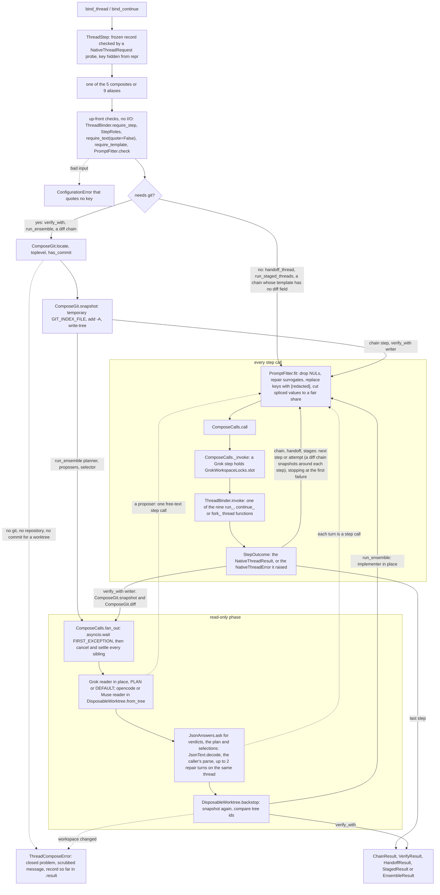

feat(harnesses): composite thread functions across Grok, opencode and Muse (vidbyte.harnesses.native.compose)
## Summary

This PR adds `vidbyte.harnesses.native.compose`: five async composites over the nine Grok, opencode and Muse thread functions from #1036, nine generated aliases, and the helpers they share. `chain_threads` runs steps in order, splicing each answer (and, when asked, that step's git diff) into the next prompt; `verify_with` runs one writer, then one to ten verifiers that review its diff at the same time and each return a parsed JSON verdict; `handoff_thread` moves a thread's state to a new thread through a summary; `run_staged_threads` retries a failed stage, moves it up a ladder of stronger configs, or stops, by how it failed; `run_ensemble` has a planner write one role per proposer, runs the proposers at the same time, selects one proposal and has an implementer build it. The decision that matters most is that exactly one step writes at a time: a Grok reader runs in place in its own `PLAN` or `DEFAULT` mode, an opencode or Muse reader runs in a disposable git worktree, and after every read-only phase a snapshot comparison raises `ThreadComposeError(READER_CHANGED_WORKSPACE)` if the workspace changed. Compose never commits, stashes, resets or moves a ref, replaces every bound key with `[redacted]` in the prompts and errors it writes, and changes nothing for existing callers. Design record: `docs/spec/native-thread-compose/spec.md` (r5); the PR stays a draft, stacked on `feat/native-grok-opencode-meta-hosts`.

## Motivation

#1036 shipped nine functions that each run one vendor CLI once, and left cross-harness composites to a later slice. The owner asked for that slice ("what are some more complex functions that we can create inside of this pr? run_opencode_then_grok, run_opencode_verify_with_grok_and_muse(), etc.", `request.md` prompt 1) and picked five shapes, two of them ports of the CLI's stages and ensemble. By hand, each shape is a chance to leak a key or damage a workspace: diff one step's change without the user's own uncommitted edits, fit the next prompt under Grok's and Muse's command-line limits, keep keys out of spliced text, stop two Grok calls from rebuilding one workspace's private home at once (#1036 EC-27), stop reviewers from editing, and remove every worktree even after a second cancel. Compose does each of these once, on the nine functions' own contract, with no change to them (this spec's NG-1), no new dependency and no configuration key.

## How to use what this PR introduces

The spec's §4 example, unchanged:

```python
import asyncio
import os

from vidbyte.harnesses.native import GrokPermissionMode, GrokThreadConfig, fork_grok_thread, run_grok_thread, run_opencode_thread
from vidbyte.harnesses.native.compose import EnsembleRoster, bind_thread, run_ensemble, run_opencode_then_grok, verify_with


async def main() -> None:
    repo, xai = "C:/code/my-repo", os.environ["XAI_API_KEY"]
    plan = GrokThreadConfig(permission_mode=GrokPermissionMode.PLAN)
    opencode = bind_thread(run_opencode_thread, api_key=os.environ["ZHIPU_API_KEY"], workspace=repo, model="zai-coding-plan/glm-5.3")
    grok = bind_thread(run_grok_thread, api_key=xai, workspace=repo, config=GrokThreadConfig(permission_mode=GrokPermissionMode.ACCEPT_EDITS))
    planner = bind_thread(run_grok_thread, api_key=xai, workspace=repo, config=plan)
    proposer = bind_thread(fork_grok_thread, api_key=xai, workspace=repo, config=plan)
    chained = await run_opencode_then_grok("Add a --verbose flag to cli.py.", opencode=opencode, grok=grok)
    print([outcome.thread_id for outcome in chained.outcomes], chained.failed_step)
    review = await verify_with(opencode, [planner, opencode], prompt="Write a test for the --verbose flag.")
    print([str(answer.value.decision) for answer in review.verdicts if answer.ok], review.agreement)
    roster = EnsembleRoster(planner=planner, proposers=[proposer, proposer, opencode], selector=planner, implementer=grok)
    result = await run_ensemble("Make the CLI start faster.", roster=roster)
    print(result.failed_stage, len(result.proposals))


asyncio.run(main())
```

Real output at 42f9c969, from the AC-1 test running that exact text (1,565 characters, only the repository path swapped) in a fresh interpreter, with stand-in `grok` and `opencode` first on `PATH`, the real `git`, placeholder keys and a repository with one commit. The stand-ins mint new thread ids on every run.

```text
['ses_7d0d56c5-e2c5-45bd-827c-d24754e3ab64', 'a95bf4e2-20d0-4eaf-90d7-ecdfc15bee59'] None
['approve', 'approve'] True
None 3
```

The lines are the chain (opencode's thread id, then Grok's, and no failed step), the two verdicts and whether they agree, and the ensemble (no failed stage, three proposals). Command: `PYTHONPATH="$(pwd);<scratch plugin folder>" python -m pytest -q -p no:cacheprovider -p s6_snippet_tee -rA -s tests/features/harness_compose/test_harness_compose_acceptance.py::test_developer_snippet_runs_as_written_against_stand_ins_on_path`, ending `1 passed in 2.73s`; the plugin only echoes the child's stdout, and the test also checks that no compose folder or worktree registration is left.

The developer no longer has to diff the repository around the writer, fit and scrub each reviewer's prompt, give the opencode reviewer a throwaway worktree, parse and repair two JSON verdicts, and prove neither reviewer touched the workspace: `verify_with` does it in one awaited call.

### Public surface

All 42 names are imported from `vidbyte.harnesses.native.compose`; the records, enums and error are the very `vidbyte.lib` objects. `compose/` below is `vidbyte/harnesses/native/compose/`.

| Name | Defined in | What it is |
|---|---|---|
| `bind_thread(function, *, api_key, workspace, model=None, skills=(), config=None)` | `compose/steps.py` (`ThreadBinder`) | A `run_*` function, or a `fork_*` one an ensemble anchors later, bound as a checked `ThreadStep` |
| `bind_continue(function, thread_id, *, api_key, workspace, model=None, skills=(), config=None)` | `compose/steps.py` | A `continue_*` or `fork_*` function bound to an existing thread |
| `chain_threads(steps, template=None, *, prompt)` | `compose/chain.py` | 2 to 25 steps in order with `{previous}` and optional `{diff}`; stops at the first failure; returns `ChainResult` |
| `verify_with(writer, verifiers, *, prompt)` | `compose/verify.py` | The writer alone, then 1 to 10 verifiers at once on its diff; returns `VerifyResult` |
| `handoff_thread(from_thread, to_step)` | `compose/handoff.py` | A summary turn, then a seed turn on a new thread; returns `HandoffResult`; no git |
| `run_staged_threads(stages)` | `compose/stages.py` | 1 to 25 stages; each failure is retried, raised a rung or aborted; returns `StagedResult`; no git |
| `run_ensemble(prompt, roster)` | `compose/ensemble.py`, `compose/selection.py` | Plan, 1 to 10 proposals at once, selection, backstop, implementation; returns `EnsembleResult` |
| `capture_diff(workspace)` | `compose/workspace.py` | Async context manager; `.diff` holds the block's `WorkspaceDiff` after a clean exit |
| `in_worktree(workspace)` | `compose/workspace.py` | Async context manager yielding a disposable worktree of the working content, always removed |
| `parse_json_answer(step, prompt, *, schema, parse)` | `compose/answers.py` | One JSON object turned into a value by `parse`, with up to 2 repair turns on the same thread; returns `JsonAnswer` |
| `run_grok_then_opencode`, `run_grok_then_muse`, `run_opencode_then_grok`, `run_opencode_then_muse`, `run_muse_then_grok`, `run_muse_then_opencode` | `compose/chain.py` | `(prompt, *, <a>, <b>)`: a two-step chain with the default template |
| `run_grok_verify_with_opencode_and_muse`, `run_opencode_verify_with_grok_and_muse`, `run_muse_verify_with_grok_and_opencode` | `compose/verify.py` | `(prompt, *, writer, <x>, <y>)`: one writer, two verifiers |
| `ThreadStep` | `vidbyte/lib/dataclasses/native_compose.py` | Function, harness, verb, key (kept out of `repr`), workspace, model, skills, config, thread id |
| `StepOutcome` | same | A `NativeThreadResult` or the very `NativeThreadError` raised, plus a `WorkspaceDiff` when captured |
| `WorkspaceDiff` | same | `files`, `text`, `truncated` (caps of 2,000 files and 100,000 characters) |
| `JsonAnswer` | same | `value`, `turns`, `problem` |
| `ThreadVerdict` | same | `decision`, `summary`, `findings` |
| `ChainResult` | same | `outcomes`; `failed_step` |
| `VerifyResult` | same | `writer`, `verdicts`; `agreement`, `failed_verifiers` |
| `HandoffResult` | same | `summary`, `target`; `failed_step` |
| `StageSpec` | same | `step`, `template`, `retries` (0 to 3), `ladder` (up to 4 configs) |
| `StageAttempt` | same | `rung`, `outcome`, `decision` |
| `StageOutcome` | same | `attempts` |
| `StagedResult` | same | `stages`; `failed_stage` |
| `EnsembleRoster` | `vidbyte/lib/dataclasses/native_ensemble.py` | `planner`, `proposers`, `selector`, `implementer` |
| `EnsembleRole` | same | One planned role: name, identity, personality, expertise, knowledge, skills, goal |
| `EnsemblePlan` | same | Task analysis, roster strategy, coverage summary, one role per proposer |
| `EnsembleRound` | same | The proposal numbers a round kept, and its summary |
| `EnsembleSelection` | same | The chosen proposal, approach, rationale and guidance |
| `EnsembleResult` | same | `plan`, `proposals`, `rounds`, `selection`, `implementation`; `failed_stage` |
| `VerdictDecision`, `StageDecision`, `EnsembleStage`, `ThreadComposeProblem` | `vidbyte/lib/enums/native_compose.py` | Verdicts, stage decisions, ensemble stages, the five compose failures |
| `ThreadComposeError` | `vidbyte/lib/errors/base.py` | Closed `problem`, workspace, scrubbed git text, likely cause, next step, `.diff` and `.result` (the record so far) |

## Flow



Every composite checks its whole input first, with no I/O, so a bad argument fails before any git process, launcher or folder exists. Only `verify_with`, `run_ensemble` and a diff chain need git; their snapshots use a temporary index and leave the real index, HEAD and refs alone. Every step call, each reader turn included, goes through `PromptFitter.fit`, `ComposeCalls.call`, the Grok slot and `ThreadBinder.invoke`, and a step's own `NativeThreadError` becomes a recorded `StepOutcome`. Readers run at once under `fan_out`, opencode and Muse readers in their own worktrees, and the backstop snapshot must equal the phase's starting tree before anything else runs.

## Changes

`compose/` is `vidbyte/harnesses/native/compose/`; line counts are of new files.

| File | Change |
|---|---|
| `compose/__init__.py` | New (117). Binds the 10 functions and 9 aliases and re-exports the lib objects; `__all__` holds the 42 names; no work at import time. |
| `compose/steps.py` | New (231). `ThreadBinder`: the binders, the nine-entry identity table (so a `functools.partial` or lambda is refused), `invoke`, and `relocate`, `anchor` and `rung`, which re-check only what they change. `StepRoles`: the reader, fork, handoff-source, one-workspace and alias rules. |
| `compose/calls.py` | New (124). `call` records a `NativeThreadError` as a `StepOutcome`; `fan_out` waits with `asyncio.wait(FIRST_EXCEPTION)`, cancels the rest and `settle`s them through any number of cancels; `GrokWorkspaceLocks` holds one one-slot semaphore per loop and workspace. |
| `compose/texts.py` | New (248). `ComposeTexts` loads the prompt files off the event loop and renders them. `PromptFitter.check` runs up front; `fit` runs at send time: NULs dropped, surrogates repaired, keys replaced, spliced values cut to a fair share by bisection, in characters and (win32, Grok and Muse) command-line units. |
| `compose/git.py` | New (240). `ComposeGit`: locate, toplevel, has_commit, snapshot, tree-to-tree diff, and worktree add, fill, index and remove, every child through `CliRunner` with `--no-optional-locks`, fsmonitor off, 15 location variables removed, and 120 s and 16 MiB bounds. `ComposeFailures` builds the scrubbed `ThreadComposeError`. |
| `compose/workspace.py` | New (196). `DiffCapture`; `DisposableWorktree` (`in_worktree`, `from_tree`, `backstop`), whose add and removals run as settled tasks. |
| `compose/answers.py` | New (185). `JsonAnswers` (`parse_json_answer`, the shared `ask` core) and `AnswerDecoders`; a cut answer is never decoded. |
| `compose/chain.py`, `verify.py`, `handoff.py`, `stages.py`, `ensemble.py` | New (199, 210, 63, 130, 285). One composite each, with the 6 pair and 3 trio aliases in `chain.py` and `verify.py`. |
| `compose/selection.py` | New (143). `EnsembleSelector`: rounds keep a fifth, rounded up, while more than five proposals remain, then a final selection, all on one thread. |
| `compose/prompts/*.md` (22) | New. Every sentence sent to a model: 10 ported from the CLI's ensemble prompts (no `<examples>`, no own output format, harness-neutral) and 12 new. |
| `vidbyte/lib/constants/native_compose.py` | New (329). Every bound, cap, git word and message text, `STAGE_DECISIONS` and `COMPOSE_PROMPT_FIELDS`. |
| `vidbyte/lib/dataclasses/native_compose.py`, `native_ensemble.py` | New (414, 160). The 18 public frozen, slotted records and the internal `PromptSegment`. |
| `vidbyte/lib/dataclasses/validation.py` | +67/−28. `require_template`, `command_line_units`, keyword `quote=True` on four validators, `min_items` on `to_tuple`. |
| `vidbyte/lib/enums/native_compose.py`, `enums/__init__.py` | New (149), +16. Seven `StrEnum`s, exported. |
| `vidbyte/lib/errors/base.py`, `errors/__init__.py` | +56, +2. `ThreadComposeError` with the A003 diagnostic packet, exported. |
| `vidbyte/lib/util/json_text.py`, `secret_text.py`, `util/__init__.py` | New (92, 70), +17/−7. `JsonText.decode` (exactly one JSON object, at most one fence) and `SecretText.replace_all` (the one longest-first key scrub), exported. |
| `vidbyte/harnesses/native/__init__.py` | +2/−2. Header only; `__all__` unchanged. |
| `vidbyte/harnesses/README.md`, `REPO_MAP.md` | One line each describing compose and its limits. |
| `pyproject.toml` | +1. Ships `prompts/*.md`. |
| `tests/features/harness_compose/` (20 files) | New offline pack: `FEATURE.md`, `README.md`, `conftest.py` and 17 modules with 389 tests (validation 100, prompts 58, keys 51, answers 49, surface 30, binding 23, chain 21, git 16, the other nine 41). |
| `tests/features/harness_threads/fake_harness.py`, `README.md` | +113/−7, +2/−1. Optional stand-in fields (`label`, `answers`, `replies`, `observe_files`, `write_files`, `delete_paths`, `term_linger`) and a marker program. |
| `docs/spec/native-thread-compose/` (27 files) | Spec r5, request, code map, test plan, review, verify log, pipeline log, 19 stage reports, this body. |

## Compatibility

Additive only; no existing behavior changes.

- New subpackage `vidbyte.harnesses.native.compose` (42 names). Nothing re-exports it from `vidbyte.harnesses.native`, `vidbyte.harnesses` or `vidbyte`, and `import vidbyte` does not import it (`test_existing_public_surfaces_are_unchanged`, `test_compose_and_new_lib_modules_respect_the_layers`).
- `vidbyte.lib` gains seven enums, `ThreadComposeError`, `JsonText`, `SecretText` and the new record modules.
- `RecordFieldValidator` and `RecordFieldConverter` gain keyword-only parameters with backward-compatible defaults (`quote=True` on `require_text`, `require_int`, `require_bool` and `to_enum`; `min_items=None` on `to_tuple`) and two static methods. Existing calls and messages are unchanged: the base pack still gives `436 passed, 2 skipped`.
- The wheel gains the 22 prompt files. No new dependency, extra or configuration key.

## Acceptance criteria → proof

Every test below lives in `tests/features/harness_compose/` unless a path says otherwise, and passes in `389 passed in 56.94s` at 42f9c969 (S6 run) and `389 passed in 53.09s` at 1511846c (verify-log iteration 4).

| AC | Proves | Proof |
|---|---|---|
| AC-1 | The §4 snippet runs as written | `test_harness_compose_acceptance.py::test_developer_snippet_runs_as_written_against_stand_ins_on_path` |
| AC-2 | A pair alias splices the answer and diff; aliases have exact signatures | `test_harness_compose_chain.py::test_opencode_then_grok_sends_the_answer_and_the_writers_diff`; `test_harness_compose_surface.py::test_each_alias_has_its_exact_signature_and_returns_a_coroutine` |
| AC-3 | The trio: writer alone, Grok in place, Muse in a worktree | `test_harness_compose_verify.py::test_trio_runs_the_writer_alone_then_reviews_its_diff_in_place_and_in_a_worktree` |
| AC-4 | Handoff resumes, then seeds; no git | `test_harness_compose_handoff.py::test_handoff_resumes_the_source_thread_and_seeds_a_new_target_thread` |
| AC-5 | Three stages pass each answer on | `test_harness_compose_stages.py::test_three_stages_on_three_harnesses_pass_each_answer_on` |
| AC-6 | Ensemble order and placement | `test_harness_compose_ensemble.py::test_ensemble_plans_proposes_selects_and_implements_in_order` |
| AC-7 | A failed step ends the chain with its own error | `test_harness_compose_chain.py::test_failed_middle_step_ends_the_chain_with_the_functions_own_error` |
| AC-8 | A writing reader is never accepted silently | `test_harness_compose_verify.py::test_grok_reader_that_writes_raises_reader_changed_after_every_verifier`, `::test_worktree_readers_that_write_leave_the_workspace_untouched`; `test_harness_compose_ensemble.py::test_single_proposer_that_writes_stops_the_ensemble_before_the_implementer` |
| AC-9 | Cut answers are never decoded | `test_harness_compose_answers.py::test_cut_verdicts_are_repaired_on_the_same_thread_and_never_graded`, `::test_parse_json_answer_never_passes_a_cut_answer_to_parse` |
| AC-10 | Cancel stops trees, removes the worktree, frees the slot | `test_harness_compose_concurrency.py::test_cancelling_a_verify_stops_both_trees_removes_the_worktree_and_frees_the_lock` |
| AC-11 | Grok takes turns per workspace only | `test_harness_compose_concurrency.py::test_grok_verifiers_on_one_workspace_take_turns_while_opencode_runs_beside_them`, `::test_composites_serialize_grok_per_workspace_and_overlap_across_repositories` |
| AC-12 | The decision table, with no sleep | `test_harness_compose_stages.py::test_failed_attempts_follow_the_decision_table`, `::test_stage_decisions_are_the_spec_table` |
| AC-13 | No repository or no git fails before any launch | `test_harness_compose_git.py::test_folder_outside_any_repository_is_not_a_git_repository`, `::test_no_git_on_path_is_git_unavailable_before_any_launch`, `::test_git_the_os_will_not_start_is_git_unavailable`; the git-free calls run outside a repository in the AC-4, AC-5 and AC-7 tests |
| AC-14 | Every invalid input is refused before any I/O | `test_harness_compose_validation.py::test_invalid_input_is_refused_before_any_git_launch_or_folder` (58 cases); `test_harness_compose_binding.py::test_each_binder_accepts_exactly_its_six_functions` |
| AC-15 | No key in argv, environment, reprs, errors or later prompts | `test_harness_compose_keys.py::test_chain_splices_answers_and_diffs_with_every_key_redacted`, `::test_ensemble_splices_roles_proposals_and_guidance_with_every_key_redacted`, `::test_errors_and_reprs_never_show_a_key_while_result_and_diff_stay_raw`, `::test_git_text_and_file_names_that_hold_a_key_are_scrubbed_from_errors`; `test_harness_compose_binding.py::test_bound_step_stores_resolved_checked_values_and_hides_its_key` |
| AC-16 | Repairs name their problems; errors end the answer | `test_harness_compose_answers.py::test_each_problem_gets_a_repair_naming_it_and_an_error_ends_the_answer` |
| AC-17 | The diff isolates the writer in a dirty repository | `test_harness_compose_workspace.py::test_capture_diff_shows_only_the_blocks_change_without_line_ending_noise` |
| AC-18 | `in_worktree` and `capture_diff` behave on every exit | `test_harness_compose_workspace.py::test_in_worktree_holds_the_working_content_isolates_writes_and_always_goes_away`, `::test_capture_diff_is_none_after_a_raising_block_whose_error_propagates`, `::test_repository_with_no_commit_refuses_in_worktree_but_captures_diffs` |
| AC-19 | Long answers are cut to fit the Grok step | `test_harness_compose_chain.py::test_long_answer_with_a_nul_is_shortened_to_fit_the_grok_step`, `::test_quote_dense_answer_is_shortened_by_command_line_units_as_well` |
| AC-20 | Ten proposers narrow; no proposal stops early | `test_harness_compose_ensemble.py::test_ten_proposers_narrow_in_one_round_with_repairs_for_bad_answers`, `::test_no_successful_proposal_stops_before_the_selector_but_the_backstop_runs` |
| AC-21 | The wheel holds and loads the 22 prompts | `test_harness_compose_prompts.py::test_prompt_folder_holds_exactly_the_22_markdown_files`, `::test_each_prompt_loads_as_a_package_resource`, `::test_each_prompt_holds_exactly_its_bare_placeholders`, `::test_compose_prompt_fields_covers_every_prompt`, `::test_every_fixed_combination_leaves_half_the_argv_room`, `::test_ported_prompt_drops_its_own_output_contract_and_sandbox_wording`, `::test_pyproject_ships_the_prompt_files`; wheel half: gate 8 below |
| AC-22 | The public surfaces are exact | `test_harness_compose_surface.py::test_compose_exports_exactly_the_42_names_as_the_lib_objects`, `::test_lib_packages_export_the_new_enums_error_and_decoder`, `::test_existing_public_surfaces_are_unchanged`, `::test_compose_and_new_lib_modules_respect_the_layers`; `tests/features/harness_threads/test_harness_threads_static_policy.py` (unchanged) |
| AC-23 | Lint, both CI stages and semgrep pass | Gates 1 to 7 below; remote CI 39531295940 and Static policy 39531298277 |

## Verification

**Local gates, verify-log iteration 4**, at 1511846c (code c5e40f82, the code at this head); exact commands in `verify-log.md`:

| # | Gate | Command | Result |
|---|---|---|---|
| 1 | Lint | `python lint/run.py` | `SDK-LINT: PASS`, counts as in iteration 3, no baseline raised |
| 2 | Ratchets | ruff I001 and TID251 counts | `Found 223 errors.`, `Found 5 errors.` (baselines) |
| 3 | Semgrep | `--test`, then `scan --error` | `1/1: ✓ All tests passed`; `Ran 1 rule on 977 files: 0 findings.` |
| 4 | New tests | `PYTHONPATH=$(pwd) python -m pytest -q tests/features/harness_compose` | `389 passed in 53.09s` |
| 5 | Base pack | `PYTHONPATH=$(pwd) python -m pytest -q tests/features/harness_threads` | `436 passed, 2 skipped in 44.67s` |
| 6 | CI source | `PYTHONPATH=$(pwd) python scripts/run_ci.py --stage source` | `6030 passed, 16 skipped in 140.02s`; `CI passed.` |
| 7 | CI package | `python scripts/run_ci.py --stage package --dist-dir <empty folder>`, no `PYTHONPATH` | `Installed vidbyte-sdk 0.3.0 passed smoke checks.`; `CI passed.` |
| 8 | AC-21 wheel half | `check_wheel_prompts.py` on the installed wheel, outside the checkout | `AC-21 WHEEL HALF: PASS` (17 fixed combinations, none over 12,000 characters) |
| 9 | Comment width | `awk 'length($0) > 72'` on changed comment lines | 0 lines |
| — | Frozen tests | `git diff bfd2b2c4..HEAD --stat -- tests` | empty |

**S6 re-run at 42f9c969** (same code): `PYTHONPATH=$(pwd) python -m pytest -q -p no:cacheprovider tests/features/harness_compose` gave `389 passed in 56.94s`; the same over `tests/features/harness_threads` gave `436 passed, 2 skipped in 43.39s`.

**Remote checks.** CI and Static policy run on `workflow_dispatch` only, so `gh pr checks` lists nothing. At 1511846c, the last commit that is not docs only, CI 39531295940 (Source / Python 3.11, Source / Python 3.12, Package) and Static policy 39531298277 succeeded. Every later commit (865fdd89, 67f3d918, 42f9c969, and the commits adding this body and the S6 report) touches only `docs/spec/native-thread-compose/`. Both workflows are dispatched again on the final head after this body is committed; a committed file cannot name runs on its own commit, so list them with `gh run list --repo cerredz/Vidbyte-SDK --branch feat/native-thread-compose --limit 4`. The red CI 39506184626 at bfd2b2c4 is the R-34 rows failing before their fix, as intended.

- [x] Existing repository checks pass. Gates 1 to 9 and both remote runs at 1511846c; only docs changed since.
- [x] New or changed package assets are present in the built wheel. Gate 8: the built `vidbyte_sdk-0.3.0-py3-none-any.whl`, installed outside the checkout, holds and loads all 22 prompts.
- [x] Documentation and examples reflect the change. The harnesses README and `REPO_MAP.md` describe compose and its limits, every new module has a full header, the test pack has `README.md` and `FEATURE.md`, and AC-1 runs the §4 example.
- [x] No credentials, private data, generated bytecode, build output, or unrelated changes are included. Every file maps to a §12.3 row, the test pack or the pipeline record; no added path matches `__pycache__`, `.pyc`, `build/`, `dist/`, `.egg-info`, `.whl` or `.env`; no added line matches common key formats, and the tests build placeholder keys at runtime.

## Adversarial review

20 findings confirmed by an independent verifier across three lenses (spec conformance, repo conventions, engineering), 20 fixed, 0 waived. Full record: `docs/spec/native-thread-compose/review.md`.

Both review caps were reached. S1 spec review: 2 of 2 rounds (0 Blocker, 8 Major, 3 Minor; then 1 Blocker, 2 Major, 3 Minor), then r3 was approved. S5 post-repair re-review (conformance lens): 2 of 2 rounds; round 1 found R-33 and round 2 found R-34. R-34 was fixed after the cap (c5e40f82), so no reviewer has re-read the fix. It is verified by its four test rows (`4 failed, 385 passed` at bfd2b2c4, `4 passed` at 865fdd89), the full local gate, CI and Static policy at 1511846c, the orchestrator's own runs, and the findings verifier, which proved the same diff on a full copy first. The S6 author read c5e40f82: each of its three `OSError` handlers keeps only `type(error).__name__` and raises after the handler, with no `from`.

The review also kept 14 Minor findings (R-18 to R-23 fixed, R-24 to R-31 open; see Follow-ups) and refuted or re-tiered 7 claims with evidence.

| ID | Finding | Fixed in |
|---|---|---|
| R-1 | **Blocker.** A sentence addressed to the model lived in a Python constant, not a prompt file | b5b73be2 |
| R-2 | **Blocker.** Validator floors were literals beside named caps (A007 field guide) | 44475dcd |
| R-3 | **Blocker.** Short caller text holding a key was quoted, key included, in compose's own `ConfigurationError` | 4b153b94 |
| R-4 | **Blocker.** `add_worktree` → `remove_worktree` → three helpers: a two-level chain (AGENTS.md principle 1) | a1d17451 |
| R-5 | **Blocker.** The key scrub was written twice; now one lib helper, `SecretText.replace_all` | b009653b |
| R-6 | **Blocker.** 24 source comment lines ran past 72 columns | 337c45e6 |
| R-7 | **Blocker.** Six count floors were hand-written instead of using the shared validator | 361e0589 |
| R-8 | **Blocker.** A reader worktree that could not be removed (EC-16) dropped finished verdicts and proposals from the error's record | 7eda491a |
| R-9 | **Blocker.** Prompt segments travelled as positional `(text, bool)` tuples (now `PromptSegment`) | 77b85d53 |
| R-10 | **Blocker.** Cleanup survived only one cancel; a second cancel or an anyio scope left worktrees and grandchildren | a1d17451 |
| R-11 | **Blocker** (tests). 22 test comment lines ran past 72 columns | 4d3ee613 |
| R-33 | **Blocker.** A record built outside a binder quoted a misplaced short key in its refusal | 0e4321a4 (spec 7aad13ba) |
| R-34 | **Blocker.** A removal failure chained the raw `OSError`, whose file name a reader can make hold its key, into `__cause__`, `__context__` and the traceback | c5e40f82 (spec 1511846c) |
| R-12 | **Major.** A lone surrogate in an answer crashed the send-time fit on win32 before a Grok or Muse step, losing the record | 5202ec02 |
| R-13 | **Major.** A placeholder-only template such as `{previous}` could send a blank prompt | 9cbd47d6 |
| R-14 | **Major.** A cancel during `git worktree add` on Windows could leave an unreported locked registration | a1d17451 |
| R-15 | **Major.** Derived steps re-ran the whole probe, so a writer deleting a reader's skill folder raised a bare `ConfigurationError` after I/O | 1d5d4d90 |
| R-32 | **Major.** R-13's check falsely refused templates holding `{prompt}` | dc631222 (comments 3600d47b) |
| R-16 | **Major** (tests). No test could fail for the sibling-cancel rule; a plain gather passed all 276 tests | 742db6bf |
| R-17 | **Major** (tests). The key tests used keys too long to be quoted, so R-3's leak was unreachable | c81d8596 |

## Deviations from the spec

Spec r5 is the as-built record: §17 "Implementation deviations" lists each shape the code chose where the spec was open, and none changes a public name, signature, record field, prompt field set, git command or port rule. The ones a reviewer should know:

- **Four approved lib grants (S5).** (a) `PromptSegment(text, spliced)` replaces `(text, bool)` tuples (R-9). (b) `SecretText.replace_all` in the new `vidbyte/lib/util/secret_text.py`, the 41st new file, is the one key scrub; hostkit keeps its copy (R-5). (c) `to_tuple(min_items=…)` and a keyword `quote` on four validators, defaults unchanged; compose passes `quote=False` wherever a refusal could quote caller text or a key, and `ThreadStep` names a refused model or thread id by type only (R-7, R-3, R-33). (d) Every validator floor is a named constant beside its cap (R-2).
- **Git failures.** A git timeout in a worktree command is `WORKTREE_FAILED`; failing to launch git is `GIT_UNAVAILABLE`; a folder that cannot be made or deleted raises after its `OSError` handler with only the error's type (R-34).
- **EC-16 record.** Each verdict or proposal is kept as it arrives; the error's `result` holds them all once every reader answered, otherwise the writer or plan alone (R-8).
- **EC-23 numbers.** A Grok selector over ten 100,000-character proposals keeps about 1,560 characters of each (1,564 measured on win32), not about 1,100; the README says about 1,500.
- **Smaller shapes.** `ThreadVerdict.findings` items may be blank; a problem is cut at 2,000 characters in the record but sent whole, scrubbed, to the repair turn; `handoff_thread` has no up-front fit check (its prompts are fixed files); the 12 new prompt files are worded by the implementer.
- **§5 names, not behavior (found at S6; §5 not edited).** The §5 flowchart, INV-19 and T-1 name `DiffCapture` and `parse_json_answer`, but the composites call `ComposeGit.snapshot` and `diff`, `DisposableWorktree.backstop`, and the shared `JsonAnswers.ask` core that `parse_json_answer` also uses. The §5 sequence diagram adds the Muse worktree before its `par` block; the code adds each worktree inside that verifier's own task (`ThreadVerifiers._review`). The Flow chart above shows the code.

### Where the build differs from the request

1. `chain_threads` and `verify_with` take a required keyword-only `prompt` (D-25); the request's positional shapes still work.
2. Aliases cover only the six distinct-harness pairs and three trios, with no default roster helpers (NG-7, Q-1, Q-3).
3. Every step of `verify_with` and `run_ensemble` shares one workspace; opencode and Muse readers must be `RUN` steps, Grok readers `PLAN` or `DEFAULT`, and fork roles Grok only (INV-5, INV-9, INV-10, D-3).
4. `ThreadStep` is a validated record called through `ThreadBinder.invoke`, not a bare callable alias; composites refuse other callables (D-2, INV-3).
5. Compose scrubs only text it writes: answers and diffs stay raw in records, and a reader can open a key file a writer saved (INV-4, EC-71, T-3).
6. Snapshots are git trees through a temporary index, not literal `git status`/`git diff` texts; an untracked nested repository with no commit fails the snapshot (D-6, Q-10, EC-73).
7. Failures compose owns raise `ThreadComposeError` carrying the partial record (D-26).
8. Each git command has its own `COMPOSE_GIT_TIMEOUT_SECONDS` bound, as `CliInvocation` requires; it is not a step timeout (D-22).
9. Ported prompts drop `<examples>` and their own output formats, and double-brace placeholders become single-brace `str.format` fields (D-10, D-12, D-13).
10. New domain modules `native_compose.py` and `native_ensemble.py` (500-line cap); a Grok writer needs `ACCEPT_EDITS`, since compose never changes a permission mode.

The request's trio hint (`capture_diff`, `asyncio.gather`, `parse_json_answer`) became direct `ComposeGit` snapshots, `ComposeCalls.fan_out` (no gather, so one exception propagates and every sibling is awaited, D-17) and the shared `JsonAnswers.ask` core.

## Follow-ups

**Before landing on `main`** (the owner's call; the pipeline does not rebase, merge or retarget):

- #1036 was squash-merged into `main` as f216fdcf on 2026-10-15, so this PR sits on `feat/native-grok-opencode-meta-hosts` (still 5c08c35e), which `main` does not descend from; `main` is 85 commits past it (98a5d37b). A dry run that moves no ref, `git merge-tree --write-tree --merge-base=5c08c35e origin/main HEAD`, shows replaying this PR onto `main` conflicts in 8 files: `REPO_MAP.md`, `vidbyte/harnesses/README.md`, `vidbyte/harnesses/native/__init__.py`, `vidbyte/lib/dataclasses/validation.py`, `vidbyte/lib/errors/base.py`, `vidbyte/lib/util/__init__.py`, `tests/features/harness_threads/README.md`, `tests/features/harness_threads/fake_harness.py` (`pyproject.toml` and `vidbyte/lib/enums/__init__.py` merge cleanly).
- On `main`, `tests/features/codex_host/test_codex_host_packaging.py:184-204` (`CodexHostFixedBytesTests`) pins the SHA-256 of `vidbyte/harnesses/native/__init__.py`, the REPO_MAP native section and the harnesses README native bullet; this PR changes all three, so the pins move with the conflict resolution.
- `main` adds a fourth native harness, `vidbyte/harnesses/native/codex/`; the composites cover Grok, opencode and Muse only.

**Review coverage:**

- R-34's fix (c5e40f82, +24/−12 in `compose/git.py` and `compose/workspace.py`) is the one change no reviewer has read.
- On CPython 3.12.4 and later, `shutil.rmtree` names the folder it was walking, not the held file, so the two held-file R-34 rows catch a regression only on win32 and CI's Python 3.11 leg (the two folder rows check `__cause__` and `__context__` on every leg); dropping the 3.11 leg would weaken them on Linux.

**Open Minor findings** (`review.md`, lines as of 42f9c969):

- R-24: three one-line rules repeated where a helper exists, such as the workspace key (`compose/calls.py:44`, `compose/chain.py:148`, `:153`, `compose/steps.py:201`, `:214`).
- R-25 [scope-adding]: every snapshot re-hashes the whole tree (`compose/git.py:109`); a stat-seeded index is about 40 times faster at 100,000 files.
- R-26: a whitespace-only file name in a diff (POSIX) raises a bare `ConfigurationError` after I/O (`vidbyte/lib/dataclasses/native_compose.py:194-195`); spec §9.1 conflicts with INV-15, so it needs an owner ruling.
- R-27: the callable checks could use `require_instance` (`vidbyte/lib/dataclasses/native_compose.py:93-96`, `compose/answers.py:56`).
- R-28: `AnswerDecoders.read` and `ThreadEnsembles._roles` return tuples (`compose/answers.py:119`, `compose/ensemble.py:132`).
- R-29 to R-31 are in the base (NG-1): a base error can quote a short key; an unencodable prompt can leave an opencode child running (`CliRunner`); a second cancel inside `ProcessStopper.stop_tree` can leave grandchildren alive.

**Rulings and defaults carried forward:**

- A misplaced key that validation accepts (a bare key as a Grok or Muse `model`, or as a `thread_id`) is not refused: compose cannot tell a key from a model id, and a `model != api_key` check would add scope.
- The base `NATIVE_MODEL_PATTERN` (`vidbyte/lib/constants/native_threads.py:55`) accepts a NUL: such a model binds on all three harnesses (checked at S6) and, by the code (`vidbyte/lib/process/runner.py:301-302`), fails at launch as `launch_failed`, which `run_staged_threads` retries. A base fix.
- Compose refusals name a refused caller value by type only (`got str`), the price of never quoting a key. Making `_received` never quote a str SDK-wide is the larger move, would close R-29 too, and belongs in its own PR.
- `JsonAnswer.problem` keeps the decoder's raw text, and the stdlib `Enum(value)` `ValueError` is not a `ConfigurationError`; both are by design (EC-71).
- Q-1 to Q-11 took their "no" defaults when the S1 cap was reached with no owner reply (spec §15): more aliases, parallel stages, roster helpers, per-stage classifiers, non-Grok fork roles, `DONT_ASK` readers, retry sleeps, extra diffs, a batch-`git` refusal, literal git texts, shortened-input marks. Each is a small follow-up.
- Accepted limits are listed in the harnesses README native bullet: ignored files and `.git` stay out of snapshots, nested repositories show as links or fail as `GIT_FAILED`, snapshots slow down near 100,000 files, LFS filters and hooks still run, worktrees are full checkouts, Grok turns are per event loop and workspace, and injected text can steer a verdict.

🤖 Generated with [Claude Code](https://claude.com/claude-code)
