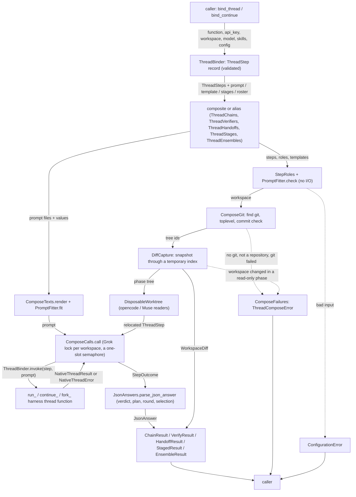
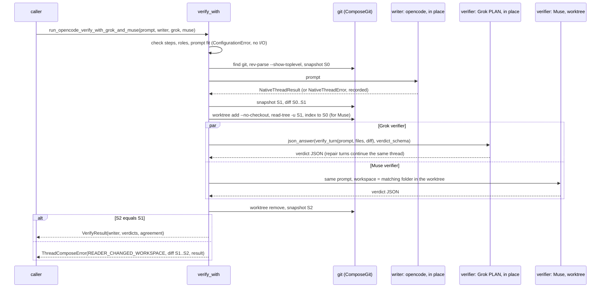

# Spec: Composite thread functions across Grok, opencode and Muse

> **TL;DR** — This stacked PR adds `vidbyte.harnesses.native.compose`. It holds five general composites over the nine native thread functions, `chain_threads`, `verify_with`, `handoff_thread`, `run_staged_threads` and `run_ensemble`, plus nine aliases generated from them, such as `run_opencode_then_grok` and `run_opencode_verify_with_grok_and_muse`. The caller builds every step with `bind_thread` or `bind_continue`, choosing its harness, key, model and config; the helpers `capture_diff`, `in_worktree` and `parse_json_answer` are public too. The decision that matters most is that the single-writer rule is enforced by mechanism: Grok reviewers run in place only in PLAN or DEFAULT mode and are serialized per workspace; opencode and Muse reviewers run inside disposable git worktrees built from a snapshot of the workspace; and a snapshot of the whole repository taken before and after every read-only phase turns any change into a loud `ThreadComposeError` before the writer runs.

## §0 User prompts

### 0.1 Invoking request (verbatim)
````text
run the implementation of the following inside of a subagent with opus 5.5 max reasoning effort that runs the "spec-pipeline" skill file for the following, with the ones I pick, can also run/implement like variations of them if they exist:

run_opencode_then_grok(prompt, ...): opencode does the task, then Grok receives the original prompt plus opencode's final text and diff, and continues the work. Implement as chain_threads([step_a, step_b], template="...{previous}...") where each step's result is spliced into the next prompt, the same sequential handoff the CLI's stages.py uses.

run_opencode_verify_with_grok_and_muse(prompt, ...): opencode implements, then Grok (PLAN mode) and Muse (in a worktree) independently review the diff and answer a structured verdict. Return both verdicts plus an agreement flag. Implement with capture_diff around the writer, then asyncio.gather over two bound verifier steps feeding parse_json_answer.

handoff_thread(from_step, to_step): ask a thread to summarize its state, decisions and open items, then seed a thread on another harness with that summary. The migration primitive for when a harness hits key_rejected or a quota mid-task. Implement as continue_* with a fixed summary prompt, then run_* on the target.

run_staged_threads(stages: Sequence[StageSpec]): a direct port of the CLI stages primitive. Each stage is a fresh thread on a chosen harness with a retry budget, and a failure classifier keyed on NativeThreadProblem decides whether to retry, raise effort, or abort. Returns a per-stage result list.

run_ensemble(prompt, proposers=3): port of same-host-ensemble. One planner thread writes a role roster, N forks in PLAN mode each propose weighed approaches, a selector narrows to one, and one writer with ACCEPT_EDITS implements. The prompts move over from services/ensemble/prompts/. (small feedback, want the user to be able to define the threads/different providers that we have to offer for this).
````

### 0.2 User replies during the run
_None yet. The orchestrator appends any reply the user sends during the run here verbatim, labeled with the revision it produced._

---

## Part A — Framing

## §1 Goal

The base PR gives one thread per call: `run_`, `continue_` and `fork_` for `grok`, `opencode` and `muse`. It left composite cross-harness functions to "the later slices" (base spec NG-1 and §2). Today a developer who wants opencode to implement and Grok to continue, or two harnesses to review a change, writes that coordination by hand:

- splicing one answer into the next prompt;
- capturing what the writer changed;
- keeping a reviewer from editing the workspace;
- parsing a JSON verdict out of free text;
- retrying a failed stage;
- running roles concurrently without breaking Grok's shared private home.

Each of those has a trap the base spec already documents:

- opencode and Muse have no read-only mode (base NG-9).
- Concurrent Grok calls in one workspace can collide while the skills folder is rebuilt (base EC-27).
- A Grok or Muse prompt over 24,000 characters is refused (base EC-3), while one previous answer can be 100,000 characters (`NATIVE_RESULT_TEXT_MAX_CHARS`).
- An answer over that size is cut with `text_truncated=True` (base EC-31).

The owner asked for five composites by name and for their variations (§0.1), and settled the shape in the 13-item ledger (request §B).

| ID | Goal (outcome) | How we will know | Source |
|---|---|---|---|
| G-1 | A developer composes the nine thread functions into multi-step work, chaining, verifying, handing off, staging with retries and running an ensemble, while choosing every step's harness, model, key and config themselves. | AC-1–AC-6 | §0.1; request §B ledger 2, 3; §C "want the user to be able to define the threads/different providers" |
| G-2 | Reviewing and proposing steps cannot change the workspace. If the workspace changes during a read-only phase anyway, the composite fails loudly before anything else runs. | AC-3, AC-6, AC-8, AC-18 | ledger 4; acceptance item 2 ("with neither verifier able to change the workspace") |
| G-3 | Verifiers judge the actual change, the diff of what the writer did, even when the workspace was already dirty. A workspace that is not a git repository is a closed failure. | AC-3, AC-13, AC-17 | ledger 5; §0.1 "independently review the diff" |
| G-4 | Structured answers (verdicts, rosters, selections) are reliable. They are parsed, validated and repaired a bounded number of times, and never graded from a truncated answer. | AC-9, AC-16, AC-20 | ledger 6 |
| G-5 | Nothing is lost or leaked. Every step's result or error and thread id is reported, and the cancellation, timeout and key rules of the nine functions still hold. | AC-7, AC-10, AC-12, AC-15 | ledger 1, 3, 7, 8 |
| G-6 | The PR can be reviewed within the house rules: placement, layering, the base INV-15 static policy, prompts as Markdown, no new dependency, and a green full gate. | AC-21–AC-23 | ledger 9, 10; AGENTS.md |

## §2 Objective

When this PR merges, `vidbyte.harnesses.native.compose` exports 42 names. Exactly one row of §12.3 changes how each piece is written.

- **Binding.** `bind_thread` and `bind_continue` turn one of the nine functions plus the caller's `api_key`, `workspace`, `model`, `skills` and `config` into a validated `ThreadStep` record that is called with a prompt.
- **Composites.** Five composites take `ThreadStep`s and return frozen result records:
  - `chain_threads` runs steps in order, splicing each answer and its diff into the next prompt.
  - `verify_with` runs one writer, then any set of verifiers that answer structured verdicts, plus an agreement flag.
  - `handoff_thread` asks one thread for a summary and seeds a thread on another harness with it.
  - `run_staged_threads` runs fresh-thread stages with a retry budget, an effort ladder and a classifier keyed on `NativeThreadProblem`.
  - `run_ensemble` runs a planner, proposers, a narrowing selector and one implementer, all supplied by the caller.
- **Aliases.** Nine aliases are generated from `chain_threads` (six ordered pairs) and `verify_with` (three writer/verifier trios).
- **Helpers.** `capture_diff`, `in_worktree` and `parse_json_answer` are public first-class helpers.
- **Errors.** `ThreadComposeError` carries a closed `ThreadComposeProblem` for git and read-only failures.
- **Lib pieces.** Records, enums and constants land under `vidbyte/lib/`, with a canonical `JsonText` decoder in `vidbyte/lib/util/` and two validator methods in `RecordFieldValidator`.
- **Prompts.** Every sentence sent to a model lives in 22 Markdown prompt files shipped as package data. Ten of them are ported from the CLI's ensemble prompts.

Nothing in the nine functions, their records, `NativeThreadError`, `FailureCode`, the pinned enums, `vidbyte.lib.process`, `vidbyte.harnesses.native.__all__` or the root `vidbyte.__all__` changes. The PR is stacked on PR #1036 (`feat/native-grok-opencode-meta-hosts`). This is the whole slice.

## §3 Non-goals

- **NG-1** — Changing the nine functions, `NativeThreadRequest`, `NativeThreadResult`, the three config records, `NativeThreadError`, `FailureCode`, the 14 pinned enums, `CONTRACT_CONSTANTS` or `vidbyte.lib.process`. — *Why not:* ledger 1; existing tests pin all of them (code-map C-2, C-4), and no agent in this pipeline may modify an existing assertion.
- **NG-2** — Exporting composites from `vidbyte.harnesses.native` or from the root `vidbyte` package. — *Why not:* orchestrator ruling (a). `native.__all__` is pinned by `test_harness_threads_surface.py`; ledger 9 forbids root exports and allows `vidbyte.harnesses.native.compose`.
- **NG-3** — Sync wrappers, model-facing tools, payment or admission logic, live streaming, interrupt, or progress callbacks. — *Why not:* ledger 12; base NG-2, NG-4, NG-5.
- **NG-4** — Any composite-level deadline, overall budget, or sleep or backoff between retries. — *Why not:* ledger 8 says "no composite invents a second timeout system", and lint S064 fails a sleeping retry loop that has no overall deadline (Q-7, default no).
- **NG-5** — Moving the seven existing JSON-from-model-text sites or the four `string.Formatter().parse` template sites onto the new lib helpers. — *Why not:* AGENTS.md "Do not rewrite untouched code just to make it conform; that belongs in its own pull request."
- **NG-6** — A read-only mode for opencode or Muse (an opencode agent, a Muse approval mode), new `GrokPermissionMode` members, or `DONT_ASK` reviewers. — *Why not:* base NG-9; ledger 4 picks the worktree route (Q-6, default no).
- **NG-7** — Further variations: same-harness pair aliases, verify aliases with other verifier sets, default roster helpers, parallel stages, or a "keep going after a failure" option. — *Why not:* the general functions already express them, and only the owner's named shapes become aliases (ledger 2; Q-1, Q-2, Q-3, default no).
- **NG-8** — Putting the compose prompts in the `vidbyte.prompts` catalog. — *Why not:* D-9.
- **NG-9** — A git helper in `vidbyte/lib/`. — *Why not:* D-7. Only compose needs git.
- **NG-10** — Serializing Grok across processes or event loops, or locking direct calls to the nine functions. — *Why not:* ledger 11 scopes the rule to fan-out inside composites, and a cross-process lock needs lock files that nothing asked for (EC-20, EC-21 are accepted limitations).
- **NG-11** — Undoing a writer's changes, committing, stashing, resetting, or deleting vendor threads. — *Why not:* not requested. Compose never writes refs or the working tree except through the steps it runs.
- **NG-12** — Tests against a real vendor CLI or a real key. — *Why not:* ledger 13.
- **NG-13** — Diffs for the implementer, for readers, or for the last step of a chain. — *Why not:* no requested shape consumes them (Q-8, default no).

## §4 Developer usage

```python
import asyncio
import os

from vidbyte.harnesses.native import GrokPermissionMode, GrokThreadConfig, fork_grok_thread, run_grok_thread, run_opencode_thread
from vidbyte.harnesses.native.compose import EnsembleRoster, bind_thread, run_ensemble, run_opencode_then_grok, verify_with


async def main() -> None:
    repo, xai = "C:/code/my-repo", os.environ["XAI_API_KEY"]
    plan = GrokThreadConfig(permission_mode=GrokPermissionMode.PLAN)
    opencode = bind_thread(run_opencode_thread, api_key=os.environ["ZHIPU_API_KEY"], workspace=repo, model="zai-coding-plan/glm-5.3")
    grok = bind_thread(run_grok_thread, api_key=xai, workspace=repo, config=GrokThreadConfig(permission_mode=GrokPermissionMode.ACCEPT_EDITS))
    planner = bind_thread(run_grok_thread, api_key=xai, workspace=repo, config=plan)
    proposer = bind_thread(fork_grok_thread, api_key=xai, workspace=repo, config=plan)
    chained = await run_opencode_then_grok("Add a --verbose flag to cli.py.", opencode=opencode, grok=grok)
    print([outcome.thread_id for outcome in chained.outcomes], chained.failed_step)
    review = await verify_with(opencode, [planner, opencode], prompt="Write a test for the --verbose flag.")
    print([str(answer.value.decision) for answer in review.verdicts if answer.ok], review.agreement)
    roster = EnsembleRoster(planner=planner, proposers=[proposer, proposer, opencode], selector=planner, implementer=grok)
    result = await run_ensemble("Make the CLI start faster.", roster=roster)
    print(result.failed_stage, len(result.proposals))


asyncio.run(main())
```

The developer binds each step once, with its own harness, key, model and config, and then passes steps instead of keys or harness names. The two forked proposers branch the planner's Grok thread in PLAN mode, the opencode step writes in place but reviews and proposes inside a disposable worktree, and Grok implements with `ACCEPT_EDITS`. The developer no longer splices prompts, captures diffs, parses JSON verdicts, sets up worktrees or serializes Grok calls by hand, and a reviewer that changes files is reported instead of silently accepted.

## §5 Flow diagram





All validation happens first and does no I/O:

- the step table check and the role and reader rules (`StepRoles`);
- the templates (`RecordFieldValidator.require_template`);
- whether each prompt still fits its receiving harness with every spliced value counted as its longest truncation note (`PromptFitter.check`).

A refusal is a `ConfigurationError`. Only then does compose touch git: it finds the program and the repository and takes a snapshot, which writes only unreachable objects. After that the steps run through the nine functions. The only changes to the workspace are what the writer steps do. Reader worktrees live under the system temporary folder and are always removed. Each step's `NativeThreadError` is caught in `ComposeCalls.call` and recorded in a `StepOutcome`. Git failures and a changed workspace become `ThreadComposeError` through `ComposeFailures`, carrying the partial record. Cancellation passes through unchanged after siblings are cancelled and worktrees removed.

---

## Part B — Behavior (this is the spec; everything else is framing)

## §6 Behavior

### 6.1 Invariants

**Surface and binding**

- **INV-1** — `vidbyte.harnesses.native.compose` is a subpackage whose literal `__all__` lists exactly the 42 names of §8.5:
  - 10 functions: `bind_thread`, `bind_continue`, `chain_threads`, `verify_with`, `handoff_thread`, `run_staged_threads`, `run_ensemble`, `capture_diff`, `in_worktree`, `parse_json_answer`;
  - 9 aliases (INV-24);
  - 18 records, 4 enums and `ThreadComposeError`, each the same object as in its `vidbyte.lib` module.

  The five composites, `parse_json_answer` and every alias return awaitables: the composites and `parse_json_answer` are coroutine functions, and calling an alias returns a coroutine. `bind_thread` and `bind_continue` are plain functions. `capture_diff` and `in_worktree` are plain functions that return async context managers.

  No other compose class is exported. Importing compose starts no process, reads no file and touches no folder.

  The seven new enums are exported from `vidbyte.lib.enums`, `ThreadComposeError` from `vidbyte.lib.errors`, and `JsonText` from `vidbyte.lib.util`.
- **INV-2** — Binding. Each binder accepts exactly six of the nine functions:
  - `bind_thread` accepts the three `run_*` functions, which give a `RUN` step, and the three `fork_*` functions, which give an *unanchored* `FORK` step whose `thread_id` is `None`.
  - `bind_continue` accepts the three `continue_*` functions, which give a `CONTINUE` step, and the three `fork_*` functions, which give an *anchored* `FORK` step.

  Any other callable raises `ConfigurationError` naming `function`.

  The `ThreadStep` stores:
  - the function's harness and verb, taken from compose's table of the nine functions;
  - the caller's `api_key`;
  - the workspace, resolved;
  - the skills, resolved;
  - `model`;
  - `config`, which is the harness's default record when it is `None`;
  - `thread_id`.

  Every argument is checked when the step is built, by the same record the nine functions use (`NativeThreadRequest`, built with a probe prompt that is never sent). So a bad key, workspace, model, skill folder or thread id fails at binding with `ConfigurationError` naming the argument. A config record of another harness, or anything that is not a config record, is refused naming `config`.

  The binders also store `ThreadBinder.invoke` as the step's `invoker` (D-2). `await step(prompt)` awaits that invoker, which makes exactly one call to the bound function with the bound arguments (`thread_id` first for continue and fork). It returns the function's `NativeThreadResult` or lets its `NativeThreadError` propagate unchanged.

  Calling an unanchored fork step directly raises `ConfigurationError` naming `thread_id` before any process starts. A `ThreadStep` built without a binder has `invoker=None`; awaiting it directly raises `ConfigurationError` naming `ThreadStep.invoker` before any process starts, and composites still run it (INV-3, EC-78).
- **INV-3** — Composites take steps only. Every composite, alias and `parse_json_answer` re-checks each step against compose's table of the nine functions, and refuses with `ConfigurationError` naming the argument (`steps[1]`, `writer`, `verifiers[0]`, `from_thread`, `stages[2].step`, `roster.proposers[0]`, `step`):
  - anything that is not a `ThreadStep`: a harness name, a key string, a bare function, a `functools.partial`;
  - a `ThreadStep` whose function is not one of the nine;
  - a `ThreadStep` whose harness or verb does not match its function.

  No composite has a parameter for a key, a harness name, a model or a config. Composites call every step through `ThreadBinder.invoke(step, prompt)`, never through its stored `invoker`, so a step whose `invoker` was replaced still runs only its checked function (INV-28, EC-78).
- **INV-4** — Key hygiene. A step's `api_key` is passed only to that step's own nine-function call. It never appears in any text compose itself produces:
  - any argv or environment compose hands to `CliRunner`;
  - the `repr` of a `ThreadStep`, and so of any record that holds one (`ThreadStep.api_key` is `field(repr=False)`);
  - the `ThreadComposeError` message and every attribute except `result` and `diff`: `details`, `safe_runtime_details`, `git_message`, `likely_cause`, `next_step` and the rest of the A003 packet;
  - any `ConfigurationError` compose raises;
  - any file compose writes;
  - any spliced value in a prompt compose sends.

  Before a spliced value is placed into a prompt, compose replaces every occurrence of every `api_key` bound in that composite's steps with `COMPOSE_REDACTED_KEY` (D-28). Spliced values are the previous answer, a diff text, a file list, a summary, a role field, a proposal and a problem text. So a key that one model printed, or that a writer saved into a file, never reaches another step's prompt or argv through compose. A reader can still open such a file itself and send its content to its own vendor (T-3, accepted). Text that a step returned or wrote (`NativeThreadResult.text`, `WorkspaceDiff.text`) stays raw wherever a record carries it, `ThreadComposeError.result` and `.diff` included (EC-71), so the `repr` of such a record can show a key that a model printed. The caller's own prompt, templates and the records returned to the caller are not altered. Compose never writes `os.environ`.

**Validation and git**

- **INV-5** — Validate first. Every composite checks its whole input before it runs any git command, writes any file or calls any step:
  - the step checks (INV-3);
  - the counts: `chain_threads` 2 to 25 steps, `verify_with` 1 to 10 verifiers, `run_staged_threads` 1 to 25 stages, `run_ensemble` 1 to 10 proposers;
  - the role rules (INV-9, INV-10, D-3), and for `handoff_thread`: `from_thread` is a `CONTINUE` step or an anchored `FORK` step, because a `RUN` step would start a new thread with nothing to summarize (EC-76);
  - the one-workspace rule: every step of `verify_with` and of `run_ensemble` has the same resolved workspace, compared after `os.path.normcase`;
  - the templates, through `RecordFieldValidator.require_template`: only bare field names from the allowed set, a `chain_threads` template contains `{previous}`, a stage template may use only `{previous}`, and the first stage's template uses none;
  - the prompt fit (INV-18).

  A refusal is a `ConfigurationError` whose `details["field"]` names the argument path and whose message never quotes a key. After a refusal, no process has started and no file or folder has been created.
- **INV-6** — Git is a closed failure. Git is needed exactly when a composite captures a diff, takes a phase snapshot or builds a worktree:
  - `chain_threads`, when its template uses `{diff}` (for every step but the last);
  - `verify_with`, `run_ensemble`, `capture_diff` and `in_worktree`, always;
  - `handoff_thread`, `run_staged_threads` and `parse_json_answer`, never.

  When git is needed, compose checks before any step runs:
  - git is found on `PATH` and starts; otherwise `GIT_UNAVAILABLE`;
  - each workspace is inside a repository (`rev-parse --show-toplevel`); otherwise `NOT_A_GIT_REPOSITORY`;
  - when a worktree reader will run, the repository has a commit; otherwise `WORKTREE_FAILED`.

  A later git command that exits non-zero or passes its time bound is `GIT_FAILED`. A worktree that cannot be added, filled or removed is `WORKTREE_FAILED`.

  Each of these is a `ThreadComposeError` carrying its `ThreadComposeProblem`, the workspace, a `likely_cause` and a `next_step` (both non-empty, from constants; when the snapshot's `add` exits non-zero, its `GIT_FAILED` gets the two `add` texts instead, which name both causes git gives for that exit: an untracked repository with no commit, or a file git could not read, EC-73; an `add` that passes its time bound keeps the generic texts), and `git_message`. `likely_cause` and `next_step` are those constant texts verbatim, with nothing formatted into them. `git_message` is git's stderr, scrubbed (bound keys first, then `HarnessRedactor`) and cut to its last `COMPOSE_GIT_MESSAGE_MAX_CHARS` characters.

  The message holds complete sentences in this order:
  1. what failed, naming the problem and the workspace;
  2. what compose observed: the git subcommand and its exit status, or the seconds waited, or (for `READER_CHANGED_WORKSPACE`) the changed files, at most `COMPOSE_MESSAGE_MAX_FILES` names plus a count of the rest;
  3. git's scrubbed text, when there is any;
  4. the likely cause;
  5. the next step.

  No git or worktree failure escapes as `OSError`, `subprocess.CalledProcessError` or `NativeThreadError`. No step's own failure ever becomes a `ThreadComposeError`.
- **INV-7** — Snapshots. A snapshot is the git tree id of the whole repository's working tree: every tracked file and every untracked file that is not ignored, exactly as `git add -A` sees them.
  - It is built with a temporary index in a fresh temporary folder: `read-tree HEAD` (skipped when the repository has no commit), then `add -A`, then `write-tree`. `add -A` refuses an untracked folder that is a git repository with no commit, so such a folder fails the snapshot (EC-73).
  - The folder is removed afterwards, also on failure and cancellation.
  - Taking a snapshot never changes the working tree, the real index, `HEAD`, any ref or any branch. It only adds unreachable objects to the object store.
  - The same working tree content always gives the same tree id.
- **INV-8** — Diffs. A `WorkspaceDiff` between two snapshots holds:
  - `files`: every changed path, relative to the repository root and in git's order. That covers added, modified and deleted paths, untracked files included, and a rename is a deletion plus an addition. At most `COMPOSE_DIFF_MAX_FILES` names.
  - `text`: the unified diff (`--no-color --no-ext-diff --no-textconv --no-renames`), at most `COMPOSE_DIFF_MAX_CHARS` characters.
  - `truncated`: `True` exactly when either was cut.

  `text` is the stdout `CliRunner` returns for the §9.2 diff-text command, unchanged apart from the cut: not stripped and not scrubbed (INV-4). A cut keeps the start, `text[:COMPOSE_DIFF_MAX_CHARS]` and `files[:COMPOSE_DIFF_MAX_FILES]`, and adds no marker.

  A change that existed before the first snapshot never appears. The diff is computed from git's object store, so line-ending conversion adds no noise (checked under `core.autocrlf=true`, A-9). It is the change in working-tree content whatever caused it: an edit, a commit, a checkout.

**One writer, readers and the backstop**

- **INV-9** — Worktree readers. A *reader* is any step that must not change the workspace: every verifier, and an ensemble's planner, proposers and selector. A reader on opencode or Muse must be a `RUN` step. It runs only inside its own disposable worktree:
  - The worktree is a fresh folder under the system temporary folder, registered with `git worktree add --detach --no-checkout` at `HEAD`. It is filled with `read-tree -u --reset` from the phase snapshot, so it holds the workspace's content, uncommitted and untracked files included.
  - Compose then creates, through `asyncio.to_thread`, the folder inside the worktree that has the original workspace's path relative to the repository root, because a snapshot holds no empty or ignored-only folder (EC-74). The step runs with its workspace set to that folder, which therefore always exists.
  - For a verifier, compose then sets the worktree's index, and only the index, to the before-writer snapshot (`read-tree <S0>`). `git diff` there then shows the writer's changes to files that existed before it, and `git status` lists the writer's new files as untracked. So the worktree matches the diff in the verifier's prompt instead of mixing earlier edits into the writer's change.
  - Every turn of that reader runs there: its first turn, its repair turns and, for a selector, every round.
  - The worktree is removed after the reader's last turn, also when the reader failed or was cancelled: `worktree remove --force`, then the folder is deleted if anything is left.

  Nothing a worktree reader writes reaches the original workspace.
- **INV-10** — Grok readers. A reader on Grok runs in place: its own workspace, never relocated, so its private home and its threads stay where a direct call would put them. Its `GrokThreadConfig.permission_mode` must be `PLAN` or `DEFAULT`. `ACCEPT_EDITS` and `DONT_ASK` are refused with `ConfigurationError` naming the step, before anything runs. Compose never changes any step's config or permission mode (D-21).
- **INV-11** — Backstop. A *read-only phase* is `verify_with`'s verifiers, or `run_ensemble`'s planner, proposers and selector. Around each one, compose compares a snapshot taken before the phase with a snapshot taken after it, once every reader worktree is removed.

  If they differ, the composite raises `ThreadComposeError(READER_CHANGED_WORKSPACE)`. Its `diff` attribute is the `WorkspaceDiff` of the change and its `result` attribute is the composite's record so far. In `run_ensemble` the implementer never runs.

  The backstop also runs when the phase stopped early (a failed plan, no successful proposal, a failed round or selection). It does not run after a cancellation or a defect. Compose does not restore the workspace (NG-11).
- **INV-12** — One writer at a time.
  - In `verify_with` the writer is the only step that may change the workspace in place, and it runs before any verifier starts.
  - In `run_ensemble` the implementer is the only such step, and it runs after the selector has finished and the backstop has passed.
  - `chain_threads`, `handoff_thread` and `run_staged_threads` run their steps strictly one after another, so at most one step of the composite runs at any moment (D-27).
- **INV-13** — Grok serialization. Inside composites, at most one Grok step call runs at a time for each pair of event loop and normalized resolved workspace. So fan-out Grok steps that share a workspace run one after another, while steps on other harnesses, or Grok steps in other workspaces, still run concurrently.

  This Grok lock is a one-slot `asyncio.Semaphore`, never an `asyncio.Lock` (D-5). It covers exactly one step call: each repair turn of a JSON answer takes it again. It is always released, also on failure and cancellation. Direct calls to the nine functions, other event loops and other processes are not serialized (NG-10).

**Fan-out, partial success and stopping**

- **INV-14** — Fan-out. `verify_with`'s verifiers and `run_ensemble`'s proposers run concurrently, under these rules:
  - A step's `NativeThreadError` is recorded in its outcome and never stops a sibling: these fan-outs are all-results.
  - Any other exception from a child, such as a `ThreadComposeError` from its worktree or a defect, cancels every sibling. Compose waits until each sibling has stopped and removed its worktree, then that one exception propagates, never an `ExceptionGroup`.
  - When the caller cancels, every running child is cancelled, the nine functions stop its process tree, its worktree is removed and its Grok lock released. Then `asyncio.CancelledError` propagates unchanged.

  No task outlives the composite call.
- **INV-15** — Partial success. A composite returns its record whenever it got past validation and the git checks without a compose-owned failure, however many steps failed. For every step that ran, the record holds:
  - the step's `NativeThreadResult`, or the very `NativeThreadError` object it raised;
  - its thread id: the result's, or the error's `thread_id`, which may be `None`;
  - which step failed: `ChainResult.failed_step`, `VerifyResult.writer.ok` and `failed_verifiers`, `HandoffResult.failed_step`, `StagedResult.failed_stage` or `EnsembleResult.failed_stage`.

  A composite raises only these (D-26):
  - `ConfigurationError`, before any I/O;
  - `ThreadComposeError`, carrying the record so far in `result`;
  - `asyncio.CancelledError`;
  - a defect.
- **INV-16** — Early stop.
  - `chain_threads` stops after the first failed step, and later steps never start.
  - `run_staged_threads` stops after the first failed stage, and later stages have no attempts.
  - `verify_with` runs no verifier after a failed writer, and its verdicts are empty.
  - `handoff_thread` never runs `to_step` after a failed summary turn, and its `target` is `None`.
  - `run_ensemble` stops after a failed plan, or when no proposal succeeded (no selector or implementer runs), or after a failed round or selection (no implementer runs).

  A failed verifier or proposer stops nothing.

**Prompts and answers**

- **INV-17** — Splicing. Templates are rendered with `str.format_map` over named values only. Values are never parsed as templates, so braces in model output, diffs or prompts arrive literally.
  - `chain_threads` sends step 1 exactly the caller's prompt. Step k ≥ 2 gets the template rendered with `prompt` (the caller's prompt), `previous` (step k−1's answer text) and `diff` (step k−1's diff text, or empty when none was captured). The default template is `chain_turn`.
  - `run_staged_threads` sends stage 1 its template rendered with no values, which turns `{{` into `{`. Stage k ≥ 2 gets its template rendered with `previous`, the answer text of stage k−1's successful attempt.
  - `handoff_thread` sends `from_thread` the `handoff_summary` prompt, and sends `to_step` the `handoff_seed` prompt with `summary` set to that answer's text.
- **INV-18** — Prompt fit. Every prompt compose sends fits its receiving step:
  - at most `NATIVE_ARGV_PROMPT_MAX_CHARS` characters for Grok and Muse, and on win32 also at most `NATIVE_WINDOWS_ARGV_PROMPT_MAX_UNITS` command-line units;
  - at most `NATIVE_PROMPT_MAX_CHARS` characters for opencode;
  - no NUL character, and not blank.

  Before any I/O, compose renders every prompt it will send in its longest possible form:
  - each spliced value is replaced by the longest truncation note it could carry: the `truncation_note` with an omitted count of `sys.maxsize`, which no string length exceeds;
  - a selector prompt holds one `proposal_block` per proposer;
  - each counted number takes its largest value in that composite.

  A prompt that does not fit then raises `ConfigurationError` naming the argument that makes it too long: `prompt`, `template` or `stages[i].template`.

  At send time, compose first removes NUL characters from every spliced value in the message, including those inside a wrapped turn, and replaces bound keys with `COMPOSE_REDACTED_KEY` (INV-4). If the prompt still does not fit, it shortens spliced values only, each separately (in a selector prompt, each proposal's role name and text):
  - it finds by bisection the largest share for which the rendered prompt fits;
  - a value no longer than the share, or no longer than the note that would replace it, stays whole;
  - any other value becomes its longest prefix that, followed by its `truncation_note`, is no longer than the share, or the note alone. The note says how many characters were left out: the value's length after NUL removal and key replacement, minus the kept prefix's length;
  - on win32, a value's length is measured in command-line units as well as characters.

  A larger share never makes the prompt shorter, so the bisection finds the largest share that fits, and the smallest share, where every long value is its note alone, fits because the up-front check reserved that room. The caller's prompt, templates, schemas and the fixed prompt files are never shortened, and no spliced value is sent blank in place of its content. A step therefore never fails with `configuration.invalid_argument` because of a spliced value.
- **INV-19** — Structured answers. `parse_json_answer(step, prompt, schema=…, parse=…)` works like this:
  1. It sends the step `json_answer`, which wraps `prompt` and the schema text.
  2. It reads the answer with `JsonText.decode`, which strips whitespace, removes one surrounding code fence and requires exactly one JSON object; anything else is a problem.
  3. It calls `parse` with the read-only mapping.

  A *problem* is any of these: the answer has `text_truncated=True`; the text cannot be decoded; `parse` raises `ValueError`, `TypeError`, `KeyError` or `ConfigurationError`. A truncated answer is never decoded and never passed to `parse`. After a problem, compose sends a repair turn: `json_repair` with the problem text and the schema, as a `continue_*` call on the same thread. It sends at most `COMPOSE_JSON_REPAIR_TURNS` of them. A `NativeThreadError` on any turn ends the answer, with the error recorded.

  The problem text is `COMPOSE_TRUNCATED_PROBLEM` for a cut answer, and otherwise `str()` of the exception: the `ValueError` from `JsonText.decode`, or what `parse` raised. The composites' decoders raise with the constant their name gives: `COMPOSE_EXTRA_MEMBERS_PROBLEM`, naming each extra member (EC-27); `COMPOSE_ROLE_COUNT_PROBLEM` for a role count other than the number of proposers (EC-49); `COMPOSE_KEPT_PROBLEM` for kept numbers that were not offered or exceed the target, and `COMPOSE_PROPOSAL_PROBLEM` for a selected number that was not offered (EC-50).

  The returned `JsonAnswer` holds:
  - `value`: set exactly when `parse` returned;
  - `turns`: every turn's outcome in order, 1 to 1 + `COMPOSE_JSON_REPAIR_TURNS` of them;
  - `problem`: the last problem text, capped at `COMPOSE_PROBLEM_MAX_CHARS`, or `None`.

  Any other exception from `parse` propagates as a defect. Every verdict, plan, round and selection in the composites goes through `parse_json_answer`, with a decoder that refuses unknown members, missing members and wrongly typed members.
- **INV-20** — Prompts are files. Every text compose sends to a model comes from the 22 Markdown files in the compose `prompts` folder. They are loaded as package resources in UTF-8, off the event loop, and checked at first load: each file's placeholders are exactly its `COMPOSE_PROMPT_FIELDS` entry.

  Compose adds only these texts:
  - the caller's prompt and templates;
  - spliced values;
  - numbers it counts;
  - problem texts, which are error messages from `JsonText`, the caller's `parse` and the decoders (D-10);
  - `COMPOSE_REDACTED_KEY`.

  No compose module holds prompt prose. A prompt that asks for JSON describes the object exactly once, through `json_answer` and its schema file: no other prompt file states an output format of its own (the port rules in §9.2).

**Stages, ensemble, aliases and agreement**

- **INV-21** — Stage retries. A stage makes at most 1 + `retries` attempts. `retries` runs from 0 to `STAGE_MAX_RETRIES` and defaults to `STAGE_DEFAULT_RETRIES`. Every attempt is a fresh thread (a `RUN` call) and is sent the same prompt.

  After a failed attempt, the decision comes from `STAGE_DECISIONS`, keyed by the error's `NativeThreadProblem`. The problem is found by a reverse lookup of `failure_code` in `NATIVE_THREAD_FAILURE_CODES`. A code with no problem (`configuration.invalid_argument`, `runtime.error`) gets `STAGE_UNCLASSIFIED_DECISION`, which is `ABORT`. The decisions act on *rungs*:
  - Rung 0 is the step's own config, and rung r is `ladder[r−1]`.
  - `RETRY` keeps the rung.
  - `RAISE_EFFORT` moves to the next rung, and stays on the top rung once there.
  - `ABORT` ends the stage.

  Every attempt records its rung, its outcome and its decision, which is `None` for a successful attempt. There is no sleep and no backoff between attempts.
- **INV-22** — One timeout system. Every step runs under its own config's `timeout_seconds`, through the nine functions. No composite adds an overall deadline, a per-step timeout, a sleep or a backoff (NG-4). The only other time bound is `COMPOSE_GIT_TIMEOUT_SECONDS` on each git child process (D-22).
- **INV-23** — Ensemble shape. `run_ensemble` runs these stages in order:
  1. **Plan.** The planner answers through `parse_json_answer`, and the answer must be an `EnsemblePlan` with exactly as many roles as there are proposers, all with unique names.
  2. **Propose.** The proposers run concurrently, and proposer i gets role i. A `RUN` or `CONTINUE` step gets `role_system` then `role_turn`. An unanchored Grok fork step is anchored at the planner's thread and gets `fork_turn` wrapping both. Each proposer answers free text.
  3. **Select.** The selector sees the successful proposals, numbered by their 1-based proposer position.
     - While target = max(⌈alive / `ENSEMBLE_NARROWING_FACTOR`⌉, 1) is above 1, the selector answers an `EnsembleRound` that keeps at most target of the numbers it was offered.
     - Then it always answers an `EnsembleSelection` naming one offered number.
     - Its first turn carries `selector_system`, or `fork_turn` for an unanchored Grok fork. Later turns continue its thread.
  4. **Backstop** (INV-11).
  5. **Implement.** The implementer runs in place with `implementer_system` then `implementer_turn`, which carries the chosen proposal and the selection's approach, rationale and guidance. No snapshot is taken after it, so `implementation.diff` is `None` (NG-13).

  No role is tied to a harness. Any role may run on any harness, within INV-9, INV-10 and D-3.
- **INV-24** — Aliases. Each alias is generated from a general composite, never hand-written:
  - The six ordered pairs of distinct harnesses: `run_<a>_then_<b>(prompt, *, <a>, <b>)` calls `chain_threads([<a>, <b>], prompt=prompt)` with the default template.
  - The three trios: `run_<w>_verify_with_<x>_and_<y>(prompt, *, writer, <x>, <y>)` calls `verify_with(writer, [<x>, <y>], prompt=prompt)`. The writer must be a step on harness `<w>`.

  Each alias's `__call__` first binds its arguments with `self.__signature__.bind(prompt, **steps)`. A missing, unknown or misspelled step keyword therefore raises `TypeError` when the call is awaited (`__call__` is a coroutine function), before any check, git command or step (EC-77). Each alias then checks that every step it is given is on the harness its parameter names, and raises `ConfigurationError` naming the parameter otherwise. `inspect.signature` of each alias shows exactly its parameters. Each returns exactly what the general composite returns.
- **INV-25** — Agreement. `VerifyResult.agreement` is `True` exactly when there is at least one verdict, every verdict parsed and every decision is the same; otherwise `False`. `failed_verifiers` lists, in order, the index of every verifier whose step failed or whose verdict did not parse.
- **INV-26** — Git hygiene.
  - Every git child is started through `CliRunner`. Its argv comes from `CliArgv.build` in `SEPARATE` style: the program path `CliRunner.find_program` found, then `--no-optional-locks -c core.fsmonitor=false -c core.safecrlf=false`, then the subcommand, built from `GitFlag` members and constants.
  - Argv never holds a caller value or model text, only fixed words, tree ids git printed, and folders compose created. No argument holds a caret: compose names `HEAD`, never `HEAD^{tree}` (EC-65).
  - The `cwd` is the one §9.2 names for each command: the repository root, the workspace or the worktree folder. Snapshots, diffs and worktree registration run from the repository root, so a user's `diff.relative=true` cannot drop the paths outside the workspace from a diff (§15 fact 13). stdin is `DEVNULL`.
  - Each run is bounded by `COMPOSE_GIT_TIMEOUT_SECONDS` and `COMPOSE_GIT_MAX_OUTPUT_BYTES`.
  - The 15 repository-location variables in `COMPOSE_GIT_CLEARED_VARIABLES` are removed from the child's environment. `GIT_INDEX_FILE` is set only for snapshot commands, and only in the child. No other variable is set, so every git child's `env_overlay` is empty or holds only `GIT_INDEX_FILE`.

  Compose never runs `commit`, `stash`, `reset`, `checkout`, `clean`, `push`, `fetch`, or any command that changes the working tree, the real index, `HEAD` or a ref. `worktree add` and `worktree remove` add or remove only compose's own worktree registration and folder.

**Must not regress:**
- **INV-27** — *(base INV-1, INV-23)* The names exported today stay as they are:
  - `vidbyte.harnesses.native.__all__` keeps exactly its 17 names, and each harness subpackage's `__all__` keeps its three;
  - the root `vidbyte.__all__` and `contracts/sdk-public-api.json` are unchanged.

  `import vidbyte` imports neither `vidbyte.harnesses.native` nor compose. *(Today: `vidbyte/harnesses/native/__init__.py`, pinned by `tests/features/harness_threads/test_harness_threads_surface.py`.)*
- **INV-28** — *(base INV-2, INV-3, INV-7, INV-10, INV-12, INV-16, INV-17, INV-18)* A step called by a composite starts exactly the vendor process a direct call to its function with the same arguments starts: the same argv, environment, stdin, cwd, private home and skills. The one exception is a relocated reader, whose workspace is its worktree folder. *(Today: `vidbyte/harnesses/native/{grok,opencode,muse}/threads.py`.)*
- **INV-29** — *(base INV-4, INV-5, INV-6, INV-9, INV-11)* A `NativeThreadError` recorded in an outcome is the object the function raised, with every field unchanged (`outcome.error is` the raised error). Cancellation is never turned into a `NativeThreadError` or a recorded outcome. A composite starts no git process and no step before its arguments are checked (INV-5), and never sends a step a prompt the step would refuse (INV-18). *(Today: `vidbyte/harnesses/native/hostkit/errors.py`.)*
- **INV-30** — *(base INV-8, EC-15, EC-16)* Every vendor process is still bounded by its own config's timeout, and is stopped and reaped on timeout and on cancellation. Compose adds no wait that is not bounded by a step's timeout, by `COMPOSE_GIT_TIMEOUT_SECONDS` or by the shielded cleanups that follow a cancellation. *(Today: `vidbyte/lib/process/runner.py`.)*
- **INV-31** — *(base INV-12, INV-13, EC-27, EC-40, EC-43)* A Grok step is never relocated (INV-10), so its private home, its skills folder and its threads are exactly those of a direct call. Compose creates no Grok home of its own. *(Today: `vidbyte/harnesses/native/grok/threads.py`.)*
- **INV-32** — *(base INV-15, INV-20; lint A006)* Every module under `vidbyte/harnesses/native/compose/` passes the base INV-15 static policy. The existing test reaches the new modules through `rglob`. `vidbyte.lib.*` imports nothing from `vidbyte.harnesses` or any higher layer. Compose imports nothing from `vidbyte.tools`, `vidbyte.harnesses.native.hostkit`, `vidbyte.prompts` or the root `vidbyte` package. *(Today: `tests/features/harness_threads/test_harness_threads_static_policy.py`.)*
- **INV-33** — *(base INV-22; C-4)* The pinned vocabularies stay as they are:
  - `FailureCode` keeps its 120 + 28 members;
  - the 14 enums pinned in `EXPECTED_ENUMS` gain no member;
  - the `CONTRACT_CONSTANTS` values are unchanged;
  - `vidbyte.lib.process.__all__ == ["CliArgv", "CliRunner", "ProcessStopper"]`, and `vidbyte/lib/process/` is not edited.

  *(Today: `test_harness_threads_surface.py`.)*
- **INV-34** — *(base INV-19, narrowed by orchestrator ruling (b))* The nine functions themselves still never compute or request a diff, a session list or a revert. Diff capture exists only in compose (C-5). *(Today: the nine functions' modules.)*
- **INV-35** — *(base INV-21)* Every existing test passes unmodified: the base pack `tests/features/harness_threads/` (438 tests collected at `base_commit`) and the full suite. No existing assertion changes. The five files the base PR restored stay untouched.
- **INV-36** — Existing helpers keep their behavior:
  - `RecordFieldValidator.require_command_line_units` returns the same results and raises the same errors after it starts delegating to `command_line_units`;
  - the seven JSON-from-model-text sites and the four `string.Formatter().parse` sites are not edited (NG-5).

  *(Today: `vidbyte/lib/dataclasses/validation.py:64`.)*

### 6.2 Acceptance criteria

"Stand-in" means a fake vendor CLI that answers like the real one, first on `PATH` (on win32 built as an `.exe` launcher, because batch files are refused), as in the base pack. "A repository with one commit" means a temporary folder initialised with the real `git`; a test may use it in place of any literal path.

| ID | Given | When | Then | Priority | Proof |
|---|---|---|---|---|---|
| AC-1 | a clean checkout of this branch; stand-in `grok` and `opencode` that give each call the answer scripted for its role (the writer's text, two verdict JSON objects, a three-role plan JSON, three proposals, a selection JSON, the implementer's text); a real `git` on `PATH`; `XAI_API_KEY` and `ZHIPU_API_KEY` set to placeholder values in the caller's own environment; the user home (`USERPROFILE`/`HOME`) pointed at a temporary folder; the folder the snippet names is a repository with one commit | the §4 snippet runs as written | it prints exactly three lines: a list of two thread ids (opencode's, then Grok's) and `None`; a list of the two decision values the stand-ins answered and `True` when they are equal, else `False`; and `None 3`. No exception escapes, no compose worktree folder or registration remains, and the working tree differs from the commit only by what the stand-in writers wrote | P0 | `test_harness_compose_acceptance.py::test_developer_snippet_runs_as_written_against_stand_ins_on_path` (runs the §4 snippet, character for character, in a fresh interpreter against stand-ins on `PATH`) |
| AC-2 | a repository with one commit; a stand-in opencode that writes `notes.txt` into its workspace and answers "done"; a stand-in Grok | `await run_opencode_then_grok(prompt, opencode=bind_thread(run_opencode_thread, …), grok=bind_thread(run_grok_thread, …))` | opencode receives exactly `prompt`. Grok's prompt contains `prompt`, opencode's answer text and a unified diff that names `notes.txt` and shows its content. The result holds two outcomes in order with both thread ids; outcome 0's `diff.files == ("notes.txt",)`; outcome 1's `diff` is `None`; `failed_step is None`. The other five pair aliases exist, and their signatures are `(prompt, *, <a>, <b>)` | P0 | `test_harness_compose_chain.py::test_opencode_then_grok_sends_the_answer_and_the_writers_diff`; `test_harness_compose_surface.py::test_each_alias_has_its_exact_signature_and_returns_a_coroutine` (the 6 pair and 3 trio aliases) |
| AC-3 | a repository with one commit; a stand-in opencode writer that writes a file; a Grok verifier bound with `permission_mode=PLAN`; a Muse verifier on its `muse_command` stand-in; both verifiers answer verdict JSON | `await run_opencode_verify_with_grok_and_muse(prompt, writer=…, grok=…, muse=…)` | The writer runs first, alone, in the workspace. Grok runs with `cwd` set to the workspace and with `--permission-mode=plan` in its argv. Muse runs with a workspace inside a compose worktree folder under the temporary folder, and that folder holds the writer's file. Both verifier prompts contain the writer's diff and not the writer's answer text. The result holds the writer's outcome with its diff, two parsed verdicts in verifier order, and `agreement` equal to whether the two decisions match. Afterwards the worktree folder is gone, `git worktree list` shows only the main worktree, and the working tree equals its state right after the writer | P0 | `test_harness_compose_verify.py::test_trio_runs_the_writer_alone_then_reviews_its_diff_in_place_and_in_a_worktree` |
| AC-4 | a Grok thread created earlier in a workspace; `from_thread=bind_continue(continue_grok_thread, thread_id, …)` and `to_step=bind_thread(run_opencode_thread, …)` | `await handoff_thread(from_thread=…, to_step=…)` | Grok is resumed on that thread with the `handoff_summary` prompt. opencode starts a new thread whose prompt contains Grok's answer text. `result.summary.text` is Grok's answer, and `result.target` holds opencode's result and its new thread id. `failed_step is None`. No git process starts | P0 | `test_harness_compose_handoff.py::test_handoff_resumes_the_source_thread_and_seeds_a_new_target_thread` |
| AC-5 | three `StageSpec`s on different harnesses, whose templates use `{previous}` from stage 2 on | `await run_staged_threads([...])` | The result has exactly one entry per stage. Each entry has one successful attempt on rung 0 whose decision is `None`. Stage k's prompt contains stage k−1's answer text. Every attempt is a `RUN` call. `failed_stage is None`. No git process starts | P0 | `test_harness_compose_stages.py::test_three_stages_on_three_harnesses_pass_each_answer_on` |
| AC-6 | a repository with one commit; planner a Grok `RUN` step with `PLAN`; proposers `[an unanchored Grok fork step with PLAN, an opencode RUN step, a Muse RUN step]`; selector a Grok `RUN` step with `PLAN`; implementer a Grok `RUN` step with `ACCEPT_EDITS`; stand-ins answer a three-role plan, free-text proposals and a final selection | `await run_ensemble(prompt, roster=EnsembleRoster(planner=…, proposers=[…], selector=…, implementer=…))` | The planner runs first, and its prompt holds the planner system and turn text plus the JSON instructions. The Grok proposer runs in place with PLAN as a fork of the planner's thread (`--resume=<planner thread id>` with `--fork-session`). The opencode and Muse proposers each run in a worktree of their own. Each proposer's prompt holds its own role from the plan. The selector receives all three proposals, numbered 1 to 3, and answers a final selection with no round. The implementer runs once, in place, with `ACCEPT_EDITS`, and its prompt holds the chosen proposal. The result holds the plan (its roles and its text), three proposals, no rounds, the selection and the implementation; `failed_stage is None`; no worktree remains | P0 | `test_harness_compose_ensemble.py::test_ensemble_plans_proposes_selects_and_implements_in_order` |
| AC-7 | a three-step `chain_threads` whose second stand-in fails with `run_failed` | the chain is awaited | No exception escapes. `len(result.outcomes) == 2`. `outcomes[1].error` is the `NativeThreadError` object the function raised, with `failure_code` `<harness>.run_failed`. `failed_step == 1`. The third step's launcher never starts | P0 | `test_harness_compose_chain.py::test_failed_middle_step_ends_the_chain_with_the_functions_own_error` |
| AC-8 | (a) a `verify_with` whose Grok PLAN verifier stand-in writes a file into its workspace; (b) one whose opencode or Muse verifier stand-in writes a file; (c) a `run_ensemble` whose Grok proposer stand-in writes a file | each composite is awaited | (a) `ThreadComposeError` with `problem == READER_CHANGED_WORKSPACE` is raised after every verifier has finished; its `diff.files` names the file; its `result` holds the writer's outcome and both verdicts; its message names the file and the workspace. (b) The write lands only in that verifier's worktree, the workspace is unchanged, the worktree is removed and the verdict stands. (c) `READER_CHANGED_WORKSPACE` is raised and the implementer's launcher never starts. A verifier that writes is never accepted silently | P0 | (a) `test_harness_compose_verify.py::test_grok_reader_that_writes_raises_reader_changed_after_every_verifier`; (b) `test_harness_compose_verify.py::test_worktree_readers_that_write_leave_the_workspace_untouched`; (c) `test_harness_compose_ensemble.py::test_single_proposer_that_writes_stops_the_ensemble_before_the_implementer` |
| AC-9 | a verifier stand-in whose first answer is cut (`text_truncated=True`) and whose second answer is a valid verdict; separately, a stand-in whose every answer is cut | the verify composite is awaited | The cut answer is never decoded or graded. A repair turn continues the same thread with the `json_repair` prompt, which names the truncation; the verdict comes from the second answer; `len(turns) == 2`. When every answer is cut: `value is None`, `len(turns) == 1 + COMPOSE_JSON_REPAIR_TURNS`, `problem` names the truncation, and the composite still returns its record | P0 | `test_harness_compose_answers.py::test_cut_verdicts_are_repaired_on_the_same_thread_and_never_graded`; `test_harness_compose_answers.py::test_parse_json_answer_never_passes_a_cut_answer_to_parse` |
| AC-10 | a `verify_with` with a Grok verifier and an opencode verifier whose stand-ins hold until released | the composite's task is cancelled while both verifiers run | `asyncio.CancelledError` propagates. No stand-in process is alive within the base pack's stop bound. The worktree folder is gone and unregistered. The Grok lock for that workspace is free: a following composite's Grok step starts at once. The working tree is unchanged | P0 | `test_harness_compose_concurrency.py::test_cancelling_a_verify_stops_both_trees_removes_the_worktree_and_frees_the_lock` |
| AC-11 | three Grok PLAN verifiers on one workspace, plus one opencode verifier, whose stand-ins hold until released; separately, two such composites on two different repositories | each composite is awaited | Within one workspace the three Grok verifiers never overlap: each starts only after the previous one exited. The opencode verifier runs while a Grok verifier runs. All four verdicts are recorded. Grok steps of the two composites on different repositories do overlap | P0 | `test_harness_compose_concurrency.py::test_grok_verifiers_on_one_workspace_take_turns_while_opencode_runs_beside_them`; `test_harness_compose_concurrency.py::test_composites_serialize_grok_per_workspace_and_overlap_across_repositories` |
| AC-12 | `StageSpec(step, template, retries=2, ladder=(stronger_config,))` whose stand-in always fails with `run_failed`; separately, one that fails with `timed_out`, and one that fails with `key_rejected`; each as stage 1 of 2 | `run_staged_threads` is awaited | `run_failed`: three attempts on rungs 0, 1, 1, each with decision `RAISE_EFFORT`, and attempts 2 and 3 run with the ladder config. `timed_out`: three attempts on rung 0, each with `RETRY`. `key_rejected`: one attempt, with `ABORT`. In every case `failed_stage == 0`, stage 2 has no attempts, and no sleep happens between attempts | P0 | `test_harness_compose_stages.py::test_failed_attempts_follow_the_decision_table` (4 cases: `run_failed`, `timed_out`, `key_rejected`, and `run_failed` with no ladder); `test_harness_compose_stages.py::test_stage_decisions_are_the_spec_table` |
| AC-13 | (a) a workspace folder that is not inside a git repository; (b) a `PATH` with no `git` | each git-needing call (`verify_with`, `run_ensemble`, `capture_diff`, `in_worktree`, `chain_threads` with the default template) is made | (a) `ThreadComposeError(NOT_A_GIT_REPOSITORY)` naming the workspace is raised before any vendor launcher starts. In the same folder, `chain_threads` with a template that has no `{diff}`, `handoff_thread` and `run_staged_threads` work. (b) `ThreadComposeError(GIT_UNAVAILABLE)` is raised before any launch | P0 | (a) `test_harness_compose_git.py::test_folder_outside_any_repository_is_not_a_git_repository` (the 5 calls); the git-free calls in a folder outside any repository: `test_harness_compose_chain.py::test_failed_middle_step_ends_the_chain_with_the_functions_own_error`, `test_harness_compose_handoff.py::test_handoff_resumes_the_source_thread_and_seeds_a_new_target_thread`, `test_harness_compose_stages.py::test_three_stages_on_three_harnesses_pass_each_answer_on`; (b) `test_harness_compose_git.py::test_no_git_on_path_is_git_unavailable_before_any_launch` (the 5 calls), `test_harness_compose_git.py::test_git_the_os_will_not_start_is_git_unavailable` |
| AC-14 | each invalid input: a non-step in `steps`; a harness name; an unanchored fork as a verifier; a Grok verifier with `ACCEPT_EDITS`; an opencode verifier that is a `CONTINUE` step; verifiers on another workspace; a template with an unknown, positional, attribute or indexed field, a conversion, a format spec or an unmatched brace; a chain template without `{previous}`; a first-stage template using `{previous}`; 1 or 26 chain steps; 0 or 11 verifiers or proposers; `retries=4`; a ladder config of another harness; an alias step on the wrong harness; a caller prompt too long for the fixed prompt files; `bind_thread(continue_grok_thread, …)`; a `RUN` step as `handoff_thread`'s `from_thread` | the call is made | `ConfigurationError` is raised, its `details["field"]` names the argument, and its message does not contain the key. No git process, vendor launcher or temporary folder is created | P0 | `test_harness_compose_validation.py::test_invalid_input_is_refused_before_any_git_launch_or_folder` (58 cases: every input listed here and more); `test_harness_compose_binding.py::test_each_binder_accepts_exactly_its_six_functions` (`bind_thread` refuses each `continue_*` function) |
| AC-15 | steps bound with distinctive keys; stand-ins that echo the key into their answer and into a file they write | chain, verify and ensemble composites run, and one fails with `ThreadComposeError` | No key appears in: any argv or environment compose passed to `CliRunner` for git; the `repr` of any `ThreadStep`, or of a record that holds one (`StageSpec`, `EnsembleRoster`); the `ThreadComposeError` message, or any of its attributes except `result` and `diff`; any `ConfigurationError` message; the prompt any later step receives, where `COMPOSE_REDACTED_KEY` stands in its place. The echoed key stays unchanged in the returned records' `NativeThreadResult.text` and `WorkspaceDiff.text`, and in the error's `result` and `diff` where they carry that text (INV-4, EC-71). `os.environ` is unchanged | P0 | `test_harness_compose_keys.py`: `test_chain_splices_answers_and_diffs_with_every_key_redacted`, `test_ensemble_splices_roles_proposals_and_guidance_with_every_key_redacted`, `test_errors_and_reprs_never_show_a_key_while_result_and_diff_stay_raw`, `test_git_text_and_file_names_that_hold_a_key_are_scrubbed_from_errors`; `test_harness_compose_binding.py::test_bound_step_stores_resolved_checked_values_and_hides_its_key` |
| AC-16 | a verifier whose answers are: prose, then an object with an extra member, then a valid verdict; separately, three bad answers; separately, a `NativeThreadError` on the first repair turn | `verify_with` is awaited | Two repairs continue the same thread, each `json_repair` prompt names its problem, and the third answer gives the value (`len(turns) == 3`). Three bad answers: `value is None`, `problem` is set, and the composite returns. An error on a repair: the answer ends with that error as its last turn and no further turn is sent | P0 | `test_harness_compose_answers.py::test_each_problem_gets_a_repair_naming_it_and_an_error_ends_the_answer` |
| AC-17 | a repository with uncommitted edits and untracked files before the writer runs; a writer that edits one already-edited file and adds a new file | `verify_with` (or `capture_diff` around the writer) runs | The writer's diff lists exactly the two paths the writer changed, shows none of the earlier edits, and includes the new file's content. With `COMPOSE_DIFF_MAX_CHARS` lowered (through `vidbyte.lib.constants.native_compose`), the text is cut to the cap and `truncated is True` | P1 | `test_harness_compose_workspace.py::test_capture_diff_shows_only_the_blocks_change_without_line_ending_noise` |
| AC-18 | a repository with committed, edited-but-uncommitted, untracked and ignored files; separately, a repository with no commit | `async with in_worktree(workspace) as folder:` runs, both normally and with the block raising; `async with capture_diff(workspace) as capture:` runs | `folder` holds the committed, edited and untracked content and not the ignored files, and lies outside the repository. A write inside `folder` does not reach the workspace. After the block, whether it ended normally or raised, the folder is gone and `git worktree list` shows only the main worktree; a raising block's exception propagates unchanged. With no commit: `ThreadComposeError(WORKTREE_FAILED)`. `capture.diff` is `None` inside the block, a `WorkspaceDiff` after a clean exit, and `None` after an exception | P1 | `test_harness_compose_workspace.py`: `test_in_worktree_holds_the_working_content_isolates_writes_and_always_goes_away`, `test_capture_diff_is_none_after_a_raising_block_whose_error_propagates`, `test_repository_with_no_commit_refuses_in_worktree_but_captures_diffs` |
| AC-19 | a two-step chain whose first step answers 100,000 characters into a Grok second step, and whose answer contains a NUL | the chain is awaited | Grok's prompt is at most `NATIVE_ARGV_PROMPT_MAX_CHARS` characters (and fits the unit ceiling on win32), contains the caller's prompt whole, ends the shortened answer with the truncation note giving the omitted count, and contains no NUL. The Grok step succeeds | P1 | `test_harness_compose_chain.py`: `test_long_answer_with_a_nul_is_shortened_to_fit_the_grok_step`, `test_quote_dense_answer_is_shortened_by_command_line_units_as_well` (the win32 unit ceiling, EC-36) |
| AC-20 | ten successful proposers; separately, a selector that keeps a number it was not offered, and a planner that answers the wrong number of roles; separately, proposers that all fail | `run_ensemble` is awaited | Ten proposers: one round with target 2 offered numbers 1 to 10, then a final turn offered only the kept numbers. A number not offered, or the wrong role count, leads to a repair turn. All proposers failing: `failed_stage == PROPOSE`, no selector or implementer launcher starts, and the backstop snapshot was taken | P1 | `test_harness_compose_ensemble.py`: `test_ten_proposers_narrow_in_one_round_with_repairs_for_bad_answers`, `test_no_successful_proposal_stops_before_the_selector_but_the_backstop_runs` |
| AC-21 | the wheel built by the package stage | its contents are listed and the compose prompts are loaded from an installed copy outside the source checkout | The wheel holds the 22 compose prompt files. Each loads. Each file's placeholders equal its `COMPOSE_PROMPT_FIELDS` entry. Each fixed combination (NFR-11) is at most 12,000 characters. No ported file contains any of the texts "Return one JSON object", "candidate_id", "eliminated", "round_summary", "sandbox", "workspace-write", "cannot write" or "will fail" | P0 | Source half, `test_harness_compose_prompts.py`: `test_prompt_folder_holds_exactly_the_22_markdown_files`, `test_each_prompt_loads_as_a_package_resource`, `test_each_prompt_holds_exactly_its_bare_placeholders`, `test_compose_prompt_fields_covers_every_prompt`, `test_every_fixed_combination_leaves_half_the_argv_room`, `test_ported_prompt_drops_its_own_output_contract_and_sandbox_wording`, `test_pyproject_ships_the_prompt_files`. Wheel half left to S3/S5: it needs the wheel that the package stage of `scripts/run_ci.py` builds, installed outside the checkout; lint C015 checks that tracked package files are covered by package data. Wheel half, S3 at `feea90c8`: `py -3.11 scripts/run_ci.py --stage package --dist-dir <empty folder>`, run with no `PYTHONPATH`, built `vidbyte_sdk-0.3.0-py3-none-any.whl` and ended `Installed vidbyte-sdk 0.3.0 passed smoke checks.` and `CI passed.`; `py -3.11 -m zipfile -l` on the wheel lists the 22 `.md` files under `vidbyte/harnesses/native/compose/prompts/`. The wheel was then installed with pip into a new virtual environment outside the checkout, and a check run there with `python -I` from a folder outside the checkout loaded `vidbyte` from that environment's `site-packages`, loaded the 22 files through `ComposeTexts.load`, found 22 entries in the installed folder, all `.md`, found each file's placeholders equal to its `COMPOSE_PROMPT_FIELDS` entry, measured the 17 fixed combinations at 8,304 characters at most (the planner's), and found none of the eight texts in the ten ported files: `AC-21 WHEEL HALF: PASS`. The 35 installed compose files are byte-identical to the committed ones |
| AC-22 | this branch | the public surfaces are inspected | `compose.__all__` is exactly the 42 names of §8.5; `vidbyte.harnesses.native.__all__` is unchanged; `vidbyte.lib.enums` exports the seven new enums; `vidbyte.lib.errors` exports `ThreadComposeError`; `vidbyte.lib.util` exports `JsonText`; the base static-policy test passes over the compose modules; no compose module imports hostkit, `vidbyte.tools`, `vidbyte.prompts` or the root package | P0 | `test_harness_compose_surface.py`: `test_compose_exports_exactly_the_42_names_as_the_lib_objects`, `test_lib_packages_export_the_new_enums_error_and_decoder`, `test_existing_public_surfaces_are_unchanged`, `test_compose_and_new_lib_modules_respect_the_layers`; `tests/features/harness_threads/test_harness_threads_static_policy.py` (unchanged; it reaches the compose modules through `rglob`) |
| AC-23 | this branch | `python lint/run.py`, the source and package stages of `scripts/run_ci.py` (§11), and the semgrep test and scan run | Lint ends `SDK-LINT: PASS` with no baseline raised. Both stages pass; the inherited flake `tests/test_mcp_stdio_transport.py::McpStdioTransportHardeningTests::test_cancelled_waiter_does_not_break_transport` may fail once and must pass on a rerun. Semgrep reports 0 findings. The base pack and every existing test pass unmodified | P0 | Gate, not a pack test: S3/S5 run `python lint/run.py`, the source and package stages of `scripts/run_ci.py`, and semgrep. At S2 lint ends `SDK-LINT: PASS` and the base pack ends `436 passed, 2 skipped` |

### 6.3 Edge cases and failure modes

"Accepted limitation" means there is no control in this PR. The behavior is documented in the harnesses README bullet (§12.3 row 26).

| ID | Trigger (input + state) | System behavior | User sees | Guarded by (INV-/D-) |
|---|---|---|---|---|
| EC-1 | A git-needing call (INV-6) on a workspace that is not inside any repository | `rev-parse --show-toplevel` fails before any step runs. Without the check, the writer would run and its diff could not be taken, or the verifiers would review nothing | `ThreadComposeError(NOT_A_GIT_REPOSITORY)` naming the workspace, with git's text, the likely cause and the next step | INV-6 |
| EC-2 | No `git` on `PATH` | `CliRunner.find_program` finds nothing, and nothing starts | `ThreadComposeError(GIT_UNAVAILABLE)` before any launch | INV-6 |
| EC-3 | A `git` is found but the OS refuses to start it (no permission, a broken file) | `CliRunner` returns a launch failure | `ThreadComposeError(GIT_UNAVAILABLE)` with the launch failure | INV-6 |
| EC-4 | A git command fails or passes `COMPOSE_GIT_TIMEOUT_SECONDS` after a step has run (for example `write-tree` with the disk full) | Compose stops at once. The writer's edits stay | `ThreadComposeError(GIT_FAILED)` naming the subcommand and its exit status or the seconds waited; `result` holds the record so far, the writer's outcome included | INV-6, INV-15 |
| EC-5 | A repository with no commit yet (unborn `HEAD`) | Snapshots skip `read-tree` and still work, so diffs work. A worktree reader is refused before any step runs, because `worktree add … HEAD` fails with "invalid reference: HEAD". Composites whose readers are all Grok readers work | `ThreadComposeError(WORKTREE_FAILED)` only when a worktree reader is present | INV-6, INV-7, INV-9 |
| EC-6 | The workspace already has uncommitted edits before the writer runs | The before-snapshot holds them, so the diff shows only what the writer changed. A `git diff` read after the writer would have mixed the old edits into the verdict | The writer's diff without the earlier edits | INV-7, INV-8, D-6 |
| EC-7 | The writer creates new, untracked files | `add -A` in the temporary index takes them in. `git diff` alone would not show them, so a verifier would never see a new file | The new files listed in `files`, with their content in `text` | INV-7, INV-8, D-6 |
| EC-8 | A writer or reader changes ignored files (`.gitignore`, `info/exclude`) or files inside the `.git` folder | Snapshots leave ignored files and `.git` out. Such a change is not in any diff and not seen by the backstop | Nothing. Accepted limitation | INV-7 (limit) |
| EC-9 | A huge untracked file that is not ignored, such as a build artifact | Each snapshot hashes it into the object store, which costs time and disk. A snapshot slower than the git bound fails | Slow snapshots, or `GIT_FAILED` with the seconds waited. Accepted limitation (A-6) | INV-6, A-6 |
| EC-10 | The workspace is a subfolder of the repository | Snapshots cover the whole repository, so a change anywhere in it shows. Diff paths are relative to the repository root. A worktree reader gets the matching subfolder | The full picture of the change, paths from the repository root | INV-7, INV-9 |
| EC-11 | The user, another process or another composite on the same repository edits files during a read-only phase | The backstop cannot tell who changed the files and reports the change | `READER_CHANGED_WORKSPACE`, whose message says the files changed while only readers were running. Accepted limitation | INV-11 (limit) |
| EC-12 | Something outside edits files while a chain step runs | The edit shows in that step's diff | It is attributed to the step. Accepted limitation | INV-8 (limit) |
| EC-13 | Submodules, or untracked nested repositories that have a commit | Each is a gitlink in the snapshot: uncommitted edits inside it are not seen, and worktrees do not check it out. A nested repository with no commit fails the snapshot instead (EC-73) | Missing changes inside them. Accepted limitation | INV-7 (limit) |
| EC-14 | The repository uses clean/smudge or process filters (Git LFS) | `add -A` and `read-tree -u` run the filters. They may be slow or need the network | Slower snapshots and worktrees, or `GIT_FAILED`/`WORKTREE_FAILED` with git's text. Accepted limitation (T-6) | INV-6, T-6 |
| EC-15 | Sparse checkout or skip-worktree entries | Paths outside the sparse cone are not seen as changed, and a worktree is filled with the whole tree | Diffs that ignore those paths. Accepted limitation | INV-7 (limit) |
| EC-16 | A worktree cannot be removed after a reader ends normally (on Windows a lingering child holds a file, or an antivirus locks one) | Compose deletes the folder. If anything is left, the composite fails loudly. If the reader's block raised instead, that error wins | `ThreadComposeError(WORKTREE_FAILED)` naming the folder; its `result` holds the record so far; the next step names `git worktree prune` | INV-9, D-4 |
| EC-17 | Cancellation while a worktree is being added or filled | The removal runs as a shielded task, then `CancelledError` propagates | No leftover registration or folder | INV-14, INV-9 |
| EC-18 | A verifier or proposer raises `NativeThreadError` (for example `key_rejected`) | It is recorded in that outcome, or in that verdict's last turn. Siblings go on | The outcome's `error`; `failed_verifiers` lists the index; `agreement` is `False` | INV-14, INV-15, INV-25 |
| EC-19 | A fan-out child raises something other than `NativeThreadError` (a defect, or a `ThreadComposeError` from its worktree) | Siblings are cancelled and awaited, and their worktrees removed. Then that one exception propagates. A plain `gather` would leave siblings running | The one exception, never an `ExceptionGroup` | INV-14 |
| EC-20 | Several Grok steps in one fan-out on one workspace | They run one at a time. Without the lock, they could collide while Grok's shared skills folder is rebuilt (base EC-27) | Correct verdicts. Total time is the sum of the Grok steps | INV-13, D-5 |
| EC-21 | A Grok call in the same workspace from another event loop or process, or a direct call to a nine function running beside a composite | Not serialized | Base EC-27 behavior. Accepted limitation | NG-10 |
| EC-22 | Two composites in one event loop with Grok steps on the same workspace | They share the per-loop, per-workspace lock and are serialized | Correct results | INV-13 |
| EC-23 | A Grok or Muse selector over many long proposals (10 × 100,000 characters into 24,000) | Each proposal is shortened to its fair share and carries the truncation note | Each proposal cut to its share: about 1,100 characters when ten proposals, with their role names and block wrappers, share the 12,000 characters left beside the fixed text. An opencode selector (200,000 characters) sees far more. Accepted limitation of argv prompts | INV-18 |
| EC-24 | The answer is prose, not JSON | `JsonText.decode` raises, and the problem leads to a repair turn | The next turn's `json_repair` prompt holds the decode problem | INV-19 |
| EC-25 | The answer is a JSON array, string or number | A problem ("not one JSON object"), so a repair turn follows | As EC-24 | INV-19 |
| EC-26 | The answer has surrounding whitespace, or is wrapped in one Markdown code fence | Accepted: the fence and whitespace are removed. Prose around a fence, or two objects, is a problem | The parsed value | INV-19 |
| EC-27 | The object has an extra member | The decoder refuses it, so a repair turn follows | `problem` names the extra member | INV-19 |
| EC-28 | A member is missing or has the wrong type (`decision` "maybe", `findings` not a list, `kept` not integers) | Record validation raises `ConfigurationError` or `ValueError`, so a repair turn follows | `problem` names the field | INV-19 |
| EC-29 | The answer is cut (`text_truncated=True`) | Never decoded and never graded, so a repair turn follows. Without the guard, a cut answer can still decode to wrong JSON | `problem` says the answer was cut | INV-19 |
| EC-30 | Every repair turn is used up | `value` is `None` and `problem` is set. A failed verdict marks that verifier failed; a failed plan, round or selection stops the ensemble | The composite's record, with the failure marked | INV-19, INV-16 |
| EC-31 | A `NativeThreadError` on a repair turn | The answer ends and the error is recorded as its last turn | `turns[-1].error` | INV-19 |
| EC-32 | Empty answer text `""` | A problem, so a repair turn follows | As EC-24 | INV-19 |
| EC-33 | Deeply nested JSON (tens of thousands of brackets) | `JsonText` turns the parser's `RecursionError` into a problem. The interpreter would otherwise raise out of the composite | A repair turn | INV-19, T-5 |
| EC-34 | A spliced value makes a prompt too long (a 100,000-character answer into a Grok step) | The value is shortened to the room left and ends with the truncation note. Without this, the Grok step would fail with `configuration.invalid_argument` naming `prompt` | The step runs on the shortened prompt | INV-18, D-19 |
| EC-35 | The caller's prompt, plus the fixed prompt files and one longest truncation note per spliced value, is longer than the receiving step allows | Refused before any I/O | `ConfigurationError` naming `prompt` (or `template`) | INV-18, INV-5 |
| EC-36 | On win32, a spliced value full of quotes, backslashes or emoji fits the character cap but not the command-line unit ceiling | The share is measured in command-line units as well as characters, and a longer prefix never takes fewer units, so the one bisection finds the cut. No value is sent blank | The step runs on the shortened prompt | INV-18, D-19 |
| EC-37 | A spliced value contains NUL | The NUL characters are removed before sending. The step would otherwise refuse the prompt | The step runs | INV-18 |
| EC-38 | A Grok writer or implementer bound without `ACCEPT_EDITS` (the default is `DEFAULT`) | Compose runs it unchanged. Under vendor defaults the edit is refused, the run fails, or it waits until timeout (base EC-35) | An empty diff, `run_failed` or `timed_out` in the writer's outcome. Accepted | D-21 |
| EC-39 | A template with an unknown field, a positional `{}`, an attribute `{prompt.x}`, an index `{x[0]}`, a conversion `{x!r}`, a format spec `{x:>5}` or an unmatched brace | Refused before any I/O. `str.format` would otherwise raise `KeyError` or `IndexError` mid-composite, after steps had run | `ConfigurationError` naming `template` or `stages[i].template` | INV-5 |
| EC-40 | A `chain_threads` template without `{previous}` | Refused. The next step would otherwise never see the previous answer | `ConfigurationError` naming `template` | INV-5 |
| EC-41 | The first stage's template uses `{previous}` | Refused, because there is no previous answer | `ConfigurationError` naming `stages[0].template` | INV-5 |
| EC-42 | An alias gets a step on the wrong harness (`opencode=` a Grok step) | Refused | `ConfigurationError` naming `opencode` | INV-24 |
| EC-43 | `bind_thread(continue_*)`, `bind_continue(run_*)`, or any callable that is not one of the nine | Refused | `ConfigurationError` naming `function` | INV-2 |
| EC-44 | An unanchored fork step called directly, or passed where none is allowed (`chain_threads`, `verify_with`, `handoff_thread`, a stage, the planner, an opencode or Muse role) | Refused before any process starts | `ConfigurationError` naming `thread_id` from a direct call, or, from a composite, the argument that holds the step (for example `to_step`) | INV-2, INV-5, D-3 |
| EC-45 | An unanchored Grok fork as proposer, selector or implementer whose planner is not on Grok, or is in another workspace | Refused, because the fork would have no reachable thread to branch from | `ConfigurationError` naming the role | D-3 |
| EC-46 | A Grok reader with `ACCEPT_EDITS` or `DONT_ASK` | Refused | `ConfigurationError` naming the step | INV-10 |
| EC-47 | An opencode or Muse reader that is a `CONTINUE` or `FORK` step | Refused: a worktree reader must start a new thread there | `ConfigurationError` naming the step | INV-9 |
| EC-48 | `verify_with` or `run_ensemble` steps on different workspaces | Refused | `ConfigurationError` naming the first step whose workspace differs | INV-5 |
| EC-49 | The planner answers the wrong number of roles, or duplicate role names | A repair turn. Once repairs are used up, the ensemble stops | `failed_stage == PLAN` | INV-23, INV-19 |
| EC-50 | The selector keeps an unoffered, duplicate or empty set of numbers, keeps more than the target, or selects an unoffered number | A repair turn. Once repairs are used up, no implementer runs | `failed_stage == SELECT` | INV-23, INV-16 |
| EC-51 | No proposal succeeds | The selector and implementer do not run. The backstop still runs | `failed_stage == PROPOSE` | INV-16, INV-11 |
| EC-52 | The writer of `verify_with` fails | No verifier runs. The writer's diff is still taken, because a failed writer may have edited files | `writer.error` and `writer.diff`; `verdicts == ()`; `agreement is False` | INV-16 |
| EC-53 | `RAISE_EFFORT` with an empty ladder | The stage stays on rung 0 until its budget is used up | Every attempt on rung 0 | INV-21 |
| EC-54 | A stage fails with `configuration.invalid_argument` or `runtime.error` | `ABORT`, because no `NativeThreadProblem` matches the code | One attempt, decision `ABORT` | INV-21 |
| EC-55 | A Muse reader in WSL mode inside a Windows worktree | Muse reads and writes files through `/mnt/<drive>/…`. A git command Muse runs inside WSL may not follow the worktree's Windows `gitdir:` path | Muse may not use git inside its worktree. Accepted limitation (A-4) | INV-9 (limit), A-4 |
| EC-56 | The system temporary folder is on a UNC or drive-less path on win32 | Muse refuses the worktree workspace (`MUSE_WSL_WORKSPACE_RULE`), which is recorded as that reader's error | That reader's `configuration.invalid_argument` error. Accepted limitation | INV-15 |
| EC-57 | The caller later continues a thread that an opencode or Muse reader created | The thread was made in a worktree that is now removed. opencode ties sessions to a project, so a continue from the original workspace may not find it | Possibly `thread_not_found`. Accepted limitation (A-3) | A-3 |
| EC-58 | The caller's environment holds `GIT_DIR`, `GIT_WORK_TREE`, `GIT_INDEX_FILE` or another of the 15 location variables | They are removed from every git child. They would otherwise point compose's snapshots at another repository or at the real index | Snapshots of the step's own repository | INV-26 |
| EC-59 | A hostile repository config: a `core.fsmonitor` hook, `diff.external`, textconv, `core.safecrlf=true` | Turned off by `-c` settings and diff flags. Clean/smudge and process filters, and a `reference-transaction` hook during `worktree add`, can still run | Accepted (T-6) | INV-26, T-6 |
| EC-60 | A repository owned by another user ("dubious ownership") | `rev-parse --show-toplevel` fails | `NOT_A_GIT_REPOSITORY`, with git's text naming `safe.directory` | INV-6 |
| EC-61 | The system temporary folder is inside the repository | Worktrees and temporary indexes land inside the working tree and change the snapshots | A false `READER_CHANGED_WORKSPACE`. Accepted limitation (A-10) | A-10 |
| EC-62 | `chain_threads` with 1 step or more than 25 | Refused | `ConfigurationError` naming `steps` | INV-5 |
| EC-63 | `verify_with` with exactly one verifier | Allowed | `agreement` is `True` exactly when that verdict parsed | INV-25 |
| EC-64 | `handoff_thread` when the source thread's key is still rejected | The summary turn fails and the target never runs. To migrate after a key problem, bind `from_thread` with another key for the same vendor | `failed_step == 0`, with the `key_rejected` error | INV-16 |
| EC-65 | On win32 the only `git` found is a batch launcher (`git.cmd`) | cmd.exe re-parses the arguments and strips `^`, so compose names `HEAD`, never `HEAD^{tree}`, and passes no caller or model text. The temporary-folder paths it passes to `worktree add` and `worktree remove` come from `TMP`/`TEMP`, and cmd.exe also re-parses `&`, `%` and `^` in them | Normal behavior, except that with such a character in the temporary-folder path the worktree commands can fail (`WORKTREE_FAILED`) or act on a mangled path. Accepted limitation (T-8, Q-9) | D-24 |
| EC-66 | A large repository (around 100,000 files) | The temporary index has no stat cache, so every snapshot re-reads every file | Seconds per snapshot, or `GIT_FAILED` past the git bound. Accepted limitation | INV-6 (limit) |
| EC-67 | Very deep paths on Windows without `core.longpaths` | `read-tree -u` fails inside the worktree | `ThreadComposeError(WORKTREE_FAILED)` with git's text. Accepted limitation | INV-6 |
| EC-68 | Ten worktree proposers | Ten full checkouts of the repository exist at once | Disk use of ten copies, removed afterwards. Accepted limitation | INV-9 |
| EC-69 | One step object used in several roles (writer and verifier; the same proposer twice) | Allowed. Each role is a separate call, and the reader copy is relocated | Separate outcomes per role | INV-9, D-2 |
| EC-70 | A single proposer | No round. The final selection is offered number 1 | One proposal, one selection | INV-23 |
| EC-71 | A step's answer, or a file the writer wrote, contains a bound key | The key is replaced by `COMPOSE_REDACTED_KEY` in every later prompt. The records keep the raw text, which is the caller's own data: `NativeThreadResult.text` and `WorkspaceDiff.text` are never scrubbed, also inside `ThreadComposeError.result` and `.diff` | No key in another step's argv or prompt. The key stays in the answer and diff texts the records carry, so printing a record shows it | INV-4, D-28 |
| EC-72 | The writer commits, switches branch or stashes during its run | The diff is the change in working-tree content, whatever caused it. Compose does not look at refs | That content diff | INV-8 |
| EC-73 | An untracked folder inside the repository is a git repository with no commit (a `git init` by the user, or by a writer step), or a file git cannot read, such as one another program holds open | `add -A` into the temporary index exits 128 ("does not have a commit checked out", or "Permission denied" for the file; §15 facts 9 and 14), so the snapshot fails. Compose does not pass `--ignore-errors`, which would skip such files silently, so a diff would misreport them | `ThreadComposeError(GIT_FAILED)` naming `add`, with git's text naming the folder or the file. Because `add` exited non-zero, the likely cause and next step name both causes: an untracked repository with no commit (commit in that folder, list it in `.git/info/exclude`, or remove its `.git`), or a file git could not read (close the program that holds it, or fix its permissions, then retry). An `add` that passes its time bound gets the generic texts (EC-9). Accepted limitation; the nested repository is a state the literal commands of ledger 5 would accept (D-6, Q-10) | INV-6, INV-7, D-6 |
| EC-74 | The workspace folder is empty, or holds only ignored files, so no snapshot holds it | Compose creates the matching folder in each reader worktree after the fill. Without that, every opencode or Muse reader would be refused for a missing workspace folder that the caller never chose | Readers run in an empty folder | INV-9 |
| EC-75 | The workspace folder is itself ignored (for example a workspace under an ignored `build/`) | Snapshots leave its content out, so every writer diff is empty and every worktree reader sees an empty folder | Empty diffs, so verifiers judge no change. Accepted limitation | INV-7 (limit) |
| EC-76 | `handoff_thread` with a `RUN` step as `from_thread` | Refused before any process starts. A new thread has no state, so its summary would describe nothing while the handoff reported success | `ConfigurationError` naming `from_thread` | INV-5 |
| EC-77 | An alias is called with a missing, unknown or misspelled step keyword (`muze=` for `muse=`) | Its `__call__` binds the arguments to its `__signature__` before anything else, so awaiting the call fails before any check, git command or step. Without the bind, a missing name would surface as a raw `KeyError` and a misspelled one would be ignored. A step passed positionally fails at the call itself, from Python | `TypeError` from `Signature.bind`, naming the missing or unexpected parameter | INV-24 |
| EC-78 | A `ThreadStep` built directly instead of through a binder, so its `invoker` is `None`, or one whose `invoker` was replaced with `dataclasses.replace` | A direct `await step(prompt)` with no invoker refuses before any process starts; with a replaced invoker it runs the replacement, which is the caller's own code. A composite runs either step through `ThreadBinder.invoke`, never the stored invoker, so it calls only the step's checked function | `ConfigurationError` naming `ThreadStep.invoker` from a direct call with no invoker; from a composite, the same results as for a bound step | INV-2, INV-3, D-2 |

**Rollback of the user action:** A composite leaves four kinds of lasting effect:
1. **The writer's and implementer's edits.** They stay in the workspace on purpose. Undo them with the user's own git commands (`git restore`, `git clean`), using `WorkspaceDiff.files` as the list of what changed.
2. **The vendor threads every step created.** They remain at the vendors, as with a direct call.
3. **Unreachable git objects from snapshots.** `git gc` prunes them in time. They change no file, index, ref or branch.
4. **A leftover worktree.** This happens only after a crash, or after a `WORKTREE_FAILED` on removal. Clear it with `git worktree prune` and by deleting the folder the error names.

Compose itself never undoes, commits, stashes or resets anything (NG-11).

## §7 Requirements

**Functional**
| ID | Requirement | Priority | Source (request.md / G-) |
|---|---|---|---|
| FR-1 | `bind_thread` and `bind_continue` turn one of the nine functions plus the caller's `api_key`, `workspace`, `model`, `skills` and `config` into a validated, awaitable `ThreadStep`, including the continue-bound and fork-bound forms (INV-2) | P0 | ledger 3; acceptance 1, 3; G-1 |
| FR-2 | `chain_threads(steps, template=None, *, prompt)` runs 2 to 25 steps in order, splicing each answer, and the diff when the template asks for it, into the next prompt, and stops at the first failure (INV-17, INV-16) | P0 | Prompt 2 item 1; ledger 2; G-1 |
| FR-3 | The six ordered-pair aliases `run_<a>_then_<b>` are generated from `chain_threads`, never hand-written (INV-24) | P0 | Prompt 2 "variations"; ledger 2; acceptance 1 |
| FR-4 | `verify_with(writer, verifiers, *, prompt)` runs the writer with its diff captured, then 1 to 10 verifiers that each judge the diff and answer one structured verdict, and returns every verdict plus `agreement` (INV-25) | P0 | Prompt 2 item 2; ledger 2, 5; G-2, G-3 |
| FR-5 | The three writer/verifier-trio aliases `run_<w>_verify_with_<x>_and_<y>` are generated from `verify_with` (INV-24) | P0 | Prompt 2 item 2; acceptance 2 |
| FR-6 | `handoff_thread(from_thread, to_step)` asks an anchored thread (a `CONTINUE` step or an anchored fork; a `RUN` step is refused, INV-5) for a fixed summary of its state, decisions and open items, then seeds `to_step` with it, and returns the summary and the new thread's result (INV-17, INV-16) | P0 | Prompt 2 item 3; acceptance 3 |
| FR-7 | `run_staged_threads(stages)` runs 1 to 25 `StageSpec` stages, each a fresh thread with a retry budget, a config ladder and a classifier keyed on `NativeThreadProblem` that decides `RETRY`, `RAISE_EFFORT` or `ABORT`. It records the decision for every attempt and returns one entry per stage (INV-21) | P0 | Prompt 2 item 4; ledger 2; acceptance 4 |
| FR-8 | `run_ensemble(prompt, roster)` runs plan, propose, select and implement with the caller's own step for every role, and returns the roster text and roles, every proposal, the selection and the implementation (INV-23) | P0 | Prompt 2 item 5 and its feedback; ledger 2; acceptance 5 |
| FR-9 | `capture_diff(workspace)` is a public async context manager that snapshots the repository before and after its block, and afterwards holds a bounded `WorkspaceDiff` of the changed files and the unified diff (INV-7, INV-8) | P0 | ledger 5; ruling (b) |
| FR-10 | `in_worktree(workspace)` is a public async context manager that yields the folder, inside a disposable worktree built from a snapshot of the workspace, that matches the workspace, and removes the worktree afterwards (INV-9) | P0 | ledger 4 |
| FR-11 | `parse_json_answer(step, prompt, *, schema, parse)` sends a schema instruction, decodes and validates the answer through the caller's `parse`, runs at most two repair turns on the same thread, and never grades a truncated answer (INV-19) | P0 | ledger 6 |
| FR-12 | In `verify_with` and `run_ensemble` exactly one step writes in place. Readers are made read-only by mechanism: Grok in `PLAN`/`DEFAULT`, opencode and Muse in worktrees. A snapshot backstop turns any change during a read-only phase into `READER_CHANGED_WORKSPACE` before the writer runs (INV-9 to INV-12) | P0 | ledger 4; acceptance 2; G-2 |
| FR-13 | Grok steps that fan out over one workspace run one at a time inside composites (INV-13) | P0 | ledger 11 |
| FR-14 | Every composite returns every step's result or error, every thread id and which step failed, and raises only for invalid input, compose-owned failures, cancellation or defects (INV-15) | P0 | ledger 7 |
| FR-15 | Cancellation reaches every running step. A fan-out cancels its siblings on an unrecoverable failure and is all-results for step failures. Each step keeps its own `timeout_seconds`, and there is no second timeout system (INV-14, INV-22) | P0 | ledger 8 |
| FR-16 | Every text sent to a model lives in one of 22 Markdown prompt files shipped as package data. Ten of them are ported from the CLI ensemble, made harness-neutral and stripped of their own output contracts (INV-20, §9.2 port rules) | P0 | ledger 10 |
| FR-17 | Git and read-only failures are a `ThreadComposeError` with a closed `ThreadComposeProblem`, a scrubbed message in a fixed order, a likely cause and a next step (INV-6) | P0 | ledger 4, 5 ("closed failure, not a crash"); G-3 |
| FR-18 | Spliced prompts always fit their receiving harness, by checking up front with each spliced value counted as its longest truncation note and by fair-share shortening of spliced values at send time; no spliced value is sent blank (INV-18) | P0 | C-11; base EC-3; G-5 |

**Non-functional**
| ID | Requirement | Priority | Target |
|---|---|---|---|
| NFR-1 | No new dependency | P0 | `pyproject.toml` `dependencies` and the extras are unchanged; compose uses only the standard library and the SDK |
| NFR-2 | Async only | P0 | No sync wrapper. Every function that runs a step or git is a coroutine, or returns an async context manager. Blocking filesystem work (temporary folders, prompt-file reads, folder removal) runs through `asyncio.to_thread`, as `muse/threads.py` does. No coroutine makes a blocking subprocess call (S052, ASYNC220/221), and no async function takes a `timeout` parameter (S045, ASYNC109) |
| NFR-3 | Layering | P0 | `vidbyte/lib/**` imports nothing from `vidbyte.harnesses` or higher. Compose imports no hostkit, `vidbyte.tools`, `vidbyte.prompts` or root `vidbyte`. Plumbing modules never import composite modules. `python lint/run.py --rule A006` stays at baseline |
| NFR-4 | House style | P0 | Every new `.py` file is under 500 lines (base NFR-2); main functions are narrated; call chains are one level deep; no nested functions (AGENTS.md principles 1–3) |
| NFR-5 | Static policy | P0 | Every compose module passes base INV-15. The existing test runs unmodified |
| NFR-6 | Offline tests | P0 | Every test uses stand-ins and the real `git`. No real vendor CLI, key or network |
| NFR-7 | Diagnostics | P0 | `ThreadComposeError` carries the A003 packet and the message order of INV-6. `likely_cause` and `next_step` are non-empty for every problem |
| NFR-8 | Bounded sizes | P0 | Every collection and text in a new record has a bound from constants: steps ≤ 25, verifiers ≤ 10, stages ≤ 25, attempts ≤ 4, ladder ≤ 4, proposers ≤ 10, findings ≤ 50, turns ≤ 3, diff ≤ 2,000 files, problem ≤ 2,000 characters. Diff text and answer fields are capped at `NATIVE_RESULT_TEXT_MAX_CHARS` (100,000), derived from the base cap rather than guessed (`strict-config-dataclasses.md`) |
| NFR-9 | Cross-platform | P0 | Passes on Windows 11 (Python 3.11) and on CI Ubuntu (Python 3.11 and 3.12). Workspaces are compared after `os.path.normcase` |
| NFR-10 | Gates green | P0 | `SDK-LINT: PASS` with no baseline raised; source and package stages pass; semgrep 0 findings; the wheel holds the 22 prompt files |
| NFR-11 | Prompt room | P1 | Each fixed combination compose sends (a system file, a turn file, `json_answer` and a schema file when used), with the caller's prompt and every spliced value empty, is at most 12,000 characters. That leaves at least half of the 24,000-character Grok/Muse cap for the caller's prompt and spliced values |

---

## Part C — Design

## §8 Architecture and decisions

Compose sits in the harnesses layer, beside the nine functions it calls. It is built from three groups of modules:
- **Plumbing.** A binder for steps, a caller with the Grok lock and the fan-out, a prompt loader with a fitter, a git runner with its failure messages, the diff-capture and worktree context managers, and the JSON-answer helper.
- **Composites.** One module each for chain, verify, handoff, stages, ensemble and the ensemble's selector.
- **The package `__init__`**, which binds the public names.

Plumbing never imports a composite module. Records, enums, constants, the error, the template validator and the JSON decoder live in `vidbyte.lib` and import nothing above it.

### 8.1 Decisions
| ID | Decision | Deciding reason | Runner-up | Flips if |
|---|---|---|---|---|
| D-1 | Composites live in a new subpackage, `vidbyte.harnesses.native.compose`, and are exported only from it. Records, enums and constants go in new `vidbyte.lib` domain modules (orchestrator ruling (a)) | Ledger 9 allows `compose`. `native.__all__` is pinned by a test no agent may change (C-2). The composites call the nine functions, so they belong in the harnesses layer | Export from `vidbyte.harnesses.native` | The owner wants the names in `native.__all__` and authorises the surface-test change |
| D-2 | `ThreadStep` is a frozen, slotted lib record with `async __call__(prompt)`. It is validated when bound, and its key is `field(repr=False)`. Its last field is `invoker: Callable[..., Awaitable[NativeThreadResult]] \| None = field(default=None, repr=False, compare=False)`, which the binders set to `ThreadBinder.invoke`. `__call__` only awaits `self.invoker(self, prompt)`, and raises `ConfigurationError` naming `ThreadStep.invoker` when the field is `None`. `ThreadBinder.invoke(step, prompt)`, in compose, holds the unanchored-fork guard and the argument order each verb needs (INV-2), and composites call it directly, never a step's stored invoker (revised r3, R-13) | Ledger 3 asks for `ThreadStep = Callable[[str], Awaitable[NativeThreadResult]]`. A `functools.partial` shows the key in its `repr` (G-1), a closure is a nested function (principle 1), and a module-level `Callable` alias breaks INV-15 (C-3). A record fails bad input at the boundary (principle 4) and tells composites the harness, verb, workspace and config they need (C-10, C-11). AGENTS.md Placement Rules say: "Validation of the record itself (`__post_init__`, field checks) lives with the dataclass. Behavior that acts on the record lives in the layer that owns that behavior." Calling a harness function in its verb's argument order is such behavior, so it lives in compose, and the record only stores and awaits an injected invoker: the shape of `vidbyte/lib/dataclasses/runner.py:RunnerHandle`, which stores `_invoke` and awaits it in `invoke`. Because composites never call the stored invoker, INV-3 and INV-28 hold for every step, also one built without a binder or with a replaced invoker (EC-78) | `__call__` forwards the record's own fields to its stored function in the order its verb names, with the guard in the record (r2), which puts the harness calling convention in lib against the Placement Rule | AGENTS.md lets a lib record act on itself beyond validation |
| D-3 | `bind_thread(fork_*)` gives an *unanchored* fork step, which compose anchors at the planner's thread. It is allowed only as an ensemble proposer, selector or implementer, and only when both it and the planner are Grok steps on one workspace. The planner may not be unanchored | A fork needs a source id that exists only after the planner returns (C-9). A Grok thread is reachable only from its workspace, and no fork crosses harnesses. opencode and Muse readers run in worktrees, where the planner's thread is not reachable (G-11) | Fork roles on every harness (Q-5) | opencode and Muse sessions are verified reachable across directories, and the owner asks for those fork roles (Q-5) |
| D-4 | opencode and Muse readers run only in disposable worktrees filled from the phase snapshot, uncommitted and untracked content included. A snapshot backstop surrounds every read-only phase | Ledger 4 prefers worktrees. opencode and Muse have no read-only mode (NG-9, C-8). The backstop turns the unverified Grok PLAN case (C-7) into a loud failure. Detection alone cannot keep a reader's edit out of the workspace while the writer's work sits there | Readers in place, with diff capture that fails loudly | opencode or Muse gains a verified read-only mode |
| D-5 | Grok fan-out is serialized per event loop and resolved workspace, with one `asyncio.Semaphore` per pair whose single slot (`COMPOSE_GROK_MAX_CONCURRENT_CALLS`) is held for one step call (revised r4, S2-1) | Ledger 11 offers serialize or worktree. A worktree per Grok step breaks Grok threads: a new private home per path, never removed, about 1 MB each (EC-43, G-2), and threads reachable only from that path (C-9). Forks of the planner's thread must run in the planner's workspace. The primitive is a one-slot `Semaphore` because `lint/ruff.toml:8` bans `asyncio.Lock` (TID251: "Use the SDK-owned concurrency boundary.") and S039 already sits at its baseline of 5 (`lint/baseline.json:66`), which AC-23 forbids raising. No SDK-owned boundary exists in `vidbyte/`, and the SDK's own answer is a `Semaphore` sized by a named constant of 1 (`vidbyte/agents/codex/agent.py:82–86`, `vidbyte/lib/constants/codex.py:226`). Probed on 3.11.0: one call per workspace at a time, another workspace's call beside it, and free at once after its holder and a waiter are cancelled | 1. a worktree per Grok step; 2. C-17's pattern, letting concurrent Grok calls run once an earlier call has prepared the skill set (runner-up only, per the orchestrator); 3. one `asyncio.Lock` per pair (r1 to r3), which fails lint S039 | Grok documents safe concurrent calls in one home, or the owner accepts C-17. The primitive changes only if `vidbyte/lib/` gains an SDK-owned concurrency boundary |
| D-6 | A snapshot is a git tree object built through a temporary index, and a diff is tree-to-tree. It is not the text of `git status --porcelain` and `git diff` | Ledger 5's literal commands cannot isolate one step's change in a dirty workspace: an already-edited file keeps the same status line, and two `git diff` texts cannot be subtracted. `git diff` never shows untracked new files, so a verifier would miss a new file (G-3). Trees also give the backstop an exact content comparison. The design still runs git through `CliRunner`, still snapshots before and after, and still returns changed files plus a bounded unified diff. It refuses one state the literal commands accept: an untracked folder that is a git repository with no commit makes `add -A` fail, so the snapshot raises `GIT_FAILED` (EC-73) | The literal status and diff texts (Q-10) | The owner insists on the literal commands (Q-10) |
| D-7 | Git logic lives in compose (`ComposeGit`, `DiffCapture`, `DisposableWorktree`), not in `vidbyte/lib/` | Principle 5 lets logic that only one feature needs stay with that feature, and no other SDK code runs git (code-map §2.3). `vidbyte.lib.process.__all__` is pinned (INV-33). Compose still uses the canonical `CliRunner` and `CliArgv` | A `vidbyte/lib/git/` helper (NG-9) | A second feature needs snapshots or worktrees |
| D-8 | `JsonText.decode` is a canonical decoder in `vidbyte/lib/util/`. `parse_json_answer` lives in compose, because it calls threads. Validation is a caller-supplied `parse` that turns the mapping into a validated record. `schema` is the caller's own text describing the object | Seven sites reimplement JSON-from-model-text (G-10, principle 5). No dependency is allowed (NFR-1). Records validate themselves (principle 4). The native harnesses have no output-schema flag (C-13), so the layers are prompt, decode, record validation and code checks (CLI field guide `agent-stage-prompts.md:35–48`) | A JSON-schema mapping checked by hand | The nine functions gain an output-schema parameter |
| D-9 | Prompts are local Markdown files in `compose/prompts/`, loaded with `importlib.resources`. They are not added to the `vidbyte.prompts` catalog | A catalog family makes every prompt a public direct import, a `Prompt` member, a header count and a README row (G-9), which is surface nobody asked for. INV-15 forbids literal file names, so names come from `ComposePrompt`. Precedent: `vidbyte/paradigms/context_minimal_fanout/prompts/` with its package-data entry | A catalog family | The owner wants these prompts public in the catalog |
| D-10 | Placeholders are `{name}`, rendered with `str.format_map` and checked by a new canonical `RecordFieldValidator.require_template` built on `string.Formatter().parse`. The CLI's `{{name}}` placeholders are converted, and literal braces are doubled. Problem texts passed to `json_repair` are error messages (data), not prompt prose | SDK prompt consumers render with `str.format` (C-12). Four sites already parse templates with `Formatter` (principle 5: one validator). A literal `{{x}}` replace would leave unfilled placeholders undetected | Keep `{{name}}` with a literal replace (CLI `library.py`) | The prompts must stay byte-identical to the CLI's |
| D-11 | A "system" file is put in front of the first turn's text, separated by `COMPOSE_PROMPT_SEPARATOR`. An unanchored Grok fork gets `fork_turn(instructions, turn)`, as in the CLI | The nine functions have no system-prompt parameter. Grok's `--system-prompt-override` and `--rules` are not `GrokFlag` members, and that enum is pinned (C-11) | Add Grok flags | The nine functions gain a system-prompt parameter |
| D-12 | The CLI prompts' `<examples>` blocks are not ported, and the wording becomes harness-neutral | `planner_system` is 58,578 characters, 50,807 bytes of them examples. With the examples, no Grok or Muse planner prompt fits in 24,000 characters (C-11, NFR-11). Codex sandbox wording is false for these harnesses | Port the examples and require opencode for the planner and implementer, which would tie roles to a harness (against ledger 2) | Argv caps grow past the full prompts (A-8) |
| D-13 | Proposals are free text. Only the plan, rounds and selection are JSON. Candidates are whole proposals numbered by position, not per-approach ids. So the ported prompts lose their own output contracts: proposers are told to answer in prose, and each JSON answer is described only by `json_answer` with its schema file (§9.2 port rules; revised r2, R-1) | Ledger 6 names verdict, roster and selection. A proposal is prose for the selector to weigh. Per-approach ids need a proposal schema the native harnesses cannot enforce (C-13), and would multiply repair turns. Two contracts in one message leave the model obeying one and breaking the other, and the decoders refuse extra members (INV-19) | CLI-style `role.approach` ids with a JSON proposal schema | Proposals must be compared by machine |
| D-14 | "Raise effort" is a caller-supplied ladder of up to 4 config records of the step's own harness. The classifier is the fixed table `STAGE_DECISIONS` keyed on `NativeThreadProblem`. There is no backoff | The CLI has no ladder, and native effort differs per harness (C-16): Grok's reasoning effort tops out at `max`, Muse's at `ultra`, and opencode has only a free-form `variant`. So only the caller can say what more effort means. Ledger 8 and lint S064 rule out a sleeping retry loop with no deadline (NG-4). The stage loop is one run-then-route method (`fallback-coordination.md`) | Compose maps an effort enum per harness | The owner asks for per-stage classifiers (Q-4) or backoff (Q-7) |
| D-15 | A new `ThreadComposeError(AgentExecutionError)` carries a closed `ThreadComposeProblem` | REPO_MAP line 197 prefers reusing a type, but none fits. `NativeThreadError` needs a `FailureCode` and a `NativeThreadOperation`, both pinned (C-4). `OutputSchemaViolationError` covers "the answer did not validate", which compose reports as data (`JsonAnswer.problem`). `ConfigurationError` is for caller input, while these are workspace and tool states, each with its own next step. The `base.py` header says "Add one type for a distinct remediation category" | `AgentExecutionError` with only a message, which callers cannot branch on | The pinned vocabularies are opened |
| D-16 | No new `FailureCode`, `NativeThreadProblem` or `NativeThreadOperation` member | They are pinned (C-4, INV-33) | none | The pins are lifted |
| D-17 | Fan-out uses tasks with `asyncio.gather`, plus explicit cancellation of siblings. It does not use `asyncio.TaskGroup` | There is no `TaskGroup` precedent in `vidbyte/` (code-map §2.3). A `TaskGroup` raises an `ExceptionGroup`, while INV-14 promises one exception. Lint S006, S019 and S063 fit the gather shape | `asyncio.TaskGroup` | The repo adopts `TaskGroup` |
| D-18 | Aliases are instances of two small callable classes (`ThreadChainPair`, `ThreadVerifyTrio`). Each instance is a class attribute and carries an `inspect.Signature`, to which its `__call__` binds its arguments first (INV-24), and it is bound in compose `__init__` as `run_opencode_then_grok = ThreadChainPairs.OPENCODE_THEN_GROK` | Ledger 2 says to generate variations and never hand-write them. INV-15 allows only `name = Class.attr` bindings in `__init__`, and no literals (C-3). A `functools.partial` has no keyword-only signature for the harness names | Nine hand-written static methods, which ledger 2 rejects | never |
| D-19 | Prompt fit has two parts. Before any I/O, compose checks every prompt in its longest form, with each spliced value counted as its longest truncation note, so a fit always exists. At send time it removes NULs and replaces bound keys, then finds by bisection the largest fair share that fits (in characters, and on win32 also command-line units) and cuts each longer value to a prefix plus its truncation note. The caller's prompt, templates and schemas are never cut, and no spliced value is sent blank (revised r2, R-2) | One answer can be 100,000 characters, while Grok and Muse take 24,000 (C-11, base EC-3). Failing a step because of a spliced value would turn a good chain into a failure, and a blank value would have a verifier or selector judge nothing. Reserving one note per value up front is what makes the send-time cut always fit, and the share search is exact because a larger share never shortens the prompt | Check with spliced values empty and send them blank as a last resort (r1), which can hand verifiers and selectors empty inputs; refuse oversized prompts, which breaks AC-19; or cut only from the end, which loses the diff | The argv caps change |
| D-20 | One phase snapshot serves three uses. In `verify_with`, the snapshot after the writer is the end of the writer's diff, the source of the verifier worktrees and the start of the backstop. In `run_ensemble`, the first snapshot is the worktree source and the backstop start | It saves one hash of the whole repository per composite, and it defines exactly what the readers saw | A separate snapshot for each use | never |
| D-21 | Composites never change a step's config or permission mode. An unfit reader is refused instead | Ledger 3 lets the caller choose the config, and INV-28 makes children exactly like direct calls. Silently switching a Grok reader to PLAN would hide the caller's mistake | Force PLAN on Grok readers | The owner wants compose to set reader modes |
| D-22 | Each git child is bounded by `COMPOSE_GIT_TIMEOUT_SECONDS`. That bound is not a step timeout | `CliInvocation` requires a timeout (C-6), and lint A007 requires it to be a named constant. Ledger 8's "no second timeout system" is about steps | Reuse a step's `timeout_seconds`, which is the wrong scale (30 minutes for a snapshot) | never |
| D-23 | This is a stacked PR on `feat/native-grok-opencode-meta-hosts`, which overrides CONTRIBUTING's "branch from the latest `main`" (C-15) | The nine functions exist only on that branch (request §C) | Wait for #1036 to merge | #1036 merges first; then catch up by merge, never by force-push |
| D-24 | Compose does not refuse a batch-file `git` launcher on win32, and no git argument it passes holds a caret: it names `HEAD`, never `HEAD^{tree}` (revised r2, R-8) | cmd.exe strips `^` from a batch launcher's arguments, so `HEAD^{tree}` would make a repository with commits look empty. Compose's git argv never carries caller or model text (INV-26), so the batch-argument injection the base refuses (base INV-14) needs a crafted value compose never passes; what remains is a temporary-folder path holding a cmd.exe metacharacter (EC-65). The base's batch check is private to hostkit, which compose may not import (NFR-3) | Lift the check into lib (Q-9) | Q-9 is answered yes |
| D-25 | The general composites keep the ledger's positional order and take the caller's prompt as a required keyword: `chain_threads(steps, template=None, *, prompt)` and `verify_with(writer, verifiers, *, prompt)`. The aliases put the prompt first: `(prompt, *, …)` (revised r2, R-3) | Ledger 2 fixes `chain_threads(steps, template)` and `verify_with(writer, verifiers, ...)`, and Prompt 2 writes `chain_threads([step_a, step_b], template="...{previous}...")`, so those positional forms must work. Step 1 still needs the caller's prompt, and only a keyword adds it without moving the ledger's arguments. The acceptance list calls the aliases as `(prompt, …)` | Prompt first everywhere, `chain_threads(prompt, steps, *, template=None)` (r1), under which the ledger's positional forms raise `TypeError` | The owner asks for the prompt first |
| D-26 | "Only an empty result aborts" means a composite raises only when nothing usable can be returned (invalid input, before any I/O), or for a compose-owned failure (git, worktree, backstop), and then always with the record so far. Step failures are recorded, and an early stop returns the record | Ledger 7, and the CLI doctrine "Partial success is reported, not discarded" (`runtime-primitives/SKILL.md:65–66`). The record already says which step failed | Raise when every step failed | The owner wants an exception for an all-failed result |
| D-27 | The one-writer mechanism applies to `verify_with` and `run_ensemble`, the composites with read-only roles. `chain_threads`, `handoff_thread` and `run_staged_threads` are sequential pipelines in which each step may write | Prompt 2 says Grok "continues the work" after opencode. The doctrine covers topologies "mixing analysis with implementation" (`SKILL.md:62–64`). Sequential steps never write at the same time (INV-12) | Make every non-final chain step a reader, which contradicts Prompt 2 | The owner wants chain steps after the first to be readers |
| D-28 | Every key bound in a composite is removed from spliced values before they enter a prompt | Ledger 3 and base INV-2 ("never appears in argv") must hold for composites (ledger 1). A model can print its environment and a writer can save a key, and splicing would carry it into Grok or Muse argv and to another vendor. The replacement is exact text, not `HarnessRedactor`, because the redactor rewrites `token = …` lines inside diffs and would corrupt the code the verifiers review | Accept it as a limitation | never |

### 8.2 Patterns inherited
- **Static-method classes with plain-name bindings** — a single scannable surface (`class-bound-helpers.md`), and the only module-level shape INV-15 allows — `vidbyte/harnesses/native/grok/threads.py:GrokThreads`, `vidbyte/harnesses/native/grok/__init__.py`.
- **One guarded `try` per call** — cancellation passes first, then the feature's own errors, so nothing is wrapped twice — `vidbyte/harnesses/native/grok/threads.py:69–86`. In `ComposeCalls.call` the order is: `CancelledError` re-raised; `NativeThreadError` recorded as the outcome; everything else propagates as a defect.
- **Validated frozen, slotted records with bounds from constants** — bad input fails at the boundary — `vidbyte/lib/dataclasses/native_threads.py:NativeThreadRequest` (whose docstring documents its `Path | str` union, a pattern `ThreadStep` copies).
- **An injected invoker on a lib record** — the record stores a callable that the owning layer supplies and only awaits it, so lib holds no calling convention (D-2) — `vidbyte/lib/dataclasses/runner.py:RunnerHandle` (`_invoke`, `invoke`).
- **Every literal in a lib constants module, read as a module attribute at call time** — INV-15, and tests can shrink a bound — `vidbyte.lib.constants.native_threads` as used in `grok/threads.py` (`native_threads.NATIVE_CONFIG_ARGUMENT`).
- **`CliRunner` and `CliArgv` for every child process** — time and output bounds, no shell, no inherited stdin — `vidbyte/lib/process/runner.py:CliRunner.run`, `vidbyte/lib/process/argv.py:CliArgv.build`.
- **Shielded cleanup on cancellation** — a second cancel cannot stop a removal half-way — `vidbyte/harnesses/native/muse/threads.py:109–116`.
- **A003 error packet, with the message composed and scrubbed in the calling layer** — `vidbyte/lib/errors/base.py:NativeThreadError`, `vidbyte/harnesses/native/hostkit/errors.py:NativeErrorFactory.scrub` (HarnessRedactor, then a cap).
- **Feature-local Markdown prompts shipped as package data** — `vidbyte/paradigms/context_minimal_fanout/prompts/` and `pyproject.toml:70–76`.
- **Fan-out with `gather(return_exceptions=True)`, results checked against `BaseException`** — `vidbyte/agents/aggregation.py:89` (lint S063).
- **A one-slot `asyncio.Semaphore` sized by a named constant where a lock is needed** — lint bans `asyncio.Lock` (TID251, S039) — `vidbyte/agents/codex/agent.py:82–86`, with `CODEX_MAX_CONCURRENT_TURNS = 1` at `vidbyte/lib/constants/codex.py:226`.
- **Template fields read with `string.Formatter().parse`** — `vidbyte/agents/aggregation.py:192`, `vidbyte/context/algorithms/independent_critic.py:248`.
- **CLI runtime-primitive shapes, ported and not imported** — the per-stage retry loop (`stages.py:151–191`), the narrowing target `max(ceil(alive / 5), 1)` (`services/ensemble/service.py:201–203`), candidate numbers assigned by code and checked on the way back (`service.py:193–217`), one writer, partial success reported (`runtime-primitives/SKILL.md:62–66`).

### 8.3 Smaller design rejected
The simplest design is five hand-written functions:
- each takes keys and harness names, plus `run_opencode_then_grok` written out by hand;
- prompts are Python strings;
- each verifier is told "do not edit files" in its prompt;
- one `json.loads` with no repair;
- `git diff` text before and after the writer;
- no worktrees, no backstop, no fitting.

It fails requirement after requirement:
- FR-1 and INV-3: composites must take caller-bound steps, never keys or harness names (ledger 3).
- FR-3 and INV-24: variations must be generated (ledger 2).
- FR-12 and INV-9 to INV-11: read-only must be enforced by mechanism, not by the prompt (ledger 4).
- FR-16 and INV-20: prompt prose must live in Markdown files (ledger 10). Python-held prose and literals also break base INV-15 (NFR-5).
- FR-11 and INV-19: bounded repair, and no grading of a truncated answer (ledger 6).
- INV-8 and AC-17: verifiers would miss new files and see earlier edits.
- FR-18 and AC-19: a long first answer would make the Grok step fail.

The next smaller design keeps everything except the worktrees: opencode and Muse readers run in place and are only detected. It fails INV-9 and ledger 4, which prefers worktrees. A detected write has already changed the workspace the writer produced, and concurrent opencode readers would race on the same files.

### 8.4 Complexity budget
| Item | Count | Justification for each |
|---|---|---|
| New files | 41 | 19 Python modules and 22 Markdown prompts. 13 compose modules (§12.3 rows 11–16, 19–25): plumbing split by subsystem, one module per composite, and a package `__init__`, each under 500 lines (NFR-4). 6 lib modules (rows 1, 3, 5, 7, 8, and `vidbyte/lib/util/secret_text.py` from S5 grant (b), §17): placement rules for enums, constants and dataclasses (ensemble records in their own module to keep both under 500 lines), and two canonical helpers. 22 prompts (row 17): 10 ported per ledger 10 and 12 for the texts the other composites send (ledger 10: every sentence to a model in a file) |
| New classes/modules | 51 classes in 19 modules | 22 compose classes, each owning one subsystem (principle 3): `ThreadBinder`, `StepRoles`, `ComposeCalls`, `GrokWorkspaceLocks`, `ComposeTexts`, `PromptFitter`, `ComposeGit`, `ComposeFailures`, `DiffCapture`, `DisposableWorktree`, `JsonAnswers`, `AnswerDecoders`, `ThreadChains`, `ThreadChainPair`, `ThreadChainPairs`, `ThreadVerifiers`, `ThreadVerifyTrio`, `ThreadVerifyTrios`, `ThreadHandoffs`, `ThreadStages`, `ThreadEnsembles`, `EnsembleSelector`. 19 records, one per input or output shape that crosses a layer (principle 4), `PromptSegment` among them from S5 grant (a) (§17). 7 enums, one per closed vocabulary (placement rule). 1 error (D-15). 1 decoder (D-8). 1 key scrub, `SecretText`, from S5 grant (b) (principle 5) |
| New dependencies | 0 | NFR-1 |
| New config keys | 0 | Bounds are constants. Tests reach them through the constants module (§13) |
| New collections/tables | 0 | Nothing is persisted. Snapshots are unreachable git objects that git owns |
| New public endpoints/commands | 42 public names in `vidbyte.harnesses.native.compose`, plus 10 lib exports (7 enums in `vidbyte.lib.enums`, `ThreadComposeError` in `vidbyte.lib.errors`, `JsonText` and `SecretText` in `vidbyte.lib.util`); 0 commands; 0 root exports | The 42 names are the five composites, their nine aliases, the binders, the three helpers, the records callers construct or read, the four enums callers branch on, and the error. The 10 lib exports are required by AGENTS.md (enums) and by the `base.py` header (errors). `JsonText` and `SecretText` are canonical helpers (principle 5) |

Nine existing files are modified (§12.3 rows 2, 4, 6, 9, 10, 18, 26, 27, 28). Two methods are added to `RecordFieldValidator`. S5 grant (c) adds two keywords whose defaults keep every existing caller unchanged: `min_items` on `RecordFieldConverter.to_tuple` and `quote` on `RecordFieldValidator.require_text` (§17).

_The implementer may not exceed this budget without stopping and reporting BLOCKED._

### 8.5 Key interfaces

Public names are exported from `vidbyte.harnesses.native.compose`. Records, enums and the error are defined in `vidbyte.lib`, and compose re-exports those same objects.

```python
# ---- vidbyte.harnesses.native.compose: functions --------------------------------
ThreadConfig = GrokThreadConfig | OpencodeThreadConfig | MuseThreadConfig   # spec shorthand only; not a module-level alias (INV-15)

def bind_thread(function: Callable[..., Awaitable[NativeThreadResult]], *, api_key: str, workspace: str | Path,
                model: str | None = None, skills: Sequence[str | Path] = (), config: ThreadConfig | None = None) -> ThreadStep: ...
def bind_continue(function: Callable[..., Awaitable[NativeThreadResult]], thread_id: str, *, api_key: str, workspace: str | Path,
                  model: str | None = None, skills: Sequence[str | Path] = (), config: ThreadConfig | None = None) -> ThreadStep: ...
async def chain_threads(steps: Sequence[ThreadStep], template: str | None = None, *, prompt: str) -> ChainResult: ...
async def verify_with(writer: ThreadStep, verifiers: Sequence[ThreadStep], *, prompt: str) -> VerifyResult: ...
async def handoff_thread(from_thread: ThreadStep, to_step: ThreadStep) -> HandoffResult: ...
async def run_staged_threads(stages: Sequence[StageSpec]) -> StagedResult: ...
async def run_ensemble(prompt: str, roster: EnsembleRoster) -> EnsembleResult: ...
def capture_diff(workspace: str | Path) -> DiffCapture: ...        # async with capture_diff(ws) as capture: ...; capture.diff -> WorkspaceDiff | None
def in_worktree(workspace: str | Path) -> DisposableWorktree: ...  # async with in_worktree(ws) as folder: ...; folder: Path
async def parse_json_answer(step: ThreadStep, prompt: str, *, schema: str,
                            parse: Callable[[Mapping[str, object]], AnswerT]) -> JsonAnswer[AnswerT]: ...

# ---- aliases: callable instances; each call returns a coroutine ----------------
run_grok_then_opencode(prompt: str, *, grok: ThreadStep, opencode: ThreadStep) -> ChainResult
run_grok_then_muse(prompt: str, *, grok: ThreadStep, muse: ThreadStep) -> ChainResult
run_opencode_then_grok(prompt: str, *, opencode: ThreadStep, grok: ThreadStep) -> ChainResult
run_opencode_then_muse(prompt: str, *, opencode: ThreadStep, muse: ThreadStep) -> ChainResult
run_muse_then_grok(prompt: str, *, muse: ThreadStep, grok: ThreadStep) -> ChainResult
run_muse_then_opencode(prompt: str, *, muse: ThreadStep, opencode: ThreadStep) -> ChainResult
run_grok_verify_with_opencode_and_muse(prompt: str, *, writer: ThreadStep, opencode: ThreadStep, muse: ThreadStep) -> VerifyResult
run_opencode_verify_with_grok_and_muse(prompt: str, *, writer: ThreadStep, grok: ThreadStep, muse: ThreadStep) -> VerifyResult
run_muse_verify_with_grok_and_opencode(prompt: str, *, writer: ThreadStep, grok: ThreadStep, opencode: ThreadStep) -> VerifyResult

# ---- vidbyte.lib.dataclasses.native_compose (all @dataclass(frozen=True, slots=True)) ----
AnswerT = TypeVar("AnswerT")

class ThreadStep:            # await step(prompt) -> NativeThreadResult, through its invoker (D-2)
    function: Callable[..., Awaitable[NativeThreadResult]]
    harness: NativeHarness
    verb: NativeThreadVerb
    api_key: str = field(repr=False)
    workspace: Path | str                    # resolved Path after __post_init__
    model: str | None = None
    skills: Sequence[str | Path] = ()        # tuple[Path, ...] after __post_init__
    config: ThreadConfig | None = None       # the harness's own record after __post_init__
    thread_id: str | None = None             # None: RUN, or an unanchored FORK
    invoker: Callable[..., Awaitable[NativeThreadResult]] | None = field(default=None, repr=False, compare=False)   # ThreadBinder.invoke when bound
    async def __call__(self, prompt: str) -> NativeThreadResult: ...   # awaits self.invoker(self, prompt); ConfigurationError naming ThreadStep.invoker when None

class StepOutcome:
    result: NativeThreadResult | None = None
    error: NativeThreadError | None = None   # exactly one of result / error
    diff: WorkspaceDiff | None = None
    ok: bool              # property: result is not None
    thread_id: str | None # property: result.thread_id, else error.thread_id
    text: str             # property: result.text, else ""

class WorkspaceDiff:
    files: tuple[str, ...]
    text: str
    truncated: bool

class JsonAnswer(Generic[AnswerT]):   # built as JsonAnswer(...), never JsonAnswer[X](...): Python 3.11.0 raises TypeError
    value: AnswerT | None
    turns: tuple[StepOutcome, ...]
    problem: str | None = None
    ok: bool              # property: value is not None
    text: str             # property: the last turn's text
    thread_id: str | None # property: the last turn's thread id

class ThreadVerdict:
    decision: VerdictDecision
    summary: str
    findings: tuple[str, ...] = ()

class ChainResult:
    outcomes: tuple[StepOutcome, ...]
    failed_step: int | None        # property

class VerifyResult:
    writer: StepOutcome
    verdicts: tuple[JsonAnswer[ThreadVerdict], ...] = ()
    agreement: bool                # property (INV-25)
    failed_verifiers: tuple[int, ...]   # property

class HandoffResult:
    summary: StepOutcome
    target: StepOutcome | None = None
    failed_step: int | None        # property: 0 summary failed, 1 target failed, else None

class StageSpec:
    step: ThreadStep               # a RUN step
    template: str                  # fields ⊆ STAGE_TEMPLATE_FIELDS; none in stage 1
    retries: int = STAGE_DEFAULT_RETRIES
    ladder: Sequence[ThreadConfig] = ()   # tuple of the step's own config type after __post_init__

class StageAttempt:
    rung: int
    outcome: StepOutcome
    decision: StageDecision | None = None

class StageOutcome:
    attempts: tuple[StageAttempt, ...] = ()
    ok: bool; text: str; thread_id: str | None   # properties of the last attempt

class StagedResult:
    stages: tuple[StageOutcome, ...]
    failed_stage: int | None       # property

# ---- vidbyte.lib.dataclasses.native_ensemble ----------------------------------------
class EnsembleRoster:
    planner: ThreadStep
    proposers: Sequence[ThreadStep]          # tuple after __post_init__
    selector: ThreadStep
    implementer: ThreadStep

class EnsembleRole:
    name: str; identity: str; personality: str; expertise: str; knowledge: str; skills: str; goal: str

class EnsemblePlan:
    task_analysis: str; roster_strategy: str; coverage_summary: str
    roles: tuple[EnsembleRole, ...]

class EnsembleRound:
    kept: tuple[int, ...]
    summary: str

class EnsembleSelection:
    proposal: int; approach: str; rationale: str; guidance: str

class EnsembleResult:
    plan: JsonAnswer[EnsemblePlan]           # plan.text is the roster text
    proposals: tuple[StepOutcome, ...] = ()
    rounds: tuple[JsonAnswer[EnsembleRound], ...] = ()
    selection: JsonAnswer[EnsembleSelection] | None = None
    implementation: StepOutcome | None = None
    failed_stage: EnsembleStage | None       # property

# ---- vidbyte.lib.enums.native_compose (all StrEnum) ---------------------------------
class VerdictDecision(StrEnum):     APPROVE = "approve"; REJECT = "reject"
class StageDecision(StrEnum):       RETRY = "retry"; RAISE_EFFORT = "raise_effort"; ABORT = "abort"
class EnsembleStage(StrEnum):       PLAN = "plan"; PROPOSE = "propose"; SELECT = "select"; IMPLEMENT = "implement"
class ThreadComposeProblem(StrEnum):
    NOT_A_GIT_REPOSITORY = "not_a_git_repository"; GIT_UNAVAILABLE = "git_unavailable"; GIT_FAILED = "git_failed"
    WORKTREE_FAILED = "worktree_failed"; READER_CHANGED_WORKSPACE = "reader_changed_workspace"
class ComposePrompt(StrEnum):       # value = file stem; the 22 members are listed in §9.2
class ComposeField(StrEnum):        # value = placeholder name; the 34 members are listed in §9.2
class GitFlag(StrEnum):
    NO_OPTIONAL_LOCKS = "--no-optional-locks"; CONFIG = "-c"; SHOW_TOPLEVEL = "--show-toplevel"; VERIFY = "--verify"
    QUIET = "--quiet"; ALL = "-A"; NAME_ONLY = "--name-only"; NUL_TERMINATED = "-z"; NO_RENAMES = "--no-renames"
    NO_COLOR = "--no-color"; NO_EXT_DIFF = "--no-ext-diff"; NO_TEXTCONV = "--no-textconv"; DETACH = "--detach"
    NO_CHECKOUT = "--no-checkout"; UPDATE = "-u"; RESET = "--reset"; FORCE = "--force"

# ---- vidbyte.lib.errors.base ---------------------------------------------------------
class ThreadComposeError(AgentExecutionError):
    DIAGNOSTIC_FIELDS = ("error_kind", "expected", "actual", "safe_runtime_details", "likely_causes",
                         "repair_approaches", "related_docs", "relevant_tests")
    def __init__(self, message: str, *, problem: ThreadComposeProblem, workspace: str, likely_cause: str, next_step: str,
                 git_message: str | None = None, diff: WorkspaceDiff | None = None, result: object | None = None) -> None: ...
    # attributes: problem, workspace, likely_cause, next_step, git_message, diff, result, plus the A003 packet;
    # error_kind == problem.value; details holds the eight A003 fields, and safe_runtime_details holds problem,
    # workspace and git_message, as NativeThreadError does; neither holds diff text or result

# ---- vidbyte.lib.dataclasses.validation.RecordFieldValidator (new static methods) ----
def require_template(value: object, field_name: str, *, fields: frozenset[str], required: frozenset[str] = frozenset()) -> str: ...
def command_line_units(value: str) -> int: ...      # require_command_line_units delegates here; behavior unchanged

# ---- vidbyte.lib.util.json_text -------------------------------------------------------
class JsonText:
    @staticmethod
    def decode(text: str) -> Mapping[str, object]: ...   # read-only mapping; ValueError (never a fallback) on anything else
```

Internal compose classes are not exported. Their class names are fixed by §8.4; their method names are the ones §12.3 uses:
- `ThreadBinder`: `bind_thread`, `bind_continue`, `invoke(step, prompt) -> NativeThreadResult` (the only path by which compose calls a step, D-2), `require_step`, `relocate`, `anchor`, `rung`.
- `StepRoles`: reader, workspace, fork-role and `from_thread` checks, and `needs_worktree`.
- `ComposeCalls`: `call(step, prompt) -> StepOutcome`, `fan_out`.
- `GrokWorkspaceLocks`: a one-slot `asyncio.Semaphore` for each running loop and normcased resolved workspace (D-5, INV-13).
- `ComposeTexts`: `load`, `render`.
- `PromptFitter`: `check`, `fit`.
- `ComposeGit`: `locate`, `toplevel`, `has_commit`, `snapshot`, `diff`, `add_worktree`, `set_index`, `remove_worktree`.
- `ComposeFailures`.
- `DiffCapture`, with the static `capture_diff`.
- `DisposableWorktree`, with the static `in_worktree`.
- `JsonAnswers`: `parse_json_answer`.
- `AnswerDecoders`: `verdict`, `plan`, `round`, `selection`.
- `ThreadChains`: `chain_threads`. `ThreadChainPair` and `ThreadChainPairs`, with members `GROK_THEN_OPENCODE`, `GROK_THEN_MUSE`, `OPENCODE_THEN_GROK`, `OPENCODE_THEN_MUSE`, `MUSE_THEN_GROK`, `MUSE_THEN_OPENCODE`.
- `ThreadVerifiers`: `verify_with`. `ThreadVerifyTrio` and `ThreadVerifyTrios`, with members `GROK_WRITES`, `OPENCODE_WRITES`, `MUSE_WRITES`.
- `ThreadHandoffs`: `handoff_thread`.
- `ThreadStages`: `run_staged_threads`, `classify`.
- `ThreadEnsembles`: `run_ensemble`.
- `EnsembleSelector`.

Constants live in `vidbyte.lib.constants.native_compose`. Compose reads them at call time as module attributes (`native_compose.COMPOSE_DIFF_MAX_CHARS`), so a test can lower a bound there. Character caps either come from a base constant or are at least as large as the broad cap in the base constants file (`strict-config-dataclasses.md`, "Local size caps are generous"):

```python
COMPOSE_MIN_CHAIN_STEPS = 2;  COMPOSE_MAX_STEPS = 25;  COMPOSE_MAX_VERIFIERS = 10;  COMPOSE_MAX_STAGES = 25
STAGE_DEFAULT_RETRIES = 1;  STAGE_MAX_RETRIES = 3;  STAGE_MAX_LADDER = 4
STAGE_DECISIONS: Mapping[NativeThreadProblem, StageDecision]     # §9.2; MappingProxyType
STAGE_UNCLASSIFIED_DECISION = StageDecision.ABORT
ENSEMBLE_MIN_PROPOSERS = 1;  ENSEMBLE_MAX_PROPOSERS = 10;  ENSEMBLE_NARROWING_FACTOR = 5
ENSEMBLE_MIN_APPROACHES = 2;  ENSEMBLE_MAX_APPROACHES = 5;  ENSEMBLE_ROLE_NAME_MAX_CHARS = NATIVE_NAME_MAX_CHARS        # 64
COMPOSE_ANSWER_TEXT_MAX_CHARS = NATIVE_RESULT_TEXT_MAX_CHARS;  COMPOSE_VERDICT_MAX_FINDINGS = 50                     # 100,000
COMPOSE_JSON_REPAIR_TURNS = 2;  COMPOSE_PROBLEM_MAX_CHARS = 2_000          # at least NATIVE_VENDOR_MESSAGE_MAX_CHARS (1,000)
COMPOSE_DIFF_MAX_CHARS = NATIVE_RESULT_TEXT_MAX_CHARS;  COMPOSE_DIFF_MAX_FILES = 2_000                               # 100,000
COMPOSE_GIT_TIMEOUT_SECONDS = 120.0;  COMPOSE_GIT_MAX_OUTPUT_BYTES = 16_777_216
COMPOSE_GIT_MESSAGE_MAX_CHARS = 2_000;  COMPOSE_MESSAGE_MAX_FILES = 10
COMPOSE_READER_GROK_MODES = frozenset({GrokPermissionMode.PLAN, GrokPermissionMode.DEFAULT});  COMPOSE_GROK_MAX_CONCURRENT_CALLS = 1   # slots of each per-workspace Grok semaphore (D-5)
COMPOSE_PROMPT_FIELDS: Mapping[ComposePrompt, frozenset[ComposeField]]   # §9.2
CHAIN_TEMPLATE_FIELDS = frozenset({ComposeField.PROMPT, ComposeField.PREVIOUS, ComposeField.DIFF})
CHAIN_REQUIRED_FIELDS = frozenset({ComposeField.PREVIOUS});  STAGE_TEMPLATE_FIELDS = frozenset({ComposeField.PREVIOUS})
COMPOSE_PROMPTS_FOLDER = "prompts";  COMPOSE_PROMPT_SUFFIX = ".md";  COMPOSE_PROMPT_ENCODING = "utf-8"
COMPOSE_PROMPT_SEPARATOR = "\n\n";  COMPOSE_PROBE_PROMPT = "…";  COMPOSE_REDACTED_KEY = "[redacted]"
COMPOSE_GIT_PROGRAM = "git";  COMPOSE_GIT_SETTINGS = ("core.fsmonitor=false", "core.safecrlf=false")
COMPOSE_GIT_REV_PARSE, COMPOSE_GIT_READ_TREE, COMPOSE_GIT_ADD, COMPOSE_GIT_WRITE_TREE, COMPOSE_GIT_DIFF,
COMPOSE_GIT_WORKTREE, COMPOSE_GIT_WORKTREE_ADD, COMPOSE_GIT_WORKTREE_REMOVE        # one subcommand word each
COMPOSE_GIT_HEAD = "HEAD";  COMPOSE_GIT_UNBORN_EXIT_CODE = 1          # never HEAD^{tree}: cmd.exe strips ^ (D-24)
COMPOSE_GIT_INDEX_VARIABLE = "GIT_INDEX_FILE";  COMPOSE_GIT_INDEX_FILE_NAME = "index"
COMPOSE_GIT_CLEARED_VARIABLES: tuple[str, ...]      # the 15 names in §9.3
COMPOSE_WORKTREE_PREFIX = "vidbyte-compose-worktree-";  COMPOSE_INDEX_PREFIX = "vidbyte-compose-index-";  COMPOSE_NUL = "\x00"
THREAD_COMPOSE_SUMMARIES, THREAD_COMPOSE_LIKELY_CAUSES, THREAD_COMPOSE_NEXT_STEPS: Mapping[ThreadComposeProblem, str]
THREAD_COMPOSE_ADD_LIKELY_CAUSE, THREAD_COMPOSE_ADD_NEXT_STEP     # GIT_FAILED when the snapshot's add exits non-zero: a repository with no commit, or an unreadable file (EC-73)
THREAD_COMPOSE_*_OBSERVATION templates (git exit status, seconds waited, changed files, launch failure)
COMPOSE_TRUNCATED_PROBLEM, COMPOSE_EXTRA_MEMBERS_PROBLEM, COMPOSE_ROLE_COUNT_PROBLEM, COMPOSE_KEPT_PROBLEM, COMPOSE_PROPOSAL_PROBLEM
COMPOSE_PROMPT_PARAMETER = "prompt";  COMPOSE_WRITER_PARAMETER = "writer"
```

## §9 Data, API, configuration, migration

### 9.1 Data model
Every record lives in memory only, is immutable and is never persisted. There is no volume, no index and no lifecycle beyond construction. Each record validates itself in `__post_init__` through `RecordFieldValidator` and `RecordFieldConverter`, with bounds from constants. The fields filled from a decoded JSON list (`ThreadVerdict.findings`, `EnsemblePlan.roles`, `EnsembleRound.kept`) are stored as tuples by `RecordFieldConverter.to_tuple`, which accepts a list. A refusal is a `ConfigurationError` naming `<Record>.<field>`. Flags are derived properties, never stored next to the data they summarise (`blocking-lint-invariants.md`, C002).

| Record | Validation (all required unless a default is shown) |
|---|---|
| `ThreadStep` | `function` is callable (a lib record checks the shape of a higher-layer object, not its type); `harness` is a `NativeHarness`; `verb` is a `NativeThreadVerb`. The remaining fields are checked by building `NativeThreadRequest(harness, RUN if thread_id is None else verb, COMPOSE_PROBE_PROMPT, api_key, workspace, model, skills, thread_id)`, which applies the base rules for key, workspace, model per harness, skills and thread id; `workspace` and `skills` are stored resolved. `config=None` becomes `GrokThreadConfig()`, `OpencodeThreadConfig()` or `MuseThreadConfig()`; a record of another type is refused naming `config`. `verb == CONTINUE` requires `thread_id`. `invoker` is `None` or callable, and is left out of `repr`, equality and hashing. The docstring explains the `Path \| str` union, as `NativeThreadRequest`'s does |
| `StepOutcome` | exactly one of `result` (a `NativeThreadResult`) and `error` (a `NativeThreadError`), and both or neither is refused naming `StepOutcome.result`; `diff` is `None` or a `WorkspaceDiff` |
| `WorkspaceDiff` | `files` holds at most `COMPOSE_DIFF_MAX_FILES` non-blank strings; `text` at most `COMPOSE_DIFF_MAX_CHARS` characters; `truncated` is a bool (`require_bool`) |
| `JsonAnswer` | `turns` holds 1 to 1 + `COMPOSE_JSON_REPAIR_TURNS` outcomes; `problem` is `None` or at most `COMPOSE_PROBLEM_MAX_CHARS` characters; `value` is unchecked (the caller's `parse` built it) |
| `ThreadVerdict` | `decision` is a `VerdictDecision`; `summary` is non-blank, at most `COMPOSE_ANSWER_TEXT_MAX_CHARS`; `findings` holds at most `COMPOSE_VERDICT_MAX_FINDINGS` strings of at most that many characters each |
| `ChainResult` | 1 to `COMPOSE_MAX_STEPS` outcomes |
| `VerifyResult` | `writer` is a `StepOutcome`; `verdicts` holds at most `COMPOSE_MAX_VERIFIERS` |
| `HandoffResult` | `summary` is a `StepOutcome`; `target` is `None` or a `StepOutcome` |
| `StageSpec` | `step` is a `ThreadStep` with verb `RUN`; `template` passes `require_template(fields=STAGE_TEMPLATE_FIELDS)`; `retries` from 0 to `STAGE_MAX_RETRIES`; `ladder` holds at most `STAGE_MAX_LADDER` records of the step's own config type |
| `StageAttempt` | `rung` from 0 to `STAGE_MAX_LADDER`; `decision` is `None` or a `StageDecision` |
| `StageOutcome` | at most 1 + `STAGE_MAX_RETRIES` attempts |
| `StagedResult` | 1 to `COMPOSE_MAX_STAGES` entries |
| `EnsembleRoster` | four roles are `ThreadStep`s; `ENSEMBLE_MIN_PROPOSERS` to `ENSEMBLE_MAX_PROPOSERS` proposers |
| `EnsembleRole` | `name` non-blank, at most `ENSEMBLE_ROLE_NAME_MAX_CHARS`, no NUL; the other six fields non-blank, at most `COMPOSE_ANSWER_TEXT_MAX_CHARS` |
| `EnsemblePlan` | three texts non-blank, at most `COMPOSE_ANSWER_TEXT_MAX_CHARS`; 1 to `ENSEMBLE_MAX_PROPOSERS` roles with unique names |
| `EnsembleRound` | `kept` holds 1 to `ENSEMBLE_MAX_PROPOSERS` unique positive ints; `summary` as above |
| `EnsembleSelection` | `proposal` from 1 to `ENSEMBLE_MAX_PROPOSERS`; three texts as above |
| `EnsembleResult` | at most `ENSEMBLE_MAX_PROPOSERS` proposals and at most `ENSEMBLE_MAX_PROPOSERS` rounds (one in practice) |

Rules that depend on more than one record (the role rules, one workspace, the nine-function table, the offered numbers, exactly N roles) are compose policy in `StepRoles`, `ThreadBinder` and `AnswerDecoders`. They are not record validation, because they act on records together (AGENTS.md: "Behavior that acts on the record lives in the layer that owns that behavior").

### 9.2 API and interface surface
**Boundary validation and errors** apply to every public function. It refuses bad input before any I/O with `ConfigurationError` (`details["field"]` names the argument, INV-5). A call that does not match a function's signature raises Python's `TypeError` instead, the aliases included (EC-77). It raises `ThreadComposeError` for git and read-only failures (INV-6, INV-11). It records step failures in the returned record (INV-15), and lets `asyncio.CancelledError` pass unchanged. No function needs auth beyond the caller's own key, which goes only to the nine functions.

**`capture_diff(workspace)`** checks `workspace` as the nine functions do (an absolute existing folder) when it is called. Entering the block finds git and the repository and takes the before-snapshot. Leaving the block normally takes the after-snapshot and sets `.diff`. Leaving it with an exception skips the diff, leaves `.diff` as `None`, and lets the exception propagate.

**`in_worktree(workspace)`** checks `workspace` the same way. Entering the block takes a snapshot, adds the worktree, fills it, creates the folder matching `workspace` when the snapshot lacks it (EC-74), and yields that folder. Leaving the block removes the worktree, also on an exception or a cancellation. A removal failure after a normal exit raises `WORKTREE_FAILED`. After an exception, the block's own exception wins.

**`parse_json_answer`** is described in INV-19. The step may be any step except an unanchored fork. A repair turn reuses the step's key, workspace, model, skills and config through `ThreadBinder.anchor(step, thread_id)`.

**JSON objects the composites ask for.** Member names are the record field names, read with `dataclasses.fields`. Extra members are refused.

| Answer | Members |
|---|---|
| verdict (`verdict_schema`) | `decision` ("approve" or "reject"), `summary` (string), `findings` (list of strings, may be empty) |
| plan (`plan_schema`, with `{roles}` = number of proposers) | `task_analysis`, `roster_strategy`, `coverage_summary` (strings); `roles`: a list of exactly `{roles}` objects with `name`, `identity`, `personality`, `expertise`, `knowledge`, `skills`, `goal` (strings) |
| round (`round_schema`, with `{target}`) | `kept` (a list of at most `{target}` offered proposal numbers), `summary` (string) |
| selection (`selection_schema`) | `proposal` (one offered number), `approach`, `rationale`, `guidance` (strings) |

**`STAGE_DECISIONS`** (D-14):

| `NativeThreadProblem` | Decision |
|---|---|
| `NOT_INSTALLED`, `LAUNCHER_REFUSED`, `KEY_REJECTED`, `THREAD_NOT_FOUND`, `WSL_UNAVAILABLE` | `ABORT` |
| `LAUNCH_FAILED`, `TIMED_OUT`, `OUTPUT_TOO_LARGE`, `PROTOCOL_MISMATCH` | `RETRY` |
| `RUN_FAILED` | `RAISE_EFFORT` |
| no problem (`configuration.invalid_argument`, `runtime.error`) | `STAGE_UNCLASSIFIED_DECISION` (`ABORT`) |

**Git commands** (INV-26). Every command starts with `<git> --no-optional-locks -c core.fsmonitor=false -c core.safecrlf=false`. No argument holds a caret, which cmd.exe strips when git is a batch launcher (EC-65).

| Purpose | Subcommand | cwd | Extra environment |
|---|---|---|---|
| find the repository root | `rev-parse --show-toplevel` | workspace | — |
| does a commit exist | `rev-parse --verify --quiet HEAD` (exit 1 means none) | workspace | — |
| snapshot | `read-tree HEAD` (only when a commit exists), `add -A`, `write-tree` | repository root | `GIT_INDEX_FILE=<fresh temp folder>/index` |
| changed files | `diff --name-only -z --no-renames <a> <b>` | repository root | — |
| diff text | `diff --no-color --no-ext-diff --no-textconv --no-renames <a> <b>` | repository root | — |
| add a worktree | `worktree add --detach --no-checkout <fresh temp folder> HEAD` | repository root | — |
| fill the worktree | `read-tree -u --reset <tree>` | the worktree folder | — |
| set a verifier worktree's index to the before-writer snapshot | `read-tree <S0>` (index only, no `-u`) | the worktree folder | — |
| remove the worktree | `worktree remove --force <folder>` | repository root | — |

**Prompt files** (22, in `compose/prompts/`, placeholders `{name}`). P marks a file ported from the CLI ensemble by the port rules below the table. N marks a new file.

| `ComposePrompt` | Source | Fields (`COMPOSE_PROMPT_FIELDS`) | Sent by |
|---|---|---|---|
| `planner_system` | P | roles | ensemble planner, first turn |
| `planner_turn` | P | task, roles | ensemble planner |
| `plan_schema` | N | roles | wrapped in `json_answer` for the planner |
| `role_system` | P | role_name, identity, personality, expertise, knowledge, skills, goal, minimum, maximum | each proposer |
| `role_turn` | P | task, task_analysis, roster_strategy, coverage_summary, minimum, maximum | each proposer |
| `fork_turn` | P | instructions, turn | an unanchored Grok fork's first turn |
| `selector_system` | P | — | the selector's first turn |
| `selector_round_turn` | P | task, round, surviving, target, candidates | each narrowing round |
| `selector_final_turn` | P | task, round, surviving, candidates | the final selection |
| `round_schema` | N | target | wrapped for a round |
| `selection_schema` | N | — | wrapped for the selection |
| `proposal_block` | N | number, role_name, text | one block per candidate inside `candidates` |
| `implementer_system` | P | — | the implementer's first turn |
| `implementer_turn` | P | task, role_name, proposal, approach, rationale, guidance | the implementer |
| `chain_turn` | N | prompt, previous, diff | `chain_threads` default template |
| `verify_turn` | N | prompt, files, diff | each verifier |
| `verdict_schema` | N | — | wrapped for each verifier |
| `handoff_summary` | N | — | `from_thread` |
| `handoff_seed` | N | summary | `to_step` |
| `json_answer` | N | prompt, schema | `parse_json_answer`, first turn |
| `json_repair` | N | problem, schema | each repair turn |
| `truncation_note` | N | omitted | appended to a shortened spliced value |

`ComposeField` has these 34 members: roles, task, role_name, identity, personality, expertise, knowledge, skills, goal, minimum, maximum, task_analysis, roster_strategy, coverage_summary, instructions, turn, round, surviving, target, candidates, number, text, proposal, approach, rationale, guidance, prompt, previous, diff, files, summary, schema, problem, omitted.

**Port rules for the ten P files.** Every port keeps the file's reasoning, headings and checklist. It turns `{{x}}` into `{x}`, doubles literal braces, drops the `<examples>` block and makes Codex wording harness-neutral. A prompt that asks for JSON describes the object only through `json_answer` and its schema file (INV-20). So each file's own output contract goes, and with it every mention of a JSON member, id, score or return format that the §9.2 schemas lack:
- `planner_system`: the "Return one JSON object and nothing else …" paragraph becomes one sentence: answer in the JSON shape given at the end of the message. "at least five times {{roles}} candidates" loses its number ("many more candidates than {roles}").
- `planner_turn`: "as the single JSON object described in your instructions" becomes "in the JSON shape given at the end of this message".
- `role_system`: the two sentences "You are running in a read-only sandbox. You cannot write, move, or delete any file, and any attempt to do so will fail." become "Do not change any file in the workspace." Neither claim holds for every reader: a worktree reader's writes succeed inside its worktree, and the mechanism of INV-9 and INV-10, not a sandbox, does the enforcing. The "structured form" sentence and the JSON paragraph become a prose instruction (D-13): write the proposal as text for the `{role_name}` role, first how the role reads the task and how it made and narrowed its alternatives, then each approach with what to do, pros, cons, risks, affected files, assumptions, tradeoffs, validation steps and confidence. `task_analysis`, `role_strategy` and `confidence` stop being key names. "at least three times as many" loses its number. Checklist item 7 checks that every approach covers those parts.
- `role_turn`: the closing paragraph asks for the `{minimum}` to `{maximum}` approaches as the instructions describe them, naming every file each approach would change, with no JSON object and no `files` array.
- `fork_turn`: "the workspace, the sandbox, and tool use" becomes "the workspace and tool use".
- `selector_system`: the output paragraph goes, and so do ids, scores, verdict objects and the names `eliminated`, `round_summary`, `comparison_basis`, `uncertainties` and `implementation_guidance`; the prose says "dropped" where it said "eliminated". The five steps keep their reasoning in plain words. "Keep exactly the required number" becomes "keep no more than the round allows", which matches the round decoder. The answer is "the JSON shape given at the end of each message".
- `selector_round_turn`: "exactly {{target}} may survive" becomes "at most {target} may survive". "List every id you drop" and the per-survivor evidence, uncertainty and guidance go. The closing line asks for the JSON shape at the end of the message, keeping at most `{target}` offered numbers.
- `selector_final_turn`: `keep="1"` goes. The list from `round_summary` to `cons` becomes "your approach, rationale and guidance are the brief the implementer receives". The closing line asks for the JSON shape at the end of the message, naming one offered number.
- `implementer_system`: "You are running with workspace-write access" becomes "Your edits to the workspace are real". The backticked `pro`, `con`, `cons`, `risk` and `risks` become plain words for the parts of the chosen proposal.
- `implementer_turn`: the `<selected-approach>` block is rewritten around its six fields (task, role_name, proposal, approach, rationale, guidance). The other 16 placeholders go, and so do the counts in its closing sentence.

Which fields are *spliced*, so that they get the key scrub, NUL removal and fair-share shortening (INV-4, INV-18)?
- **Spliced** (model output or workspace content): previous, diff, files, summary, text, the plan's role and analysis fields, proposal, approach, rationale, guidance, candidates (each proposal's role name and text separately), problem.
- **Fixed**: the caller's `prompt` and `task`, templates, schema texts, and counted numbers (roles, minimum, maximum, round, surviving, target, number, omitted).

### 9.3 Configuration and flags
No configuration key, environment variable or settings field is added or read. The table lists what compose sets or removes in its own git children only (INV-26).

| Variable / key | Required | Default | Purpose | Lives in |
|---|---|---|---|---|
| `GIT_INDEX_FILE` | set by compose | unset | points the snapshot commands at a temporary index, so the real index is never touched. `CliRunner` removes the `env_remove` names before it applies the overlay (`vidbyte/lib/process/runner.py:278–279`), so this value survives its own removal | the git child's environment only (`CliInvocation.env_overlay`), snapshot commands only |
| `GIT_ALTERNATE_OBJECT_DIRECTORIES`, `GIT_CONFIG`, `GIT_CONFIG_PARAMETERS`, `GIT_CONFIG_COUNT`, `GIT_OBJECT_DIRECTORY`, `GIT_DIR`, `GIT_WORK_TREE`, `GIT_IMPLICIT_WORK_TREE`, `GIT_GRAFT_FILE`, `GIT_INDEX_FILE`, `GIT_NO_REPLACE_OBJECTS`, `GIT_REPLACE_REF_BASE`, `GIT_PREFIX`, `GIT_SHALLOW_FILE`, `GIT_COMMON_DIR` | removed by compose | inherited | the 15 names `git rev-parse --local-env-vars` prints; removing them stops a caller's environment from moving compose to another repository or index | `CliInvocation.env_remove` for every git child (`COMPOSE_GIT_CLEARED_VARIABLES`) |

### 9.4 Migrations and compatibility
N/A for data: nothing is persisted.

Public contracts change only by addition:
- the new subpackage `vidbyte.harnesses.native.compose`;
- seven new exports in `vidbyte.lib.enums`;
- `ThreadComposeError` in `vidbyte.lib.errors`;
- `JsonText` in `vidbyte.lib.util`;
- two new static methods on `RecordFieldValidator` (`require_command_line_units` keeps its behavior, INV-36);
- one `package-data` entry.

`vidbyte.harnesses.native.__all__`, the root `vidbyte.__all__`, `contracts/sdk-public-api.json` (C016), `FailureCode` and the pinned enums do not change (INV-27, INV-33). There is no deprecation.

Merge order: this PR targets `feat/native-grok-opencode-meta-hosts` (D-23) and lands after or with it. Catching up with its base is by merge, never by rebase or force-push.

## §10 Security and tenancy
| ID | Attacker | Shortest path to harm | Control | Where the control sits |
|---|---|---|---|---|
| T-1 | Careless user | Binds a reviewer that can write: a Grok verifier with `ACCEPT_EDITS`, or an opencode verifier in place. Its edits then mix into the work under review | Grok readers must be `PLAN`/`DEFAULT` (INV-10); opencode and Muse readers run only in worktrees (INV-9); the backstop fails loudly before the writer runs (INV-11) | compose: `StepRoles`, `DisposableWorktree`, `DiffCapture` |
| T-2 | Hostile user | Prompt injection through spliced text: a diff, a previous answer, a proposal, or repository files a reader opens, telling a reader to edit files or leak data | Readers cannot change the workspace (INV-9 to INV-11); spliced values are never parsed as templates (INV-17); answers are decoded within bounds (T-5). A verdict or selection is still a model's opinion and can be steered by injected text. Accepted limitation, stated in the README bullet | compose; lib records |
| T-3 | Compromised teammate / leaked credential | A key shows up in `ps` argv, logs, `repr`, error text, or another vendor's prompt | `ThreadStep.api_key` is `repr=False` (INV-4); keys never reach git argv or environment (INV-26); every bound key is scrubbed from spliced values (D-28) and from git text (`ComposeFailures`, via `HarnessRedactor`); keys go only to the nine functions, which keep base INV-2. Residuals: a reader can open a workspace file into which a writer saved a key and send it to its own vendor, because compose scrubs only what it splices; and the records keep step output raw, `ThreadComposeError.result` and `.diff` included (INV-4, EC-71), so a caller who prints or logs a record can show a key that a model printed. Accepted, like T-2 | lib record; compose `PromptFitter`, `ComposeFailures` |
| T-4 | Another tenant | N/A — the SDK runs in the caller's own process with the caller's own keys and folders, so no other tenant shares a call | Nothing crosses callers: the only shared object is the per-loop table of Grok locks, which holds one-slot semaphores and no data (INV-13) | compose `GrokWorkspaceLocks` |
| T-5 | Hostile model output | A JSON bomb (deep nesting), a huge answer, or a "valid-looking" cut answer drives a wrong verdict or crashes the composite | Answer text is capped by the base (100,000 characters); a cut answer is never decoded (INV-19); `JsonText` turns a `RecursionError` into a problem (EC-33); every record field is bounded (NFR-8); extra members are refused | lib `JsonText`, records; compose `AnswerDecoders` |
| T-6 | Hostile repository configuration | A repository's `core.fsmonitor`, `diff.external` or textconv runs a program when compose snapshots or diffs | `-c core.fsmonitor=false`, `--no-ext-diff`, `--no-textconv`, `--no-optional-locks`; `read-tree -u` and `--no-checkout` run no `post-checkout` hook (verified by probe). Clean/smudge and process filters, and a `reference-transaction` hook, can still run: accepted, the same exposure as any git command the user runs in that repository | compose `ComposeGit` |
| T-7 | Hostile repository content in a worktree | A worktree checks out the repository's `opencode.json` and files, which can steer an opencode reader (base T-6, EC-41) | The same exposure as the workspace itself, so no new path. Worktrees live under the system temporary folder, outside every Grok home (INV-31) | inherited |
| T-8 | A local user who can plant a `git.cmd` on win32 `PATH`, or set `TMP`/`TEMP` | A batch launcher re-parses arguments | Compose's git argv holds no caller or model text and no caret (INV-26, D-24), so there is nothing to inject. The temporary-folder paths come from `TMP`/`TEMP`, and whoever sets those, or plants a launcher on `PATH`, already runs code as the user. Accepted (D-24, EC-65, Q-9) | compose `ComposeGit` |

There is no new endpoint or command, so no new auth. Tenant isolation is N/A, as T-4 explains. Secrets follow the repo's conventions:
- keys are `field(repr=False)` on the record (pattern: `NativeThreadRequest.api_key`);
- they never enter argv or the environment compose builds;
- dynamic text in error messages is scrubbed with `HarnessRedactor` (`vidbyte/harnesses/serialization.py:65`), after exact replacement of the bound keys, as `NativeErrorFactory.scrub` does.

## §11 Codebase grounding

All paths are as of `base_commit` (`5c08c35e`) and relative to the worktree root, unless absolute.

- **Rules read:**
  - `AGENTS.md`, all 81 lines. Binding here:
    - the Repository Map rules: read `REPO_MAP.md` before creating files, read each folder's README first, treat `docs/` as opaque, and run the full gate;
    - principles 1–5: one-level call chains, narrated main functions, small single-purpose classes in one-directional layers, validated frozen dataclasses, canonical helpers in `vidbyte/lib/`;
    - the Placement Rules for dataclasses and enums, which have no exceptions here.
  - `CLAUDE.md`, which is `@AGENTS.md`.
  - `REPO_MAP.md`: lines 159–161 (the native entry), 197 ("A new failure mode should usually reuse an existing error type"), 215 (`lib/process`).
  - `CONTRIBUTING.md`: 38–49 (branching; assets in the wheel), 51–73 (verification), 75–85 (PR contents).
  - `.github/pull_request_template.md`.
  - Folder READMEs: `vidbyte/harnesses/README.md` (native bullet at line 178; no Notes for agents and no File Index) and `vidbyte/lib/README.md` (process bullet at line 43). `vidbyte/harnesses/native/` and its subpackages have no README.
  - File headers that set rules:
    - `vidbyte/lib/errors/base.py`: "Add one type for a distinct remediation category, export it from errors.__init__".
    - `vidbyte/lib/dataclasses/validation.py`: the canonical owner of validators, value first and field_name second.
    - `vidbyte/lib/util/__init__.py`: "Add a new general-purpose helper class as its own module in this folder … no SDK dependencies".
    - `vidbyte/harnesses/native/hostkit/__init__.py:4`: "Imported by vidbyte.harnesses.native.grok, .opencode and .muse only".
    - `vidbyte/harnesses/native/__init__.py` (WHAT NOT TO DO).
    - `tests/features/harness_threads/fake_harness.py:7`: "Add a scenario field, read it here with .get and a default".
  - `lint/README.md`.
  - `lint/ruff.toml:8`, which bans `asyncio.Lock` (TID251), and `lint/baseline.json:66`, which holds S039 at the five uses that exist. No SDK-owned concurrency boundary exists in `vidbyte/`, so D-5 follows the codex agent's one-slot `Semaphore`.
- **Field-guide entries applied** (`C:/Users/422mi/vidbyte-repos/field-guide/`):
  - `vidbyte-sdk/comment-format.md` — a multi-line comment is a block of at most 72 columns, placed directly above the line it explains, with `# @intent` on its own first line.
  - `vidbyte-sdk/blocking-lint-invariants.md` — a new `base.py` class needs the full A003 packet; derive status flags from data (C002); never name a non-HTTP method `request` (S012); a lib record that holds a higher-layer object checks its shape, not its type.
  - `vidbyte-sdk/local-ci-verification.md` — run the source stage with `PYTHONPATH=$(pwd)` and the package stage without it; `git add` before trusting lint or semgrep, which read only tracked files; check S051 over the whole tree; the MCP stdio flake is known.
  - `vidbyte-sdk/class-bound-helpers.md` — related helpers are static methods on one class.
  - `vidbyte-sdk/strict-config-dataclasses.md` — records own all their validation; bounds live in lib constants; a union field is explained in the docstring; caps are generous and derived from base constants.
  - `vidbyte-sdk/fallback-coordination.md` — a retry is one run-then-route method, not a four-helper split.
  - `vidbyte-sdk/review-scope.md` — every file must trace to the request; an overbuilt PR gets rebuilt from scratch.
  - `vidbyte-sdk/agents-md-map.md` — map entries are general sentences, with no file names, child-folder paths or commands.
  - `vidbyte-sdk/cli-backed-source-integrations.md` — command construction stays in the feature, and process execution goes through the one library runner.
  - `vidbyte-cli/agent-stage-prompts.md:35–48, 117–128, 144–152` — structured output in three layers (schema, revalidation, code check); one schema and one thread per multi-turn stage; prompt assets must be package data, and "the gate will not catch it".
  - `vidbyte-cli/runtime-execution.md:36–41` — the per-step retry record shape. The CLI's jittered backoff is not ported (D-14).
  - `vidbyte-sdk/runtime-boundaries.md` (last entry) and `vidbyte-sdk/prompt-families.md` — a number written into a prompt drifts from the code, so code enforces limits and prompts carry behavior; state only behavior the code has. Compose adds no catalog family (D-9), but the rule shapes its 22 prompt files: every count a model is asked for (`roles`, `target`, the offered numbers) is a placeholder filled from the same constant or count that `AnswerDecoders` then checks, so prompt and code cannot drift. The approach range (`minimum`, `maximum`) is filled from constants too; it is guidance the code does not check, because proposals are free text (D-13), as in the CLI (`role_system.md:26`).
- **Stack (from manifests):**
  - Python `>=3.11` (`pyproject.toml:10`; the local interpreter is 3.11.0). Package version `0.3.0` (line 7).
  - pytest 8.3.5 and pytest-asyncio 1.3.0 (lines 48–49). `[tool.pytest.ini_options]` (78–81): `testpaths=["tests"]`, `--strict-config --strict-markers`, `asyncio_default_fixture_loop_scope="function"`, and no `asyncio_mode`, which means strict mode.
  - No database.
  - git 2.49.0.windows.1 with `core.autocrlf=true` on the Windows 11 dev host.
  - CI runs on `ubuntu-latest` with Python 3.11 and 3.12, plus a package job on 3.11 (`.github/workflows/ci.yml`).
- **Commands (exact, from `context/code-map.md` §1.3 / AGENTS.md / the orchestrator briefing):**
  - Install: none. The dev extras are already installed in the shared interpreter, and no agent runs `pip install -e` in this worktree (orchestrator briefing). For reference, the repo command is `python -m pip install -e ".[dev]"` (`CONTRIBUTING.md:35`).
  - Lint: `python lint/run.py`, which must end with `SDK-LINT: PASS`. One rule: `python lint/run.py --rule <ID>`. S051 over the tree: `python -m ruff check vidbyte --config lint/ruff.toml --select I001 --no-cache`.
  - Typecheck: N/A. The repo has no type-check gate, and `compileall` runs inside the source stage.
  - Test (focused): `PYTHONPATH=$(pwd) python -m pytest -q tests/features/harness_compose`; one file: `PYTHONPATH=$(pwd) python -m pytest -q tests/features/harness_compose/<file>.py`; the base pack, which must stay green: `PYTHONPATH=$(pwd) python -m pytest -q tests/features/harness_threads`.
  - Test (full): `PYTHONPATH=$(pwd) python -m pytest -q`.
  - Full local gate: `PYTHONPATH=$(pwd) python scripts/run_ci.py --stage source`, then `python scripts/run_ci.py --stage package` with no `PYTHONPATH`. AGENTS.md calls this `python scripts/run_ci.py`.
  - Remote-only checks:
    - Semgrep, run locally through the orchestrator's venv (`export PATH="/c/Users/422mi/AppData/Local/Temp/claude/C--Users-422mi-vidbyte-repos/d2d5110d-c484-4b56-acef-651ebe9a78a5/scratchpad/semgrep-venv/Scripts:$PATH"`): `semgrep --test --config .semgrep/typed-mapping-boundary-policy.yml .semgrep/typed-mapping-boundary-policy.py`, then, after `git add`, `semgrep scan --error --config .semgrep/typed-mapping-boundary-policy.yml vidbyte`.
    - CI and static policy are dispatch-only: `gh workflow run ci.yml --ref feat/native-thread-compose` and `gh workflow run static-policy.yml --ref feat/native-thread-compose`.
- **Baseline on clean `origin/main`:** measured instead on this PR's base, `origin/feat/native-grok-opencode-meta-hosts` at `5c08c35e`, because the PR is stacked (D-23).
  - Remote CI run 38814538787 on `5c08c35e`: success.
  - Local Windows source stage: `SDK-LINT: PASS`; pytest "1 failed, 5640 passed, 16 skipped in 109.07s" (wall time 3m4s). The one failure is `tests/test_mcp_stdio_transport.py::McpStdioTransportHardeningTests::test_cancelled_waiter_does_not_break_transport`, the known flake (`local-ci-verification.md`). Isolated reruns gave pass, pass, fail. It is inherited, not this PR's.
  - Semgrep: "1/1: ✓ All tests passed"; "Ran 1 rule on 958 files: 0 findings."
- **Directory layout relevant to this change:**
  ```text
  vidbyte/
    harnesses/
      README.md                     native bullet, line 178 (row 26)
      serialization.py              HarnessRedactor (line 65)
      native/
        __init__.py                 17 pinned names (unchanged); its header names compose (row 28)
        grok/ opencode/ muse/       the nine functions (unchanged)
        hostkit/                    internal to grok/opencode/muse (compose does not import it)
        compose/                    [NEW] __init__ steps calls texts git workspace answers
                                          chain verify handoff stages ensemble selection
          prompts/                  [NEW] 22 *.md, no __init__.py
    lib/
      constants/  native_threads.py  native_compose.py [NEW]
      dataclasses/ native_threads.py native_compose.py [NEW] native_ensemble.py [NEW] validation.py process.py
      enums/      native_threads.py  native_compose.py [NEW] __init__.py
      errors/     base.py __init__.py
      process/    argv.py runner.py (unchanged)
      util/       __init__.py text.py … json_text.py [NEW]
  tests/features/
    harness_threads/                base pack: conftest.py and 14 test files (unchanged); fake_harness.py,
                                    which the test author may extend with scenario fields read with .get (§13)
    harness_compose/                [NEW] written by the test author (§13)
  ```
- **Nearest sibling feature (the template to copy):** the nine thread functions and their pack:
  - `vidbyte/harnesses/native/grok/threads.py`: a static-method class, the guarded `try`, narrated main functions, `# @intent` blocks, constants read as module attributes, `CliRunner().run(invocation)`.
  - `vidbyte/harnesses/native/muse/threads.py`: shielded cleanup on cancel (109–116).
  - `vidbyte/harnesses/native/grok/__init__.py`: plain-name bindings and a literal `__all__`.
  - `vidbyte/lib/{dataclasses,enums,constants}/native_threads.py`: the lib split and record style.
  - `tests/features/harness_threads/`: the pack layout, fake harness and sandbox conftest.
- **Reusable pieces:**
  - `vidbyte/lib/process/runner.py:CliRunner.run` runs each git child within time and output bounds with no inherited stdin. `CliRunner.find_program` finds `git` in absolute `PATH` folders only.
  - `vidbyte/lib/process/argv.py:CliArgv.build` builds git argv in `SEPARATE` style. A first build over `(git_path,)` makes the global-option prefix.
  - `vidbyte/lib/dataclasses/process.py:CliInvocation`, `CliOption` and `CliOutcome`. `stdout_truncated` lets a huge diff be cut instead of failing, because the runner reads to the end with a capped buffer.
  - `vidbyte/lib/dataclasses/native_threads.py:NativeThreadRequest` validates a step's arguments at bind time, through a probe prompt.
  - `vidbyte/lib/dataclasses/validation.py:RecordFieldValidator` and `RecordFieldConverter` do every record check. `require_command_line_units` (line 64) gains `command_line_units`.
  - `vidbyte/lib/constants/native_threads.py`: `NATIVE_THREAD_FAILURE_CODES` (line 349) for the reverse lookup of a problem; `NATIVE_ARGV_PROMPT_MAX_CHARS`, `NATIVE_PROMPT_MAX_CHARS` and `NATIVE_WINDOWS_ARGV_PROMPT_MAX_UNITS` for the prompt fit; `NATIVE_RESULT_TEXT_MAX_CHARS` and `NATIVE_NAME_MAX_CHARS` as the bases of the compose caps.
  - `vidbyte/harnesses/serialization.py:HarnessRedactor` scrubs git text.
  - `vidbyte/lib/errors/base.py:NativeThreadError` (558) is the A003 template. `AgentExecutionError` (134) is the base class.
  - `vidbyte/paradigms/context_minimal_fanout/prompts/` and `pyproject.toml:70–76` show local prompts shipped as package data. Only the packaging is copied: its literal file names would break INV-15.
  - `vidbyte/agents/aggregation.py:89` is a gather fan-out with classified exceptions.
- **Code-style exemplar** (`vidbyte/harnesses/native/grok/threads.py`, lines 70–84):
  ```python
          # One guarded try per call: cancellation and the feature's own
          # errors pass through, a refused argument names the argument,
          # and anything else is a defect named only by its class.
          errors = NativeErrorFactory(NativeHarness.GROK, operation)
          request: NativeThreadRequest | None = None
          try:
              request = NativeThreadRequest(harness=NativeHarness.GROK, verb=verb, prompt=prompt, api_key=api_key, workspace=workspace, model=model, skills=skills, thread_id=thread_id)
              settings = GrokThreadConfig() if config is None else RecordFieldConverter.require_instance(config, native_threads.NATIVE_CONFIG_ARGUMENT, GrokThreadConfig)
              return await GrokThreadRun.execute(request, settings, errors)
          except asyncio.CancelledError:
              raise
          except NativeThreadError:
              raise
          except ConfigurationError as exc:
              raise errors.from_configuration_error(exc, request) from exc
  ```
- **Domain glossary:**
  - *thread*: one vendor conversation, identified by `NativeThreadResult.thread_id`.
  - *harness*: Grok, opencode or Muse (`NativeHarness`).
  - *the nine functions*: `run_`, `continue_` and `fork_` × `grok`/`opencode`/`muse`.
  - *step*: a `ThreadStep`, one of the nine functions with its key, workspace, model, skills and config bound.
  - *anchored / unanchored fork*: a fork step with or without its source thread id.
  - *composite*: `chain_threads`, `verify_with`, `handoff_thread`, `run_staged_threads`, `run_ensemble`.
  - *alias*: one of the nine generated named composites.
  - *writer*: the one step allowed to change the workspace in place. *Reader*: a step that must not change it.
  - *read-only phase*: the readers' part of a composite.
  - *snapshot*: the tree id of the whole working tree. The *phase snapshot* is the one the readers see.
  - *backstop*: the before/after snapshot comparison around a read-only phase.
  - *worktree reader*: an opencode or Muse reader relocated into a disposable worktree.
  - *spliced value*: model output or workspace content placed into a prompt. *Fixed text*: the caller's prompt, templates, prompt files and counted numbers.
  - *rung / ladder*: the config an attempt uses, and the caller's list of stronger configs.
  - *repair turn*: a continue that asks for the JSON again, naming the problem.
- **Prior specs / design docs / ADRs that constrain this:** named by the orchestrator:
  - `docs/spec/harness-thread-functions/spec.md`: its INV, EC and §10 rules hold for the composites (ledger 1);
  - `docs/spec/harness-thread-functions/test-plan.md`;
  - `docs/spec/harness-thread-functions/context/vendor-facts.md`;
  - `docs/spec/harness-thread-functions/context/code-map.md`;
  - this run's `docs/spec/native-thread-compose/request.md` and `context/code-map.md`.
- **Conflicts between house style and AGENTS.md:**
  - CONTRIBUTING's "branch from the latest `main`" conflicts with the stacked PR the owner asked for (C-15). The owner's instruction wins (D-23).
  - AGENTS.md's gate command `python scripts/run_ci.py` is run in two stages from a worktree (`local-ci-verification.md`). That refines the command; it is not a conflict.
  - AGENTS.md's "a new Jev-facing prompt is a new family under `vidbyte/prompts/prompts/`" covers Jev prompts only. It is a precedent here, not a mandate (D-9).
  - AGENTS.md "Existing code": `vidbyte/paradigms/context_minimal_fanout/types.py` is not copied, only that package's prompt packaging.

## §12 Work breakdown — everything this PR has to do

### 12.1 Feature list
| ID | Feature (capability this PR adds) | Serves | Visible to |
|---|---|---|---|
| W-1 | Bind any of the nine functions into a validated, awaitable step, in run, continue and fork forms | FR-1, AC-14, AC-15 | developer |
| W-2 | Chain steps, splicing answers and diffs into the next prompt; six generated pair aliases | FR-2, FR-3, AC-2, AC-7, AC-19 | developer |
| W-3 | Verify a writer with any set of verifiers, structured verdicts and agreement; three generated trio aliases | FR-4, FR-5, AC-3, AC-8, AC-11 | developer |
| W-4 | Hand a thread's state off to a thread on another harness | FR-6, AC-4 | developer |
| W-5 | Staged fresh-thread runs with retry budgets, a config ladder and a problem-keyed classifier | FR-7, AC-5, AC-12 | developer |
| W-6 | An ensemble whose every role is a caller-chosen step | FR-8, AC-6, AC-20 | developer |
| W-7 | Public diff capture of any block of work | FR-9, AC-17, AC-18 | developer |
| W-8 | Disposable worktrees for readers, the public `in_worktree`, and the read-only backstop | FR-10, FR-12, AC-8, AC-18 | developer |
| W-9 | Structured answers with bounded repair turns | FR-11, AC-9, AC-16 | developer |
| W-10 | Grok serialization per workspace, plus the fan-out and cancellation rules | FR-13, FR-15, AC-10, AC-11 | developer |
| W-11 | Markdown prompt files, the loader with field checks, the prompt fitter and the key scrub of spliced values | FR-16, FR-18, AC-15, AC-19, AC-21 | developer |
| W-12 | `ThreadComposeError` with closed problems and ordered, scrubbed messages | FR-17, AC-13 | developer, operator |
| W-13 | Public surface, packaging and docs | FR-14, AC-1, AC-21, AC-22, AC-23 | developer |

### 12.2 Folder and module map
| Folder | Kind of code (per repo rules) | New? | README / header obligation | May import from |
|---|---|---|---|---|
| `vidbyte/harnesses/native/compose/` | Harness-layer composition over the nine functions: static-method classes, bound in `__init__` | yes | A001 header in every `.py`. No folder README, matching its sibling subpackages; the `vidbyte/harnesses/README.md` native bullet documents it (row 26) | `vidbyte.lib.*`; `vidbyte.harnesses.native.grok`, `.opencode`, `.muse` (the nine functions only); `vidbyte.harnesses.serialization`. Never hostkit, `vidbyte.tools`, `vidbyte.prompts` or root `vidbyte`. Plumbing modules never import composite modules |
| `vidbyte/harnesses/native/compose/prompts/` | Markdown prompt assets (package data, not a package) | yes | no header (not Python); covered by `pyproject.toml` package-data (C015). No README here: the `prompts/*.md` glob would ship it, which C015 refuses (`readme-shipped`) | — |
| `vidbyte/lib/enums/` | enums (Placement Rules) | no | A001 in the new module; export from `__init__` | `enum`, lib only |
| `vidbyte/lib/constants/` | constants | no | A001 | lib enums, lib constants |
| `vidbyte/lib/dataclasses/` | dataclasses and validators (C008) | no | A001 | lib enums, constants, errors, other lib dataclasses |
| `vidbyte/lib/errors/` | error types | no | A003 packet; export from `__init__` | lib enums (runtime); lib dataclasses under `TYPE_CHECKING` only |
| `vidbyte/lib/util/` | general-purpose helpers with no SDK dependencies | no | A001; export from `__init__` | standard library only |
| `vidbyte/harnesses/` (README) and the repository root (`REPO_MAP.md`, `pyproject.toml`) | docs and packaging | no | A009 ≤ 40,000 characters; `agents-md-map.md` | — |

### 12.3 File-by-file actions
| # | Action | Path | Kind of code | What exactly changes (symbols, signatures, exports, registrations) | Governing standard (AGENTS.md § / placement rule / field-guide file / lint rule ID) | Serves | Phase |
|---|---|---|---|---|---|---|---|
| 1 | CREATE | `vidbyte/lib/enums/native_compose.py` | enum | `VerdictDecision`, `StageDecision`, `EnsembleStage`, `ThreadComposeProblem`, `ComposePrompt` (22 members, §9.2), `ComposeField` (34 members, §9.2), `GitFlag` (17 members, §8.5). All `StrEnum`, each with a docstring; a literal `__all__` | AGENTS.md Placement Rules › Enums; A001; S015 | FR-4, FR-7, FR-8, FR-16, FR-17, INV-26; W-3, W-5, W-6, W-11, W-12 | P1 |
| 2 | MODIFY | `vidbyte/lib/enums/__init__.py` | export list | Add the block `from vidbyte.lib.enums.native_compose import (ComposeField, ComposePrompt, EnsembleStage, GitFlag, StageDecision, ThreadComposeProblem, VerdictDecision)` in alphabetical module order, and the seven names in `__all__` in alphabetical order | AGENTS.md "every public enum is added to the export list"; S015; S051 | INV-1, AC-22; W-13 | P1 |
| 3 | CREATE | `vidbyte/lib/constants/native_compose.py` | constants | Every name in the §8.5 constants block. Read-only maps are `MappingProxyType`. `STAGE_DECISIONS` and `COMPOSE_PROMPT_FIELDS` are as in §9.2. A summary, likely cause and next step for each `ThreadComposeProblem`; the observation templates; the problem texts. Not re-exported from the constants package (same as `native_threads.py`) | base INV-15 (no literals in native modules); `strict-config-dataclasses.md` (bounds in constants, generous caps); A007; A001; S062 | INV-5 to INV-26; NFR-5, NFR-8; W-1 to W-12 | P1 |
| 4 | MODIFY | `vidbyte/lib/dataclasses/validation.py` | validator | Add `RecordFieldValidator.require_template(value, field_name, *, fields, required=frozenset()) -> str`. It uses `string.Formatter().parse` and allows only bare names in `fields`. It refuses positional, attribute and index fields, conversions, format specs and malformed braces (a `ValueError` from the parser becomes `ConfigurationError`). It requires every name in `required` and sets `details["field"]`. Add `RecordFieldValidator.command_line_units(value) -> int`, which `require_command_line_units` delegates to with unchanged results and errors. Update the header FUNCTION INVENTORY | C008 (validators live only here); principle 5 (four `Formatter().parse` sites); the header's value-then-field_name order; INV-36 | INV-5, INV-18, AC-14, AC-19; W-11 | P1 |
| 5 | CREATE | `vidbyte/lib/util/json_text.py` | canonical helper | `JsonText.decode(text) -> Mapping[str, object]`. It strips whitespace, removes one surrounding code fence, runs `json.loads`, requires an object and returns a read-only mapping. Anything else raises `ValueError`, including a `RecursionError` from deep nesting. It never returns a fallback. A literal `__all__`, as `text.py` has | principle 5 (seven inline sites, G-10); `vidbyte/lib/util/__init__.py` header ("its own module", "no SDK dependencies"); semgrep `no-untyped-mapping-fallback`; S060; A001 | INV-19, AC-16; W-9 | P1 |
| 6 | MODIFY | `vidbyte/lib/util/__init__.py` | export list | Import `JsonText`, add it to `__all__`, and add it to the header's re-export list (ROLE IN CODEBASE) and FUNCTION INVENTORY | util header; S015; S051 | INV-1, AC-22; W-13 | P1 |
| 7 | CREATE | `vidbyte/lib/dataclasses/native_compose.py` | dataclass | `AnswerT`; `ThreadStep` (with its `invoker` field and `async __call__`), `StepOutcome`, `WorkspaceDiff`, `JsonAnswer`, `ThreadVerdict`, `ChainResult`, `VerifyResult`, `HandoffResult`, `StageSpec`, `StageAttempt`, `StageOutcome`, `StagedResult`, as in §8.5 and §9.1. Flags are properties. A literal `__all__`, as `native_threads.py` has. `ThreadStep.__call__` only awaits `self.invoker(self, prompt)` and raises `ConfigurationError` naming `ThreadStep.invoker` when the field is `None` (D-2); the record holds no verb dispatch and no fork guard | AGENTS.md Placement Rules › Dataclasses ("Behavior that acts on the record lives in the layer that owns that behavior": the call convention lives in compose, D-2; precedent `vidbyte/lib/dataclasses/runner.py:RunnerHandle`) and principle 4; `strict-config-dataclasses.md`; `blocking-lint-invariants.md` (shape checks for `function` and `invoker`, derived flags, C002); C012; S039; A006; A001 | INV-2, INV-4, INV-15, INV-21, INV-25; NFR-8; W-1 to W-5, W-7, W-9 | P1 |
| 8 | CREATE | `vidbyte/lib/dataclasses/native_ensemble.py` | dataclass | `EnsembleRoster`, `EnsembleRole`, `EnsemblePlan`, `EnsembleRound`, `EnsembleSelection`, `EnsembleResult`, as in §8.5 and §9.1, and a literal `__all__` | as row 7 | INV-23, NFR-8, AC-6, AC-20; W-6 | P1 |
| 9 | MODIFY | `vidbyte/lib/errors/base.py` | error | Add `ThreadComposeError(AgentExecutionError)` after `NativeThreadError`, with the §8.5 constructor and the A003 packet: a literal `DIAGNOSTIC_FIELDS`, each field set as an attribute and passed in `details`, with problem, workspace and git_message in `safe_runtime_details`, as `NativeThreadError` does. `error_kind = problem.value`, `related_docs = ("vidbyte/harnesses/README.md",)`, `relevant_tests = ("tests/features/harness_compose",)`. `WorkspaceDiff` is imported under `TYPE_CHECKING`, as `AgentMessage` and `DeliveryReceipt` are today (`base.py:61–64`). `details` holds only safe strings | A003 (`blocking-lint-invariants.md`); `base.py` header; REPO_MAP line 197, answered by D-15 | INV-6, INV-11, FR-17, NFR-7; W-12 | P1 |
| 10 | MODIFY | `vidbyte/lib/errors/__init__.py` | export list | Add `ThreadComposeError` to the import tuple and to `__all__`, in alphabetical family order (the header's COMMON MODIFICATION PATTERNS) | `base.py` header ("export it from errors.__init__"); S015 | INV-1, AC-22; W-12 | P1 |
| 11 | CREATE | `vidbyte/harnesses/native/compose/steps.py` | service (plumbing) | `ThreadBinder`: `bind_thread` and `bind_continue`, each storing `ThreadBinder.invoke` as the step's `invoker`; `invoke`, the unanchored-fork guard and then one call to the step's checked function in its verb's argument order (INV-2), which is the only path by which compose calls a step; `require_step`, `relocate`, `anchor`, `rung`, and the nine-function table as a class attribute keyed by the imported function objects. `StepRoles`: the reader rules, the one-workspace rule, the fork-role rules, the `from_thread` rule (INV-5), `needs_worktree` | base INV-15; `class-bound-helpers.md`; principles 1–3; AGENTS.md Placement Rules (D-2); A001; A002 | INV-2, INV-3, INV-5, INV-9, INV-10; D-2, D-3; W-1 | P2 |
| 12 | CREATE | `vidbyte/harnesses/native/compose/calls.py` | service (plumbing) | `ComposeCalls.call(step, prompt) -> StepOutcome`: awaits `ThreadBinder.invoke(step, prompt)`, never the step's stored invoker; re-raises `CancelledError` first, and turns only `NativeThreadError` into an outcome. `ComposeCalls.fan_out`: tasks and gather, with explicit cancellation and awaiting of siblings. `GrokWorkspaceLocks`: one `asyncio.Semaphore(native_compose.COMPOSE_GROK_MAX_CONCURRENT_CALLS)` per running loop and normcased resolved workspace, held in a class-level `WeakValueDictionary` and entered with `async with` around one step call; never an `asyncio.Lock` (D-5) | S006, S019, S063; D-17; INV-13, INV-14; lint S039 (TID251 bans `asyncio.Lock`, `lint/ruff.toml:8`; baseline 5 of 5, `lint/baseline.json:66`); precedent `vidbyte/agents/codex/agent.py:82–86` | INV-13, INV-14, INV-15; W-10 | P2 |
| 13 | CREATE | `vidbyte/harnesses/native/compose/texts.py` | service (plumbing) | `ComposeTexts.load` joins `importlib.resources.files(__package__)` with `COMPOSE_PROMPTS_FOLDER` and the stem plus suffix, calls `read_text(encoding=…)` through `asyncio.to_thread`, caches the result, and checks it with `require_template(required=…)`. `ComposeTexts.render` uses `format_map`. `PromptFitter.check` is the up-front check: each spliced value counted as its longest truncation note, one `proposal_block` per proposer, counted numbers at their largest. `PromptFitter.fit` does the key scrub and NUL removal, then finds by bisection the largest fair share that fits (characters, and on win32 also command-line units) and cuts each longer value to a prefix plus its truncation note. It never sends a value blank | ledger 10; D-9, D-10, D-19, D-28; S061 (no positional `read_text`); base INV-15 | INV-4, INV-17, INV-18, INV-20; W-11 | P2 |
| 14 | CREATE | `vidbyte/harnesses/native/compose/git.py` | service (plumbing) | `ComposeGit`: `locate` (through `CliRunner.find_program`), `toplevel`, `has_commit`, `snapshot`, `diff`, `add_worktree`, `set_index`, `remove_worktree`, with argv per INV-26 and §9.2, and no caret in any argument. `ComposeFailures` builds every `ThreadComposeError`: the INV-6 message order, the key scrub then `HarnessRedactor`, the tail cap, and the likely cause and next step for an `add` that exited non-zero, which name both causes (EC-73); an `add` past its time bound keeps the generic texts | INV-26; S055; `cli-backed-source-integrations.md`; A002 | INV-6, INV-7, INV-8, INV-26; W-7, W-8, W-12 | P2 |
| 15 | CREATE | `vidbyte/harnesses/native/compose/workspace.py` | service (plumbing) | `DiffCapture`: an async context manager with a static `capture_diff(workspace)` and `.diff`. `DisposableWorktree`: an async context manager with a static `in_worktree(workspace)`; an internal constructor from a tree id for readers, with, for a verifier, the before-writer tree its index is set to; the matching workspace folder created after the fill through `asyncio.to_thread`; and shielded removal | `muse/threads.py:109–116` (shielded cleanup); S019; S052 | FR-9, FR-10, INV-7, INV-8, INV-9, INV-11; W-7, W-8 | P2 |
| 16 | CREATE | `vidbyte/harnesses/native/compose/answers.py` | service (plumbing) | `JsonAnswers.parse_json_answer`. `AnswerDecoders`: `verdict`, `plan(…, roles)`, `round(…, offered, target)` and `selection(…, offered)`. Member names come from `dataclasses.fields`, extra members are refused, and the code checks run here. Composites pass them through `functools.partial`. `JsonAnswer(...)` is built without a type subscript (§8.5) | ledger 6; D-8, D-13; semgrep `no-untyped-mapping-fallback`; principle 1 (no nested functions) | INV-19, INV-23; W-9 | P2 |
| 17 | CREATE | `vidbyte/harnesses/native/compose/prompts/*.md` (22 files) | prompt asset | The 22 files of §9.2. Ten are ported from the CLI ensemble prompts by the §9.2 port rules: `{{x}}` becomes `{x}`, literal braces are doubled, `<examples>` blocks are dropped, sandbox and Codex wording becomes harness-neutral, and each file's own output contract is replaced, so `json_answer` with a schema file is the only JSON contract and proposers answer in prose. Twelve are new. Placeholders are exactly `COMPOSE_PROMPT_FIELDS`. No `__init__.py` and no README (C015) | ledger 10; C-12; D-10 to D-13; NFR-11; C015 | FR-16, INV-20, AC-21; W-11 | P2 |
| 18 | MODIFY | `pyproject.toml` | config | Add `"vidbyte.harnesses.native.compose" = ["prompts/*.md"]` to `[tool.setuptools.package-data]`, after the `context_minimal_fanout` entry. Nothing else changes | C015; `CONTRIBUTING.md:38–49` (assets in the wheel); `agent-stage-prompts.md:144–152` | AC-21, NFR-10; W-13 | P2 |
| 19 | CREATE | `vidbyte/harnesses/native/compose/chain.py` | service (composite) | `ThreadChains.chain_threads`. `ThreadChainPair`: callable, with `__signature__` and `async __call__(prompt, **steps)`, which first binds its arguments with `self.__signature__.bind(prompt, **steps)`, so a missing or unknown keyword raises `TypeError` before any check (EC-77), and then checks each step's harness against its parameter. `ThreadChainPairs`: six members | INV-24; D-18, D-25; principles 1–2 | FR-2, FR-3, AC-2, AC-7; W-2 | P3 |
| 20 | CREATE | `vidbyte/harnesses/native/compose/verify.py` | service (composite) | `ThreadVerifiers.verify_with`; `ThreadVerifyTrio`, built as row 19 builds `ThreadChainPair` (the bind first, EC-77, then the harness checks); `ThreadVerifyTrios` (three members) | INV-9 to INV-12, INV-24, INV-25; principle 2 | FR-4, FR-5, FR-12, AC-3, AC-8, AC-11; W-3 | P3 |
| 21 | CREATE | `vidbyte/harnesses/native/compose/handoff.py` | service (composite) | `ThreadHandoffs.handoff_thread` | INV-16, INV-17; principle 2 | FR-6, AC-4; W-4 | P3 |
| 22 | CREATE | `vidbyte/harnesses/native/compose/stages.py` | service (composite) | `ThreadStages.run_staged_threads`, with one run-then-route loop per stage; `ThreadStages.classify` | D-14; `fallback-coordination.md`; S064 | FR-7, AC-5, AC-12; W-5 | P3 |
| 23 | CREATE | `vidbyte/harnesses/native/compose/ensemble.py` | service (composite) | `ThreadEnsembles.run_ensemble`: plan, propose, select through `EnsembleSelector`, backstop, implement | INV-23; D-3, D-13, D-20; principle 2 | FR-8, AC-6, AC-20; W-6 | P3 |
| 24 | CREATE | `vidbyte/harnesses/native/compose/selection.py` | service (composite helper) | `EnsembleSelector`: the narrowing rounds and final selection on one selector thread, with one worktree for every round when the selector is on opencode or Muse | INV-23; the CLI shape at `services/ensemble/service.py:193–217` | FR-8, AC-20; W-6 | P3 |
| 25 | CREATE | `vidbyte/harnesses/native/compose/__init__.py` | package init | A001 header; imports and re-exports; bindings such as `bind_thread = ThreadBinder.bind_thread`, `capture_diff = DiffCapture.capture_diff` and `run_opencode_then_grok = ThreadChainPairs.OPENCODE_THEN_GROK`; the literal 42-name `__all__`. P2 creates it with the plumbing functions, records, enums and error. P3 adds the composites and aliases | base INV-15 rule 1; S015; the `vidbyte/harnesses/native/__init__.py` style | INV-1, INV-24, AC-22; W-13 | P2, P3 |
| 26 | MODIFY | `vidbyte/harnesses/README.md` | doc | Extend the `native/` bullet (line 178) with the compose subpackage: what it holds, the one-writer mechanism, the git requirement, the scope of Grok serialization, and every accepted limitation of §6.3 and §10 in one short sentence each or grouped (EC-8, EC-9, EC-11 to EC-15, EC-21, EC-23, EC-38, EC-55 to EC-57, EC-59, EC-61, EC-65 to EC-68, EC-73, EC-75, T-2, T-3, T-6, T-8) | AGENTS.md (each folder's README documents the folder); A009 (10,771 characters at `base_commit`, cap 40,000) | W-13; the accepted limitations of §6.3 and §10 | P4 |
| 27 | MODIFY | `REPO_MAP.md` | doc | Add one general sentence to the `vidbyte/harnesses/native/` entry (lines 159–161): the folder also holds composites that chain, verify, hand off, stage and ensemble thread calls with exactly one writing step. No file names, child-folder paths or commands | AGENTS.md › Repository Map; `agents-md-map.md` | W-13 | P4 |
| 28 | MODIFY | `vidbyte/harnesses/native/__init__.py` | package init (header only) | The header docstring only. ARCHITECTURE NOTE gains one sentence naming the `compose` subpackage: composites over the nine functions, exported only from `vidbyte.harnesses.native.compose`. WHAT NOT TO DO gains: do not re-export the compose names here. The imports and the pinned 17-name `__all__` are unchanged | lint A001 (the header describes the package as it is); D-1; INV-27 | INV-27; W-13 | P4 |

New files: rows 1, 3, 5, 7 and 8 (5 lib modules), rows 11–16 and 19–25 (13 compose modules) and row 17 (22 prompts), so 40 in all, matching §8.4. Modified files: rows 2, 4, 6, 9, 10, 18, 26, 27 and 28. Test files belong to the test author (§13) and are not listed here.

### 12.4 Standards checklist for this change
- [ ] Every new `.py` module opens with the A001 header: PURPOSE, ROLE IN CODEBASE, ARCHITECTURE NOTE, FUNCTION INVENTORY, COMMON MODIFICATION PATTERNS, WHAT NOT TO DO IN THIS FILE, KNOWN EDGE CASES, RELATED DOCS and TESTS (`tests/features/harness_compose/`). Prompt `.md` files carry no header — *source:* lint A001; `vidbyte/harnesses/native/grok/threads.py`.
- [ ] Every new enum is a `StrEnum` with a docstring in `vidbyte/lib/enums/native_compose.py`, and all seven are exported from `vidbyte/lib/enums/__init__.py` — *source:* AGENTS.md Placement Rules › Enums.
- [ ] Every new dataclass is `@dataclass(frozen=True, slots=True)` in `vidbyte/lib/dataclasses/native_compose.py` or `native_ensemble.py`. It validates in `__post_init__` through `RecordFieldValidator`/`RecordFieldConverter`, and takes every bound from `vidbyte/lib/constants/native_compose.py` — *source:* AGENTS.md principle 4 and Placement Rules; `strict-config-dataclasses.md`.
- [ ] Status flags (`ok`, `failed_step`, `failed_stage`, `agreement`, `failed_verifiers`) are properties derived from data, never stored bools. The only stored bool is `WorkspaceDiff.truncated`, which no content can derive; it is checked with `require_bool` — *source:* `blocking-lint-invariants.md` (C002).
- [ ] `ThreadStep.api_key` is `field(repr=False)`, so no record shows a bound key through a step it holds; text a step returned or wrote stays raw in the records (INV-4, EC-71) — *source:* base INV-2; `strict-config-dataclasses.md`.
- [ ] The base INV-15 rules hold for every compose module:
  - module level has only a docstring, imports, classes, a literal `__all__` and, in `__init__`, `name = Class.attr`;
  - no str, bytes, int or float literal except docstrings, `__all__` strings, `""`, `0` and `1`;
  - no f-string with literal text;
  - `from __future__ import annotations` keeps annotations from becoming string constants;
  - no `__slots__` string tuples.

  *source:* base spec INV-15; `tests/features/harness_threads/test_harness_threads_static_policy.py`.
- [ ] Compose imports only `vidbyte.lib.*`, the nine functions from `vidbyte.harnesses.native.grok`/`.opencode`/`.muse`, and `vidbyte.harnesses.serialization`. It never imports hostkit, `vidbyte.tools`, `vidbyte.prompts` or root `vidbyte`. Plumbing modules never import composite modules. `vidbyte/lib/**` imports nothing above lib — *source:* AGENTS.md principle 3; lint A006; `hostkit/__init__.py:4`.
- [ ] Public functions are `@staticmethod`s on classes, bound to plain names in `compose/__init__.py` — *source:* `class-bound-helpers.md`; `vidbyte/harnesses/native/grok/__init__.py`.
- [ ] Main functions are narrated in plain English: each composite, `parse_json_answer`, the enter and exit of `DiffCapture` and `DisposableWorktree`, `ComposeGit.snapshot`, and the stage loop. Comment blocks are at most 72 columns and sit directly above the code they explain — *source:* AGENTS.md principle 2; `comment-format.md`.
- [ ] Call chains are one level deep, and there are no nested functions; decoders are passed with `functools.partial` — *source:* AGENTS.md principle 1.
- [ ] Load-bearing methods carry a `# @intent <name>` block. Any `def` whose name holds an A002 policy token (retry, attempt, permission, redact, fallback, transition, request, send, subprocess, …) has its marker between 4 lines above and 20 lines below the `def` — *source:* lint A002.
- [ ] Every new `.py` file is under 500 lines — *source:* base spec NFR-2; AGENTS.md principle 3.
- [ ] `ThreadComposeError` has the literal A003 `DIAGNOSTIC_FIELDS` tuple, sets each field as an attribute and passes each in `details` — *source:* lint A003; `blocking-lint-invariants.md`.
- [ ] No method is named `request` — *source:* lint S012.
- [ ] Fan-out rules:
  - every `gather(..., return_exceptions=True)` result is checked against `BaseException` in the same module;
  - every created task is kept and awaited;
  - `CancelledError` is always re-raised.

  *source:* lint S063, S006, S019.
- [ ] No retry loop sleeps or backs off — *source:* lint S064; ledger 8.
- [ ] No `asyncio.Lock`: the Grok lock is a one-slot `asyncio.Semaphore` sized by `COMPOSE_GROK_MAX_CONCURRENT_CALLS` (D-5), so S039 stays at its baseline of 5 — *source:* lint S039 (TID251, `lint/ruff.toml:8`; `lint/baseline.json:66`); `vidbyte/agents/codex/agent.py:82–86`.
- [ ] No async function has a `timeout` parameter, and no coroutine makes a blocking subprocess call. Blocking filesystem work runs through `asyncio.to_thread` — *source:* lint S045 (ASYNC109), S052 (ASYNC220/221); `muse/threads.py`.
- [ ] Control flow nests at most 3 levels — *source:* lint S024.
- [ ] No `open(x)`, no positional `.read_text(x)` or `.write_text(x)`, and no `shutil.copy*`/`move` with a non-literal first argument — *source:* lint S061.
- [ ] No implicit string concatenation, also in the constants module — *source:* lint S062.
- [ ] Imports are sorted, checked with ruff I001 over the whole `vidbyte` tree — *source:* lint S051; `local-ci-verification.md`.
- [ ] No `dict[str, Any]` on a public seam; decoded objects are `Mapping[str, object]`. No `TypedDict` — *source:* lint S060, S039.
- [ ] Decoding raises instead of returning a default for non-mapping input — *source:* semgrep `no-untyped-mapping-fallback`.
- [ ] Every `__all__` matches its module's public names — *source:* lint S015.
- [ ] Every child process goes through `CliRunner`, with argv from `CliArgv.build`, and never through a shell — *source:* lint S055; INV-26.
- [ ] Validator helpers are added only in `vidbyte/lib/dataclasses/validation.py` — *source:* lint C008.
- [ ] Package data covers the 22 prompt files — *source:* lint C015.
- [ ] Prompt files state only behavior compose has: no sandbox or approval claims, no number written into prose, and no output format of their own, because `json_answer` with a schema file is the only JSON contract (§9.2 port rules). Every number arrives through a placeholder filled from a constant or a count — *source:* `runtime-boundaries.md` (last entry); `prompt-families.md`; D-12, D-13.
- [ ] `contracts/sdk-public-api.json` is unchanged — *source:* lint C016.
- [ ] Numbers are named constants — *source:* lint A007.
- [ ] `vidbyte/harnesses/README.md` stays at or under 40,000 characters — *source:* lint A009.
- [ ] The `REPO_MAP.md` addition is one general sentence, with no file names, child-folder paths or commands — *source:* AGENTS.md › Repository Map; `agents-md-map.md`.
- [ ] No credential-shaped constant name (`*_TOKEN`, `*_SECRET`, `*_PASSWORD`) holds a literal — *source:* lint S054 (Ruff S105–S107).
- [ ] No existing test file or assertion is modified — *source:* orchestrator briefing; INV-35.

### 12.5 Non-code actions
- Extend the `native/` bullet — `vidbyte/harnesses/README.md` (row 26) — *source:* AGENTS.md ("Each folder's own `README.md` documents that folder"); the base PR added this bullet.
- Add one general sentence to the native entry — `REPO_MAP.md` (row 27) — *source:* AGENTS.md › Repository Map; `agents-md-map.md`.
- Name the compose subpackage in the native package header, docstring only — `vidbyte/harnesses/native/__init__.py` (row 28) — *source:* lint A001; that header's ARCHITECTURE NOTE.
- Add the package-data entry — `pyproject.toml` (row 18) — *source:* lint C015; `CONTRIBUTING.md:38–49`.
- Add the exports — `vidbyte/lib/enums/__init__.py`, `vidbyte/lib/errors/__init__.py`, `vidbyte/lib/util/__init__.py` (rows 2, 10, 6) — *source:* AGENTS.md Placement Rules; the `base.py` header; the util header.
- Not needed, with reasons:
  - `vidbyte/lib/README.md`: no new lib folder (the base PR added a bullet only for its new `process/` folder).
  - `llms.txt` and `artifacts/file_index.md`: the base PR did not touch them, and no rule requires it (`git diff origin/main...5c08c35e`).
  - `contracts/sdk-public-api.json`: the root `__all__` does not change (C016).
  - `.env.example`: no variables.
  - Changelog: none exists.
  - Lint baselines: none change, and none may be raised.
- The PR body (written by S6) follows `.github/pull_request_template.md` (Motivation, Changes, Compatibility, Verification, Follow-ups) and reprints the §4 snippet.

### 12.6 Phases and dependency order
**P1 — Lib contracts** (ships: records, enums, constants, the error, the template validator and `JsonText`, importable and self-validating; nothing calls them yet; every existing test passes): rows 1–10.
**P2 — Compose plumbing** (ships: `bind_thread`, `bind_continue`, `capture_diff`, `in_worktree` and `parse_json_answer` usable end to end; prompts loaded and packaged): rows 11–18, and row 25 created.
**P3 — Composites and aliases** (ships: the five composites and nine aliases; `compose.__all__` has all 42 names): rows 19–24, and row 25 completed.
**P4 — Docs** (ships: the README bullet, the map sentence and the native package header): rows 26–28.

**Dependency order:** P1 → P2 → P3 → P4.
- Within P1: row 1 comes before rows 2, 3, 7, 8 and 9; row 4 before rows 7 and 8; row 9 before row 10.
- Within P2: rows 11–14 come before rows 15 and 16; row 17 goes with row 13 and row 18 with row 17; row 25 is created last.
- Within P3: row 24 comes before row 23; row 25 is completed last.

**Independent:** rows 5–6 (`JsonText`) are independent of the rest of P1; rows 19, 20, 21 and 22 of one another; rows 26, 27 and 28 of one another.

## §13 Test seams (facts for the test author — no tests here)

- **Framework:** pytest 8.3.5 with pytest-asyncio 1.3.0 (`pyproject.toml:48–49`). `[tool.pytest.ini_options]` (`pyproject.toml:78–81`) sets `testpaths=["tests"]`, `--strict-config --strict-markers` and `asyncio_default_fixture_loop_scope="function"`. It sets no `asyncio_mode` and registers no marker, so pytest-asyncio runs in strict mode: each async test carries `@pytest.mark.asyncio`, as the base pack's do, and an unregistered marker fails the run. Python ≥ 3.11. The dev host is Windows 11 with git 2.49.0.windows.1; CI runs Ubuntu with Python 3.11 and 3.12.
- **Layout and naming:**
  - The pack is `tests/features/harness_compose/`, the folder `ThreadComposeError.relevant_tests` already names (§12.3 row 9). Test files are `test_harness_compose_<topic>.py`.
  - Ledger 13 asks for `FEATURE.md` and `README.md` beside the tests, as the base pack has them. The base pack's `FEATURE.md` states the contract, actors, inputs, observable outcomes, state transitions, invariants and a suite map. Its `README.md` holds the folder description, a file index and dated logs.
  - Pack folders have no `__init__.py`. Under pytest's default import mode, every test module basename must therefore be unique under `tests/`, and a test module cannot import its `conftest.py` by name. The base pack hands its constants to tests through a `pack` fixture (`tests/features/harness_threads/conftest.py:406`).
  - The base pack's `conftest.py` does not apply to `harness_compose/`, because pytest loads a `conftest.py` only for tests in its own folder or below. The compose pack needs its own `conftest.py`.
  - The base pack imports `vidbyte` lazily inside fixtures, so a missing module fails each test at setup instead of stopping collection (its `conftest.py` header, ARCHITECTURE NOTE).
- **Prior art to copy:** `tests/features/harness_threads/conftest.py`:
  - `Sandbox`: one `tmp_path_factory.mktemp("case")` root holding `home`, `ws` (the workspace), `skill-src`, `bin`, `tmp` and `fake` (logs, thread state and `release.flag`);
  - `scenario` and `command`, which give `(sys.executable, "-u", <fake_harness.py>, <scenario.json>)`, and `stand_in`, which builds an `.exe` (win32) or script (POSIX) stand-in;
  - the log readers `records`, `starts`, `only_start` and `answers`, and `snapshot`;
  - the fixtures `sandbox`, `fast_stop`, `wait_until`, `alive` and `pack`.

  For the end-to-end shape that AC-1 follows, copy `tests/features/harness_threads/test_harness_threads_acceptance.py`.
- **Fixtures / factories:** The stand-in is `tests/features/harness_threads/fake_harness.py`, which ledger 13 says to reuse, extended if needed. It runs as a real child process from its path, so the compose pack can launch it without importing anything from the base pack. Six facts about it shape the compose tests:
  1. **One scenario per command.** Every launch of one bound step reads the same scenario file, so all of one step's turns (its first answer and its repair turns, or a stage's attempts) get the same answer today. A different answer per launch needs a per-scenario launch counter (code-map G-5). AC-9, AC-16 and any fail-then-succeed case need one.
  2. **One release file per sandbox.** `mode: "hold"` waits for the sandbox's single `release.flag`, or for `HOLD_LIMIT_SECONDS` (30 s), and then answers normally. Writing the flag releases every held stand-in at once.
  3. **Numbered logs, no clock.** Each process logs to its own `NNNNNN-<role>-<pid>.jsonl`, numbered by an atomic launch claim. Records hold `kind`, `pid` and `seq` but no time, so overlap (AC-11) is shown with hold, release and launch order, not with timestamps. A `start` record holds the argv and the `cwd` (`fake_harness.py:169`), which is how a test sees a reader's worktree folder and Grok's `--permission-mode`.
  4. **Missing modes.** It has no mode that writes a file into its workspace, and none that puts the key into its answer or into a file. `echo_secrets` prints the key only into the vendor's error output (its header, WHAT NOT TO DO 3). AC-2, AC-3, AC-8, AC-15 and AC-17 need such modes.
  5. **Thread storage.** Grok threads live under `GROK_HOME/sessions/<hash of --cwd>`, so a Grok thread is reachable only from its own workspace, as with the vendor. opencode and Muse threads live in one state folder whatever `--dir` or the cwd is, so the stand-in cannot show EC-57 (code-map G-11).
  6. **Answers.** The answer text is the scenario's `text` (Grok, Muse) or `final_parts` (opencode). `mode: "long_text"` with `text_chars` above `NATIVE_RESULT_TEXT_MAX_CHARS` gives an answer cut with `text_truncated=True` (base EC-31).

  An extension adds a scenario field that the stand-in reads with `.get` and a default, the modification pattern its header names. It stays standard-library only and never logs a key value. Every base test keeps passing unmodified (INV-35).
- **Real seams (do not mock):**
  - The nine functions run for real against the stand-in. A step is bound with its config's `grok_command`, `opencode_command` or `muse_command` set to the stand-in's argv, which is the base pack's contract seam. Muse on win32 never searches `PATH` (base EC-29), so a Muse step always gets its stand-in that way. A `PATH` lookup on win32 needs an `.exe` stand-in built from pip's `distlib/t64.exe`, because batch launchers are refused (base INV-14); the base pack skips when pip lacks it.
  - The real `git`. Snapshots, diffs, worktrees and the repository checks are the feature, so `git`, `CliRunner`, `ComposeGit`, `DiffCapture` and `DisposableWorktree` are never mocked.
  - The real filesystem: workspaces, the temporary folder and worktrees.
  - Never a real vendor CLI, a real key or the network (NFR-6, ledger 13).
- **Git in the sandbox** (verified by the S1 probe, §15):
  - **`PATH`.** The base sandbox sets `PATH` to its `bin` folder only (`conftest.py:257`), so `CliRunner.find_program` cannot find git there (code-map G-6). git is reachable only once its folder is on `PATH`, and its location has to be read before the sandbox replaces `PATH`. On this host, `shutil.which("git")` gives `C:/Program Files/Git/mingw64/bin/git.EXE` from Git Bash, and Git for Windows' `cmd` folder holds `git.exe`. Neither folder holds a `grok`, `opencode`, `muse` or `wsl` program. On POSIX, a symbolic link to the real git inside the sandbox `bin` keeps `PATH` closed.
  - **Identity.** The redirected `USERPROFILE`/`HOME` hides the user's global git config, so a test repository has no commit identity. A commit there needs `-c user.name=… -c user.email=…`, or the `GIT_AUTHOR_*` and `GIT_COMMITTER_*` variables for that one command.
  - **System config.** The system config still applies. On the dev host it sets `core.autocrlf=true` (`C:/Program Files/Git/etc/gitconfig`). A test's own `git add` then prints "LF will be replaced by CRLF" warnings; compose's git children do not, because they pass `-c core.safecrlf=false` (INV-26).
  - **Temporary folder.** The sandbox sets `tempfile.tempdir` to `<root>/tmp` (`conftest.py:258`), a sibling of the workspace `<root>/ws`. Compose makes its folders through `tempfile`, with the `COMPOSE_WORKTREE_PREFIX` and `COMPOSE_INDEX_PREFIX` names, so they land there, outside a repository made in `ws`, and EC-61 does not arise. Leftovers are found by those prefixes.
  - **Discovery.** Git looks for a repository in parent folders too. `GIT_CEILING_DIRECTORIES` is not one of the 15 variables compose removes, so a test may set it to the sandbox root to make "not a repository" (AC-13) independent of the machine.
  - **Probe results.** In a repository with no commit, `worktree add … HEAD` exits 128 with "invalid reference: HEAD" (EC-5, AC-18). Outside a repository, `rev-parse --show-toplevel` exits 128 with "not a git repository". `git worktree list` shows every registration.
- **Timing and size knobs:**
  - Compose reads every bound in `vidbyte.lib.constants.native_compose` as a module attribute at call time (§8.5), so `monkeypatch.setattr` on that module lowers it: `COMPOSE_DIFF_MAX_CHARS` (AC-17), `COMPOSE_GIT_TIMEOUT_SECONDS`, `COMPOSE_JSON_REPAIR_TURNS` and the rest.
  - A compose constant defined from a base constant (`COMPOSE_DIFF_MAX_CHARS = NATIVE_RESULT_TEXT_MAX_CHARS`) is bound when its module is imported, so a test lowers the compose name itself.
  - `NATIVE_RESULT_TEXT_MAX_CHARS` is read at call time by the three wire modules (for example `vidbyte/harnesses/native/grok/wire.py:81`), so lowering it gives cut answers cheaply. `NATIVE_ARGV_PROMPT_MAX_CHARS` and `NATIVE_PROMPT_MAX_CHARS` are imported by name into `vidbyte/lib/dataclasses/native_threads.py:21–29`, so lowering them on the constants module does not change the record's prompt cap: for AC-19 the cap stays 24,000 characters whatever a test sets there.
  - The base `fast_stop` fixture lowers `NATIVE_KILL_WAIT_SECONDS`. Step deadlines come from each config's `timeout_seconds`.
- **The wheel (AC-21):** lint C015 runs in the source stage (`scripts/run_ci.py:82`). It emulates setuptools over tracked files, so once the 22 prompt files are tracked it proves statically that the wheel ships them. It also refuses a folder README that the wheel would ship, which is why `compose/prompts/` holds no README. The package stage checks one asset only, `REQUIRED_PROMPT_ASSET` (`scripts/run_ci.py:50`). So the gate shows that the files ship; loading them from an installed copy and checking their placeholder sets is what needs a built wheel, and the forbidden texts of AC-21 can be read from the files themselves.
- **Python facts** (r2 probe on Python 3.11.0 and 3.13.1; the last bullet by the r3 probe on 3.11.0):
  - On 3.11.0, `JsonAnswer[X](…)` raises `TypeError` for a frozen, slotted generic dataclass, while 3.13.1 accepts it. `JsonAnswer(…)` without the subscript works on both.
  - `inspect.iscoroutinefunction(alias)` is `False` for the callable alias instances (D-18), while `inspect.iscoroutinefunction(type(alias).__call__)` is `True` and calling an alias returns a coroutine (INV-1).
  - `NativeThreadResult.text` is checked only as a `str`, so it can hold NUL characters, while every prompt must match `NATIVE_PROMPT_PATTERN` (`[^\x00]+`). Compose removes NULs from spliced values (INV-18).
  - Inside an `async __call__`, `Signature.bind` raises its `TypeError` only when the returned coroutine is awaited, while a step passed positionally fails at the call itself (EC-77). A field declared `field(default=None, repr=False, compare=False)` on a frozen, slotted dataclass is left out of `repr`, `==` and `hash`, and `dataclasses.replace` carries it over (EC-78).
- **Observability:** the stand-in logs (argv, cwd, stdin, and credential digests and lengths, never values); the returned records; `ThreadComposeError` attributes and its message order (INV-6); `git worktree list`; `git status --porcelain` and the files in the workspace; leftover folders under the sandbox `tmp`; and `alive(pid)` for stopped processes.
- **Per-area config:** none beyond `pyproject.toml`. There is no `tests/conftest.py`; the only `conftest.py` files belong to four feature packs.
- **Must keep passing untouched:**
  - the base pack `tests/features/harness_threads/`, whose static-policy test reaches the compose modules through `rglob` and must pass over them (INV-32);
  - `tests/test_mcp_stdio_transport.py`, whose known flake is rerun alone when it fails (AC-23).
- **Run one file:** `PYTHONPATH=$(pwd) python -m pytest -q tests/features/harness_compose/<file>.py` · **Run all:** `PYTHONPATH=$(pwd) python -m pytest -q`

## §14 Agent boundaries
- **Always:**
  - Work only in `C:/Users/422mi/vidbyte-repos/worktrees/vidbyte-sdk-native-thread-compose`, on `feat/native-thread-compose`.
  - Build the §12.3 rows in §12.6 order. After each phase, run the compose pack and the base pack, and check that `PYTHONPATH=$(pwd) python -c "import vidbyte,inspect;print(inspect.getfile(vidbyte))"` prints this worktree's path.
  - `git add` new files before running lint or semgrep, because both read only tracked files (`local-ci-verification.md`). Run `python lint/run.py` and the S051 ruff command before each commit.
  - Before pushing, run the full local gate (the source stage with `PYTHONPATH=$(pwd)`, then the package stage without it) and the semgrep test and scan (§11).
  - Cite W-, FR- and row IDs in commit messages, and end each one with `Co-Authored-By: Claude Opus 5.5 <noreply@anthropic.com>`.
  - Catch up with `feat/native-grok-opencode-meta-hosts` by merge only.
- **Ask first (stop and report BLOCKED):**
  - Exceeding the §8.4 budget: more than 40 new files, or any class, record, enum, constant group or public name that §8.5 does not list.
  - Touching a file not in §12.3.
  - Adding a dependency, a parameter, a config field, a control or a public name not in §8.5.
  - Changing a §8.5 signature, a §9.2 git command, a §9.2 prompt file's field set or a §9.2 port rule.
  - Editing the nine functions, `hostkit`, `vidbyte/lib/process/`, the base records, `NativeThreadError`, `FailureCode` or a pinned enum (NG-1).
  - Editing `lint/` (rules, baselines, exemptions), `.semgrep/`, `contracts/` or `.github/`.
  - Editing anything under `docs/`.
  - Running `pip install -e` in this worktree.
  - **Never modify a test file.** The test author owns `tests/`, and a test that looks wrong is reported, not edited.
- **Never:**
  - Put a key in argv, a file, `os.environ`, an error, a log or a `repr`, or read a key from the environment inside the SDK. A step's own answer and diff text stay raw where a record carries them (INV-4).
  - Change a step's config or permission mode (D-21).
  - Run a git command that changes the working tree, the real index, `HEAD` or a ref (INV-26).
  - Delete, skip, xfail or weaken a test, or change an existing assertion.
  - Raise a lint baseline, or add a suppression or `noqa`.
  - Rebase or force-push, or push to `main` or to `feat/native-grok-opencode-meta-hosts`.
  - Import from or edit the CLI checkout. Port shapes only.
  - Export compose names from `vidbyte.harnesses.native` or from the root `vidbyte` package.
  - Run a real vendor CLI with a real key (it spends money).
  - Implement anything not in §12.

## §15 Assumptions and open questions
**Git facts this spec settles.** These were verified by the S1 probe in a scratch folder with git 2.49.0.windows.1 and `core.autocrlf=true`, facts 9 to 12 and the `HEAD` forms of facts 1 and 5 by the r2 probe, and facts 13 and 14 by the r3 probe; no checkout was touched. They are facts, not assumptions:
1. A snapshot through a temporary index (`read-tree HEAD`, `add -A`, `write-tree`, each with `GIT_INDEX_FILE` set; `read-tree HEAD^{tree}` gives the same tree id) leaves the real index byte-identical and the working tree unchanged. It picks up modified, deleted and untracked files, leaves ignored files out, and gives the same tree id for the same content.
2. A tree-to-tree diff lists added, modified and deleted paths, shows a new file's content, and shows no line-ending noise for a CRLF file.
3. `worktree add --detach --no-checkout <folder> HEAD`, then `read-tree -u --reset <tree>` inside the folder, gives a worktree holding the snapshot's content, uncommitted and untracked files included. The main worktree is unchanged, a write inside the new folder does not reach it, and `worktree remove --force` removes the folder and the registration.
4. That path runs no `post-checkout` hook, while a normal `worktree add` runs it (positive control).
5. With no commit, `rev-parse --verify --quiet HEAD` exits 1 (0 once a commit exists), and `worktree add … HEAD` exits 128 with "invalid reference: HEAD".
6. Outside a repository, `rev-parse --show-toplevel` exits 128 with "not a git repository".
7. `git rev-parse --local-env-vars` prints exactly the 15 names of §9.3.
8. Under `core.autocrlf=true`, `add -A` prints "LF will be replaced by CRLF" warnings on stderr, and `-c core.safecrlf=false` silences them.
9. When an untracked folder is a git repository with no commit, `add -A` into a temporary index exits 128 with "error: '<folder>/' does not have a commit checked out" and "fatal: adding files failed". `add -A --ignore-errors` exits 1 after indexing the rest. `git status --porcelain` exits 0 and lists the folder as untracked.
10. In a worktree filled with `read-tree -u --reset <S1>`, `read-tree <S0>` changes only the index: `git diff` then lists the files the writer changed that S0 already held, and `git status --porcelain` lists the writer's new files as untracked and the earlier edits as staged.
11. `worktree add --detach --no-checkout` into an existing empty folder made by `mkdtemp` succeeds.
12. `cmd.exe /d /c echo HEAD^{tree}` prints `HEAD{tree}`, and `subprocess.list2cmdline` leaves `^`, `&` and `%` unquoted.
13. With `diff.relative=true`, a tree-to-tree `diff --name-only` run from a subfolder lists only the paths under that subfolder, relative to it; run from the repository root, it lists every changed path, relative to the root.
14. A file another program holds open with no sharing (win32) makes `add -A` into a temporary index exit 128 with `error: open("<file>"): Permission denied`, `error: unable to index file '<file>'` and `fatal: adding files failed`; once the handle is closed, the same `add -A` exits 0.

**Assumptions** (stand unless the user corrects them):
- **A-1** — Grok in `PLAN` or `DEFAULT` mode, run headless, does not change files. Vendor-facts documents neither mode headless (base vendor-facts line 57; code-map C-7). — *If wrong:* the backstop raises `READER_CHANGED_WORKSPACE` whenever a Grok reader edits, so nothing is silently accepted, but those verify and ensemble runs fail. The fix would move Grok readers out of the workspace (D-5's runner-up), which needs the owner's decision.
- **A-2** — Every machine that runs compose has git 2.17 or later on `PATH`: `worktree remove` arrived in 2.17 and `--no-optional-locks` in 2.15. The dev host has 2.49.0; the git on CI's runner image was not checked. — *If wrong:* an older git fails with `GIT_FAILED` or `WORKTREE_FAILED` carrying git's text. Nothing misbehaves silently.
- **A-3** — Callers do not continue, after the composite returns, an opencode or Muse thread that a worktree reader created. Real opencode ties sessions to the project folder, and a continue from another folder is unverified (base vendor-facts line 146). — *If wrong:* such a continue may fail with `thread_not_found` (EC-57). Keeping worktrees alive would be a new control, out of scope.
- **A-4** — Muse in WSL mode can read and write files in a worktree folder under the Windows temporary folder (`/mnt/<drive>/…`). Whether git inside WSL follows the worktree's Windows `gitdir:` path is unverified (code-map §4.3). — *If wrong:* a Muse reader in WSL mode fails, or cannot use git. Its error is recorded in its outcome (EC-55, EC-56) and the composite still returns.
- **A-5** — Several forks of the planner's Grok thread, run one after another in the same workspace (INV-13), each get a new thread id and see the planner's turn, as one fork does (base INV-11). Repeated forks of one session were not probed. — *If wrong:* the affected proposer records `grok.protocol_mismatch` or a run failure, and the other proposers and the record stand.
- **A-6** — One snapshot of a typical repository (`add -A` hashing every file that is not ignored) finishes well inside `COMPOSE_GIT_TIMEOUT_SECONDS` (120 s). Large repositories were not measured. — *If wrong:* `GIT_FAILED` with the seconds waited (EC-9, EC-66). The bound is one constant.
- **A-7** — Two repair turns (`COMPOSE_JSON_REPAIR_TURNS`) are enough for a model that can produce the object at all. The CLI relies on a host-enforced schema (code-map C-13), so there is no number to port. — *If wrong:* more answers end with `value is None`. The composite still returns, and every bound on turns derives from that one constant.
- **A-8** — The ported prompts without their `<examples>` blocks (D-12) still produce usable rosters, proposals and selections. Answer quality cannot be measured offline. — *If wrong:* the examples come back only if the argv caps grow, or if roles are tied to opencode, which ledger 2 rejects. Short of that, it is a prompt-only change.
- **A-9** — Line-ending normalization in snapshots matches what the user's own `git add` does, so diffs carry no line-ending noise. This is verified for `core.autocrlf=true` (fact 2), not for every `.gitattributes` `eol`/`text` combination. — *If wrong:* a diff shows whole-file changes for files with mixed endings, and verifiers see noise.
- **A-10** — The system temporary folder is not inside any repository compose works on. — *If wrong:* worktrees and temporary indexes land in the working tree, and the backstop reports a false `READER_CHANGED_WORKSPACE` (EC-61). The caller points `TMP`/`TMPDIR` elsewhere.
- **A-11** — Up to 10 proposers, and 2 to 5 approaches per proposal (`ENSEMBLE_MIN_APPROACHES` and `ENSEMBLE_MAX_APPROACHES`, the `minimum` and `maximum` the role prompts ask for), cover the owner's use. The CLI asks for 5 to 10 approaches per role (`vidbyte_cli/types/ensemble.py:22–23`), but its proposals are JSON read by a host with no argv cap. Here a Grok or Muse selector reads free-text proposals inside 24,000 characters (EC-23). — *If wrong:* raise the constants; nothing else changes.

**Open questions** (max 5 blocking; none of these blocks):
| ID | Question | Blocking? | Default if unanswered |
|---|---|---|---|
| Q-1 | Generate more verify aliases, for other writer and verifier sets or same-harness verifiers, beyond the three trios? | non-blocking | No. `verify_with` already takes any set (NG-7) |
| Q-2 | Add parallel stages, or a "keep going after a failed stage" option, to `run_staged_threads`? | non-blocking | No. Stages run in order and stop at the first failure (INV-16) |
| Q-3 | Add default roster helpers, such as three Grok PLAN forks, beside the public roster? | non-blocking | No. Ledger 2 calls them optional; the caller builds the roster |
| Q-4 | Let each stage supply its own classifier instead of the fixed `STAGE_DECISIONS`? | non-blocking | No. One fixed table keyed on `NativeThreadProblem` (D-14) |
| Q-5 | Allow opencode and Muse fork roles in the ensemble, anchored at a planner on the same harness? | non-blocking | No. Reachability across worktrees is unverified (D-3, A-3) |
| Q-6 | Allow `DONT_ASK` Grok readers, or an opencode read-only agent, as reader modes? | non-blocking | No. `PLAN`/`DEFAULT` only; opencode and Muse readers use worktrees (INV-10, NG-6) |
| Q-7 | Add a sleep or backoff between stage attempts? | non-blocking | No. Ledger 8 and lint S064 (NG-4) |
| Q-8 | Capture diffs for the implementer, for readers or for a chain's last step? | non-blocking | No. Nothing consumes them (NG-13); `capture_diff` is public for callers who want one |
| Q-9 | Refuse a batch-file `git` launcher on win32 by lifting the base check into lib? | non-blocking | No. Compose's git argv carries no caller text and no caret (D-24); a temporary-folder path holding a cmd.exe metacharacter stays an accepted limitation (EC-65) |
| Q-10 | Use the literal `git status --porcelain` and `git diff` texts of ledger 5 instead of tree snapshots? | non-blocking | No. The literal texts cannot isolate one step's change or show new files (D-6). The trees refuse one state the literal commands accept: an untracked repository with no commit (EC-73) |
| Q-11 | Mark in `StepOutcome` that a spliced input to that step was shortened? | non-blocking | Not built. The truncation note tells the receiving model, and the records keep every full answer (R-2, scope-adding) |

## §16 Review log
| Round | ID | Severity | Section | Finding (one line) | Disposition | Change made / reason |
|---|---|---|---|---|---|---|
| r1-1 | R-1 | Major | §9.2 prompt table; §12.3 row 17 | The port rules kept the CLI prompts' own JSON contracts, which contradict D-13 and the §9.2 schemas, and `implementer_turn` could not load as ported | accepted | §9.2 gains per-file port rules: each file's own output contract goes, `json_answer` with a schema is the only JSON contract, proposers answer in prose, `implementer_turn` is rewritten around its six fields, and sandbox wording becomes neutral. INV-20, D-13, FR-16, row 17, §12.4, §14 and AC-21 (forbidden texts) follow. `planner_system` takes the same rule although its contract matched, so one rule covers all ten files |
| r1-2 | R-2 | Major | INV-18; EC-36; D-19; row 13 | The up-front fit check measured empty spliced values, so a send-time fit could fail, and the last resort sent verifiers and selectors blank inputs | accepted | The check counts each spliced value as its longest truncation note, one proposal block per proposer and numbers at their largest. Send time finds the largest fair share by bisection, in characters and on win32 also in units. The blank last resort and `COMPOSE_FIT_ROUNDS` are gone. INV-18, EC-23, EC-35, EC-36, FR-18, D-19, row 13, §5 and §8.5 follow. The scope-adding marker of a shortened input is Q-11 (default: not built) |
| r1-3 | R-3 | Major | §8.5; D-25; §4 | The prompt-first signatures broke the ledger's positional `chain_threads(steps, template)` and `verify_with(writer, verifiers, ...)` | accepted (orchestrator adjudication) | D-25 now holds its runner-up: `chain_threads(steps, template=None, *, prompt)` and `verify_with(writer, verifiers, *, prompt)`, with the aliases still `(prompt, *, …)`. §4, FR-2, FR-4, INV-24 and §8.5 follow. Not carried as a Q |
| r1-4 | R-4 | Major | INV-7; EC-13; D-6; Q-10 | `add -A` into the temporary index fails on an untracked nested repository with no commit, while EC-13 said nested repositories only hide changes | accepted | Re-probed: exit 128, and exit 1 with `--ignore-errors`. EC-13 is corrected and EC-73 added. A `GIT_FAILED` from `add` gets its own likely cause and next step (two constants). INV-6, INV-7, D-6 and Q-10 name the refusal. `--ignore-errors` is rejected because it hides unreadable files |
| r1-5 | R-5 | Major | D-2; row 7 | `async __call__` on a lib record never engaged the Placement Rule, so the placement workflow could move it after tests depend on it | accepted | D-2 quoted the rule and cited the `RunnerHandle.invoke` shape. Superseded in r3 by r2-13: the injected invoker with `ThreadBinder.invoke` is now the only design |
| r1-6 | R-6 | Major | INV-9; EC-6; EC-8 | Worktree readers ran in a folder the worktree might not hold, and a verifier's worktree index held the after-writer state | accepted | Re-probed. After the fill, compose creates the matching folder. A verifier's worktree index is set to S0 (`read-tree <S0>`, a new §9.2 git row, `ComposeGit.set_index`). EC-74 (an empty or ignored-only workspace) and EC-75 (an ignored workspace, accepted) are added. §5 and rows 14 and 15 follow |
| r1-7 | R-7 | Major | FR-6; INV-5; AC-14 | No rule refused a `RUN` step as `from_thread`, so a handoff that carried nothing reported success | accepted | INV-5's role rules require a `CONTINUE` step or an anchored fork. FR-6, AC-14, EC-76, row 11 and the `StepRoles` list follow. INV-3 is unchanged: it covers what a step is, not which verb a role needs |
| r1-8 | R-8 | Major | §9.2 git table; EC-65; D-24 | cmd.exe strips the caret from `HEAD^{tree}`, so a batch `git.cmd` made a repository with commits look empty | accepted | Re-probed. Compose names `HEAD` in `rev-parse --verify --quiet` and `read-tree`, which gives the same tree id, and `COMPOSE_GIT_HEAD_TREE` is gone. INV-26, EC-65, T-8, D-24, Q-9 and the §15 facts state what remains: `&`, `%` and `^` in temporary-folder paths |
| r1-9 | R-9 | Minor | §8.5; row 9; §11 | The `details` shape contradicted row 9, §11 froze `fake_harness.py`, and the native package header omitted compose | accepted | (a) §8.5 and row 9 follow `NativeThreadError`: the eight A003 fields in `details`, and problem, workspace and git_message in `safe_runtime_details`. (b) The §11 layout line is relabelled. (c) Row 28 adds a header-only edit of `vidbyte/harnesses/native/__init__.py`, so nine files are modified |
| r1-10 | R-10 | Minor | §13 | §13 said nothing in the gate checks the compose prompts, but C015 runs in the source stage | accepted | §13 and §12.2 now say that C015 proves the 22 tracked files ship and refuses a README in `compose/prompts/`. Only loading from an installed copy and checking the placeholder sets need the wheel |
| r1-11 | R-11 | Minor | INV-4; T-3 | INV-4 promised that a key saved into a file never reaches another vendor, but compose scrubs only spliced values | accepted | INV-4 is narrowed to another step's prompt or argv through compose. T-3 records the residual, a reader opening such a file, as accepted. Row 26 lists T-3 |
| r2-12 | R-12 | Blocker | INV-4; AC-15; EC-71 | AC-15 forbade an echoed key in result-record reprs and in every `ThreadComposeError` attribute, while INV-4 and EC-71 keep step output raw, so two P0 statements could not both pass | accepted | INV-4 now covers only text compose produces: git argv and environment, `ThreadStep` reprs, the error's message and every attribute but `result` and `diff`, `ConfigurationError`, files compose writes and spliced values. It also says that `NativeThreadResult.text` and `WorkspaceDiff.text` stay raw, `error.result` and `.diff` included. AC-15's Then list matches and checks the raw texts too. EC-71, T-3, §12.4 and §14 follow |
| r2-13 | R-13 | Major | D-2; row 7 | The primary design put each verb's calling convention and the fork guard in a lib record on a precedent that matched only the fallback, and the fallback left three behaviors open | accepted (orchestrator adjudication: the reviewer's first option) | The injected invoker is the only design. `ThreadStep.invoker` is `field(default=None, repr=False, compare=False)`, and the binders set it to `ThreadBinder.invoke`. `__call__` awaits it and raises `ConfigurationError` naming `ThreadStep.invoker` when it is `None`. Composites call `ThreadBinder.invoke(step, prompt)` directly. D-2, INV-2, INV-3, §5, §8.2, §8.5, §9.1, rows 7, 11 and 12, §13 and r1-5 follow, and EC-78 is added. Probed on Python 3.11.0 |
| r2-14 | R-14 | Major | INV-24; row 19 | The aliases advertised `(prompt, *, <a>, <b>)` but accepted `**steps`, with no stated outcome for a missing or misspelled keyword | accepted | INV-24 and rows 19 and 20: `__call__` first binds with `self.__signature__.bind(prompt, **steps)`, so a missing or unknown keyword raises `TypeError` when the call is awaited, before any check. EC-77 is added, and D-18, the §9.2 boundary paragraph and §13 follow. Probed on Python 3.11.0 |
| r2-15 | R-15 | Minor | INV-26; §9.2 git table | INV-26 put every git command in the workspace or the worktree folder, while the table runs snapshot, diff and worktree commands from the repository root, which alone gives full diffs under `diff.relative=true` | accepted | INV-26 now defers to the §9.2 cwd column. Re-probed as §15 fact 13 |
| r2-16 | R-16 | Minor | INV-6; EC-73 | Every snapshot `add` failure, a timeout or an unreadable file included, got the texts for an untracked repository with no commit | accepted | Only an `add` that exited non-zero gets the two `add` texts, which now name both causes; a timeout keeps the generic texts. INV-6, EC-73, row 14 and the §8.5 constants comment follow. The unreadable-file exit is re-probed as §15 fact 14 |
| r2-17 | R-17 | Minor | §9.2 port rules (`role_system`) | The port rule replaced one read-only sandbox sentence, but the CLI has two, so a literal port kept "any attempt to do so will fail" and still passed AC-21 | accepted | The rule now quotes both sentences (`role_system.md:37–38`) and replaces them with "Do not change any file in the workspace." AC-21 also forbids "cannot write" and "will fail" in ported files |
| s2-1 | S2-1 | Blocker | D-5; §12.3 row 12 | D-5 and row 12 prescribed an `asyncio.Lock` per loop and workspace, which `lint/ruff.toml:8` bans (TID251) while S039 already sits at its baseline of 5, so the implementation would fail AC-23 | accepted (orchestrator: fix before S3; not a review round) | The Grok lock is a one-slot `asyncio.Semaphore` sized by the new constant `COMPOSE_GROK_MAX_CONCURRENT_CALLS = 1`, the SDK's own pattern (`vidbyte/agents/codex/agent.py:82–86`). D-5, row 12, INV-13, §5, §8.2, §8.5 (the class line and the constant), §11, §12.4 and T-4 follow. Behavior and public names are unchanged |
| s2-2 | S2-2 | Minor | INV-6; INV-8; INV-18; INV-19; INV-23; INV-26; EC-44; §9.1 | The test plan's notes list readings the tests encode where the spec was silent or loose | accepted | One-line clarifications: the omitted count is taken after NUL removal and key replacement (INV-18); a diff cut keeps the start, and `text` is git's stdout unchanged (INV-8); which problem text each case gets (INV-19); `likely_cause` and `next_step` are the constants verbatim (INV-6); a composite names the argument, such as `to_step`, for an unanchored fork (EC-44); the overlay holds only `GIT_INDEX_FILE` (INV-26); no snapshot after the implementer (INV-23); answer lists are stored as tuples, and the `StepOutcome` refusal names `StepOutcome.result` (§9.1). The reading that the `add` failure "appends" both cause texts is not adopted, because INV-6 says "instead"; it is left unchanged and reported as an open item |

## §17 Revision history
| Revision | Date | Stage | Summary |
|---|---|---|---|
| r1 | 2026-10-15 | S1 spec | Initial spec |
| r2 | 2026-10-16 | S1 spec (review round 1) | R-1 to R-11 applied: per-file port rules, so `json_answer` is the only JSON contract; a prompt fit that reserves a note per spliced value, searches the share by bisection and never sends a blank value (Q-11 added); ledger-order `chain_threads` and `verify_with`; EC-73 to EC-76; `HEAD` instead of `HEAD^{tree}`; the verifier worktree index at S0; the D-2 placement argument and fallback; row 28 |
| r3 | 2026-10-16 | S1 spec (review round 2) | R-12 to R-17 applied: INV-4 covers only text compose produces, and step output stays raw (AC-15, EC-71); `ThreadStep.invoker` with `ThreadBinder.invoke` is the only call design (D-2, EC-78); aliases bind their arguments first (INV-24, EC-77); INV-26 follows the §9.2 cwd column; the `add` texts name both causes and apply only to a non-zero exit; the `role_system` port rule quotes both sandbox sentences. Status set to approved after the two review rounds |
| r4 | 2026-10-17 | S1 spec (S2 test-author findings; not a review round) | S2-1: the Grok lock is a one-slot `asyncio.Semaphore` sized by the new `COMPOSE_GROK_MAX_CONCURRENT_CALLS`, because lint bans `asyncio.Lock` (D-5, row 12, INV-13, §8.5, §12.4); S2-2: one-line clarifications of the readings the tests encode (INV-6, INV-8, INV-18, INV-19, INV-23, INV-26, EC-44, §9.1). Status `tests-written`; behavior and public names are unchanged |
| r4 | 2026-10-18 | S3 implement | All 28 rows of §12.3 implemented in phase order, in 26 commits, on draft PR #1186. The 276 compose tests and the full local gate pass, the AC-21 wheel half is proven, and no test file changed. The implementation deviations are listed below |

### Implementation deviations

These are S3 choices where the spec was silent or named only a lower-level shape. None of them changes a public name, signature, record field, prompt field set, git command or port rule.

- **Constants.** `vidbyte/lib/constants/native_compose.py` also holds the message templates, argument names, observation texts and unit words that the compose modules need under base INV-15.
- **Rendering.** `ComposeTexts.render` returns `(text, spliced)` segments built with `string.Formatter().parse`. Their joined text equals what `format_map` gives, and each spliced value stays separate for the scrub and the cut.
- **Plumbing helpers beyond §8.5:**
  - `ComposeTexts.spliced`, `join` and `opening`, and `ComposeFailures.changed`;
  - `StepRoles.counted`, `item`, `member`, `unanchored` and `on_harness`;
  - `DisposableWorktree.from_tree` and `backstop`, `JsonAnswers.ask` and `wrapped`, and `AnswerDecoders.read`;
  - `ThreadStep.CONFIG_TYPES`, and `JSON_KIND_NAMES`, a module constant in `vidbyte/lib/util/json_text.py` beside `JSON_FENCE` and `JSON_FENCE_LANGUAGES`.
- **Shapes of some plumbing.**
  - `ThreadBinder.anchor` takes a verb: `CONTINUE`, or `FORK` for an unanchored fork.
  - `bind_continue` checks `thread_id` up front.
  - `ComposeGit` is an instance class with `has_commit(required=)`.
  - `DiffCapture` takes no keys.
  - The plan decoder is keyed by `ComposeField.ROLES`.
- **Git failures.** A git timeout during a worktree command is `WORKTREE_FAILED`, and a failure to launch git is `GIT_UNAVAILABLE`. Removing a temporary index folder ignores errors.
- **Verdicts.** `ThreadVerdict.findings` items may be blank.
- **Fan-out.** `ComposeCalls.fan_out` uses `asyncio.wait(FIRST_EXCEPTION)` and then `gather(return_exceptions=True)`, so exactly one exception propagates.
- **Problem texts.**
  - An exception with blank text gives its type name as the problem.
  - The record keeps the problem cut at 2,000 characters.
  - The repair prompt gets the whole problem, with keys scrubbed.
- **Aliases.** They call `Signature.bind_partial` before `bind` (EC-77).
- **Chain git check.** Chain steps on one workspace share one git check.
- **The record so far (INV-15, EC-16).**
  - Each composite attaches the record so far to a `ThreadComposeError` whose `result` is still `None`.
  - When their worktree cannot be removed, the planner and the selector attach their own answers (the selector's rounds and selection).
  - Several readers running at once (verifiers, proposers) give the record from before their stage, because the first failure cancels the others (D-17).
  - The backstop diffs only when the tree ids differ.
- **Handoff.** `handoff_thread` has no up-front fit check, because its two prompts are fixed files with no caller text. The fit at send time still applies.
- **Stage decisions.** `ThreadStages.classify` takes a `StepOutcome` and returns `None` for a success. Schema files are rendered with `format_map` before they are used as fixed text.
- **Ensemble up-front check.**
  - Every selector turn is measured as a first turn holding one block per proposer.
  - The round number and the survivors are counted as the number of proposers.
  - The round turn is checked only when a round can happen.
  - Repair turns hold no caller text, so they are not checked up front.
  - `EnsembleSelector.select` takes and returns an `EnsembleResult`.
- **EC-23.** A Grok selector over ten 100,000-character proposals keeps about 1,560 characters of each (1,564 measured on win32), not about 1,100. The fixed text beside the proposals is about 7,600 characters, not 12,000. The README says about 1,500.
- **Prompt wording.** The wording of the twelve new prompt files is the implementer's, within the §9.2 field sets and port rules.
- **Commits.**
  - Rows 1 and 2, 5 and 6, 17 and 18, and 27 and 28 were each committed together.
  - Row 25 was committed in a P2 part and a P3 part.
  - Row 24 was committed before row 23, which imports it.
- **S5 repair 1: approved grants.** The orchestrator approved these four for the review fixes. None adds a dependency or changes `vidbyte.harnesses.native.__all__`, the 42 names of `compose.__all__` or what a base function raises.
  - Grant (a), R-9. A frozen, slotted `PromptSegment(text, spliced)` record in `vidbyte/lib/dataclasses/native_compose.py` carries prompt segments in place of `(text, spliced)` tuples, and `ComposeTexts.fixed` builds a fixed segment beside `ComposeTexts.spliced`. It checks only the types of its two fields, so a long or NUL-holding spliced value is never refused after I/O began (INV-15, EC-37).
  - Grant (b), R-5. `SecretText.replace_all(text, secrets, marker)` in the new `vidbyte/lib/util/secret_text.py`, re-exported from `vidbyte.lib.util`, is the one longest-first exact-text key scrub. `ComposeFailures.error` and `PromptFitter.fit` call it, and `ComposeFailures._replace` and the loop in `PromptFitter._scrub` are gone. hostkit keeps its own copy.
  - Grant (c), R-7 and R-3. `RecordFieldConverter.to_tuple` gains `min_items`, which replaces `StepRoles.counted` and `COMPOSE_COUNT_RULE`. `RecordFieldValidator.require_text` gains `quote`: compose passes `quote=False` for caller text and for each `WorkspaceDiff.files` name, and the binders raise the record's model refusal again with the model named by its type only. Both keywords default to the old behaviour.
  - Grant (d), R-2. Every validator floor is a named constant beside its cap in `vidbyte/lib/constants/native_compose.py`: `COMPOSE_MIN_VERIFIERS`, `COMPOSE_MIN_STAGES`, `STAGE_MIN_RETRIES`, `STAGE_MIN_RUNG` and `ENSEMBLE_MIN_PROPOSAL_NUMBER`. R-7 adds `COMPOSE_MIN_CHAIN_OUTCOMES` and `COMPOSE_MIN_JSON_TURNS` the same way.
