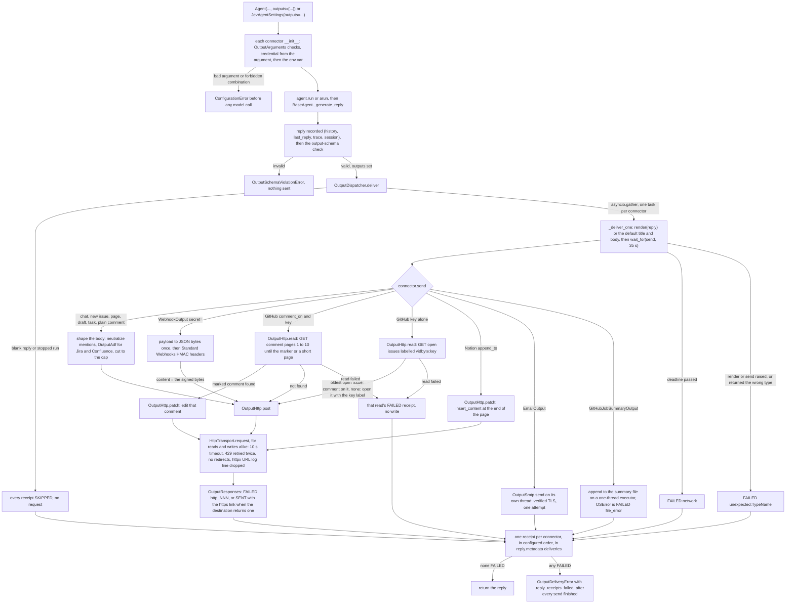

feat(outputs): agents deliver each finished reply to 16 destinations: chat, email, issue trackers, docs, CRM, drafts, and signed webhooks
## Summary
An agent can now send each finished reply to 16 destinations: Slack, Discord, Microsoft Teams, Google Chat, Telegram, email over SMTP, GitHub Issues, the GitHub Actions job summary, GitLab, Linear, Jira Cloud, Confluence Cloud, Notion, Typefully drafts, HubSpot tasks, and any HTTPS webhook. The developer passes connectors as `outputs=[...]` to `Agent`, `BaseAgent`, or `CodingAgent`, or as `JevAgentSettings.outputs`. Each connector takes one pasted static key, from its argument or its environment variable, with no OAuth. The first batch built the delivery path: plain SDK code runs once, after the reply passes its schema check and is recorded, so the model never sees a key or picks a target. All connectors send at once under a 35 s deadline, only HTTP 429 is retried, each destination gets one receipt in `reply.metadata["deliveries"]`, and any failure raises `OutputDeliveryError` after every send has finished. The second batch makes replies render natively (Slack `markdown` block, Telegram rich Markdown, a Teams card with a bold title, Jira and Confluence rich text, Discord forum posts). It also gives `WebhookOutput` fixed headers, a custom payload, and a Standard Webhooks signature over the exact bytes sent, lets GitHub, Linear, and Jira comment on an existing item and Notion append to a page, and lets GitHub edit one marked comment or keep one issue per key instead of opening duplicates. It adds five connectors (GitLab, job summary, Confluence, Typefully, HubSpot) and a docs pass. Every behavior the second batch adds lives inside a connector's `send` or below it, in `OutputHttp` and `HttpTransport`: a send reads first and writes at most once, last, and `BaseAgent`, the dispatcher, the skip rule, and the 35 s deadline are unchanged since the first batch. Specs: `docs/spec/agent-output-connectors/spec.md` (r8) and `docs/spec/output-connector-followups/spec.md` (r3). No new dependency.

## How to use what this PR introduces
```python
from vidbyte import (
    Agent,
    DiscordOutput,
    GitHubIssueOutput,
    GitHubJobSummaryOutput,
    OutputDeliveryError,
    TelegramOutput,
    WebhookOutput,
)

agent = Agent(
    name="ci-reviewer",
    system_prompt="Review the diff and report what is wrong.",
    provider="openai",
    model_name="gpt-4.1",
    outputs=[
        GitHubIssueOutput(repo="acme/shop", comment_on=412, key="ci-review"),  # GITHUB_TOKEN; edits one comment
        GitHubJobSummaryOutput(),                                               # GITHUB_STEP_SUMMARY
        DiscordOutput(forum=True, forum_tags=["1203040506070809"]),             # DISCORD_WEBHOOK_URL
        TelegramOutput(chat_id="@acme_alerts", topic_id=7),                     # TELEGRAM_BOT_TOKEN
        WebhookOutput(headers={"Authorization": "Bearer n8n-demo-key"}, secret="whsec_MfKQ9r8GKYqrTwjUPD8ILPZIo2LaLaSw"),
    ],
)

try:
    reply = agent.run("Review pull request 412")
except OutputDeliveryError as err:
    reply = err.reply

for receipt in reply.metadata["deliveries"]:
    print(receipt.destination.value, receipt.status.value, receipt.url)
```
This is spec §4 unchanged, and it runs as written. I ran it offline twice on the same agent. The model was the feature pack's scripted `AnswerRunner` and HTTP was scripted at `HttpTransport._send_once`, as the acceptance test does, so no real request was made. Both runs printed exactly the five lines in the spec:
```text
github_issue sent https://github.com/acme/shop/pull/412#issuecomment-2400000001
github_job_summary sent None
discord sent None
telegram sent None
webhook sent None
```
Run 1 sent `GET …/issues/412/comments?per_page=100&page=1` (empty), then `POST …/issues/412/comments` with the body ending in `<!-- vidbyte:ci-review -->`. Run 2 found that marked comment and sent `PATCH …/issues/comments/2400000001` instead, so there was still one comment. The summary file held both replies, each followed by a blank line. The developer no longer writes GitHub pagination, an HMAC, a forum-post body, or Telegram's rich-message shape, and no longer opens a new issue on every run.

The other new modes and connectors are one line each. I ran this block offline as well, with its imports from `vidbyte`, passed as `outputs=` to an `Agent` like the one above, with the same scripted model and HTTP:
```python
outputs = [
    GitHubIssueOutput(repo="acme/shop", labels=["nightly"], key="nightly-scan"),  # one open issue per key
    LinearIssueOutput(comment_on="ENG-123"),                                    # comment on an existing issue
    NotionPageOutput(append_to="1f0c3c4e-8a5b-4c1e-9f6e-2b7d1a9c0e11"),         # append to one page
    GitLabIssueOutput(project="acme/shop", merge_request=7),                    # note on a merge request
    TypefullyDraftOutput(social_set_id=123, platforms=["x", "linkedin"]),       # a draft; a person publishes it
    HubSpotTaskOutput(),                                                         # one CRM task
    WebhookOutput(payload=lambda reply, content: {"topic": "agents", "message": content.title}),
]
```
```text
github_issue sent https://github.com/acme/shop/issues/88
linear_issue sent https://linear.app/acme/issue/ENG-123#comment-5f1c
notion_page sent None
gitlab_issue sent None
typefully_draft sent https://typefully.com/?d=9
hubspot_task sent None
webhook sent None
```
GitHub made one `GET …/issues?labels=vidbyte%3Anightly-scan&state=open&sort=created&direction=asc&per_page=100`, found nothing, and opened the issue with the key's label added. Notion got one `PATCH …/pages/<id>/markdown`. Every other destination got one `POST`.

## Flow

Every argument is checked when the connector and the agent are built, so a missing key, a bad URL, or two targets that cannot both be honoured fail before the model runs. State changes only at the destination (the single write of each send) or in the job-summary file (one append); the reads before it change nothing, and a failed read ends the send with that read's receipt. Each connector turns its own HTTP, SMTP, or file failure into a FAILED receipt, so one bad destination never stops the others. The dispatcher maps anything else to `unexpected:<Type>`, lets cancellation pass through unchanged, and raises only after every connector has finished.

## Destinations
| Connector | Credential env var | What each reply creates or updates | Options added in batch 2 |
|---|---|---|---|
| `SlackOutput` | `SLACK_WEBHOOK_URL` | A message in the webhook's channel | Up to 12,000 chars: one `markdown` block, with the one-line title as notification text; longer: escaped text, as before (cap 40,000) |
| `DiscordOutput` | `DISCORD_WEBHOOK_URL` | A message in the webhook's channel | `forum=True`: a new forum post named after the title (100 chars); `forum_tags=` |
| `TeamsOutput` | `TEAMS_WEBHOOK_URL` | An Adaptive Card in a channel or chat | Full-width card: bold title block, then the body without the repeated title (cap 7,000) |
| `GoogleChatOutput` | `GOOGLE_CHAT_WEBHOOK_URL` | A message in a space | Unchanged: Google documents Markdown only for the Chat API, not webhooks |
| `TelegramOutput` | `TELEGRAM_BOT_TOKEN` | A bot message in a chat or channel | `sendRichMessage` Markdown (cap 32,768, was 4,096); `<` becomes `＜` and `![` becomes `!［`; `topic_id=` |
| `EmailOutput` | `SMTP_PASSWORD` | One plain-text email over verified TLS | Unchanged |
| `GitHubIssueOutput` | `GITHUB_TOKEN` | A new issue | `comment_on=` (an issue or PR); `key=`: edit one marked comment, or keep one open issue per key |
| `GitHubJobSummaryOutput` (new) | `GITHUB_STEP_SUMMARY` (a path) | An append to the Actions step summary | No network; any `OSError` is FAILED `file_error` |
| `GitLabIssueOutput` (new) | `GITLAB_TOKEN` | A new issue (link `web_url`), or a merge request note | `host=` for self-managed GitLab; `labels=` |
| `LinearIssueOutput` | `LINEAR_API_KEY` | A new issue in a team | `labels=` (label UUIDs); `comment_on=` (`ENG-123` or a UUID) |
| `JiraIssueOutput` | `JIRA_API_TOKEN` | A new Jira Cloud issue | Rich description (headings, flat lists, code blocks); `labels=`; `comment_on="PROJ-12"` |
| `ConfluencePageOutput` (new) | `CONFLUENCE_API_TOKEN` | A new page in a space, as rich text | `parent_id=` |
| `NotionPageOutput` | `NOTION_API_KEY` | A new child page | `append_to=<page id>` |
| `TypefullyDraftOutput` (new) | `TYPEFULLY_API_KEY` | One draft for the chosen platforms (X, LinkedIn, Threads, Bluesky, Mastodon) | Never publishes or schedules |
| `HubSpotTaskOutput` (new) | `HUBSPOT_ACCESS_TOKEN` | One CRM task, due at the send time | No owner and no association |
| `WebhookOutput` | `VIDBYTE_OUTPUT_WEBHOOK_URL` | One JSON POST of `{agent, title, body, structured}` | `headers=`, `payload=`, `secret=` (Standard Webhooks signing) |

Every batch-2 option is a keyword argument with a default, so every first-batch call still works. vidbyte-cli draft #166 builds on `SlackOutput`, `GitHubIssueOutput`, `LinearIssueOutput`, and the root `OutputDispatcher`; none of them lost a name or a parameter. Three destinations change shape on the wire on purpose: Slack replies of at most 12,000 characters, Telegram, and Teams. Two change only for some inputs: Jira, when the body has Markdown headings, lists, or code fences, and GitHub, when a body contains `<!-- vidbyte:` (it is quoted). Everything else sends the same request byte for byte (AC-34). `vidbyte/lib/outputs/README.md` gives each destination's credential steps, least privilege, cap, and official docs, plus the Email-in and Webhook receivers sections (ntfy, Gotify, Home Assistant, n8n, Jira Automation, and others reached with `headers=` and `payload=`).

## What changed
Full list: `git diff --stat origin/main...HEAD` (108 files; 64 outside `docs/`).
| Area | Files | Why |
|---|---|---|
| Agent wiring (batch 1) | `vidbyte/agents/base.py`, `fork.py`, `jev/agent.py`, `jev/settings.py` | `outputs=` on agents and `restore`; delivery after the schema check in `_deliver_outputs`; forks never post. Not touched in batch 2. |
| Contract and dispatcher (batch 1) | `vidbyte/agents/output/{connector,dispatcher,__init__}.py` | `OutputConnector`, the skip and shaping rules, concurrent delivery under the deadline, receipts, `OutputDeliveryError`. Not touched in batch 2 except exports. |
| Shared delivery | `vidbyte/lib/outputs/{base,delivery,text}.py`, `vidbyte/lib/http/transport.py` | Batch 1: `BaseOutput`, `OutputArguments`, `OutputHttp.post`, `OutputSmtp`, `OutputText`. Batch 2: `OutputHttp.patch` and `read`, `OutputResponses`, `basic_authorization`; seven new `OutputArguments` checks; `HttpTransport.request(content=)` sends exact bytes. |
| Rich text and GitHub helpers (batch 2) | `vidbyte/lib/outputs/adf.py`, `github_api.py` | `OutputAdf` builds Atlassian rich text for Jira and Confluence; `GitHubRequests` and `GitHubResponses` build GitHub's requests and read its lists. |
| First-batch connectors | `vidbyte/lib/outputs/{slack,discord,teams,telegram,github,linear,jira,notion,webhook}.py`; `google_chat.py` and `email.py` unchanged since batch 1 | The batch-2 options in the table above. |
| New connectors (batch 2) | `vidbyte/lib/outputs/{gitlab,github_job_summary,confluence,typefully,hubspot}.py` | One module per new product. |
| Records, enums, constants, error | `vidbyte/lib/{dataclasses,enums,constants}/outputs.py`, `vidbyte/lib/enums/__init__.py`, `vidbyte/lib/errors/{base,__init__}.py` | Batch 2: `OutputRequest` takes JSON, exact bytes, or no body; `OutputRead`; `OutputMethod`; `TypefullyPlatform`; five `OutputDestination` values and env vars; `file_error` joins the "may already have been delivered" codes. |
| Exports and contract | `vidbyte/__init__.py`, `vidbyte/lib/outputs/__init__.py`, `contracts/sdk-public-api.json` | 24 root names in all (18 from batch 1, 6 from batch 2: the five connectors and `TypefullyPlatform`); contract 630 exports. |
| Tests | `tests/features/agent_output_connectors/` (20 files) | Feature pack: 186 test functions, 664 cases. Batch 2 added 7 modules (rendering, webhook options, comments, new destinations, update in place, follow-up contract and acceptance) and updated the first-batch expectations for Slack, Telegram, and Teams. |
| Docs | `vidbyte/lib/outputs/README.md`, `vidbyte/agents/output/README.md`, `vidbyte/agents/README.md`, `vidbyte/agents/jev/README.md`, `vidbyte/lib/README.md`, `REPO_MAP.md` | Provider reference for 16 destinations, Email-in, Webhook receivers, footguns; agent docs. |
| Specs | `docs/spec/agent-output-connectors/`, `docs/spec/output-connector-followups/` | Requests, specs, test plans, reviews, verify logs, stage reports, and the PR bodies. |

## Acceptance criteria → proof
Batch 2 (`output-connector-followups` r3). All tests are in `tests/features/agent_output_connectors/`; the file prefix `test_output_connectors_` is shortened to `…_`. Every name below was checked against `pytest --collect-only` on this branch.
| AC | What it checks | Proven by |
|---|---|---|
| AC-1 | The §4 snippet prints the five lines. | `…_followup_acceptance.py::test_followup_spec_snippet_reaches_five_destinations_and_prints_the_documented_lines` |
| AC-2 | Discord `forum=True` adds a one-line `thread_name` and the tags; `forum=False` is unchanged. | `…_rendering.py::test_discord_forum_post_adds_a_one_line_thread_name_and_its_tags` |
| AC-3 | Bad `forum` or `forum_tags` fail at construction. | `…_rendering.py::test_discord_forum_arguments_are_checked_at_construction` |
| AC-4 | Slack up to 12,000 chars is a `markdown` block with mentions neutralized; longer is escaped text. | `…_rendering.py::test_slack_reply_up_to_12000_characters_is_a_markdown_block_with_an_escaped_one_line_title`, `::test_slack_switches_to_todays_escaped_text_above_12000_characters`; `…_wire_contract.py::test_each_http_connector_sends_its_documented_request[slack]` |
| AC-5 | Telegram sends rich Markdown with no HTML tag and no media block; only `<` and `![` change. | `…_rendering.py::test_telegram_sends_rich_markdown_with_no_html_tag_and_no_media_block`, `::test_telegram_neutralization_changes_only_tag_starts_and_media_brackets` |
| AC-6 | `topic_id` must be a positive int. | `…_rendering.py::test_telegram_topic_id_must_be_a_positive_int` |
| AC-7 | Teams: bold title block, body without the repeated title, full width. | `…_rendering.py::test_teams_card_has_a_bold_title_block_and_the_body_without_a_repeated_title`; `…_wire_contract.py::test_each_http_connector_sends_its_documented_request[teams]` |
| AC-8 | Jira builds headings, lists, code blocks, and paragraphs in order, never empty text. | `…_rendering.py::test_jira_description_is_built_with_adf_blocks_in_order`, `::test_jira_description_cut_inside_an_open_fence_ends_its_code_block_with_the_marker`, `::test_adf_document_follows_the_block_rules_and_never_emits_empty_text` |
| AC-9 | Google Chat is byte-identical to batch 1. | `…_wire_contract.py::test_each_http_connector_sends_its_documented_request[google_chat]`; `…_followup_acceptance.py::test_first_batch_connectors_keep_their_headers_and_send_no_raw_bytes[google_chat]` |
| AC-10 | Webhook `headers=` are sent lowercased, hidden from `repr`, and bad ones are refused without echoing a value. | `…_webhook_options.py::test_webhook_sends_fixed_headers_lowercased_and_keeps_the_envelope`, `::test_invalid_webhook_headers_are_refused_naming_only_safe_parts`, `::test_webhook_header_values_never_reach_a_rendered_surface_when_the_receiver_echoes_them` |
| AC-11 | `payload=` replaces the envelope; a bad payload fails only that output. | `…_webhook_options.py::test_webhook_payload_replaces_the_envelope_and_receives_the_reply_and_content`, `::test_webhook_payload_that_raises_or_returns_a_non_mapping_fails_only_that_output`, `::test_webhook_payload_must_be_callable` |
| AC-12 | `secret=` sends exact bytes with a signature that verifies. | `…_webhook_options.py::test_signed_webhook_puts_exact_bytes_on_the_wire_with_a_verifiable_signature`, `::test_signing_headers_replace_the_callers_content_type_and_signature_headers` |
| AC-13 | A 429 retry repeats the same bytes and headers; each send gets a new id. | `…_webhook_options.py::test_signed_webhook_retry_after_429_repeats_the_same_bytes_and_signing_headers`, `::test_each_signed_send_gets_a_new_webhook_id` |
| AC-14 | A bad `secret` is refused without echoing it; 24 to 64 bytes are accepted. | `…_webhook_options.py::test_invalid_webhook_secret_is_refused_naming_secret_without_echoing_it`, `::test_webhook_secret_of_24_to_64_bytes_is_accepted_with_or_without_the_prefix` |
| AC-15 | `HttpTransport` sends `content=` verbatim and refuses it with `json_body`. | `…_webhook_options.py::test_transport_sends_content_bytes_verbatim_without_adding_a_content_type`, `::test_transport_refuses_json_body_and_content_together_before_any_request` |
| AC-16 | GitHub `comment_on` posts the chat text and links the comment. | `…_comments.py::test_github_comment_on_posts_the_chat_text_and_links_the_comment` |
| AC-17 | Linear `comment_on` uses `commentCreate`; `labels` adds `labelIds`. | `…_comments.py::test_linear_comment_on_uses_comment_create_and_links_the_comment`, `::test_linear_labels_add_label_ids_to_the_issue_input`; `…_wire_contract.py::test_each_http_connector_sends_its_documented_request[linear_issue]` |
| AC-18 | Jira `comment_on` posts a rich-text comment linked by `focusedCommentId`; `labels` are added. | `…_comments.py::test_jira_comment_on_posts_an_adf_comment_and_links_it_by_focused_comment_id`, `::test_jira_labels_are_added_to_the_issue_fields`; `…_wire_contract.py::test_each_http_connector_sends_its_documented_request[jira_issue]` |
| AC-19 | Notion `append_to` PATCHes the page Markdown with mentions neutralized. | `…_comments.py::test_notion_append_to_patches_the_page_markdown_with_mentions_neutralized` |
| AC-20 | Forbidden or missing target combinations name both parameters. | `…_comments.py::test_forbidden_or_missing_mode_combinations_name_both_parameters` |
| AC-21 | GitLab issue and merge request note. | `…_new_destinations.py::test_gitlab_issue_posts_title_description_and_labels_and_links_web_url`, `::test_gitlab_merge_request_note_posts_the_chat_text_and_is_sent_without_a_link` |
| AC-22 | Job-summary appends run off the event loop, one after the other; file errors are `file_error`. | `…_new_destinations.py::test_job_summary_concurrent_appends_run_off_the_loop_one_after_the_other`, `::test_job_summary_appends_the_chat_text_and_a_blank_line_after_what_is_there`, `::test_job_summary_os_error_is_failed_file_error_and_creates_nothing` |
| AC-23 | Confluence creates a v2 page with a rich-text body and links it. | `…_new_destinations.py::test_confluence_creates_a_v2_page_with_an_adf_body_and_links_it` |
| AC-24 | Typefully creates one draft and never schedules. | `…_new_destinations.py::test_typefully_creates_one_draft_for_the_chosen_platforms_and_never_schedules` |
| AC-25 | HubSpot creates a task stamped in UTC; the body is cut at 65,536. | `…_new_destinations.py::test_hubspot_creates_a_task_stamped_with_the_send_time_in_utc`, `::test_hubspot_task_body_is_cut_at_65536_characters` |
| AC-26 | The five new connectors name their missing credential, mask `repr`, and are exported. | `…_configuration.py::test_every_connector_without_a_credential_names_its_parameter_and_variable`; `…_contract.py::test_every_connector_is_a_base_output_that_satisfies_the_protocol_and_masks_its_repr`, `::test_public_names_are_exported_from_the_agent_output_package_and_the_root`; contract `--check` (Verification) |
| AC-27 | Sticky comment: read both pages, then one PATCH; no marker means one POST. | `…_update_in_place.py::test_sticky_marked_comment_on_page_two_is_edited_after_both_reads`, `::test_sticky_without_a_marker_on_a_short_page_posts_one_marked_comment` |
| AC-28 | A failed read is that read's receipt, and nothing is written (first page or later page). | `…_update_in_place.py::test_read_failure_is_that_reads_receipt_and_nothing_is_written`, `::test_read_failure_on_a_later_page_is_that_reads_receipt_and_nothing_is_written` |
| AC-29 | The sticky search stops after 10 full pages, then posts. | `…_update_in_place.py::test_sticky_search_stops_after_ten_full_pages_then_posts` |
| AC-30 | One issue per key: comment on the oldest labelled issue (skipping PRs), or open it with the label. | `…_update_in_place.py::test_keyed_issue_found_skips_pull_requests_and_comments_on_the_oldest_issue`, `::test_keyed_issue_missing_creates_the_issue_with_the_key_label_added` |
| AC-31 | A marker written by the model is neutralized; only the connector's own marker ends the body. | `…_update_in_place.py::test_marker_forged_in_the_reply_is_neutralized_and_only_the_own_marker_ends_the_body` |
| AC-32 | Bad `key` or `comment_on` names its parameter; the longest valid key works. | `…_update_in_place.py::test_invalid_key_or_comment_on_names_its_parameter`, `::test_longest_valid_key_is_accepted_and_used_in_the_marker` |
| AC-33 | Reads and patches use the same timeout, 429-only retry, no redirects, and log filter as posts. | `…_update_in_place.py::test_reads_and_patches_use_the_output_transport_rules`, `::test_reads_and_patches_never_follow_a_redirect`, `::test_reads_and_patches_drop_the_httpx_request_log_while_the_callers_own_requests_still_log` |
| AC-34 | First-batch connectors with first-batch arguments send today's headers and no raw bytes. | `…_followup_acceptance.py::test_first_batch_connectors_keep_their_headers_and_send_no_raw_bytes`; `…_wire_contract.py::test_each_http_connector_sends_its_documented_request` |
| AC-35 | Docs: dated provider rows, Email-in and Webhook receivers sections, the corrected first-spec catalog, no "eleven" left, README under 40,000 chars (32,180). | `…_followup_contract.py::test_docs_changed_and_new_provider_rows_carry_their_facts_a_link_and_the_new_date`, `::test_docs_new_readme_sections_cover_every_named_tool_with_official_links`, `::test_docs_first_spec_catalog_carries_the_corrections_and_a_revision_row`, `::test_docs_no_module_header_or_readme_still_counts_eleven_connectors`; `…_contract.py::test_docs_new_folder_readmes_stay_within_40000_characters` |
| AC-36 | `OutputDeliveryError` lists `file_error` among codes that may already be delivered. | `…_new_destinations.py::test_delivery_error_lists_file_error_among_codes_that_may_already_be_delivered` |

<details><summary>First batch (agent-output-connectors r8) — 26 ACs, every named test still on the branch</summary>

All 44 test names below were re-checked with `pytest --collect-only` on this branch. Batch 2 changed the expected wire values inside some of them (Slack, Telegram, Teams), not their names.

| AC | What it checks (plain words) | Proven by |
|---|---|---|
| AC-1 | The first spec's §4 snippet prints the two receipt lines and raises nothing. | `…_acceptance.py::test_spec_snippet_delivers_one_validated_reply_to_slack_and_a_github_issue_and_prints_both_receipts` |
| AC-2 | The env-var credential is stripped, an explicit argument wins, and a missing one names the parameter and the variable. | `…_configuration.py::test_slack_credential_from_the_environment_is_stripped`, `::test_slack_credential_prefers_a_non_blank_explicit_argument_over_the_environment`, `::test_slack_credential_missing_everywhere_raises_the_documented_message` |
| AC-3 | No `repr`, error, receipt, metadata, or exported state shows the credential. | `…_security.py::test_no_surface_shows_the_credential_even_when_the_destination_echoes_it` |
| AC-4 | A reply that fails its schema raises and sends nothing. | `…_acceptance.py::test_reply_that_fails_its_output_schema_raises_and_sends_nothing` |
| AC-5 | One failed destination: the others are still tried, and the error carries the recorded reply and all receipts. | `…_acceptance.py::test_partial_failure_attempts_every_output_then_raises_with_the_recorded_reply_and_one_receipt_each` |
| AC-6 | Only 429 is retried; a silent destination fails at the deadline without holding the others. | `…_http_failures.py::test_slack_answer_maps_to_one_receipt_and_only_a_429_is_retried`; `…_dispatch.py::test_destination_that_never_answers_is_failed_network_at_the_deadline_without_holding_back_the_others` |
| AC-7 | Mixed failures get their codes in configured order, and no URL leaks. | `…_http_failures.py::test_mixed_failures_give_their_codes_in_configured_order_and_no_url_leaks` |
| AC-8 | A blank reply or a stopped run is SKIPPED everywhere, with no request. | `…_dispatch.py::test_stopped_or_blank_reply_is_skipped_for_every_output_with_no_request_and_no_error`; `…_agent_wiring.py::test_run_stopped_by_max_iterations_is_skipped_for_every_output_and_returns_normally` |
| AC-9 | Channel-wide mentions cannot ping in Slack, Discord, Google Chat, Telegram, or Notion. | `…_wire_contract.py::test_channel_wide_mentions_are_neutralized_for_each_chat_destination`, `::test_notion_mention_tags_in_the_markdown_body_are_neutralized` |
| AC-10 | Long bodies are capped with a marker; long titles become one 250-character line. | `…_wire_contract.py::test_long_reply_is_capped_for_discord_and_its_long_first_line_becomes_a_250_character_one_line_title`, `::test_long_first_line_becomes_a_250_character_one_line_title_at_every_titled_destination` |
| AC-11 | Default title and body shaping; `render` overrides it; a bad `render` or `send` result fails only its connector. | `…_dispatch.py::test_default_shaping_turns_each_reply_into_one_title_and_one_body`, `::test_render_replaces_the_shaping_rule_for_its_own_connector_only`, `::test_render_that_returns_anything_but_output_content_fails_only_its_connector`, `::test_send_that_returns_anything_but_a_delivery_receipt_fails_only_its_connector` |
| AC-12 | Forks and `AgentTool` children never post. | `…_agent_wiring.py::test_fork_and_agent_tool_children_never_deliver_the_parents_outputs` |
| AC-13 | `export_state` never saves outputs; `restore` posts only to what the caller passes. | `…_agent_wiring.py::test_export_and_restore_never_serialize_outputs_and_reattach_only_what_the_caller_passes` |
| AC-14 | `JevAgent` takes outputs from its settings and delivers; a bare string is rejected. | `…_agent_wiring.py::test_jev_agent_takes_outputs_from_its_settings_and_delivers_the_finished_reply`, `::test_jev_agent_settings_reject_a_bare_string_outputs_value` |
| AC-15 | `CodingAgent` accepts `outputs=` with no signature change. | `…_agent_wiring.py::test_coding_agent_accepts_outputs_through_its_base_options_and_delivers`; `tests/features/coding_agent/test_coding_agent_contract.py` unmodified |
| AC-16 | SMTP: STARTTLS on 587, implicit TLS on 465, each failure maps to its code, `sender` required when the username has no `@`. | `…_email.py::test_default_port_uses_starttls_then_login_then_one_plain_text_message_off_the_event_loop`, `::test_port_465_uses_implicit_tls_with_a_verified_context_and_no_starttls`, `::test_smtp_failure_maps_to_its_code_after_one_connection_and_stops_at_that_step`, `::test_partial_refusal_returned_by_send_message_is_failed_recipients_refused`, `::test_username_without_an_at_sign_and_no_sender_is_rejected_naming_sender` |
| AC-17 | Each HTTP connector sends exactly its documented request; a 2xx with no usable link is FAILED. | `…_wire_contract.py::test_each_http_connector_sends_its_documented_request`, `::test_created_object_link_that_is_missing_or_unsafe_makes_a_2xx_response_failed_invalid_response` |
| AC-18 | Cancellation passes through unwrapped and drops the run's queued prompts. | `…_agent_wiring.py::test_cancellation_during_delivery_propagates_unwrapped_and_clears_the_runs_queued_prompts` |
| AC-19 | Sends run at the same time; receipts keep configured order. | `…_dispatch.py::test_sends_run_concurrently_and_receipts_keep_configured_order_not_finish_order` |
| AC-20 | Every invalid `outputs` value or connector argument fails at construction, naming the parameter and never the secret. | `…_configuration.py::test_invalid_connector_argument_is_rejected_at_construction_naming_the_parameter_and_no_secret`, `::test_invalid_outputs_value_is_rejected_when_the_agent_is_built` |
| AC-21 | An agent without outputs behaves exactly as before. | `…_acceptance.py::test_agent_without_outputs_runs_exactly_as_before_and_writes_no_deliveries_key`; the full suite (Verification) |
| AC-22 | Lint, CI, contract, and Semgrep pass; no dependency added. | Verification below; `git diff origin/main...HEAD -- pyproject.toml` is empty |
| AC-23 | A session records the turn and captures the delivery failure once, via `session.run` and via a direct `agent.run`. | `…_acceptance.py::test_session_records_the_turn_and_captures_the_delivery_failure_before_it_reaches_the_caller`, `::test_agent_bound_to_a_session_reports_its_own_delivery_failure_when_run_directly` |
| AC-24 | Resending only the failed connectors makes one new request. | `…_dispatch.py::test_resending_only_the_failed_connectors_makes_one_new_request_to_that_destination` |
| AC-25 | A redirect is not followed, so the token never reaches another host. | `…_http_failures.py::test_redirect_is_not_followed_so_the_token_never_reaches_the_location_host` |
| AC-26 | Docs: one dated provider row per destination, `outputs=` documented, REPO_MAP entries, READMEs under 40,000 characters. | `…_contract.py::test_docs_provider_reference_has_one_dated_row_with_an_official_link_per_destination`, `::test_docs_describe_outputs_in_the_agent_readme_and_both_folders_in_the_repo_map`, `::test_docs_new_folder_readmes_stay_within_40000_characters` |
</details>

## Verification
The last Python change is `a1405d71`, and the last change outside `docs/` is `44b71741` (one README line). Remote CI ran on `b1c32edd`, which contains both; every commit after it changes only `docs/spec/` (`git diff --stat b1c32edd..HEAD -- . ':!docs'` is empty). The branch is 0 commits behind `main` (fetched 2026-10-14), and `git diff origin/main...HEAD -- pyproject.toml` is empty.
| Gate | Command | Result |
|---|---|---|
| Feature pack | `PYTHONPATH=$(pwd) python -m pytest -q -p no:cacheprovider tests/features/agent_output_connectors` | `664 passed in 5.41s` (HEAD `eff95946`, rerun for this PR body) |
| Lint | `PYTHONIOENCODING=utf-8 python lint/run.py` | `S064 RATCHETED: 4 known finding(s).` · `SDK-LINT: PASS` (HEAD, rerun). A002 `IMPROVED 703 -> 577`; no baseline edited (verify-log iteration 2) |
| Lint, the seven rules this change must not add to | `python lint/run.py --rule <A002, S061, S001, S017, S025, C011, C012> --all --format json`, filtered to touched files | No finding in code this change created or modified; the remaining touched-file findings predate it and are listed in spec §17 (verify-log iteration 1) |
| Import order | `python -m ruff check <touched .py> --config lint/ruff.toml --select I001 --no-cache` | `All checks passed!` (verify-log iteration 1) |
| Source gate | `PYTHONPATH=$(pwd) python scripts/run_ci.py --stage source` | `4679 passed, 13 skipped in 37.36s` · `CI passed.` (HEAD, rerun) |
| Package gate | `python scripts/run_ci.py --stage package` (no PYTHONPATH) | `Installed vidbyte-sdk 0.2.1 passed smoke checks.` · `CI passed.` (`8d8ba811`, verify-log iteration 1; only a README changed after it) |
| Public API contract | `python scripts/generate-sdk-public-api.py --check` | `contracts/sdk-public-api.json is current at eadefa3f… (vidbyte-sdk 0.2.1, 630 exports).` (HEAD, rerun) |
| Semgrep | `semgrep scan --metrics=off --error --config .semgrep/typed-mapping-boundary-policy.yml vidbyte` | `Ran 1 rule on 921 files: 0 findings.` (verify-log iteration 1) |
| Remote `ci.yml`, run 38550257344 on `b1c32edd` | Source / Python 3.11 | success · `4673 passed, 19 skipped in 51.82s` · `CI passed.` |
| | Source / Python 3.12 | success · `4673 passed, 19 skipped, 19 warnings in 52.18s` · `CI passed.` |
| | Package | success · `Installed vidbyte-sdk 0.2.1 passed smoke checks.` · `CI passed.` |
| Remote `static-policy.yml`, run 38550260311 on `b1c32edd` | Static policy | success · `1/1: ✓ All tests passed` · `Ran 1 rule on 921 files: 0 findings.` |

CI in this repo runs only when dispatched, so `gh pr checks` lists nothing; the check runs on `b1c32edd` above are the checks (read with `gh api repos/cerredz/Vidbyte-SDK/commits/<sha>/check-runs`). The docs-only commits after it were not dispatched.

## Adversarial review
Batch 2's spec went through two adversarial review rounds before any test was written: 18 findings (1 Blocker, 5 Major, 12 Minor), all applied. The code was then reviewed through three independent lenses (spec conformance, repo conventions, engineering) and an independent verifier. Result: 14 confirmed (2 Major, 12 Minor), 11 fixed, 3 deferred by decision, 1 refuted. The final re-review returned SOUND. Full record: `docs/spec/output-connector-followups/review.md`.
| ID | Finding | Fixed in |
|---|---|---|
| R-1 (Major) | The Telegram tests never sent two `![` in one reply, so code that neutralized only the first media block passed the whole pack (a mutation proved it). | `05fbe43e`: a two-media-block row, plus later-page read failures for R-5. The mutant now fails. |
| R-2 (Major) | The two transport functions this PR changed explained their new rules without the `# @intent` marker lint A002 looks for. | `a39cf95b`: two `@intent` markers (A002 579 to 577); spec §17 records how the rule was read. |
| Final re-review | SOUND: all 11 fixes held, the pack, suite, lint, and contract were green. Three docs-only Minors: R-RR1 (undated footgun links), R-RR2 (two unrecorded deviations), R-RR3 (constants module over the 300-line target). | `44b71741`, `42018c13`, `b1c32edd` |

Minors fixed: R-5 `05fbe43e`, R-6 `1e678c38` (any `Mapping` from `payload=` is sent), R-8 `efb2c26b` (one Basic-auth helper), R-9 `47696121`, R-10 `3bc709e3`, R-11 `bde205cd`, R-12 `3f5623ca`, R-13 `9fb29e3b`, R-14 `a1405d71`. Deferred: R-3, R-4, and R-7 (see Follow-ups). Refuted: R-15 (removing `TELEGRAM_TEXT_MAX_CHARS` is not a public API change).

The first batch had 15 confirmed findings (1 Blocker, 3 Major, 11 Minor), 14 fixed and 1 turned into an optional question, then two SOUND re-reviews: `docs/spec/agent-output-connectors/review.md`.

## Live checks before this leaves draft
Every test here is offline: HTTP is scripted, so no vendor has seen these requests. Each check below needs your own account and key, and none was run. Do **L-1 first**, then **L-2**. Both change every message on a destination that already worked in the first batch, and both rest on vendor behavior the docs do not state (assumptions A-1 and A-4). L-4 (Teams) is the third such change, on documented card fields.
- **L-1 (do first) — Slack accepts the `markdown` block.** Send a short reply with a heading, a list, and a code block through `SlackOutput` to a test channel, then one containing `<!channel>` and `<@U…>`. Pass: both receipts SENT, the Markdown renders, nobody is pinged, and the notification shows the title. If Slack answers 4xx, every Slack reply up to 12,000 characters fails until D-7 is reverted (or Q-5 is taken).
- **L-2 — Telegram `sendRichMessage`.** Send to a group, to an `@channel` where the bot is an admin with "Post Messages", and to a forum topic with `topic_id=`, plus one 5,000-character reply. Then send one reply holding `<tg-button type="callback_data" data="x">Go</tg-button>`, `a < b`, a fenced `<div>`, ``, and "costs $5 and $10". Pass: all SENT; the button, the `<`, the `<div>`, and the image show as plain text. Note whether "$5 and $10" renders as a formula.
- **L-3 — Google Chat Markdown.** By hand, post `{"text": "**bold**", "markupSyntax": "MARKUP_SYNTAX_MARKDOWN"}` to a space webhook. If it renders bold, answer Q-4.
- **L-4 — Teams card.** Send through a channel workflow and a "Send webhook alerts to a chat" workflow. Pass: a full-width card with a bold title, and the title not repeated in the body.
- **L-5 — Discord forum.** `DiscordOutput(forum=True, forum_tags=[<tag id>])` on a forum channel's webhook. Pass: a tagged post named after the title. Then `?thread_id=<post id>` on the URL with `forum=False` posts into it.
- **L-6 — Notion append.** `NotionPageOutput(append_to=<page id>)` on a page shared with the integration. Pass: SENT, and the reply is at the end of the page.
- **L-7 — Jira.** `comment_on="PROJ-12"`: the receipt link scrolls to the comment. A new issue whose body has headings, lists, and a code block shows them formatted.
- **L-8 — GitHub key label.** The first `GitHubIssueOutput(repo=…, key=…)` run, with a token that has push access, creates the `vidbyte:<key>` label by itself; a 42-character key works. Pass: one issue carrying the label, and the second run comments on it. While there, run the §4 GitHub line twice against a test PR: one comment, edited on the second run.
- **L-9 — Confluence.** A page is created with the rich-text body and the receipt link opens it. A second page with the same title in the space is expected to fail `http_400` (the README suggests a `render=` that adds the date).
- **L-10 — Typefully.** A draft for X and LinkedIn appears, unpublished; the receipt's `private_url` opens it.
- **L-11 — HubSpot.** A task with no association appears in the portal's task list.
- **L-12 — GitLab.** A self-managed instance returns an `https://` `web_url` (otherwise the issue is created but the receipt is FAILED `invalid_response`), and a merge request note appears.
- **L-13 — Webhook signature.** Verify one signed delivery with the official `standardwebhooks` library and the same secret. Pass: verification succeeds. If it fails, the key-decoding assumption (A-7) is wrong.
- **L-14 — Google Apps Script.** Post to an Apps Script web app. Expected: the row is written and the receipt is FAILED `http_302`, as the README says.
- **L-15 — Pushcut.** The README recipe sends a notification.

The first batch's body listed no live checks. Its connectors were also tested only offline, so one real send to each first-batch destination you use (Slack, Discord, Teams, Google Chat, Telegram, email, GitHub, Linear, Jira, Notion, webhook) fits in the same session.

## Deviations from the spec
**Batch 2** (spec r3 §17; none removes or changes a public name or a tested behavior):
- **`OutputHttp.basic_authorization`** is a public static method that §8.5 and D-2 do not list. Review R-8 found the Basic header built twice; Jira and Confluence now share it, and Jira's bytes are unchanged.
- **`TELEGRAM_TEXT_MAX_CHARS` was removed**, because only the old `sendMessage` path used it. It was never a root export (R-15).
- **`OutputHttp.read` returns any parsed JSON.** The list-of-objects check lives in `GitHubResponses.items`, which gives FAILED `invalid_response` otherwise.
- **`OutputAdf` keeps each paragraph's line as written** and matches its patterns on the line without trailing spaces. Blank lines add no node, so an empty fence between two items of one kind keeps one list.
- **Discord's `forum_tags` without `forum=True`** raises inline in `discord.py`, not through a new `OutputArguments` helper. `GitHubRequests.issue` makes the title one line itself, and `signing_key` strips surrounding whitespace first.
- **A few literals stay inline** with no operational name next to them: the `"\n\n"` marker separator, the GitHub query words `open`, `created`, and `asc`, Slack's three escape characters, the header-value characters `"\r\n\x00"`, and HubSpot's `"+00:00"` to `"Z"`.
- **The "no lint finding in touched files" box** is read as "no finding in code this change creates or modifies". The older findings in touched files stay, under AGENTS.md "Do not rewrite untouched code": A002 at `errors/base.py:166/299/314/323` and `transport.py:34/98/124`, and S001 F401 at `vidbyte/__init__.py:434/436/581/588`.
- **`vidbyte/agents/README.md`** was edited although §12.3 does not list it, to name the current destination kinds (R-11, approved).
- **`vidbyte/lib/constants/outputs.py` is 326 lines**, over NFR-2's 300-line target and well under AGENTS.md's 1,000. It was not split, because a second constants module would exceed the 7-new-file budget.
- **Spec §5 drifted in two details, now corrected:** a Notion append is a direct PATCH with no read, and in one-issue-per-key mode a found issue gets a POSTed comment (only the sticky comment is PATCHed). The flow chart above is the corrected one.

**Batch 1** (spec r8 §17, unchanged by batch 2):
- Delivery sits in a private `_deliver_outputs` helper, and three last-trace lines moved into `_record_last_trace`, so `_generate_reply` stays within lint S008 (spec r5 adopted this).
- `OutputArguments.optional_callable` takes the callable's own type rather than `object` (generic since batch 2, D-26), so mypy needs no `cast`. `OutputArguments.identifier` returns the canonical lowercase dashed UUID.
- `OutputShaping.content` falls back to the agent name whenever no title is found. `OutputRequest` rejects a header name that is not lowercase.
- `vidbyte/lib/errors/__init__.py` keeps its existing unsorted-import finding, so lint S051 does not regress.
- `TelegramOutput.__init__` checks the `chat_id` type inline. Batch 2 adds two more inline checks of the same kind: Discord `forum_tags` and the GitLab port.

## Follow-ups
**Optional additions for batch 2, not built (spec r3 Q-1 to Q-10; each defaults to No):**
- Q-1: `owner_id=` on `HubSpotTaskOutput`, so tasks land in one user's list.
- Q-2: read `secret=` from `VIDBYTE_OUTPUT_WEBHOOK_SECRET` when it is not passed.
- Q-3: when Telegram rejects rich Markdown with a 400, resend once as plain `sendMessage` (a 400 posted nothing, so no duplicate).
- Q-4: after L-3 passes, send `markupSyntax` Markdown to Google Chat.
- Q-5: when Slack rejects the `markdown` block with a 4xx, resend once as escaped text.
- Q-6: send `skip_entity_detection` to Telegram, so URLs and `@username` in reply text are not auto-linked.
- Q-7: skip a multi-request send's write when too little of the 35 s deadline is left, instead of risking an ambiguous cut.
- Q-8: match sticky markers only on comments written by a bot or by the token's own user (today the oldest marked comment wins, even one a person planted).
- Q-9 (review R-3): refuse non-ASCII, padded, or framing `headers=` values at construction, instead of failing at send time.
- Q-10 (review R-7): map a reply with a lone surrogate to `file_error` in the job summary, instead of `unexpected:UnicodeEncodeError`.

**Optional additions for batch 1, not built (spec r8 Q-8 to Q-11):** Q-8, reject a Jev specialist whose agent has its own outputs, to prevent double posts. Q-9, an `implicit_tls` flag on `EmailOutput` for ports other than 465. Q-10, neutralize per-user `@mentions` in GitHub and Telegram text. Q-11, reject non-ASCII or control characters in credentials. Its Q-3, an HMAC signature on `WebhookOutput`, is now built as `secret=`.

**Deferred review Minors:** R-3 (now Q-9) and R-7 (now Q-10) above, and R-4: 133 added test comment lines are wider than 72 columns, like most of `tests/`. Rewrapping them changes no behavior.

**Known limits, documented in `vidbyte/lib/outputs/README.md` and `vidbyte/agents/output/README.md`:** two runs racing on one key can each write, and later runs use the oldest marked comment or key issue. Only the first 1,000 comments are searched for the marker, and anyone who can comment can plant a marker before the first run (Q-8). Without push access GitHub drops labels silently, so `key=` alone opens a new issue every run. A send cut by the 35 s deadline may still land. GitHub caps a step's job summary at 1 MiB. Nothing but a 429 is retried, and receipts are not saved in session checkpoints.

**Candidate next PRs (the checklist's "Next, if you want them" list, not built here):** Grafana annotations, Azure DevOps work items, PagerDuty Change Events, and a local Markdown or JSONL file (for example an Obsidian vault folder). Update-in-place for Linear and Jira, which the request left for "only if you ask".

🤖 Generated with [Claude Code](https://claude.com/claude-code)
