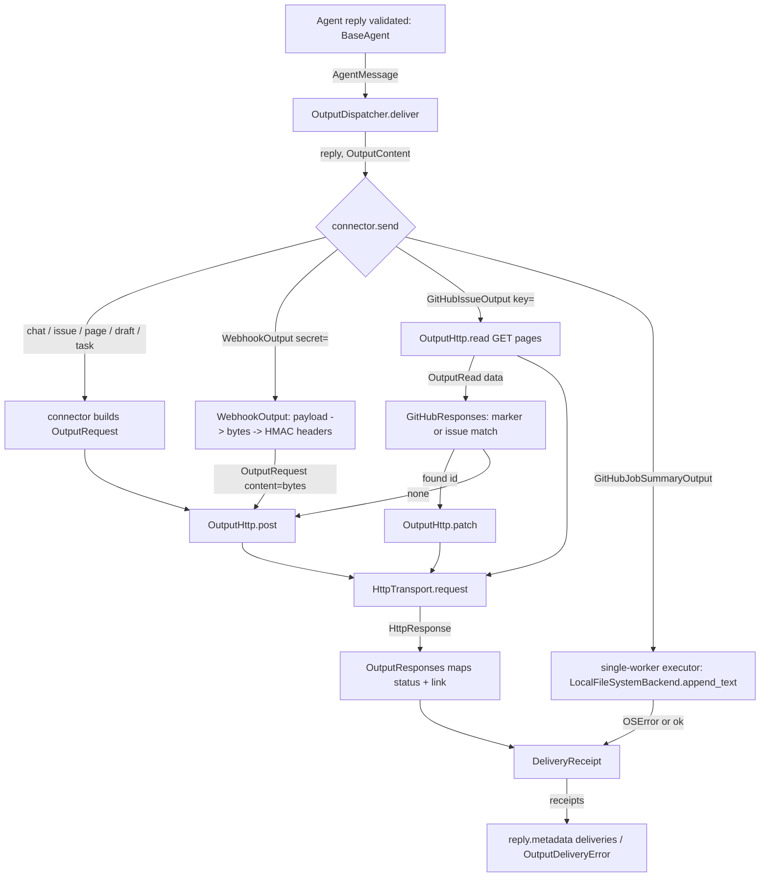
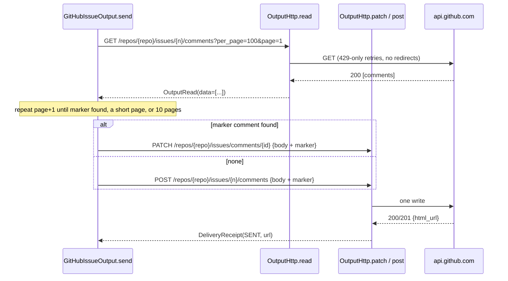

# Spec: Output connector follow-ups

> **TL;DR** — PR #882 gets a second batch of work on top of its 11 output connectors. Replies render properly on Discord forums, Slack, Telegram, Teams, and Jira. `WebhookOutput` gains fixed headers, a custom payload, and Standard Webhooks signing. Existing GitHub, Linear, Jira, and Notion targets can now take comments, and Linear and Jira issues can take labels. Five new connectors are added: GitLab, GitHub job summary, Confluence, Typefully drafts, and HubSpot tasks. GitHub can also update a comment or issue in place instead of opening a duplicate. The design decision that matters most: every new ability is a keyword argument on an existing connector, or a new connector built on the same `OutputRequest` → `OutputHttp` path. The only shared-layer changes are three. `HttpTransport` gets an exact-bytes `content=` option, so a signature covers the bytes actually sent. `OutputHttp` gets `patch` and `read`, and a send always does every read first and at most one write last. `OutputRequest` gets an optional body. The dispatcher and `BaseAgent` do not change.

## §0 User prompts

### 0.1 Invoking request (verbatim)

```
great, implement these things on the pr
```

"These things" is the checklist the assistant gave in answer to Prompt 9. That checklist is reproduced verbatim in `request.md` §B. Its sections 0–5 are the scope source for this spec, and are quoted here verbatim:

> ### 0 · Docs pass on #882, before merge (no code changes, so nothing to re-review)
> - [ ] **Discord row** (`vidbyte/lib/outputs/README.md`, line 63): say it works in text and announcement channels. Explain that adding `?thread_id=` to the URL posts into an existing thread or forum post, and that new forum posts fail with `http_400` until the Rendering PR lands.
> - [ ] **Teams row and the note at line 110:**
>   - Microsoft now labels "Anyone" a Legacy setting.
>   - Group chats work with the "Send webhook alerts to a chat" template.
>   - If a tenant turns "Anyone" off, use the channel's email address with `EmailOutput`.
> - [ ] **Telegram row:** channels work with `chat_id="@name"` once the bot is an admin.
> - [ ] **Jira row:** Atlassian API tokens expire within a year.
> - [ ] **New "Email-in" section:**
>   - About 12 tools with setup links: Linear intake, Trello, Asana, ClickUp, monday.com, Todoist, PagerDuty, Zendesk, Freshdesk, Help Scout, Slack/Teams channel addresses, Evernote.
>   - Caveats: some tools read the subject line as commands, and some accept mail only from known senders.
>   - Note that `render=` can already set a fixed subject, e.g. Basecamp's `FWD:` or Evernote's trailing `+` to append to a note.
> - [ ] **Webhook section:** Google Apps Script answers with a 302 redirect. The row still gets written, but the receipt says FAILED `http_302`. Recommend sending Sheets through n8n, Make or Zapier instead.
> - [ ] **Spec §9.2(b) corrections:**
>   - HubSpot tasks qualify.
>   - X, LinkedIn, Bluesky, Mastodon and Threads are reachable through Typefully or Buffer.
>   - Pushover and ntfy are reachable through Apprise.
>   - Nine JSON-based SMS providers exist.
>   - Retirements: Zendesk, Shopify, Greenhouse and Bandwidth are moving to OAuth-only; Bitbucket issues, Relay.app, OneNote email-in and LINE Notify are gone.
> - [ ] **Then your usual merge routine:**
>   1. Merge main into the branch (it was 5 commits behind, and the merge was conflict-free).
>   2. Re-measure S008.
>   3. Dispatch `ci.yml` and `static-policy.yml`.
>   4. Mark the PR ready.
>
> ### 1 · Rendering PR: replies look right (same credentials)
> - [ ] **Discord `forum=True`**, plus optional `forum_tags=`: the reply's title becomes the forum post's name (up to 100 chars). It has to be opt-in because Discord rejects that field on normal text channels. **S**
> - [ ] **Slack:** send Slack's `markdown` block (up to 12,000 chars), with plain `text` for the notification. Longer replies keep today's escaped text. **S** 🧪 Check that webhooks accept the block and that `<!channel>` inside it doesn't ping everyone.
> - [ ] **Telegram:** use `sendRichMessage` with Markdown. The length limit goes from 4,096 to 32,768 chars. **S** 🧪
> - [ ] **Teams:** show the title as its own bold line above the body, on a full-width card. **S**
> - [ ] **Jira:** support headings, bulleted and numbered lists, and code blocks. Today every line becomes a plain paragraph. **M**
> - [ ] **Google Chat:** turn on its Markdown option, but only if the test shows webhooks honor it. **S** 🧪
> - [ ] **Optional — Telegram `topic_id=`** for groups that use forum topics. **S**
>
> ### 2 · Webhook PR: `WebhookOutput` can reach any JSON receiver
> - [ ] **`headers=`** for fixed headers such as `Authorization`. Hidden in `repr` and never logged. **S**
> - [ ] **`payload=`**: a function that builds the JSON for a specific receiver. The default `{agent, title, body, structured}` stays the same. **S**
> - [ ] **`secret=`**: signs requests using the Standard Webhooks headers (`webhook-id`, `webhook-timestamp`, `webhook-signature`). The request's existing idempotency key doubles as `webhook-id`, so receivers can drop retried duplicates. **M**, because the signature must cover the exact bytes sent, and today `HttpTransport` turns `json_body` into bytes itself.
> - [ ] **README examples instead of new classes:** ntfy, Gotify, Home Assistant, Pushcut, Apprise, Inngest, incident.io, Mattermost/Rocket.Chat, n8n with header auth, Jira Automation.
>
> ### 3 · Comments PR: comment on an existing issue or PR (one POST each, no transport change)
> - [ ] **GitHub `comment_on=<issue or PR number>`:** the receipt links to the comment. This is the main win for CI review agents. **S**
> - [ ] **Linear `comment_on="ENG-123"`** via `commentCreate`. **S**
> - [ ] **Jira `comment_on="PROJ-12"`:** the link uses `focusedCommentId`. **S**
> - [ ] **Notion:** add to an existing page instead of creating a child page. **S** 🧪 Need to confirm the name of the operation that updates a page's Markdown.
> - [ ] **`labels=` on Linear** (label ids) **and Jira** (label names), matching GitHub's existing `labels=`. **S**
>
> ### 4 · New connectors PR (pick 3–5)
> - [ ] **GitLab issue** (plus a merge-request comment): `PRIVATE-TOKEN`, link from `web_url`, `host=` for self-hosted GitLab. **S** For engineers.
> - [ ] **GitHub job summary:** appends the reply's Markdown to `$GITHUB_STEP_SUMMARY`. No key and no network call; it shows up on the Actions run page. **S** For CI agents.
> - [ ] **Confluence page:** same Atlassian token as Jira, and reuses Jira's rich-text builder. Needs the space's numeric id. **M**
> - [ ] **Typefully drafts:** reaches X, LinkedIn, Threads, Bluesky and Mastodon with one key. It only ever makes drafts, because it never sends `publish_at`. **S** 🧪 Need to confirm the request format of their v2 API. For founders.
> - [ ] **HubSpot task:** uses a private-app token; HubSpot returns no link. **S** HubSpot now files these tokens under "legacy apps", so they may be retired.
> - **Next, if you want them:** Grafana annotations, Azure DevOps work items, PagerDuty Change Events, a local Markdown/JSONL file (for example, an Obsidian vault folder).
>
> ### 5 · Update-in-place PR: update instead of creating duplicates (largest change)
> - [ ] **Transport:** `OutputHttp` gains GET and PATCH and returns the response JSON to the connector. Reads always happen first and the single write happens last. **M**
> - [ ] **GitHub "sticky" comment:** a hidden `<!-- vidbyte:<key> -->` marker. If a comment with the marker exists, PATCH it; otherwise create one. **M**
> - [ ] **GitHub one-issue-per-key:**
>   - List open issues that carry the label `vidbyte:<key>`, then comment on the match or create a new issue.
>   - Don't use the search API: newly created issues show up there late, and it allows only 30 requests a minute.
>   - **M**
> - [ ] **Linear and Jira versions**, only if you ask for them. **M**
> - **Limit to document:** two runs racing on the same key can both create an issue.

The orchestrator's readings of this reply are in `request.md` §C, "Key decisions". This spec follows all of them:
- Everything lands on PR #882.
- "Mark the PR ready" is not done.
- The merge of main is already done (`336d6c78`).
- The Discord row describes this run's final behavior.
- `topic_id=` is built.
- Google Chat Markdown is decided from Google's documentation (§8.1 D-24).
- All five connectors are built.
- "Next, if you want them", the Linear and Jira update-in-place versions, and the "Don't build" list are not built.
- The Needs-you defaults 3 and 4 are "no".

**Note on IDs.** The work groups are named G0–G5, with no hyphen: G0 docs, G1 rendering, G2 webhook, G3 comments and labels, G4 new connectors, G5 update in place. The goals in §1 are `G-1`…`G-6`, with a hyphen.

### 0.2 User replies during the run
_None yet. The orchestrator appends any reply the user sends during the run here verbatim, labeled with the revision it produced._

---

## Part A — Framing

## §1 Goal

PR #882 lets a developer send an agent's reply to 11 destinations with one line and one key. The user then asked whether "we have the full implementation space of all outputs covered" (Prompt 8), and the answer found these gaps:
- **Raw rendering.** Replies render as raw text in four places:
  - Slack: every `<` is escaped (`vidbyte/lib/outputs/slack.py`).
  - Telegram: plain `sendMessage`, capped at 4,096 characters.
  - Teams: one plain text block.
  - Jira: one paragraph per line.
- **Discord forums.** Forum channels reject every post.
- **Unauthenticated webhooks.** Receivers that require an auth header or a signature cannot be reached: `WebhookOutput` sends `{}` headers and an unsigned body.
- **Comments.** CI review agents can only open new issues. They cannot comment on the PR they reviewed.
- **Missing tools.** Common engineering, docs, social, and CRM tools are missing.
- **Duplicates.** Every run opens a fresh issue, so a nightly agent floods the tracker.

The user's words: "very easily", "in 1 line using a key", "no oauth", "not be overengineers, clean, modular, and elegant", "be extensive with output channel list", and "implement these things on the pr".

| ID | Goal (outcome) | How we will know | Source |
|---|---|---|---|
| G-1 | Replies look the way they were written on Discord forums, Slack, Telegram, Teams, and Jira | Each destination's request uses its native rich format (Discord `thread_name`, Slack `markdown` block, Telegram `sendRichMessage`, Teams bold title block, Jira ADF headings, lists, and code) and still neutralizes channel-wide mentions | request.md §B 1; Prompt 8 |
| G-2 | `WebhookOutput` can reach any JSON receiver, including ones that need an auth header, a custom body, or a verifiable signature | A receiver can authenticate with a fixed header, parse its own body shape, and verify a Standard Webhooks signature over the exact bytes it received | request.md §B 2 |
| G-3 | An agent can comment on an existing GitHub issue or PR, Linear issue, or Jira issue, or append to an existing Notion page, and can label new Linear and Jira issues | One keyword argument switches the connector from "create" to "comment" or "append", and the receipt links to the comment where the vendor returns a link | request.md §B 3 |
| G-4 | Five more destinations work with one line and one key (or none): GitLab, the GitHub job summary, Confluence, Typefully drafts, and HubSpot tasks | `GitLabIssueOutput(project="acme/shop")` and its four peers deliver with only an environment variable set; none uses OAuth | request.md §B 4; Prompt 8 "be extensive" |
| G-5 | A repeated run updates one GitHub comment or one issue instead of adding duplicates | Run N+1 with the same `key` edits run N's comment, or comments on run N's issue, and makes no new one | request.md §B 5 |
| G-6 | The docs tell a user the setup gotchas and every reachable tool | The provider README has the corrected rows, an Email-in section, a webhook-receivers section, and five new rows, all with dated official links. The first spec's §9.2(b) platform table is corrected | request.md §B 0 |

## §2 Objective

When this PR merges, PR #882 has everything below and nothing more:
- **New options on existing connectors:**
  - `DiscordOutput(forum=, forum_tags=)`
  - `TelegramOutput(topic_id=)`
  - `WebhookOutput(headers=, payload=, secret=)`
  - `GitHubIssueOutput(comment_on=, key=)`
  - `LinearIssueOutput(comment_on=, labels=)`
  - `JiraIssueOutput(comment_on=, labels=)`
  - `NotionPageOutput(append_to=)`
- **New rendering:** Slack `markdown` blocks, Telegram rich Markdown, the Teams title card, and Jira ADF blocks, built by a new shared `OutputAdf` helper.
- **New connectors:**
  - `GitLabIssueOutput`
  - `GitHubJobSummaryOutput`
  - `ConfluencePageOutput`
  - `TypefullyDraftOutput`
  - `HubSpotTaskOutput`
  - The enum `TypefullyPlatform`, used by `TypefullyDraftOutput`.
  - Their five `OutputDestination` values and environment variables.
- **New delivery plumbing:**
  - `OutputHttp.patch` and `OutputHttp.read`, plus the `OutputRead` record and the `OutputMethod` enum.
  - An optional body and an exact-bytes `content` field on `OutputRequest`.
  - `HttpTransport.request(content=)`.
- **Docs:** the provider README pass (rows, Email-in, webhook receivers, recipes, footguns), the repo docs that list the connector set, and the corrected §9.2(b) table in the first batch's spec.

This is the second and last slice of the output-connector feature for this PR. Later slices, should the user ask, are §3 NG-2 and NG-3.

## §3 Non-goals

- **NG-1** — Marking PR #882 ready or merging it. — *Why not:* request.md §C keeps that the user's call. The PR stays a draft.
- **NG-2** — The "Next, if you want them" connectors: Grafana annotations, Azure DevOps work items, PagerDuty Change Events, and a local Markdown/JSONL file. — *Why not:* listed as not picked (request.md §C).
- **NG-3** — Update-in-place for Linear and Jira. — *Why not:* "only if you ask for them", and the user did not ask.
- **NG-4** — Everything on the §B "Don't build these unless you ask" list:
  - editing chat messages in place;
  - file uploads and multipart;
  - form-encoded APIs;
  - HTML email;
  - Slack `xoxb` and Discord bot tokens;
  - a client-credentials helper;
  - quiet posts, custom bot names, and opt-in pings;
  - outputs that reach customers or the public, including any Typefully publish or schedule.

  *Why not:* request.md §C, and Needs-you defaults 3 and 4 are "no".
- **NG-5** — Google Chat `markupSyntax`. — *Why not:* Google's docs offer it "for messages sent using the Chat API" and say nothing about incoming webhooks (§8.1 D-24). It stays a live check for the user (§15).
- **NG-6** — One connector class per push service (ntfy, Gotify, Home Assistant, Pushcut, Apprise, Inngest, incident.io, Mattermost, Rocket.Chat). — *Why not:* `WebhookOutput(headers=, payload=)` reaches them. The README carries a recipe for each (request.md §C, rejected alternatives).
- **NG-7** — The GitHub search API. — *Why not:* newly created issues show up there late, and search allows 30 requests a minute ([GitHub search](https://docs.github.com/en/rest/search/search), read 2026-10-14).
- **NG-8** — Treating any 3xx as delivered. — *Why not:* single-sign-on gateways answer an unauthenticated POST with a redirect to a login page.
- **NG-9** — Any change to `BaseAgent`, `Agent`, `CodingAgent`, `JevAgentSettings`, the dispatcher, the skip rule, the shaping rule, or the 35-second deadline. — *Why not:* S008 has zero headroom on `BaseAgent._generate_reply`. A connector may already make several requests inside its own `send`.
- **NG-10** — OAuth of any kind, including GitLab OAuth apps, HubSpot public apps, and Atlassian OAuth 2.0 (3LO). — *Why not:* "lets assume no aoath token" (Prompt 2).
- **NG-11** — Replacing or rewriting Notion page content, updating Confluence pages, and HubSpot associations or owners. — *Why not:* none was asked. An owner option is offered as Q-1, default no.
- **NG-12** — Splitting long Typefully posts into threads, per-platform text variants, or media. — *Why not:* not asked. A draft is edited by a person before it is published.
- **NG-13** — Retrying reads on 5xx, following `Link` headers for pagination, and parsing response headers. — *Why not:* 429-only retries are the first batch's rule (INV-4). Page numbers reach the same comments without response headers.
- **NG-14** — Rewriting first-batch spec sections other than §9.2(b), plus one §17 note. — *Why not:* that spec is `pr-open` history. Only the correction that §B asked for goes in.

## §4 Developer usage

```python
from vidbyte import (
    Agent,
    DiscordOutput,
    GitHubIssueOutput,
    GitHubJobSummaryOutput,
    OutputDeliveryError,
    TelegramOutput,
    WebhookOutput,
)

agent = Agent(
    name="ci-reviewer",
    system_prompt="Review the diff and report what is wrong.",
    provider="openai",
    model_name="gpt-4.1",
    outputs=[
        GitHubIssueOutput(repo="acme/shop", comment_on=412, key="ci-review"),  # GITHUB_TOKEN; edits one comment
        GitHubJobSummaryOutput(),                                               # GITHUB_STEP_SUMMARY
        DiscordOutput(forum=True, forum_tags=["1203040506070809"]),             # DISCORD_WEBHOOK_URL
        TelegramOutput(chat_id="@acme_alerts", topic_id=7),                     # TELEGRAM_BOT_TOKEN
        WebhookOutput(headers={"Authorization": "Bearer n8n-demo-key"}, secret="whsec_MfKQ9r8GKYqrTwjUPD8ILPZIo2LaLaSw"),
    ],
)

try:
    reply = agent.run("Review pull request 412")
except OutputDeliveryError as err:
    reply = err.reply

for receipt in reply.metadata["deliveries"]:
    print(receipt.destination.value, receipt.status.value, receipt.url)
```

Suppose every delivery succeeds, and GitHub answers the comment write with `"html_url": "https://github.com/acme/shop/pull/412#issuecomment-2400000001"`. The snippet then prints exactly:

```text
github_issue sent https://github.com/acme/shop/pull/412#issuecomment-2400000001
github_job_summary sent None
discord sent None
telegram sent None
webhook sent None
```

The developer does not write GitHub pagination, an HMAC, a forum-post body, or Telegram's rich-message shape, and does not open a new issue on every run. On the first run the SDK creates one review comment on PR 412. On every later run it finds that comment by its hidden marker and edits it. It also appends the reply to the Actions run page, opens a Discord forum post titled with the reply's title, posts rich Markdown into Telegram topic 7, and signs the webhook request so the receiver can verify it.

## §5 Flow diagram





**Validation** happens at construction, in `OutputArguments`, and in the records' `__post_init__`. **State changes** happen only at the vendor (one write per send) or in the job-summary file (one append).

**Failures** are caught in three places:
- `OutputHttp` turns every HTTP outcome, for reads, patches, and posts, into a receipt or an `OutputRead.failure`.
- A connector returns a failed read's receipt without writing.
- The dispatcher's 35-second deadline and `unexpected:<Type>` mapping are unchanged.

---

## Part B — Behavior (this is the spec; everything else is framing)

## §6 Behavior

### 6.1 Invariants

- **INV-1** — **One write, and it comes last.** A single `send` makes at most one write request (POST or PATCH), always after every read it makes. A read failure returns that read's FAILED receipt and makes no write. *(G5; §B 5 "Reads always happen first and the single write happens last.")*
- **INV-2** — **Default requests are unchanged.** A connector constructed only with first-batch arguments sends a request byte-identical to base `336d6c78`: same URL, method, headers, and JSON body. This holds for Discord (`forum=False`), Google Chat, Email, GitHub (no `comment_on`, no `key`), Linear (no `comment_on`, no `labels`), Jira (no `comment_on`, no `labels`, and a body with no Markdown block syntax), Notion (`parent_page_id`), and Webhook (no `headers`, `payload`, or `secret`). Only Slack replies of at most 12,000 characters, Telegram, and Teams change shape, and those are intentional (FR-7, FR-8, FR-10). One input-dependent exception: a GitHub body that itself contains `<!-- vidbyte:` has that sequence neutralized (FR-33).
- **INV-3** — **Secrets stay hidden.** These values never appear in `repr()` of a connector or record, in an exception message or `details`, in a receipt, or in an httpx `HTTP Request:` log line:
  - a `headers=` value;
  - `secret=` or its decoded key;
  - a token, API key, or webhook URL;
  - the `GITHUB_STEP_SUMMARY` path.

  This holds for reads and patches as well as posts.
- **INV-4** — **Retry and redirect rules.** Every HTTP request from `vidbyte/lib/outputs/` (GET, POST, PATCH) uses a 10-second timeout and is retried only on HTTP 429, at most twice. Redirects are never followed. Writes carry a fresh local idempotency key that is never sent.
- **INV-5** — **Slack mentions stay inert.** No Slack request carries an unneutralized `<!` or `<@` sequence from reply text, on either the Markdown path or the escaped-text path.
- **INV-6** — **Discord mentions stay inert.** Every Discord request, forum or not, carries `"allowed_mentions": {"parse": []}`.
- **INV-7** — **Typefully only drafts.** `TypefullyDraftOutput` never sends `publish_at`, `plan_at`, or `share`. It only creates drafts.
- **INV-8** — **The signature covers the bytes sent.** With `secret=`:
  - `webhook-signature` is `v1,` plus the base64 HMAC-SHA256 of `"{webhook-id}.{webhook-timestamp}."` followed by exactly the body bytes put on the wire.
  - Every 429 retry of one send repeats those same bytes and the same three header values.
  - Each send gets a new `webhook-id`.
- **INV-9** — **Receipt grammar.** Every receipt follows the first batch's grammar: a `url` appears only on SENT and only as `https://…`, and `error_code` comes from the fixed set plus the one new code `file_error`.
- **INV-10** — **The target is fixed.** The target comes only from constructor arguments: repo, issue or PR number, Linear issue, Jira key, Notion page, GitLab host and project, Confluence site and space, Typefully social set, HubSpot portal (implied by the token), and summary path. Model output can neither move a delivery nor forge a sticky marker: every `<!-- vidbyte:` in reply text is neutralized before the connector's own marker is added.
- **INV-11** — **Errors at construction.** Every invalid argument, and every forbidden combination, raises `ConfigurationError` at construction, naming the parameter or parameters. No request is made. Errors about `headers=` name a header only when its name is a valid token, give an invalid name only by its position, report a non-mapping only by its type name, and never show a value. Errors about `secret=` never echo it.
- **INV-12** — **Job-summary appends.** They run one at a time on a dedicated single-worker thread, never on the event loop and never interleaved. Each one appends the reply followed by one blank line.
- **INV-13** — **Truncation.** Every capped body is cut with the existing `OutputText.truncate` rule (marker included in the cap). Every title is cut with `OutputText.single_line` (one line, at most the stated cap).
- **INV-18** — **Telegram carries no HTML and no media from reply text.** Before the cap, two length-preserving replacements run on the Telegram Markdown: every `<` (U+003C) becomes the fullwidth `＜` (U+FF1C), and every `[` (U+005B) directly after a `!` becomes the fullwidth `［` (U+FF3B), so `![` becomes `!［`. No other character changes. So no HTML tag from reply text reaches Telegram (no `<tg-button>`, no raw `<a>`), and no media block opens (no photo, video, audio, animation, document, custom emoji, or `tg://time` entity). Markdown links and `tg://user?id=` mentions are not touched, so personal mentions notify, as the README's "Personal mentions" footgun says. *(Added in r2 for R-1; media added in r3 for R-10.)*

**Must not regress:**
- **INV-14** — First-batch public names, constructor parameters, environment variable names, `OutputDestination` values and order, `DeliveryStatus`, error codes, receipt shape, and the default webhook envelope `{agent, title, body, structured}` keep working unchanged. vidbyte-cli draft PR #166 depends on these: `SlackOutput`, `GitHubIssueOutput`, `LinearIssueOutput`, and the root `OutputDispatcher` (`vidbyte/__init__.py`, `vidbyte/agents/output/__init__.py`).
- **INV-15** — The dispatcher's skip rule, shaping rule, concurrency, receipt order, 35-second per-connector deadline, `unexpected:<Type>` mapping, and `OutputDeliveryError` behave exactly as in `vidbyte/agents/output/dispatcher.py` today.
- **INV-16** — `vidbyte/lib/outputs/*.py` import only the standard library, `pydantic` (`webhook.py`), and `vidbyte.lib.*`. HTTP goes only through `HttpTransport` (`tests/features/agent_output_connectors/test_output_connectors_contract.py` layering test).
- **INV-17** — `BaseAgent._generate_reply` is byte-identical to base (S008 zero headroom).

### 6.2 Acceptance criteria

| ID | Given | When | Then | Priority | Proof |
|---|---|---|---|---|---|
| AC-1 | a clean checkout of this branch, the five credential variables set, and a scripted transport that answers each destination with success (GitHub: one comments page `[]`, then a 201 `html_url` as in §4) | the §4 snippet runs | it prints exactly the five lines shown in §4 | P0 | |
| AC-2 | `DiscordOutput(forum=True, forum_tags=["1203040506070809"])` | a reply titled with a 300-character, multi-line first line is sent | the body is `{"content": <chat text capped 2,000>, "allowed_mentions": {"parse": []}, "thread_name": <title on one line, cut to 100>, "applied_tags": ["1203040506070809"]}`. With no tags, `applied_tags` is absent. With `forum=False`, the body is byte-identical to today | P0 | |
| AC-3 | `forum_tags` given with `forum=False`, a tag that is not all digits, or a `forum` that is not a bool | the connector is constructed | `ConfigurationError` names `forum_tags` or `forum` | P0 | |
| AC-4 | `SlackOutput()` and a reply whose chat text is at most 12,000 characters | it is sent | the body is `{"text": <one-line title, &/</> escaped>, "blocks": [{"type": "markdown", "text": <chat text with "<!" → "＜!" and "<@" → "＜@">}]}`. A chat text of 12,001 or more characters sends today's `{"text": <escaped, capped 40,000>}` | P0 | |
| AC-5 | `TelegramOutput(chat_id=-100123, topic_id=7)` | a reply containing `<tg-button type="callback_data" data="x">Go</tg-button>` and `` is sent | one POST goes to `…/bot<token>/sendRichMessage` with `{"chat_id": -100123, "message_thread_id": 7, "rich_message": {"markdown": <chat text with every "<" replaced by "＜" and every "`, and holds no `<` and no `![`. Without `topic_id`, `message_thread_id` is absent. The body never has `text` or `parse_mode` | P0 | |
| AC-6 | `topic_id` of `True`, `0`, `-1`, or `"7"` | `TelegramOutput` is constructed | `ConfigurationError` names `topic_id` | P1 | |
| AC-7 | `TeamsOutput()` and (a) title `Checkout fails` with body `# Checkout fails\n\nSteps: x`; (b) title `Load test` with body `"x" * 7_000`; (c) a body that is only the title line | a reply is sent | the card's `body[0]` is `{"type": "TextBlock", "text": <title one line ≤250>, "weight": "Bolder", "size": "Medium", "wrap": True}`. `body[1]` is `{"type": "TextBlock", "text": <body by the D-9 rule, capped 7,000>, "wrap": True}`: (a) gives `Steps: x`; (b) gives the body unchanged, because its first line is not the title. (c) gives a one-block card. The card has `"msteams": {"width": "Full"}` and `"version": "1.2"` | P0 | |
| AC-8 | `JiraIssueOutput` and a body with `## Steps`, `- a`, `- b`, `1. one`, a fenced block, and a plain line | it is sent | `description.content` is, in order:<br>• `heading` (level 2)<br>• `bulletList` with 2 `listItem`s<br>• `orderedList` with 1<br>• `codeBlock`, with `attrs.language` only when the fence names one<br>• `paragraph`<br>Every `text` node is non-empty. A body of plain lines gives the same paragraphs as today.<br>A loose list `1. a`, a blank line, `2. b` gives one `orderedList` with 2 items. A `* * *` line gives a `paragraph` whose text is `* * *` | P0 | |
| AC-9 | `GoogleChatOutput()` | a reply is sent | the body is byte-identical to today, and `markupSyntax` is absent | P1 | |
| AC-10 | `WebhookOutput(headers={"Authorization": "Bearer k", "X-Team": "a"})`; also `headers={"Authorization: Bearer S3CRET": ""}` and `headers=["Authorization: Bearer S3CRET"]` | a reply is sent, or the connector is constructed | the request carries `authorization: Bearer k` and `x-team: a`, and `repr()` shows neither value. A header name that is not an RFC 9110 token (for example, one with a space or colon), a value with CR, LF, or NUL, or two names equal after lowercasing raises `ConfigurationError` naming `headers`. The error names a valid header name, names an invalid one only by its position, and never shows a value. A `headers` that is not a mapping is reported by its type name only (`list`). No message contains `S3CRET` | P0 | |
| AC-11 | `WebhookOutput(payload=lambda reply, content: {"text": content.title})` | a reply is sent | the JSON body is exactly `{"text": <title>}`. Without `payload`, it is exactly `{agent, title, body, structured}` as today | P0 | |
| AC-12 | `WebhookOutput(secret="whsec_MfKQ9r8GKYqrTwjUPD8ILPZIo2LaLaSw")` | a reply is sent | the request is sent with `content=` bytes (no `json_body`) and carries `content-type: application/json`, `webhook-id: msg_<32 hex>`, `webhook-timestamp: <unix seconds>`, and `webhook-signature: v1,<base64>`. The signature verifies under the Standard Webhooks algorithm with the base64-decoded key and the exact bytes sent | P0 | |
| AC-13 | a signed webhook whose receiver answers 429 and then 200 | it is sent | both attempts carry byte-identical content and identical `webhook-*` headers, and the receipt is SENT | P0 | |
| AC-14 | `secret` that is blank, not base64 after an optional `whsec_` prefix, not a string, or decodes to fewer than 24 or more than 64 bytes (for example `whsec_AA==`) | `WebhookOutput` is constructed | `ConfigurationError` names `secret` and its message does not contain the value | P0 | |
| AC-15 | `HttpTransport().request(method="POST", url=…, headers={}, content=b"{\"a\":1}")` | it is sent | the wire body is exactly those bytes and no content-type is added. Passing both `json_body` and `content` raises `ProviderRequestError` before any I/O | P0 | |
| AC-16 | `GitHubIssueOutput(repo="acme/shop", comment_on=412)` | a reply is sent | one POST goes to `https://api.github.com/repos/acme/shop/issues/412/comments` with `{"body": <chat text capped 65,536>}`, and the receipt URL is the response's `html_url` | P0 | |
| AC-17 | `LinearIssueOutput(comment_on="ENG-123")`, or `LinearIssueOutput(team_id=…, labels=[<uuid>])` | a reply is sent | the comment form sends `LINEAR_COMMENT_CREATE_MUTATION` with `{"issueId": "ENG-123", "body": <chat text>}` and links `data.commentCreate.comment.url`. The labels form adds `"labelIds": [<uuid>]` to the `issueCreate` input, and without labels the input is exactly today's | P0 | |
| AC-18 | `JiraIssueOutput(site=…, email=…, comment_on="PROJ-12")`, or `JiraIssueOutput(site=…, project="PROJ", email=…, labels=["ci"])` | a reply is sent | the comment form POSTs `https://{site}/rest/api/3/issue/PROJ-12/comment` with `{"body": <ADF doc>}` and links `https://{site}/browse/PROJ-12?focusedCommentId=<id>`. The labels form adds `"labels": ["ci"]` to `fields`, and without labels `fields` is exactly today's | P0 | |
| AC-19 | `NotionPageOutput(append_to=<uuid>)` | a reply is sent | one PATCH goes to `https://api.notion.com/v1/pages/<uuid>/markdown` with `{"type": "insert_content", "insert_content": {"content": <chat text, "<mention-" neutralized>}}` and the `notion-version` header, and a 2xx is SENT with `url=None` | P0 | |
| AC-20 | GitHub `labels`+`comment_on`; Linear `team_id`+`comment_on`, or neither; Linear `labels`+`comment_on`; Jira `project`+`comment_on`, or neither; Jira `labels`+`comment_on`; Notion `parent_page_id`+`append_to`, or neither; GitLab `labels`+`merge_request` | the connector is constructed | `ConfigurationError` names both parameters. No request is ever made | P0 | |
| AC-21 | `GitLabIssueOutput(project="acme/shop", labels=["bug", "ci"])`, `GitLabIssueOutput(project=42, host="gitlab.acme.dev", merge_request=7)` | a reply is sent | the issue form POSTs `https://gitlab.com/api/v4/projects/acme%2Fshop/issues` with header `private-token`, `{"title", "description", "labels": "bug,ci"}`, and the receipt links `web_url`. The note form POSTs `https://gitlab.acme.dev/api/v4/projects/42/merge_requests/7/notes` with `{"body"}`, and a 2xx is SENT with no URL | P0 | |
| AC-22 | `GitHubJobSummaryOutput(path=<tmp file>)` | two replies are sent concurrently | the file ends with both chat texts, each followed by `"\n\n"`, never interleaved. Each receipt is SENT with no URL. A path in a missing directory gives FAILED `file_error`. The write never runs on the event-loop thread | P0 | |
| AC-23 | `ConfluencePageOutput(site="acme.atlassian.net", space_id="98304", email=…, parent_id="12345")` | a reply is sent | one POST goes to `https://acme.atlassian.net/wiki/api/v2/pages` with Basic auth and `{"spaceId": "98304", "status": "current", "title": …, "parentId": "12345", "body": {"representation": "atlas_doc_format", "value": <JSON string of the ADF doc>}}`. The receipt URL is `https://acme.atlassian.net/wiki` + `_links.webui` | P0 | |
| AC-24 | `TypefullyDraftOutput(social_set_id=123, platforms=["x", TypefullyPlatform.LINKEDIN])` | a reply is sent | one POST goes to `https://api.typefully.com/v2/social-sets/123/drafts` with `authorization: Bearer <key>` and `{"draft_title": <title>, "platforms": {"x": {"enabled": true, "posts": [{"text": <body>}]}, "linkedin": {…same…}}}`, with no `publish_at`, `plan_at`, or `share`. The receipt links `private_url` | P0 | |
| AC-25 | `HubSpotTaskOutput()` | a reply is sent | one POST goes to `https://api.hubapi.com/crm/v3/objects/tasks` with `authorization: Bearer <token>` and `{"properties": {"hs_task_subject": <title>, "hs_task_body": <body capped 65,536>, "hs_timestamp": <UTC ISO 8601 with milliseconds and Z>}}`, and a 2xx is SENT with no URL | P0 | |
| AC-26 | each of the five new connectors with its environment variable unset and no argument | it is constructed | the message is exactly `Missing credential for <value> output. Pass <parameter> or set <ENV_VAR>.`. `repr()` is `<Class>(credential='***')`. The class is exported from `vidbyte`, `vidbyte.agents.output`, and `vidbyte.lib.outputs`, and `python scripts/generate-sdk-public-api.py --check` passes | P0 | |
| AC-27 | `GitHubIssueOutput(repo="acme/shop", comment_on=412, key="ci-review")` | page 1 holds 100 comments without the marker, and page 2 holds the marked comment with id 99 | the sends are, in order: GET page 1, GET page 2, then one PATCH to `/repos/acme/shop/issues/comments/99` whose body ends `"\n\n<!-- vidbyte:ci-review -->"`. There is no POST. With no marker on a short last page, the only write is a POST to `/issues/412/comments` with the same body | P0 | |
| AC-28 | a sticky or per-key send whose read answers 429 three times, 500, a network error, a non-JSON 200, or a JSON object instead of a list | it is sent | the receipt is FAILED `http_429`, `http_500`, `network`, `invalid_response`, and `invalid_response` respectively, and no POST or PATCH was sent | P0 | |
| AC-29 | 10 full pages without the marker | a sticky send runs | exactly 10 GETs are made, then one POST | P1 | |
| AC-30 | `GitHubIssueOutput(repo="acme/shop", labels=["bug"], key="nightly")` | open labeled issues are `[{"number": 5, "pull_request": {…}}, {"number": 9}]`, or `[]` | one GET goes to `/repos/acme/shop/issues?labels=vidbyte%3Anightly&state=open&sort=created&direction=asc&per_page=100`. Then either one POST to `/issues/9/comments`, or one POST to `/issues` with `labels: ["bug", "vidbyte:nightly"]` | P0 | |
| AC-31 | a sticky send whose reply text contains `<!-- vidbyte:other -->` | it is sent | the posted body contains no `<!-- vidbyte:other -->`, and the only marker is the connector's own, at the end | P0 | |
| AC-32 | `key` with a space, a slash, or more than 42 characters, or `comment_on` of `0`, `True`, or `"412"` | `GitHubIssueOutput` is constructed | `ConfigurationError` names `key` or `comment_on` | P1 | |
| AC-33 | any `OutputHttp.read` | it runs | the transport receives `method="GET"`, no body, `timeout_seconds=10.0`, `retry_count=2`, `retry_status_codes=(429,)`, `max_response_bytes=16_000_000`, and `follow_redirects=False`. httpx `HTTP Request:` log lines are dropped during reads and patches, as during posts | P0 | |
| AC-34 | each first-batch connector built only with first-batch arguments (INV-2 list) | a reply is sent | the request equals base `336d6c78`'s request for that connector (the first batch's `WIRE_ROWS`, minus the intentional Slack, Telegram, and Teams changes) | P0 | |
| AC-35 | the docs after this PR | they are read | `vidbyte/lib/outputs/README.md` has:<br>• one Provider Reference row per credential variable, each with an official `https://` link and a retrieval date<br>• the Email-in and Webhook receivers sections<br>• the Discord, Teams, Telegram, and Jira notes of §B 0<br>It stays at most 40,000 characters. The first batch's spec §9.2(b) carries the corrections and a §17 note. No module header, `REPO_MAP.md`, or folder README still says "eleven" connectors | P0 | |
| AC-36 | `OutputDeliveryError` after a FAILED `file_error` | `repair_approaches` is read | it lists `file_error` among the codes whose output may already have been delivered | P1 | |

### 6.3 Edge cases and failure modes

| ID | Trigger (input + state) | System behavior | User sees | Guarded by (INV-/D-) |
|---|---|---|---|---|
| EC-1 | `forum=True` on a text-channel webhook | Discord rejects (220003) | FAILED `http_400` | D-6, README row |
| EC-2 | Forum requires a tag and `forum_tags` is empty | Discord rejects (40067) | FAILED `http_400`. The README says to pass `forum_tags` | README row |
| EC-3 | Forum webhook with `forum=False` | Discord rejects (220001) | FAILED `http_400`. The README says to use `forum=True` or `?thread_id=` | README row |
| EC-4 | URL holds `?thread_id=` and `forum=True` | Discord rejects (220002) | FAILED `http_400` | README row |
| EC-5 | Title over 100 characters or multi-line, `forum=True` | `thread_name` is the title on one line, cut to 100 | Post named with the cut title | INV-13 |
| EC-6 | Slack chat text is exactly 12,000 vs 12,001 characters | ≤12,000 uses the `markdown` block. 12,001 or more uses the escaped `text` capped at 40,000 | Formatted vs plain message | D-7 |
| EC-7 | Slack incoming webhooks do not accept the `markdown` block (unverified, A-1) | Slack answers 4xx | FAILED `http_400[:token]` on every short reply until fixed. Live check L-1 catches it before merge. Q-5 offers a fallback | A-1, Q-5 |
| EC-8 | Reply Markdown builds more than 500 Telegram blocks or 16 nesting levels | Telegram rejects | FAILED `http_400` | A-4 |
| EC-9 | `chat_id="@channel"` and the bot is not a channel admin with "Post Messages" | Telegram rejects | FAILED `http_400` or `http_403`. The README tells the user to add the bot as an admin | README row |
| EC-10 | `topic_id` set for a chat that is not a forum | Telegram rejects | FAILED `http_400` | README row |
| EC-11 | Teams body is only the title line | One title block; no body block | Bold title only | D-9 |
| EC-12 | Jira body truncated inside an unclosed code fence | The code block runs to the end and holds the `[truncated]` marker line | Code block ends with `[truncated]` | D-10 |
| EC-13 | Jira line `####### x`, `#x`, or `-x` | Not a heading or list item, so it is a paragraph | Plain paragraph | D-10 |
| EC-14 | Empty fenced block, or a lone list marker such as `- ` | An empty fence emits no node, since ADF text must be non-empty. After the trailing-whitespace strip, `- ` is `-`, which matches no list pattern, so it becomes a paragraph | Nothing for the empty fence; a `-` paragraph for the lone marker | D-10, row 3 patterns |
| EC-15 | `headers={"Authorization": "a", "authorization": "b"}` | `ConfigurationError` at construction | Error naming `headers` and `authorization` | INV-11 |
| EC-16 | Header value containing `\r\n` (header injection) | `ConfigurationError` at construction | Error naming the header, not the value | INV-11, T-2 |
| EC-17 | `headers` sets `webhook-signature` or `content-type` and `secret` is set | The signing headers and `content-type: application/json` replace the caller's | Receiver sees the SDK's values | D-4 |
| EC-18 | `payload` raises, or returns a non-mapping | Dispatcher maps the exception | FAILED `unexpected:<Type>`; the other outputs are still delivered | INV-15 |
| EC-19 | `payload` returns a mapping with a non-JSON value | `json.dumps` raises `TypeError` (signed path in `WebhookOutput`, unsigned path in the transport) | FAILED `unexpected:TypeError`, as in first-batch EC-40 | INV-15 |
| EC-20 | Receiver is a Google Apps Script web app (redirects) | Redirect is not followed | FAILED `http_302`, though the script already ran. The README recommends n8n, Make, or Zapier | NG-8 |
| EC-21 | `comment_on` is a PR number | GitHub's issue-comment endpoint accepts PRs | Comment on the PR | FR-18 |
| EC-22 | `comment_on` issue does not exist, or the token cannot see it | 404 | FAILED `http_404` | INV-9 |
| EC-23 | Linear `comment_on` identifier unknown | 200 with `errors[]` and no comment URL | FAILED `invalid_response` | FR-19 |
| EC-24 | Jira comment 201 without `id` | Link missing | FAILED `invalid_response` (comment exists; the resend caution covers it) | INV-9 |
| EC-25 | Notion page not shared with the integration | 404 | FAILED `http_404` | README row |
| EC-26 | Self-managed GitLab whose `web_url` is `http://` | Link not https | FAILED `invalid_response` though the issue exists (caution covers it) | A-14 |
| EC-27 | GitLab `project="acme shop"`, `"../x"`, or `"shop"` (no namespace); or `host="gitlab.com:99999"`, `"gitlab.com:0"`, or `"https://gitlab.com"` | `ConfigurationError` | Error naming `project` or `host` | INV-11 |
| EC-28 | `GitHubJobSummaryOutput()` outside GitHub Actions (`GITHUB_STEP_SUMMARY` unset) | `ConfigurationError` at construction | `Missing credential for github_job_summary output. Pass path or set GITHUB_STEP_SUMMARY.` | INV-11 |
| EC-29 | A step's summary passes 1 MiB across several replies | The SDK still appends; GitHub fails that step's summary upload with an annotation, and the step's status is unaffected | SENT receipts; summary missing on the run page | README footgun |
| EC-30 | Disk full, permission denied, or the path is a directory | `OSError` caught | FAILED `file_error`. A partial append is possible, so it is in the resend caution | D-18, FR-35 |
| EC-31 | Two sends to the same summary file at once | The single worker runs them one after the other | Both blocks are whole | INV-12 |
| EC-32 | Confluence page title already used in the space (A-11) | Confluence rejects | FAILED `http_400`. The README suggests a `render=` that adds a date | A-11 |
| EC-33 | Typefully platform not connected in that social set | Typefully rejects | FAILED `http_4xx` | A-12 |
| EC-34 | HubSpot token lacks the CRM write scope | 403 | FAILED `http_403` | README row |
| EC-35 | Two runs with the same sticky key race before any marked comment exists | Both find none and both POST | Two marked comments; later runs edit the oldest | Documented limit, D-14 |
| EC-36 | Two runs with the same per-key key race | Both create an issue | Two issues; later runs comment on the oldest | Documented limit (§B 5) |
| EC-37 | Token without push access, so GitHub silently drops labels on new issues | No issue ever carries `vidbyte:<key>` | A new issue every run. README footgun | A-9 |
| EC-38 | Sticky reads take longer than the 35-second deadline | Dispatcher cancels | FAILED `network`. Nothing is written if the cut lands during the reads | INV-1, INV-15 |
| EC-39 | Marked comment deleted between the read and the PATCH | 404 | FAILED `http_404`; no POST fallback (INV-1) | INV-1 |
| EC-40 | One comments page is larger than 16,000,000 bytes | Transport refuses | FAILED `network`; nothing written | D-22 |
| EC-41 | Jira label with whitespace | `ConfigurationError` | Error naming `labels` | INV-11 |
| EC-42 | A human plants `<!-- vidbyte:<key> -->` in a comment before the bot's first run (the key can be read from a public workflow file) | The planted comment is the oldest match, so every sticky send PATCHes it. **If the token can edit others' comments,** the bot's report replaces that comment's text. **If it cannot,** GitHub answers 403 on every run for the life of the PR | Either the human comment is overwritten, or every run is FAILED `http_403` and no report is posted. Both branches are README footguns. Q-8 offers an author filter | T-2 limitation, Q-8 |
| EC-43 | Telegram reply text holds `<tg-button …>`, `<a href=…>`, or any other HTML tag | Every `<` becomes `＜` before the cap | The tag shows as literal text: no button and no hidden link | INV-18 |
| EC-44 | Telegram reply Markdown holds a media block: ``, a reference-style `![x][ref]`, or a custom-emoji image `` | Each `[` after a `!` becomes `［` before the cap, so no media block opens | The media syntax shows as literal text, such as `!［](https://…/x.pdf)`. Telegram fetches and posts no file, and the reply is not rejected for missing media rights | INV-18, D-8 |
| EC-45 | The 35-second deadline cuts a multi-request send (GitHub `key=`) during its write, after GitHub applied it | The dispatcher cancels | FAILED `network`, with the existing "may already have been delivered" caution. In keyed-issue mode, if the cut write was the issue create, a resend finds the new issue and POSTs the same text as a comment, a visible duplicate. Q-7 offers a budget check | NFR-7, Q-7 |
| EC-46 | The 35-second deadline passes while a job-summary append is queued or running on its worker thread | The dispatcher stops waiting; an append that has started is not stopped | FAILED `network`, though the text may still be appended. The README Deadline footgun says so, as it does for SMTP | D-18, INV-15 |

**Rollback of the user action.** The user deletes the created comment, issue, page, draft, or task in the vendor's UI.
- A sticky comment that was edited keeps GitHub's edit history, so earlier versions stay visible there.
- Job-summary text cannot be removed from a finished step.
- A signed webhook delivery cannot be recalled, but a receiver dedupes on `webhook-id`.
- In code, removing the new keyword argument restores the first-batch behavior.

## §7 Requirements

**Functional**

| ID | Requirement | Priority | Source (request.md / G-) |
|---|---|---|---|
| FR-1 | **G0.** The `vidbyte/lib/outputs/README.md` Provider Reference rows describe this PR's final behavior, each with an official link and a retrieval date:<br>• **Discord:** text and announcement channels; `?thread_id=` for an existing thread or forum post; `forum=True` and `forum_tags=` for new forum posts.<br>• **Teams:** "Anyone" is labelled Legacy; the "Send webhook alerts to a chat" template for group chats; the channel email address with `EmailOutput` when "Anyone" is off.<br>• **Telegram:** `chat_id="@name"` once the bot is a channel admin; `topic_id=`.<br>• **Jira:** tokens expire within a year; `comment_on`; `labels`.<br>• Slack, GitHub, Linear, Notion, and Webhook rows updated to their new options. | P0 | §B 0; G-6 |
| FR-2 | **G0.** "Be extensive with output channel list" (Prompt 8): a new "Email-in" README section lists:<br>• Linear, Trello, Asana, ClickUp, monday.com, Todoist, PagerDuty, Zendesk, Freshdesk, Help Scout, Slack channel email, Teams channel email, and Evernote, each with its official setup link;<br>• the caveats: subject-line commands, known-sender-only tools, and no `Auto-Submitted` or `Precedence: bulk`;<br>• that `render=` can set a fixed subject (Basecamp `FWD:`, Evernote trailing `+`). | P0 | §B 0; G-6 |
| FR-3 | **G0.** A new "Webhook receivers" README section says:<br>• Google Apps Script redirects, so the row is written but the receipt is FAILED `http_302`. Recommend n8n, Make, or Zapier for Sheets.<br>• How a receiver verifies `secret=` signatures. | P0 | §B 0, §B 2; G-6 |
| FR-4 | **G0.** The first batch's spec `docs/spec/agent-output-connectors/spec.md` §9.2(b) gets the six corrections of §B 0, plus one §17 note naming this spec. | P0 | §B 0 |
| FR-5 | **G0.** Every repo doc and module header that lists the connector set or says "eleven" names the 16 connectors (§12.3 rows 7, 25, 26, 31, 32). | P1 | G-6 |
| FR-6 | **G1.** `DiscordOutput(forum: bool = False, forum_tags: Sequence[str] = ())`:<br>• With `forum=True`, the body adds `thread_name` (the title on one line, cut to 100) and, when tags are given, `applied_tags`.<br>• `forum_tags` without `forum=True`, a non-digit tag, or a non-bool `forum` raises `ConfigurationError`. | P0 | §B 1; G-1 |
| FR-7 | **G1.** `SlackOutput` sends a `markdown` block whenever the chat text is at most 12,000 characters, with `text` set to the escaped one-line title. Longer replies keep today's escaped `text`. Both paths neutralize `<!` and `<@`. | P0 | §B 1; G-1 |
| FR-8 | **G1.** `TelegramOutput` sends through `sendRichMessage` with `rich_message.markdown`, capped at 32,768 characters, after every `<` is replaced with `＜` and every `![` with `!［` (INV-18). | P0 | §B 1; G-1 |
| FR-9 | **G1.** `TelegramOutput(topic_id: int \| None = None)` sends `message_thread_id` when set. It must be a positive int, not a bool. | P1 | §B 1 (optional item, built) |
| FR-10 | **G1.** `TeamsOutput` sends a bold title `TextBlock` above a body `TextBlock`, which leaves out the body's first line only when it repeats the title (D-9) and is capped at 7,000, on a full-width card (`msteams.width = "Full"`). | P0 | §B 1; G-1 |
| FR-11 | **G1.** `JiraIssueOutput` builds its description, and its comments, with `OutputAdf`. `OutputAdf` supports ATX headings 1–6, flat bullet and ordered lists, fenced code blocks with an optional language, and paragraphs, and never emits empty text. | P0 | §B 1; G-1 |
| FR-12 | **G1.** `GoogleChatOutput` is unchanged. The README records Markdown as an unconfirmed live check (D-24). | P1 | §B 1 (conditional item) |
| FR-13 | **G2.** `WebhookOutput(headers: Mapping[str, str] \| None = None)` sends the validated, lowercased headers on every request, kept hidden as INV-3 requires. | P0 | §B 2; G-2 |
| FR-14 | **G2.** `WebhookOutput(payload: Callable[[AgentMessage, OutputContent], Mapping[str, object]] \| None = None)` replaces the JSON body. The default envelope is unchanged. | P0 | §B 2; G-2 |
| FR-15 | **G2.** `WebhookOutput(secret: str \| None = None)` signs each request with the Standard Webhooks headers over the exact bytes sent, using a generated `webhook-id` (`msg_` + uuid4 hex). | P0 | §B 2; G-2 |
| FR-16 | **G2.** `HttpTransport.request(..., content: bytes \| None = None)` sends caller bytes verbatim. `OutputRequest.content` carries them, and `OutputHttp` passes them through. | P0 | §B 2 ("M") |
| FR-17 | **G2.** The README carries `WebhookOutput` recipes for ntfy, Gotify, Home Assistant, Pushcut, Apprise API, Inngest, incident.io, Mattermost, Rocket.Chat, n8n header auth, and Jira Automation incoming webhooks. | P0 | §B 2 |
| FR-18 | **G3.** `GitHubIssueOutput(comment_on: int \| None = None)` comments on that issue or PR and links the comment. | P0 | §B 3; G-3 |
| FR-19 | **G3.** `LinearIssueOutput(comment_on: str \| None = None)` comments via `commentCreate` and links the comment. `team_id` becomes optional, with exactly one of `team_id` and `comment_on` required. | P0 | §B 3; G-3 |
| FR-20 | **G3.** `JiraIssueOutput(comment_on: str \| None = None)` comments with an ADF body and links `…/browse/<KEY>?focusedCommentId=<id>`. `project` becomes optional, with exactly one of `project` and `comment_on` required. | P0 | §B 3; G-3 |
| FR-21 | **G3.** `NotionPageOutput(append_to: str \| None = None)` appends the reply to that page through the page-markdown update. `parent_page_id` becomes optional, with exactly one of the two required. | P0 | §B 3; G-3 |
| FR-22 | **G3.** `LinearIssueOutput(labels: Sequence[str] = ())` (UUIDs → `labelIds`) and `JiraIssueOutput(labels: Sequence[str] = ())` (names without whitespace → `fields.labels`), each sent only when non-empty. | P0 | §B 3; G-3 |
| FR-23 | **G3.** Every forbidden combination listed in AC-20 raises `ConfigurationError` naming both parameters. | P0 | G-3 |
| FR-24 | **G4.** `GitLabIssueOutput` creates an issue, or with `merge_request=` adds an MR note. It uses `PRIVATE-TOKEN` and `host=`, and links the issue's `web_url`. | P0 | §B 4; G-4 |
| FR-25 | **G4.** `GitHubJobSummaryOutput` appends the chat text to `path` or `$GITHUB_STEP_SUMMARY` with no network call. | P0 | §B 4; G-4 |
| FR-26 | **G4.** `ConfluencePageOutput` creates a v2 page with an ADF body built by `OutputAdf` and links it. | P0 | §B 4; G-4 |
| FR-27 | **G4.** `TypefullyDraftOutput` creates one Typefully draft for the chosen platforms and never publishes. | P0 | §B 4; G-4 |
| FR-28 | **G4.** `HubSpotTaskOutput` creates one CRM task with a private-app token and reports SENT without a link. | P0 | §B 4; G-4 |
| FR-29 | **G4.** All five new connectors are wired in:<br>• each has its `OutputDestination` value and its credential variable in `OUTPUT_CREDENTIAL_ENV_VARS`;<br>• each is exported (with `TypefullyPlatform`) from `vidbyte.lib.outputs` (connectors only), `vidbyte.agents.output`, and root `vidbyte`;<br>• each has a dated README row;<br>• `contracts/sdk-public-api.json` is regenerated. | P0 | §B 4; G-4 |
| FR-30 | **G5.** `OutputHttp.patch` and `OutputHttp.read` keep the first batch's guarantees. `read` returns the parsed JSON in an `OutputRead` record, or a FAILED receipt. | P0 | §B 5; G-5 |
| FR-31 | **G5.** `GitHubIssueOutput(comment_on=n, key=k)` keeps one sticky comment marked `<!-- vidbyte:k -->`, PATCHing the oldest marked comment found in up to 10 pages of 100, or else POSTing a new one. | P0 | §B 5; G-5 |
| FR-32 | **G5.** `GitHubIssueOutput(key=k)` without `comment_on` lists open issues labelled `vidbyte:k` with the list endpoint (oldest first, PRs skipped). It comments on the first one, or else creates the issue with that label added. | P0 | §B 5; G-5 |
| FR-33 | **G5.** Reply text can never contain a live `<!-- vidbyte:` marker. Every occurrence is neutralized before the connector adds its own marker. | P0 | §B 5; T-2 |
| FR-34 | **Compat.** INV-2 and INV-14 hold. No first-batch public name, parameter, default, env var, destination value, error code, or envelope changes meaning. | P0 | request.md §C constraints |
| FR-35 | **Errors.** The new code `file_error` is added to `OutputDeliveryError`'s "may already have been delivered" caution. | P1 | G-4 |

**Non-functional**

| ID | Requirement | Priority | Target |
|---|---|---|---|
| NFR-1 | No new runtime or dev dependency | P0 | `pyproject.toml` unchanged; signing uses stdlib `hmac`, `hashlib`, and `base64` |
| NFR-2 | "Not be overengineers, clean, modular, and elegant" (Prompt 4) | P0 | Within the §8.4 budget. Every module stays under 300 lines. Each new connector module follows the first-batch connector shape. No new class where a keyword argument on an existing connector serves |
| NFR-3 | "Very easily … in 1 line using a key" (Prompt 1) | P0 | Every new connector and option is used in one constructor call with one environment variable (or none for the job summary), as in §4 |
| NFR-4 | "No oauth" (Prompts 2, 4, 8) | P0 | Every new credential is one pasted static value: a token, an API key, a private-app token, an Atlassian API token, or a file path. No token exchange, refresh, or redirect flow |
| NFR-5 | Secrets never leak | P0 | INV-3 holds for every new value. Errors use only the parameter name, a valid header name, or an entry's position |
| NFR-6 | Lint stays green | P0 | `python lint/run.py` prints `SDK-LINT: PASS` with no baseline raised, no new suppression, and `BaseAgent._generate_reply` unchanged. Seven rules have room under their ratchets: A002 (579/703), S061 (5/6), S001 (56/59), S017 (78/79), S025 (261/263), C011 (1/2), and C012 (23/24). So, in addition, `python lint/run.py --rule <ID> --all` for each of those seven must show no finding in any file this change touches. S054 (3/3) has no room, so a new finding already fails the gate; S010 (0/5) does not cover `vidbyte/lib/outputs/`. The S051 import order is clean on new files. Comment blocks are at most 72 columns |
| NFR-7 | Each attempt is bounded, and a cut is reported honestly | P0 | Each HTTP attempt has a 10 s timeout per phase (INV-4), as httpx applies it, so an endpoint that trickles bytes can hold one attempt open until the 35 s deadline, as the first batch's FEATURE.md notes. A 429 retry adds backoff (0.5 s, then 1.0 s). A send makes at most 10 reads + 1 write, and the unchanged 35 s dispatcher deadline may cut it. A cut during the reads writes nothing (EC-38). A cut during the write is ambiguous and is reported FAILED `network`, the existing resend caution (EC-45). The constants header's invariant (the deadline stays above three request timeouts plus the 429 backoff) still holds for each single request |
| NFR-8 | Docs stay within limits and cite sources | P0 | `vidbyte/lib/outputs/README.md` ≤ 40,000 characters. Every vendor fact in it is cited with an official URL and a retrieval date |
| NFR-9 | "Implement these things on the pr" (Prompt 10), covering "the full implementation space" that Prompt 8 asked about | P0 | The full local gate passes: `PYTHONPATH=$(pwd) python scripts/run_ci.py --stage source`, then `python scripts/run_ci.py --stage package`. So do the contract `--check` and Semgrep. Every §B 0–5 checkbox in scope maps to a built FR (traceability below) |
| NFR-10 | Layering holds | P0 | INV-16 holds. `github_job_summary.py` writes only through `LocalFileSystemBackend` (S061) |

**Traceability (every in-scope §B checkbox → FR → §12.3 row):**

| §B item | FR | §12.3 rows |
|---|---|---|
| 0 Discord row | FR-1 | 29 |
| 0 Teams row + note | FR-1 | 29 |
| 0 Telegram row | FR-1 | 29 |
| 0 Jira row | FR-1 | 29 |
| 0 Email-in section | FR-2 | 29 |
| 0 Webhook section (Apps Script) | FR-3 | 29 |
| 0 Spec §9.2(b) corrections | FR-4 | 33 |
| 0 Merge routine (merge main done at S0; S008 re-measure and dispatch at gates; ready = NG-1) | NFR-6, NFR-9 | §12.5 |
| 1 Discord forum | FR-6 | 3, 7, 9 |
| 1 Slack markdown | FR-7 | 3, 10 |
| 1 Telegram rich | FR-8 | 3, 11 |
| 1 Teams title | FR-10 | 3, 12 |
| 1 Jira rich text | FR-11 | 3, 8, 13 |
| 1 Google Chat Markdown (conditional; not built) | FR-12 | 29 |
| 1 Telegram topic_id | FR-9 | 7, 11 |
| 2 headers= | FR-13 | 3, 7, 14 |
| 2 payload= | FR-14 | 7, 14 |
| 2 secret= | FR-15, FR-16 | 3, 4, 5, 6, 7, 14 |
| 2 README recipes | FR-17 | 29 |
| 3 GitHub comment_on | FR-18 | 15, 16 |
| 3 Linear comment_on | FR-19 | 3, 17 |
| 3 Jira comment_on | FR-20 | 3, 13 |
| 3 Notion append | FR-21 | 3, 6, 18 |
| 3 labels= Linear and Jira | FR-22, FR-23 | 3, 7, 13, 17 |
| 4 GitLab | FR-24, FR-29 | 1, 3, 19, 24–26, 28, 29 |
| 4 GitHub job summary | FR-25, FR-29, FR-35 | 1, 3, 20, 24–28, 29 |
| 4 Confluence | FR-26, FR-29 | 1, 3, 8, 21, 24–26, 28, 29 |
| 4 Typefully | FR-27, FR-29 | 1, 2, 3, 22, 24–26, 28, 29 |
| 4 HubSpot | FR-28, FR-29 | 1, 3, 23, 24–26, 28, 29 |
| 5 Transport GET/PATCH | FR-30 | 1, 2, 3, 4, 6 |
| 5 Sticky comment | FR-31, FR-33 | 3, 15, 16 |
| 5 One-issue-per-key | FR-32 | 3, 15, 16 |
| 5 Race limit documented | FR-31, FR-32 | 29 |
| §C Compatibility constraint (cross-cutting) | FR-34 | every MODIFY row; proved by AC-34, INV-2, INV-14 |

---

## Part C — Design

## §8 Architecture and decisions

The design adds keyword arguments and request shapes to the existing connectors, five new connector modules on the same `OutputRequest` → `OutputHttp` path, two static helper modules (`OutputAdf` and the GitHub request and response helpers), and three small additions to the shared delivery path:
- **Transport:** an exact-bytes `content` option.
- **Records:** an optional body on `OutputRequest`, and an `OutputRead` record.
- **`OutputHttp`:** `patch` and `read`, with its two response readers moved to a static `OutputResponses` class in the same module (D-2).

Nothing above `vidbyte/lib/` changes, except the exports in `vidbyte/agents/output/__init__.py` and `vidbyte/__init__.py`, and the "may already have been delivered" list in `OutputDeliveryError`.

### 8.1 Decisions

| ID | Decision | Deciding reason | Runner-up | Flips if |
|---|---|---|---|---|
| D-1 | Every new ability on a product that already has a connector is a keyword argument on that connector. A new class exists only for a new product (GitLab, job summary, Confluence, Typefully, HubSpot) | "1 line using a key" and "not overengineered" (Prompts 1 and 4). One class per product keeps one credential and one README row per product | One class per mode (`GitHubCommentOutput`, `NotionAppendOutput`, …) | Reviewers want the mode visible in the class name |
| D-2 | `OutputHttp` gets the verbs `post` (unchanged), `patch`, and `read`. `post` and `patch` share a private `_write(destination, request, method: OutputMethod)`. The two response readers move unchanged from `OutputHttp._error_code` and `_link` into a static `OutputResponses` class in `delivery.py` (`error_code`, `link`), which `_write` and `read` both call. `OutputRequest` gets no method field | Call sites read as "reads first, then one write" (INV-1). `post` keeps its name and meaning for first-batch connectors and connector authors (INV-14). A closed set of methods is an enum (AGENTS.md placement rules). AGENTS.md Style 1: `post` → `_write` → `_error_code` inside one class would be two levels, and a call into another class does not count, the same reasoning as D-23 (R-9) | A `method` field on `OutputRequest` plus one `send` | A fourth verb is needed (then `send(request)` with a method field becomes simpler) |
| D-3 | Signing covers exact bytes: `HttpTransport.request` and `_send_once` gain `content: bytes \| None = None`, sent verbatim with no content-type added. `OutputRequest` gains `content: bytes \| None = field(default=None, repr=False)`, and `json_body` may be `None`. `WebhookOutput` serializes the payload once with `json.dumps(body).encode("utf-8")`, signs those bytes, and sends them as `content`. Unsigned webhooks keep `json_body` | INV-8: the signature must cover the bytes on the wire, and only the caller-built bytes are known. AGENTS.md Style 5 says add the option to `HttpTransport` instead of building a variant | Sign `json.dumps(json_body)` and trust the transport to produce the same bytes | — |
| D-4 | `webhook-id` is `msg_` + `uuid4().hex`, made once per send. `webhook-timestamp` is `str(int(time.time()))`, made once per send. `webhook-signature` is `v1,<base64 HMAC-SHA256>`. The signing headers, plus `content-type: application/json`, are set after the caller's `headers=`, so they win | §B 2 said "the request's existing idempotency key doubles as `webhook-id`". That key is a local guard, never sent (`transport.py` `_require_idempotency_guard`, request.md §C correction). One id per send, reused across the transport's 429 retries, gives receivers the same dedupe the checklist wanted. Standard Webhooks: the id "remains the same no matter how many times a webhook that has failed is retried" ([spec](https://github.com/standard-webhooks/standard-webhooks/blob/main/spec/standard-webhooks.md), read 2026-10-14) | Send the idempotency key as the id | — |
| D-5 | `secret=` is explicit only: no environment variable and no `OUTPUT_CREDENTIAL_ENV_VARS` entry. `OutputArguments.signing_key` validates it: an optional `whsec_` prefix, then strict base64 that decodes to 24–64 bytes, which become the HMAC key | Not requested; an env var is offered as Q-2. Base64 after `whsec_` is the spec's secret format, and its size rule is "Between 24 bytes … and 64 bytes" (R-8) | `VIDBYTE_OUTPUT_WEBHOOK_SECRET` | User answers Q-2 yes |
| D-6 | Discord `forum=True` adds `thread_name` and, when tags are given, `applied_tags`. `content` stays the full chat text. `forum=False` sends exactly today's body | Discord rejects `thread_name` on non-forum channels (220003), so the option must be off by default. Keeping `content` avoids an empty-content failure when the body is only the title | Drop the title from `content` | — |
| D-7 | Slack sends the `markdown` block when the chat text is ≤ `SLACK_MARKDOWN_MAX_CHARS` (12,000), otherwise today's escaped `text` capped at 40,000. The block text has `<!` → `＜!` and `<@` → `＜@` (fullwidth, length unchanged). `text` is the escaped one-line title | §B 1. Slack: "The cumulative limit for all `markdown` blocks in a single payload is 12,000 characters" ([markdown block](https://docs.slack.dev/reference/block-kit/blocks/markdown-block/), read 2026-10-14). Slack's docs do not say whether mentions inside the block are parsed (A-2), so the length-preserving replacement from `google_chat.py` and `notion.py` stops a ping either way | HTML-escape inside the block (may render `&lt;` literally) | L-1 shows the block renders entities, or never parses mentions |
| D-8 | Telegram always uses `sendRichMessage` with `{"markdown": …}`. First, two length-preserving replacements run on the chat text: every `<` becomes `＜` (`TELEGRAM_TAG_PREFIX` → `TELEGRAM_TAG_REPLACEMENT`), and every `, local copy saved 2026-10-12, read 2026-10-14). The same page says Rich Markdown can contain arbitrary HTML, and its Rich HTML examples include `<tg-button type="callback_data" …>`; replacing every `<` closes that channel (R-1), as INV-5 does for Slack. Rich Markdown media blocks (``, `…/video.mp4`, `…/document.zip`, and so on) make Telegram fetch the file and post it from the bot with no link alert, and "the bot must have the right to send the media to the chat"; replacing `![` closes that channel (R-10). **Cost** (R-12): code in a reply that contains `<` (`if a < b`, `x <= y`, `cat <<EOF`, `Vec<String>`) shows `＜`, so code copied from Telegram will not run; `<https://…>` autolinks lose their link form; custom-emoji and `tg://time` entities in reply text show as text. Whether `$…$` in prose ("costs $5 and $10") becomes an inline formula is undocumented (L-2). A fallback would be a second write path, so it is Q-3 | The tag-start rule `<(?=[A-Za-z/!?])`, which keeps comparisons and arrows and still changes every tag start. Whether Telegram accepts a bare `<` in Rich Markdown is undocumented, so L-2 decides; it is not adopted now | L-2 shows a bare `<` is accepted (then switch to the tag-start rule), or the user answers Q-3 yes |
| D-9 | Teams card body: a title `TextBlock` (`weight: "Bolder"`, `size: "Medium"`, `wrap: true`), then a body `TextBlock`. Its text follows one rule: when `OutputText.first_line(body) == title`, drop the lines up to and including that first non-blank line, then any leading blank lines; otherwise use the body unchanged. The text is capped at 7,000, and the block is left out when it is blank. The card gets `"msteams": {"width": "Full"}` and keeps version `1.2` | §B 1. "To make a full width Adaptive Card, the `width` object in `msteams` property in the card content must be set to `Full`" ([Teams card format](https://learn.microsoft.com/en-us/microsoftteams/platform/task-modules-and-cards/cards/cards-format), read 2026-10-14). The default shaping makes the body start with the title (`vidbyte/agents/output/connector.py:65`), so that line is removed to avoid showing it twice. `OutputText.chat_text` already uses the same `first_line(body) == title` test (`text.py:28-32`). A custom `render=`, or a direct `send` as in the existing wire and cap tests, can pass a body that does not open with the title, and then nothing is dropped (R-11). Casing follows the Teams sample (A-6) | Title in `chat_text` with `**bold**`; or always drop the first non-blank line, which deletes real text when the body does not repeat the title | — |
| D-10 | A shared static `OutputAdf.document(markdown) -> Mapping[str, object]` in a new module builds ADF, reading line by line:<br>• **Headings:** `#`–`######` followed by a space → `heading` (level 1–6).<br>• **Bullet lists:** runs of `-`, `*`, or `+` items → one `bulletList`.<br>• **Ordered lists:** runs of `N.` or `N)` items → one `orderedList`. Lists are flat; indentation is ignored.<br>• **Code:** a fence opening with three backticks → `codeBlock` with optional `attrs.language`. An unclosed fence runs to the end.<br>• **Other lines:** any other non-blank line → one `paragraph`, as today.<br>• **Thematic breaks:** a line made only of `-`, `*`, or `_` characters, spaces, and tabs (`ADF_BREAK_PATTERN`, checked before the list patterns) is a paragraph holding that text, so `* * *` is never a bullet.<br>• **Blank lines** end a list unless the next non-blank line is an item of the same kind (bullet after bullet, ordered after ordered), so a loose list stays one list.<br>• No inline marks and no empty text. Empty blocks are skipped.<br>Jira descriptions, Jira comments, and Confluence pages use it | §B 1 and §B 4 ("reuses Jira's rich-text builder"). Plain lines stay one paragraph each, so INV-2 holds for plain bodies. Node rules: "text **must not** be empty"; `heading` `attrs.level` "1-6"; `listItem` holds a `paragraph`; `codeBlock` takes "one or more text nodes without marks" ([ADF nodes](https://developer.atlassian.com/cloud/jira/platform/apis/document/nodes/), read 2026-10-14) | A full CommonMark parser (new dependency, NFR-1) | — |
| D-11 | A comment or append sends `OutputText.chat_text(content)`, because a comment has no separate title field. An issue, page, or draft keeps the title field and sends `content.body`, as today | Matches the chat destinations, so the comment carries the title line | — | — |
| D-12 | Mode combinations are checked at construction by `OutputArguments.exclusive`:<br>• **Linear:** `team_id` becomes optional, with exactly one of `team_id` and `comment_on` required.<br>• **Jira:** `project` becomes optional, with exactly one of `project` and `comment_on` required.<br>• **Notion:** `parent_page_id` becomes optional, with exactly one of `parent_page_id` and `append_to` required.<br>• **At most one of each pair:** `labels` and `comment_on` (GitHub, Linear, Jira); `labels` and `merge_request` (GitLab).<br>Jira's `issue_type` is ignored in comment mode, because its default cannot be told apart from an explicit value | INV-11: a target that cannot be honoured fails at construction, not at the vendor. Making a required argument optional keeps every first-batch call valid (INV-14) | Keep `team_id`, `project`, and `parent_page_id` required and ignore them in comment mode | — |
| D-13 | Notion append is `PATCH /v1/pages/{id}/markdown` with `{"type": "insert_content", "insert_content": {"content": …}}`. No `after` and no `position` means append at the end. The receipt is SENT with `url=None` | The only documented append command. `insert_content` is "still supported but may be deprecated in a future version", and `update_content`/`replace_content` edit or replace existing text. The 200 response is a `page_markdown` object with no `url` ([Update page markdown](https://developers.notion.com/reference/update-page-markdown), read 2026-10-14) | `replace_content` (destroys the page) | Notion removes `insert_content` |
| D-14 | GitHub update-in-place is driven by `key=`:<br>• `comment_on` + `key` = **sticky comment**, marked `<!-- vidbyte:<key> -->`.<br>• `key` alone = **one issue per key**, labelled `vidbyte:<key>`.<br>The list endpoints are used, never search. The oldest match wins | §B 5 ("Don't use the search API"). Comments are "ordered by ascending ID". The issue list takes `labels`, `state`, `sort`, and `direction`, and PRs carry a `pull_request` key ([issue comments](https://docs.github.com/en/rest/issues/comments), [issues](https://docs.github.com/en/rest/issues/issues), read 2026-10-14) | Two parameters, `sticky_key` and `issue_key` | — |
| D-15 | Comments are paged by page number: `per_page=GITHUB_PAGE_SIZE` (100, the documented maximum), pages `1..GITHUB_MAX_PAGES` (10). Paging stops at the first marked comment or at a page shorter than 100 | Without response headers there is no `Link` parsing, so `HttpResponse.headers` stays unread (the test fakes return `{}`). 10 pages = 1,000 comments. The dispatcher deadline bounds the time (NFR-7, EC-45) | `Link` header pagination | A PR routinely passes 1,000 comments |
| D-16 | Every GitHub body has each `<!-- vidbyte:` replaced with `<!-- vidbyte-quoted:` **before** truncation, and the connector's own marker is appended **after** truncation (cap minus the marker suffix) | INV-10 and FR-33: a prompt-injected reply must not plant a marker that another key's sticky search would match | Match only comments by our own user (needs `GET /user`, which installation tokens cannot call) | — |
| D-17 | New credential variables: `GITLAB_TOKEN`, `GITHUB_STEP_SUMMARY` (a path, set by Actions), `CONFLUENCE_API_TOKEN`, `TYPEFULLY_API_KEY`, and `HUBSPOT_ACCESS_TOKEN`, each added to `OUTPUT_CREDENTIAL_ENV_VARS` | One variable per destination is the first batch's rule. Confluence gets its own variable although one Atlassian token works for both products (§9.2), so each connector reads only its own key | Reuse `JIRA_API_TOKEN` | — |
| D-18 | The job summary resolves `path` through `OutputArguments.credential` (explicit argument, then `GITHUB_STEP_SUMMARY`) at construction. It appends with `LocalFileSystemBackend().append_text(..., encoding="utf-8", create_parents=False)` on a module-level `ThreadPoolExecutor(max_workers=GITHUB_JOB_SUMMARY_WRITERS)` (1) through `run_in_executor`. `OSError` → FAILED `file_error` | S061 allows raw file writes only in `local.py`. S047 and S052 forbid blocking I/O in async code. One worker keeps appends whole (INV-12). Same pattern as `email.py` `_SMTP_EXECUTOR`. Append semantics: "use `>>` to continuously append content" ([workflow commands](https://docs.github.com/en/actions/reference/workflows-and-actions/workflow-commands), read 2026-10-14) | `asyncio.to_thread` (forbidden for SMTP in the first batch) | — |
| D-19 | Typefully needs an explicit `platforms` (one or more `TypefullyPlatform`, or their string values). The draft title is `draft_title`. Each enabled platform gets one post whose `text` is `content.body`. The receipt links `private_url` | `platforms` is a required object of per-platform entries. Leaving out `publish_at` saves a draft ([Typefully API](https://typefully.com/docs/api), read 2026-10-14). A closed set is an enum (AGENTS.md) | Default to X only | — |
| D-20 | HubSpot uses the v3 endpoint `POST /crm/v3/objects/tasks` with no associations, and `hs_timestamp` is the send time in UTC ISO 8601 | The v3 guide calls associations optional and `hs_timestamp` "Required … Unix timestamp in milliseconds or UTC format". The date-versioned `2026-03` endpoint requires associations ([tasks guide](https://developers.hubspot.com/docs/api-reference/crm-tasks-v3/guide), read 2026-10-14) | `/crm/objects/2026-03/tasks` | v3 is retired |
| D-21 | A GitLab MR note returns SENT with no URL | The documented note response has no `web_url` ([Notes API](https://docs.gitlab.com/api/notes/), read 2026-10-14) | Build `…/-/merge_requests/<iid>#note_<id>` (undocumented) | — |
| D-22 | Reads use their own ceiling, `OUTPUT_MAX_READ_BYTES` (16,000,000). Writes keep 1,000,000 | 100 comments of up to 65,536 characters do not fit in 1 MB. Too large fails as `network`, with nothing written | Reuse the write ceiling | — |
| D-23 | The GitHub request builders and response readers live in a new module as two static classes, `GitHubRequests` and `GitHubResponses`. `GitHubIssueOutput.send` narrates the mode choice and calls them | AGENTS.md Style 1: send → mode helper → builder would be two levels inside one class. Calls into another class do not count. Static helper classes are the house pattern (field guide `class-bound-helpers.md`) | One 250-line `github.py` | — |
| D-24 | Google Chat Markdown is not built (FR-12) | Google offers `markup_syntax` "for messages sent using the Chat API" ([Format messages](https://developers.google.com/workspace/chat/format-messages), read 2026-10-14) and is silent on webhooks. The create page lists no markup field. request.md §C says build only if the docs show webhook acceptance | Build it and rely on the live check | L-3 passes and the user answers Q-4 yes |
| D-25 | Receivers reachable by `WebhookOutput` get README recipes, not classes | request.md §C rejected alternatives | One class per service | — |
| D-26 | `OutputArguments` gains:<br>• `flag`, `number`, `reference`, `members`, `headers`, `signing_key`, and `exclusive`;<br>• a generic `optional_callable`, typed with a `TypeVar` bound to `Callable[..., object]`.<br>Only the checks for secrets (`signing_key`, and the values and invalid names in `headers`) never echo the value | The base.py header says "Add a static check to OutputArguments when a new connector argument needs one; keep every error naming the parameter" | Inline checks in each connector | — |

### 8.2 Patterns inherited

- **Thin connector over `OutputRequest` → `OutputHttp`.** It keeps vendor shape in one module and delivery policy in one place. Where: `vidbyte/lib/outputs/github.py:GitHubIssueOutput.send`, `jira.py:JiraIssueOutput.send`.
- **`OutputArguments` static checks that name the parameter.** They give uniform construction-time errors (INV-11). Where: `vidbyte/lib/outputs/base.py:OutputArguments`.
- **Static helper classes.** `OutputAdf`, `OutputResponses`, `GitHubRequests`, and `GitHubResponses` copy the shape of `vidbyte/lib/outputs/text.py:OutputText`, which is pure functions with no state.
- **Length-preserving neutralization with fullwidth characters.** Slack (`<!` → `＜!`, `<@` → `＜@`) and Telegram (`<` → `＜`, `![` → `!［`). Where: `google_chat.py`, `notion.py` with `GOOGLE_CHAT_MENTION_*` and `NOTION_MENTION_*`.
- **GitHub marker quoting.** `<!-- vidbyte:` → `<!-- vidbyte-quoted:`. It is neither fullwidth nor length-preserving, so it runs before truncation (D-16).
- **Link from the response by path plus prefix.** It serves the comment links, Jira's `focusedCommentId` link, and Confluence `_links.webui`. Where: `delivery.py:OutputHttp._link` (moved unchanged to `OutputResponses.link`, D-2), `jira.py` `link_prefix`.
- **Dedicated executor for blocking work.** Used for the job-summary append. Where: `email.py:_SMTP_EXECUTOR` with `run_in_executor`.
- **Extend the canonical helper, do not fork it** (AGENTS.md Style 5). `HttpTransport.request(content=)`, rather than a raw-bytes variant in outputs. Where: `vidbyte/lib/http/transport.py:HttpTransport.request`.
- **ContextVar-scoped httpx log filter.** Now set by `_write` and `read` as well. Where: `delivery.py:_OUTPUT_POST_ACTIVE`, `OutputHttp._keep_log_record`.
- **Credential map plus `OutputArguments.credential`.** Used for every new variable, the job-summary path included. Where: `constants/outputs.py:OUTPUT_CREDENTIAL_ENV_VARS`.
- **Filesystem writes only through `LocalFileSystemBackend`** (S061 allowlist). Where: `vidbyte/lib/tools/filesystem/backends/local.py:LocalFileSystemBackend.append_text`.

### 8.3 Smaller design rejected

- **Connectors call `HttpTransport` directly for GET and PATCH.** No `OutputHttp.read` and no `patch`. This is smaller by one record and two methods, but it fails:
  - INV-3: the httpx log filter is scoped to `OutputHttp`.
  - INV-4: each connector would restate the timeout, retry, and redirect policy.
  - FR-30.
  - The `delivery.py` header rule: "A new HTTP connector builds an OutputRequest and calls OutputHttp.post; it never calls HttpTransport itself."
- **Sign `json.dumps(payload)` in `WebhookOutput`, keep passing `json_body`, and leave the transport alone.** This is smaller by one transport option and one record field, but it fails INV-8 and FR-16. The signature would cover bytes made by a different call than the one that writes the wire, so any change to the transport's serialization silently breaks every receiver's verification.
- **No `OutputAdf`, with Jira keeping one paragraph per line.** This fails FR-11, and FR-26's "reuses Jira's rich-text builder".

### 8.4 Complexity budget

| Item | Count | Justification for each |
|---|---|---|
| New files | 7 | All under `vidbyte/lib/outputs/`:<br>• `adf.py`: shared ADF builder for Jira and Confluence (D-10)<br>• `github_api.py`: GitHub builders and readers (D-23)<br>• `gitlab.py`, `github_job_summary.py`, `confluence.py`, `typefully.py`, `hubspot.py`: one per new product (D-1) |
| New classes/modules | 12 | • Modules: the 7 files above<br>• Classes: `OutputAdf`, `OutputResponses` (D-2, in the existing `delivery.py`), `GitHubRequests`, `GitHubResponses`, the 5 connectors, `OutputRead` (D-2), `OutputMethod` (D-2), `TypefullyPlatform` (D-19)<br>Counted as 12 = 5 connectors + 4 helper classes + 1 record + 2 enums |
| New dependencies | 0 | NFR-1 |
| New config keys | 5 | The environment variables `GITLAB_TOKEN`, `GITHUB_STEP_SUMMARY` (read only), `CONFLUENCE_API_TOKEN`, `TYPEFULLY_API_KEY`, `HUBSPOT_ACCESS_TOKEN` (D-17) |
| New collections/tables | 0 | No persistence. The update-in-place state lives at GitHub (the marker and the label) |
| New public endpoints/commands | 6 root exports | The 5 connectors plus `TypefullyPlatform`. Plus 5 `OutputDestination` values, and 14 new keyword parameters on existing connectors: Discord `forum` and `forum_tags`; Telegram `topic_id`; Webhook `headers`, `payload`, and `secret`; GitHub `comment_on` and `key`; Linear `comment_on` and `labels`; Jira `comment_on` and `labels`; Notion `append_to` |

_The implementer may not exceed this budget without stopping and reporting BLOCKED._

### 8.5 Key interfaces

```python
# --- vidbyte/lib/enums/outputs.py -------------------------------------------
class OutputDestination(str, Enum):
    ...  # the 11 first-batch members, unchanged and in the same order, then:
    GITLAB_ISSUE = "gitlab_issue"
    GITHUB_JOB_SUMMARY = "github_job_summary"
    CONFLUENCE_PAGE = "confluence_page"
    TYPEFULLY_DRAFT = "typefully_draft"
    HUBSPOT_TASK = "hubspot_task"

class OutputMethod(str, Enum):
    GET = "GET"
    POST = "POST"
    PATCH = "PATCH"

class TypefullyPlatform(str, Enum):
    X = "x"
    LINKEDIN = "linkedin"
    THREADS = "threads"
    BLUESKY = "bluesky"
    MASTODON = "mastodon"

# --- vidbyte/lib/dataclasses/outputs.py --------------------------------------
@dataclass(frozen=True, slots=True)
class OutputRequest:
    url: str = field(repr=False)
    headers: Mapping[str, str] = field(repr=False)
    json_body: Mapping[str, object] | None = field(repr=False)      # None: no JSON body
    link_path: tuple[str, ...] = ()
    link_prefix: str = ""
    content: bytes | None = field(default=None, repr=False)        # exact bytes; excludes json_body
    # __post_init__ adds: json_body is a Mapping or None; content is bytes or None;
    # json_body and content are never both set.

@dataclass(frozen=True, slots=True)
class OutputRead:
    failure: DeliveryReceipt | None = None
    data: object = field(default=None, repr=False)                 # parsed JSON on success
    # __post_init__: failure is None or a FAILED DeliveryReceipt; data is None when failure is set.

# --- vidbyte/lib/http/transport.py (new keyword only) -------------------------
class HttpTransport:
    async def request(self, *, method: str, url: str, headers: Mapping[str, str],
                      json_body: Mapping[str, object] | None = None, ..., follow_redirects: bool = False,
                      content: bytes | None = None) -> HttpResponse: ...
    async def _send_once(self, client: httpx.AsyncClient, *, method: str, url: str,
                         headers: Mapping[str, str], json_body: Mapping[str, object] | None,
                         timeout_seconds: float, max_response_bytes: int | None = None,
                         content: bytes | None = None) -> HttpResponse: ...
    # json_body and content together -> ProviderRequestError before any I/O.

# --- vidbyte/lib/outputs/delivery.py ------------------------------------------
class OutputHttp:
    @staticmethod
    async def post(destination: OutputDestination, request: OutputRequest) -> DeliveryReceipt: ...
    @staticmethod
    async def patch(destination: OutputDestination, request: OutputRequest) -> DeliveryReceipt: ...
    @staticmethod
    async def read(destination: OutputDestination, request: OutputRequest) -> OutputRead: ...
    # private: _write(destination, request, method: OutputMethod) -> DeliveryReceipt
class OutputResponses:                 # moved unchanged from OutputHttp._error_code and _link (D-2)
    @staticmethod
    def error_code(response: HttpResponse) -> str: ...
    @staticmethod
    def link(response: HttpResponse, request: OutputRequest) -> str | None: ...

# --- vidbyte/lib/outputs/base.py (OutputArguments additions) ---------------------
CallableT = TypeVar("CallableT", bound=Callable[..., object])
EnumT = TypeVar("EnumT", bound=Enum)
class OutputArguments:
    @staticmethod
    def optional_callable(value: CallableT | None, *, parameter: str) -> CallableT | None: ...
    @staticmethod
    def flag(value: object, *, parameter: str) -> bool: ...                    # a real bool
    @staticmethod
    def number(value: object, *, parameter: str) -> int: ...                   # int > 0, not bool
    @staticmethod
    def reference(value: object, pattern: str, *, parameter: str) -> str: ...  # int > 0 or str fully matching
    @staticmethod
    def members(values: object, kind: type[EnumT], *, parameter: str) -> tuple[EnumT, ...]: ...
    @staticmethod
    def headers(value: object, *, parameter: str) -> Mapping[str, str]: ...    # lowercased; never echoes a value or an invalid name
    @staticmethod
    def signing_key(value: object, *, parameter: str) -> bytes: ...  # 24-64 bytes; never echoes
    @staticmethod
    def exclusive(values: Mapping[str, object], *, required: bool = False) -> None: ...
    # "set" = not None and not an empty sequence; the error names every key in values.

# --- vidbyte/lib/outputs/adf.py ------------------------------------------------
class OutputAdf:
    @staticmethod
    def document(markdown: str) -> Mapping[str, object]: ...   # {"type": "doc", "version": 1, "content": [...]}

# --- vidbyte/lib/outputs/github_api.py -----------------------------------------
class GitHubRequests:
    @staticmethod
    def body(text: str, marker: str | None) -> str: ...        # neutralize, truncate, append marker
    @staticmethod
    def issue(repo: str, token: str, title: str, body: str, labels: Sequence[str]) -> OutputRequest: ...
    @staticmethod
    def comment(repo: str, token: str, number: int, body: str) -> OutputRequest: ...
    @staticmethod
    def edit(repo: str, token: str, comment_id: int, body: str) -> OutputRequest: ...
    @staticmethod
    def comments_page(repo: str, token: str, number: int, page: int) -> OutputRequest: ...
    @staticmethod
    def keyed_issues(repo: str, token: str, label: str) -> OutputRequest: ...
class GitHubResponses:
    @staticmethod
    def items(data: object) -> tuple[Mapping[str, object], ...] | None: ...   # None: not a list of objects
    @staticmethod
    def marked_comment(items: Sequence[Mapping[str, object]], marker: str) -> int | None: ...
    @staticmethod
    def first_issue(items: Sequence[Mapping[str, object]]) -> int | None: ...  # skips pull requests

# --- connectors (keyword-only; render= stays last everywhere) --------------------
DiscordOutput(*, webhook_url: str | None = None, forum: bool = False, forum_tags: Sequence[str] = (), render=None)
SlackOutput(*, webhook_url: str | None = None, render=None)                         # unchanged
TeamsOutput(*, webhook_url: str | None = None, render=None)                         # unchanged
TelegramOutput(*, chat_id: int | str, topic_id: int | None = None, bot_token: str | None = None, render=None)
WebhookOutput(*, url: str | None = None, headers: Mapping[str, str] | None = None,
              payload: Callable[[AgentMessage, OutputContent], Mapping[str, object]] | None = None,
              secret: str | None = None, render=None)
GitHubIssueOutput(*, repo: str, labels: Sequence[str] = (), comment_on: int | None = None,
                  key: str | None = None, token: str | None = None, render=None)
LinearIssueOutput(*, team_id: str | None = None, labels: Sequence[str] = (), comment_on: str | None = None,
                  api_key: str | None = None, render=None)
JiraIssueOutput(*, site: str, project: str | None = None, email: str, issue_type: str = JIRA_DEFAULT_ISSUE_TYPE,
                labels: Sequence[str] = (), comment_on: str | None = None, api_token: str | None = None, render=None)
NotionPageOutput(*, parent_page_id: str | None = None, append_to: str | None = None,
                 api_key: str | None = None, render=None)
GitLabIssueOutput(*, project: str | int, host: str = GITLAB_DEFAULT_HOST, labels: Sequence[str] = (),
                  merge_request: int | None = None, token: str | None = None, render=None)
GitHubJobSummaryOutput(*, path: str | None = None, render=None)
ConfluencePageOutput(*, site: str, space_id: str | int, email: str, parent_id: str | int | None = None,
                     api_token: str | None = None, render=None)
TypefullyDraftOutput(*, social_set_id: str | int, platforms: Sequence[TypefullyPlatform | str],
                     api_key: str | None = None, render=None)
HubSpotTaskOutput(*, access_token: str | None = None, render=None)
# every render is: Callable[[AgentMessage], OutputContent] | None = None
```

**Pseudocode of the one multi-request send.** It is not an implementation, and the narration comments are left out:

```text
GitHubIssueOutput.send(reply, content):
  if comment_on is None and key is None:  return post(issue(title, body(content.body, None), labels))
  if comment_on is not None and key is None: return post(comment(comment_on, body(chat_text, None)))
  if comment_on is None:                                   # one issue per key
      read = read(keyed_issues("vidbyte:" + key)); if read.failure: return read.failure
      items = GitHubResponses.items(read.data);   if items is None: return FAILED invalid_response
      number = GitHubResponses.first_issue(items)
      if number is None: return post(issue(title, body(content.body, None), [*labels, "vidbyte:" + key]))
      return post(comment(number, body(chat_text, None)))
  marker = "<!-- vidbyte:" + key + " -->"                 # sticky comment
  for page in GITHUB_FIRST_PAGE .. GITHUB_FIRST_PAGE + GITHUB_MAX_PAGES - 1:
      read = read(comments_page(comment_on, page)); if read.failure: return read.failure
      items = GitHubResponses.items(read.data);     if items is None: return FAILED invalid_response
      found = GitHubResponses.marked_comment(items, marker)
      if found is not None: return patch(edit(found, body(chat_text, marker)))
      if len(items) < GITHUB_PAGE_SIZE: break
  return post(comment(comment_on, body(chat_text, marker)))
```

`send` must stay under Ruff's C901, PLR0912, and PLR0915 limits (S008). So it chooses one of four mode methods: `_create_issue`, `_comment`, `_comment_on_keyed_issue`, and `_sticky_comment`. Each mode method calls only `OutputHttp`, `GitHubRequests`, and `GitHubResponses`, which are other classes and so keep AGENTS.md Style 1.

## §9 Data, API, configuration, migration

### 9.1 Data model

There is no persistent data and no tables. The changed and new in-memory records:
- **`OutputRequest`.** `json_body` widens to `Mapping[str, object] | None`, still the third positional field with no default. A new trailing field, `content: bytes | None = field(default=None, repr=False)`, carries exact bytes. The record never holds both `json_body` and `content`. Reads pass `json_body=None, content=None`.
- **`OutputRead` (new).** `failure: DeliveryReceipt | None = None` and `data: object = field(default=None, repr=False)`. `failure`, when set, is a FAILED receipt, and then `data` is `None`.
- **Enums.** `OutputDestination` gains 5 members, appended after `WEBHOOK`. `OutputMethod` and `TypefullyPlatform` are new.
- **Vendor-side natural keys (not stored by the SDK):**
  - Sticky comment: the oldest comment on the issue or PR whose body contains `<!-- vidbyte:<key> -->`.
  - Keyed issue: the oldest open issue (not a PR) with the label `vidbyte:<key>`.
  - Key pattern: `GITHUB_KEY_PATTERN` = `[A-Za-z0-9._-]{1,42}`, so `vidbyte:` plus the key is at most 50 characters (A-9).
- **Volume:** per send, at most 10 reads of up to 16,000,000 bytes each, then 1 write.

### 9.2 API and interface surface

**(a) Wire shapes this PR adds or changes.** Every row was checked against the vendor page linked, read 2026-10-14. Unverified parts are A-n (§15).

| Connector / mode | Method + URL | Headers | Body | Success → receipt |
|---|---|---|---|---|
| Discord, `forum=True` | POST the webhook URL | `{}` | `{"content": chat≤2,000, "allowed_mentions": {"parse": []}, "thread_name": single_line(title, 100)}` + `"applied_tags": [ids]` when given. [Webhook](https://docs.discord.com/developers/resources/webhook): "name of thread to create (requires the webhook channel to be a forum or media channel)"; [Channel](https://docs.discord.com/developers/resources/channel): "1-100 character channel name". Errors 220001/220003/40067 per [codes](https://docs.discord.com/developers/topics/opcodes-and-status-codes) | 2xx → SENT, no URL |
| Slack, chat ≤12,000 | POST the webhook URL | `content-type: application/json` | `{"text": escape(single_line(title, 250)), "blocks": [{"type": "markdown", "text": neutralize(chat)}]}` ([markdown block](https://docs.slack.dev/reference/block-kit/blocks/markdown-block/); webhooks: "You can use all the usual formatting and layout blocks with incoming webhooks", [incoming webhooks](https://docs.slack.dev/messaging/sending-messages-using-incoming-webhooks/)) | 2xx → SENT |
| Slack, chat >12,000 | unchanged | unchanged | `{"text": escape(truncate(chat, 40,000))}` | unchanged |
| Telegram | POST `https://api.telegram.org/bot<token>/sendRichMessage` | `{}` | `{"chat_id": id, "rich_message": {"markdown": truncate(chat.replace("<", "＜").replace(" `sendRichMessage`, `InputRichMessage`: "Exactly one of the fields html, markdown, or blocks must be used") | 2xx → SENT |
| Teams | POST the workflow URL | `{}` | `{"type": "message", "attachments": [{"contentType": "application/vnd.microsoft.card.adaptive", "contentUrl": None, "content": {"type": "AdaptiveCard", "version": "1.2", "body": [title block, body block?], "msteams": {"width": "Full"}}}]}`. The title block is `{"type": "TextBlock", "text": single_line(title, 250), "weight": "Bolder", "size": "Medium", "wrap": True}`. The body block is `{"type": "TextBlock", "text": truncate(body_without_title, 7,000), "wrap": True}`, where `body_without_title` follows the D-9 rule | 2xx → SENT |
| Jira, description | unchanged URL and headers | unchanged | `fields.description = OutputAdf.document(truncate(body, 32,767))`. Adds `"labels": [names]` to `fields` when given ([Jira v3](https://developer.atlassian.com/cloud/jira/platform/rest/v3/api-group-issues/) example `"labels":["bugfix","blitz_test"]`; "labels cannot contain spaces", [KB](https://support.atlassian.com/jira/kb/how-to-create-and-use-labels-in-jira-cloud)) | unchanged |
| Jira, `comment_on` | POST `https://{site}/rest/api/3/issue/{KEY}/comment` | Basic | `{"body": OutputAdf.document(truncate(chat, 32,767))}` ([comments](https://developer.atlassian.com/cloud/jira/platform/rest/v3/api-group-issue-comments/): 201, `id` "The ID of the comment.") | `id` → `https://{site}/browse/{KEY}?focusedCommentId={id}` (A-8) |
| Webhook, unsigned | POST the URL | `headers=` lowercased (or `{}`) | the `payload(reply, content)` mapping, or the unchanged envelope | 2xx → SENT |
| Webhook, `secret=` | POST the URL, `content=` bytes | `headers=` then `content-type: application/json`, `webhook-id: msg_<hex>`, `webhook-timestamp: <secs>`, `webhook-signature: v1,<b64>` | `json.dumps(mapping).encode("utf-8")`. Signed content is `"{id}.{ts}."` followed by those bytes ([Standard Webhooks](https://github.com/standard-webhooks/standard-webhooks/blob/main/spec/standard-webhooks.md): "The content to be signed is therefore: `msg_id.timestamp.payload`"; signature "v1, followed by a comma (`,`), followed by the base64 encoded signature") | 2xx → SENT |
| GitHub, `comment_on` | POST `https://api.github.com/repos/{repo}/issues/{n}/comments` | unchanged GitHub headers | `{"body": body(chat, marker?)}` ([issue comments](https://docs.github.com/en/rest/issues/comments): 201, `html_url`) | `html_url` |
| GitHub, sticky edit | PATCH `https://api.github.com/repos/{repo}/issues/comments/{id}` | same | `{"body": body(chat, marker)}` (200, `html_url`) | `html_url` |
| GitHub, comments page | GET `…/issues/{n}/comments?per_page=100&page={p}` | same | none | JSON list (ascending id) |
| GitHub, keyed issues | GET `…/repos/{repo}/issues?labels=vidbyte%3A{key}&state=open&sort=created&direction=asc&per_page=100` | same | none | JSON list. "You can identify pull requests by the pull_request key" ([issues](https://docs.github.com/en/rest/issues/issues)) |
| GitHub, keyed issue create | POST `…/repos/{repo}/issues` | same | `{"title", "body", "labels": [*labels, "vidbyte:{key}"]}`. "Only users with push access can set labels for new issues. Labels are silently dropped otherwise." | `html_url` |
| Linear, `comment_on` | POST `https://api.linear.app/graphql` | `authorization: <key>` | `{"query": LINEAR_COMMENT_CREATE_MUTATION, "variables": {"input": {"issueId": ref, "body": chat}}}`. `issueId`: "Can be a UUID or issue identifier (e.g., 'LIN-123')" ([schema](https://github.com/linear/linear/blob/master/packages/sdk/src/schema.graphql)) | `data.commentCreate.comment.url` |
| Linear, `labels` | unchanged | unchanged | `input.labelIds = [uuids]` when given (`labelIds: [String!]`, same schema) | unchanged |
| Notion, `append_to` | PATCH `https://api.notion.com/v1/pages/{id}/markdown` | `authorization: Bearer`, `notion-version: 2026-03-11` | `{"type": "insert_content", "insert_content": {"content": neutralize_mentions(chat)}}` ([update page markdown](https://developers.notion.com/reference/update-page-markdown)) | 2xx → SENT, no URL |
| GitLab, issue | POST `https://{host}/api/v4/projects/{id or url-encoded path}/issues` | `private-token: <token>` | `{"title": single_line(title, 250), "description": truncate(body, 1,048,576)}` + `"labels": "a,b"` when given ([issues](https://docs.gitlab.com/api/issues/): description "Limited to 1,048,576 characters"; labels "Comma-separated label names"; `web_url`; path "URL-encoded", [REST](https://docs.gitlab.com/api/rest/); `PRIVATE-TOKEN`, [auth](https://docs.gitlab.com/api/rest/authentication/)) | `web_url` |
| GitLab, `merge_request` | POST `…/projects/{id}/merge_requests/{iid}/notes` | same | `{"body": truncate(chat, 1,000,000)}` ([notes](https://docs.gitlab.com/api/notes/): "Limited to 1,000,000 characters") | 2xx → SENT, no URL |
| GitHub job summary | no HTTP: append to `path` | — | `truncate(chat, 262,144 − 2) + "\n\n"`, UTF-8. "each step is restricted to a maximum size of 1MiB" ([workflow commands](https://docs.github.com/en/actions/reference/workflows-and-actions/workflow-commands)) | SENT, no URL. `OSError` → FAILED `file_error` |
| Confluence | POST `https://{site}/wiki/api/v2/pages` | `authorization: Basic b64(email:token)` | `{"spaceId": id, "status": "current", "title": single_line(title, 250), "body": {"representation": "atlas_doc_format", "value": json.dumps(OutputAdf.document(truncate(body, 500,000)))}}` + `"parentId"` when given ([create page](https://developer.atlassian.com/cloud/confluence/rest/v2/api-group-page/#api-pages-post): success 200; `spaceId` string, the only required field; 413 over 5 MB; [Basic auth](https://developer.atlassian.com/cloud/confluence/basic-auth-for-rest-apis/)) | `"https://{site}/wiki" + _links.webui` (A-11) |
| Typefully | POST `https://api.typefully.com/v2/social-sets/{id}/drafts` | `authorization: Bearer <key>` | `{"draft_title": single_line(title, 250), "platforms": {p: {"enabled": True, "posts": [{"text": body}]} …}}`, never `publish_at`, `plan_at`, or `share` ([Typefully API](https://typefully.com/docs/api): `publish_at` "Omit to save as a draft"; 201 with `private_url`) | `private_url` |
| HubSpot | POST `https://api.hubapi.com/crm/v3/objects/tasks` | `authorization: Bearer <token>` | `{"properties": {"hs_task_subject": single_line(title, 250), "hs_task_body": truncate(body, 65,536), "hs_timestamp": "<UTC ISO 8601, ms, Z>"}}` ([tasks guide](https://developers.hubspot.com/docs/api-reference/crm-tasks-v3/guide); Bearer, [legacy private apps](https://developers.hubspot.com/docs/apps/legacy-apps/private-apps/overview)) | 2xx → SENT, no URL |

**(b) Validation at the boundary (construction).** Each check raises `ConfigurationError` naming the parameter:

| Parameter | Rule (helper) |
|---|---|
| Discord `forum` | `flag`. It must be a real bool. |
| Discord `forum_tags` | `texts`, then each matches `DISCORD_SNOWFLAKE_PATTERN` (`[0-9]+`). Non-empty requires `forum=True`. |
| Telegram `topic_id` | `number`. A positive int, not a bool, or `None`. |
| Webhook `headers` | `headers`. A Mapping; anything else is refused by its type name only. Each name matches `OUTPUT_HEADER_NAME_PATTERN` (an RFC 9110 token) and is lowercased. Each value is a str with no CR, LF, or NUL. No two names may be equal after lowercasing. Errors name a valid header name, name an invalid one only by its position, and never show a value (R-18). |
| Webhook `payload` | `optional_callable`. |
| Webhook `secret` | `signing_key`. A non-blank str. The prefix `WEBHOOK_KEY_PREFIX` (`whsec_`) is stripped when present. The rest must be strict base64 that decodes to `WEBHOOK_KEY_MIN_BYTES`–`WEBHOOK_KEY_MAX_BYTES` (24–64) bytes, because the Standard Webhooks spec says the secret is "Between 24 bytes (192 bits) and 64 bytes (512 bits)". The value is never echoed. |
| GitHub `comment_on` | `number`. |
| GitHub `key` | `matching` with `GITHUB_KEY_PATTERN`. |
| Linear `comment_on` | `matching` with `LINEAR_ISSUE_REF_PATTERN`: a team-key identifier such as `ENG-123`, or a dashed UUID (the compact 32-hex form is refused). |
| Linear `labels` | each `identifier` (UUID). |
| Jira `comment_on` | `matching` with `JIRA_ISSUE_KEY_PATTERN` (`[A-Z][A-Z0-9_]+-[0-9]+`). |
| Jira `labels` | each `matching` with `JIRA_LABEL_PATTERN` (`\S+`). |
| Jira `project` | `text` when given. |
| Notion `append_to` | `identifier`. |
| GitLab `project` | `reference` with `GITLAB_PROJECT_PATH_PATTERN` (namespace/…/name), then `urllib.parse.quote(value, safe="")`. |
| GitLab `host` | `matching` with `GITLAB_HOST_PATTERN`: a bare host with an optional port that has no leading zero. No scheme, path, or userinfo. Then the port is read with `urlsplit("https://" + host).port`, as `https_url` does, so a port above 65,535 also fails here (R-17). |
| GitLab `labels` | `texts`. |
| GitLab `merge_request` | `number`. |
| Job summary `path` | `credential` (argument, then `GITHUB_STEP_SUMMARY`). |
| Confluence `site` | `matching` with `JIRA_SITE_PATTERN`. |
| Confluence `space_id`, `parent_id` | `reference` with `CONFLUENCE_ID_PATTERN` (`[0-9]+`). |
| Confluence `email` | `address`. |
| Typefully `social_set_id` | `reference` with `TYPEFULLY_ID_PATTERN` (`[A-Za-z0-9_-]+`). |
| Typefully `platforms` | `members` of `TypefullyPlatform`. At least one; duplicates are dropped in order. |
| Combinations | `exclusive`, as listed in D-12. |

**(c) Errors at send time.** All of these use the first batch's grammar. The only new code is `file_error` (`OUTPUT_ERROR_FILE`):
- **Read failures** map exactly like post failures: `network`, `http_<status>[:token]`, and `invalid_response`, the last for a non-JSON body or a JSON value that is not a list of objects.
- **A `payload` that returns a non-Mapping** raises `TypeError` inside `send`, which becomes `unexpected:TypeError`.

**(d) One Atlassian token for both products.** Confirmed: [Atlassian API tokens](https://support.atlassian.com/atlassian-account/docs/manage-api-tokens-for-your-atlassian-account/), read 2026-10-14. "Token expiration is 1 to 365 days." A token with scopes must call `api.atlassian.com/ex/...`, so these connectors, which call the site host, need a classic token without scopes. That is a README footgun.

### 9.3 Configuration and flags

| Variable / key | Required | Default | Purpose | Lives in |
|---|---|---|---|---|
| `GITLAB_TOKEN` | When `token=` is not passed | — | GitLab personal, project, or group access token | `OUTPUT_CREDENTIAL_ENV_VARS[GITLAB_ISSUE]` |
| `GITHUB_STEP_SUMMARY` | When `path=` is not passed (GitHub Actions sets it per step) | — | Job-summary file path | `OUTPUT_CREDENTIAL_ENV_VARS[GITHUB_JOB_SUMMARY]` |
| `CONFLUENCE_API_TOKEN` | When `api_token=` is not passed | — | Atlassian API token (may be the same value as `JIRA_API_TOKEN`) | `OUTPUT_CREDENTIAL_ENV_VARS[CONFLUENCE_PAGE]` |
| `TYPEFULLY_API_KEY` | When `api_key=` is not passed | — | Typefully API key | `OUTPUT_CREDENTIAL_ENV_VARS[TYPEFULLY_DRAFT]` |
| `HUBSPOT_ACCESS_TOKEN` | When `access_token=` is not passed | — | HubSpot legacy private-app token | `OUTPUT_CREDENTIAL_ENV_VARS[HUBSPOT_TASK]` |

There are no feature flags. Every new behavior is opt-in by keyword argument, except the Slack, Telegram, and Teams rendering, which is the requested default.

### 9.4 Migrations and compatibility

- **Public contract (C016).** It gains 6 root names and loses or renames none (INV-14). `contracts/sdk-public-api.json` is regenerated after the root `__init__` commit (§12.5). `contracts/README.md` asks for a note to vidbyte-cli owners only when a name is removed or renamed, which does not happen here.
- **Arguments that became optional.** Linear `team_id`, Jira `project`, and Notion `parent_page_id` are now optional. Every first-batch call still passes them, so behavior is unchanged. Leaving all modes out raises `ConfigurationError` instead of `TypeError`.
- **Intentional wire changes,** called out in the PR body:
  - Slack replies ≤12,000 characters now carry `blocks`, and `text` becomes the title.
  - Telegram moves to `sendRichMessage`, and its cap rises to 32,768.
  - The Teams card has two blocks and full width.
  - Jira Markdown lines become ADF blocks.
  - GitHub bodies neutralize `<!-- vidbyte:`.
- **vidbyte-cli #166** uses `SlackOutput()`, `GitHubIssueOutput(repo=…)`, `LinearIssueOutput(team_id=…)`, and `OutputDispatcher`. All still work. Its Slack messages render as Markdown.
- **`OutputRequest(url, headers, body)` positional construction** still works, and `json_body` is still required.
- **`HttpTransport` callers that do not pass `content`** see no change. Fakes that accept `**kwargs` receive one extra keyword (`content=None`).
- **No deprecations.**

## §10 Security and tenancy

| ID | Attacker | Shortest path to harm | Control | Where the control sits |
|---|---|---|---|---|
| T-1 | Careless user | Puts `Authorization` in `headers=` or a `whsec_` secret in code, then prints the connector, logs an error, or turns on httpx INFO logging | `repr` stays `Class(credential='***')`. Header and secret errors name only the parameter, a valid header name, or an invalid name's position (R-18). `OutputRequest.headers` and `content` are `repr=False`. The httpx `HTTP Request:` filter covers `read` and `_write` | `vidbyte/lib/outputs/base.py`, `delivery.py`, `dataclasses/outputs.py` |
| T-2 | Hostile user (prompt-injected model output, or a repo commenter) | (a) `<!channel>` or `<@U…>` in a Slack Markdown block. (b) A forged `<!-- vidbyte:k -->` so another key's sticky search edits this comment. (c) Telegram rich HTML such as `<tg-button type="callback_data">`, which would put a real inline button under the bot's name; Markdown `[x](tg://user?id=N)` mentions; `` media; hidden links in Teams or Jira rich text. (d) A human plants the marker, or labels an issue `vidbyte:k` (triage rights) | (a) Fullwidth neutralization (INV-5). (b) Neutralization before truncation (D-16). (c) Every `<` and every `). Teams and ADF carry no mention entities from this code. (d) Documented limitation (EC-42), plus README footguns. Optional Q-6 and Q-8 | Connectors and `GitHubRequests.body` |
| T-3 | Compromised teammate / leaked credential | Points `host=` or a URL at a server they control to collect the token. Replays a captured signed webhook | Targets come only from the constructor (INV-10). The `GITLAB_HOST_PATTERN` and `JIRA_SITE_PATTERN` checks block scheme, path, and userinfo tricks. Redirects are never followed (INV-4). The README tells receivers to check `webhook-timestamp` tolerance and dedupe `webhook-id`. The secret is never read from the environment (D-5) | `OutputArguments`, `OutputHttp`, README |
| T-4 | Another tenant | N/A. The SDK runs in the caller's process. Connector instances share no state. The only module-level object, the single-worker summary executor, carries one `(path, text)` call at a time and keeps no data | — | — |
| T-5 | Over-broad target | A job summary `path=` pointing at a file the process should not touch | The path is a developer argument, never model output. Writes are append-only, with `create_parents=False`. README: "pass only a file you own" | `github_job_summary.py`, README |
| T-6 | Public exposure | An agent's draft goes public on X or LinkedIn | INV-7: drafts only. Publishing stays a person's action in Typefully (NG-4) | `typefully.py` |

Auth, by connector:
- Each new connector uses exactly one static credential, resolved by `OutputArguments.credential`:
  - GitLab `PRIVATE-TOKEN`;
  - Confluence Basic `email:token`;
  - Typefully Bearer;
  - HubSpot Bearer.
- The job summary needs none: Actions controls the file.
- Secrets follow the first batch's conventions:
  - `repr=False` on record fields;
  - no echo in errors (`OutputArguments.credential`, `https_url`, `headers`, `signing_key`);
  - the ContextVar-scoped httpx log filter;
  - connectors are never serialized (first batch).

## §11 Codebase grounding

- **Rules read:**
  - `AGENTS.md`: Styles 1–5, the Placement Rules, "do not read `docs/`", and the full-gate rule. `CLAUDE.md` is `@AGENTS.md`.
  - `REPO_MAP.md` entries for `vidbyte/lib/outputs/` (line 203), `vidbyte/agents/output/`, and `vidbyte/lib/http/`.
  - `vidbyte/lib/outputs/README.md`, all 150 lines. It has no `## Notes for agents`, and keeps `## Modules`, not `## File Index`, so S020 does not opt in.
  - `vidbyte/agents/output/README.md`, all 104 lines.
  - The test pack's `README.md` and `FEATURE.md`.
  - Module headers of every file in §12.3.
  - `docs/` read only where named: this run's `request.md`, `pipeline.md`, `context/code-map.md`, `reports/S0-scout.md`, and the first batch's `docs/spec/agent-output-connectors/spec.md`.
- **Field-guide entries applied** (`C:/Users/422mi/vidbyte-repos/field-guide/vidbyte-sdk/`):
  - `provider-api-contracts.md`: mirror the vendor reference exactly (§9.2 table (a)); one guarded `try` per provider call; never catch `BaseException`.
  - `blocking-lint-invariants.md`: the A003 packet only if a new error class is added (none is); S060 forbids `dict[str, Any]` (use `Mapping[str, object]`); S012 forbids a non-HTTP helper named `request`; A006 counts function-local imports; A007 flags numeric literals next to operational names.
  - `strict-config-dataclasses.md`: thin constructors, bounds as named constants, generous caps taken from vendor limits.
  - `comment-format.md`: comment blocks at most 72 columns, `# @intent` first.
  - `class-bound-helpers.md`: static helper classes (`OutputAdf`, `GitHubRequests`, `GitHubResponses`).
  - `local-ci-verification.md`: run the source stage with `PYTHONPATH`, the package stage without.
  - `review-scope.md`: never re-sort an untouched import block.
- **Stack (from manifests):**
  - Python `>=3.11` (local 3.11.0); `httpx>=0.27` (local 0.28.1, `dict(Headers)` lowercases names); `pydantic>=2,<3`; `PyYAML>=6,<7`.
  - Dev: `mypy==2.3.1`, `ruff==0.16.4`. Tests: pytest 8.3.5 and pytest-asyncio 1.3.0 (`asyncio_default_fixture_loop_scope="function"`).
  - Semgrep 1.170.1 runs in its own venv. There is no database.
- **Commands (exact, from `context/code-map.md` §1.3 and AGENTS.md):**
  - Install: `pip install -e ".[dev]"`
  - Lint: `PYTHONPATH=$(pwd) python lint/run.py` (pass line `SDK-LINT: PASS`). Import order: `python -m ruff check vidbyte --config lint/ruff.toml --select I001 --no-cache`. Comment width: `awk 'length($0) > 72' <file> | grep -E '^\s*#'`.
  - Typecheck: run inside lint as S009 (mypy on `vidbyte`, ratcheted).
  - Test (focused): `PYTHONPATH=$(pwd) python -m pytest -q tests/features/agent_output_connectors`, or one file with `…/test_output_connectors_<x>.py`.
  - Test (full): `PYTHONPATH=$(pwd) python -m pytest -q`
  - Full local gate: `PYTHONPATH=$(pwd) python scripts/run_ci.py --stage source`, then `python scripts/run_ci.py --stage package` with no `PYTHONPATH`.
  - Contract: `python scripts/generate-sdk-public-api.py --check`. Regenerate without `--check`, only after `vidbyte/__init__.py` is committed.
  - Semgrep: `semgrep scan --error --config .semgrep/typed-mapping-boundary-policy.yml vidbyte`. It scans tracked files only, so `git add` first.
  - Remote-only checks: `ci.yml` and `static-policy.yml`, both `workflow_dispatch` only.
- **Baseline on base `336d6c78` plus this run's spec docs (2026-10-14):**
  - `python lint/run.py` → `SDK-LINT: PASS`, exit 0. Several pre-existing IMPROVED verdicts are not this PR's to ratchet: A002 579/703, C011 1/2, C012 23/24, S001 56/59, S010 0/5, S017 78/79, S025 261/263, S061 5/6.
  - The pack `tests/features/agent_output_connectors` → `341 passed in 4.21s`.
  - The full `run_ci.py` was not run at S1.
- **Directory layout relevant to this change:**
  ```text
  vidbyte/
    __init__.py                       # root exports (output block ~266-285, __all__ ~995-1012)
    agents/output/{__init__,connector,dispatcher}.py, README.md
    lib/
      constants/outputs.py  dataclasses/outputs.py  enums/{outputs,__init__}.py
      errors/base.py                  # OutputDeliveryError repair text (line 215)
      http/transport.py               # HttpTransport
      tools/filesystem/backends/local.py   # LocalFileSystemBackend.append_text (S061 allowlist)
      outputs/  base delivery text slack discord teams google_chat telegram email
                github linear jira notion webhook  (+ adf github_api gitlab
                github_job_summary confluence typefully hubspot) README.md
  contracts/sdk-public-api.json
  tests/features/agent_output_connectors/
  ```
- **Nearest sibling feature (the template to copy):**
  - `vidbyte/lib/outputs/github.py` and `jira.py` for issue-style connectors (headers, `link_path`, `link_prefix`).
  - `slack.py` and `google_chat.py` for chat connectors and neutralization.
  - `email.py` for the executor pattern.
  - `webhook.py` for the envelope.
- **Reusable pieces:**
  - `vidbyte/lib/outputs/text.py:OutputText` (`chat_text`, `truncate`, `single_line`, `first_line`): every body and title.
  - `vidbyte/lib/outputs/base.py:OutputArguments.credential`, `https_url`, `text`, `texts`, `identifier`, `matching`, `address`: construction checks.
  - `vidbyte/lib/outputs/delivery.py:OutputHttp._error_code`, `_link`: moved unchanged to `OutputResponses.error_code` and `.link` in the same module, and called by `read` and `_write` (D-2).
  - `vidbyte/lib/http/transport.py:HttpTransport.request`: the only HTTP path.
  - `vidbyte/lib/tools/filesystem/backends/local.py:LocalFileSystemBackend.append_text(path, content, *, encoding, create_parents, newline=None)`: the job-summary append. It is synchronous and opens with `path.open("a")`, so it raises `OSError`. Importing it loads no new module after `vidbyte.lib.outputs` (checked 2026-10-14).
- **Code-style exemplar** (`vidbyte/lib/outputs/github.py`, verbatim):
  ```python
      async def send(self, reply: AgentMessage, content: OutputContent) -> DeliveryReceipt:
          """Open one issue with a one-line title, the body, and the configured labels."""
          # @intent github-issue-target-is-fixed
          # The repo and labels come only from the constructor, so model
          # output cannot move the issue or the token to another repo.
          title = OutputText.single_line(content.title, OUTPUT_TITLE_MAX_CHARS)
          body = OutputText.truncate(content.body, GITHUB_BODY_MAX_CHARS)
          headers = {"authorization": f"Bearer {self._token}", "accept": "application/vnd.github+json", "x-github-api-version": GITHUB_API_VERSION}
          request = OutputRequest(f"{GITHUB_API_URL}/repos/{self._repo}/issues", headers, {"title": title, "body": body, "labels": list(self._labels)}, link_path=("html_url",))
          return await OutputHttp.post(self.destination, request)
  ```
- **Domain glossary:**
  - **Connector**: a `BaseOutput` subclass.
  - **Receipt**: a `DeliveryReceipt`.
  - **Chat text**: `OutputText.chat_text`, the title, a blank line, then the body, unless the body opens with the title.
  - **Sticky comment**: one comment found again by a hidden marker and edited on each run.
  - **One issue per key**: at most one open issue labelled `vidbyte:<key>`.
  - **Email-in**: a tool's inbound address that turns mail into a task.
  - **ADF**: Atlassian Document Format.
  - **Live check (L-n)**: a one-time test the user runs against a real workspace.
- **Prior specs / design docs that constrain this:** `docs/spec/agent-output-connectors/spec.md` (r8, `pr-open`), whose D-, NG-, and §9.2 tables this extends, plus this run's `request.md`, `context/code-map.md`, and `reports/S0-scout.md`.
- **Conflicts between house style and AGENTS.md:** none that change a decision. Two notes:
  - `vidbyte/lib/http/transport.py` has no A001 header, which predates this PR. This PR edits the file and does not add the header (AGENTS.md: "Do not rewrite untouched code").
  - The placement rule "a closed set is an enum" forces `OutputMethod` even though only a private helper takes it (D-2).

## §12 Work breakdown — everything this PR has to do

### 12.1 Feature list

| ID | Feature (capability this PR adds) | Serves | Visible to |
|---|---|---|---|
| W-1 | **G0** Provider README pass:<br>• the Discord, Teams, Telegram, and Jira rows<br>• the Email-in section<br>• the Webhook receivers section, with Apps Script and recipes<br>• the five new rows<br>• the footguns | FR-1, FR-2, FR-3, FR-17, AC-35 | developer |
| W-2 | **G0** First-batch spec §9.2(b) corrections, plus a §17 note | FR-4, AC-35 | maintainer |
| W-3 | **G0** Repo docs and headers name the 16 connectors | FR-5 | developer |
| W-4 | **G1** Discord forum posts (`forum=`, `forum_tags=`) | FR-6, AC-2, AC-3 | developer, end user |
| W-5 | **G1** Slack `markdown` block | FR-7, AC-4 | end user |
| W-6 | **G1** Telegram rich messages and `topic_id=` | FR-8, FR-9, AC-5, AC-6 | end user |
| W-7 | **G1** Teams title card | FR-10, AC-7 | end user |
| W-8 | **G1** `OutputAdf` and Jira rich descriptions | FR-11, AC-8 | end user |
| W-9 | **G1** Google Chat left unchanged, with a live check | FR-12, AC-9 | developer |
| W-10 | **G2** Webhook `headers=`, `payload=`, `secret=` | FR-13, FR-14, FR-15, AC-10…AC-14 | developer |
| W-11 | **G2** `HttpTransport` `content=`, `OutputRequest.content` | FR-16, AC-15 | developer |
| W-12 | **G3** Comments: GitHub, Linear, Jira; Notion append | FR-18…FR-21, AC-16…AC-19 | developer |
| W-13 | **G3** Labels on Linear and Jira; mode-combination checks | FR-22, FR-23, AC-17, AC-18, AC-20 | developer |
| W-14 | **G4** `GitLabIssueOutput` | FR-24, AC-21 | developer |
| W-15 | **G4** `GitHubJobSummaryOutput` and `file_error` | FR-25, FR-35, AC-22, AC-36 | developer, operator |
| W-16 | **G4** `ConfluencePageOutput` | FR-26, AC-23 | developer |
| W-17 | **G4** `TypefullyDraftOutput` and `TypefullyPlatform` | FR-27, AC-24 | developer |
| W-18 | **G4** `HubSpotTaskOutput` | FR-28, AC-25 | developer |
| W-19 | **G4** Destinations, env vars, exports, contract | FR-29, AC-26, AC-1 | developer |
| W-20 | **G5** `OutputHttp.patch` and `read`, `OutputRead`, `OutputMethod` | FR-30, AC-33 | developer |
| W-21 | **G5** GitHub sticky comment, one issue per key, and marker neutralization | FR-31, FR-32, FR-33, AC-27…AC-32 | developer, end user |
| W-22 | Compatibility kept | FR-34, AC-34, INV-2, INV-14 | developer |

### 12.2 Folder and module map

| Folder | Kind of code (per repo rules) | New? | README / header obligation | May import from |
|---|---|---|---|---|
| `vidbyte/lib/enums/` | Enums (placement rule) | no | Export each new public enum from `__init__.py` | stdlib |
| `vidbyte/lib/constants/` | Immutable constants | no | `outputs.py` header: "Add a named constant here before introducing another delivery limit, version, or endpoint literal"; update `__all__` | stdlib, `vidbyte.lib.enums`, `vidbyte.lib.dataclasses.agents` (as today) |
| `vidbyte/lib/dataclasses/` | Validated frozen records (placement rule) | no | Header and `__all__` | stdlib, `vidbyte.lib.constants`, `vidbyte.lib.enums`, `vidbyte.lib.errors` |
| `vidbyte/lib/http/` | Canonical HTTP helper (Style 5) | no | None (no README) | stdlib, `httpx`, `vidbyte.lib.errors` |
| `vidbyte/lib/outputs/` | Provider connectors and helpers (REPO_MAP: "Add a new destination here alongside its provider reference") | no | `README.md` rows and Modules list. Each new module gets the `"""FILE: …` header with all seven A001 fields | stdlib, `pydantic` (`webhook.py` only), `vidbyte.lib.*` only (INV-16) |
| `vidbyte/lib/errors/` | Error classes | no | None | as today |
| `vidbyte/agents/output/` | Agent-side contract and exports | no | Its `__init__.py` header: add the import and the `__all__` entry here and in `vidbyte/__init__.py` together. README note on multi-request sends | stdlib, `vidbyte.lib.*`, `vidbyte.agents.output.*` |
| `vidbyte/` (root) | Root exports | no | Header line 20 and `__all__` | everything |
| `contracts/` | Generated public API contract | no | Regenerate only | — |
| `docs/spec/agent-output-connectors/` | First-batch spec (human-named doc) | no | Edit only §9.2(b) and §17 | — |

### 12.3 File-by-file actions

| # | Action | Path | Kind of code | What exactly changes (symbols, signatures, exports, registrations) | Governing standard (AGENTS.md § / placement rule / field-guide file / lint rule ID) | Serves | Phase |
|---|---|---|---|---|---|---|---|
| 1 | MODIFY | `vidbyte/lib/enums/outputs.py` | enum | Append `GITLAB_ISSUE`, `GITHUB_JOB_SUMMARY`, `CONFLUENCE_PAGE`, `TYPEFULLY_DRAFT`, and `HUBSPOT_TASK` to `OutputDestination` after `WEBHOOK`. Add `OutputMethod(str, Enum)` (GET, POST, PATCH) and `TypefullyPlatform(str, Enum)` (x, linkedin, threads, bluesky, mastodon). Update `__all__` and the header | Placement rule "Enums go in `vidbyte/lib/enums/`"; INV-14: existing members and order unchanged | W-17, W-19, W-20 | P1 |
| 2 | MODIFY | `vidbyte/lib/enums/__init__.py` | enum export | Import and add `OutputMethod` and `TypefullyPlatform` to `__all__` (next to `OutputDestination`, import line ~111, `__all__` ~169/212) | Placement rule: "every public enum is added to the export list"; S051 import order | W-17, W-20 | P1 |
| 3 | MODIFY | `vidbyte/lib/constants/outputs.py` | constants | Add the constants listed under this table, add the 5 new entries to `OUTPUT_CREDENTIAL_ENV_VARS` (D-17), and add every new name to `__all__`. Keep header line 7's invariant as it is (the deadline must stay above three request timeouts plus the 429 backoff). Add a note after it that a multi-request send (GitHub `key=`) can still be cut by the deadline, during its reads (EC-38) or its write (EC-45) | Header COMMON MODIFICATION PATTERNS; A007 (no bare numeric literal in code: every cap, page size, and count lives here); S054/S105 (no `_TOKEN_` or `_SECRET_` name segment on a string constant: `WEBHOOK_KEY_PREFIX`, `GITLAB_AUTH_HEADER`) | W-4…W-21 | P1 |
| 4 | MODIFY | `vidbyte/lib/dataclasses/outputs.py` | dataclass | `OutputRequest`: `json_body: Mapping[str, object] \| None = field(repr=False)`, a new trailing `content: bytes \| None = field(default=None, repr=False)`, checks (Mapping or None; bytes or None; not both), and the docstring updated ("One HTTPS request…"). New `OutputRead(failure, data)` with checks (§9.1). Add `OutputRead` to `__all__`; update the header PURPOSE | Placement rule "Dataclasses go in `vidbyte/lib/dataclasses/`"; AGENTS.md Style 4 (frozen, slots, `__post_init__` names the field); S060 | W-11, W-20 | P1 |
| 5 | MODIFY | `vidbyte/lib/http/transport.py` | service (canonical helper) | `HttpTransport.request(..., content: bytes \| None = None)` passes it to `_send_once(..., content: bytes \| None = None)`, which uses it as the request content when `json_body` is `None` and adds no content-type. `json_body` together with `content` → `ProviderRequestError` before any I/O. `SyncHttpTransport` unchanged | AGENTS.md Style 5 (add the option to the canonical helper); S056 (`idempotency_key` stays declared); S011; S012 | W-11 | P1 |
| 6 | MODIFY | `vidbyte/lib/outputs/delivery.py` | service | `post` and the new `patch` each call the private `_write(destination, request, method)` with `OutputMethod.POST` or `OutputMethod.PATCH`. `_write` passes `json_body=request.json_body, content=request.content`. New `read` → `OutputRead` (GET, `max_response_bytes=OUTPUT_MAX_READ_BYTES`, 429-only retries, no redirects, JSON parse → `invalid_response`). Move `OutputHttp._error_code` and `_link` unchanged into a new static class `OutputResponses` (`error_code(response)`, `link(response, request)`) in this module. `_write` and `read` call them, so no `OutputHttp` helper calls another `OutputHttp` helper. Add `OutputResponses` to this module's `__all__`; it is not re-exported from `vidbyte.lib.outputs`. Rename the private ContextVar `_OUTPUT_POST_ACTIVE` → `_OUTPUT_SEND_ACTIVE` and set it in `_write` and `read`. Update the header and the `# @intent` blocks (`output-post-retries-only-rate-limits` now covers every method) | Style 1 (the D-23 pattern: a call into another class does not count); header rule "never calls HttpTransport itself"; A002 (`@intent` on `read`, `patch`, `_write`); A007; `provider-api-contracts.md` (one guarded `try`) | W-11, W-12, W-20, W-21 | P1 |
| 7 | MODIFY | `vidbyte/lib/outputs/base.py` | service (argument checks) | Make `OutputArguments.optional_callable` generic (`CallableT`). Add `flag`, `number`, `reference`, `members`, `headers`, `signing_key`, and `exclusive` (§8.5, §9.2(b)). Header ROLE: "the sixteen connectors" | base.py header "Add a static check to OutputArguments…"; Style 1; Semgrep `no-untyped-mapping-fallback` (positive `isinstance` branches in `headers`); A002 (`signing_key` mentions secret → `@intent`) | W-3, W-4, W-6, W-10, W-13…W-21 | P1 |
| 8 | CREATE | `vidbyte/lib/outputs/adf.py` | service (static helper) | `OutputAdf.document(markdown) -> Mapping[str, object]` per D-10, with private one-level helpers for each block kind. `__all__ = ["OutputAdf"]` | `class-bound-helpers.md`; A001 header (`"""FILE: vidbyte/lib/outputs/adf.py` + 7 fields); Style 1; S024 (nesting ≤3); A007 | W-8, W-16 | P2 |
| 9 | MODIFY | `vidbyte/lib/outputs/discord.py` | connector | `__init__` gains `forum`, `forum_tags`. `send` adds `thread_name` and `applied_tags` when forum (D-6). Update the `@intent` comment and docstring | First-batch connector shape; INV-6; A002 | W-4 | P2 |
| 10 | MODIFY | `vidbyte/lib/outputs/slack.py` | connector | `send` chooses the markdown-block path or the escaped-text path (D-7). New `@intent slack-markdown-cannot-ping` | INV-5; comment format ≤72 columns | W-5 | P2 |
| 11 | MODIFY | `vidbyte/lib/outputs/telegram.py` | connector | `__init__` gains `topic_id` (`OutputArguments.number`, `None` allowed). `send` replaces every `<` with `＜` and every `![` with `!［` (INV-18), caps the text, and posts to `sendRichMessage` with `rich_message.markdown` and an optional `message_thread_id`. Replace `@intent telegram-text-is-plain` with `@intent telegram-rich-text-carries-no-html-or-media`. It states four things: rich Markdown is intended; no HTML tag (so no `tg-button`) passes; no media block (`![`) opens, so model output cannot make the bot post a file; and personal mentions, `tg://user?id=` included, notify (D-8) | INV-3 (the token in the URL is hidden by the log filter); INV-18 | W-6 | P2 |
| 12 | MODIFY | `vidbyte/lib/outputs/teams.py` | connector | `send` builds the title block, the optional body block, and `msteams.width` (D-9). Private static `_body_without_title(content) -> str`: when `OutputText.first_line(content.body) == content.title`, drop the lines through that first non-blank line, then leading blank lines; otherwise return the body unchanged (D-9) | Style 1; `@intent` updated | W-7 | P2 |
| 13 | MODIFY | `vidbyte/lib/outputs/jira.py` | connector | `__init__`: `project: str \| None = None`, `labels`, `comment_on`, and `exclusive` checks. `send`: description via `OutputAdf.document`; `fields.labels` when given; the comment mode posts to `…/issue/{KEY}/comment` with `link_prefix=f"https://{site}{JIRA_BROWSE_PATH}{KEY}{JIRA_FOCUSED_COMMENT_QUERY}"` and `link_path=("id",)` | D-10, D-12; `@intent jira-site-is-a-bare-atlassian-host` kept | W-8, W-12, W-13 | P3 |
| 14 | MODIFY | `vidbyte/lib/outputs/webhook.py` | connector | `__init__` gains `headers` (`OutputArguments.headers`), `payload` (`optional_callable`), and `secret` (`signing_key`, stored as the key bytes). `send`: body = payload or envelope; a non-Mapping → `TypeError`. Unsigned → `OutputRequest(url, headers, body)`. Signed → `content = json.dumps(body).encode("utf-8")`, headers from the private static `_signed_headers(headers, key, content)` (D-4). Update the header ("unsigned" note) and `@intent webhook-payload-is-plain-json` | INV-8; A002 (`secret`, `send` tokens); S050 (SHA-256 only); stdlib `hmac`, `hashlib`, `base64`, `time`, `uuid` (NFR-1) | W-10 | P3 |
| 15 | CREATE | `vidbyte/lib/outputs/github_api.py` | service (static helpers) | `GitHubRequests` (`body`, `issue`, `comment`, `edit`, `comments_page`, `keyed_issues`, plus a private `_headers(token)`) and `GitHubResponses` (`items`, `marked_comment`, `first_issue`) per §8.5. The query is built with `urllib.parse.urlencode`. `__all__` lists both | D-14, D-15, D-16, D-23; A001; S012 (no helper named `request`); A007; Semgrep (positive `isinstance`) | W-12, W-21 | P3 |
| 16 | MODIFY | `vidbyte/lib/outputs/github.py` | connector | `__init__` gains `comment_on` (`number`) and `key` (`matching` `GITHUB_KEY_PATTERN`), with `exclusive({"labels": …, "comment_on": …})`. `send` narrates the mode choice and calls one of `_create_issue`, `_comment`, `_comment_on_keyed_issue`, `_sticky_comment` (§8.5 pseudocode) | Style 1, Style 2 (narrated); S008 (each method under Ruff limits); S024; INV-1; A002 (`@intent` per mode method that sends or reads) | W-12, W-21 | P4 |
| 17 | MODIFY | `vidbyte/lib/outputs/linear.py` | connector | `team_id: str \| None = None`, `labels` (each `identifier`), `comment_on` (`matching` `LINEAR_ISSUE_REF_PATTERN`), and `exclusive` checks. `send`: comment mode with `LINEAR_COMMENT_CREATE_MUTATION`, link path `("data", "commentCreate", "comment", "url")`; issue mode adds `labelIds` only when non-empty | INV-2; `@intent linear-success-needs-the-issue-link` extended to comments | W-12, W-13 | P3 |
| 18 | MODIFY | `vidbyte/lib/outputs/notion.py` | connector | `parent_page_id: str \| None = None`, `append_to` (`identifier`), `exclusive(required=True)`. `send`: append mode → `OutputHttp.patch` to `f"{NOTION_PAGES_URL}/{id}{NOTION_MARKDOWN_PATH}"` with the `insert_content` body (D-13) | `@intent notion-markdown-cannot-mention-people` covers both modes | W-12 | P3 |
| 19 | CREATE | `vidbyte/lib/outputs/gitlab.py` | connector | `GitLabIssueOutput` per §8.5 and §9.2 (issue mode, MR note mode), `destination = OutputDestination.GITLAB_ISSUE`, credential `token`. `host` passes `GITLAB_HOST_PATTERN`, then its port is read with `urlsplit` (§9.2(b), R-17) | First-batch connector shape; A001; A002; INV-10 (`host` pattern) | W-14 | P5 |
| 20 | CREATE | `vidbyte/lib/outputs/github_job_summary.py` | connector | `GitHubJobSummaryOutput` per D-18, module-level `_SUMMARY_EXECUTOR = ThreadPoolExecutor(max_workers=GITHUB_JOB_SUMMARY_WRITERS)`, private static `_append(path, text) -> DeliveryReceipt` (catches only `OSError`) | S061 (write only via `LocalFileSystemBackend`); S047, S052 (no blocking I/O in async); S041 (explicit encoding); A001; A002 (`send`) | W-15 | P5 |
| 21 | CREATE | `vidbyte/lib/outputs/confluence.py` | connector | `ConfluencePageOutput` per §8.5 and §9.2, `link_path=("_links", "webui")`, `link_prefix=f"https://{site}{CONFLUENCE_WEB_PREFIX}"` | Same as row 19; D-10 reuse | W-16 | P5 |
| 22 | CREATE | `vidbyte/lib/outputs/typefully.py` | connector | `TypefullyDraftOutput` per §8.5 and §9.2, link path `("private_url",)`, `@intent typefully-only-creates-drafts` | INV-7; A001; A002 | W-17 | P5 |
| 23 | CREATE | `vidbyte/lib/outputs/hubspot.py` | connector | `HubSpotTaskOutput` per §8.5 and §9.2, empty `link_path` | A001; A002; A007 | W-18 | P5 |
| 24 | MODIFY | `vidbyte/lib/outputs/__init__.py` | export | Import and add `ConfluencePageOutput`, `GitHubJobSummaryOutput`, `GitLabIssueOutput`, `HubSpotTaskOutput`, `TypefullyDraftOutput`, and `OutputAdf` to `__all__` (sorted as today) | Its header ("Add a new connector's import and its __all__ entry here together"); S051 | W-19 | P6 |
| 25 | MODIFY | `vidbyte/agents/output/__init__.py` | export | Import and export the 5 connectors and `TypefullyPlatform`. Header PURPOSE: "the sixteen connectors" | Its header (export here and in root together) | W-19, W-3 | P6 |
| 26 | MODIFY | `vidbyte/__init__.py` | export | Add the 6 names to the output import block (~266-285) and to `__all__` (~995-1012). Header line 20: "the sixteen destination connectors (SlackOutput through HubSpotTaskOutput) and TypefullyPlatform" | S015 (root `__all__` integrity); C016 | W-19, W-3 | P6 |
| 27 | MODIFY | `vidbyte/lib/errors/base.py` | error text | In `OutputDeliveryError`'s repair text (line 215), add `file_error` to the "may already have been delivered" code list. No field changes | A003 unchanged (no new class); S062 (no adjacent string literals) | W-15 | P6 |
| 28 | MODIFY | `contracts/sdk-public-api.json` | config (generated) | Regenerate with `python scripts/generate-sdk-public-api.py` after row 26 is committed. Never hand-edit | C016; `contracts/README.md` | W-19 | P6 |
| 29 | MODIFY | `vidbyte/lib/outputs/README.md` | doc | Detailed under this table | REPO_MAP (provider reference with dated official links); A009 (≤40,000); S020 (keep `## Modules`) | W-1, W-9, W-19, W-21 | P7 |
| 30 | MODIFY | `vidbyte/agents/output/README.md` | doc | Note that one connector `send` may make several requests (reads, then one write), and that the deadline may cut it (EC-45). Add `file_error` to the resend caution (~98-104). The README has no connector count, so no count changes | AGENTS.md (folder README documents the folder); A009 | W-15, W-21 | P7 |
| 31 | MODIFY | `REPO_MAP.md` | doc | Rewrite the `vidbyte/lib/outputs/` paragraph (line 203) to list chat channels, email, issue trackers and code hosts (comments and update-in-place), docs workspaces, CI job summaries, social-post drafts, CRM tasks, and signed generic webhooks. "One pasted credential, or none for the job summary" | AGENTS.md "regenerate a wrong entry from the tree" | W-3 | P7 |
| 32 | MODIFY | `vidbyte/lib/README.md` | doc | Update the `outputs/` line (42) to match | AGENTS.md (folder README) | W-3 | P7 |
| 33 | MODIFY | `docs/spec/agent-output-connectors/spec.md` | doc (human-named spec) | In §9.2(b) apply the corrections listed under this table. In §17 append one row: "r9 — 2026-10-14 — follow-ups — §9.2(b) corrected per docs/spec/output-connector-followups/spec.md; NG-7/NG-8/NG-10/NG-12 superseded there where the follow-ups build them". Do not change other sections or the frontmatter `status` | request.md §B 0; NG-14 | W-2 | P7 |

**Row 3: constants to add.** Every literal value in the new code lives here (A007, the header rule):
- Rendering:
  - `DISCORD_THREAD_NAME_MAX_CHARS = 100` and `DISCORD_SNOWFLAKE_PATTERN = r"[0-9]+"`.
  - `SLACK_MARKDOWN_MAX_CHARS = 12_000`.
  - `SLACK_BROADCAST_PREFIX = "<!"` and `SLACK_BROADCAST_REPLACEMENT = "＜!"`.
  - `SLACK_USER_MENTION_PREFIX = "<@"` and `SLACK_USER_MENTION_REPLACEMENT = "＜@"`.
  - `TELEGRAM_RICH_TEXT_MAX_CHARS = 32_768` and `TELEGRAM_RICH_METHOD = "sendRichMessage"`.
  - `TEAMS_CARD_WIDTH = "Full"`, `TEAMS_TITLE_WEIGHT = "Bolder"`, and `TEAMS_TITLE_SIZE = "Medium"`.
  - `ADF_HEADING_PATTERN = r"(#{1,6})[ \t]+(\S.*)"`, `ADF_BULLET_PATTERN = r"[ \t]*[-*+][ \t]+(\S.*)"`, `ADF_ORDERED_PATTERN = r"[ \t]*[0-9]{1,9}[.)][ \t]+(\S.*)"`, and `ADF_FENCE = "```"`. Each pattern is applied with `re.fullmatch` to the line after `rstrip()`. A fence is a line whose `strip()` starts with `ADF_FENCE`. On an opening fence, the rest of the line, stripped, becomes `attrs.language` when it is non-empty. The next fence line closes the block.
  - `ADF_BREAK_PATTERN = r"[ \t]*[-*_][-*_ \t]*"` (R-13). A line it fully matches is a paragraph, never a list item. It is checked before `ADF_BULLET_PATTERN`.
  - `TELEGRAM_TAG_PREFIX = "<"` and `TELEGRAM_TAG_REPLACEMENT = "＜"` (INV-18).
  - `TELEGRAM_MEDIA_PREFIX = "!["` and `TELEGRAM_MEDIA_REPLACEMENT = "!［"` (INV-18, R-10).
- Webhook:
  - `OUTPUT_HEADER_NAME_PATTERN = r"[!#$%&'*+.^_`|~0-9A-Za-z-]+"` and `OUTPUT_JSON_CONTENT_TYPE = "application/json"`.
  - `WEBHOOK_KEY_PREFIX = "whsec_"`, `WEBHOOK_ID_PREFIX = "msg_"`, and `WEBHOOK_SIGNATURE_VERSION = "v1"`.
  - `WEBHOOK_KEY_MIN_BYTES = 24` and `WEBHOOK_KEY_MAX_BYTES = 64` (R-8).
  - `WEBHOOK_ID_HEADER`, `WEBHOOK_TIMESTAMP_HEADER`, and `WEBHOOK_SIGNATURE_HEADER`.
- Comments and labels:
  - `LINEAR_COMMENT_CREATE_MUTATION = "mutation($input: CommentCreateInput!) { commentCreate(input: $input) { success comment { url } } }"` and `LINEAR_ISSUE_REF_PATTERN = r"[A-Za-z][A-Za-z0-9]*-[0-9]+|[0-9A-Fa-f]{8}-[0-9A-Fa-f]{4}-[0-9A-Fa-f]{4}-[0-9A-Fa-f]{4}-[0-9A-Fa-f]{12}"`. It accepts `ENG-123`, `eng-123`, or a UUID in either case, and the value is sent as given.
  - `JIRA_ISSUE_KEY_PATTERN`, `JIRA_LABEL_PATTERN`, `JIRA_COMMENT_PATH = "/comment"`, and `JIRA_FOCUSED_COMMENT_QUERY = "?focusedCommentId="`.
  - `NOTION_MARKDOWN_PATH = "/markdown"` and `NOTION_INSERT_COMMAND = "insert_content"`.
- New connectors:
  - GitLab: `GITLAB_DEFAULT_HOST = "gitlab.com"`; `GITLAB_HOST_PATTERN = r"[A-Za-z0-9](?:[A-Za-z0-9-]*[A-Za-z0-9])?(?:\.[A-Za-z0-9](?:[A-Za-z0-9-]*[A-Za-z0-9])?)*(?::[1-9][0-9]{0,4})?"` (host labels plus an optional port with no leading zero, so `gitlab.example.com:8443` passes and no `/`, `@`, scheme, or port `0` does). After the pattern, `gitlab.py` reads `urlsplit("https://" + host).port`, the same check `https_url` makes. It raises `ValueError` above 65,535, which becomes a `ConfigurationError` naming `host` (R-17); `GITLAB_PROJECT_PATH_PATTERN = r"[A-Za-z0-9_][A-Za-z0-9_.-]*(?:/[A-Za-z0-9_][A-Za-z0-9_.-]*)+"` (at least one `/`, and no segment starts with `.` or `-`, so `../x`, `acme shop`, and `shop` are refused); `GITLAB_API_PATH = "/api/v4"`, `GITLAB_AUTH_HEADER = "private-token"`, `GITLAB_DESCRIPTION_MAX_CHARS = 1_048_576`, and `GITLAB_NOTE_MAX_CHARS = 1_000_000`.
  - Job summary: `GITHUB_JOB_SUMMARY_MAX_CHARS = 262_144`, `GITHUB_JOB_SUMMARY_SEPARATOR = "\n\n"`, `GITHUB_JOB_SUMMARY_WRITERS = 1`, `OUTPUT_FILE_ENCODING = "utf-8"`, and `OUTPUT_ERROR_FILE = "file_error"`.
  - Confluence: `CONFLUENCE_PAGES_PATH = "/wiki/api/v2/pages"`, `CONFLUENCE_WEB_PREFIX = "/wiki"`, `CONFLUENCE_ID_PATTERN = r"[0-9]+"`, `CONFLUENCE_BODY_MAX_CHARS = 500_000`, `CONFLUENCE_REPRESENTATION = "atlas_doc_format"`, and `CONFLUENCE_PAGE_STATUS = "current"`.
  - Typefully: `TYPEFULLY_SOCIAL_SETS_URL = "https://api.typefully.com/v2/social-sets"`, `TYPEFULLY_DRAFTS_PATH = "/drafts"`, and `TYPEFULLY_ID_PATTERN = r"[A-Za-z0-9_-]+"`.
  - HubSpot: `HUBSPOT_TASKS_URL = "https://api.hubapi.com/crm/v3/objects/tasks"` and `HUBSPOT_TASK_BODY_MAX_CHARS = 65_536`.
- Update in place:
  - `OUTPUT_MAX_READ_BYTES = 16_000_000`.
  - `GITHUB_PAGE_SIZE = 100`, `GITHUB_FIRST_PAGE = 1`, and `GITHUB_MAX_PAGES = 10`.
  - `GITHUB_KEY_PATTERN = r"[A-Za-z0-9._-]{1,42}"` and `GITHUB_KEY_LABEL_PREFIX = "vidbyte:"`.
  - `GITHUB_MARKER_PREFIX = "<!-- vidbyte:"`, `GITHUB_MARKER_REPLACEMENT = "<!-- vidbyte-quoted:"`, and `GITHUB_MARKER_SUFFIX = " -->"`.

**Row 29: `vidbyte/lib/outputs/README.md`.** Every changed or added row carries an official link and the date `2026-10-14`.
- **Intro.** Update the destination list.
- **Existing lines the change makes false** (line numbers at base):
  - :19, Non-goals, "Every destination takes one pasted credential": add "or, for the job summary, a file path".
  - :37, `delivery.py`, "the single JSON `POST`": now JSON or exact-bytes POST and PATCH, plus JSON GET reads.
  - :44, `telegram.py`, "a bot `sendMessage` call": now `sendRichMessage`.
  - :46-49, GitHub, Linear, Jira, and Notion, "a new …": each can also comment or append, and GitHub can also update in place.
  - :50, `webhook.py`, "a JSON `POST`": now optionally with fixed headers, a custom payload, and a signature.
  - :98-102, How To Add A Destination step 3, "only `__init__` and `send` … `OutputHttp.post` or `OutputSmtp.send`": allow private static helpers, `OutputHttp.patch` and `OutputHttp.read`, and an executor for blocking work (`email.py`, `github_job_summary.py`).
  - :115-116, the GitHub footgun (labels dropped without push access): add that with `key=`, this means a new issue on every run (EC-37).
  - :119-120, the Jira footgun (scoped API tokens are not supported): say it applies to Confluence too.
  - :137, "Personal mentions": add Telegram `[name](tg://user?id=N)` inline mentions, which notify by user id (INV-18).
  - :140-148, the Deadline footgun: add `file_error` to the list of codes whose output may already have been delivered. Say that a job-summary append, like an SMTP send, runs on its own worker thread and may still land after the deadline (EC-46).
- **`## Modules`.** Add `adf.py`, `github_api.py`, `gitlab.py`, `github_job_summary.py`, `confluence.py`, `typefully.py`, and `hubspot.py`. Keep the heading name for S020.
- **Provider Reference rows** (lines 62–72):
  - **Slack:** the `markdown` block at ≤12,000, with escaped text beyond that.
  - **Discord:**
    - It works in text and announcement channels.
    - `?thread_id=<id>` posts into an existing thread or forum post.
    - `forum=True` (plus `forum_tags=` when the forum requires tags) creates a forum post titled with the reply title.
    - `?wait=true` returns ids, not a link.
  - **Teams:** the bold-title, full-width card.
  - **Telegram:**
    - It uses `sendRichMessage` with 32,768 characters. Every `<` shows as `＜` and every `: "Token expiration is 1 to 365 days").
  - **Notion:** `append_to`, which needs the page shared with the integration.
  - **Webhook:** `headers`, `payload`, `secret`. Remove "The request is unsigned".
  - **Five new rows**, one each for GitLab, the GitHub job summary, Confluence, Typefully, and HubSpot. Each row names its class signature, its credential variable, where to get the credential, its cap, an official link, and `2026-10-14`. The HubSpot row notes that HubSpot files these tokens under "Legacy apps".
- **Footnote** (line 74). Becomes "Retrieved 2026-10-11; rows changed by the follow-ups retrieved 2026-10-14".
- **Teams note** (line 110):
  - Microsoft labels the "Anyone" trigger setting "Legacy" ([Power Automate auth](https://learn.microsoft.com/en-us/power-automate/oauth-authentication): "**Anyone**: Legacy setting for this trigger…").
  - Group chats use the "Send webhook alerts to a chat" template ([Teams workflows](https://support.microsoft.com/en-us/office/create-incoming-webhooks-with-workflows-for-microsoft-teams-8ae491c7-0394-4861-ba59-055e33f75498)).
  - If a tenant turns "Anyone" off, use the channel's email address ("More options > Get email address", which an admin must enable; [channel email](https://support.microsoft.com/en-us/teams/teams-channels/send-an-email-to-a-channel-in-microsoft-teams)) with `EmailOutput`.
- **New `## Email-in` section.** A table of tool → where to find the address → official link, using the URLs in §15 "Verified email-in sources". Then the caveats and the `render=` examples (fixed subject; Basecamp `FWD:`; Evernote trailing `+` appends to the newest note with that title):
  - **Trello:** subject `#label`/`@member` commands.
  - **Todoist:** priority, label, and date words.
  - **ClickUp:** `<tag>` commands.
  - **Evernote:** `@notebook #tag !reminder +`.
  - **monday.com:** members must send from their account address.
  - **Asana:** project membership is required.
  - **PagerDuty:** filters can drop mail silently.
  - **Slack channel email:** paid plans.
  - **Teams channel email:** admin-enabled.
  - **Never add `Auto-Submitted` or `Precedence: bulk`:** Jira Service Management rejects them, and Zendesk suspends them.
- **New `## Webhook receivers` section:**
  - **Apps Script.** It redirects to `script.googleusercontent.com` ([Content service](https://developers.google.com/apps-script/guides/content)). The SDK does not follow redirects, so the script runs but the receipt is FAILED `http_302`. Use n8n, Make, or Zapier for Sheets.
  - **Verifying `secret=`.** Recompute the base64 HMAC-SHA256 over `"{webhook-id}.{webhook-timestamp}." + raw body` with the base64-decoded key, compare in constant time, reject old timestamps, and dedupe `webhook-id`.
  - **One recipe each** (a `WebhookOutput(...)` line plus the receiver doc link):
    - ntfy (JSON to the root URL with `topic`);
    - Gotify (`/message` + `X-Gotify-Key`);
    - Home Assistant (`/api/webhook/<id>`, local-only by default, must be reachable over https);
    - Pushcut (`https://api.pushcut.io/v1` + `API-Key`, path marked unverified, A-15);
    - Apprise API (`/notify/<key>` `{body, title}`);
    - Inngest (`https://inn.gs/e/<key>` `{name, data}`);
    - incident.io (alert-source URL + `Bearer <source secret>`, `{title, status: "firing"}`, 202);
    - Mattermost and Rocket.Chat (`{text}`);
    - n8n Header Auth (`headers={"x-api-key": …}`);
    - Jira Automation (`X-Automation-Webhook-Token`, `{{webhookData}}`).
- **Footguns.** Add:
  - multi-request sends and the deadline: a cut during the write is reported `network` but may have been applied, and in keyed-issue mode a resend can add a duplicate comment (EC-45);
  - the sticky and per-key race;
  - comments past 1,000 not searched;
  - the planted-marker limitation, in both branches: a comment the token can edit is overwritten; otherwise every run fails `http_403` for the life of the PR (EC-42);
  - Telegram: every `<` shows as `＜` and every `).
- **Google Chat row.** It records that Markdown (`markupSyntax`) is not sent because Google documents it only for Chat API calls (D-24, L-3).

**Row 33: §9.2(b) corrections**, each one line with its source URL from §15:
- **HubSpot tasks qualify**, with a legacy private-app token.
- **X, LinkedIn, Bluesky, Mastodon, and Threads** are reachable through Typefully (built here) or Buffer ([buffer.com](https://buffer.com/), API keys at [buffer.com/developers/api](https://buffer.com/developers/api)).
- **Pushover and ntfy** are reachable through Apprise ([apprise](https://github.com/caronc/apprise)).
- **Eight JSON-body SMS providers are verified**: Telnyx, Plivo, Vonage Messages, Sinch, Infobip, ClickSend, Bird, and Textmagic. The checklist's "nine" is corrected, because Telesign's send call is form-encoded.
- **Retirements:**
  - Zendesk API tokens: no new tokens from 2026-10-27; all deactivated on 2027-04-30.
  - Shopify: custom apps created from 2026-01-01 use the client-credentials grant.
  - Greenhouse: Harvest v1 and v2 unavailable after 2026-08-31; v3 is OAuth.
  - Bandwidth: legacy API-user authentication removed 2026-12-02.
  - Bitbucket Cloud: issue tracker removed 2026-08-20.
  - Relay.app: shut down September 2026.
  - OneNote: me@onenote removed March 2025.
  - LINE Notify: ended 2025-03-31.

### 12.4 Standards checklist for this change

- [ ] Every new enum (`OutputMethod`, `TypefullyPlatform`) lives in `vidbyte/lib/enums/outputs.py` and is exported from `vidbyte/lib/enums/__init__.py`. *Source:* AGENTS.md Placement Rules.
- [ ] Every new dataclass (`OutputRead`) lives in `vidbyte/lib/dataclasses/outputs.py`. It is `frozen=True, slots=True` and validated in `__post_init__`, naming the field. *Source:* AGENTS.md Placement Rules, Style 4.
- [ ] No module named `types.py`, `records.py`, `models.py`, or `schemas.py` is created. *Source:* AGENTS.md.
- [ ] Every new `.py` opens with the `"""FILE: <path>` header with non-empty PURPOSE, ROLE IN CODEBASE, ARCHITECTURE NOTE, COMMON MODIFICATION PATTERNS, KNOWN EDGE CASES, RELATED DOCS, and TESTS. *Source:* lint A001; the first-batch modules.
- [ ] Every function whose name, body names, or attributes hold a policy token (`send`, `request`, `secret`, `retry`, `fetch`, `transport`, `provider`, …) has a `# @intent <name>` comment within def−4…def+20, as the first line of its block. *Source:* lint A002; `comment-format.md`.
- [ ] No numeric literal sits next to an operational name (timeout, retry, attempt, char, byte, truncate, limit, status, …), including `0`, `1`, page numbers, and `max_workers`. All come from `constants/outputs.py`. *Source:* lint A007.
- [ ] No string constant name holds a `TOKEN`, `SECRET`, `PASSWORD`, or `PASS` segment. *Source:* S054/S105.
- [ ] `vidbyte/lib/outputs/*.py` import only the standard library, `pydantic` (webhook only), and `vidbyte.lib.*`. That includes function-local imports, and nothing is imported from `httpx`, `requests`, `urllib.request`, or `http.client`. *Source:* AGENTS.md Style 3; A006; S011; layering test.
- [ ] HTTP only through `OutputHttp` → `HttpTransport`; no connector calls `HttpTransport` itself. *Source:* `delivery.py` header; AGENTS.md Style 5.
- [ ] File writes only through `LocalFileSystemBackend.append_text`, with an explicit `encoding`, never on the event loop, and never through `asyncio.to_thread`. *Source:* S061, S041, S047, S052; `email.py` precedent.
- [ ] Every main function (each connector `send` and each GitHub mode method) is narrated with short plain-English comments, and each helper calls no other helper of its own class. *Source:* AGENTS.md Styles 1–2.
- [ ] Each `send` and mode method stays within Ruff C901 ≤10, branches ≤12, and statements ≤50, with nesting ≤3. `BaseAgent._generate_reply` is untouched. *Source:* S008, S024.
- [ ] Type hints are fully parameterized. Use `Mapping[str, object]`, never `dict[str, Any]`, and no `TypedDict`, `assert_never`, or `asyncio.Lock`. *Source:* S009, S060; `lint/ruff.toml` TID251.
- [ ] Type checks in helpers taking `object` use positive `isinstance` branches, never an early `if not isinstance(v, Mapping): return`. *Source:* Semgrep `no-untyped-mapping-fallback`.
- [ ] Every connector constructor is keyword-only and ends with `render=…`. It calls `super().__init__(render=render)` and resolves exactly one credential with `OutputArguments.credential`. *Source:* first-batch convention (code-map §1.6).
- [ ] Header names passed to `OutputRequest` are lowercase. Every secret-bearing field is `repr=False`. Errors never echo a credential, header value, or secret. *Source:* `dataclasses/outputs.py`; INV-3.
- [ ] Comment blocks are at most 72 columns. *Source:* `comment-format.md`.
- [ ] Import blocks follow I001 in new and changed files, and untouched import blocks are never re-sorted. *Source:* S051; `review-scope.md`.
- [ ] No adjacent string literals. *Source:* S062.
- [ ] READMEs stay at most 40,000 characters, and `## Modules` keeps its name. *Source:* A009, S020.
- [ ] Root exports change in `vidbyte/__init__.py`, `vidbyte/agents/output/__init__.py`, and `vidbyte/lib/outputs/__init__.py` together, and the contract is regenerated after the commit. *Source:* `agents/output/__init__.py` header; C016; S015.
- [ ] No lint baseline is raised, and no `noqa` or `type: ignore` is added. *Source:* `lint/README.md`; pipeline rule.
- [ ] `python lint/run.py --rule <ID> --all` for A002, S061, S001, S017, S025, C011, and C012 shows no finding in any file this change creates or modifies. These rules have room under their ratchets, so `SDK-LINT: PASS` alone does not prove this. *Source:* `lint/baseline.json` counts (§11 baseline); NFR-6.

### 12.5 Non-code actions

- **Docs:**
  - The README rows, sections, and footguns (row 29). *Source:* REPO_MAP `vidbyte/lib/outputs/` entry; §B 0.
  - `vidbyte/agents/output/README.md` (row 30), `REPO_MAP.md` (row 31), and `vidbyte/lib/README.md` (row 32). *Source:* AGENTS.md Repository Map.
  - The first-batch spec §9.2(b) and §17 (row 33). *Source:* §B 0.
- **Exports and registrations.** Rows 2, 24, 25, 26, the five `OUTPUT_CREDENTIAL_ENV_VARS` entries (row 3), and the contract (row 28). *Source:* the module headers; C016.
- **Gates.** Re-measure S008, run the seven `python lint/run.py --rule <ID> --all` checks of NFR-6, and dispatch `ci.yml` and `static-policy.yml` on the branch after push. *Source:* §B 0 "usual merge routine"; memory "SDK CI is manual dispatch".
- **The PR stays a draft** (NG-1). *Source:* request.md §C.
- **Not maintained, so no action:**
  - `llms.txt` and `artifacts/file_index.md`: neither names the output connectors (checked 2026-10-14).
  - No changelog file.
  - No `.env.example`: credential variables are documented only in the README rows, as in the first batch.

### 12.6 Phases and dependency order

- **P1 — Shared plumbing.** Rows 1–7. Ships enum members, constants, records, transport `content=`, `OutputHttp.patch` and `read`, and the new checks. Existing behavior is unchanged, and the pack stays green except tests pinned to new names.
- **P2 — Rendering.** Rows 8–12. Ships Discord forums, Slack Markdown, Telegram rich messages and topics, Teams cards, and `OutputAdf`.
- **P3 — Comments, labels, and webhook.** Rows 13, 14, 17, 18. Ships Jira rich text, comments, and labels; signed and custom webhooks; Linear comments and labels; and Notion append.
- **P4 — GitHub comments and update in place.** Rows 15, 16. Ships `comment_on`, sticky comments, and one issue per key.
- **P5 — New connectors.** Rows 19–23. Ships the five new destinations, importable from their modules.
- **P6 — Exports and contract.** Rows 24–28. Ships the root imports, the error text, and the regenerated contract.
- **P7 — Docs.** Rows 29–33. Ships the README pass, repo docs, and the first-spec corrections.

**Dependency order:**
- P1 comes before everything.
- Row 8 (`OutputAdf`) comes before rows 13 and 21.
- Row 6 (`patch`) comes before row 18.
- Row 6 (`read`) and row 15 come before row 16.
- Row 26 must be committed before row 28.
- P7 last, so the README describes the built behavior.

**Independent:**
- Within P2, rows 9, 10, 11, and 12 are independent of each other.
- Rows 14, 17, and 18 are independent.
- Rows 19–23 are independent of each other and of P4.
- Rows 30–33 are independent of each other.

## §13 Test seams (facts for the test author — no tests here)

- **Framework:**
  - pytest 8.3.5 with pytest-asyncio 1.3.0 (`asyncio_default_fixture_loop_scope="function"`). Async tests use `@pytest.mark.asyncio`.
  - The pack `tests/features/agent_output_connectors/` was green at base: `341 passed in 4.21s`, 2026-10-14.
- **Layout and naming:**
  - Files are named `tests/features/agent_output_connectors/test_output_connectors_<area>.py`. Each opens with the `"""FILE: … PURPOSE … FUNCTION INVENTORY …` header, because A001 also scans tests.
  - The pack's `README.md` (boundary, Non-Goals) and `FEATURE.md` (contract, INV map) are pack docs the test author owns.
- **Prior art to copy:**
  - `test_output_connectors_wire_contract.py`: `WIRE_ROWS` (one documented request per destination), `CAPPED`, and `UNCAPPED`.
  - `test_output_connectors_http_failures.py`: scripted status and network outcomes.
  - `test_output_connectors_email.py`: the worker-thread and executor checks.
- **Fixtures / factories:**
  - **`factories.py`:**
    - `ConnectorCase` and `CONNECTOR_CASES`: 11 rows of key, class, credential parameter, env var, placeholder secret, extra kwargs, host fragment, success response, and wire secret.
    - `HTTP_DESTINATION_KEYS` (10) and `ALL_DESTINATION_KEYS`.
    - `OUTPUT_ENV_VARS` (11).
    - `HttpScript`: `answer(url_fragment, *responses, repeat=False)`, `sends_to(fragment)`, and `respond(kwargs)`. `respond` records every kwarg, round-trips `json_body` through `json`, and **always returns `headers={}`**.
    - The placeholder secrets contain `S3CRET`.
  - **`conftest.py`:**
    - The autouse `isolated_output_env` deletes only `OUTPUT_ENV_VARS`.
    - `fake_http` patches `HttpTransport._send_once` (`**kwargs`) and `transport_module.asyncio.sleep`.
    - `httpx_destination` runs the real `_send_once` over `httpx.MockTransport`, which is what to use to see the exact bytes on the wire and the log filter.
    - `fake_smtp`, plus the `http_case` and `any_case` parametrization.
    - Sockets are refused.
- **Real seams (do not mock):**
  - `OutputHttp`, `OutputResponses`, `OutputRequest`, `OutputRead`, the connectors, `OutputAdf`, `GitHubRequests`, and `GitHubResponses` run for real. Only `HttpTransport._send_once`, or httpx's transport, is faked.
  - The job summary writes a real file: use `tmp_path` and do not mock `LocalFileSystemBackend`.
  - `hmac`, `hashlib`, and `base64` are stdlib. A test can recompute the signature from the recorded `content` and headers.
  - `webhook-timestamp` comes from `time.time()` and `webhook-id` from `uuid4()` in `webhook.py`. A test reads them from the recorded request rather than freezing them. HubSpot's `hs_timestamp` comes from `datetime.now(timezone.utc)` in `hubspot.py`. A static `WIRE_ROWS` row cannot read anything, so `WIRE_ROWS["hubspot_task"]` uses `unittest.mock.ANY` for `hs_timestamp`, and a separate test asserts its format (UTC ISO 8601 with milliseconds and `Z`, such as `2026-10-14T09:30:00.123Z`).
- **New facts the seams expose:**
  - `_send_once` now receives a `content` keyword (`bytes` or `None`) on every call. A signed webhook has `json_body=None` and `content=<bytes>`.
  - Reads arrive as `method="GET"` with `json_body=None`, `content=None`, and `max_response_bytes=16_000_000`.
  - Patches arrive as `method="PATCH"` with an `idempotency_key`. The fake records the kwargs passed to `_send_once`; `idempotency_key` is not among them.
  - A scripted route matches by URL fragment and is consumed in order. A sticky test queues several GET answers on `"/issues/412/comments"` and one PATCH answer on `"/issues/comments/"`. Mind that `"/issues/412/comments"` is not a fragment of `"/issues/comments/99"`.
  - In GitHub Actions, `GITHUB_STEP_SUMMARY` is set, so it must be in `OUTPUT_ENV_VARS` for `isolated_output_env` to clear it.
- **Existing first-batch expectations this behavior changes.** Update exactly these (file → pinned today → now required):
  - `test_output_connectors_wire_contract.py` `WIRE_ROWS["slack"]`: today `{"text": CHAT}`. Now `{"text": <TITLE with &, <, > escaped>, "blocks": [{"type": "markdown", "text": CHAT}]}`. The content-type header is unchanged.
  - Same file, `WIRE_ROWS["teams"]`: today one `TextBlock` holding `CHAT`. Now two blocks: the title block `{"type": "TextBlock", "text": TITLE, "weight": "Bolder", "size": "Medium", "wrap": True}`, then exactly `{"type": "TextBlock", "text": BODY, "wrap": True}`. `_send_one` passes `OutputContent(TITLE, BODY)`, and `BODY` does not open with `TITLE`, so D-9 keeps it unchanged. Plus `"msteams": {"width": "Full"}`.
  - Same file, `WIRE_ROWS["telegram"]`: today URL `…/sendMessage` with `{"chat_id", "text": CHAT}`. Now URL `…/sendRichMessage` with `{"chat_id": TELEGRAM_CHAT_ID, "rich_message": {"markdown": CHAT}}`.
  - Same file, `CAPPED["teams"]`: today `(7_000, body[0].text, True)`. Now `(7_000, …["body"][1]["text"], False)`. The cap test sends `OutputContent("Load test", "x" * n)`. Its first line is not the title, so D-9 uses the body unchanged, and `body[1]` exists for every non-blank body.
  - Same file, `CAPPED["telegram"]`: today `(4_096, body["text"], True)`. Now `(32_768, body["rich_message"]["markdown"], True)`.
  - Same file, `test_channel_wide_mentions_are_neutralized_for_each_chat_destination`:
    - **Slack:** today `{"text": "&lt;!channel&gt; &amp; @everyone &lt;users/all&gt;"}`. Now `{"text": "&lt;!channel&gt; &amp; @everyone &lt;users/all&gt;", "blocks": [{"type": "markdown", "text": "＜!channel> & @everyone <users/all>"}]}`. The whole text is the title, and the chat text is the body alone.
    - **Telegram:** today `set(json_body) == {"chat_id", "text"}`. Now `{"chat_id", "rich_message"}`. `"parse_mode" not in` stays true.
  - Unchanged and still valid: `CAPPED["slack"]` (40,000, the escaped path, since >12,000), `test_slack_escapes_after_truncation…`, `test_jira_description_paragraphs…` (plain lines), the Discord rows (`forum=False`), the GitHub, Linear, Notion, and Webhook rows, and `test_each_http_connector_sends_its_documented_request`'s `method == "POST"`, `timeout_seconds == 10.0`, and `max_response_bytes == 1_000_000`.
  - `test_output_connectors_dispatch.py:125` and `:148`: today Slack `{"text": slack_text}` and `{"text": "# Heading\nrest"}`. Now the new Slack shape: `text` is the escaped one-line title, and the full chat text is `blocks[0]["text"]`. Lines `:124` and `:147` (GitHub `{"title", "body", "labels": []}`) are unchanged. Line `:315` still passes as written: each reply there is one line, so its title equals its text.
  - `test_output_connectors_acceptance.py:97`: today `slack["json_body"] == {"text": f"{BUG_TITLE}\n\n{BUG_BODY}"}`. Now `{"text": BUG_TITLE escaped, "blocks": [{"type": "markdown", "text": f"{BUG_TITLE}\n\n{BUG_BODY}"}]}`.
  - `test_output_connectors_agent_wiring.py:62` still passes as written. Its helper reads `json_body["text"]` of Slack sends, and every reply it reads (lines 96, 110, 132, 178) is one line, so the escaped title equals the text, as at `dispatch.py:315`.
  - `test_output_connectors_contract.py`:
    - `ROOT_NAMES` (18) and `len(output_api.__all__) == 18`: now 24, adding the 5 connectors and `TypefullyPlatform`. `CONNECTOR_NAMES = ROOT_NAMES[7:]` must still hold only connectors.
    - `LIB_OUTPUT_MODULES`: add `adf`, `github_api`, `gitlab`, `github_job_summary`, `confluence`, `typefully`, and `hubspot`.
    - The ordered `OutputDestination` values: append the 5 new values.
    - The operational-constants test needs 5 more `CONNECTOR_CASES` rows.
    - The docs test requires `"2026-10-11"` in each env var's row. The changed and new rows carry `2026-10-14`, so the date check must accept the row's own retrieval date.
  - `test_output_connectors_wire_contract.py`: `test_each_http_connector_sends_its_documented_request` is parametrized over `HTTP_DESTINATION_KEYS` and indexes `WIRE_ROWS[key]`. So `WIRE_ROWS` needs four new rows, `gitlab_issue`, `confluence_page`, `typefully_draft`, and `hubspot_task`, each with the §9.2(a) URL, headers, and body. All four are POST, with `timeout_seconds` 10.0 and `max_response_bytes` 1,000,000. The test asserts `send["json_body"] == json_body` exactly (`:101`), so two rows cannot be plain literals. HubSpot's `hs_timestamp` is `unittest.mock.ANY`. Confluence's `body.value` is a JSON string whose text depends on key order, which D-10 does not fix, so the row uses `ANY` for `value`, and a separate assertion compares `json.loads(value)` with the expected ADF document.
  - `factories.py`:
    - `CONNECTOR_CASES` gains `gitlab_issue`, `github_job_summary`, `confluence_page`, `typefully_draft`, and `hubspot_task`.
    - `HTTP_DESTINATION_KEYS` gains the four HTTP ones; the job summary is not HTTP.
    - `ALL_DESTINATION_KEYS` gains `github_job_summary`.
    - `OUTPUT_ENV_VARS` gains `GITLAB_TOKEN`, `GITHUB_STEP_SUMMARY`, `CONFLUENCE_API_TOKEN`, `TYPEFULLY_API_KEY`, and `HUBSPOT_ACCESS_TOKEN`.
    - **The Confluence `ConnectorCase` uses a site distinct from Jira's**, for example `acme-wiki.atlassian.net`. Jira's host fragment is `"acme.atlassian.net"` (`factories.py:106`). `test_each_credential_travels_only_in_its_own_destinations_request` (`test_output_connectors_security.py:100-112`) unpacks `[send] = fake_http.sends_to(case.host)`, and `httpx_destination` keys its routes by host. With a shared site, each test would match both connectors' requests.
    - **The job-summary `ConnectorCase` credential is a path under a directory that does not exist**, and it contains `S3CRET`, for example `S3CRET-no-such-dir/summary.md`. `test_no_surface_shows_the_credential_even_when_the_destination_echoes_it` (`test_output_connectors_security.py:55`, over `ALL_DESTINATION_KEYS`) expects a FAILED receipt. Because `create_parents=False`, the append raises `OSError` → FAILED `file_error`, and no file is created. A path in an existing directory would be SENT, and a relative one would leave a stray file in the repo.
    - `GitHubJobSummaryOutput`'s repr is `GitHubJobSummaryOutput(credential='***')`, inherited from `BaseOutput`, which `test_output_connectors_contract.py:112` and `test_output_connectors_security.py:82` assert for every case.
  - `test_output_connectors_configuration.py`: the env-var test is parametrized over `HTTP_DESTINATION_KEYS` (`:178`), so the job summary, whose "credential" is a path, is not in it. The missing-credential test is parametrized over `ALL_DESTINATION_KEYS` (`:193`), and EC-28's message matches its exact format (`:203`).
  - `test_output_connectors_security.py:110`: the wire secret scan joins `url`, `headers`, and `json_body`. A signed webhook's body is in `content`.
  - Pack `README.md` Non-Goals line 12 ("Do not test … HMAC signing") and `FEATURE.md` ("Each destination receives exactly one request") describe the first batch. Signing is now in scope, and GitHub `key=` sends reads plus one write.
- **Other suites touched by the transport change** (they must stay green; no edits are expected): `tests/test_web_operation_client_retry.py:32` and `tests/features/coding_agent/conftest.py:81` (fakes with `**kwargs`), and `scripts/test-async-http-transport.py:115` (calls the real `_send_once` with explicit keywords; the new keyword has a default).
- **Per-area config:** none beyond `pyproject.toml`'s pytest settings. Put the repo root on `PYTHONPATH` (the `conftest.py:11` command).
- **Run one file:** `PYTHONPATH=$(pwd) python -m pytest -q tests/features/agent_output_connectors/test_output_connectors_wire_contract.py`.
- **Run all:** `PYTHONPATH=$(pwd) python -m pytest -q tests/features/agent_output_connectors`, then the full gate.

## §14 Agent boundaries

- **Always:**
  - Build rows in §12.6 order and run the pack after each phase.
  - Run `python lint/run.py`, the I001 check on new files, and the 72-column comment check before each commit.
  - Run the full gate (`--stage source` with `PYTHONPATH`, then `--stage package` without), the contract `--check`, and Semgrep (after `git add`) before pushing.
  - Keep edits inside the worktree.
  - Cite FR-, AC-, and W- IDs in commit messages.
  - Catch up with main by merging `origin/main`, never by rebasing.
  - Push with `git push origin HEAD:feat/agent-output-connectors`.
- **Ask first (stop and report BLOCKED):**
  - Exceeding the §8.4 budget (a new file, class, enum, record, dependency, or env var not listed).
  - Touching any file outside §12.3.
  - Changing a public name, parameter, or default not in §9.2.
  - Changing a first-batch wire shape beyond the three intentional ones (Slack ≤12,000, Telegram, Teams) and the INV-2 exceptions.
  - Any change to `vidbyte/agents/` other than rows 25 and 30.
  - Any lint baseline change.
  - **Never modify a test file.** If a test looks wrong, report it to S2 with the test name and the spec line.
- **Never:**
  - Commit secrets or real credentials.
  - Call a real vendor endpoint with a credential.
  - Delete, skip, or weaken a failing test.
  - Raise a lint baseline or add `noqa`, `type: ignore`, or Semgrep suppressions.
  - Touch `BaseAgent._generate_reply`.
  - Force-push, rebase a pushed branch, push to `main`, or mark PR #882 ready.
  - Build anything in §3, including Linear or Jira update-in-place, the "Next" connectors, the Don't-build list, Google Chat Markdown, and any Q-n answered "no".
  - Send `publish_at`, `plan_at`, or `share` to Typefully.

## §15 Assumptions and open questions

**Assumptions** (they stand unless the user corrects them). Each one was not confirmed in official docs on 2026-10-14, and each has a live check below:
- **A-1** — Slack incoming webhooks accept the `markdown` block. The webhook page says "all the usual formatting and layout blocks"; the block page lists surface "Messages". — *If wrong:* every Slack reply ≤12,000 characters fails with `http_400` (EC-7). Revert D-7, or take Q-5.
- **A-2** — Slack may parse `<!channel>` and `<@U…>` inside a `markdown` block (not documented either way). The fullwidth neutralization makes this moot for pings. — *If wrong:* nothing breaks. The neutralization stays, and only its comment changes.
- **A-3** — Slack uses top-level `text` as the notification fallback when `blocks` are present. Not on the two pages read. — *If wrong:* notifications show the first block's text instead. Cosmetic.
- **A-4** — Telegram accepts ordinary GitHub-flavored reply Markdown, with `<` and `![` neutralized, without 400s, apart from the 500-block and 16-level limits. Prose that contains `$` signs is not turned into a formula (undocumented). — *If wrong:* some replies fail `http_400` or show a formula. Take Q-3.
- **A-5** — Discord `applied_tags` has no limit on execute-webhook. The channel page limits tags to 5 only on Modify Channel. — *If wrong:* more than 5 tags → `http_400`. Documented.
- **A-6** — Teams accepts `"Bolder"` and `"Medium"` (Teams sample casing; the Adaptive Cards schema lists lowercase). — *If wrong:* the title renders unbolded. Switch to lowercase.
- **A-7** — The Standard Webhooks HMAC key is the base64-decoding of the secret after `whsec_` (implied by "base64 encoded, prefixed with `whsec_`"; not stated). — *If wrong:* receivers using the reference libraries fail to verify. Change `signing_key` to return the raw bytes.
- **A-8** — Jira Cloud opens `/browse/KEY?focusedCommentId=<id>` at the comment. Documented only for old Jira Server 4.1. — *If wrong:* the link opens the issue, not the comment. It is still a valid https link.
- **A-9** — GitHub creates a missing label named in the create-issue `labels` (with push access), and label names may be 50 characters. Neither is documented. — *If wrong:* the user must create `vidbyte:<key>` once, or keys must be shorter. README footgun, L-8.
- **A-10** — Notion's deprecated `insert_content` keeps working on `notion-version 2026-03-11`. — *If wrong:* append fails `http_400`. Revisit D-13.
- **A-11** — The Confluence page link is `_links.base` + `_links.webui`, and `base` is `https://{site}/wiki`. A duplicate title in a space is rejected (Atlassian issue CONFCLOUD-2524 is not documentation). — *If wrong:* the link is FAILED `invalid_response` (page created; the caution covers it), or duplicates are allowed. README adjusts.
- **A-12** — Typefully accepts each platform entry with only `enabled` and `posts` (no `settings`), takes `social_set_id` as an integer or string path segment, and accepts long text in a draft. — *If wrong:* `http_4xx`. Adjust the body.
- **A-13** — HubSpot v3 `POST /crm/v3/objects/tasks` accepts a task with no associations, `hs_timestamp` as an ISO 8601 UTC string with milliseconds, and `hs_task_body` up to 65,536 characters. — *If wrong:* `http_400`. Switch to epoch milliseconds or lower the cap.
- **A-14** — A self-managed GitLab reached over https returns an `https://` `web_url`. — *If wrong:* EC-26.
- **A-15** — Pushcut's notification path is `POST /v1/notifications/<name>` with `{title, text}`. The official page renders blank to fetchers, and community posts show it. — *If wrong:* the README recipe changes. No code impact.
- **A-16** — Google Apps Script answers a web-app POST with HTTP 302. Google documents a redirect but no code. — *If wrong:* the receipt code differs (`http_303`, say). Only the README text changes.
- **A-17** — The GitHub comment body limit equals the issue body limit (65,536). — *If wrong:* very long comments fail `http_422`. Lower the cap.
- **A-18** — A bot needs channel admin with "Post Messages" to post to `@channel`. The docs show the `can_post_messages` right but no sentence. — *If wrong:* README text only.

**Live checks for the user** (L-n), to list in the PR body. Each uses the user's own credentials, outside this pipeline:
- **L-1** — Slack: a short reply through an incoming webhook is accepted and renders Markdown, and a reply containing `<!channel>` and `<@U…>` pings no one (A-1, A-2, A-3).
- **L-2** — Telegram: `sendRichMessage` to a group, to an `@channel`, and to a forum topic (`topic_id`). A 5,000-character reply is accepted. One reply holding `<tg-button type="callback_data" data="x">Go</tg-button>`, `a < b`, a fenced `<div>`, ``, and "costs $5 and $10" is accepted, shows the button, the `<`, the `<div>`, and the image as text, and shows whether `$5 and $10` renders as a formula (A-4, A-18, D-8).
- **L-3** — Google Chat: send a message with `"markupSyntax": "MARKUP_SYNTAX_MARKDOWN"` through a space webhook by hand. If Markdown renders, answer Q-4 (D-24).
- **L-4** — Teams: the two-block, full-width card renders in a channel and in a group chat made with "Send webhook alerts to a chat" (A-6).
- **L-5** — Discord: `forum=True` with `forum_tags` creates a tagged post. `?thread_id=` posts into it (EC-1…EC-4).
- **L-6** — Notion: `append_to` appends to a shared page (A-10).
- **L-7** — Jira: the comment link scrolls to the comment (A-8). An ADF description with headings, lists, and code renders.
- **L-8** — GitHub: the first `key=` issue gets the `vidbyte:<key>` label created automatically; a 42-character key works (A-9).
- **L-9** — Confluence: page create with `atlas_doc_format`; the receipt link opens the page; creating a second page with the same title (A-11).
- **L-10** — Typefully: a draft for X and LinkedIn appears unpublished; the `private_url` opens it (A-12).
- **L-11** — HubSpot: a task appears in the token owner's task list (A-13).
- **L-12** — GitLab: a self-managed instance returns an https `web_url`; an MR note appears (A-14).
- **L-13** — Standard Webhooks: verify one signed delivery with the official `standardwebhooks` library (A-7).
- **L-14** — Apps Script: the receipt shows `http_302` and the row is written (A-16).
- **L-15** — Pushcut recipe (A-15).

**Verified email-in sources** (official pages read 2026-10-14, for README row 29):
- **Linear:** https://linear.app/docs/creating-issues
- **Trello:** https://support.atlassian.com/trello/docs/creating-cards-by-email/
- **Asana:** https://help.asana.com/s/article/email-tasks-to-asana (via the search index; the page is rendered by JavaScript)
- **ClickUp:** https://help.clickup.com/hc/en-us/articles/6309707288599
- **monday.com:** https://support.monday.com/hc/en-us/articles/115005339645-Email-to-board
- **Todoist:** https://www.todoist.com/help/articles/forward-emails-to-todoist-JPJ1V339
- **PagerDuty:** https://support.pagerduty.com/main/docs/email-integration-guide
- **Zendesk:** https://support.zendesk.com/hc/en-us/articles/4408886828698
- **Freshdesk:** https://support.freshdesk.com/support/solutions/articles/37541-setting-up-your-support-email
- **Help Scout:** https://docs.helpscout.com/article/830-get-your-email-into-help-scout
- **Slack:** https://slack.com/help/articles/206819278-Send-emails-to-Slack
- **Teams:** https://support.microsoft.com/en-us/teams/teams-channels/send-an-email-to-a-channel-in-microsoft-teams
- **Evernote:** https://help.evernote.com/hc/en-us/articles/209005347-Save-emails-into-Evernote
- **Basecamp:** https://basecamp.com/help/2/guides/projects/email-in. This is the Basecamp 2 guide, the only one found; the README says so.
- **Caveats:** JSM `Auto-Submitted` and `Precedence: bulk` at https://support.atlassian.com/jira/kb/emails-sent-by-customers-are-rejected-by-jira-service-management-mail-handler/; Zendesk suspension at https://support.zendesk.com/hc/en-us/articles/4408828416282-Causes-for-ticket-suspension.

**Retirement sources** (read 2026-10-14):
- **Zendesk:** https://developer.zendesk.com/documentation/authentication/oauth-migration/
- **Shopify:** https://help.shopify.com/en/manual/apps/install-setup-apps
- **Greenhouse:** https://support.greenhouse.io/hc/en-us/articles/360029266032-Harvest-API-overview
- **Bandwidth:** https://dev.bandwidth.com/docs/account/credentials/management/
- **Bitbucket:** https://developer.atlassian.com/cloud/bitbucket/changelog/
- **Relay.app:** https://docs.relay.app/
- **OneNote:** https://support.microsoft.com/en-us/onenote/use-email-to-send-notes-to-onenote-notebooks
- **LINE Notify:** https://notify-bot.line.me/en/

**SMS providers** (read 2026-10-14):
- **Telnyx:** https://developers.telnyx.com/api/messaging/send-message
- **Plivo:** https://www.plivo.com/docs/messaging/api/message/send-a-message
- **Vonage Messages:** https://developer.vonage.com/en/messages/technical-details
- **Sinch:** https://developers.sinch.com/docs/sms/api-reference/
- **Infobip:** https://www.infobip.com/docs/essentials/api-essentials/api-authentication
- **ClickSend:** https://developers.clicksend.com/docs/messaging/sms/other/send-sms
- **Bird:** https://docs.bird.com/api
- **Textmagic:** https://docs.textmagic.com/
- **Telesign** (form-encoded, so excluded): https://developer.telesign.com/enterprise/reference/sendsms

**Open questions.** None is blocking, and each defaults to no, so nothing beyond the request is built:

| ID | Question | Blocking? | Default if unanswered |
|---|---|---|---|
| Q-1 | Add `owner_id=` to `HubSpotTaskOutput`, sending `hubspot_owner_id`, so tasks land in a chosen user's list? | non-blocking | **No.** Tasks belong to the token's portal, unassigned |
| Q-2 | Read `secret=` from an environment variable (`VIDBYTE_OUTPUT_WEBHOOK_SECRET`) when not passed? | non-blocking | **No.** Explicit only (D-5) |
| Q-3 | When Telegram rejects rich Markdown with 400, resend once as plain `sendMessage`? A 400 means nothing was posted, so no duplicate is possible | non-blocking | **No.** FAILED `http_400` (D-8) |
| Q-4 | After live check L-3 passes, send `markupSyntax: MARKUP_SYNTAX_MARKDOWN` on Google Chat? | non-blocking | **No**, not in this PR (D-24) |
| Q-5 | When Slack rejects the `markdown` block with 4xx, resend once as today's escaped `text`? | non-blocking | **No.** FAILED `http_4xx` (EC-7) |
| Q-6 | [scope-adding, R-1] Send `skip_entity_detection: true` to Telegram, so URLs, emails, and `@username` mentions in reply text are not auto-linked? | non-blocking | **No.** Today's plain `sendMessage` also auto-detects them |
| Q-7 | [scope-adding, R-2] Before a multi-request send's write, skip it and return FAILED `network` when the remaining deadline is below one write's worst case? | non-blocking | **No.** The cut stays ambiguous (EC-45) |
| Q-8 | [scope-adding, R-7] Match sticky markers only on comments whose `user.type` is `Bot`, or whose author is the token's own login? | non-blocking | **No.** The oldest marked comment wins (EC-42) |

## §16 Review log

| Round | ID | Severity | Section | Finding (one line) | Disposition | Change made / reason |
|---|---|---|---|---|---|---|
| r1 | R-1 | Major | §10 T-2, D-8, §12.3 row 11 | Telegram rich Markdown passes arbitrary HTML (`tg-button`), and `tg://user?id=` mentions notify | accepted; the skip-entity part → Q-6 | Added INV-18 (every `<` → `＜`), EC-43, and EC-44. Rewrote D-8, AC-5, the §9.2 Telegram row, T-2(c), the row 11 `@intent`, and A-4. README "Personal mentions" gains the inline mention. Optional `skip_entity_detection` is Q-6, default no |
| r1 | R-2 | Major | NFR-7, EC-38, row 3 | "10 reads + 1 write inside 35 s" is not a bound the design meets, and a cut during the write was not listed | accepted; the budget check → Q-7 | NFR-7 restated per attempt, with honest cut semantics. Added EC-45 (write cut; duplicate comment on resend in keyed-issue mode). Row 3 keeps the header line 7 invariant and adds a note. D-15 and the README footgun aligned. Budget check is Q-7, default no |
| r1 | R-3 | Major | §13 | The change list missed four new `WIRE_ROWS`, the Confluence/Jira host collision, the job-summary failing credential, and the job-summary repr, and wrongly listed `dispatch.py:315` | accepted | §13 now covers the four `WIRE_ROWS` rows, a distinct Confluence site, a missing-directory `S3CRET` path, and the repr form; `:315` moved to "still passes" |
| r1 | R-4 | Minor | NFR-6, §12.4 | `SDK-LINT: PASS` cannot catch new A002 or S061 findings, because both rules have room under their ratchets | accepted | NFR-6 and §12.4 require `--rule A002 --all` and `--rule S061 --all` to be clean on touched files |
| r1 | R-5 | Minor | §12.3 row 29 | README lines :19, :37, :44, :46-49, :50, :98-102, and :137 become false | accepted | Row 29 gains an "Existing lines the change makes false" bullet, including the Telegram inline mention |
| r1 | R-6 | Minor | §9.2(b), row 3 | The Linear ref, GitLab host and path, and ADF patterns were named without values | accepted | Exact `r"…"` values added to the row 3 constants, with the fullmatch-after-`rstrip()` rule and the fence rules. EC-14 aligned (`- ` is a `-` paragraph) |
| r1 | R-7 | Minor | EC-42, T-2(d) | The planted-marker row missed the branch where every run gets 403 | accepted; the author filter → Q-8 | EC-42 covers both branches, and the README footgun is updated. The author filter is Q-8, default no |
| r1 | R-8 | Minor | §9.2(b) `secret` | `signing_key` accepted a 1-byte key, but the spec says 24–64 bytes | accepted | `signing_key` requires 24–64 decoded bytes. Added `WEBHOOK_KEY_MIN_BYTES` and `WEBHOOK_KEY_MAX_BYTES`; updated D-5, AC-14, and §8.5 |
| r2 | R-9 | Blocker | §12.3 row 6, D-2, §8.2 | `post` → `_write` → `_error_code`/`_link` is two levels inside `OutputHttp`, against AGENTS.md Style 1 | accepted | The readers move unchanged into a static `OutputResponses` class in `delivery.py` (the D-23 pattern). Changed D-2, §8 intro, §8.2, §8.4 (classes 11 → 12; files stay 7), §8.5, §11, row 6 (cites Style 1), §5, and §13 |
| r2 | R-10 | Major | §10 T-2(c), INV-18, EC-44 | Telegram media blocks `` let model output post any https file as the bot | accepted | INV-18 also replaces `![` with `!［` (U+FF3B, length unchanged; new `TELEGRAM_MEDIA_*` constants). Changed AC-5, D-8, FR-8, §9.2, T-2(c), EC-44 (now literal text), A-4, row 11 `@intent`, and the README row and footgun |
| r2 | R-11 | Major | AC-7, D-9, row 12, §13 | "Body without its leading title line" was undefined when the body does not open with the title, as in the existing tests | accepted | D-9 states the rule: drop through the first non-blank line only when `OutputText.first_line(body) == title`, otherwise keep the body. Changed AC-7 (three cases), FR-10, row 12, §9.2, and the §13 `WIRE_ROWS`/`CAPPED` Teams lines (body block is exactly `BODY`) |
| r2 | R-12 | Minor | D-8, A-4, L-2 | The cost of replacing every `<` was understated, and no live check exercised it | accepted | Kept the rule. D-8 and the README footgun state the cost (copied code with `<` will not run; `<https://…>` autolinks are lost). L-2 adds the `<tg-button>`, `a < b`, `<div>`, image, and `$5 and $10` reply. The tag-start rule `<(?=[A-Za-z/!?])` is the D-8 runner-up, decided by L-2 |
| r2 | R-13 | Minor | D-10 | Loose numbered lists split into one-item lists, and `* * *` became a bullet | accepted | D-10: a blank line ends a list only when the next non-blank line is not an item of the same kind; a line of only `-`, `*`, `_`, and spaces is a paragraph (`ADF_BREAK_PATTERN`). AC-8 gains both cases. `2026. was a year` stays an ordered item (no fix proposed) |
| r2 | R-14 | Minor | §13 | Two new `WIRE_ROWS` could not be exact literals, and three §13 statements were inexact | accepted | HubSpot `hs_timestamp` uses `unittest.mock.ANY` with the format asserted separately; Confluence compares `json.loads(value)`. `agent_wiring.py:62` moved to "still passes". The parametrizations are named `HTTP_DESTINATION_KEYS` (`:178`) and `ALL_DESTINATION_KEYS` (`:193`) |
| r2 | R-15 | Minor | §12.3 row 29 | The README Deadline footgun (:140-148) stayed stale, and two new footguns repeated existing ones | accepted | Row 29 edits :140-148 (adds `file_error` and the job-summary-after-deadline case) and turns the two repeats into edits of :115-116 and :119-120. New EC-46 |
| r2 | R-16 | Minor | row 30, NFR-7, §8.2 | Row 30 kept r1 deadline wording and a count that does not exist; NFR-7 said per attempt, not per phase; §8.2 called the GitHub marker fullwidth | accepted | Row 30 now cites EC-45 and drops the count (FR-5 no longer lists row 30; row 30 serves W-15 and W-21; row 7 gains W-3). NFR-7 says per phase and notes trickling bodies. §8.2 lists Slack and Telegram as fullwidth and the GitHub marker separately |
| r2 | R-17 | Minor | §9.2(b) GitLab `host`, row 3 | `GITLAB_HOST_PATTERN` accepted ports 0 and 65,536–99,999 | accepted, with a variant | The pattern's port now has no leading zero (`[1-9][0-9]{0,4}`), and `gitlab.py` reads `urlsplit("https://" + host).port` (raises above 65,535). This gives exactly the reviewer's "None or 1–65535" without a numeric literal (A007). EC-27 gains the bad hosts. The README Linear row says "dashed UUID" |
| r2 | R-18 | Minor | AC-10, §9.2(b) Webhook `headers` | Errors that "name the header" would echo a secret pasted into the name (`"Authorization: Bearer …"`) | accepted | An invalid name is reported only by its position, and a non-mapping only by its type name. Changed AC-10 (`S3CRET` inputs), §9.2(b), INV-11, T-1, NFR-5, D-26, and §8.5 |

## §17 Revision history

| Revision | Date | Stage | Summary |
|---|---|---|---|
| r1 | 2026-10-14 | S1 spec | Initial spec: request §B 0–5 scope, organized as work groups G0–G5 (docs; rendering; webhook; comments and labels; five new connectors; GitHub update-in-place). Vendor facts checked against official docs read 2026-10-14; unconfirmed facts are A-1…A-18 with live checks L-1…L-15 |
| r2 | 2026-10-14 | S1 revision | Applied S1 review round 1 R-1…R-8 (3 Major and 5 Minor, all accepted). Telegram HTML neutralization (INV-18, EC-43, EC-44). Honest deadline semantics (NFR-7, EC-45). §13 factory and `WIRE_ROWS` facts. A002 and S061 `--all` checks. README stale-line fixes. Exact patterns. Both planted-marker branches. 24–64-byte webhook keys. The scope-adding parts became optional Q-6, Q-7, and Q-8 (default no) |
| r3 | 2026-10-14 | S1 revision (final) | Applied S1 review round 2, R-9…R-18 (1 Blocker, 2 Major, 7 Minor; all accepted, R-17 with a no-literal variant). `OutputResponses` keeps `OutputHttp` one level deep. Telegram also neutralizes `![` media. The Teams body rule is defined. ADF loose lists and breaks. Exact §13 assertions. README Deadline footgun and EC-46. GitLab port range. Header errors never echo a name. Seven `--rule --all` lint checks. Status set to approved: the two review rounds are the approval |
