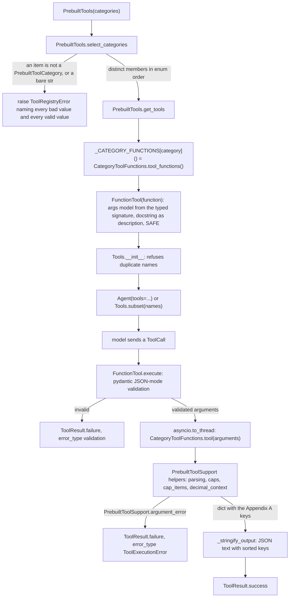

feat(prebuilt-tools): add 265 prebuilt deterministic agent tools in 31 categories
## Summary
This PR adds `PrebuiltTools`, a `Tools` catalog that gives any agent 265 small tools in 31 categories for jobs a model does badly in its head: exact decimal and date arithmetic, counting letters, parsing JSON, CSV, XML, and TOML, encoding, hashing, IP math, and the like. Each tool is a typed `@staticmethod` on an internal `<Category>ToolFunctions` class, and the existing `FunctionTool` wraps it, so one signature is the tool's schema, its pydantic validation, and its model-facing description; the SDK gets no new tool mechanism. Every tool runs on the Python standard library alone, touches no network, file, process, environment variable, or clock, and returns one JSON object; an argument that is well-formed but wrong in meaning fails as `ToolExecutionError` with the message `Invalid value for '<param>': <problem>. Expected <form>.` The decision that matters most: tools are attached by category (6 to 12 tools each) and never all at once by default, because tool-selection accuracy drops past about 10 to 15 attached tools for smaller models and 20 to 30 for larger ones (spec D-3). Every argument, list result, and output that could grow has a named cap in `vidbyte/lib/constants/prebuilt_tools.py`, so hostile input at the caps stays fast and small. Spec: `docs/spec/prebuilt-agent-tools/spec.md` (r7).

## How to use what this PR introduces
```python
import asyncio

from vidbyte import Agent
from vidbyte.lib.enums import PrebuiltToolCategory
from vidbyte.tools.toolsets import PrebuiltTools
from vidbyte.tools.types import ToolCall

# Attach two whole categories to an agent.
tools = PrebuiltTools([PrebuiltToolCategory.DATES, PrebuiltToolCategory.TEXT_COUNTING])
agent = Agent(name="assistant", system_prompt="Use tools for exact answers.", provider="openai", model_name="gpt-4.1", tools=tools)

# Or pick individual tools by name from the full library.
picked = PrebuiltTools(PrebuiltToolCategory).subset(["days_between_dates", "count_character_occurrences"])
print(picked.names())

# Every tool is an ordinary FunctionTool and returns JSON text.
result = asyncio.run(picked[1].execute(ToolCall("count_character_occurrences", {"text": "strawberry", "character": "r"})))
print(result.status.value, result.output)
```
This is the spec §4 snippet unchanged. Run on this branch (Python 3.11.0, every `*_API_KEY` unset), it prints exactly:
```
('days_between_dates', 'count_character_occurrences')
success {"count": 3, "positions": [2, 7, 8], "truncated": false}
```
A developer no longer writes, describes, or validates any of these tools; building the agent needs no API key. A wrong call comes back as a result, not an exception: `decimal_arithmetic` with a zero divisor gives `error` / `ToolExecutionError` / `Invalid value for 'right': it is zero, so the division has no result. Expected a divisor other than zero.`, and `add_to_date` with `2024-02-30` gives `error` / `validation` before any tool code runs.

## Flow

Construction runs once per `PrebuiltTools(...)` call: `select_categories` checks every value before anything is built, `get_tools` wraps fresh `FunctionTool` objects (nothing is cached or built at import), and `Tools.__init__` refuses a duplicate name. At call time the existing `FunctionTool.execute` validates the model's arguments against the pydantic model built from the signature, so types, bounds, patterns, enum values, and length caps fail as `validation` before tool code runs. Inside a tool, input that is well-formed but wrong in meaning raises `ToolExecutionError` through `PrebuiltToolSupport.argument_error`, and `FunctionTool` turns the raise into a failure result. No tool keeps state: each reads only its arguments and returns a dict that `_stringify_output` writes as JSON.

## What changed
| File | Change |
|---|---|
| `vidbyte/tools/toolsets/prebuilt.py` (new) | `PrebuiltTools(Tools)`: a narrated `__init__` calls `select_categories` (distinct members in catalogue order, `ToolRegistryError` for anything else) and `get_tools` (a fresh `FunctionTool` per function), with a read-only `_CATEGORY_FUNCTIONS` dispatch table. |
| `vidbyte/tools/toolsets/__init__.py` | Exports `PrebuiltTools` next to `CodingAgentTools` and `ParadigmMinimalToolset`. |
| `vidbyte/tools/builtins/prebuilt/__init__.py` (new) | Re-exports the 31 category classes for the toolset and the tests; deliberately not re-exported from `vidbyte.tools.builtins`. |
| `vidbyte/tools/builtins/prebuilt/_support.py` (new) | `PrebuiltToolSupport`, the shared rules: the one argument-error builder, JSON parsing with the nesting and finite-number checks, exact number text with the 4,000-digit cap, a fresh fully specified decimal context, `cap_items` (1,000 items and 1,000,000 characters), line, word, sentence, and syllable rules, CSV reading and writing, tolerant Base64, the HTML end-of-input step, and the name shortener for error messages. |
| `vidbyte/tools/builtins/prebuilt/exact_arithmetic.py` (new) | 10 tools: exact `Decimal` and `Fraction` arithmetic, rounding by mode and to significant figures, exact sums, decimal and repeating-decimal to fraction and back, integer square root, quadratic roots. |
| `vidbyte/tools/builtins/prebuilt/number_theory.py` (new) | 10 tools: deterministic Miller–Rabin primality, factorization, primes in a range, the n-th and nearest prime, gcd, lcm, divisors, modular power and inverse. |
| `vidbyte/tools/builtins/prebuilt/number_formatting.py` (new) | 7 tools: base conversion, English number words both ways, abbreviated amounts, digit grouping in six separator styles, formatted amounts, scientific and engineering notation. |
| `vidbyte/tools/builtins/prebuilt/descriptive_statistics.py` (new) | 11 tools: summary, modes, percentiles and quartiles by named method, weighted mean, Pearson and hand-written Spearman correlation, least-squares line, moving average, IQR outliers, ranks. |
| `vidbyte/tools/builtins/prebuilt/probability.py` (new) | 9 tools: exact combination, permutation, and factorial counts, binomial and Poisson tails, normal probabilities and quantiles, birthday collisions, a capped combination listing. |
| `vidbyte/tools/builtins/prebuilt/seeded_random.py` (new) | 6 tools: seeded integers, shuffle, sample, weighted picks, dice notation, version-4 UUIDs, each from its own `random.Random(seed)`. |
| `vidbyte/tools/builtins/prebuilt/finance.py` (new) | 10 tools: compound interest, loan payment and amortization, NPV, IRR, CAGR, percentage change and shares, allocation by weights, tax-inclusive split; money steps are exact `Fraction`s rounded half-up to cents once. |
| `vidbyte/tools/builtins/prebuilt/unit_conversion.py` (new) | 10 tools for length, mass, temperature, volume, area, speed, duration, energy, fuel economy, and data size: exact factors, one `float()` at the end. |
| `vidbyte/tools/builtins/prebuilt/dates.py` (new) | 10 tools: days between dates, adding units with month clamping, calendar difference, weekday, ISO week, n-th and next weekday, relative phrases against a caller-given reference date, date text parsing, fiscal quarter. |
| `vidbyte/tools/builtins/prebuilt/scheduling.py` (new) | 8 tools: business days between and added (with holidays), date ranges, weekday counts, recurrences, merged intervals, common free slots, sorting mixed-format dates. |
| `vidbyte/tools/builtins/prebuilt/timestamps_durations.py` (new) | 8 tools: Unix timestamps both ways, fixed UTC offsets, time between moments, adding, writing, and reading durations, minutes between clock times. |
| `vidbyte/tools/builtins/prebuilt/text_counting.py` (new) | 12 tools: character counts, one character's positions, substring positions, words, sentences, lines, word, character, and n-gram frequencies, character at a position, readability, syllables. |
| `vidbyte/tools/builtins/prebuilt/text_transform.py` (new) | 10 tools: reverse, identifier case, shorten, literal replace, dedupe and sort lines, strip HTML tags, chunk, line range, template fill; amplifying tools refuse output over the cap before building it. |
| `vidbyte/tools/builtins/prebuilt/unicode.py` (new) | 10 tools: character details and search by name, normalization, diacritic removal, invisible and non-ASCII reports, script detection, encoded size, SMS segments, mojibake repair. |
| `vidbyte/tools/builtins/prebuilt/regex.py` (new) | 7 tools: find all, match in full, prefix, or search mode, replace, split, compile check, sample testing, wildcard name filtering. |
| `vidbyte/tools/builtins/prebuilt/text_comparison.py` (new) | 6 tools: unified line diff, word diff, Levenshtein distance, fuzzy ranking, longest common substring, n-gram Jaccard similarity. |
| `vidbyte/tools/builtins/prebuilt/json_data.py` (new) | 9 tools: syntax check, format, get and set by JSON Pointer, path listing, diff, RFC 6902 patch with size and work caps, shape summary, JSON extraction from text. |
| `vidbyte/tools/builtins/prebuilt/json_records.py` (new) | 9 tools over a JSON array of objects: filter, pluck, group, aggregate, group with aggregate, sort, count values, join, write as CSV. |
| `vidbyte/tools/builtins/prebuilt/csv_tables.py` (new) | 9 tools: CSV to records, dialect detection, column profiles, filter, sort, aggregate, group, join, Markdown table. |
| `vidbyte/tools/builtins/prebuilt/structured_formats.py` (new) | 9 tools: XML to JSON, XML well-formedness, XML element search with a visit cap, INI, TOML with a one-pass dotted-key scan, URL parts and resolution, query strings, `.env` text; DOCTYPE and ENTITY are refused before parsing. |
| `vidbyte/tools/builtins/prebuilt/encoding.py` (new) | 10 tools: Base64 and hex both ways, URL percent-encoding both ways, HTML entity decoding, JWT inspection that never claims verification, JSON string escaping both ways. |
| `vidbyte/tools/builtins/prebuilt/hashing.py` (new) | 7 tools: text and Base64 hashes, HMAC (the key is never echoed), digest check, CRC-32 and Adler-32, Git blob ID, stable bucket. |
| `vidbyte/tools/builtins/prebuilt/identifiers.py` (new) | 9 tools: Luhn, ISBN, IBAN, GTIN, email and URL syntax with named problems, UUID check, name-based UUID, SemVer precedence. |
| `vidbyte/tools/builtins/prebuilt/lists.py` (new) | 7 tools: item frequencies, duplicates, two-list comparison, intersection of several lists, missing integers, range compression and expansion. |
| `vidbyte/tools/builtins/prebuilt/graphs.py` (new) | 6 tools over parallel edge lists: topological order, cycle finding, shortest path by hops and by weight, connected components, critical path. |
| `vidbyte/tools/builtins/prebuilt/geometry.py` (new) | 7 tools: great-circle distance, bearing, destination point, degrees-minutes-seconds both ways, polygon area and orientation, point in polygon. |
| `vidbyte/tools/builtins/prebuilt/bits_bytes.py` (new) | 6 tools: data size parsing (exponent bounded before any `Decimal` is built), human-readable bytes, bitwise operations, two's complement both ways, Unix permissions. |
| `vidbyte/tools/builtins/prebuilt/markdown_html.py` (new) | 7 tools: Markdown headings, tasks, tables, links, and fenced code; HTML tables as records; HTML links. |
| `vidbyte/tools/builtins/prebuilt/text_extraction.py` (new) | 8 tools that pull URLs, emails, numbers, dates, IP addresses, money amounts, key-value pairs, and sentences out of free text with linear-time patterns. |
| `vidbyte/tools/builtins/prebuilt/code_analysis.py` (new) | 10 tools that read source without running it: Python syntax check, function, class, and import listings, line counts for 17 languages, a function signature, name usages, literal to JSON, shell splitting and quoting. |
| `vidbyte/tools/builtins/prebuilt/network_addresses.py` (new) | 8 tools: IP validation with a reason, CIDR details, membership, subnet splitting, range to CIDRs, classification, integer conversion, netmask conversion; subnet counts are arithmetic. |
| `vidbyte/lib/enums/prebuilt_tools.py` (new) | `PrebuiltToolCategory` (31 members, `values()`) and the 57 other closed vocabularies the tools take or report. |
| `vidbyte/lib/enums/units.py` (new) | The 10 unit vocabularies (length through data size). |
| `vidbyte/lib/enums/__init__.py` | Imports and exports all 68 new enums in the file's alphabetical order. |
| `vidbyte/lib/constants/prebuilt_tools.py` (new) | Every cap, work budget, field pattern, fixed precision, and reference table, all immutable. |
| `vidbyte/lib/constants/units.py` (new) | Exact unit factor tables as `Fraction`-parsable text, plus the Celsius-to-Kelvin offset. |
| `vidbyte/tools/builtins/prebuilt/README.md` (new) | Folder README: how to attach, why not to attach everything, the output and error contract, version-dependent behavior, limitations, non-goals, file index. |
| `vidbyte/tools/README.md` | New "Prebuilt Tools" section (the snippet above, no output block) and two Key Modules lines. |
| `REPO_MAP.md` | The `vidbyte/tools/builtins/` entry mentions the utility library; the `vidbyte/tools/toolsets/` entry is regenerated to cover agent, paradigm, and category bundles. |
| `tests/features/prebuilt_tools/` (26 new files) | Feature test pack written before the code: `FEATURE.md`, `README.md`, `conftest.py`, a harness, two hand-copied catalogue and parameter tables, 12 row files (one per category group), and 8 contract files (acceptance, toolset contract, model-facing contract, error contract, determinism, side effects, resource bounds, hostile inputs). 4,397 tests. |
| `docs/spec/prebuilt-agent-tools/` (26 new files) | The pipeline record: request, spec r7, test plan, review, verify log, recon context, stage reports, and this body. |

## Acceptance criteria → proof
| AC | What it checks (plain words) | Proven by |
|---|---|---|
| AC-1 | The usage snippet prints exactly the two documented lines. | `test_prebuilt_acceptance.py::test_developer_snippet_prints_exactly_the_documented_result` (fresh interpreter, API keys removed); also run by hand above. |
| AC-2 | The full library has at least 250 tools, every catalogue name, and 6–15 tools per category. | `test_prebuilt_toolset_contract.py::test_full_library_meets_the_floor_and_holds_every_appendix_name`; `::test_single_category_holds_its_appendix_rows_in_order` |
| AC-3 | Each category holds exactly its catalogue rows, in row order. | `test_prebuilt_toolset_contract.py::test_single_category_holds_its_appendix_rows_in_order` (31 cases); `::test_category_class_lists_its_functions_in_row_order` |
| AC-4 | A plain string, a non-member, or a bare string is refused before any tool is built, and the error names the bad and the valid values. | `test_prebuilt_toolset_contract.py::test_plain_string_equal_to_a_member_value_is_rejected_before_building`; `::test_mixed_valid_and_invalid_items_name_every_bad_value`; `::test_bare_plain_string_is_rejected_whole_and_never_iterated` |
| AC-5 | Importing the SDK builds no tool. | `test_prebuilt_acceptance.py::test_importing_the_sdk_builds_no_tool` (fresh interpreter) |
| AC-6 | Any schema-valid call returns the documented keys or fails as `validation` / `ToolExecutionError`, never anything else. | `test_prebuilt_error_contract.py::test_any_schema_valid_call_keeps_the_result_contract` (265 tools, schema-derived argument sets) |
| AC-7 | Text or a list one unit over its cap fails validation before the body runs. | `test_prebuilt_model_facing_contract.py::test_one_over_cap_argument_fails_validation_naming_the_parameter`; `test_prebuilt_toolset_contract.py::test_every_text_and_list_parameter_is_capped` |
| AC-8 | Every tool description and every parameter description has 4–5 sentences, and no parameter lacks one. | `test_prebuilt_model_facing_contract.py::test_tool_description_has_four_or_five_sentences_and_no_example`; `::test_parameter_descriptions_have_four_or_five_sentences_and_no_example` |
| AC-9 | OpenAI, Anthropic, and Gemini schemas build, one declaration per tool. | `test_prebuilt_model_facing_contract.py::test_provider_schemas_declare_every_tool_once` |
| AC-10 | Output is byte-identical across hash seeds, environments, and repeated calls. | `test_prebuilt_determinism.py::test_outputs_match_across_hash_seeds_and_environments` (two child interpreters); `::test_repeated_calls_in_one_process_are_identical` |
| AC-11 | Every catalogue row's outputs, defaults, edge cases, and errors match the spec. | 12 `test_prebuilt_rows_*.py` files: `test_<area>_rows_return_documented_output` (1,381 cases, at least one for each of the 265 tools) and `test_<area>_rows_reject_bad_input` (532 cases) |
| AC-12 | Dropping below 250 tools fails the suite. | `test_prebuilt_toolset_contract.py::test_full_library_meets_the_floor_and_holds_every_appendix_name`; `::test_full_library_is_exactly_appendix_a_in_catalogue_order` |
| AC-13 | No tool touches sockets, processes, the environment, the clock, writable files, or global interpreter state. | `test_prebuilt_side_effects.py::test_tool_calls_touch_no_outside_resource`; `::test_global_interpreter_state_is_unchanged`; `::test_prebuilt_source_has_no_side_effect_or_code_execution_calls` |
| AC-14 | Listing tools stop at the item cap and the character budget, set `truncated`, and still count everything; huge counts are arithmetic. | `test_prebuilt_resource_bounds.py::test_regex_matches_stop_at_the_item_cap_and_count_every_match`; `::test_regex_matches_stop_at_the_character_budget`; `::test_divisors_past_the_cap_still_count_and_sum`; `::test_subnet_count_is_arithmetic_for_two_to_the_128`; `::test_integer_range_count_is_arithmetic_for_ten_to_the_15`; `::test_combination_count_covers_every_combination` |
| AC-15 | An integer result of more than 4,000 digits fails as `ToolExecutionError`, never `ValueError`. | `test_prebuilt_resource_bounds.py::test_integers_of_4001_digits_fail_as_tool_errors` |
| AC-16 | Both CI stages and the public API check pass; the existing suite is unchanged. | Gate: source stage, package stage, and `generate-sdk-public-api.py --check` (see Verification) |
| AC-17 | Lint passes with no baseline raised, semgrep is clean, and mypy adds no errors. | Gate: `python lint/run.py` → `SDK-LINT: PASS` (S009 included); semgrep 0 findings (see Verification); `git diff origin/main...HEAD -- lint/baseline.json` is empty |
| AC-18 | Two catalogues with the same tool cannot be merged. | `test_prebuilt_toolset_contract.py::test_overlapping_catalogues_cannot_be_merged` |
| AC-19 | No categories means an empty catalogue; there is no attach-everything default. | `test_prebuilt_toolset_contract.py::test_empty_categories_give_an_empty_catalogue_and_there_is_no_default` |
| AC-20 | The 14 tools whose output can grow refuse an oversized result before building it. | `test_prebuilt_resource_bounds.py::test_amplifying_tools_refuse_output_over_the_text_cap` (14 tools); `::test_refused_text_outputs_are_never_built` (peak memory) |
| AC-21 | XML, TOML, and Python literals nested past 100 levels fail as tool errors, and a too-deep JSON candidate is skipped; `execute` never raises. | `test_prebuilt_resource_bounds.py::test_deep_nesting_fails_as_a_tool_error`; `::test_too_deep_json_candidate_is_skipped_not_fatal` |

## Verification
Every gate below was run at `8c37990b` (the code last changed at `70298784`; the only later commit adds this body and a stage report and sets the spec's status) on Windows 11 with Python 3.11.0. `PYTHONPATH` pointed at the worktree for every command except the package stage, which installs the built wheel into a fresh virtual environment.

| Gate | Command | Result |
|---|---|---|
| Feature pack | `python -m pytest -q -p no:cacheprovider -o faulthandler_timeout=120 tests/features/prebuilt_tools` | `4397 passed in 53.47s` |
| Lint (inside the source stage) | `python lint/run.py` | `SDK-LINT: PASS`; S009 staged mypy contracts `RATCHETED: 350 known finding(s)`, unchanged |
| Lint baseline | `git diff origin/main...HEAD -- lint/baseline.json` | empty |
| Semgrep 1.170.1 | `semgrep scan --error --config .semgrep/typed-mapping-boundary-policy.yml vidbyte` | `Ran 1 rule on 931 files: 0 findings.` |
| Public API | `python scripts/generate-sdk-public-api.py --check` | `contracts/sdk-public-api.json is current at f7a02bae175913f4ab1cd25d89bfce5ae78e86d0 (vidbyte-sdk 0.2.1, 606 exports).` |
| Source stage | `python scripts/run_ci.py --stage source` | `8412 passed, 13 skipped in 86.76s`, then `CI passed.` |
| Package stage | `python scripts/run_ci.py --stage package` | `Installed vidbyte-sdk 0.2.1 passed smoke checks.`, then `CI passed.` |
| Usage snippet | the §4 snippet above, run as a script | the two documented lines, exactly |

Remote checks: none configured — CI workflows are dispatch-only; not run. `gh pr checks` reports `no checks reported on the 'feat/prebuilt-agent-tools' branch`.

## Adversarial review
17 findings confirmed by an independent verifier across three lenses (spec conformance, repo conventions, engineering), 17 fixed, 0 waived. Full record: `docs/spec/prebuilt-agent-tools/review.md`.

The first review (S4) confirmed R-1 to R-14 (8 Blocker, 6 Major); its verifier downgraded one claim (R-V1, merged into R-13 as a Major) and part-refuted another (R-V2). Re-review round 1 confirmed R-15 to R-17 (3 Blocker: two in the R-6 TOML repair, one in `parse_data_size`) and Minor M-6. Re-review round 2 found the branch SOUND with one Minor (R-C1, under Deviations and Follow-ups). Minors M-1 to M-4 and M-6 are fixed; M-5 is a follow-up. The repairs took 2 iterations.

| ID | Finding | Fixed in |
|---|---|---|
| R-1 (Blocker) | `extract_markdown_headings` was quadratic on a long run of spaces in a heading (about 6 minutes at the cap). | `c1b332d6` |
| R-2 (Blocker) | `extract_numbers` and `extract_money_amounts` were quadratic on a comma chain that fails at its end (9 to 18 minutes at the cap). | `1d1e8acc` |
| R-3 (Blocker) | `verify_ip_address` leaked `AddressValueError` on an IPv6 address with a zone suffix. | `ca9c7fc4` |
| R-4 (Blocker) | Three model-facing descriptions illustrated a rule with literal example values. | `a57738f1` |
| R-5 (Blocker) | `extract_json_from_text` returned `Infinity` in a success for a number such as `1e400`. | `27d7a7b2` |
| R-6 (Blocker) | `toml_to_json` was quadratic in the segments of one dotted key (about 20 minutes at the cap). | `a9b54ff1`; scan rewritten in `202ef85f` |
| R-7 (Blocker) | `xml_find_elements` materialized duplicate descendant matches: 45,057,474 from a 420-character document, out of document order. | `b13273c4` |
| R-8 (Blocker) | The three `HTMLParser` tools hit CVE-2025-6069 in `close()` (hours at the cap), and their output changed between patch releases. | `166b355a` |
| R-9 (Major) | `apply_json_patch` had no bound on the total work of 1,000 operations (13 s on a 200,007-character document). | `1098a5f2` |
| R-10 (Major) | Literal substring search cost the text length times the search length (about 27 s at the caps). | `b8048af9` |
| R-11 (Major) | `parse_records_json` formed a three-level helper chain, against AGENTS.md principle 1. | `1babbb9a` |
| R-12 (Major) | `localcontext(prec=…)` inherited the host's decimal traps and exponent range through `asyncio.to_thread`. | `43b692d5` |
| R-13 (Major) | Rules two categories share were written two to four times (Base64 reader, sort keys, delimiter table, JSON types, field patterns, name shortener). | `6ea8bfb1`, `26dac7c7`, `42a325f3`, `3aad2048`, `428cbe04`, `5e76f6b3`, `7945a491` |
| R-14 (Major) | No pack test drove a tool to its cost at the cap with hostile input. | `c9710ed2` (test author) |
| R-15 (Blocker) | The R-6 TOML pre-scan was quadratic on a line of escaped quotes (about 23 minutes at the cap). | `202ef85f` |
| R-16 (Blocker) | `parse_data_size` leaked `decimal.InvalidOperation` on an exponent past ±999,999,999,999,999,999 in a 25-character input. | `9f7b70ac` |
| R-17 (Blocker) | A multi-line TOML string with an odd number of quotes let a long dotted key bypass the pre-scan (16 s at a third of the cap). | `202ef85f` |

## Deviations from the spec
- **`extract_numbers` and a far exponent (R-C1).** Spec §9.2 item 18 says the A.29 row gives the result for an exponent past the DecText cap; the row does not. The code (`text_extraction.py:224-227`) lists a zero mantissa as `0` and skips any other value whose exponent is past 4,002, even when the value fits: `1000e-4003` gives nothing while `1e-4000`, the same number, is listed. The comment at `text_extraction.py:220-223`, the header's KNOWN EDGE CASES (`:9`), and the tool description (`:120`) give the reason as a value too long to write out, which is false for that case. The non-zero skip dates from the first implementation (`0fd73086`); `70298784` added the zero case. The fix is documentation (see Follow-ups).
- **More helpers in `_support.py` than §12.3 row 6 names.** `split_lines` and `line_and_column` (spec §17, S3 deviation 2), and `decimal_context`, `parse_html`, `shortened_names`, `natural_sort_key`, `numeric_order`, `csv_row_writer`, and `base64_bytes`, which row 6 covers by rule ("a rule that two or more categories share is one helper here") and which the R-12, R-8, and R-13 repairs added. `json_data.py` passes the private decoder hook `PrebuiltToolSupport._read_json_float` to its own decoders (the R-5 and M-1 fix); no lint rule flags the cross-class use of a private name.
- **One private nested class beyond the `HTMLParser` subclasses**, `_CaseKeepingConfigParser`, keeps INI key case (spec §17, S3 deviation 4). The `_CountedElement` XML subclass is in row 27 since r6.
- **Spec §17's S3 deviation list is partly stale.** Deviation 5 (Base64 reader written twice) was removed by R-13 at `6ea8bfb1`, and deviation 1's finance locals are now `monthly_interest_fraction` and `yearly_interest_fraction` (M-2, `fb22c691`). This PR leaves that spec text as it is.
- No other deviation: the §4 snippet runs as written, the §5 flow matches the code, and the build matches §8.4 (39 files added and 4 modified outside docs and tests, no D-18 split module, no dataclass, no new error class, no new dependency, `vidbyte.__all__` and `contracts/sdk-public-api.json` unchanged).

## Follow-ups
- **R-C1 (round-2 Minor).** Add to the A.29 `extract_numbers` row the clause §9.2 item 18 promises ("a number whose exponent is more than 4,002 in absolute value is listed as 0 when its digits are all zero, and is otherwise skipped, even when its value would fit"), and correct the comment at `text_extraction.py:220-223`, the header sentence at `text_extraction.py:9`, and the last sentence of the tool description at `text_extraction.py:120`. If exact expansion should win instead, skip on `mantissa.adjusted() + exponent`: a code change for a later PR.
- **M-5: remaining duplicated module rules.** The INV-18 bound `10**PREBUILT_MAX_INTEGER_DIGITS` is recomputed in six modules; `_EXACT_PRECISION` is written in `exact_arithmetic.py` and `number_formatting.py`; `unicode.py` streams its own line and column beside `line_and_column`; the weekday numbering (`dates.py`, `scheduling.py`), the Unix epoch (`encoding.py`, `timestamps_durations.py`), and the script and style tag set (`markdown_html.py`, `text_transform.py`) are each written twice; seconds per duration unit sit in two tables (`DURATION_UNIT_FACTORS` and `PREBUILT_DURATION_UNIT_WORDS`).
- **Accepted limitations** (documented in the folder README and the spec):
  - EC-10: a regex with catastrophic backtracking has no timeout; only `ToolSettings.tool_timeout_seconds` bounds the wait, and the worker thread runs on.
  - EC-45: `seeded_weighted_choice` can return about 10,000,000 characters (1,000 picks of a 10,000-character item).
  - EC-46: `diff_words`, `closest_string_matches`, and `unified_diff_text` can take from seconds to about 90 s on highly repetitive input at the caps (measured on Python 3.11.0); the caps bound the work, so they always finish.
  - EC-47: HTML markup left open at the end of the input, such as `x <b`, is dropped before the parser closes.
  - The `toml_to_json` dotted-key scan can hold about 98 MB of transient regex memory on crafted multi-line string content at the 1,000,000-character cap (measured in re-review round 2); the spec has no rule for parser scratch memory.
- **Spec defaults the owner may want to revisit** (each kept at its default):
  - Q-1: fixed UTC offsets only; no IANA time zones, because `tzdata` is not a dependency.
  - Q-2: no root `vidbyte` exports; import from `vidbyte.tools.toolsets` and `vidbyte.lib.enums`.
  - Q-3: no tool-search meta-tool.
  - Q-4: no YAML or declarative discovery of these tools.
  - Q-5: no killable regex worker.
  - **Q-6: the 265 tools return documented dicts, not frozen dataclasses. This is a recorded exception (spec D-7) to AGENTS.md principle 4,** which asks core logic to return validated dataclasses. The reasons: `FunctionTool` already validates every argument through the pydantic model it builds from the signature, a dataclass parameter would nest the model-facing schema under one wrapper, and the only reader of the output is `_stringify_output`. Saying yes would add about 265 output dataclasses in `vidbyte/lib/dataclasses/`.
- **Test-pack gaps:**
  - The three count tests (2^128 subnets, 10^15 integers, C(39,20)) have no liveness watchdog, so a regression there hangs instead of failing.
  - The schema test compares `minItems` only for the one list of lists, not for flat lists.
  - Two readings are the pack's own where the spec is silent: `get_python_function_signature` writes a function without a return annotation as `def run(self)` with no arrow, and `detect_csv_dialect` `has_header` is `ANY` in two cases.
- **Known local flakes** (not caused by this PR):
  - On Windows under concurrent load, a pack run can stall. The harness starts a new event loop for every tool call (`prebuilt_tool_harness.py:214`), and on Windows each loop builds its self-pipe with the pure-Python `socket.socketpair()`. The pack's documented command passes `-o faulthandler_timeout=120`, which dumps the stalled stack; rerun once before calling a stall a regression. The CI workflows run on Linux.
  - `tests/test_mcp_stdio_transport.py::McpStdioTransportHardeningTests::test_cancelled_waiter_does_not_break_transport` can hit its 5 s request timeout once under load on Windows (seen once in the S5 iteration 2 source stage, green on the rerun); the test is on `main` and predates this PR.

🤖 Generated with [Claude Code](https://claude.com/claude-code)
