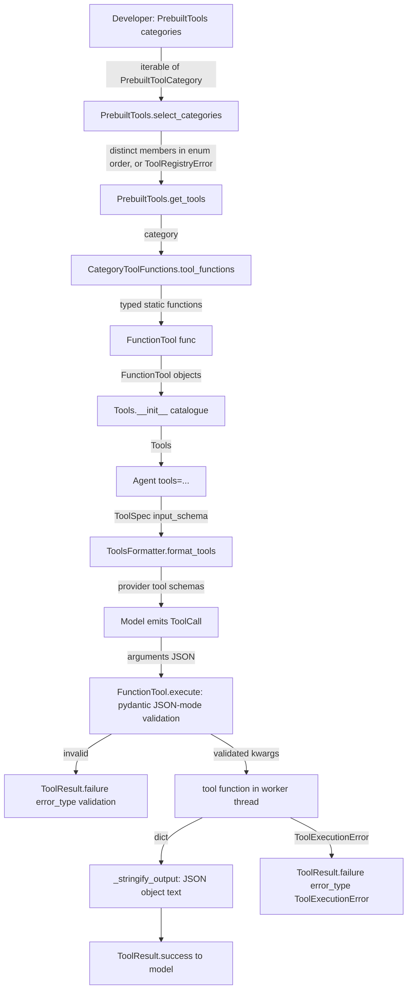

# Spec: A library of 250+ prebuilt agent tools in vidbyte-sdk

> **TL;DR** — The SDK gains 265 small tools that run locally, give the same answer every time, and use only the Python standard library. They are grouped into 31 categories, and a developer attaches them to any agent with `PrebuiltTools([PrebuiltToolCategory.DATES, ...])` or picks single tools by name with `.subset([...])`. Each tool is one typed function that the existing `FunctionTool` wraps, so the SDK gets no new tool mechanism. The decision that matters most is that tools are attached by category (6 to 12 tools each) and never all at once by default, because published measurements show models pick the wrong tool more often once more than about 15 to 30 are attached.

## §0 User prompts

### 0.1 Invoking request (verbatim)

```
straight into spec for vidbyte-sdk/. Implement 250+ simple, easy to under, and useful prebuilt tools int the vidbyte-sdk/, dont really care what they are but they should expand the capability of the agent in some way (can ground your ideas in recent agentic research on some of the tools that people were giving to agents).
```

### 0.2 User replies during the run

None yet.

---

## Part A — Framing

## §1 Goal

Today an agent built with the SDK can compute only through `calculator` (`vidbyte/tools/builtins/calculator.py`, which evaluates arithmetic expressions in Python `int` and binary `float` arithmetic), `code_execution`, or tools the developer writes. Research gathered for this run (`context/research.md`, cited as [n]) measures where models fail when they work in tokens alone. GPT-4 multiplies two 3-digit numbers correctly only 59% of the time [23]. Most models cannot count a letter that appears more than twice in a word [22]. "Days between two dates" questions score 13.5–16%, and the most common error is being off by one day [24]. Models resolve "next Friday" wrongly [8]. They round-trip base64 perfectly only 66–76% of the time [29]. They write regular expressions that look plausible but do not parse [30]. They drop or invent items when sorting [26] and fail to intersect lists of 80 items [27]. A developer who wants an agent to be reliable at these tasks must write each tool by hand. The user asked for 250 or more prebuilt tools that close gaps like these.

| ID | Goal (outcome) | How we will know | Source |
|---|---|---|---|
| G-1 | A developer can give an agent at least 250 ready-made tools without writing any tool code. | `len(PrebuiltTools(PrebuiltToolCategory)) >= 250`. Every tool in Appendix A can be called through an `Agent`. | §0 "Implement 250+ … prebuilt tools" |
| G-2 | Every tool gives the agent something it does badly, or cannot do, in tokens alone: exact computation, reliable counting, sorting or diffing, date and time arithmetic, parsing and checking formats, encoding, or changing structured data. | Each row in Appendix A targets one of the gaps listed above. No tool echoes its input or returns a fixed string. | §0 "expand the capability of the agent"; request.md §C |
| G-3 | Attaching tools keeps the agent able to pick the right one. A developer attaches a coherent category, or names single tools, instead of the whole library. | Every category holds at most 15 tools. Nothing is attached unless the developer asks for it. | research [14][17][18][21] |
| G-4 | Every tool is simple and easy to understand. It does one thing, its name says what it returns, its inputs are typed, and all tools share one output shape and one error shape. | The rules in §9.2 hold for all 265 tools. Every tool and every parameter has a description of 4–5 sentences. | §0 "simple, easy to under[stand], and useful" |

## §2 Objective

When this PR merges, the repository contains a new package, `vidbyte/tools/builtins/prebuilt/`. It holds 265 model-callable tool functions in 31 category modules, each function typed, documented, and listed in Appendix A. A new toolset, `PrebuiltTools`, in `vidbyte/tools/toolsets/`, turns a list of `PrebuiltToolCategory` members into an ordinary `Tools` catalogue of `FunctionTool` objects. A developer can pass that catalogue to `Agent(tools=...)` or narrow it with the inherited `Tools.subset(names)`. Four other new modules sit in `vidbyte/lib/`: the category enum and every other closed vocabulary the tools use (two enum modules), and the size caps, reference tables, and unit factors (two constants modules). The change also adds a folder README, a "Prebuilt Tools" section in `vidbyte/tools/README.md`, and updated `REPO_MAP.md` entries. It adds a test pack that fails if the catalogue drops below 250 tools; the S2 test author writes that pack. The change adds no runtime dependency, no root-level `vidbyte` export, no CLI command, and no agent setting. This PR delivers the whole request in one slice.

## §3 Non-goals

- **NG-1** — No tools that use the network, read or write files, or start processes. *Why not:* A-1 (request.md §C) limits the library to local, deterministic, standard-library tools, and the SDK already ships fetch, filesystem, bash, and code-execution tools for those jobs.
- **NG-2** — No IANA time-zone tools, such as converting "America/New_York" to another zone. *Why not:* `tzdata` is not a declared dependency (`pyproject.toml` `[project].dependencies`). On a clean Windows install, `zoneinfo.ZoneInfo(...)` raises `ZoneInfoNotFoundError`. The time tools therefore use fixed UTC offsets only. Adding the dependency is optional `Q-1`, default no.
- **NG-3** — No tool-search or tool-retrieval meta-tool. *Why not:* the user did not ask for one. Attaching by category (D-2) handles tool count. Optional `Q-3`, default no.
- **NG-4** — No YAML or declarative discovery of the new tools through `ComponentRegistry`. *Why not:* the user did not ask for it, and `vidbyte/lib/registries/components.py:101-124` finds only `BaseTool` subclasses. Optional `Q-4`, default no.
- **NG-5** — No root-level `vidbyte` exports. *Why not:* the user did not ask for them. A root export changes `contracts/sdk-public-api.json` (lint C016), and `vidbyte/__init__.py` is already 1,297 lines. The toolset is imported from `vidbyte.tools.toolsets` and the enum from `vidbyte.lib.enums`. Optional `Q-2`, default no.
- **NG-6** — No new CLI commands and no new agent settings fields. *Why not:* the user asked for neither, and the field guide's `prebuilt-agents.md` says bundles ship as toolsets, not commands.
- **NG-7** — No change to existing built-ins (`calculator`, the reasoning trace tools, `code_execution`), and no tool that duplicates them. *Why not:* overlapping tools make the model less likely to pick the right one [15]. `calculator` already evaluates arithmetic expressions, division included, in Python `int` and binary `float` arithmetic, with positional `abs`, `round`, `min`, `max`, and `pow` (`vidbyte/tools/builtins/calculator.py:13`; its own parameter description gives `'(4 * 3) / 2'` as an example, `:62`), and it bounds integer results at `MAX_PRINT_INT_BITS = 4096` bits (`vidbyte/tools/builtins/code_execution.py:31`). So the library ships no general expression evaluator and no tools to add, multiply, or raise big integers to a power. The exact tools that sit nearest to it (`decimal_arithmetic`, `sum_decimal_list`, `fraction_arithmetic`) differ by exactness: they compute in `Decimal` and `Fraction` and return canonical text, so their results carry no binary floating-point error.
- **NG-8** — No tools whose answer depends on the clock, such as "current date or time". *Why not:* such a tool gives a different answer each time it is called, so it breaks INV-12. Tools that need "today", such as `resolve_relative_date_phrase`, take a `reference_date` argument instead.
- **NG-9** — No locale-dependent formatting, which means no use of the `locale` module, and no languages other than English for number words, sentence splitting, syllables, or relative dates. *Why not:* `locale` changes the whole process and gives different results on each platform (INV-12, INV-13). Supporting other languages is new scope.
- **NG-10** — No YAML parsing tool, even though PyYAML is a dependency. *Why not:* `yaml.safe_load` expands aliases with no limit (the "billion laughs" attack), so a short hostile input can use up memory. That breaks INV-19.
- **NG-11** — No changes to `llms.txt` or `artifacts/file_index.md`. *Why not:* both are maintained by hand, with no generator and no CI check (only `scripts/test_artifact_context_sources.py` mentions them). AGENTS.md does not require editing them for each feature.
- **NG-12** — No regex worker that can be killed and no regex timeout. *Why not:* the user did not ask for one, and the stdlib `re` module has no timeout. Accepted limitation EC-10. Optional `Q-5`, default no.
- **NG-13** — No typed output dataclass for each tool. *Why not:* D-7 records this as a deliberate exception to the letter of AGENTS.md principle 4. `Q-6` asks the owner to confirm it, default no.

## §4 Developer usage

```python
import asyncio

from vidbyte import Agent
from vidbyte.lib.enums import PrebuiltToolCategory
from vidbyte.tools.toolsets import PrebuiltTools
from vidbyte.tools.types import ToolCall

# Attach two whole categories to an agent.
tools = PrebuiltTools([PrebuiltToolCategory.DATES, PrebuiltToolCategory.TEXT_COUNTING])
agent = Agent(name="assistant", system_prompt="Use tools for exact answers.", provider="openai", model_name="gpt-4.1", tools=tools)

# Or pick individual tools by name from the full library.
picked = PrebuiltTools(PrebuiltToolCategory).subset(["days_between_dates", "count_character_occurrences"])
print(picked.names())

# Every tool is an ordinary FunctionTool and returns JSON text.
result = asyncio.run(picked[1].execute(ToolCall("count_character_occurrences", {"text": "strawberry", "character": "r"})))
print(result.status.value, result.output)
```

Prints exactly:

```
('days_between_dates', 'count_character_occurrences')
success {"count": 3, "positions": [2, 7, 8], "truncated": false}
```

The developer gets tested tools for exact counting, date arithmetic, parsing, encoding, and the other jobs in Appendix A. They do not have to write, describe, or validate any of these tools. Building the agent needs no API key.

## §5 Flow diagram



Construction (A–F) runs once, when the developer calls `PrebuiltTools(...)`. It checks the category values, raising `ToolRegistryError` for an unknown one before it builds anything. It then builds fresh `FunctionTool` objects, and `Tools.__init__` rejects duplicate names. At call time (I–O), the existing `FunctionTool.execute` checks the model's arguments against the pydantic model built from each function's annotated signature, in JSON mode. That check enforces types, bounds, string patterns, enum values, and size limits before any tool code runs, and a failure comes back as `error_type: "validation"`. Inside the function, input that is well-formed but wrong in meaning, such as an impossible fraction or a pattern that does not compile, raises `ToolExecutionError`. `FunctionTool` turns that into a failure result (`function_tool.py:76-81`). A normal return is a `dict` that `_stringify_output` serializes with sorted keys (`function_tool.py:206-225`). The tools keep no state, so nothing is saved anywhere.

---

## Part B — Behavior (this is the spec; everything else is framing)

## §6 Behavior

### 6.1 Invariants

- **INV-1** — `PrebuiltTools(PrebuiltToolCategory)` holds at least 250 tools. In revision 7 it holds exactly the 265 tools named in Appendix A: each name appears exactly once, and no other name appears.
- **INV-2** — Each of the 31 `PrebuiltToolCategory` members maps to exactly one category class, and each category holds between 6 and 15 tools (12 at most in revision 7). Every tool belongs to exactly one category. Catalogue order is the enum declaration order (the order of the Appendix A tables), then the row order inside each table.
- **INV-3** — Every tool name matches `^[a-z][a-z0-9_]*$` and is at most 64 characters long. Names are unique across the library. No name equals a tool name the SDK already ships (`vidbyte/tools/builtins/**`, `vidbyte/tools/filesystem/**`, MCP presets), and no name equals the reserved `isDone`, `updateTrace`, or `mcp`.
- **INV-4** — `PrebuiltTools(categories)` contains exactly the tools of the distinct categories given, in catalogue order, whatever the order of `categories` and however often a category repeats. A single member (not wrapped in a list) is accepted as one category. An empty iterable gives an empty catalogue.
- **INV-5** — An item that is not a `PrebuiltToolCategory` member, including a plain string even when it equals a member's value, raises `ToolRegistryError` before any tool is built. So does a bare plain string passed as `categories`, which is never iterated character by character. The message names every bad value and lists every valid value.
- **INV-6** — Every `PrebuiltTools(...)` construction builds new `FunctionTool` objects. There is no module-level cache and no global registry, and two `PrebuiltTools(...)` constructions never share a tool object. (`Tools.subset` and `Tools.without` return catalogues that share objects with their source, by design.)
- **INV-7** — Importing `vidbyte`, `vidbyte.tools.toolsets`, or `vidbyte.tools.builtins.prebuilt` builds no `FunctionTool` and no `Tools`.
- **INV-8** — Every tool is a `FunctionTool` with `ToolPermission.SAFE`. Its name is the function's `__name__`, its `input_schema` comes from the function's annotated signature, and its description is the first paragraph of the function's docstring.
- **INV-9** — Every tool description, and every parameter description (`Field(description=...)`), has 4 or 5 sentences as counted by `SentenceCounter` (`lint/rules/s025_model_facing_description_depth.py:185`). No description contains a concrete example value, such as a sample input, output, date, or pattern, or a literal value that illustrates a rule (such as "the number 1 and the string 1"); the rule is stated in general terms instead (`field-guide/vidbyte-sdk/model-facing-tool-contracts.md`).
- **INV-10** — Every successful output is the JSON text of one object. Its top-level keys are exactly the keys listed for that tool in Appendix A, with no extra keys and none missing.
- **INV-11** — The output values follow the conventions in §9.2. Floats are always finite. Integers that may reach 2^53 or more are canonical integer text. Exact decimals are canonical decimal text. Dates are `YYYY-MM-DD`. Datetimes are ISO 8601 with an explicit offset. Positions are 0-based indices of Unicode code points. Line and column numbers are 1-based. Values drawn from a closed vocabulary are the value strings of the enum named in §9.2.
- **INV-12** — Calling a tool twice with the same arguments gives byte-identical output on the same Python minor version and operating system. The output does not depend on wall-clock time, locale, environment variables, the current directory, `PYTHONHASHSEED`, or earlier calls. Across operating systems, a float computed through the platform's C math library (`math.sin`, `math.atan2`, `math.erf`, `math.exp`, `math.log`, float `**`, and the like) may differ in its last bits; such floats agree within the §9.2 item 5 precision rule, and every value that does not depend on one is identical. The exceptions are the version-dependent outputs listed in EC-24, EC-25, EC-26, and EC-38, which still do not vary within one Python version, and malformed HTML other than markup left open at the end, which follows the running `html.parser`, so a CPython security release can change its output within one minor version (EC-47).
- **INV-13** — No tool reads or writes files, opens a socket, starts a process or thread (beyond the worker thread `FunctionTool` already uses), reads environment variables or the clock, or uses unseeded randomness. No tool changes global interpreter state: `sys.set_int_max_str_digits`, the recursion limit, `decimal.getcontext()` (tools enter a fresh, fully specified context with `decimal.localcontext(context)`, §9.2 item 18), `csv.field_size_limit`, and the `random` module's global generator all stay untouched.
- **INV-14** — For every set of arguments that passes schema validation, a tool either returns the output Appendix A documents or raises `ToolExecutionError`. No other exception class ever escapes, so a failed result always carries `metadata["error_type"]` equal to `"validation"` or `"ToolExecutionError"`.
- **INV-15** — Every `ToolExecutionError` message has the form `Invalid value for '<parameter>': <problem>. Expected <accepted form>.`, where `<parameter>` is a parameter of that tool. It never contains a traceback or `str(exc)` or `repr(exc)` of a caught exception. It never repeats a run of more than `PREBUILT_MAX_ECHO_CHARS` (100) contiguous characters of an argument value (a message may echo several shortened names, as the `fill_text_template` row allows), and it never repeats the `key` argument of `compute_hmac` at all.
- **INV-16** — Every `str` and `list` parameter has the length cap §9.2 or its Appendix A row gives (`Field(max_length=...)`). Input over the cap fails schema validation (`error_type: "validation"`) before the function body runs.
- **INV-17** — A tool whose Appendix A row lists a `truncated` key returns at most the row's cap of items: `PREBUILT_MAX_RESULT_ITEMS` (1,000) unless the row says otherwise. It also stops before the item that would push the sum of the kept items' compact JSON lengths past `PREBUILT_MAX_TEXT_CHARS`, the character budget (§9.2 item 12). The items are in the documented order. `truncated` is `true` exactly when more items existed than were returned, and total-count keys count every item, not only the items returned. Reaching either limit is a success, not an error.
- **INV-18** — Any integer result whose absolute value is 10^4000 or more (more than `PREBUILT_MAX_INTEGER_DIGITS` digits) raises `ToolExecutionError`. Such a result never surfaces as Python's int-to-string `ValueError` and never causes an unbounded computation.
- **INV-19** — Structured input is parsed defensively. XML containing `<!DOCTYPE` or `<!ENTITY`, or a namespace declaration whose URI is longer than `PREBUILT_MAX_NAME_CHARS` (the parser copies that URI into every name that uses it), is rejected before the parser sees it. JSON nested deeper than `PREBUILT_MAX_JSON_NESTING` (100) is rejected, and so are the JSON constants `NaN`, `Infinity`, and `-Infinity`, a number too large for a float (such as `1e400`), and an integer of more than 4,300 digits (Python's default integer-text limit, A-5). The same nesting cap applies to every value a tool converts and returns: XML element depth in `xml_to_json`, TOML nesting in `toml_to_json`, and literal nesting in `python_literal_to_json` raise `ToolExecutionError`, and `extract_json_from_text` skips a deeper candidate. Depth is measured without recursion, so no returned value is deep enough to make `_stringify_output` raise `RecursionError`; that call runs after the tool's error handling (`function_tool.py:85`), where it would make `execute` itself raise. No tool calls `eval`, `exec`, or `compile` on input. Python source is only ever passed to `ast.parse`, and `ast.literal_eval` is used only in `python_literal_to_json`.
- **INV-20** — These tools can build output with no fixed bound relative to their input, by repeating input text, padding, indentation, or copying, so each predicts its output length first, or counts it while building, and raises `ToolExecutionError` as soon as it would pass `PREBUILT_MAX_TEXT_CHARS`: `replace_all_occurrences`, `regex_replace`, `fill_text_template`, `regex_match`, `format_json`, `apply_json_patch`, `records_to_csv`, `csv_to_records`, `csv_to_markdown_table`, `xml_to_json`, `parse_markdown_table`, `html_table_to_records`, `list_python_functions`, and `list_python_classes`. §9.2 item 12 says how each measures, and each Appendix A row names the parameter its error names. Enumerating tools stop under INV-17 instead. A tool that expands its capped input by at most a fixed factor is not in this list and is not capped by it (EC-45).
- **INV-21** — `PrebuiltTools(PrebuiltToolCategory).provider_schemas(p)` succeeds for `p` in `"openai"`, `"anthropic"`, and `"gemini"`, and returns one declaration per catalogue tool.

**Must not regress:**
- **INV-22** — `vidbyte.tools.toolsets.__all__` still exports `CodingAgentTools` and `ParadigmMinimalToolset`, unchanged (`vidbyte/tools/toolsets/__init__.py:20-23`). This PR adds only `PrebuiltTools`.
- **INV-23** — `vidbyte.__all__` (`vidbyte/__init__.py:690`) and `contracts/sdk-public-api.json` stay unchanged, so `python scripts/generate-sdk-public-api.py --check` still passes.
- **INV-24** — `vidbyte.tools.builtins.__all__` (`vidbyte/tools/builtins/__init__.py`) stays unchanged, and `scripts/check_reasoning_trace_contracts.py` (182 reasoning tools) still passes.
- **INV-25** — `pyproject.toml` `[project].dependencies` stays unchanged, and `import vidbyte` needs no new package.
- **INV-26** — The runtime treats prebuilt tools like any other `FunctionTool`, with no special case. `ToolSettings.tool_timeout_seconds` (`vidbyte/agents/settings/tool.py:39`, applied at `vidbyte/agents/runtime.py:1449-1451`), result truncation, permission policy, middleware, and tracing all apply unchanged.

### 6.2 Acceptance criteria

| ID | Given | When | Then | Priority | Proof |
|---|---|---|---|---|---|
| AC-1 | a clean checkout of this branch | the §4 snippet runs | it produces exactly the shown result | P0 | `tests/features/prebuilt_tools/test_prebuilt_acceptance.py::test_developer_snippet_prints_exactly_the_documented_result` (fresh interpreter, every `*_API_KEY` removed) |
| AC-2 | the full library | `PrebuiltTools(PrebuiltToolCategory)` is built | it holds at least 250 tools, every Appendix A name is among its names, and every category holds 6–15 tools | P0 | `tests/features/prebuilt_tools/test_prebuilt_toolset_contract.py::test_full_library_meets_the_floor_and_holds_every_appendix_name`; `::test_single_category_holds_its_appendix_rows_in_order` (6–15 per category) |
| AC-3 | any single category `c` | `PrebuiltTools([c]).names()` is read | it equals the names of `c`'s Appendix A table in row order | P0 | `tests/features/prebuilt_tools/test_prebuilt_toolset_contract.py::test_single_category_holds_its_appendix_rows_in_order` (31 cases); `::test_category_class_lists_its_functions_in_row_order` |
| AC-4 | an iterable containing a value that is not a `PrebuiltToolCategory` member (a plain string such as `"dates"`, or any other object), or a bare plain string passed as `categories` | `PrebuiltTools(...)` is called | `ToolRegistryError` is raised; its message contains the bad value and every valid value; no `FunctionTool` was built | P0 | `tests/features/prebuilt_tools/test_prebuilt_toolset_contract.py::test_plain_string_equal_to_a_member_value_is_rejected_before_building`; `::test_mixed_valid_and_invalid_items_name_every_bad_value`; `::test_bare_plain_string_is_rejected_whole_and_never_iterated` |
| AC-5 | a fresh interpreter | `import vidbyte` and `import vidbyte.tools.toolsets` run | no `FunctionTool` and no `Tools` was built | P0 | `tests/features/prebuilt_tools/test_prebuilt_acceptance.py::test_importing_the_sdk_builds_no_tool` (fresh interpreter) |
| AC-6 | any tool and any arguments that pass its schema | the tool is executed through `tool.execute(ToolCall(...))` | the result is either `success` with exactly the documented keys, or `error` with `metadata["error_type"]` equal to `"validation"` or `"ToolExecutionError"`; no other `error_type` ever appears | P0 | `tests/features/prebuilt_tools/test_prebuilt_error_contract.py::test_any_schema_valid_call_keeps_the_result_contract` (265 tools × 13 schema-derived argument sets) |
| AC-7 | a `str` or `list` argument one unit over its cap | the tool is executed | the result is `error` with `error_type: "validation"`, and the function body did not run | P0 | `tests/features/prebuilt_tools/test_prebuilt_model_facing_contract.py::test_one_over_cap_argument_fails_validation_naming_the_parameter`; caps: `tests/features/prebuilt_tools/test_prebuilt_toolset_contract.py::test_every_text_and_list_parameter_is_capped` |
| AC-8 | every tool in the library | its `spec()` is read | the description and every parameter description have 4–5 sentences by `SentenceCounter`, and every parameter has a non-empty description | P0 | `tests/features/prebuilt_tools/test_prebuilt_model_facing_contract.py::test_tool_description_has_four_or_five_sentences_and_no_example`; `::test_parameter_descriptions_have_four_or_five_sentences_and_no_example` |
| AC-9 | the full library | `provider_schemas` is called for `openai`, `anthropic`, and `gemini` | each call succeeds and returns exactly one declaration per catalogue tool (`len(declarations) == len(catalogue)`) | P0 | `tests/features/prebuilt_tools/test_prebuilt_model_facing_contract.py::test_provider_schemas_declare_every_tool_once` (openai, anthropic, gemini) |
| AC-10 | any tool and fixed arguments | the call runs twice, in two interpreters with different `PYTHONHASHSEED` values | the outputs are byte-identical (the version-dependent fields in EC-24, EC-25, EC-26, and EC-38 compared within one Python version) | P0 | `tests/features/prebuilt_tools/test_prebuilt_determinism.py::test_outputs_match_across_hash_seeds_and_environments` (two child interpreters); `::test_repeated_calls_in_one_process_are_identical` |
| AC-11 | each Appendix A row | the tool is called with inputs covering the row's parameters, defaults, returns, and edge behavior | the output and error behavior match the row and the §9.2 conventions: floats within the §9.2 item 5 precision rule, and every other value exactly | P0 | `tests/features/prebuilt_tools/test_prebuilt_rows_*.py` (12 files): `test_<area>_rows_return_documented_output` (1,339 cases) and `test_<area>_rows_reject_bad_input` (511 cases); every tool has an exact-output case |
| AC-12 | the shipped test pack | the catalogue is reduced below 250 tools | the test suite fails | P0 | `tests/features/prebuilt_tools/test_prebuilt_toolset_contract.py::test_full_library_meets_the_floor_and_holds_every_appendix_name`; `::test_full_library_is_exactly_appendix_a_in_catalogue_order` |
| AC-13 | any tool | it runs with `socket.socket`, `subprocess.Popen`, `os.environ` reads, wall-clock reads, and writable `open` calls instrumented | none of these is called | P0 | `tests/features/prebuilt_tools/test_prebuilt_side_effects.py::test_tool_calls_touch_no_outside_resource`; `::test_global_interpreter_state_is_unchanged`; `::test_prebuilt_source_has_no_side_effect_or_code_execution_calls` |
| AC-14 | an enumerating tool given input that has more results than its item cap, or results whose compact JSON lengths sum past the character budget | it is executed | `truncated` is `true`, the items returned are the first ones in the documented order, no more than the cap and within the budget, and total-count keys report the full count | P0 | `tests/features/prebuilt_tools/test_prebuilt_resource_bounds.py::test_regex_matches_stop_at_the_item_cap_and_count_every_match`; `::test_regex_matches_stop_at_the_character_budget`; `::test_divisors_past_the_cap_still_count_and_sum`; `::test_subnet_count_is_arithmetic_for_two_to_the_128`; `::test_integer_range_count_is_arithmetic_for_ten_to_the_15`; `::test_combination_count_covers_every_combination` |
| AC-15 | any integer-producing tool whose exact result would exceed 4,000 digits | it is executed | it returns `ToolExecutionError` within 1 second and never `ValueError` | P0 | `tests/features/prebuilt_tools/test_prebuilt_resource_bounds.py::test_integers_of_4001_digits_fail_as_tool_errors` (the 1-second bound is not timed; see test-plan) |
| AC-16 | this branch | `PYTHONPATH=$(pwd) python scripts/run_ci.py --stage source`, then `python scripts/run_ci.py --stage package` | both pass; the pre-existing suite passes unchanged; `python scripts/generate-sdk-public-api.py --check` passes | P0 | Gate, not a test: `scripts/run_ci.py --stage source` and `--stage package` (S3/S5) |
| AC-17 | this branch with every new file staged | `python lint/run.py` and the semgrep commands in §11 run | lint ends with `SDK-LINT: PASS` with no number in `lint/baseline.json` raised; semgrep reports no findings; S009 (mypy) reports no new errors | P0 | Gate, not a test: `python lint/run.py` → `SDK-LINT: PASS` with the S2 pack staged |
| AC-18 | two catalogues built from overlapping categories | they are combined with `Tools([a, b])` | `ToolRegistrationError` names the duplicate tool (existing `vidbyte/tools/catalog.py:38`); no tool object is shared between `a` and `b` | P1 | `tests/features/prebuilt_tools/test_prebuilt_toolset_contract.py::test_overlapping_catalogues_cannot_be_merged` |
| AC-19 | a developer who passes no categories | `PrebuiltTools([])` is built | the catalogue is empty; there is no default that attaches the whole library | P0 | `tests/features/prebuilt_tools/test_prebuilt_toolset_contract.py::test_empty_categories_give_an_empty_catalogue_and_there_is_no_default` |
| AC-20 | each INV-20 tool, given input whose output would pass `PREBUILT_MAX_TEXT_CHARS` (for example the EC-41 patch or the EC-43 inputs) | it is executed | it returns `ToolExecutionError` naming the parameter its row names, within 2 seconds, without first building the oversized result | P0 | `tests/features/prebuilt_tools/test_prebuilt_resource_bounds.py::test_amplifying_tools_refuse_output_over_the_text_cap` (14 tools); `::test_refused_text_outputs_are_never_built` (peak memory; the 2-second bound is not timed) |
| AC-21 | `xml_to_json`, `toml_to_json`, or `python_literal_to_json` given input nested deeper than 100 levels, or `extract_json_from_text` given such a candidate | it is executed through `tool.execute` | the first three return a failure with `error_type: "ToolExecutionError"`, the fourth skips the candidate, and `execute` itself never raises | P0 | `tests/features/prebuilt_tools/test_prebuilt_resource_bounds.py::test_deep_nesting_fails_as_a_tool_error`; `::test_too_deep_json_candidate_is_skipped_not_fatal` |

### 6.3 Edge cases and failure modes

| ID | Trigger (input + state) | System behavior | User sees | Guarded by (INV-/D-) |
|---|---|---|---|---|
| EC-1 | The developer attaches all 265 tools to one agent (`PrebuiltTools(PrebuiltToolCategory)`). | Allowed: it is an explicit choice. The schemas of all 265 tools go with every request. | Every request costs much more, and the model picks the right tool less often [16][21]. The README warns against it. | D-2 (categories are required and there is no "attach all" default); accepted |
| EC-2 | The same category member appears twice in `categories`. | Duplicates are removed. Each tool appears once, in catalogue order. | A normal catalogue. | INV-4 |
| EC-3 | `categories` is the bare member `PrebuiltToolCategory.DATES`, not a list, or the bare plain string `"dates"`. A member is also a `str`, so without a guard the code would iterate its characters and reject `'d'`, `'a'`, and so on. | The bare member is treated as one category. The bare plain string raises `ToolRegistryError` naming `'dates'`, without iterating it. | A catalogue with the dates tools, or a clear error that lists the valid members. | INV-4, INV-5 |
| EC-4 | The developer's own tool, or another catalogue, has the same name as a prebuilt tool. | `Tools.__init__` raises `ToolRegistrationError("Tool already exists: <name>")`. | A clear error naming the tool. The developer uses `.without(...)` or `.subset(...)`. | existing `catalog.py:38`; accepted |
| EC-5 | The model sends `"2"` for an `int` parameter, or a number for a `str` parameter. | Pydantic's lax JSON mode converts `"2"` to `2`. A number sent for a `str` parameter fails validation. | Success, or a validation error that names the parameter. | existing `FunctionTool` (`function_tool.py:180-189`) |
| EC-6 | The model sends an argument the tool does not declare. | The argument is ignored, which is existing pydantic behavior. | Success. | existing; accepted |
| EC-7 | The model sends `null` for an optional parameter. | The default applies (`function_tool.py:93-102`). | Success. | existing |
| EC-8 | `exact_factorial` with `n = 5000`, or `least_common_multiple` of many large values. Without the guard, the result has more than 4,300 digits, `json.dumps` raises `ValueError` inside `_stringify_output`, and the fallback `str(value)` raises again, crashing the call. | The tool compares the size with `10**PREBUILT_MAX_INTEGER_DIGITS` before converting and raises `ToolExecutionError`. | "Invalid value for 'n': the result would have more than 4000 digits …" | INV-18 |
| EC-9 | `list_primes_in_range` over [0, 10^12], or `prime_factorize` of a 30-digit number. Without caps, the worker thread runs for hours. | Schema bounds (`PREBUILT_MAX_SIEVE_VALUE`, `PREBUILT_MAX_FACTORIZE_VALUE`) reject the input. | A validation error that states the bound. | INV-16, D-4 |
| EC-10 | The model calls `regex_find_all` with a catastrophic-backtracking pattern such as `(a+)+$` on 30 `a` characters followed by `b`. | `re` backtracks for an exponential time. `FunctionTool` never returns unless `ToolSettings.tool_timeout_seconds` is set. Even after a timeout, the worker thread keeps using CPU until the match finishes or the process exits. | The call hangs, or times out when the developer set a timeout. | accepted limitation: caps (`PREBUILT_MAX_PATTERN_CHARS`, `PREBUILT_MAX_REGEX_TEXT_CHARS`) shrink it, the README documents it, `Q-5` |
| EC-11 | XML with an entity-expansion bomb (`<!DOCTYPE … <!ENTITY …>`). | Rejected before parsing. `verify_xml_wellformed` reports `wellformed: false`, and the other XML tools raise `ToolExecutionError`. | A clear refusal. | INV-19 |
| EC-12 | JSON text of 100,000 `[` characters. Without the guard, `json.loads` raises `RecursionError`, or a recursive walker overflows the stack. | `PrebuiltToolSupport.parse_json_text` catches `RecursionError` and checks nesting depth after parsing, raising `ToolExecutionError`. | "nesting deeper than 100 levels". | INV-19, INV-14 |
| EC-13 | `replace_all_occurrences` on 1,000,000 `a` characters, replacing `a` with 10,000 characters. Without the guard, it builds a 10^10-character string and exhausts memory. | The tool predicts the result length (count × length difference) and raises `ToolExecutionError` when it exceeds `PREBUILT_MAX_TEXT_CHARS`. | A refusal before any allocation. | INV-20 |
| EC-14 | The text holds a character the chosen encoding cannot represent, such as `€` with `latin_1` or `é` with `ascii`, and goes to an encoding, hashing, or checksum tool, or to `count_bytes_in_encoding`. Without the guard, `UnicodeEncodeError` escapes and `error_type` becomes `UnicodeEncodeError`. | Encoding, hashing, and checksum tools raise `ToolExecutionError` naming the text parameter and the first failing position. `count_bytes_in_encoding` reports `encodable: false` instead. An unpaired surrogate (JSON `"\ud800"`) never reaches a tool: pydantic JSON-mode validation rejects it first, so that call fails with `error_type: "validation"`, and no tool has a surrogate path. | A clear error. | INV-14 |
| EC-15 | Text with `\r\n` or lone `\r` line endings. | Line-based tools treat `\r\n`, `\n`, and `\r` each as one line break. Tools that return rebuilt text join lines with `\n`. | Consistent line counts. Rebuilt text uses `\n`. | §9.2 line rule |
| EC-16 | Case-insensitive work on `ß`, `İ`, or `fi`. If text were lowercased and positions then read from the lowered copy, they would shift. | Search tools that report positions use `re.IGNORECASE`, which folds case one character at a time and keeps positions. Word and item comparisons use `str.casefold()`. | Positions always index the original text. | §9.2 case rule |
| EC-17 | `parse_date_to_iso("03/04/2025")`. | When both parts are 12 or less, `day_first` decides the reading and `ambiguous` is `true`. When one part is over 12, that part is the day. | `{"date": "2025-03-04", "ambiguous": true}` by default. | Appendix A dates |
| EC-18 | `add_to_date` from 2024-02-29 plus 1 year, or from 2025-01-31 plus 1 month. | The day is clamped to the last day of the target month. | `2025-02-28` with `clamped: true`. | Appendix A dates |
| EC-19 | A datetime argument with no offset. | It is read as UTC. | Output datetimes show `+00:00`. | §9.2 time rule |
| EC-20 | The agent needs a daylight-saving-aware local time. | Not supported. Tools take a fixed offset, so the agent must supply the correct offset for the date. | The README states this. | NG-2, D-5, `Q-1`; accepted |
| EC-21 | A float result overflows, for example `summarize_numbers([1e308, 1e308])` gives an infinite sum. Without the guard, JSON output would contain `Infinity`. | The tool checks the result is finite and raises `ToolExecutionError`. | "the sum exceeds the floating-point range". | INV-11 |
| EC-22 | `summarize_numbers` of a single value. | The sample statistics are `null` and the population statistics are `0.0`. | A documented shape. | Appendix A |
| EC-23 | Division by zero in `decimal_arithmetic`, `fraction_arithmetic`, or `modular_inverse`. | `ToolExecutionError` naming the divisor parameter. | A clear error. | INV-14 |
| EC-24 | A `seeded_*` tool with the same seed on Python 3.11 and 3.12. | Python guarantees the same sequence only for `random()` itself, so `randint`, `shuffle`, and similar functions may differ between versions. | Results reproduce within one Python version. The README states this. | D-6; accepted |
| EC-25 | `verify_python_syntax` on code that only 3.12 accepts, such as a PEP 695 `type X = int`, run on 3.11. | `ast.parse` uses the running interpreter's grammar. | `valid: false` on 3.11 and `valid: true` on 3.12. The output includes `python_version`. | accepted |
| EC-26 | `classify_ip_address("100.64.0.1")`, or an IPv4-mapped address such as `::ffff:192.0.2.1`. | `ipaddress` flags such as `is_private` come from the running Python's tables, which change between patch releases. The text form of a mapped address also differs between versions. | Version-dependent flags. The README states this. | accepted |
| EC-27 | The runtime runs several prebuilt tools in parallel threads. | The tools keep no state, decimal contexts are fresh and local to the call (§9.2 item 18), and no shared object is changed. | Correct, independent results. | INV-13 |
| EC-28 | A slow call hits `tool_timeout_seconds`. | The runtime returns its timeout result. The worker thread finishes later and its result is thrown away. No state is left half-changed, because there is none. | A timeout result. | INV-26; accepted |
| EC-29 | A bug in a tool raises something other than `ToolExecutionError`, such as `KeyError`. | `FunctionTool` still returns a failure, but with `error_type: "KeyError"`. | A failure that breaks INV-14, which AC-6 catches. | INV-14, AC-6 |
| EC-30 | The model sends a JSON array where a `*_json` text parameter is expected. | Validation fails with "Input should be a valid string". | The model retries with JSON text. The parameter description says the value is JSON text. | D-4; accepted |
| EC-31 | `toml_to_json` with invalid TOML. | The Python 3.11 `TOMLDecodeError` has no line or column attributes, and S017 forbids formatting the exception. | "Invalid value for 'toml_text': the text is not valid TOML 1.0. Expected …", with no position. Invalid text that holds a dotted run of more than 100 segments outside comments and multi-line strings gets the nesting message instead (A.20). | S017; accepted |
| EC-32 | The agent treats `decode_jwt_payload` output as a verified token. | The output always contains `"signature_verified": false`, and the description says the tool never verifies. | An honest flag. | T-3 |
| EC-33 | The `compute_hmac` key, a JWT, or `.env` text passes through tool arguments. | The values appear in the model transcript and in traces, as every tool argument does. Outputs never repeat the HMAC key. | The README warns. | T-3, INV-15; accepted |
| EC-34 | `sort_records` on a field holding numbers, strings, booleans, and nulls. Without a defined order, Python raises `TypeError`. | The fixed type order in Appendix A applies. | A deterministic order. | INV-14 |
| EC-35 | A CSV with a row longer than its header, or a header with duplicate names. | `ToolExecutionError` naming the row or column. Short rows are padded with `""`. | A clear error. | Appendix A csv rule |
| EC-36 | `unix_timestamp_to_datetime(-86400)` on Windows. Without the guard, `datetime.fromtimestamp` raises `OSError` for negative values on Windows. | Computed as the epoch plus a `timedelta`, never with `fromtimestamp`. | `1969-12-31T00:00:00+00:00` on every OS. | INV-12 |
| EC-37 | `find_unicode_character` scans about 1.1 million code points on each call. | Takes up to about 1 second, with no cache. | A correct but slower call. | NFR-7; accepted |
| EC-38 | Unicode data changes between Python versions (`unicodedata.unidata_version` 14.0.0 on 3.11, 15.0.0 on 3.12). | Character names and categories follow the running Python. | Version-dependent results for newly added characters. | accepted |
| EC-39 | `extract_json_from_text` on 100,000 `[` characters. Without the guard, every start position tries a decode that runs to the end of the text, an O(n²) scan. | At most `PREBUILT_MAX_JSON_SCAN_STARTS` (1,000) start positions are tried, then `truncated` is set. | A bounded result. | INV-17 |
| EC-40 | A hot loop calls `PrebuiltTools(...)` again on every request. | Each call builds fresh tools, about 1 ms per tool. | Avoidable CPU cost. The README says to build once. | D-11; accepted |
| EC-41 | `apply_json_patch` with about 30 operations that each copy the document root into a new key. Each copy doubles the size: the S1 review measured 20 such steps growing a 100-character document to 125,830,135 characters. Without the guard, memory runs out in the worker thread. | The running size passes `PREBUILT_MAX_TEXT_CHARS` at some operation, and the tool raises before applying it. Nothing is returned except the error. | "Invalid value for 'patch_json': operation N would make the document longer than 1000000 characters …" | INV-20 |
| EC-42 | `xml_to_json` on 5,000 nested elements (35,000 characters). Without the guard, the parse succeeds, the converted value is 5,000 levels deep, and `_stringify_output` raises `RecursionError` outside the tool's error handling, so `execute` raises instead of returning a failure. | Element depth is measured without recursion after parsing, and a depth over 100 raises `ToolExecutionError`. TOML and Python-literal nesting follow the same cap. | A clear error naming `xml_text`. | INV-19, INV-14 |
| EC-43 | Output amplification from a small input: `format_json` with indent 8 on a 100-level array of small values, `csv_to_records` on a long header repeated in every record, `html_table_to_records` with a huge `colspan`, `regex_find_all` with lookahead groups that capture the rest of the text, or XML whose long namespace URI is copied into every element name. | The INV-20 tools measure or predict their output and raise at `PREBUILT_MAX_TEXT_CHARS`. Enumerating tools stop at the character budget. Long namespace URIs are rejected before parsing. | A clear error, or `truncated: true`. | INV-17, INV-19, INV-20 |
| EC-44 | A CSV tool with `delimiter: null` on 1,000,000 adversarial characters. `csv.Sniffer` slows down quadratically: the S1 review measured 2.35 s at 100,000 characters and 7.09 s at 300,000. | Only the first `PREBUILT_MAX_SNIFF_CHARS` (10,000) characters are sniffed, measured at 0.22 s. | A normal result. | NFR-7 (`PREBUILT_MAX_SNIFF_CHARS`, §12.3 row 26) |
| EC-45 | A tool that expands its input by a fixed factor gets the largest input its schema allows: `apply_unicode_normalization` with NFKC or NFKD (U+FDFA becomes 18 characters), `hex_encode` with `utf_32` and a separator (up to about 23 characters per input character), `escape_json_string` with `ensure_ascii` (12 per astral character), `extract_line_range` with line numbers (about 9×), `base64_encode` (about 5.3×), or `unified_diff_text` (about 2×). `seeded_weighted_choice` repeats the items it picks, so 1,000 picks of one 10,000-character item give its largest output: `PREBUILT_MAX_RANDOM_PICKS` × `PREBUILT_MAX_SHORT_TEXT_CHARS`, 10,000,000 characters, a tenth of its capped input. | Allowed. These tools are not in the INV-20 list, because their output is at most about 23 times their capped input. | A large but bounded result. The runtime's existing result truncation still applies. | INV-16, INV-26; accepted |
| EC-46 | The model calls `diff_words`, `closest_string_matches`, or `unified_diff_text` with highly repetitive input at the caps: `"a b "` × 500 against `"a c "` × 500; the query `"ac"` × 50 against 1,000 candidates `"ab"` × 50; the query `"ffl"` × 100 against 1,000 candidates `"ffi"` × 100 with casefolding; or 4,000 lines that cycle through 98 short lines, against a version in which every second line is a unique line. | `SequenceMatcher` finds one matching block per `find_longest_match` call, and each call scans the whole remaining range, so input with many short matching blocks takes time that grows with about the cube of its length. Casefolding can first triple a string's length (`"ffi"` becomes `"ffi"`). In the line case, no repeated line occurs more than 1% of the lines plus one, the popularity limit above which the junk heuristic of `difflib.unified_diff` would ignore it. Measured on the dev machine (Python 3.11.0) by S3 and in r5: `diff_words` 14.4–22.4 s at 2,000 tokens per side (1.8 s at 1,000 and 0.23 s at 500); `closest_string_matches` about 3–5 s, and about 87 s with the casefolded ligatures; `unified_diff_text` 4.2 s at 4,000 lines. The caps bound the work, so the call always finishes. `ToolSettings.tool_timeout_seconds` bounds how long the agent waits (A-4); after a timeout the worker thread finishes the call and its result is thrown away (EC-28). | A correct result that takes longer than NFR-7's 2 s, or a timeout result when the developer set a timeout. | accepted limitation: NFR-7, A-4, EC-28; the caps (`PREBUILT_MAX_DIFF_TOKENS`, `PREBUILT_MAX_FUZZY_CANDIDATES`, `PREBUILT_MAX_FUZZY_CANDIDATE_CHARS`, `PREBUILT_MAX_DIFF_LINES`) bound it, and the README documents it |
| EC-47 | `strip_html_tags`, `extract_html_links`, or `html_table_to_records` gets HTML that ends inside markup left open: `"<a "` repeated to the cap, `"<!--x>"` repeated, or `x <b`. On CPython releases before 3.11.13, 3.12.11, and 3.13.4, `HTMLParser.close()` re-scans such a tail once for every `<` in it (CVE-2025-6069, gh-135462): S4 measured 11.4 s at 24,000 characters on 3.11.0, and the cost reaches hours at the cap. The fixed releases also changed what the tail produces: the parser's text for `x <b` is `x <b` on 3.11.0 and `x ` on a fixed release. | Each tool calls `feed()`, then drops the parser's unprocessed tail (`rawdata`) when it starts with `<` and is neither `<` nor `</`, and only then calls `close()`. A fixed release produces nothing from such a tail for these tools either, because they ignore comments, declarations, and processing instructions, so the output is the same on every release, and `close()` has nothing left to re-scan. Other malformed markup follows the running `html.parser`, so a CPython security release that changes how it treats such markup can change these tools' output on it within one minor version. | `x <b` gives `x`; an unclosed `<a href="u"` at the end adds no link; an unclosed `<td` at the end adds no cell. S4's prototype took at most 0.18 s at 1,000,000 characters on `<a `, `<a b='`, and `<!--x>`. | INV-12, NFR-7, NFR-10, T-2 |
| EC-48 | `xml_find_elements` with a path whose descendant steps repeat elements, or whose predicate compares many siblings: `"." + "//a" × 6` on the 420-character `"<a>" × 60 + "</a>" × 60` (S4: 45,057,474 raw matches, 6.4 s and 366 MB), `"." + "//a" × 5 + "//zzz"` on the same chain (no match at all, yet 0.86 s in r6, and about 9 times longer for each added step), or `b[1]` over 249,998 sibling `<b/>` elements (each candidate lists its parent's children: 2.6 s at 20,000 siblings in r6, quadratic). | The tree is built from a private `Element` subclass that counts every element the evaluation reads, so the count passes `PREBUILT_MAX_XML_PATH_VISITS` (2,000,000) and the tool raises before the work grows further. A count of final matches alone would miss the last two inputs. Matches are distinct elements in document order. | error(`path`), in under 0.2 s in the r6 prototype; `.//a//a` on the chain lists its 58 distinct elements, and `.//b` over 249,998 siblings succeeds in 0.05 s. | NFR-7, INV-17, T-2 |
| EC-49 | `apply_json_patch` on the 200,007-character document `{"a": [0, …]}` (100,000 zeros) with 500 pairs of operations that copy `/a` to `/b` and remove `/b`. Each operation copies or measures a value of up to 1,000,000 characters, so the work grows with the number of operations while the running size of EC-41 never passes its cap: S4 measured 13.1 s, and 25.9 s at twice the size. | A work total adds the compact JSON length of each value an operation reads or writes. Each operation here adds 200,001, so the total passes `PREBUILT_MAX_PATCH_WORK_CHARS` (10,000,000) at the fiftieth operation. | error(`patch_json`) naming that operation, and nothing is applied. At the measured 64 ns per character of work, the cap keeps a call near 0.64 s. | NFR-7, T-2 |
| EC-50 | `find_substring_positions`, or `replace_all_occurrences` without case sensitivity, with a long search string in a long text: `"a" × 9,999 + "b"` in 1,000,000 `a` characters. Overlapping and case-insensitive searches compare the search string at every position, so the time is the text length times the search length: at the old 10,000-character cap r6 measured 10.3 s by default, 26.7 s without case sensitivity (two passes), and 13.3 s for a case-insensitive replace. | `find_substring_positions.substring` is capped at `PREBUILT_MAX_SEARCH_STRING_CHARS` (500) and the text is read in one pass. A case-insensitive `replace_all_occurrences` refuses a longer `find`. A case-sensitive replace keeps the `ShortText` cap, because its literal search is linear (0.01 s at 10,000 characters in r6). | At 500 characters r6 measured 0.53–0.61 s by default, 0.69 s for a case-insensitive replace, and 1.36–1.44 s for a two-pass case-insensitive search, which one pass halves. A longer case-insensitive `find` → error(`find`). | NFR-7, T-2 |
| EC-51 | `toml_to_json` gets a cap-sized dotted key, or text built to mislead a simple key scan: `"a" + ".a" × 499,998 + "=1"` and its table-header and inline-table forms (R-6: `tomllib` alone takes about 20 minutes); a comment or an unclosed basic string that holds one `"` and then 499,995 escaped quotes `\"` (R-15: a scan whose quoted segment needs a closing quote restarts at every quote, 2.24 s at 40,009 characters and about 23 minutes at the cap); or an inline-table key of 499,901 segments placed after a multi-line string with an odd number of quotes, `t = { s = '''it's''', a.a.…a = 1, u = 'v' }` (R-17: a scan that pairs quotes from left to right is one quote off for the rest of the line, so the key reached `tomllib`, 15.9 s at 320,038 characters). | One left-to-right scan over pieces (A.20): comments and multi-line strings are matched whole and skipped, and a one-line quoted segment that is not closed ends at its line end, so each character is read once. In valid TOML the scan finds every comment and string where `tomllib` does, so every key `tomllib` reads is scanned (the verifier's fuzz of 57,522 valid texts found no miss), and a run of more than 100 segments is refused before `tomllib` runs. | error(`toml_text`) with the nesting message for the long keys, `{"value": {"a": 1}}` for the escaped-quote comment, and the invalid-TOML message for the unclosed string. With the verifier's prototype, r7 measured at most 0.13 s for each shape at the cap. | NFR-7, T-2, D-19 |

**Rollback of the user action:** The tools keep no state and write nothing. Removing a prebuilt tool from an agent, by building the agent without it or with `Tools.without(...)`, undoes everything, and no state remains. Reverting the PR removes new files plus four additive edits to existing files (two export lists and two documents). No data migrates.

## §7 Requirements

**Functional**
| ID | Requirement | Priority | Source (request.md / G-) |
|---|---|---|---|
| FR-1 | Ship the 265 tools in Appendix A. Each has exactly the name, parameters, defaults, caps, return keys, and edge behavior in its row. | P0 | §0; request.md §C "250 is a floor"; G-1, G-2; verified by INV-1, INV-10, AC-2, AC-11 |
| FR-2 | Add `PrebuiltToolCategory(str, Enum)` with the 31 members in Appendix A table order. | P0 | request.md §C open question "organized … by category"; G-3; verified by INV-2, AC-3 |
| FR-3 | Add `PrebuiltTools(Tools)`, which builds the tools of the categories passed to it, as INV-4 to INV-6 define. | P0 | request.md §C "how does a developer attach … a category"; G-3; verified by AC-3, AC-4, AC-19 |
| FR-4 | Single-tool selection uses the inherited `Tools.subset(names)`, and the whole library uses `PrebuiltTools(PrebuiltToolCategory)`. No new selection API is added. | P0 | request.md §C "attach one tool … or all of them"; G-3; verified by INV-4, AC-2, AC-3 |
| FR-5 | Export the 31 category classes, each with a `tool_functions()` classmethod, from `vidbyte.tools.builtins.prebuilt`, as an internal surface that `PrebuiltTools` and the test pack use. They are not a supported call surface for application code: the supported way to run a tool is through its `FunctionTool` in a `PrebuiltTools` catalogue (D-7). The label is documentation only; nothing in the code prevents an import. | P1 | G-4 (discoverable source of each tool); verified by INV-2, INV-8 |
| FR-6 | Domain-invalid input raises `ToolExecutionError` built by `PrebuiltToolSupport.argument_error`, with the INV-15 message form. | P0 | G-4; research [15] "errors that teach recovery"; verified by INV-14, INV-15, AC-6 |
| FR-7 | Every tool follows the input and output conventions of §9.2. | P0 | G-4; INV-10, INV-11; verified by AC-6, AC-11 |
| FR-8 | Every length cap on a `str` or `list` parameter, every resource bound (digit, item, iteration, span, or size limit), and every reference table is a named constant in `vidbyte/lib/constants/prebuilt_tools.py`, and every unit factor table lives in `vidbyte/lib/constants/units.py`. A bound fixed by the domain itself (calendar ranges, numeric bases 2–36, percent and probability ranges, coordinate ranges, IP prefix lengths, enum-sized lists, and the SMS segment sizes and email length limits that their standards fix) is a literal `Field` constraint or a literal in the row. | P0 | AGENTS.md house rules; field guide `strict-config-dataclasses.md`; lint A007; verified by INV-16, INV-18, AC-7, AC-17 |
| FR-9 | Every closed vocabulary that a parameter or output uses is a `str, Enum` in `vidbyte/lib/enums/prebuilt_tools.py` or `vidbyte/lib/enums/units.py` and is exported from `vidbyte/lib/enums/__init__.py`. | P0 | AGENTS.md "Enums go in `vidbyte/lib/enums/`"; field guide `model-facing-tool-contracts.md`; verified by INV-11, AC-17 |
| FR-10 | Write `vidbyte/tools/builtins/prebuilt/README.md`, add a "Prebuilt Tools" section and Key Modules lines to `vidbyte/tools/README.md`, and update the `vidbyte/tools/builtins/` and `vidbyte/tools/toolsets/` entries in `REPO_MAP.md`. | P0 | AGENTS.md "Repository Map" (regenerate wrong entries); agentic-engineering folder README practice; A009; verified by AC-17 (S020 File Index parity, A009 size) |
| FR-11 | The test pack contains a check that fails when the library holds fewer than 250 tools. | P0 | §0 "250+"; D-9; verified by AC-12 |

**Non-functional**
| ID | Requirement | Priority | Target |
|---|---|---|---|
| NFR-1 | "Implement 250+": the number of distinct tools that can be called from `PrebuiltTools(PrebuiltToolCategory)`. | P0 | ≥ 250 (265 in revision 7), checked by the FR-11 test |
| NFR-2 | "simple": each tool does one job, takes at most 6 parameters, and has no parameter that switches it between unrelated jobs. | P0 | Appendix A rows; reviewer check |
| NFR-3 | "easy to understand": the name says what the tool returns. Parameter names are whole words; the only abbreviations allowed are standard ones (json, csv, url, ip, ipv4, cidr, iso, utc, uuid, uuid4, hmac, jwt, html, xml, toml, ini, dotenv, gtin, isbn, iban, iqr, crc32, sms, ngram, dms, hex, base64, git), plus the single letters a formula names (`a`, `b`, `c`, `n`, `k`, `x`, `y`). Descriptions follow INV-9. | P0 | AC-8; reviewer check |
| NFR-4 | "useful": every tool does a job agents meet when handling user data (§1 gaps) and returns fields that can feed the next tool without reformatting. | P0 | reviewer check against §1 |
| NFR-5 | "expand the capability of the agent": no tool's output is its input, a fixed string, or something the model reliably produces in tokens. Every tool computes, counts, parses, checks, or transforms exactly. | P0 | reviewer check of each Appendix A row |
| NFR-6 | "dont really care what they are": the spec chooses the catalogue (Appendix A, drawn from `research.md`). The implementer adds, drops, and renames no tool. | P0 | each category's names equal its Appendix A table (AC-3), so the name set equals Appendix A |
| NFR-7 | Speed. | P1 | `PrebuiltTools(PrebuiltToolCategory)` builds in ≤ 3 s. Each call at the largest input its schema allows takes ≤ 2 s on the CI runner, except in two accepted cases: catastrophic regex input (EC-10), and highly repetitive input to `diff_words`, `closest_string_matches`, and `unified_diff_text`, which can take tens of seconds but always finishes (EC-46). The caps of the slow algorithms are sized from measurements on the dev machine (Python 3.11.0, by S1 and the S1 review) on input not built to be slow: sequence matching and word diffs at 2,000 characters or tokens take 0.25–0.34 s; a unified diff takes 0.88 s at 5,000 lines on the patterns S1 tried, above the 4,000-line cap (10,000 lines took 4.63 s); `closest_string_matches` takes 0.59 s at 1,000 candidates of 100 characters; modular exponentiation takes 0.44 s at 2,000 digits; and CSV delimiter sniffing takes 0.22 s at 10,000 characters (EC-44). `longest_common_substring` has no slow case: its single `find_longest_match` call is slowest on two texts of one repeated character, 0.25 s at its cap (measured in r5). The r6 caps keep four more cases within the target: literal search with at most 500 characters to find (EC-50), XML path evaluation (EC-48), JSON patch work (EC-49), and HTML that ends inside open markup (EC-47). The one-pass dotted-key scan of `toml_to_json` keeps a fifth (EC-51). `import vidbyte` builds no tool (INV-7). |
| NFR-8 | File size: every new `.py` file stays well under 1,000 lines. | P0 | ≤ 800 lines each (AGENTS.md principle 3) |
| NFR-9 | Gates. | P0 | The full gate passes. No baseline number is raised. S009 (mypy) adds 0 errors. Semgrep `no-untyped-mapping-fallback` reports no findings. |
| NFR-10 | Results are the same across platforms. | P0 | Windows, Linux, and macOS give identical outputs on the same Python version, both on 3.11 and on 3.12, apart from the version-dependent outputs in EC-24, EC-25, EC-26, EC-38, and EC-47 and from floats computed through the platform's C math library, which agree within §9.2 item 5 (INV-12). |
| NFR-11 | "straight into spec": the spec can be implemented without any answer from the user. | P0 | 0 blocking questions in §15 |

---

## Part C — Design

## §8 Architecture and decisions

### 8.1 Decisions

| ID | Decision | Deciding reason | Runner-up | Flips if |
|---|---|---|---|---|
| D-1 | Each tool is one typed `@staticmethod` on a category class `<Category>ToolFunctions` in the prebuilt tools package. Parameters are `Annotated[T, Field(description=..., <bounds>)]`, and the docstring's first paragraph is the model-facing description. The existing `FunctionTool` wraps each function when the toolset is built. | This is the smallest unit an agent can write 265 times without drift: one function's signature is its schema, its validation, and its documentation. It reuses `FunctionTool`'s JSON-mode validation and error conversion, so the SDK gets no new tool mechanism. A static-method class follows the class-bound helpers field-guide entry and `MathHelper`. | One `BaseTool` subclass per tool, with `spec()`, `ToolParameter` lists, and `execute()`. Lint S025 would check it, and YAML discovery would find it. That means about 3× the code per tool and 265 public classes. | YAML discovery (`Q-4`) becomes required, or a tool needs a schema that `FunctionTool` cannot express. |
| D-2 | Attach tools by category through `PrebuiltTools(categories)`, a `Tools` subclass in the toolsets package. `categories` is required, is typed `Iterable[PrebuiltToolCategory] \| PrebuiltToolCategory` (AGENTS.md: a closed set is typed with an enum, not a plain `str`), and has no "attach everything" default. Single tools are selected with the inherited `Tools.subset`. | Matches the sibling `CodingAgentTools(Tools)`. A category gives the model a coherent set of 6–12 tools, below the 10–15 tool level where selection accuracy drops [21]. | 31 separate toolset classes, one per category. | Categories need their own configuration, which none does today. |
| D-3 | 31 categories (Appendix A), each with at most 15 tools. | Research [17][21] places the drop in accuracy at 10–15 tools for smaller models and 20–30 for larger ones. Every research category with more than 15 candidates was cut or split. | Fewer, larger categories (for example 15 categories of about 18 tools). | Evidence shows that larger categories do not hurt selection. |
| D-4 | One uniform contract for inputs and outputs (§9.2). Every tool returns one JSON object with fixed snake_case keys. Exact numbers travel as canonical text. JSON documents and record sets are passed in as JSON text strings. Lists of scalars are native arrays. | Output keys that never change let one tool's output feed the next [9][10]. Numbers as text keep exactness beyond 2^53 and beyond float precision. JSON-text inputs avoid the type-less `{}` schema that `pydantic.JsonValue` produces, which a Gemini reducer cannot express (probed). | Native JSON values for document inputs. | A provider-neutral way to type arbitrary JSON values in a `FunctionTool` schema appears. |
| D-5 | Standard library only, with no IANA time zones. This confirms A-1, with one refinement: the tools also rely on pydantic, through `FunctionTool`, and pydantic is already a dependency. | `tzdata` is not a dependency, and `ZoneInfo` fails on a clean Windows install. The request asks for no new dependencies. | Add `tzdata` and ship IANA time-zone tools. | The user answers `Q-1` yes. |
| D-6 | No tool depends on the clock. Seeded tools require the caller to pass `seed`, and each call creates its own `random.Random(seed)`. | Determinism is what makes 265 tools testable and their results reproducible (INV-12). | A clock that can be injected. | The user asks for "now" tools. |
| D-7 | Tool functions take annotated parameters and return `PrebuiltToolOutput = dict[str, object]` with the keys Appendix A documents, not one frozen dataclass per tool. **This is a deliberate exception to the letter of AGENTS.md principle 4**, which covers these functions because they hold the feature's real logic; the principle's only stated exemption is for small private helpers, and none applies here. The owner sees it as `Q-6`. | Three reasons, plus cost. (1) On the way in, `FunctionTool` already builds a validated record, the pydantic `{Name}Args` model generated from each annotated signature, and checks every argument's type, bound, pattern, enum value, and length before the body runs (`function_tool.py:62`), so invalid data still fails where it enters, which is the principle's purpose. (2) A single dataclass parameter would nest every argument under one wrapper property in the model-facing schema (`_build_args_model`, `function_tool.py:136-151`), making every tool harder for the model to call. (3) On the way out, the only reader is `_stringify_output`, which turns the dict into JSON text at once (`function_tool.py:85`); the category classes are exported for `PrebuiltTools` and the tests but are not a supported call surface (FR-5), and the output keys are pinned by tests (INV-10). Cost of the letter: 265 single-use output dataclasses, well over 2,000 lines in `vidbyte/lib/dataclasses/`, against the user's "simple" requirement. | Frozen output dataclasses in `vidbyte/lib/dataclasses/prebuilt_tools*.py`. `_stringify_output` already serializes dataclasses (`function_tool.py:241-242`). | The owner answers `Q-6` yes, or direct Python calls to the tool functions become a supported surface; then each tool returns a frozen output dataclass, and inputs stay signature-based because of reason (2). |
| D-8 | Reuse `ToolExecutionError` (`vidbyte/lib/errors/base.py:73`) for domain-invalid input, built by one helper, `PrebuiltToolSupport.argument_error(parameter_name, problem, expected)`. The helper writes the INV-15 message and sets `details={"parameter_name": ..., "expected": ...}`. | `REPO_MAP.md` (`vidbyte/lib/errors/`): "A new failure mode should usually reuse an existing error type with a clear message rather than growing the hierarchy." One helper keeps 265 tools consistent. `ToolExecutionError` is allowed in builtins under S016. | A new `PrebuiltToolArgumentError(ToolExecutionError)` with an A003 diagnostic packet, mirroring `ReasoningTraceArgumentError`. | The owner wants an error type for each feature. |
| D-9 | The count floor is enforced by a test in the S2 pack that asserts `len(...) >= 250` and that every Appendix A name is present (AC-2). AC-3 pins each category's names in row order. | An exact-count CI script, like `scripts/check_reasoning_trace_contracts.py:39` (`182`), would fail on every future addition even when nothing else changed. The floor catches drops below the request, and the per-category name lists catch drift. A future addition is a spec change that updates Appendix A and those lists together, never a hard-coded total. | A new `scripts/check_prebuilt_tool_contracts.py` wired into `scripts/run_ci.py`. | The team wants the guard to run outside pytest. |
| D-10 | Description depth (4–5 sentences, no examples) is enforced by tests, because S025 checks only `BaseTool` subclasses that define their own `spec()`. | Field guide `model-facing-tool-contracts.md` asks for this depth for every tool and parameter, whatever the authoring path. | Extending S025 to check `FunctionTool` docstrings. | A lint change is approved separately. |
| D-11 | Tools are built lazily and fresh. Importing the modules defines classes only, and every `PrebuiltTools(...)` builds new `FunctionTool` objects. | `vidbyte/__init__.py` imports `vidbyte.tools.toolsets` when `vidbyte` is imported, so building eagerly would slow every `import vidbyte`. Fresh objects avoid shared state across agents. Measured: 300 tools build in about 0.22 s, and the stdlib modules the library needs add about 5 ms to import time. | A cached module-level tuple. | Building is measured above 1 s for typical use. |
| D-12 | New package `vidbyte/tools/builtins/prebuilt/` containing `__init__.py` (exports the 31 classes), `_support.py` (`PrebuiltToolSupport` plus the type aliases), 31 category modules, `README.md`, and any D-18 split modules. It is not re-exported from `vidbyte.tools.builtins`. | Splitting along categories keeps every module ≤ 800 lines. Leaving `builtins/__init__.py` alone protects INV-24. | One module per tool (265 files). | — |
| D-13 | Unit conversion uses exact `Fraction` factor tables (constants written as decimal strings), computes in `Fraction`, and converts to `float` once at the end. | A single correct rounding. Factors are exact by definition, such as inch = 0.0254 m. | Float factor multiplication. | — |
| D-14 | Shared helpers (JSON parsing, number text, capping, date-text parsing, sentence and word splitting, CSV parsing) stay in the feature package as `PrebuiltToolSupport`, not in `vidbyte/lib/`. | AGENTS.md principle 5: "Logic that only one feature will ever need can stay with that feature." The helpers raise this feature's errors with its messages. | Canonical helpers in `vidbyte/lib/util/`. | A second feature needs one of them; then that helper moves. |
| D-15 | The regex tools use stdlib `re` with size caps and no worker that can be killed. | Standard library only. The caps bound typical cost, and the risk is documented (EC-10). | A subprocess with a hard timeout. | The user answers `Q-5` yes. |
| D-16 | Exactness by domain. Exact-arithmetic, number-theory, and number-formatting tools use `int`, `Decimal`, and `Fraction` and pass values as text. Statistics, probability, geometry, and the rate formulas of finance (NPV, IRR, CAGR, percentage change) use finite floats under the §9.2 item 5 precision rule. Money amounts and shares follow §9.2 item 16: float inputs enter as `Decimal(repr(x))` or `Fraction(repr(x))`, every rational money step and share is exact in `Fraction`, compound growth alone runs in a 50-digit decimal context in a stated order, and each money output is rounded once to cents, half-up. | Each domain uses the precision its users expect. Float statistics are standard. Currency needs cents that add up, and one written conversion, evaluation, and rounding rule lets the test author and the implementer reach the same cent. | Exact arithmetic everywhere; or float money math rounded at the end, which makes 2.675 round to 2.67 because its binary value is below 2.675. | — |
| D-17 | An error names the input parameter that must change. When several inputs combine to break a rule, for example a result that would be too large, the error names the first such parameter in signature order. | Gives the model one field to fix [15]. | Errors that name no parameter. | — |
| D-18 | The planned files are fixed (§8.4). A category module that would pass 800 lines moves private helper classes, or its long description constants, into private sibling modules `vidbyte/tools/builtins/prebuilt/_<category>_<part>.py`, up to 12 such files in total, without stopping to ask. The public `<Category>ToolFunctions` class and every tool function stay in `<category>.py`. | AGENTS.md principle 3 asks for files well under 1,000 lines, split along subsystem lines before they grow. The repository's own yardstick, `vidbyte/tools/builtins/cot_events.py` (6 model-facing tools in 1,139 lines), shows that a 10- to 12-tool module with 4–5 sentence descriptions can pass 800 lines, and a mid-build BLOCKED for a mechanical split helps no one. A limit of 12, roughly one split for every three category modules, keeps the budget meaningful. | Name the splits now (guesswork before the code exists), or a hard budget with no split allowance. | More than 12 split modules, or a split that would move a public class or tool function, are needed; then the implementer stops and reports BLOCKED. |
| D-19 | The `toml_to_json` dotted-key scan matches comments and multi-line strings whole and skips them, so a long dotted run inside a comment or a multi-line string is not refused and is parsed as `tomllib` reads it (A.20). | Only a dotted key makes `tomllib` quadratic; it reads comments and strings in linear time (r7, with the verifier's prototype: 0.007 s for a 999,989-character comment of `a.` pairs, and 0.15 s and 0.11 s for multi-line basic and literal strings of the same run). The scan has to recognize multi-line strings anyway, because one with an odd number of quotes otherwise shifts the scan's quote pairing and hides the next key on its line (R-17). Once the scan recognizes them, skipping them is the smallest correct code, and refusing their content would turn away valid TOML that costs nothing to parse. | Keep the r6 refusal of a long run inside a comment or a multi-line string by also scanning the content of each skipped piece: still linear and about two more lines, but it refuses valid text. | A `tomllib` release becomes slower than linear in comment or string content, or a valid text is found in which the scan and `tomllib` disagree about where a comment or a string starts. |

### 8.2 Patterns inherited

- **A toolset as a `Tools` subclass whose constructor runs static helpers.** It is the existing way to bundle tools. Copied from `vidbyte/tools/toolsets/coding.py:CodingAgentTools` (`__init__` calls `authenticate_tools` and then `get_tools`, then `super().__init__`).
- **Wrapping a function with `FunctionTool`.** The existing way to turn a typed function into a tool: it builds the schema, validates in JSON mode, and turns a raised exception into a failure. Reused from `vidbyte/tools/function_tool.py:FunctionTool`; the `@tool` path in `vidbyte/tools/decorators.py` uses the same class.
- **A static-method helper class (class-bound helpers).** The repo groups related helpers in a class instead of loose module functions. Copied from `vidbyte/lib/util/math.py:MathHelper` and `vidbyte/lib/util/text.py:SubstringCounter`, as the field guide's `class-bound-helpers.md` asks.
- **A focused `str, Enum` module plus `__init__` re-export.** Copied from `vidbyte/lib/enums/speed.py:AgentSpeedRecordingIntegrity`. The `values()` classmethod is copied from `vidbyte/lib/enums/reasoning_strategies.py:22`.
- **A constants domain module.** Copied from `vidbyte/lib/constants/speed.py` (header, UPPERCASE constants, `__all__`).
- **One error type plus a clear message.** Follows `REPO_MAP.md` `vidbyte/lib/errors/`. Message shape modeled on `ReasoningTraceArgumentError` (`vidbyte/lib/errors/base.py`), `"… parameter '<name>': expected …"`.
- **Feature test pack** (for S2). Copied from `tests/features/sdk_operation_costs/` (FEATURE.md, README.md, `test_*.py` with full A001 headers).
- **Truncation with a flag** (cap the results and say so). This is a known pattern from tool-design research [6][15][19]: SWE-agent caps search results at 50.

### 8.3 Smaller design rejected

1. **A single flat `Tools` holding all 265 `FunctionTool` objects, with no categories.** It saves one enum and the dispatch table. It fails FR-3 and G-3. The developer's only choices would be the whole library, which EC-1 shows is harmful [14][16][21], or typing up to 265 names into `subset`. Nothing would group related tools into a set an agent can use.
2. **About 60 multi-operation tools, such as `text_tool(operation=...)`, counting their operations toward 250.** It would mean fewer files and fewer descriptions. It fails NFR-1, because the request says 250 tools, not 250 operations (A-2). It also fails NFR-2, because one tool would switch between unrelated jobs.
3. **Exporting the raw functions and letting developers wrap them with `@tool`.** This needs no toolset. It fails "prebuilt" (request.md §C terminology) and FR-3, because the developer would still assemble every tool by hand.

### 8.4 Complexity budget

| Item | Count | Justification for each |
|---|---|---|
| New files | 39 planned, plus 0 to 12 conditional split modules (D-18) | **4 in `vidbyte/lib/`:** `enums/prebuilt_tools.py` and `enums/units.py` (placement rule for enums), `constants/prebuilt_tools.py` and `constants/units.py` (limits and tables live in lib constants). **34 in `vidbyte/tools/builtins/prebuilt/`:** 31 category modules (D-3, D-12; one per category), `__init__.py` (package exports), `_support.py` (D-14 shared helpers), and `README.md` (folder README practice). **1 in `vidbyte/tools/toolsets/`:** `prebuilt.py` (D-2). **0 to 12 conditional** private modules `vidbyte/tools/builtins/prebuilt/_<category>_<part>.py`, created only when a category module would pass 800 lines (D-18, §12.3 row 7). The S2-authored test pack under `tests/features/prebuilt_tools/` is outside this budget. |
| New classes/modules | 101 classes in 39 planned modules, plus helper classes in any D-18 split module | 31 `<Category>ToolFunctions`; `PrebuiltTools`; `PrebuiltToolSupport`; 68 enums (58 in `prebuilt_tools.py`, 10 in `units.py`; §9.2 lists every one). A D-18 split module holds only static-method helper classes or description constants for its category. 0 dataclasses (D-7). 0 error classes (D-8). |
| New dependencies | 0 | Standard library plus pydantic, which is already a dependency (D-5). |
| New config keys | 0 | Caps are module constants, not settings (FR-8). |
| New collections/tables | 0 | No persistence. |
| New public endpoints/commands | 0 CLI commands. 101 new importable Python names, none at the root. | Supported: `PrebuiltTools` (`vidbyte.tools.toolsets`) and 68 enums (`vidbyte.lib.enums`). Internal: 31 category classes (`vidbyte.tools.builtins.prebuilt`, FR-5) and `PrebuiltToolSupport` (underscore module). |

_The implementer may not exceed this budget without stopping and reporting BLOCKED. Creating D-18 split modules within their limit of 12 stays inside the budget._

### 8.5 Key interfaces

The names below, plus every tool name, parameter name, default, and return key in Appendix A, are the contract.

```python
# vidbyte.lib.enums  (defined in vidbyte/lib/enums/prebuilt_tools.py, re-exported)
class PrebuiltToolCategory(str, Enum):
    EXACT_ARITHMETIC = "exact_arithmetic"
    NUMBER_THEORY = "number_theory"
    NUMBER_FORMATTING = "number_formatting"
    DESCRIPTIVE_STATISTICS = "descriptive_statistics"
    PROBABILITY = "probability"
    SEEDED_RANDOM = "seeded_random"
    FINANCE = "finance"
    UNIT_CONVERSION = "unit_conversion"
    DATES = "dates"
    SCHEDULING = "scheduling"
    TIMESTAMPS_DURATIONS = "timestamps_durations"
    TEXT_COUNTING = "text_counting"
    TEXT_TRANSFORM = "text_transform"
    UNICODE = "unicode"
    REGEX = "regex"
    TEXT_COMPARISON = "text_comparison"
    JSON_DATA = "json_data"
    JSON_RECORDS = "json_records"
    CSV_TABLES = "csv_tables"
    STRUCTURED_FORMATS = "structured_formats"
    ENCODING = "encoding"
    HASHING = "hashing"
    IDENTIFIERS = "identifiers"
    LISTS = "lists"
    GRAPHS = "graphs"
    GEOMETRY = "geometry"
    BITS_BYTES = "bits_bytes"
    MARKDOWN_HTML = "markdown_html"
    TEXT_EXTRACTION = "text_extraction"
    CODE_ANALYSIS = "code_analysis"
    NETWORK_ADDRESSES = "network_addresses"

    @classmethod
    def values(cls) -> tuple[str, ...]: ...      # member values in declaration order

# vidbyte.tools.toolsets  (defined in vidbyte/tools/toolsets/prebuilt.py, re-exported)
class PrebuiltTools(Tools):
    def __init__(self, categories: Iterable[PrebuiltToolCategory] | PrebuiltToolCategory) -> None: ...
    @staticmethod
    def select_categories(categories: Iterable[PrebuiltToolCategory] | PrebuiltToolCategory) -> tuple[PrebuiltToolCategory, ...]: ...
        # distinct members in enum declaration order; a bare member is one category;
        # a bare str or any non-member item raises ToolRegistryError (INV-5)
    @staticmethod
    def get_tools(categories: tuple[PrebuiltToolCategory, ...]) -> tuple[FunctionTool, ...]: ...
        # fresh FunctionTool(func) for every function of every category, catalogue order
    # inherited and unchanged: names(), subset(names), without(tools), all(), specs(), provider_schemas(p), __getitem__, __len__

# vidbyte.tools.builtins.prebuilt  (package __init__ re-exports the 31 classes; internal surface, FR-5)
PrebuiltToolOutput = dict[str, object]                       # defined in _support.py
PrebuiltToolFunction = Callable[..., PrebuiltToolOutput]      # defined in _support.py

class DatesToolFunctions:                                     # one class per category; names in §12.3
    @staticmethod
    def days_between_dates(
        start_date: Annotated[date, Field(description="<4-5 sentences>")],
        end_date: Annotated[date, Field(description="<4-5 sentences>")],
        include_end_date: Annotated[bool, Field(description="<4-5 sentences>")] = False,
    ) -> PrebuiltToolOutput:
        """<4-5 sentence model-facing description>"""
    # ... every Appendix A row of the category, as a @staticmethod with that exact name ...
    @classmethod
    def tool_functions(cls) -> tuple[PrebuiltToolFunction, ...]: ...   # Appendix A row order

# vidbyte/tools/builtins/prebuilt/_support.py  (internal; not re-exported)
class PrebuiltToolSupport:                                    # static helpers only; full list in §12.3 row 6
    @staticmethod
    def argument_error(parameter_name: str, problem: str, expected: str) -> ToolExecutionError: ...
        # message: f"Invalid value for '{parameter_name}': {problem}. Expected {expected}."
        # details: {"parameter_name": parameter_name, "expected": expected}

# errors (existing classes, no new class)
ToolExecutionError     # raised by every tool for domain-invalid input (INV-14, INV-15)
ToolRegistryError      # raised by PrebuiltTools for an unknown category (INV-5)
ToolRegistrationError  # raised by Tools for duplicate names (existing)
```

Category class names, in enum order: `ExactArithmeticToolFunctions`, `NumberTheoryToolFunctions`, `NumberFormattingToolFunctions`, `DescriptiveStatisticsToolFunctions`, `ProbabilityToolFunctions`, `SeededRandomToolFunctions`, `FinanceToolFunctions`, `UnitConversionToolFunctions`, `DatesToolFunctions`, `SchedulingToolFunctions`, `TimestampsDurationsToolFunctions`, `TextCountingToolFunctions`, `TextTransformToolFunctions`, `UnicodeToolFunctions`, `RegexToolFunctions`, `TextComparisonToolFunctions`, `JsonDataToolFunctions`, `JsonRecordsToolFunctions`, `CsvTablesToolFunctions`, `StructuredFormatsToolFunctions`, `EncodingToolFunctions`, `HashingToolFunctions`, `IdentifiersToolFunctions`, `ListsToolFunctions`, `GraphsToolFunctions`, `GeometryToolFunctions`, `BitsBytesToolFunctions`, `MarkdownHtmlToolFunctions`, `TextExtractionToolFunctions`, `CodeAnalysisToolFunctions`, `NetworkAddressesToolFunctions`.

## §9 Data, API, configuration, migration

### 9.1 Data model

N/A — nothing is persisted. The tools keep no state, store nothing, and own no collection, file, or cache. The only "entities" are the in-memory input and output shapes of each tool. Their contract is §9.2 plus Appendix A.

### 9.2 API and interface surface

**Public Python API** (signatures in §8.5):
- `vidbyte.tools.toolsets.PrebuiltTools(categories)` returns a `Tools`. It is validated at the boundary: every item must be a `PrebuiltToolCategory` member, and any other value, a plain string included, raises `ToolRegistryError` (INV-5). Duplicate tool names in a merged catalogue raise `ToolRegistrationError` (existing).
- `vidbyte.lib.enums.PrebuiltToolCategory` and the other enums listed below.
- `vidbyte.tools.builtins.prebuilt.<Category>ToolFunctions.tool_functions()` returns the category's plain functions in Appendix A row order. It is internal (FR-5): `PrebuiltTools` and the test pack use it. A direct call skips the schema validation `FunctionTool` applies and returns a plain `dict` (D-7), so the folder README tells application code to run tools through a `PrebuiltTools` catalogue.

**Model-facing tool contract (applies to all 265 tools; Appendix A rows rely on it and do not repeat it).**

1. **Transport.** The model sends JSON arguments, which `FunctionTool` validates in pydantic JSON mode. On success the tool returns one JSON object. On failure the output is the error message text, and `metadata["error_type"]` is `"validation"` (schema) or `"ToolExecutionError"` (domain).
2. **Input shorthand types** (used in Appendix A "parameters"; every one is `Annotated[<type>, Field(description=..., <constraints>)]`):

| Shorthand | Python annotation | Constraint | Meaning |
|---|---|---|---|
| `Text` | `str` | `max_length=PREBUILT_MAX_TEXT_CHARS` (1,000,000) | Any text. |
| `ShortText` | `str` | `max_length=PREBUILT_MAX_SHORT_TEXT_CHARS` (10,000) | A search string, a replacement, a key, a name. |
| `Name` | `str` | `min_length=1`, `max_length=PREBUILT_MAX_NAME_CHARS` (200) | A field, column, node, or identifier name. |
| `TextList` | `list[Annotated[str, Field(max_length=PREBUILT_MAX_SHORT_TEXT_CHARS)]]` | `max_length=PREBUILT_MAX_LIST_ITEMS` (10,000) items | A list of strings. |
| `NumberList` | `list[Annotated[float, Field(allow_inf_nan=False)]]` | ≤ 10,000 items | Finite numbers. |
| `IntegerList` | `list[Annotated[int, Field(ge=-PREBUILT_MAX_RANDOM_MAGNITUDE, le=PREBUILT_MAX_RANDOM_MAGNITUDE)]]` | ≤ 10,000 items | Integers with magnitude ≤ 10^15. |
| `IntText` | `str` | `pattern=r"^[+-]?[0-9]+$"`, `max_length=PREBUILT_MAX_INTEGER_TEXT_CHARS` (4,001) | An exact integer as decimal digits. Leading zeros are allowed. |
| `DecText` | `str` | `pattern=r"^[+-]?([0-9]+(\.[0-9]*)?¦\.[0-9]+)$"`, `max_length=PREBUILT_MAX_DECIMAL_TEXT_CHARS` (4,002) | An exact decimal with no exponent. |
| `FractionText` | `str` | `pattern=r"^[+-]?[0-9]+(/[0-9]+)?$"`, `max_length=PREBUILT_MAX_FRACTION_TEXT_CHARS` (8,002) | `p/q` or an integer. |
| `Float` | `float` | `allow_inf_nan=False` | A finite number. |
| `Date` | `datetime.date` | pydantic date | ISO calendar date `YYYY-MM-DD`. Impossible dates fail validation. |
| `DateTime` | `datetime.datetime` | pydantic datetime | ISO 8601. A value without an offset is read as UTC. |
| `TimeOfDay` | `datetime.time` | pydantic time | `HH:MM[:SS[.ffffff]]`. A value with an offset raises `ToolExecutionError`. |
| `UtcOffset` | `str` | `pattern=r"^(Z¦[+-](0[0-9]¦1[0-9]¦2[0-3]):[0-5][0-9])$"`, `max_length=PREBUILT_MAX_UTC_OFFSET_CHARS` (6) | A fixed UTC offset. |
| `JsonText` | `str` | `max_length=PREBUILT_MAX_TEXT_CHARS` | Text of one JSON document, parsed by `PrebuiltToolSupport.parse_json_text`. |
| `RecordsJson` | `JsonText` | top level must be an array of ≤ `PREBUILT_MAX_RECORDS` (10,000) objects | A record set. |
| `CsvText` | `Text` | ≤ 10,000 data rows, ≤ `PREBUILT_MAX_TABLE_COLUMNS` (500) columns | CSV whose first row is the header. |
| `Seed` | `int` | `ge=0`, `le=PREBUILT_MAX_SEED` (2^63−1) | A random seed. |

In the patterns above, `¦` stands for the regex alternation bar `|`, written this way so the table renders. The code uses a plain `|`.

3. **JSON text inputs.** `parse_json_text` uses `json.loads` with `parse_constant` rejecting `NaN`, `Infinity`, and `-Infinity`. A syntax error raises `ToolExecutionError` with `problem` = `"parsing stopped at line L, column C: <JSONDecodeError.msg>"`, built from the exception's `lineno`, `colno`, and `msg` attributes, never from `str(exc)`. `RecursionError`, or nesting deeper than `PREBUILT_MAX_JSON_NESTING` (100), raises `ToolExecutionError`. When an object repeats a key, the last value wins (stdlib behavior). JSON Pointer paths follow RFC 6901 (`""` is the root, `~0` is `~`, `~1` is `/`). An array index token is `0` or a decimal number without leading zeros.
4. **Output key rule.** Each output object has exactly the keys in the row (INV-10). `FunctionTool` serializes them with sorted keys and `ensure_ascii=False`.
5. **Number outputs.**
   - `int` keys are JSON integers. They are used only where the value stays below 2^53.
   - `IntText` outputs are canonical: no leading zeros, `-` only for negative values, and `"0"` for zero.
   - `DecText` outputs are canonical decimal text: plain notation with no exponent, no trailing zeros after the point, no point when the fraction is zero, and `"0"` instead of `"-0"`. The exceptions are `round_decimal`, `round_significant_figures`, `format_number_with_separators`, the finance amount keys, `percentage_breakdown.percent`, and `allocate_amount`, which keep the fractional digits their rows give.
   - Fraction outputs are `"p/q"` in lowest terms, with the sign on `p` and `q > 0`. They are just `"p"` when `q = 1`.
   - `float` keys are finite. A computation that would give `inf` or `nan` raises `ToolExecutionError` (INV-11).
   - Integer results of magnitude ≥ 10^4000 raise `ToolExecutionError` (INV-18).
   - **Float precision.** A `float` output is specified to within a relative difference of 1e-9 or an absolute difference of 1e-12, whichever is larger, of the value the row's formula gives in exact arithmetic, so the S2 tests compare floats with `pytest.approx(expected, rel=1e-9, abs=1e-12)`. A float that a row rounds to k decimal places is specified to within 10^-k. A row that states its own float precision (`internal_rate_of_return`) uses that instead. Every other output (text, integers, booleans, enum values, the money and share texts of item 16, and the rounded values of item 17) is exact (AC-11).
6. **Text positions and lines.** Positions are 0-based indices of Unicode code points into the original text. Line and column numbers are 1-based, and columns count characters. A line break is `\r\n`, `\n`, or `\r`. A trailing line break does not start a new empty line. Text tools that rebuild text join lines with `\n`, and keep a single trailing `\n` when the input ended with a line break. Empty text has 0 lines. A `code_point` output is `U+` followed by the code point in uppercase hexadecimal, zero-padded to at least 4 digits (`U+0041`, `U+1F600`).
7. **Case rule.** When an output reports positions, case-insensitive matching uses `re.IGNORECASE` on `re.escape(<literal>)`, so positions stay exact. Case-insensitive comparison of words, items, keys, and values uses `str.casefold()`. The first spelling seen is the one reported.
8. **Word rule.** A word is a match of `[^\W_]+(?:['’-][^\W_]+)*` (Unicode letters and digits; an internal apostrophe or hyphen joins the parts), implemented once in `PrebuiltToolSupport.split_words`.
9. **Sentence rule.** Implemented once in `PrebuiltToolSupport.split_sentences`:
   - A sentence ends at a run of `.`, `!`, `?`, or `…` that is followed by whitespace or the end of the text. Closing quotes or brackets right after the terminator stay with the sentence.
   - It does not end when the terminator follows a token in `PREBUILT_SENTENCE_ABBREVIATIONS` (`mr. mrs. ms. dr. prof. sr. jr. st. vs. etc. e.g. i.e. inc. ltd. co. no.`, matched without regard to case) or a single uppercase letter (an initial).
   - Text left after the last terminator that is not blank is a sentence.
   - Sentences are reported with surrounding whitespace removed.
10. **Syllable rule** (English heuristic, implemented once in `PrebuiltToolSupport.count_syllables`):
    - Lowercase the word and keep only the letters `a`–`z`. A word left with no letters has 0 syllables.
    - Count the runs of the vowels `aeiouy`.
    - Subtract 1 when the word ends in `e`, the count is above 1, and the word does not end in a consonant followed by `le`.
    - The minimum is 1.
11. **Time rule.** Datetime outputs are `datetime.isoformat()` of an aware datetime: seconds always shown, microseconds only when not zero, offset `+HH:MM`. No tool uses `datetime.now`, `fromtimestamp`, `strptime`, or a naive constructor (S004). A naive input is read as UTC (`replace(tzinfo=timezone.utc)`). Unix time is calculated as `datetime(1970, 1, 1, tzinfo=timezone.utc) + timedelta(...)` (EC-36). A `time` output is the local time of day as `time.isoformat()`: `HH:MM:SS`, plus `.ffffff` only when the microseconds are not zero, with no offset.
12. **Caps and budgets.**
    - Every `str` and `list` parameter has a schema cap (INV-16).
    - Enumerating outputs carry `truncated` and are built through `PrebuiltToolSupport.cap_items`, which takes items in order from a lazy iterable and stops at the row's item cap (1,000 by default) or before the item that would push the sum of the kept items' compact JSON lengths (`json.dumps(item, separators=(",", ":"), ensure_ascii=False)`) past `PREBUILT_MAX_TEXT_CHARS`, the character budget (INV-17). It returns the kept items and whether any were left. Total-count keys are computed by the tool itself over every item, arithmetically where the row says so, so a stop never needs every item to be built.
    - An output that keeps or shrinks its input's size (filtering, sorting, or transforming text or records) is not capped and has no `truncated` key.
    - The INV-20 tools stop as soon as their output would pass `PREBUILT_MAX_TEXT_CHARS`. A text output (`replace_all_occurrences`, `regex_replace`, `fill_text_template`, `format_json`, `records_to_csv`, `csv_to_markdown_table`) is measured by its length, predicted before it is built where the row says so. `apply_json_patch` keeps the running size its row defines. Every other INV-20 output is measured by the sum of the compact JSON lengths of what it has built so far: records for `csv_to_records`, `parse_markdown_table`, and `html_table_to_records`; listed items for `list_python_functions` and `list_python_classes`; keys and texts for `xml_to_json`; and the matched text and group values for `regex_match`, whose error names `pattern`.
13. **Errors.** `raise PrebuiltToolSupport.argument_error(parameter_name, problem, expected)` returns a `ToolExecutionError`. Its message is `f"Invalid value for '{parameter_name}': {problem}. Expected {expected}."`, and its `details` are `{"parameter_name": ..., "expected": ...}` (INV-15, D-8, D-17). In Appendix A, "→ error(`p`)" means this error naming parameter `p`.
14. **Determinism.** Iteration that reaches an output never depends on `set` or `dict` order of keys whose type is affected by `PYTHONHASHSEED` (str, bytes). Use insertion-ordered dicts, or sort explicitly (INV-12).
15. **Numeric text rule.** Implemented once in `PrebuiltToolSupport.parse_numeric_text`. Text is numeric when, after removing surrounding whitespace, it fully matches `^[+-]?([0-9]+(\.[0-9]*)?¦\.[0-9]+)([eE][+-]?[0-9]+)?$` (`¦` is the regex bar, as in item 2) and `float()` of it is finite. Numeric text is an integer when it has no `.` and no exponent and its absolute value is below 2^53; its value is then the exact `int`, and otherwise the `float`. So `" 5"` and `"+5"` are the integer 5, while `"1_000"`, `"0x10"`, `"nan"`, and `"1e400"` are not numeric. A cell or value is empty when it holds only whitespace or nothing. The CSV tools, `filter_records`, and the `numeric` sort mode use this rule.
16. **Exact money and shares** (finance rows; D-16).
    - A `Float` input that enters exact arithmetic is converted from its shortest text form, `Decimal(repr(x))` or `Fraction(repr(x))`, never `Decimal(x)`, so 2.675 is exactly 2.675.
    - A money input such as `principal` is first rounded to cents: `Decimal(repr(x)).quantize(Decimal("0.01"), ROUND_HALF_UP)`.
    - **Rational steps are exact.** Every money step built only from +, −, ×, ÷, and whole-number powers is computed exactly in `Fraction` and rounded only when it becomes a money output: the period interest (balance × rate / 1200), the level loan payment for a whole number of months, the net of tax, and the shares. A `Fraction` q becomes money as sign(q) × ⌊abs(q) × 100 + 1/2⌋ / 100, written with two fractional digits, which is `ROUND_HALF_UP` applied to the exact value.
    - **Only compound growth uses a decimal context.** `compound_interest_future_value` runs in a fresh, fully specified decimal context (item 18) with `prec=PREBUILT_FINANCE_PRECISION` (50 digits) and `rounding=ROUND_HALF_EVEN`, so a host's own decimal context cannot change a result, and each operation below rounds to 50 digits in this order: `r = Decimal(repr(rate)) / 100`, `t = Decimal(repr(years))`, `base = 1 + r / m`, `exponent = m * t`, `FV = P * base ** exponent`; for continuous growth, `FV = P * (r * t).exp()`. The future value is rounded once with `quantize(Decimal("0.01"), ROUND_HALF_UP)`. A future value of 10^47 or more raises the error its row names; that is an overflow guard that keeps every value within the 50-digit context, not a claim about the last cent.
    - A negative money amount is written with a leading `-`, such as `-100.00`; zero is `0.00`, never `-0.00`.
    - `percentage_breakdown` and `allocate_amount` compute each exact share in `Fraction`, round it down to the row's places, and hand out the units of the last place still missing, one each, by largest remainder, ties to the lower index.
    - NPV, IRR, CAGR, and percentage change are float formulas under item 5.
17. **Rounding a float into exact output** (every row outside finance that rounds a `Float` to a fixed unit for a text, integer, or other exact output: `format_duration`, `parse_duration_text` through it, `decimal_degrees_to_dms`, and `unix_timestamp_to_datetime`).
    - The float is converted once with `Decimal(repr(x))`, never with `Decimal(x)`, `round()`, `timedelta(seconds=x)`, or float arithmetic. It is scaled exactly in `Decimal` (× 60, × 3600, × 1000, ÷ 1000, and so on) inside the item 18 context with `prec=PREBUILT_FINANCE_PRECISION`, where no such step rounds, because a float's text has at most 17 significant digits.
    - It is rounded once with `quantize`, half-even unless the row says otherwise, at the row's unit: whole milliseconds for `format_duration`, whole microseconds for `unix_timestamp_to_datetime`, and `seconds_decimal_places` places of an arc-second for `decimal_degrees_to_dms`.
    - A value that is written as parts (days, hours, minutes, and seconds; or degrees, minutes, and seconds) is rounded as one total first and split afterwards, so no part reaches 60 and no carry step is needed.
    - So `format_duration` writes 0.0125 seconds as `0.012s` and 59.9996 seconds as `1m`, and `decimal_degrees_to_dms` gives 3.2″ for 0.000875° at one place (the exact value is 3.15″).
18. **Decimal contexts.** Every `Decimal` operation a tool performs, other than building a `Decimal` from text it has already validated (arithmetic, `quantize`, `exp`, `to_integral_value`, and conversion to text), runs inside `decimal.localcontext(context)`, where `context` is a new `decimal.Context` with every field given: `prec` and `rounding` as the row or item says (`ROUND_HALF_EVEN` unless it says otherwise), `Emin=decimal.MIN_EMIN`, `Emax=decimal.MAX_EMAX`, `capitals=1`, `clamp=0`, `flags=[]`, and `traps=[InvalidOperation, DivisionByZero, Overflow]`. A tool never calls `localcontext()` or `localcontext(prec=...)` alone and never relies on `decimal.getcontext()`. Those copy the calling thread's context, and `FunctionTool` runs each tool through `asyncio.to_thread`, which copies the host's context into the worker thread. A `Context` field left out is copied from `decimal.DefaultContext`, which a host can also change. So a host that traps `Inexact` or lowers `Emax` cannot change a result or make a tool raise anything but `ToolExecutionError` (INV-14). One `PrebuiltToolSupport` helper builds this context (row 6). Building a `Decimal` from text is exact and needs no context only while the text's exponent lies between `decimal.MIN_ETINY` and `decimal.MAX_EMAX` (about −2×10^18 and 10^18 on 64-bit builds); past them, `Decimal()` signals `InvalidOperation` through the calling thread's context, and a host context that traps nothing turns it into a NaN. So a tool whose input pattern allows an exponent of any length compares the exponent's absolute value with `PREBUILT_MAX_DECIMAL_TEXT_CHARS` before it builds a `Decimal` from the text, and its row gives the result for a farther exponent without building one (`parse_data_size`, A.27; `extract_numbers`, A.29).

**Enum vocabularies** (each is `class <Name>(str, Enum)`; member names are the values in UPPER_SNAKE_CASE, except `CompassPoint`, whose members and values are both the uppercase compass abbreviations; values in declaration order):

| Enum | Module | Values | Used by |
|---|---|---|---|
| `PrebuiltToolCategory` | `vidbyte/lib/enums/prebuilt_tools.py` | the 31 values in §8.5 | `PrebuiltTools` |
| `ArithmeticOperation` | same | add, subtract, multiply, divide | decimal_arithmetic, fraction_arithmetic |
| `RoundingMode` | same | half_even, half_up, half_down, up, down, ceiling, floor | round_decimal, round_significant_figures |
| `SeparatorStyle` | same | comma_period, period_comma, space_period, space_comma, apostrophe_period, underscore_period | format_number_with_separators, parse_formatted_number |
| `NotationStyle` | same | scientific, engineering | to_scientific_notation |
| `PercentileMethod` | same | linear, lower, higher, nearest_rank | compute_percentile |
| `QuartileMethod` | same | exclusive, inclusive | compute_quartiles |
| `RankMethod` | same | average, min, max, dense, ordinal | rank_values |
| `ProbabilityTail` | same | exactly, at_most, at_least, less_than, greater_than | binomial_probability, poisson_probability |
| `CompoundingFrequency` | same | annually, semiannually, quarterly, monthly, weekly, daily, continuously | compound_interest_future_value |
| `DateUnit` | same | days, weeks, months, years | add_to_date |
| `Weekday` | same | monday, tuesday, wednesday, thursday, friday, saturday, sunday | dates, scheduling, timestamps outputs |
| `WeekdayOccurrence` | same | first, second, third, fourth, fifth, last | nth_weekday_of_month |
| `SearchDirection` | same | next, previous | next_prime, next_weekday |
| `RecurrenceFrequency` | same | daily, weekly, monthly, yearly | generate_recurring_dates |
| `TimestampUnit` | same | seconds, milliseconds, microseconds, nanoseconds | unix_timestamp_to_datetime, datetime_to_unix_timestamp |
| `DurationStyle` | same | compact, long, clock, iso8601 | format_duration |
| `TextUnit` | same | characters, words, lines | reverse_text, shorten_text |
| `NgramUnit` | same | words, characters | ngram_frequencies, jaccard_similarity |
| `IdentifierCase` | same | snake, screaming_snake, kebab, camel, pascal, dot, title | convert_identifier_case |
| `SortMode` | same | text, case_insensitive, natural, numeric, length | sort_text_lines, csv_sort_rows |
| `MissingPlaceholderPolicy` | same | error, keep, empty | fill_text_template |
| `UnicodeForm` | same | nfc, nfd, nfkc, nfkd | apply_unicode_normalization |
| `InvisibleCharacterKind` | same | zero_width, bidi_control, format, unusual_space, control | find_invisible_characters (output) |
| `TextEncoding` | same | utf_8, utf_16, utf_16_le, utf_16_be, utf_32, latin_1, ascii, cp1252 | encoding, hashing, and unicode tools; the codec name is the value with `_` replaced by `-` |
| `SmsEncoding` | same | gsm_7, ucs_2 | sms_segment_count (output) |
| `RegexFlag` | same | ignore_case, multiline, dot_all, verbose, ascii | regex tools |
| `RegexMatchMode` | same | full, prefix, search | regex_match, regex_test_samples |
| `DiffOperation` | same | equal, insert, delete, replace | diff_words (output) |
| `JsonType` | same | object, array, string, number, boolean, null | json tools (output) |
| `JsonChangeKind` | same | add, remove, replace | diff_json_documents (output) |
| `FilterOperator` | same | equals, not_equals, greater_than, greater_or_equal, less_than, less_or_equal, contains, starts_with, ends_with, is_empty, is_not_empty | filter_records, csv_filter_rows |
| `AggregateFunction` | same | count, sum, mean, min, max, median, distinct_count | aggregate_field, group_and_aggregate_records, csv_aggregate_column, csv_group_by |
| `JoinKind` | same | inner, left | join_records, csv_join_tables |
| `CsvDelimiter` | same | comma, semicolon, tab, pipe | csv tools, records_to_csv |
| `ColumnType` | same | integer, number, boolean, date, text, empty | profile_csv_columns (output) |
| `HexSeparator` | same | none, space, colon | hex_encode |
| `UrlEncodingMode` | same | component, path, form | url_encode, url_decode |
| `HashAlgorithm` | same | md5, sha1, sha224, sha256, sha384, sha512, sha3_256, sha3_512, blake2b, blake2s | hashing tools |
| `DigestFormat` | same | hex, base64, base64url | hash_text, hash_base64_content, compute_hmac; in all three, `hex` is lowercase, `base64` keeps its `=` padding, and `base64url` has no padding |
| `KeyFormat` | same | text, hex, base64 | compute_hmac |
| `UuidNameVersion` | same | v3, v5 | generate_name_based_uuid |
| `EmailSyntaxProblem` | same | not_ascii, missing_at_sign, multiple_at_signs, address_too_long, local_part_empty, local_part_too_long, local_part_invalid, domain_too_long, domain_label_invalid, domain_needs_two_labels, top_level_domain_invalid | verify_email_syntax (output; declared in this order and checked in the order its row gives) |
| `UrlSyntaxProblem` | same | whitespace_or_control, missing_scheme, scheme_not_allowed, missing_host, invalid_port, invalid_host | verify_url_syntax (output; checked in this order) |
| `TableAlignment` | same | left, center, right, auto | csv_to_markdown_table; parse_markdown_table outputs left, center, or right, never auto |
| `MarkdownLinkKind` | same | inline, image, autolink, reference | extract_markdown_links (output) |
| `CodeLanguage` | same | python, javascript, typescript, java, c, cpp, csharp, go, rust, kotlin, swift, php, ruby, shell, sql, html, css | count_lines_of_code |
| `PythonParameterKind` | same | positional_only, positional_or_keyword, var_positional, keyword_only, var_keyword | get_python_function_signature (output) |
| `PythonNameUsageKind` | same | definition, parameter, import, load, store, delete, attribute, keyword | find_python_name_usages (output) |
| `CompassPoint` | same | N, NNE, NE, ENE, E, ESE, SE, SSE, S, SSW, SW, WSW, W, WNW, NW, NNW | initial_bearing (output) |
| `CoordinateAxis` | same | latitude, longitude | dms_to_decimal_degrees (output), decimal_degrees_to_dms |
| `PolygonOrientation` | same | counterclockwise, clockwise, degenerate | polygon_area (output) |
| `SizeStandard` | same | si, iec | format_bytes_human |
| `BitwiseOperation` | same | and, or, xor, not, shift_left, shift_right | bitwise_operation |
| `BitStringFormat` | same | binary, hex | twos_complement_to_integer |
| `KeyValueSeparator` | same | auto, colon, equals | extract_key_value_pairs |
| `IpVersion` | same | ipv4, ipv6 | convert_ip_address_integer |
| `IpAddressProblem` | same | invalid_ipv6, invalid_characters, ipv4_wrong_part_count, ipv4_empty_part, ipv4_leading_zero, ipv4_octet_out_of_range | verify_ip_address (output; checked in this order) |
| `LengthUnit` | `vidbyte/lib/enums/units.py` | nanometer, micrometer, millimeter, centimeter, meter, kilometer, inch, foot, yard, mile, nautical_mile | convert_length, haversine_distance, destination_point |
| `MassUnit` | same | milligram, gram, kilogram, metric_ton, ounce, pound, stone, short_ton, long_ton | convert_mass |
| `TemperatureUnit` | same | celsius, fahrenheit, kelvin, rankine | convert_temperature |
| `VolumeUnit` | same | milliliter, liter, cubic_centimeter, cubic_meter, cubic_inch, cubic_foot, us_teaspoon, us_tablespoon, us_fluid_ounce, us_cup, us_pint, us_quart, us_gallon, imperial_fluid_ounce, imperial_pint, imperial_quart, imperial_gallon | convert_volume |
| `AreaUnit` | same | square_millimeter, square_centimeter, square_meter, square_kilometer, hectare, square_inch, square_foot, square_yard, acre, square_mile | convert_area |
| `SpeedUnit` | same | meters_per_second, kilometers_per_hour, miles_per_hour, knots, feet_per_second | convert_speed |
| `DurationUnit` | same | nanosecond, microsecond, millisecond, second, minute, hour, day, week | convert_duration |
| `EnergyUnit` | same | joule, kilojoule, megajoule, calorie, kilocalorie, watt_hour, kilowatt_hour, british_thermal_unit, electronvolt | convert_energy |
| `FuelEconomyUnit` | same | miles_per_us_gallon, miles_per_imperial_gallon, kilometers_per_liter, liters_per_100_kilometers | convert_fuel_economy |
| `DataSizeUnit` | same | bit, byte, kilobyte, megabyte, gigabyte, terabyte, petabyte, kibibyte, mebibyte, gibibyte, tebibyte, pebibyte, kilobit, megabit, gigabit | convert_data_size |

That is 58 enums in `prebuilt_tools.py` and 10 in `units.py`, 68 in all.

**Unit factor tables** (`vidbyte/lib/constants/units.py`; each value is a string that `fractions.Fraction` parses exactly, giving the size of one unit in the base unit):
- **Length** (meter): nanometer 0.000000001, micrometer 0.000001, millimeter 0.001, centimeter 0.01, meter 1, kilometer 1000, inch 0.0254, foot 0.3048, yard 0.9144, mile 1609.344, nautical_mile 1852.
- **Mass** (kilogram): milligram 0.000001, gram 0.001, kilogram 1, metric_ton 1000, ounce 0.028349523125, pound 0.45359237, stone 6.35029318, short_ton 907.18474, long_ton 1016.0469088.
- **Volume** (liter): milliliter 0.001, liter 1, cubic_centimeter 0.001, cubic_meter 1000, cubic_inch 0.016387064, cubic_foot 28.316846592, us_teaspoon 0.00492892159375, us_tablespoon 0.01478676478125, us_fluid_ounce 0.0295735295625, us_cup 0.2365882365, us_pint 0.473176473, us_quart 0.946352946, us_gallon 3.785411784, imperial_fluid_ounce 0.0284130625, imperial_pint 0.56826125, imperial_quart 1.1365225, imperial_gallon 4.54609.
- **Area** (square meter): square_millimeter 0.000001, square_centimeter 0.0001, square_meter 1, square_kilometer 1000000, hectare 10000, square_inch 0.00064516, square_foot 0.09290304, square_yard 0.83612736, acre 4046.8564224, square_mile 2589988.110336.
- **Speed** (meter per second): meters_per_second 1, kilometers_per_hour 5/18, miles_per_hour 0.44704, knots 463/900, feet_per_second 0.3048.
- **Duration** (second): nanosecond 1/1000000000, microsecond 1/1000000, millisecond 1/1000, second 1, minute 60, hour 3600, day 86400, week 604800.
- **Energy** (joule): joule 1, kilojoule 1000, megajoule 1000000, calorie 4.184, kilocalorie 4184, watt_hour 3600, kilowatt_hour 3600000, british_thermal_unit 1055.05585262, electronvolt 1.602176634e-19.
- **Data size** (byte): bit 1/8, byte 1, kilobyte 1000, megabyte 1000000, gigabyte 1000000000, terabyte 1000000000000, petabyte 1000000000000000, kibibyte 1024, mebibyte 1048576, gibibyte 1073741824, tebibyte 1099511627776, pebibyte 1125899906842624, kilobit 125, megabit 125000, gigabit 125000000.
- **Temperature** (kelvin, affine; not a factor table): celsius K = C + 273.15; fahrenheit K = (F − 32) × 5/9 + 273.15; rankine K = R × 5/9; kelvin K = K.
- **Fuel economy** (kilometers per liter): miles_per_us_gallon × 1.609344 / 3.785411784; miles_per_imperial_gallon × 1.609344 / 4.54609; kilometers_per_liter × 1; liters_per_100_kilometers is inverse, km/L = 100 / value.

**Caps and constants** (`vidbyte/lib/constants/prebuilt_tools.py`, UPPERCASE, exported in `__all__`; no name contains an A007 token as a whole underscore-separated word):

| Constant | Value | Used by |
|---|---|---|
| `PREBUILT_MAX_TEXT_CHARS` | 1_000_000 | `Text`, the INV-17 character budget, the INV-20 output cap |
| `PREBUILT_MAX_SHORT_TEXT_CHARS` | 10_000 | `ShortText`, list items |
| `PREBUILT_MAX_NAME_CHARS` | 200 | `Name`, XML namespace URIs (INV-19) |
| `PREBUILT_MAX_LIST_ITEMS` | 10_000 | lists |
| `PREBUILT_MAX_RESULT_ITEMS` | 1_000 | INV-17 default cap |
| `PREBUILT_MAX_INTEGER_DIGITS` | 4_000 | INV-18 |
| `PREBUILT_MAX_INTEGER_TEXT_CHARS` | 4_001 | `IntText` |
| `PREBUILT_MAX_DECIMAL_TEXT_CHARS` | 4_002 | `DecText`; the largest exponent, in absolute value, from which `parse_data_size` and `extract_numbers` build a `Decimal` (§9.2 item 18) |
| `PREBUILT_MAX_FRACTION_TEXT_CHARS` | 8_002 | `FractionText` |
| `PREBUILT_MAX_PHRASE_CHARS` | 200 | short single-value text inputs: numbers, dates, durations, codes, addresses, notations, digests, permissions |
| `PREBUILT_MAX_UTC_OFFSET_CHARS` | 6 | `UtcOffset` (the longest text its pattern allows) |
| `PREBUILT_MAX_EXPRESSION_CHARS` | 1_000 | number words, repeating decimals, semantic versions, email addresses |
| `PREBUILT_MAX_MEDIUM_TEXT_CHARS` | 100_000 | diff_words, url_encode, url_decode, parse_query_string, extract_json_from_text, expand_integer_ranges, decode_jwt_payload, shell_split_command |
| `PREBUILT_MAX_ENCODED_TEXT_CHARS` | 2_000_000 | base64_decode, hash_base64_content, hex_decode |
| `PREBUILT_MAX_DENOMINATOR` | 1_000_000_000_000 | decimal_to_fraction |
| `PREBUILT_MAX_MODULAR_TEXT_CHARS` | 2_001 | modular_exponentiation operands (NFR-7) |
| `PREBUILT_MAX_DECIMAL_PLACES` | 1_000 | decimal places, fraction_to_decimal digits |
| `PREBUILT_DEFAULT_DIVISION_PLACES` | 28 | decimal_arithmetic |
| `PREBUILT_APPROXIMATION_DIGITS` | 20 | fraction_arithmetic `decimal_approximation` |
| `PREBUILT_MAX_SIGNIFICANT_FIGURES` | 100 | significant figures |
| `PREBUILT_MAX_PATTERN_CHARS` | 1_000 | regex, wildcard, and XML paths |
| `PREBUILT_MAX_REGEX_TEXT_CHARS` | 100_000 | regex text |
| `PREBUILT_MAX_REGEX_SAMPLES` | 100 | regex_test_samples |
| `PREBUILT_MAX_SEARCH_STRING_CHARS` | 500 | find_substring_positions `substring`; replace_all_occurrences `find` without case sensitivity (NFR-7, EC-50) |
| `PREBUILT_MAX_PAIRWISE_CHARS` | 1_000 | levenshtein_distance |
| `PREBUILT_MAX_SEQUENCE_MATCH_CHARS` | 2_000 | longest_common_substring (NFR-7) |
| `PREBUILT_MAX_DIFF_LINES` | 4_000 | unified_diff_text (NFR-7) |
| `PREBUILT_MAX_DIFF_TOKENS` | 2_000 | diff_words (NFR-7) |
| `PREBUILT_MAX_FUZZY_CANDIDATES` | 1_000 | closest_string_matches |
| `PREBUILT_MAX_FUZZY_CANDIDATE_CHARS` | 100 | closest_string_matches (NFR-7) |
| `PREBUILT_MAX_SOURCE_CHARS` | 200_000 | code_analysis |
| `PREBUILT_MAX_RECORDS` | 10_000 | records and CSV rows, join output |
| `PREBUILT_MAX_TABLE_COLUMNS` | 500 | CSV, records_to_csv key union |
| `PREBUILT_MAX_SNIFF_CHARS` | 10_000 | CSV delimiter detection (NFR-7, EC-44) |
| `PREBUILT_MAX_JSON_NESTING` | 100 | INV-19: JSON input, and XML, TOML, and Python-literal nesting |
| `PREBUILT_MAX_PATCH_OPERATIONS` | 1_000 | apply_json_patch |
| `PREBUILT_MAX_PATCH_WORK_CHARS` | 10_000_000 | apply_json_patch work total (NFR-7, EC-49) |
| `PREBUILT_MAX_JSON_SCAN_STARTS` | 1_000 | extract_json_from_text |
| `PREBUILT_MAX_XML_PATH_VISITS` | 2_000_000 | xml_find_elements: element reads during path evaluation (NFR-7, EC-48) |
| `PREBUILT_MAX_GRAPH_EDGES` | 10_000 | graphs, critical_path_schedule dependencies |
| `PREBUILT_MAX_SCHEDULE_TASKS` | 1_000 | critical_path_schedule |
| `PREBUILT_MAX_FACTORIZE_VALUE` | 1_000_000_000_000 | prime_factorize, list_divisors |
| `PREBUILT_MAX_PRIMALITY_VALUE` | 3_317_044_064_679_887_385_961_980 | is_prime, next_prime (deterministic Miller–Rabin with the 13 prime bases 2 through 41) |
| `PREBUILT_MAX_SIEVE_VALUE` | 10_000_000 | list_primes_in_range |
| `PREBUILT_MAX_NTH_PRIME` | 100_000 | nth_prime |
| `PREBUILT_MAX_COMBINATORIC_N` | 10_000 | combinations, permutations, factorial |
| `PREBUILT_MAX_COMBINATION_ITEMS` | 20 | list_combinations |
| `PREBUILT_MAX_POISSON_OCCURRENCES` | 100_000 | poisson_probability |
| `PREBUILT_MAX_POISSON_RATE` | 1_000_000 | poisson_probability |
| `PREBUILT_MAX_BIRTHDAY_ITEMS` | 100_000 | birthday_collision_probability |
| `PREBUILT_MAX_BIRTHDAY_VALUES` | 1_000_000_000_000_000_000 | birthday_collision_probability |
| `PREBUILT_MAX_SEED` | 9_223_372_036_854_775_807 | `Seed` |
| `PREBUILT_MAX_RANDOM_PICKS` | 1_000 | seeded tools |
| `PREBUILT_MAX_RANDOM_MAGNITUDE` | 1_000_000_000_000_000 | `IntegerList`, seeded_random_integers |
| `PREBUILT_MAX_DICE` / `PREBUILT_MAX_DIE_SIDES` / `PREBUILT_MAX_DICE_MODIFIER` | 1_000 / 1_000 / 1_000_000 | roll_dice_notation |
| `PREBUILT_MAX_MONEY_AMOUNT` | 1_000_000_000_000_000 | finance amounts, split_tax_inclusive_amount gross |
| `PREBUILT_FINANCE_PRECISION` | 50 | the decimal context of compound growth (§9.2 item 16) and of float rounding (§9.2 item 17) |
| `PREBUILT_MAX_RATE_PERCENT` | 1_000 | finance rates |
| `PREBUILT_MAX_LOAN_MONTHS` | 600 | loan tools |
| `PREBUILT_MAX_FINANCE_YEARS` | 1_000 | finance |
| `PREBUILT_MAX_CASH_FLOWS` | 600 | internal_rate_of_return |
| `PREBUILT_IRR_GRID_START` / `PREBUILT_IRR_GRID_STEP` / `PREBUILT_IRR_GRID_POINTS` / `PREBUILT_IRR_TOLERANCE` / `PREBUILT_IRR_BISECTION_STEPS` | -0.99 / 0.01 / 1_100 / 1e-12 / 200 | internal_rate_of_return |
| `PREBUILT_MAX_SHARE_PLACES` | 10 | percentage_breakdown, allocate_amount |
| `PREBUILT_MIN_CHUNK_CHARS` | 100 | split_text_into_chunks |
| `PREBUILT_MAX_REPORTED_NAMES` | 20 | error messages that list names, through the one shared name shortener (fill_text_template, get_python_function_signature, the CSV tools' missing-column error, topological_sort cycles) |
| `PREBUILT_MAX_ECHO_CHARS` | 100 | INV-15: the longest run of an argument value an error message repeats; the one shared name shortener |
| `PREBUILT_MAX_MOJIBAKE_ROUNDS` | 2 | repair_mojibake_text |
| `PREBUILT_PROFILE_EXAMPLES` | 3 | profile_csv_columns `examples` |
| `PREBUILT_MAX_KEY_CHARS` | 100 | extract_key_value_pairs keys |
| `PREBUILT_MAX_DATE_OFFSET` | 1_000_000 | add_to_date |
| `PREBUILT_MAX_BUSINESS_DAYS` | 100_000 | add_business_days |
| `PREBUILT_MAX_DATE_SPAN_DAYS` | 36_600 | list_dates_in_range |
| `PREBUILT_MAX_RECURRENCE_STEP` | 1_000 | generate_recurring_dates |
| `PREBUILT_MAX_HOLIDAYS` | 1_000 | business-day tools |
| `PREBUILT_MAX_DURATION_SECONDS` | 1_000_000_000_000 | durations |
| `PREBUILT_MAX_FREE_SLOT_MINUTES` | 525_600 | find_common_free_slots |
| `PREBUILT_MAX_MOVING_AVERAGE_WINDOW` | 1_000 | moving_average |
| `PREBUILT_MAX_OUTLIER_MULTIPLIER` | 10 | detect_outliers_iqr |
| `PREBUILT_MAX_TOP_ITEMS` | 1_000 | `top` parameters |
| `PREBUILT_MAX_NGRAM_SIZE` | 10 | n-gram tools |
| `PREBUILT_MAX_CHARACTER_MATCHES` | 100 | find_unicode_character |
| `PREBUILT_MAX_CONTEXT_LINES` | 100 | unified_diff_text |
| `PREBUILT_MAX_INDENT` | 8 | format_json |
| `PREBUILT_MAX_BIT_WIDTH` | 4_096 | bits tools |
| `PREBUILT_MAX_DATA_SIZE_BYTES` | 1_000_000_000_000_000_000_000_000 | format_bytes_human |
| `PREBUILT_MAX_SIZE_DECIMAL_PLACES` | 6 | format_bytes_human, decimal_degrees_to_dms |
| `PREBUILT_MAX_INTEGER_RANGE_SPAN` | 10_000_000 | find_missing_integers |
| `PREBUILT_MAX_LISTS` | 100 | intersect_lists |
| `PREBUILT_MAX_BUCKETS` | 1_000_000 | assign_stable_bucket |
| `PREBUILT_MAX_NUMBER_WORD_DIGITS` | 36 | number_to_english_words |
| `PREBUILT_HEX_PREVIEW_SIZE` | 64 | base64_decode, hex_decode |
| `PREBUILT_EARTH_RADIUS_KILOMETERS` | 6371.0088 | geometry |

Reference tables, also in `vidbyte/lib/constants/prebuilt_tools.py`, are immutable tuples, frozensets, `MappingProxyType`s, or strings: `PREBUILT_SENTENCE_ABBREVIATIONS`, `PREBUILT_GSM7_BASIC_CHARACTERS`, `PREBUILT_GSM7_EXTENSION_CHARACTERS` (GSM 03.38 default alphabet and its extension table: form feed and `^ { } \ [ ~ ] | €`), `PREBUILT_CURRENCY_CODES`, `PREBUILT_CURRENCY_SYMBOLS`, `PREBUILT_DIACRITIC_FALLBACKS`, `PREBUILT_NUMBER_WORDS_ONES`, `PREBUILT_NUMBER_WORDS_TENS`, `PREBUILT_NUMBER_WORDS_SCALES`, `PREBUILT_ORDINAL_WORDS`, `PREBUILT_ABBREVIATED_NUMBER_SUFFIXES`, `PREBUILT_DATA_SIZE_SUFFIXES`, `PREBUILT_SIZE_UNIT_LABELS` (keyed by `SizeStandard`), `PREBUILT_DURATION_UNIT_WORDS`, `PREBUILT_MONTH_NAMES`, `PREBUILT_HTML_BLOCK_TAGS`, `PREBUILT_ZERO_WIDTH_CODE_POINTS`, `PREBUILT_BIDI_CONTROL_CODE_POINTS`, and `PREBUILT_COMMENT_SYNTAX` (keyed by `CodeLanguage`). Their contents are fixed by the Appendix A rows that use them.

### 9.3 Configuration and flags

| Variable / key | Required | Default | Purpose | Lives in |
|---|---|---|---|---|
| (none added) | — | — | Prebuilt tools have no settings. Operators control slow or large calls with the existing `ToolSettings.tool_timeout_seconds` and result truncation (INV-26). | `vidbyte/agents/settings/tool.py` (existing, unchanged) |

### 9.4 Migrations and compatibility

N/A for data — nothing is persisted. Public contracts: the change is purely additive. The new names are in `vidbyte.tools.toolsets.__all__`, `vidbyte.lib.enums.__all__`, and `vidbyte.tools.builtins.prebuilt`. The root `vidbyte.__all__` and `contracts/sdk-public-api.json` do not change (INV-23). No existing name changes meaning or signature, so nothing is deprecated. Adding a tool later is an additive change to Appendix A and its category module. Removing or renaming a tool is a breaking change for agents whose prompts name it, and it must go through the same spec process.

## §10 Security and tenancy

| ID | Attacker | Shortest path to harm | Control | Where the control sits |
|---|---|---|---|---|
| T-1 | Careless user (a developer) | Attaches all 265 tools to one agent. Every request then pays for 265 schemas, and the model calls the wrong tool (EC-1). | `PrebuiltTools` requires `categories` and has no "attach all" default (D-2). The folder README and the tools README section warn against it and point to `subset`. | Toolset constructor, in the SDK process |
| T-2 | Hostile user, by prompt injection or a crafted document the agent processes | Gets the model to call `regex_find_all` with a catastrophic pattern, `replace_all_occurrences` with a huge expansion, `apply_json_patch` with a chain of root copies, a template, table, or document that repeats its input many times over, deeply nested JSON or XML, an XML entity bomb or long namespace URIs, a 10^12 sieve, slow difflib, modular-power, or CSV-sniffing inputs, or a long dotted TOML key, to exhaust CPU or memory in the host process. | Schema caps (INV-16), with the caps of slow algorithms sized to NFR-7. The integer cap (INV-18), the output cap (INV-20), and the item and character budget of enumerations (INV-17). DOCTYPE, ENTITY, and namespace-URI rejection, and nesting caps on input and on converted output (INV-19). Catastrophic regex backtracking stays an accepted limitation (EC-10), reduced by the pattern and text caps and the existing `tool_timeout_seconds`. Slow `difflib` matching on highly repetitive input is accepted too (EC-46); its caps bound it, and the same timeout bounds the wait. Work caps bound XML path evaluation (EC-48), JSON patch work (EC-49), and literal search (EC-50), and the HTML tools drop markup left open at the end before `close()` (EC-47). `toml_to_json` scans dotted keys once before parsing, skipping comments and multi-line strings whole (EC-51, D-19). | Inside each tool function and its pydantic schema, before work starts |
| T-3 | Compromised teammate, or a leaked credential | Secrets in tool arguments, such as an HMAC key, a JWT, or `.env` text, end up in transcripts and traces. A decoded JWT is trusted as though it were verified. | `compute_hmac` never repeats the key, and its errors omit it (INV-15). `decode_jwt_payload` always returns `signature_verified: false`, and its description says it does not verify. The README warns that arguments are recorded like every other tool argument. No tool reads environment variables or files, so no tool can pull secrets in by itself (INV-13). | Tool output builders, and the documentation |
| T-4 | Another tenant | N/A for isolation. The tools keep no state, run in the developer's process, keep no data between calls, and share no object between catalogues (INV-6, INV-13). One tenant's call cannot see another's data. | No shared state, by construction. | In-process; nothing persists |
| T-5 | Hostile input aimed at parsers | Gets `python_literal_to_json` or the code-analysis tools to execute code. | Only `ast.parse` and `ast.literal_eval` are used, never `eval`, `exec`, or `compile` (INV-19). Source is capped at 200,000 characters. | Code-analysis functions |
| T-6 | Hostile input aimed at weak hashes | Treats an `md5` or `sha1` digest from `hash_text` as a security guarantee. | `md5` and `sha1` are built with `usedforsecurity=False` (S050), and their descriptions say they are only for checksums. `sha256` is the default. | Hashing functions |

Auth: N/A. There are no endpoints and no commands, and every tool is `ToolPermission.SAFE` because none of them writes, deletes, executes, or reaches the network. Tenant isolation: N/A, as T-4 explains. Secrets: no tool reads environment variables or files, and argument logging follows the SDK's existing trace conventions, unchanged (INV-26).


## §11 Codebase grounding

- **Rules read:**
  - `AGENTS.md`: General Coding Style principles 1–5 (one-level call chains, narrated main functions, small layered classes and files well under 1,000 lines, validated dataclasses for core logic, canonical helpers in `lib/`); Placement Rules (dataclasses in `vidbyte/lib/dataclasses/`, enums in `vidbyte/lib/enums/` exported from its `__init__`); Repository Map rules (`docs/` is opaque; run the full gate `python scripts/run_ci.py`; regenerate wrong `REPO_MAP.md` entries).
  - `REPO_MAP.md` entries for `vidbyte/tools/` (`:315`), `vidbyte/tools/builtins/` (`:319`), `vidbyte/tools/toolsets/` (`:335-337`; stale, because it says "one such bundle" and two exist), `vidbyte/lib/constants/` (`:171`), `vidbyte/lib/enums/` (`:179`), `vidbyte/lib/errors/` (`:183-185`, "reuse an existing error type … rather than growing the hierarchy").
  - `vidbyte/tools/README.md`, all of it (6,343 characters; sections Role In The SDK through Related Layers; no File Index and no Notes for agents).
  - Lint rule sources in `lint/rules/`: `a001_agent_readable_file_headers.py`, `a002_intent_comments.py:25-75`, `a003_context_rich_error_packets.py`, `a007_operational_constants.py`, `c006_finite_numeric_guards.py`, `c008_shared_validator_owner.py:25-104`, `s016_typed_boundary_errors.py`, `s017_no_raw_exception_disclosure.py`, `s020_readme_file_index_parity.py:23-44`, `s025_model_facing_description_depth.py:27,185-200`, `c015_package_data_coverage.py`, `s009_staged_mypy_contracts.py`, and `.semgrep/typed-mapping-boundary-policy.yml`.
- **Field-guide entries applied** (`C:/Users/422mi/vidbyte-repos/field-guide/vidbyte-sdk/`):
  - `model-facing-tool-contracts.md` — Give the tool and every parameter a 4–5 sentence general description with no concrete examples, and keep categorical vocabularies as `str, Enum` classes under `vidbyte/lib/enums`. The "6–9 fields per event" advice is for event tools and does not apply here.
  - `prebuilt-agents.md` — Put a bundle in a `Tools` subclass in `vidbyte/tools/toolsets/<name>.py` whose static helpers `__init__` calls as sibling steps. Never add a CLI command.
  - `strict-config-dataclasses.md` — Put reusable bounds in `vidbyte/lib/constants/` as feature-prefixed names, and make caps generous.
  - `blocking-lint-invariants.md` — A003 makes a new error class costly (D-8 avoids one). S012 forbids a method named `request`. A007 flags `CAP + 1` reads. `typing.TypedDict` is banned.
  - `local-ci-verification.md` — Run the source stage with `PYTHONPATH=$(pwd)` and the package stage without it. Run `git add` before semgrep. Check S051 over the whole tree. One MCP stdio test is flaky on CI Python 3.11.
  - `class-bound-helpers.md` — Use a static helper class instead of loose module functions.
  - `comment-format.md` — Wrap comment blocks at 72 columns, put each directly above its code, and keep `# @intent <name>` alone on the first line.
  - `agents-md-map.md` — `REPO_MAP.md` folder entries are 4–5 general sentences, with no file names or commands.
  - `review-scope.md` — Leave main's files byte-identical outside this PR's rows.
  - `declarative-config-resolution.md` — `ComponentRegistry` discovers only classes. NG-4 explains why discovery is out of scope.
- **Stack (from manifests):**
  - Python `>=3.11` (`pyproject.toml:10`); local interpreter 3.11.0; CI runs 3.11 and 3.12.
  - pydantic `>=2,<3` (2.13.4 installed), httpx, and PyYAML are the runtime dependencies.
  - pytest 8.3.5 and pytest-asyncio 1.3.0 (`[tool.pytest.ini_options]`: `testpaths=["tests"]`, `addopts=["--strict-config","--strict-markers"]`, `asyncio_default_fixture_loop_scope="function"`, no `asyncio_mode`).
  - mypy 2.3.1 runs through lint S009 (`lint/core/mypy.py:56`); no database.
- **Commands (exact, from `context/code-map.md` §1/§3 and AGENTS.md):**
  - Install: `python -m pip install -e ".[dev]"`
  - Lint: `python lint/run.py` (focused: `python lint/run.py --rule <ID>`; machine output: `--format json`); import sort: `python -m ruff check vidbyte --config lint/ruff.toml --select I001 --no-cache`
  - Typecheck: `python lint/run.py --rule S009`, which runs `python -m mypy --config-file lint/mypy.ini vidbyte` (`lint/core/mypy.py:56`)
  - Test (focused): `PYTHONPATH=$(pwd) python -m pytest -q tests/features/prebuilt_tools` (pattern from code-map §3: `python -m pytest -q tests/features/<pack>`); one file: `python -m pytest -q tests/<file>.py`
  - Test (full): `python -m pytest`
  - Full local gate: `PYTHONPATH=$(pwd) python scripts/run_ci.py --stage source`, then `python scripts/run_ci.py --stage package` (no `PYTHONPATH`). Together these two are the whole of `python scripts/run_ci.py`, whose default is `--stage all`; in a worktree, always run them split as shown, because an unprefixed source stage imports the main checkout instead (field guide `local-ci-verification.md`). Import-path sanity check: `PYTHONPATH=$(pwd) python -c "import vidbyte,inspect;print(inspect.getfile(vidbyte))"`
  - Public API check: `python scripts/generate-sdk-public-api.py --check`
  - Remote-only checks:
    - Semgrep runs in `.github/workflows/static-policy.yml:24-30`, not in `run_ci.py`. To run it locally: `python -m pip install semgrep==1.170.1`; `semgrep --test --config .semgrep/typed-mapping-boundary-policy.yml .semgrep/typed-mapping-boundary-policy.py`; `semgrep scan --error --config .semgrep/typed-mapping-boundary-policy.yml vidbyte`. Semgrep scans tracked files only, so run `git add` first.
    - The CI matrix covers Python 3.11 and 3.12.
- **Baseline on clean `origin/main`** (worktree HEAD `65138edc`, which adds only docs to `8387d666`; run by S1 on 2026-10-14):
  - `python lint/run.py` ended `SDK-LINT: PASS`, exit 0. Before any change these rules already report IMPROVED: A002 703→579, C011 2→1, C012 24→23, S001 59→56, S010 5→0, S017 79→78, S025 263→261, S061 6→5. These are not this PR's to ratchet.
  - `PYTHONPATH=$(pwd) python scripts/run_ci.py --stage source` printed `4015 passed, 13 skipped` and `CI passed.`, exit 0.
  - S1 did not run the package stage or semgrep.
- **Directory layout relevant to this change** (new items marked `+`):
  ```
  vidbyte/
    lib/
      constants/  + prebuilt_tools.py  + units.py      (speed.py is the exemplar)
      enums/      + prebuilt_tools.py  + units.py      __init__.py (modified)
      errors/     base.py (ToolExecutionError, ToolRegistryError; unchanged)
    tools/
      function_tool.py  catalog.py  types.py           (unchanged; reused)
      README.md                                        (modified)
      builtins/
        __init__.py                                    (unchanged)
        + prebuilt/  __init__.py _support.py README.md <31 category modules>.py [_<category>_<part>.py, D-18]
      toolsets/
        __init__.py (modified)  coding.py  paradigm_minimal.py  + prebuilt.py
  REPO_MAP.md                                          (modified)
  tests/features/ + prebuilt_tools/                    (S2 test author)
  ```
- **Nearest sibling feature (the template to copy):**
  - `vidbyte/tools/toolsets/coding.py:CodingAgentTools` — copy the `Tools` subclass shape, the narrated `__init__` that calls static helpers as sibling steps, the full A001 header, and the export from `vidbyte/tools/toolsets/__init__.py`.
  - `vidbyte/lib/util/math.py:MathHelper` — copy the static-method-only helper class (for `PrebuiltToolSupport` and the category classes).
- **Reusable pieces:**
  - `vidbyte/tools/function_tool.py:FunctionTool` — builds the schema from annotations (`:136-151`), validates in JSON mode (`:180-189`), runs sync functions in a worker thread (`:72`), turns exceptions into failures (`:76-81`), and serializes dict output with sorted keys (`:206-225`). Every prebuilt tool is one.
  - `vidbyte/tools/catalog.py:Tools` — rejects duplicate names (`:38`), and provides `subset` in catalogue order (`:95-102`), `names`, `without`, and `provider_schemas`. `PrebuiltTools` inherits all of it.
  - `vidbyte/lib/errors/base.py:ToolExecutionError` (`:73`) and `ToolRegistryError` (`:69`) — the error types reused.
  - `vidbyte/lib/tools/formatter.py:ToolsFormatter` — provider schema reduction (Gemini expands `$defs` and `$ref`). Used unchanged.
  - `vidbyte/lib/util/text.py:SubstringCounter.count_overlapping` — an overlap-aware count that `find_substring_positions` may call.
  - `vidbyte/lib/util/math.py:MathHelper.percentile_or_none` — nearest-rank only and returns `None` for empty input. Do not reuse it for `compute_percentile`, whose methods differ.
- **Code-style exemplar** (`vidbyte/tools/toolsets/coding.py:47-57`):
  ```python
  class CodingAgentTools(Tools):
      """Catalog of the seven tools a CodingAgent starts with, all over one root folder."""

      def __init__(self, settings: CodingAgentSettings) -> None:
          # Give the one supplied key to its fetch provider, or use the
          # keyless direct HTTP fetch when the caller supplied no key.
          fetch_tool = self.authenticate_tools(settings)

          # Put bash and the five file and search tools over the root
          # folder first, and the fetch tool last.
          super().__init__(self.get_tools(Path(settings.root_dir), fetch_tool, settings.max_rewrite_lines))
  ```
- **Domain glossary:**
  - *Tool*: a `BaseTool` the model can call.
  - *FunctionTool*: a tool built from a Python function's signature and docstring.
  - *Tools / catalogue*: the agent-local ordered collection with unique names.
  - *Toolset*: a `Tools` subclass that pre-assembles a bundle.
  - *Category*: one `PrebuiltToolCategory` member and its 6–12 tools.
  - *Validation failure*: a schema rejection by `FunctionTool` (`error_type: "validation"`).
  - *Domain error*: a `ToolExecutionError` raised by a tool body.
  - *IntText, DecText*: canonical exact-number strings (§9.2).
- **Prior specs / design docs / ADRs that constrain this:** none named by the orchestrator. `docs/` is opaque.
- **Conflicts between house style and AGENTS.md** (the repository wins):
  - House style says "typed data in and out … never loose dicts", and AGENTS.md principle 4 asks for validated dataclasses in and out of the functions that hold a feature's logic. D-7 departs from the letter of both for the model-facing tool functions, records why, and `Q-6` asks the owner to confirm.
  - House style asks for "one error class per failure mode". `REPO_MAP.md` (`vidbyte/lib/errors/`) says to reuse an existing type (D-8).

## §12 Work breakdown — everything this PR has to do

### 12.1 Feature list

| ID | Feature (capability this PR adds) | Serves | Visible to |
|---|---|---|---|
| W-1 | The category vocabulary and every other closed vocabulary the tools use, as enums | FR-2, FR-9, AC-2, AC-3 | developer |
| W-2 | Caps, numeric bounds, reference tables, and exact unit factors as constants | FR-8, INV-16, INV-17, INV-18 | developer (indirect) |
| W-3 | Shared tool support (error helper, JSON, nesting level, number text, numeric text, caps and the character budget, paired lists, weights, dates, words, sentences, syllables, CSV), plus any D-18 split modules | FR-6, FR-7, INV-11, INV-14, INV-15, INV-17, INV-19, NFR-8 | model (indirect) |
| W-4 | exact_arithmetic tools (10) | FR-1, AC-11 | model, developer |
| W-5 | number_theory tools (10) | FR-1, AC-11 | model, developer |
| W-6 | number_formatting tools (7) | FR-1, AC-11 | model, developer |
| W-7 | descriptive_statistics tools (11) | FR-1, AC-11 | model, developer |
| W-8 | probability tools (9) | FR-1, AC-11 | model, developer |
| W-9 | seeded_random tools (6) | FR-1, AC-11 | model, developer |
| W-10 | finance tools (10) | FR-1, AC-11 | model, developer |
| W-11 | unit_conversion tools (10) | FR-1, AC-11 | model, developer |
| W-12 | dates tools (10) | FR-1, AC-11 | model, developer |
| W-13 | scheduling tools (8) | FR-1, AC-11 | model, developer |
| W-14 | timestamps_durations tools (8) | FR-1, AC-11 | model, developer |
| W-15 | text_counting tools (12) | FR-1, AC-1, AC-11 | model, developer |
| W-16 | text_transform tools (10) | FR-1, AC-11 | model, developer |
| W-17 | unicode tools (10) | FR-1, AC-11 | model, developer |
| W-18 | regex tools (7) | FR-1, AC-11 | model, developer |
| W-19 | text_comparison tools (6) | FR-1, AC-11 | model, developer |
| W-20 | json_data tools (9) | FR-1, AC-11 | model, developer |
| W-21 | json_records tools (9) | FR-1, AC-11 | model, developer |
| W-22 | csv_tables tools (9) | FR-1, AC-11 | model, developer |
| W-23 | structured_formats tools (9) | FR-1, AC-11 | model, developer |
| W-24 | encoding tools (10) | FR-1, AC-11 | model, developer |
| W-25 | hashing tools (7) | FR-1, AC-11 | model, developer |
| W-26 | identifiers tools (9) | FR-1, AC-11 | model, developer |
| W-27 | lists tools (7) | FR-1, AC-11 | model, developer |
| W-28 | graphs tools (6) | FR-1, AC-11 | model, developer |
| W-29 | geometry tools (7) | FR-1, AC-11 | model, developer |
| W-30 | bits_bytes tools (6) | FR-1, AC-11 | model, developer |
| W-31 | markdown_html tools (7) | FR-1, AC-11 | model, developer |
| W-32 | text_extraction tools (8) | FR-1, AC-11 | model, developer |
| W-33 | code_analysis tools (10) | FR-1, AC-11 | model, developer |
| W-34 | network_addresses tools (8) | FR-1, AC-11 | model, developer |
| W-35 | `PrebuiltTools` toolset: attach by category, select by name, build lazily | FR-3, FR-4, FR-5, AC-1 to AC-5, AC-9, AC-18, AC-19 | developer |
| W-36 | Folder README, tools README section, and `REPO_MAP.md` entries | FR-10 | developer, agents |
| W-37 | Test pack `tests/features/prebuilt_tools/`, written by the S2 test author (not the implementer) and including the count-floor check | FR-11, AC-2 to AC-15, AC-20, AC-21 | maintainers |
| W-38 | Gate compliance across every row: lint (including S020 File Index parity and A009 README size), mypy through S009, semgrep, the public API check, and both CI stages pass with no baseline number raised | NFR-8, NFR-9, AC-16, AC-17 | maintainers |

### 12.2 Folder and module map

| Folder | Kind of code (per repo rules) | New? | README / header obligation | May import from |
|---|---|---|---|---|
| `vidbyte/lib/enums/` | Every enum (AGENTS.md Placement Rules) | no | A001 header on each new module; export every public enum from `__init__.py` | `enum` only (stdlib) |
| `vidbyte/lib/constants/` | Shared limits, defaults, and tables (`REPO_MAP.md:171`; field guide strict-config) | no | A001 header on each new module | stdlib, `vidbyte.lib.enums` |
| `vidbyte/tools/builtins/prebuilt/` | Shipped model-callable tools (`REPO_MAP.md:319`) | **yes** | New `README.md` with Folder Description / Intent, Non-Goals, File Index (S020 parity), and Logs, ≤ 40,000 characters (A009); A001 header on every `.py` | stdlib, `pydantic`, `vidbyte.lib.*`. Never `vidbyte.tools.toolsets`, `vidbyte.agents`, or higher (A006) |
| `vidbyte/tools/toolsets/` | Pre-assembled tool bundles (`REPO_MAP.md:335`) | no | A001 header on `prebuilt.py`; regenerate the folder's `REPO_MAP.md` entry | `vidbyte.tools.*`, `vidbyte.lib.*` |
| `vidbyte/tools/` | The tool domain layer | no | Keep `README.md` ≤ 40,000 characters (A009); add the section and Key Modules lines | (unchanged) |
| `tests/features/prebuilt_tools/` | Feature test pack (S2) | yes (S2) | FEATURE.md, README.md, and A001 headers on tests (S2's obligation) | `vidbyte.*`, `lint.rules.s025_model_facing_description_depth` |

### 12.3 File-by-file actions

Rows 8–38 share the **category-module standard set** written out in §12.4 group C. Each of those rows names only what is specific to it.

| # | Action | Path | Kind of code | What exactly changes (symbols, signatures, exports, registrations) | Governing standard (AGENTS.md § / placement rule / field-guide file / lint rule ID) | Serves | Phase |
|---|---|---|---|---|---|---|---|
| 1 | CREATE | `vidbyte/lib/enums/prebuilt_tools.py` | enum | The 58 enums in the §9.2 table whose module is `prebuilt_tools.py`, each `class X(str, Enum)` with a one-line docstring, members in the listed order. `PrebuiltToolCategory` also gets `@classmethod values(cls) -> tuple[str, ...]` (copied from `vidbyte/lib/enums/reasoning_strategies.py:22`). `__all__` lists all 58 in alphabetical order. No other behavior. | AGENTS.md "Enums go in `vidbyte/lib/enums/`"; field guide `model-facing-tool-contracts.md` (centralize vocabularies); A001 header (exemplar `vidbyte/lib/enums/speed.py`); S015; ≤ 800 lines | FR-2, FR-9, W-1 | P1 |
| 2 | CREATE | `vidbyte/lib/enums/units.py` | enum | The 10 unit enums in §9.2 (`LengthUnit` … `DataSizeUnit`), with `__all__`. | Same as row 1 | FR-9, W-1 | P1 |
| 3 | MODIFY | `vidbyte/lib/enums/__init__.py` | export list | Add `from vidbyte.lib.enums.prebuilt_tools import (...)` and `from vidbyte.lib.enums.units import (...)` in module-sorted position, importing all 68 names, and add all 68 to `__all__` in the file's existing alphabetical order. Leave the module header unchanged (it lists no enums by name), and make no other edits. | AGENTS.md "every public enum is added to the export list in `vidbyte/lib/enums/__init__.py`"; S051 (I001 order); S015 | FR-9, W-1 | P1 |
| 4 | CREATE | `vidbyte/lib/constants/prebuilt_tools.py` | constants | Every constant and reference table named in §9.2 ("Caps and constants" and "Reference tables"), UPPERCASE, immutable (tuples, frozensets, `MappingProxyType`, str, int, float), with `__all__`. It may import enums from `vidbyte.lib.enums.prebuilt_tools` (for `PREBUILT_COMMENT_SYNTAX`). Not re-exported from `vidbyte/lib/constants/__init__.py`. | Field guide `strict-config-dataclasses.md` (bounds in `lib/constants`, feature-prefixed, generous); A007 (limits are named constants); A001 header (exemplar `vidbyte/lib/constants/speed.py`); A006 (lib imports nothing higher); ≤ 800 lines | FR-8, W-2 | P1 |
| 5 | CREATE | `vidbyte/lib/constants/units.py` | constants | `LENGTH_UNIT_FACTORS`, `MASS_UNIT_FACTORS`, `VOLUME_UNIT_FACTORS`, `AREA_UNIT_FACTORS`, `SPEED_UNIT_FACTORS`, `DURATION_UNIT_FACTORS`, `ENERGY_UNIT_FACTORS`, `DATA_SIZE_UNIT_FACTORS`: `MappingProxyType[<UnitEnum>, str]` holding exactly the §9.2 values as `Fraction`-parsable strings. Also `CELSIUS_KELVIN_OFFSET = "273.15"` for temperature. Fuel economy adds no constant of its own: it reads the mile from `LENGTH_UNIT_FACTORS` and the US and imperial gallons from `VOLUME_UNIT_FACTORS`. `__all__`. | Same as row 4; D-13 | FR-8, W-2 | P1 |
| 6 | CREATE | `vidbyte/tools/builtins/prebuilt/_support.py` | helper class | Type aliases `PrebuiltToolOutput = dict[str, object]` and `PrebuiltToolFunction = Callable[..., PrebuiltToolOutput]`. `class PrebuiltToolSupport` with only `@staticmethod`s: `argument_error(parameter_name: str, problem: str, expected: str) -> ToolExecutionError`; `parse_json_text(text: str, parameter_name: str) -> object`; `records_from_json(value: object, parameter_name: str) -> list[dict[str, object]]` (checks a value that `parse_json_text` already returned, so each caller calls `parse_json_text` first and no helper chain forms); `json_pointer_tokens(pointer: str, parameter_name: str) -> list[str]`; `parse_integer_text(text: str, parameter_name: str) -> int`; `parse_decimal_text(text: str, parameter_name: str) -> Decimal`; `integer_text(value: int, parameter_name: str) -> str` (INV-18 check plus canonical text); `decimal_text(value: Decimal) -> str` (canonical); `fraction_text(value: Fraction) -> str`; `float_result(value: float, parameter_name: str) -> float` (raises when a computed float is not finite; the name avoids C008's `finite_float` family); `parse_numeric_text(text: str) -> int \| float \| None` (§9.2 item 15; `None` when not numeric); `nesting_level(value: object) -> int` (container depth measured with a work stack, 0 for a scalar and 1 for an empty container; the name avoids the A007 token `depth`); `cap_items(items: Iterable[T], cap: int = PREBUILT_MAX_RESULT_ITEMS) -> tuple[list[T], bool]` (§9.2 item 12: consumes the iterable lazily and stops at the item cap or the character budget); `paired_values(first: Sequence[T], second: Sequence[U], second_name: str) -> list[tuple[T, U]]` (raises naming `second_name` when the lengths differ, then zips with `strict=True`); `weight_total(weights: Sequence[float], parameter_name: str) -> Fraction` (the exact sum of `Fraction(repr(w))`; raises naming `parameter_name` for a negative weight or a zero total); `as_utc(moment: datetime) -> datetime`; `parse_utc_offset(text: str) -> timezone`; `parse_date_text(text: str, day_first: bool) -> tuple[date, bool] \| None`; `split_words(text: str) -> list[tuple[int, str]]`; `split_sentences(text: str) -> list[tuple[int, str]]`; `count_syllables(word: str) -> int`; `parse_csv_table(text: str, delimiter: CsvDelimiter \| None, parameter_name: str) -> tuple[list[str], list[list[str]], CsvDelimiter]`; `encode_text(text: str, encoding: TextEncoding, parameter_name: str) -> bytes`. `__all__`. Each helper does one job. Helpers may call `argument_error` and `nesting_level`, which are leaves that call nothing else in the class (AGENTS.md principle 1 allows that one hop); no other helper calls another helper, and each caller composes them. A rule that two or more categories share is one helper here, under the same rule (D-14): this includes the §9.2 item 18 decimal context, the EC-47 end-of-input HTML step, and the INV-15 name shortener. | AGENTS.md principles 1 and 5 (D-14); field guide `class-bound-helpers.md`; S016; S017 (read `exc.msg`, `exc.lineno`, `exc.colno`, `exc.pos`, never `str(exc)`); S004 (aware datetimes only); semgrep `no-untyped-mapping-fallback` (`records_from_json` raises on a non-object element, never returns a fallback); A001; ≤ 800 lines | FR-6, FR-7, W-3 | P2 |
| 7 | CREATE-IF-NEEDED | `vidbyte/tools/builtins/prebuilt/_<category>_<part>.py` (0 to 12 files in total) | private helper module | Created only when a category module would otherwise pass 800 lines (D-18). It holds static-method-only helper classes named for their job (for example a JSON Patch applier for `json_data.py`), or that category's long description constants, and `__all__` lists them. Only its own `<category>.py` imports it. The public `<Category>ToolFunctions` class and every tool function stay in `<category>.py`, which calls the split module's classes as another class (principle 1). Each file follows §12.4 groups A and C and is listed in the folder README File Index (row 40). | AGENTS.md principle 3 (split along subsystem lines before adding more); D-18; S020 (File Index parity); A001; ≤ 800 lines | NFR-8, W-3 | P2 |
| 8 | CREATE | `vidbyte/tools/builtins/prebuilt/exact_arithmetic.py` | tool functions | `class ExactArithmeticToolFunctions` with the 10 `@staticmethod`s of Appendix A table 1, plus `tool_functions()`. Decimal work runs inside a §9.2 item 18 context with a precision large enough for exact results. | §12.4 group C; INV-13 (local decimal context); INV-18 | FR-1, W-4 | P2 |
| 9 | CREATE | `vidbyte/tools/builtins/prebuilt/number_theory.py` | tool functions | `class NumberTheoryToolFunctions`, the 10 tools of table 2, and `tool_functions()`. Miller–Rabin uses the bases 2, 3, 5, 7, 11, 13, 17, 19, 23, 29, 31, 37, 41. | §12.4 group C; INV-18 | FR-1, W-5 | P2 |
| 10 | CREATE | `vidbyte/tools/builtins/prebuilt/number_formatting.py` | tool functions | `class NumberFormattingToolFunctions`, the 7 tools of table 3, and `tool_functions()`. `convert_number_base` caps `value` at `PREBUILT_MAX_INTEGER_TEXT_CHARS` (4,001) characters, so `int(text, base)` never meets Python's 4,300-digit string limit, and the INV-18 magnitude check runs on the parsed integer before any conversion to text. | §12.4 group C | FR-1, W-6 | P2 |
| 11 | CREATE | `vidbyte/tools/builtins/prebuilt/descriptive_statistics.py` | tool functions | `class DescriptiveStatisticsToolFunctions`, the 11 tools of table 4, and `tool_functions()`. Implement Spearman by hand, because `statistics.correlation(method="ranked")` exists only on 3.12 and later. | §12.4 group C | FR-1, W-7 | P2 |
| 12 | CREATE | `vidbyte/tools/builtins/prebuilt/probability.py` | tool functions | `class ProbabilityToolFunctions`, the 9 tools of table 5, and `tool_functions()`. | §12.4 group C; INV-18 | FR-1, W-8 | P2 |
| 13 | CREATE | `vidbyte/tools/builtins/prebuilt/seeded_random.py` | tool functions | `class SeededRandomToolFunctions`, the 6 tools of table 6, and `tool_functions()`. Each call builds its own `random.Random(seed)` and never uses module-level `random` functions. | §12.4 group C; INV-13; D-6 | FR-1, W-9 | P2 |
| 14 | CREATE | `vidbyte/tools/builtins/prebuilt/finance.py` | tool functions | `class FinanceToolFunctions`, the 10 tools of table 7, and `tool_functions()`. Money follows §9.2 item 16: float inputs enter as `Decimal(repr(x))` or `Fraction(repr(x))`, rational money steps and shares are exact in `Fraction`, compound growth alone runs in the §9.2 item 18 context of `PREBUILT_FINANCE_PRECISION` digits, half-even, in the stated order, and each money output is rounded half-up to cents once. | §12.4 group C; D-16 | FR-1, W-10 | P2 |
| 15 | CREATE | `vidbyte/tools/builtins/prebuilt/unit_conversion.py` | tool functions | `class UnitConversionToolFunctions`, the 10 tools of table 8, and `tool_functions()`. All factors come from `vidbyte/lib/constants/units.py`, computed in `Fraction`, with one `float()` at the end (D-13). | §12.4 group C | FR-1, W-11 | P2 |
| 16 | CREATE | `vidbyte/tools/builtins/prebuilt/dates.py` | tool functions | `class DatesToolFunctions`, the 10 tools of table 9, and `tool_functions()`. Text dates are parsed with `PrebuiltToolSupport.parse_date_text`. | §12.4 group C; S004 (no `strptime` or naive `now`) | FR-1, W-12 | P2 |
| 17 | CREATE | `vidbyte/tools/builtins/prebuilt/scheduling.py` | tool functions | `class SchedulingToolFunctions`, the 8 tools of table 10, and `tool_functions()`. | §12.4 group C; S004 | FR-1, W-13 | P2 |
| 18 | CREATE | `vidbyte/tools/builtins/prebuilt/timestamps_durations.py` | tool functions | `class TimestampsDurationsToolFunctions`, the 8 tools of table 11, and `tool_functions()`. Epoch arithmetic only (EC-36). Floats are rounded into exact output under §9.2 item 17. | §12.4 group C; S004 | FR-1, W-14 | P2 |
| 19 | CREATE | `vidbyte/tools/builtins/prebuilt/text_counting.py` | tool functions | `class TextCountingToolFunctions`, the 12 tools of table 12, and `tool_functions()`. `find_substring_positions` reads its text in one pass (EC-50). | §12.4 group C; EC-50 | FR-1, AC-1, W-15 | P2 |
| 20 | CREATE | `vidbyte/tools/builtins/prebuilt/text_transform.py` | tool functions | `class TextTransformToolFunctions`, the 10 tools of table 13, and `tool_functions()`. HTML stripping uses an `html.parser.HTMLParser` subclass defined as a private nested class of `TextTransformToolFunctions`, and it handles the end of the input by EC-47. | §12.4 group C; INV-20; EC-47; EC-50 | FR-1, W-16 | P2 |
| 21 | CREATE | `vidbyte/tools/builtins/prebuilt/unicode.py` | tool functions | `class UnicodeToolFunctions`, the 10 tools of table 14, and `tool_functions()`. | §12.4 group C | FR-1, W-17 | P2 |
| 22 | CREATE | `vidbyte/tools/builtins/prebuilt/regex.py` | tool functions | `class RegexToolFunctions`, the 7 tools of table 15, and `tool_functions()`. Flags are combined from `RegexFlag`. Compile errors read `re.error.msg` and `re.error.pos`. | §12.4 group C; S017; EC-10 | FR-1, W-18 | P2 |
| 23 | CREATE | `vidbyte/tools/builtins/prebuilt/text_comparison.py` | tool functions | `class TextComparisonToolFunctions`, the 6 tools of table 16, and `tool_functions()`. Every `difflib.SequenceMatcher` the tools build directly uses `autojunk=False`; `unified_diff_text` calls `difflib.unified_diff`, which keeps its own default. | §12.4 group C; EC-46 | FR-1, W-19 | P2 |
| 24 | CREATE | `vidbyte/tools/builtins/prebuilt/json_data.py` | tool functions | `class JsonDataToolFunctions`, the 9 tools of table 17, and `tool_functions()`. `apply_json_patch` keeps the INV-20 running size and the `PREBUILT_MAX_PATCH_WORK_CHARS` work total (EC-49), and `format_json` predicts its length before building the text. | §12.4 group C; INV-19; EC-49; semgrep rule (JSON walkers dispatch on positive `isinstance` or `match`, never `if not isinstance(x, dict): return`) | FR-1, W-20 | P2 |
| 25 | CREATE | `vidbyte/tools/builtins/prebuilt/json_records.py` | tool functions | `class JsonRecordsToolFunctions`, the 9 tools of table 18, and `tool_functions()`. | §12.4 group C; semgrep rule | FR-1, W-21 | P2 |
| 26 | CREATE | `vidbyte/tools/builtins/prebuilt/csv_tables.py` | tool functions | `class CsvTablesToolFunctions`, the 9 tools of table 19, and `tool_functions()`. Never calls `csv.field_size_limit`. Cells longer than the module default limit (131,072) make the parser raise `csv.Error`, which is reported as an error on `csv_text`. Delimiter detection passes only the first `PREBUILT_MAX_SNIFF_CHARS` characters to `csv.Sniffer` (NFR-7). | §12.4 group C; INV-13 | FR-1, W-22 | P2 |
| 27 | CREATE | `vidbyte/tools/builtins/prebuilt/structured_formats.py` | tool functions | `class StructuredFormatsToolFunctions`, the 9 tools of table 20, and `tool_functions()`. XML input is checked for DOCTYPE and ENTITY declarations and for namespace URIs longer than `PREBUILT_MAX_NAME_CHARS` before `xml.etree.ElementTree.fromstring`, and `xml_to_json` measures element depth with a work stack before converting (INV-19). `ParseError.position` is read, never `str(exc)`. `tomllib` errors produce the generic message (EC-31). `ini_to_json` sets the parser's `default_section` to a name no header can produce, so `[DEFAULT]` keys are never copied into other sections. `xml_find_elements` builds its tree from a private nested `Element` subclass that counts the elements path evaluation reads (EC-48), and `toml_to_json` scans dotted keys before `tomllib` runs, with one compiled pattern whose alternatives match a comment, a multi-line string, or a dotted run (A.20, D-19, EC-51). The content of a multi-line string is matched with an atomic group, not a possessive repeat, because Python 3.11.0's `re` mis-matches a possessive repeat whose body ends in a failing lookahead. | §12.4 group C; INV-19; S017; EC-48; EC-51; D-19 | FR-1, W-23 | P2 |
| 28 | CREATE | `vidbyte/tools/builtins/prebuilt/encoding.py` | tool functions | `class EncodingToolFunctions`, the 10 tools of table 21, and `tool_functions()`. | §12.4 group C | FR-1, W-24 | P2 |
| 29 | CREATE | `vidbyte/tools/builtins/prebuilt/hashing.py` | tool functions | `class HashingToolFunctions`, the 7 tools of table 22, and `tool_functions()`. Every digest is built with `hashlib.new(name, usedforsecurity=False)` for md5 and sha1 (S050). `hmac.compare_digest` is used for comparisons. | §12.4 group C; S050; S054 (no string literal assigned to a name containing password, secret, or token) | FR-1, W-25 | P2 |
| 30 | CREATE | `vidbyte/tools/builtins/prebuilt/identifiers.py` | tool functions | `class IdentifiersToolFunctions`, the 9 tools of table 23, and `tool_functions()`. | §12.4 group C | FR-1, W-26 | P2 |
| 31 | CREATE | `vidbyte/tools/builtins/prebuilt/lists.py` | tool functions | `class ListsToolFunctions`, the 7 tools of table 24, and `tool_functions()`. | §12.4 group C | FR-1, W-27 | P2 |
| 32 | CREATE | `vidbyte/tools/builtins/prebuilt/graphs.py` | tool functions | `class GraphsToolFunctions`, the 6 tools of table 25, and `tool_functions()`. Neighbors are visited in sorted order everywhere (INV-12). Iterative algorithms only, with no recursion over graph depth. | §12.4 group C; S003 (`zip(..., strict=True)` over parallel lists) | FR-1, W-28 | P2 |
| 33 | CREATE | `vidbyte/tools/builtins/prebuilt/geometry.py` | tool functions | `class GeometryToolFunctions`, the 7 tools of table 26, and `tool_functions()`. `decimal_degrees_to_dms` rounds under §9.2 item 17. | §12.4 group C; S003 | FR-1, W-29 | P2 |
| 34 | CREATE | `vidbyte/tools/builtins/prebuilt/bits_bytes.py` | tool functions | `class BitsBytesToolFunctions`, the 6 tools of table 27, and `tool_functions()`. `parse_data_size` checks the size of the exponent in its text before it builds a `Decimal` (§9.2 item 18, A.27). | §12.4 group C; INV-18; §9.2 item 18 | FR-1, W-30 | P2 |
| 35 | CREATE | `vidbyte/tools/builtins/prebuilt/markdown_html.py` | tool functions | `class MarkdownHtmlToolFunctions`, the 7 tools of table 28, and `tool_functions()`. HTML table and link parsing use private nested `HTMLParser` subclasses and handle the end of the input by EC-47. | §12.4 group C; EC-47 | FR-1, W-31 | P2 |
| 36 | CREATE | `vidbyte/tools/builtins/prebuilt/text_extraction.py` | tool functions | `class TextExtractionToolFunctions`, the 8 tools of table 29, and `tool_functions()`. Every internal regex takes time linear in the text length: each repeated part is either bounded (local part ≤ 64, domain ≤ 253, number run ≤ 4,000) or a single character class that nothing after it can force to backtrack (URL bodies). | §12.4 group C | FR-1, W-32 | P2 |
| 37 | CREATE | `vidbyte/tools/builtins/prebuilt/code_analysis.py` | tool functions | `class CodeAnalysisToolFunctions`, the 10 tools of table 30, and `tool_functions()`. Only `ast.parse`, `ast.unparse`, `ast.walk`, `ast.literal_eval`, and `shlex` are used. Never `eval`, `exec`, `compile`, `subprocess`, or imports of the analyzed code. | §12.4 group C; INV-19; T-5 | FR-1, W-33 | P2 |
| 38 | CREATE | `vidbyte/tools/builtins/prebuilt/network_addresses.py` | tool functions | `class NetworkAddressesToolFunctions`, the 8 tools of table 31, and `tool_functions()`. Only the `ipaddress` module is used, with no DNS or socket calls. | §12.4 group C | FR-1, W-34 | P2 |
| 39 | CREATE | `vidbyte/tools/builtins/prebuilt/__init__.py` | package exports | Import the 31 category classes from their modules and list them in `__all__` (alphabetical). Header states the package is not re-exported from `vidbyte.tools.builtins`. It must not import `vidbyte.tools.toolsets`. | A001; S015; S051; A006 | FR-5, W-35 | P2 |
| 40 | CREATE | `vidbyte/tools/builtins/prebuilt/README.md` | doc | Sections `## Folder Description / Intent` (including what the folder is not for), `## Non-Goals` (7–9 bullets drawn from NG-1…NG-13), `## File Index` (every tracked direct `.py` child in backticks with 3–4 sentences each: `__init__.py`, `_support.py`, the 31 category modules, and any D-18 split modules; inside this section, backtick only the folder's own direct children and name any other file without backticks, because S020 counts every backticked `name.ext` there as an entry), and `## Logs`. Also covers: how to attach (category, subset), why not to attach everything (EC-1), the uniform output and error contract (summary of §9.2), version-dependent behavior (EC-24, EC-25, EC-26, EC-38, EC-47), the regex limitation (EC-10), the slow case of the `difflib` tools on highly repetitive input (EC-46), and secrets in arguments (T-3). ≤ 40,000 characters. Not added to package data. | Agentic-engineering folder README practice (`references/folder_readme.md`); S020 (File Index parity); A009; C015 (READMEs never ship) | FR-10, W-36 | P4 |
| 41 | CREATE | `vidbyte/tools/toolsets/prebuilt.py` | toolset | `class PrebuiltTools(Tools)` with `__init__`, `select_categories`, and `get_tools` exactly as in §8.5. A module-private `_CATEGORY_FUNCTIONS: Mapping[PrebuiltToolCategory, Callable[[], tuple[PrebuiltToolFunction, ...]]] = MappingProxyType({...})` maps every member to its class's `tool_functions` (this dispatch table cannot live in `lib` because it names tools-layer classes, A006). `__init__` is narrated: choose the distinct categories, then build fresh tools and hand them to `Tools`. `select_categories` treats a bare member as one category, treats a bare `str` that is not a member as one bad value (never iterating it), accepts only items that are `PrebuiltToolCategory` members, collects every other item, raises one `ToolRegistryError` naming them and `PrebuiltToolCategory.values()`, and returns members in declaration order. `get_tools` builds `FunctionTool(function)` for each function of each category, in order. `__all__ = ["PrebuiltTools"]`. | Field guide `prebuilt-agents.md` (`Tools` subclass in toolsets; static helpers called as siblings from `__init__`); AGENTS.md principles 1–2; AGENTS.md Placement Rules (a closed set is typed with an enum, not a plain `str`); A001 (exemplar `coding.py` header); D-2, D-11 | FR-3, FR-4, W-35 | P3 |
| 42 | MODIFY | `vidbyte/tools/toolsets/__init__.py` | export list | Add `from vidbyte.tools.toolsets.prebuilt import PrebuiltTools`, add `"PrebuiltTools"` to `__all__` (alphabetical: `CodingAgentTools`, `ParadigmMinimalToolset`, `PrebuiltTools`), and add one Architecture line to the docstring: `- PrebuiltTools: Category-selected catalog of the deterministic prebuilt utility tools.` | S015; S051; review-scope (no other edits) | FR-3, INV-22, W-35 | P3 |
| 43 | MODIFY | `vidbyte/tools/README.md` | doc | Add a `## Prebuilt Tools` section after `## Deep Reasoning Traces`. It covers what the library is, the attach-by-category usage (the §4 snippet with no output block), the warning not to attach everything, and a pointer to `builtins/prebuilt/README.md`. Add Key Modules lines `- \`builtins/prebuilt/\`: 265 deterministic standard-library utility tools in 31 categories, attached through \`PrebuiltTools\`.` and extend the `toolsets/` line to mention `PrebuiltTools`. ≤ 40,000 characters total. | A009; AGENTS.md "Each folder's own README.md documents that folder" | FR-10, W-36 | P4 |
| 44 | MODIFY | `REPO_MAP.md` | doc | Update the `vidbyte/tools/builtins/` entry (`:319`) so it also covers the library of small deterministic utility tools grouped by category. Regenerate the stale `vidbyte/tools/toolsets/` entry (`:335-337`) so it describes bundles for agents plus category-selected utility bundles. Each entry stays 4–5 general plain-English sentences, with no file names, child-folder paths, or commands. No other entries change. | AGENTS.md "Repository Map … regenerate a wrong entry from the tree"; field guide `agents-md-map.md` | FR-10, W-36 | P4 |

### 12.4 Standards checklist for this change

**A. Every new or modified `.py` file**
- [ ] The file opens with the full agent-readable header: `FILE`, `PURPOSE`, `ROLE IN CODEBASE`, `ARCHITECTURE NOTE`, `FUNCTION INVENTORY`, `COMMON MODIFICATION PATTERNS`, `WHAT NOT TO DO IN THIS FILE`, `KNOWN EDGE CASES`, `RELATED DOCS`, `TESTS` (TESTS names `tests/features/prebuilt_tools/`). *Source:* lint A001; agentic-engineering `references/file_headers.md`; exemplar `vidbyte/tools/toolsets/coding.py:1-12`.
- [ ] It starts with `from __future__ import annotations`. Every name used inside a tool signature annotation (`Annotated`, `Field`, the enums, the constants, `date`, `datetime`, `time`, and the description constants) is a real module-level import or global, never under `TYPE_CHECKING`, because `FunctionTool` resolves annotations with `get_type_hints(func, include_extras=True)`. *Source:* `vidbyte/tools/function_tool.py:138`.
- [ ] The file stays ≤ 800 lines. *Source:* AGENTS.md principle 3 ("well below 1,000 lines").
- [ ] Imports are sorted. Check with `python -m ruff check vidbyte --config lint/ruff.toml --select I001 --no-cache` over the whole tree, then filter to this PR's paths. *Source:* S051; field guide `local-ci-verification.md`.
- [ ] No implicit concatenation of adjacent string literals. A long description is one literal, or uses explicit `+`. *Source:* S062.
- [ ] Every function and method has full annotations, and `__all__` lists exactly the public names. *Source:* S007, S015.
- [ ] mypy adds no new errors: `python lint/run.py --rule S009` shows no REGRESSED. Return types are `PrebuiltToolOutput`, and lists are built with explicit element types. *Source:* S009.
- [ ] Comment blocks are wrapped at 72 columns, placed directly above their code, and `# @intent <name>` sits alone on the first line. Check with `awk 'length($0) > 72' <file> \| grep -E '^\s*#'`. *Source:* field guide `comment-format.md`.
- [ ] Dependencies point down only. `vidbyte/lib/**` imports nothing above `lib`. `vidbyte/tools/builtins/prebuilt/**` never imports `vidbyte.tools.toolsets` or `vidbyte.agents`. *Source:* A006; AGENTS.md principle 3.
- [ ] No banned APIs (`typing.TypedDict`, `typing.assert_never`, `asyncio.Lock`), no `print`, and no method named `request`. *Source:* S039 (`lint/ruff.toml` TID251); A008; S012.
- [ ] No suppression comments, and no number in `lint/baseline.json` is raised. *Source:* house style; `vidbyte-gates.md`.

**B. Enum and constant modules (`vidbyte/lib/enums/*`, `vidbyte/lib/constants/*`)**
- [ ] Every new enum is `class X(str, Enum)` in `vidbyte/lib/enums/<domain>.py`, has a docstring, and is exported from `vidbyte/lib/enums/__init__.py` `__all__`. *Source:* AGENTS.md Placement Rules.
- [ ] Every parameter whose value comes from a closed set, and every output value that names a choice from a closed vocabulary (the outputs in the §9.2 enum table), is typed or produced through one of these enums, never through a bare tuple of choices in `lib/constants`. Recognition tables (words, symbols, codes, and suffixes a tool looks for in input, such as `PREBUILT_CURRENCY_CODES` and `PREBUILT_DATA_SIZE_SUFFIXES`) and display-label tables (`PREBUILT_SIZE_UNIT_LABELS`, which `format_bytes_human` prints) are reference tables, not enums: no caller chooses from them, and an output such as `extract_money_amounts.currency` repeats input text. *Source:* AGENTS.md "Any field, parameter, or registry key whose value comes from a small, closed set is typed with an enum"; field guide `model-facing-tool-contracts.md`.
- [ ] Every length cap, resource bound, and reference table is an UPPERCASE `PREBUILT_*` constant (the general units module instead uses `*_UNIT_FACTORS` and `CELSIUS_KELVIN_OFFSET`) in `vidbyte/lib/constants/`, and is immutable. Domain-fixed bounds (FR-8) may be literals in the `Field`. *Source:* field guide `strict-config-dataclasses.md`; lint A007.
- [ ] No dataclass is added anywhere. If one becomes necessary, it goes in `vidbyte/lib/dataclasses/<domain>.py`, and the implementer stops and reports, because that exceeds the budget. *Source:* AGENTS.md Placement Rules; §8.4.

**C. Category-module standard set (rows 8–38), also applied to `_support.py` and any D-18 split module (row 7) where relevant**
- [ ] There is exactly one public class `<Category>ToolFunctions`, holding only `@staticmethod` tool functions named exactly as the Appendix A rows, private `@staticmethod` helpers prefixed `_`, private nested classes where an API needs a subclass (`HTMLParser`), and `@classmethod tool_functions(cls) -> tuple[PrebuiltToolFunction, ...]` returning the tool functions in row order. *Source:* field guide `class-bound-helpers.md`; D-1.
- [ ] Each tool function has exactly the row's parameter names, order, types, defaults, and caps, written as `Annotated[T, Field(description=..., <constraints>)]`, and returns `PrebuiltToolOutput` with exactly the row's keys. *Source:* INV-10; INV-16; §8.5.
- [ ] Each docstring's first paragraph is the model-facing description: 4–5 sentences by `SentenceCounter`, saying what the tool returns, when to use it, its key limits, and its failure behavior, with no concrete example values. Each `Field(description=...)` is likewise 4–5 sentences with no example values. Descriptions shared by several parameters are module-level constants (for example `_TEXT_PARAMETER_DESCRIPTION`). *Source:* field guide `model-facing-tool-contracts.md`; INV-9; D-10.
- [ ] No parameter is named after a public `BaseModel` attribute (`json`, `dict`, `copy`, `schema`, `schema_json`, `validate`, `construct`, `parse_obj`, `parse_raw`, `parse_file`, `from_orm`, `update_forward_refs`, or `model_*`), because pydantic warns that the field shadows the parent attribute (S1 probed `schema_json`; hence `json_schema` in Appendix A). No parameter shadows a builtin used in the body (`hex`, `range`, `format`, `type`, `input`, `filter`, `id`, `min`, `max`, `sum`, `list`, `date`, `time`). *Source:* pydantic `create_model` behavior (probed); readability.
- [ ] Domain-invalid input raises only `PrebuiltToolSupport.argument_error(...)`, never `ValueError`, `TypeError`, `RuntimeError`, or `Exception`. Every expected stdlib exception (`decimal.InvalidOperation`, `ZeroDivisionError`, `ValueError` from `ipaddress` or `fromisoformat`, `re.error`, `json.JSONDecodeError`, `csv.Error`, `SyntaxError`, `UnicodeError`, `OverflowError`, `RecursionError`, `statistics.StatisticsError`, `configparser.Error`, `tomllib.TOMLDecodeError`, `xml.etree.ElementTree.ParseError`, `binascii.Error`) is caught where it can occur and converted, or handled as its row says (the `internal_rate_of_return` scan skips such grid points). *Source:* S016; INV-14.
- [ ] Inside `except` blocks, never pass `str(exc)`, `repr(exc)`, or `f"{exc}"` into an error or output. Read structured attributes (`msg`, `lineno`, `colno`, `pos`, `offset`, `position`) instead. *Source:* S017; INV-15.
- [ ] Every `raise` inside an `except` block chains the caught exception: `raise PrebuiltToolSupport.argument_error(...) from exc`. Never use `from None`, because no prebuilt tool has a documented reason to hide the cause. The chain stays internal: `FunctionTool` reports only the raised error's own message (`function_tool.py:76-81`), so INV-15 still holds. *Source:* S002 (Ruff B904, baseline 0; `lint/rules/s002_exception_cause_chaining.py:23` and its repair text, `lint/baseline.json:31`).
- [ ] Each security guard carries a `# @intent <name>` comment block directly above it, wrapped at 72 columns: the DOCTYPE, ENTITY, and namespace-URI checks, the nesting caps (INV-19), the integer digit cap (INV-18), the output cap (INV-20), and the character budget in `cap_items` (INV-17). *Source:* field guide `comment-format.md`; A002 (`lint/rules/a002_intent_comments.py:25-75`).
- [ ] No identifier (function, local, or attribute name) splits on `_` into an A002 policy token (`retry`, `backoff`, `attempt`, `permission`, `authorize`, `pricing`, `price`, `billing`, `redact`, `secret`, `persist`, `persistence`, `checkpoint`, `fallback`, `transition`, `transport`, `request`, `fetch`, `send`, `urlopen`, `provider`, `subprocess`, `mcp`). If one is unavoidable, the function carries `# @intent <name>`. *Source:* A002 (`lint/rules/a002_intent_comments.py:25-75`).
- [ ] No parameter or variable whose underscore-split name contains an A007 token (`timeout`, `retry`, `attempt`, `backoff`, `delay`, `token`, `char`, `byte`, `truncate`, `limit`, `budget`, `status`, `depth`, `interval`) sits next to a numeric literal. Every bound is a named constant. Appendix A parameter names already follow this: tokens match whole underscore-separated words only, so `size_bytes` and `character` pass, and the JWT parameter is `jwt_text`, not `token`. A007 reads every `Name`, attribute, and keyword label within seven enclosing nodes of a numeric literal, and for a literal inside a parameter annotation that reach covers the whole signature. So no constant or description-constant name used in a tool signature may contain these tokens either (hence `PREBUILT_MAX_RECURRENCE_STEP` and the parameter `repeat_every`), and a literal parameter default is reported when the parameter's own name holds a token (`lint/rules/a007_operational_constants.py:23-38,117-137`). *Source:* A007.
- [ ] No function name starts with `validate`, `validated`, `require`, `ensure`, `normalize`, `coerce`, or `check`, or with `resolve` or `is` followed by a primitive word (`positive`, `finite`, `bool`, `int`, `number`, `float`, `limit`, `budget`, `probability`, `temperature`, `timeout`), and no two-word name pairs `positive`, `non_negative`, `finite`, or `strict` with `int`, `integer`, `float`, `real`, `number`, `numeric`, `bool`, or `boolean`. *Source:* C006; C008 (`lint/rules/c008_shared_validator_owner.py:25-29`).
- [ ] Every function has cyclomatic complexity ≤ 10, ≤ 12 branches, ≤ 50 statements, and nesting ≤ 3. Multi-case dispatch over an enum uses a `match` statement or a `MappingProxyType` table with an explicit default. *Source:* S008; S024; house style.
- [ ] Call chains are one level deep. A tool function calls its own private helpers and `PrebuiltToolSupport` (another class), and a private helper never calls another private helper of the same class. *Source:* AGENTS.md principle 1.
- [ ] Any tool function with three or more steps, or longer than about 15 lines, has short plain-English comments before each step. Small single-step tools need none. *Source:* AGENTS.md principle 2.
- [ ] No file, network, process, environment, clock, or unseeded-randomness access, and no change to global interpreter state. *Source:* INV-13; A-1.
- [ ] Datetimes are always timezone-aware. There is no `datetime.now()`, `datetime.strptime`, `datetime.fromtimestamp`, `datetime.utcnow`, or naive `datetime(...)`. Dates use `date` arithmetic. *Source:* S004 (ruff DTZ); INV-12.
- [ ] Parallel lists are paired through `PrebuiltToolSupport.paired_values`, which raises `argument_error` naming the second list when the lengths differ and zips with `strict=True`. Weights are checked and summed once through `PrebuiltToolSupport.weight_total`. Neither check is written inline in a tool. *Source:* S003; AGENTS.md principle 5.
- [ ] `hashlib` md5 and sha1 are created with `usedforsecurity=False`. *Source:* S050 (ruff S324, baseline 0).
- [ ] No string literal is assigned to a name containing `password`, `secret`, or `token`. *Source:* S054 (ruff S105–S108).
- [ ] No function takes an `object` or `Any` parameter and starts with `if not isinstance(x, Mapping|dict): return ...`. Raise through `argument_error`, or dispatch on positive checks. *Source:* `.semgrep/typed-mapping-boundary-policy.yml`.
- [ ] Every tool is reachable only through `tool_functions()`, and the module defines no `BaseTool` subclass, so S025 does not apply and the INV-9 test covers description depth. *Source:* D-10.

**D. Toolset and package exports**
- [ ] `PrebuiltTools.__init__` is the narrated main function and calls `select_categories` and then `get_tools` as sibling steps. Neither helper calls the other. *Source:* field guide `prebuilt-agents.md`; AGENTS.md principles 1–2.
- [ ] Nothing is built at import (INV-7), and there is no cache (INV-6). *Source:* D-11.
- [ ] `vidbyte/tools/builtins/__init__.py`, `vidbyte/__init__.py`, and `contracts/sdk-public-api.json` stay byte-identical. *Source:* INV-23, INV-24; field guide `review-scope.md`.

**E. Documentation**
- [ ] The new folder README has the four agentic-engineering sections, and its File Index lists every tracked direct `.py` child with 3–4 sentences each (S020 parity). Inside `## File Index`, only the folder's own direct children are backticked; any other file is named without backticks, or outside the section. It stays ≤ 40,000 characters (A009) and is not added to package data (C015). *Source:* agentic-engineering `references/folder_readme.md`; S020; A009; C015.
- [ ] The `REPO_MAP.md` entries are 4–5 general sentences with no file names or commands. *Source:* field guide `agents-md-map.md`.
- [ ] The tools README stays ≤ 40,000 characters. *Source:* A009.

**F. Verification discipline**
- [ ] Run `git add` on every new file before `python lint/run.py`, because S020 and other rules read only git-tracked files, and before semgrep. *Source:* `lint/rules/s020_readme_file_index_parity.py:44` (tracked children); field guide `local-ci-verification.md`.
- [ ] Run the source stage with `PYTHONPATH=$(pwd)` and the package stage without it. *Source:* field guide `local-ci-verification.md`.

### 12.5 Non-code actions

- Export the 68 enums — `vidbyte/lib/enums/__init__.py` — *source:* AGENTS.md Placement Rules (row 3).
- Export `PrebuiltTools` — `vidbyte/tools/toolsets/__init__.py` — *source:* sibling pattern `CodingAgentTools` (row 42).
- Write the folder README — `vidbyte/tools/builtins/prebuilt/README.md` — *source:* agentic-engineering folder README practice; S020 (row 40).
- Add the tools README section and Key Modules lines — `vidbyte/tools/README.md` — *source:* AGENTS.md "Each folder's own README.md documents that folder" (row 43).
- Update the builtins entry and regenerate the toolsets entry — `REPO_MAP.md` — *source:* AGENTS.md Repository Map (row 44).
- Write the test pack — `tests/features/prebuilt_tools/` (FEATURE.md, README.md, `test_*.py`) — *source:* agentic-engineering feature test packs. The S2 test author owns it, not the implementer.
- No `llms.txt` or `artifacts/file_index.md` edit (NG-11). No `.env.example`, because no environment variables are added. No changelog file, because the repo keeps none at the root. No design doc under `docs/design/`, because AGENTS.md requires none for this repo and `docs/` is opaque. No regeneration of `contracts/sdk-public-api.json` (INV-23). No baseline change. If a rule this PR touches genuinely reports IMPROVED because of this PR's code, record it in the PR body; the pre-existing IMPROVED rules in §11 are not ratcheted here.

### 12.6 Phases and dependency order

**P1 — Vocabulary and limits** (ships: importable enums and constants, with nothing yet using them; the gate stays green): rows 1, 2, 3, 4, 5.
**P2 — Tool functions** (ships: 31 category classes whose functions can be called directly, plus the support class; nothing attaches them yet): row 6, then 8–38 in any order, each with any row 7 split module it needs, then 39.
**P3 — Attachment** (ships: `PrebuiltTools` and the §4 snippet works): rows 41, 42.
**P4 — Documentation** (ships: README, tools README, and `REPO_MAP.md`): rows 40, 43, 44.
**P5 — Verification** (W-38; no rows): `git add -A`, lint, semgrep, the source stage, the package stage, and the full gate (§11 commands).

**Dependency order:** 1–2 → 3. 1–2 → 4–5 (constants import enums). 4–5 → 6 → 8–38 (with row 7 as needed) → 39 → 41 → 42. Row 40 needs rows 6–39 to exist (File Index parity).

**Independent:**
- Rows 8–38 are independent of each other, so they can be split across work sessions.
- Rows 43 and 44 are independent of each other and of P2.

## §13 Test seams (facts for the test author — no tests here)

- **Framework:** pytest 8.3.5 with pytest-asyncio 1.3.0, in strict mode (no `asyncio_mode` setting, so async tests need `@pytest.mark.asyncio`, or call `asyncio.run(...)` inside a plain test). `addopts` has `--strict-config --strict-markers`, so an unregistered marker fails the run. `testpaths = ["tests"]`. There is no `tests/conftest.py`.
- **Layout and naming:**
  - Feature packs live in `tests/features/<pack>/` with `FEATURE.md` (headings: High-Level Feature Description, Contract, Actors / Callers, Inputs and Preconditions, Observable Outcomes, State Transitions, Invariants, External Dependencies, Known Failure Modes, Historical Regressions, Test Suite Map, Omitted Testing Strategies), `README.md` (Folder Description / Intent, Non-Goals, File Index, Logs), and plain-function `test_*.py` files. There is no `__init__.py`.
  - The planned pack is `tests/features/prebuilt_tools/`.
  - Test basenames must be unique across `tests/`, because there are no `__init__.py` files (for example, `test_contract.py` already exists in `sdk_loop_settings`).
  - Every test file carries the full A001 header. The `TESTS` field names the file's own pytest command.
- **Prior art to copy:**
  - `tests/features/sdk_operation_costs/test_operation_cost_contract.py` (pack and header shape).
  - `tests/test_function_tool_parameter_types.py` (how `FunctionTool` validation is exercised).
  - `tests/test_tools_catalog.py` (`Tools` behavior).
- **Fixtures / factories:** none shared. Build tools through `PrebuiltTools([...])` or `PrebuiltTools(PrebuiltToolCategory)`.
- **Real seams (do not mock):**
  - Call each tool as the model would: `await tool.execute(ToolCall("<name>", {...}))`, then `json.loads(result.output)` on success. Read `result.status` (`ToolStatus.SUCCESS` or `ToolStatus.ERROR`) and `result.metadata["error_type"]`.
  - Get a tool by name with `catalogue.subset([name])[0]`, or by iterating the catalogue.
  - Description depth: `from lint.rules.s025_model_facing_description_depth import SentenceCounter` (tests already import lint modules this way, for example `tests/test_readme_size_limit.py:18` and `tests/test_jev_done.py:28`). `tool.spec().description` and `tool.spec().parameters[i].description` are the texts.
  - Never mock `FunctionTool`, pydantic, or the standard library modules the tools use; they are the behavior under test. Instrumenting `socket`, `subprocess`, `os.environ`, `time`, and `open` to prove they are never called (AC-13) is acceptable.
  - Provider schemas: `catalogue.provider_schemas("openai" | "anthropic" | "gemini")`, which needs no network.
- **Facts that affect test design:**
  - Seeded outputs (EC-24), `ast` grammar (EC-25), `ipaddress` flags (EC-26), and Unicode data (EC-38) differ across Python versions, and CI runs 3.11 and 3.12. Pin cross-version expectations only for behavior Appendix A defines independently of the version.
  - For seeded tools, determinism within one interpreter is the contract, not specific numbers.
  - For `classify_ip_address`, use addresses whose flags have not changed between 3.11 and 3.12 patch releases, such as loopback, multicast, and the 10.0.0.0/8 private range.
  - Python 3.11 rejects `int` to `str` conversion above 4,300 digits. The tools cap at 4,000 digits, so expected-value computation in tests may need care (the tests can build expected strings without `str(int)` above that size).
  - `FunctionTool` ignores undeclared arguments and treats `null` for an optional parameter as "use the default".
  - A model-produced JSON number like `2.0` validates for an `int` parameter in pydantic lax mode, but `2.5` does not.
  - Compare `float` outputs with `pytest.approx(expected, rel=1e-9, abs=1e-12)`, or within 10^-k where a row rounds to k places (§9.2 item 5). Compare money, shares, and every text, integer, boolean, and enum value exactly. For money, compute expectations with §9.2 item 16 (exact `Fraction` for rational steps, the stated 50-digit order for compound growth, one half-up rounding to cents). For text, integers, and datetimes rounded from a float, use §9.2 item 17 (`Decimal(repr(x))`, exact scaling, one `quantize`, total before parts). `irr_percent` has its own tolerance, 1e-9 absolute.
  - The character budget (INV-17) and the output cap (INV-20) are both `PREBUILT_MAX_TEXT_CHARS` (1,000,000 characters). Inputs that trigger them are short when they amplify, such as the EC-41 copy chain or a 100-level array pretty-printed at indent 8 (EC-43).
  - `split_text_into_chunks` needs `chunk_size` of at least `PREBUILT_MIN_CHUNK_CHARS` (100), so chunking tests need texts longer than that.
  - S1 measured that 300 `FunctionTool` objects build in about 0.22 s on the dev machine.
  - **r6 work caps and host state.** `PREBUILT_MAX_XML_PATH_VISITS` counts the elements the running ElementPath reads, and `PREBUILT_MAX_PATCH_WORK_CHARS` counts characters of patch work, so a test picks a hostile input far past the cap (EC-48, EC-49) and an ordinary input far under it. EC-47's end-of-input rule gives the same output on every patch release, so it can be pinned exactly (`x <b` → `x`). To prove §9.2 item 18, call `decimal.setcontext()` with a hostile context (traps on `Inexact` and `Rounded`, or `Emax=5`) in the test's own thread before `asyncio.run`, because `asyncio.to_thread` copies it into the worker, and restore the old context in `finally`.
  - **r7 TOML scan and data sizes.** The A.20 scan gives the same result on 3.11.0 and 3.13.1 (the verifier's per-run segment counts agree over 80,000 random texts), so its outputs can be pinned exactly. Cap-sized TOML texts belong in the watchdog child of `test_prebuilt_hostile_inputs.py`, because the r6 code takes minutes on them; that child does not load a pytest `-p` plugin, so a prototype loaded that way is not what it runs. A Python expression for a line of escaped quotes must group the pair, `(chr(92) + '"') * k`: `chr(92) + '"' * k` is one backslash followed by k quotes, which every version scans in linear time. The `parse_data_size` exponent cases take about 0.001 s and run in the test process, once under the default context and once under a host context with `traps=[]`, set and restored as for item 18.
- **Per-area config:** none. The root `pyproject.toml` `[tool.pytest.ini_options]` applies.
- **Run one file:** `PYTHONPATH=$(pwd) python -m pytest -q tests/features/prebuilt_tools/<file>.py` · **Run all:** `python -m pytest` (or the source stage `PYTHONPATH=$(pwd) python scripts/run_ci.py --stage source`).

## §14 Agent boundaries

- **Always:**
  - Build exactly Appendix A and §12.3. Every name, parameter, default, cap, and return key must match.
  - Run `PYTHONPATH=$(pwd) python -m pytest -q tests/features/prebuilt_tools` after P3, and again after each later change. The pack builds tools through `PrebuiltTools`, which lands in P3, so it cannot run earlier.
  - Run `git add` on new files before `python lint/run.py` and semgrep.
  - Run the full local gate (§11) before pushing.
  - Keep every edit inside the worktree.
  - Cite `W-`, `FR-`, and `AC-` IDs in commit messages.
  - Keep each file ≤ 800 lines. When a category module heads past that, move private helper classes or description constants into a D-18 split module instead of growing it.
  - Quote the final lines of every gate you claim passed.
- **Ask first (stop and report BLOCKED):**
  - Modifying any test file, including ones the S2 test author wrote.
  - Adding, dropping, or renaming a tool, parameter, or return key.
  - Changing a default or a cap.
  - Adding a dependency.
  - Adding a dataclass, error class, config key, CLI command, or root export.
  - Exceeding the §8.4 budget (39 planned files, plus at most 12 D-18 split modules).
  - Touching any file not listed in §12.3.
  - Changing a public contract not in §9.2.
  - Finding that a lint rule or semgrep fires on a pattern the spec requires.
- **Never:**
  - Commit secrets.
  - Delete, skip, xfail, or weaken a test or check.
  - Raise a number in `lint/baseline.json` or add a suppression.
  - Run `sys.set_int_max_str_digits`, or change other global interpreter state.
  - Use `eval`, `exec`, `compile`, network, filesystem, or subprocess calls in a tool.
  - Edit `docs/` outside `docs/spec/prebuilt-agent-tools/`.
  - Push to `main`.
  - Use bare `git stash`.
  - Implement anything not in §12.

## §15 Assumptions and open questions

**Assumptions** (stand unless the user corrects them):
- **A-1** — The tools are deterministic, local, and standard-library only: no network, no API keys, no filesystem writes, no subprocesses, and no new dependencies. This is the orchestrator's assumption, **confirmed** with two refinements. Pydantic, an existing dependency, supplies schemas and validation through `FunctionTool`. IANA time zones are excluded because `tzdata` is not a dependency (D-5). *If wrong:* network or file tools become their own categories, with `ToolPermission.READ`, `WRITE`, or `EXECUTE` and new threats in §10.
- **A-2** — "250+ tools" counts distinct model-callable tools. A tool with an enum parameter, such as `decimal_arithmetic` with `operation`, counts once. *If wrong:* the count is already 265 distinct tools, so nothing changes. Under a stricter reading that would split enum-parameter tools, the count only rises.
- **A-3** — The consumers are developers building agents with the SDK. Models call the tools, and end users never call them directly. *If wrong:* direct-call ergonomics, such as typed Python return values, would matter more (`Q-6`).
- **A-4** — The runtime's existing `ToolSettings.tool_timeout_seconds` and result truncation are the operator's controls for slow or large tool calls, and the prebuilt tools add no timeouts of their own. *If wrong:* `Q-5` (a regex worker that can be killed), and possibly a timeout parameter for each tool.
- **A-5** — Host applications do not lower Python's `sys.get_int_max_str_digits()` below 4,300. The 4,000-digit cap stays below the default. *If wrong:* a lower host limit makes `IntText` outputs between the host limit and 4,000 digits fail inside `_stringify_output`. Lowering `PREBUILT_MAX_INTEGER_DIGITS` fixes it.
- **A-6** — Model-facing descriptions carry no concrete examples, as the field guide requires, even though research [16] measured that examples help with complex parameters. The repository rule wins. *If wrong:* add 1–3 examples to format-heavy parameters (date text, dice notation, semver ranges).
- **A-7** — The owner accepts D-7's exception to the letter of AGENTS.md principle 4: model-facing tool functions take parameters that `FunctionTool` validates through its generated pydantic model, and return documented dicts instead of dataclasses. *If wrong:* `Q-6`, with about 265 frozen output dataclasses.
- **A-8** — English-only heuristics for words, sentences, syllables, number words, and relative-date phrases are acceptable for a first library. *If wrong:* the affected tools gain a `language` parameter in a later spec.
- **A-9** — The CI runner is not more than about 2× slower than the dev machine, so the per-call ≤ 2 s target (NFR-7) holds at the maximum input sizes, outside the accepted cases EC-10 and EC-46. *If wrong:* lower the specific caps that miss the target.

**Open questions** (max 5 blocking):
| ID | Question | Blocking? | Default if unanswered |
|---|---|---|---|
| Q-1 | Add `tzdata` as a dependency, and add IANA time-zone conversion tools? | non-blocking | No. Fixed UTC offsets only (NG-2). |
| Q-2 | Export `PrebuiltTools` and `PrebuiltToolCategory` from the root `vidbyte` package, which would regenerate `contracts/sdk-public-api.json`? | non-blocking | No. Import them from `vidbyte.tools.toolsets` and `vidbyte.lib.enums` (NG-5). |
| Q-3 | Add a tool-search meta-tool that lets an agent find and load prebuilt tools on demand? | non-blocking | No (NG-3). |
| Q-4 | Make the prebuilt tools discoverable from YAML or declarative agent configs? | non-blocking | No (NG-4). |
| Q-5 | Run the regex tools in a worker that can be killed, with a hard timeout? | non-blocking | No. Caps plus the documented limitation (EC-10). |
| Q-6 | D-7 departs from the letter of AGENTS.md principle 4: the 265 tool functions take parameters that `FunctionTool` validates through its generated pydantic model and return documented dicts, instead of taking and returning validated dataclasses. Should each tool instead return one frozen output dataclass in `vidbyte/lib/dataclasses/`? | non-blocking | No: keep the dict outputs as a recorded exception (D-7). A yes adds about 265 dataclasses and is a spec change before the build; inputs stay signature-based either way, because a dataclass parameter would nest the model-facing schema. |

## §16 Review log

| Round | ID | Severity | Section | Finding (one line) | Disposition | Change made / reason |
|---|---|---|---|---|---|---|
| 1 | R-1 | Blocker | AC-11, D-16, Appendix A | "Exactly" was unreachable: no float-to-Decimal rule, no float tolerance, and 11 rows left outputs open. | Accepted | §9.2 item 5 float precision rule; new item 16 (money and shares: `Decimal(repr(x))`, 50-digit context, one `ROUND_HALF_UP` quantize, `Fraction` shares) and item 15 (numeric text rule); D-16, AC-11, and §13 point to them. Settled rows: `round_significant_figures`, `fraction_to_decimal`, `english_words_to_number` (grammar; "twenty one hundred" is 2100), `generate_recurring_dates` (count covers every date), `split_text_into_chunks` (break index just after the separator), `csv_to_records` and the CSV and record tools (numeric text rule), `format_bytes_human` (exact `Decimal`, half-even), `summarize_json_structure` (merge rule), `extract_urls` (character set and trailing rules), the finance rows (amortization early payoff, totals). Reasons became enums `EmailSyntaxProblem`, `UrlSyntaxProblem`, and `IpAddressProblem` with a check order. `count_character_occurrences` now follows §9.2 item 7. Round 2 found this partially resolved; the residue is closed in r3 by R-13 to R-16. |
| 1 | R-2 | Blocker | INV-20, T-2 | `apply_json_patch` could grow a document exponentially with root copies. | Accepted, widened | INV-20 now covers every tool whose output can amplify its input: `apply_json_patch` (running size), `format_json` (predicted length), `regex_match`, `records_to_csv`, `csv_to_records`, `csv_to_markdown_table`, `xml_to_json`, `parse_markdown_table`, `html_table_to_records`, `list_python_functions`, `list_python_classes`, plus the original three. INV-17 adds a character budget to every enumerating output, and `cap_items` takes a lazy iterable. `ini_to_json` no longer copies `[DEFAULT]` into each section. New EC-41 and EC-43, AC-20; T-2 updated. |
| 1 | R-3 | Blocker | §12.4 | S002 (Ruff B904, baseline 0) would fire at every exception conversion. | Accepted | §12.4 group C: every raise inside `except` uses `from exc` (the S002 repair text; no documented reason for `from None`), and every security guard carries a `# @intent` block. |
| 1 | R-4 | Major | NFR-7 | ≤ 2 s at the largest allowed input was false for difflib, `pow`, and CSV sniffing. | Accepted, widened | `PREBUILT_MAX_SEQUENCE_MATCH_CHARS` and `PREBUILT_MAX_DIFF_TOKENS` 2,000; new `PREBUILT_MAX_MODULAR_TEXT_CHARS` 2,001; new `PREBUILT_MAX_SNIFF_CHARS` 10,000 for every CSV tool (EC-44). S1 also measured and lowered `PREBUILT_MAX_DIFF_LINES` to 4,000 (10,000 lines took 4.63 s) and `PREBUILT_MAX_FUZZY_CANDIDATE_CHARS` to 100 (1,000 × 200 took 2.43 s). NFR-7 cites the measurements; row 23 says which matchers use `autojunk=False`. |
| 1 | R-5 | Major | INV-19 | A 5,000-deep XML document made `execute` raise `RecursionError` outside the tool's error handling. | Accepted | INV-19 applies the 100-level cap to XML element depth, TOML nesting, and Python-literal nesting (measured without recursion), and `extract_json_from_text` skips deeper candidates. New EC-42 and AC-21. |
| 1 | R-6 | Major | D-7, FR-5, §9.2 | D-7 said no other Python layer reads the dicts, yet the category classes were a public call surface. | Accepted | FR-5 and the §9.2 bullet now make the category classes internal (for `PrebuiltTools` and tests). D-7 is decided on the merits of principle 4: the pydantic args model is the validated input record, a dataclass parameter would wrap the model-facing schema, and the only reader of the output is `_stringify_output`. Flip condition: direct Python calls become supported. Q-6 states the residual owner risk. Round 2 found this partially resolved, because D-7 cited a carve-out that AGENTS.md does not contain; closed in r3 by R-17. |
| 1 | R-7 | Major | §8.5, INV-4, Appendix A | `PrebuiltTools` accepted plain `str` for a closed set, and `version: int` invented an in-range bad value. | Accepted | `categories: Iterable[PrebuiltToolCategory] \| PrebuiltToolCategory`; a bare or listed plain string raises `ToolRegistryError` (INV-4, INV-5, EC-2, EC-3, AC-4, row 41, D-2, §5). New enums `IpVersion` (for `convert_ip_address_integer`) and `WeekdayOccurrence` (for `nth_weekday_of_month`). |
| 1 | R-8 | Major | §12.3 row 6 | "Calls no other helper" contradicted building every error through `argument_error`. | Accepted | Row 6: helpers may call the leaves `argument_error` and `nesting_level`; no other helper calls another. |
| 1 | R-9 | Major | §8.4, NFR-8 | An 800-line cap with a hard 40-file budget could force a mid-build BLOCKED. | Accepted | New D-18: up to 12 conditional private split modules `_<category>_<part>.py` outside the BLOCKED rule (row 7 reused as CREATE-IF-NEEDED; §8.4, §11, §12.6, §14 updated). The optional drop was taken as well: `verify_json_against_schema` and `_json_schema.py` are gone (see R-10). |
| 1 | R-10 | Minor | §1, NG-7, Appendix A | The calculator description was wrong, and several rows were weak or near-duplicates. | Accepted | §1 and NG-7 now describe `calculator` correctly and say the exact tools differ by exactness. Dropped 12 rows (277 → 265, still ≥ 250, every category 6–12): `is_leap_year`, `days_in_month`, `collapse_whitespace`, `html_escape`, `integer_to_roman_numeral`, `roman_numeral_to_integer`, `sort_list`, `deduplicate_list`, `similarity_ratio`, `jaro_winkler_similarity`, `verify_json_against_schema`, `semver_satisfies_range`. Kept `generate_seeded_uuid4` (seeded_random needs 6 tools) and `html_unescape` (decoding entities is real work). Counts updated in §1, §2, INV-1, FR-1, NFR-1, D-n, §8.4, §9.2, §10, §12, and Appendix A. |
| 1 | R-11 | Minor | AC-2, AC-9, INV-6, D-9 | Exact-set criteria contradicted D-9's floor rationale, and INV-6 was false for `subset`. | Accepted | AC-2: every Appendix A name present, count ≥ 250, categories 6–15. AC-9: one declaration per catalogue tool. INV-6: two constructions never share a tool object. D-9 and NFR-6 reworded. |
| 1 | R-12 | Minor | §11 | The third gate command ran unprefixed and would test the main checkout. | Accepted | §11 lists only the two split stage commands and says they make up the full gate. |
| 2 | R-13 | Major | §9.2 items 5 and 16, A.11, A.26 | Rounding a float into exact text outside finance had no rule, and `round()` and `Decimal` disagree on ties. | Accepted | New §9.2 item 17: `Decimal(repr(x))`, exact scaling, one `quantize` in the row's mode, and a whole value rounded before it is split into parts. `format_duration` (milliseconds; 59.9996 s is `1m`; no sign on a zero result), `parse_duration_text` (exact `Decimal` sum; `iso8601` is `format_duration` of the float), `decimal_degrees_to_dms` (total arc-seconds; fixed digits; a value that rounds to zero takes N or E), and `unix_timestamp_to_datetime` (`timedelta(microseconds=...)`) cite it. Item 5 and §13 point to it. |
| 2 | R-14 | Major | §9.2 item 16, A.7 | Amortization cents depended on the evaluation order inside the 50-digit context. | Accepted | Item 16: rational money steps (period interest, level payment, net of tax, shares) are exact in `Fraction` and rounded half-up once by a stated formula; only compound growth uses the 50-digit context, in a stated operation order. 10^47 is now an overflow guard, not a claim about cents. The A.7 header, four finance rows, D-16, row 14, the constants table, and §13 match. |
| 2 | R-15 | Major | A.7 `internal_rate_of_return` | The grid failed from 154 flows, the tolerance broke item 5 for small rates, and the returned point was open. | Accepted | The row states the NPV formula, skips grid points whose NPV overflows, divides by zero, or is not finite, scans in one ordered pass, gives the bisection step and the midpoint return, and gives `irr_percent` its own 1e-9 absolute precision, which item 5 names. The 600-flow cap stays: an S1 probe solved 600 flows in 0.015 s, skipping 30 grid points. `net_present_value` names its overflow error. |
| 2 | R-16 | Major | Appendix A | Four rows still left outputs open. | Accepted | `ini_to_json`: `sections` never holds `DEFAULT` (its keys serialize sorted, so the reviewer's "file order" was not added). `format_number_with_separators`: input form, leading zeros, a bare point, the sign of zero, exact places (now on item 5's list), and the separator characters, which `parse_formatted_number` shares. `parse_data_size`: the item 15 number form and an exact factor product. `profile_csv_columns`: the first equal value in row order. |
| 2 | R-17 | Minor | D-7 | D-7 cited a carve-out that AGENTS.md principle 4 does not contain. | Accepted | D-7 is now a deliberate, owner-visible exception to the letter of principle 4, with the same three reasons and the cost. NG-13, A-7, FR-5 (the internal label is documentation only), and §11 match. Q-6 asks the owner to confirm, default no (keep dicts). |
| 2 | R-18 | Minor | INV-20, INV-12, NFR-10 | INV-20's opening and cross-OS byte identity promised more than the rows give. | Accepted | INV-20 opens with "These tools" and points to new EC-45, which accepts bounded expansion of up to about 23×. INV-12 and NFR-10 exempt floats from the platform C math library across operating systems; they agree within item 5. |
| 2 | R-19 | Minor | §12.4 B, FR-8, §9.2 | "Never a bare tuple" contradicted two rows, and several bounds had no name. | Accepted, option (b) | §12.4 B covers parameters and the vocabularies a tool chooses from; recognition tables and display-label tables stay reference tables (new `PREBUILT_SIZE_UNIT_LABELS`), so the enum count stays 68. New constants `PREBUILT_APPROXIMATION_DIGITS`, `PREBUILT_MAX_REPORTED_NAMES`, `PREBUILT_PROFILE_EXAMPLES`, `PREBUILT_MAX_KEY_CHARS`, and `PREBUILT_MAX_MOJIBAKE_ROUNDS`; `fraction_to_decimal` cites `PREBUILT_MAX_DECIMAL_PLACES`; FR-8 lists the SMS and email limits as fixed by their standards. |
| 2 | R-20 | Minor | §14 | Running the pack after each category module was impossible before P3. | Accepted | §14: run it after P3 and after each later change. |
| 2 | R-21 | Minor | row 40, §12.4 E | S020 counts every backticked file name in the File Index as an entry. | Accepted | Row 40 and §12.4 E: inside `## File Index`, backtick only the folder's direct children. |
| 2 | R-22 | Minor | row 6, §12.4 C | The same pairing and weight checks were repeated inline in about 22 rows. | Accepted | Row 6 adds `paired_values` and `weight_total`; §12.4 C requires them instead of inline checks; W-3 matches. |
| S2 | S2-1 | Defect | EC-14, A.14, A.21 | The lone-surrogate path of EC-14 and `unicode_character_info` `utf8_hex: null` cannot be reached, because pydantic JSON mode rejects `"\ud800"` first. | Accepted | EC-14 now covers characters the chosen encoding cannot represent and says a lone surrogate fails validation. `utf8_hex` is a plain `str` (the key set is unchanged), and `count_bytes_in_encoding` drops its surrogate clause. |
| S2 | S2-2 | Defect | A.10, A.25 | `add_business_days.holidays` and `weekend_days`, and `critical_path_schedule.dependency_sources` and `dependency_targets`, had no cap (INV-16). | Accepted | `holidays` ≤ `PREBUILT_MAX_HOLIDAYS` and `weekend_days` ≤ 7, exactly as in `business_days_between` (FR-8 keeps an enum-sized bound literal). Both dependency lists ≤ `PREBUILT_MAX_GRAPH_EDGES`, the named edge cap of the graph tools. No cap a test pins changed. |
| S2 | S2-3 | Defect | §9.2 `UtcOffset` | `UtcOffset` was bounded only by its pattern. | Accepted | New `PREBUILT_MAX_UTC_OFFSET_CHARS` (6) as its `max_length`; the pattern string the tests pin is unchanged. |
| S2 | S2-4 | Defect | A.23 `verify_email_syntax`, enum table | `domain_too_long` was dead, because `address_too_long` (over 254) was checked first. | Accepted | The row checks `domain_too_long` just before `address_too_long`. The enum's declaration order, which the tests pin, is unchanged, and the enum table now says the row gives the check order. A 253-character domain still gives `address_too_long`, as the test expects. |
| S2 | S2-5 | Defect | §9.2 `DigestFormat`, A.22 | Unpadded `base64url` was stated only on `hash_text`. | Accepted | The §9.2 enum row states the rule for all three users (lowercase hex, padded `base64`, unpadded `base64url`), and `hash_text`, `hash_base64_content`, and `compute_hmac` cite it. |
| S2 | S2-6 | Defect | A.20 `xml_find_elements` | The path `[` makes the stdlib raise `TypeError`, not `SyntaxError`. | Accepted | Any `SyntaxError`, `TypeError`, or `KeyError` from `findall` → error(`path`), and a parse error → error(`xml_text`), on every Python version. |
| S2 | S2-7 | Defect | A.30 | A null byte raises `ValueError` on 3.11 and `SyntaxError` on later versions. | Accepted | The A.30 rule rejects a null character before `ast.parse`: `verify_python_syntax` gives `valid: false` with `null` line and column, `python_literal_to_json` gives error(`literal`), and the other parsing tools give error(`source`), each with a fixed message. |
| S2 | S2-8 | Note | EC-26, A.31 | `classify_ip_address` flags of IPv4-mapped addresses depend on the Python version. | Accepted | EC-26 and the row name the version-dependent parts (the `address` text and three flags) and the fixed ones. |
| S2 | S2-9 | Defect | A.9, A.10, A.27 | Three error rows named no parameter. | Accepted | `fiscal_quarter` past the date range → error(`target_date`); a missing or out-of-range shift amount → error(`right`); all seven weekend days in `business_days_between` → error(`weekend_days`). |
| S2 | S2-10 | Note | A.5 `list_combinations` | The count tests are infeasible to enumerate, so an enumerating implementation hangs. | Accepted | `list_combinations` now says its count is `math.comb` arithmetic, as `split_cidr_into_subnets` and `expand_integer_ranges` already did. A hang in those tests is a failure. |
| S2 | S2-11 | Loose rows | Appendix A; §9.2 items 6, 11, and 16 | About 50 rows where a test pinned one reading (S2 report §5). | Accepted | Each pinned reading is written into its row; where a test leaves a value open (`ANY`), the row picks one value the test accepts. §9.2 gains the `code_point` form (item 6), the `time` form (item 11), and the negative-money form (item 16). `strip_html_tags` lists the `PREBUILT_HTML_BLOCK_TAGS` contents. `remove_diacritics` drops marks only after Latin letters, which ends its self-contradiction. `get_python_function_signature` cites `PREBUILT_MAX_REPORTED_NAMES`. No pinned reading contradicts §9.2, an INV-, or another row. |
| S3 | S3-1 | Major | NFR-7, EC-46, A-9, T-2, §12.3 rows 23 and 40, A.16 | On highly repetitive input, NFR-7's ≤ 2 s was false for `diff_words` (14.6–22.4 s at 2,000 tokens), `closest_string_matches` (3.1–4.9 s; 87 s with casefolded ligatures), and, found in r5, `unified_diff_text` (4.2 s at 4,000 lines). No pack test times them. | Accepted | New EC-46 accepts the case as a documented limitation like EC-10: the call always finishes, its caps bound it, `tool_timeout_seconds` bounds the wait (A-4, EC-28), and the README documents it. NFR-7, A-9, T-2, rows 23 and 40, and the three A.16 rows cite it. Rejected: lower caps, because the tests pin 2,000 tokens, 1,000 candidates of 100 characters, and 4,000 lines, and `diff_words` would need roughly 800 tokens to meet 2 s on the CI runner; folding per code point, because it breaks the §9.2 item 7 case rule (`"straße"` against `"STRASSE"` would no longer score 1.0) and still leaves 3–5 s. `longest_common_substring` was measured and stays within NFR-7 (0.25 s at worst). No tool code changes. |
| S3 | S3-2 | Minor | A.6 `seeded_weighted_choice`, EC-45, INV-17, INV-20 | `seeded_weighted_choice` can return about 10,000,000 characters (1,000 picks of a 10,000-character item), and its row named no output bound. | Accepted | INV-17 covers only rows with a `truncated` key, and adding one would change the pinned key set, so the bound is recorded instead: at most `PREBUILT_MAX_RANDOM_PICKS` × `PREBUILT_MAX_SHORT_TEXT_CHARS`, 10,000,000 characters, a tenth of its capped input and less than `seeded_shuffle_list` may already return. EC-45 and the row say so, and the tool stays out of INV-20. No code change. |
| S3 | S3-3 | Test defect | A.24 `intersect_lists` | `prebuilt_parameter_data.py:257` gives `lists` an item string cap of 10,000, but the row types `lists` as `list[TextList]`, so each item is a list; two contract tests fail against an implementation that follows the row. | Test defect; adjudicated for the spec by the orchestrator | No spec change. The S2 test author fixes the test data. |
| S4 | S4-1 | Blocker | A.28 `extract_markdown_headings` | review.md R-1: the closing-`#` pattern is quadratic on a long run of spaces (3.8 s at 100,000 spaces; about 6 minutes at the cap). | Code fix in S5; spec unchanged | The row already fixes the output: `# a`, k spaces, and `#x` give one level-1 heading on line 1 whose text keeps the spaces and `#x` and whose anchor is `a`, k hyphens, and `x`. |
| S4 | S4-2 | Blocker | A.29 preamble | R-2: `_AMOUNT` is quadratic on a comma chain that fails at its end (9 to 18 minutes at the cap). | Code fix in S5; the preamble states the output | The preamble now gives the grouping rule that the verifier's guard implements: a grouped amount never starts right after three digits and a comma, so `1,2,3` gives `1`, `2`, and `3`, and `1,000,0000` gives `1`, `000`, and `0000`. The reviewer's whole-amount guard stays rejected, because it drops list items. |
| S4 | S4-3 | Blocker | A.31 `verify_ip_address` | R-3: an IPv6 zone suffix leaks `AddressValueError` (INV-14). | Code fix in S5; the row states the output | The row says how `exploded` writes a zone, which the stdlib cannot produce: `fe80::1%eth0` gives `fe80:0000:0000:0000:0000:0000:0000:0001%eth0`. |
| S4 | S4-4 | Blocker | INV-9 | R-4: three descriptions illustrate a rule with literal values ("the number 1"). | Code fix in S5; INV-9 tightened | INV-9 now counts a literal that illustrates a rule as an example value and asks for the rule in general terms. |
| S4 | S4-5 | Blocker | A.17 `extract_json_from_text`, INV-19 | R-5: `1e400` in a candidate becomes `Infinity` in a success. | Code fix in S5; INV-19 and the row state the rule | INV-19 now lists a float overflow and an integer of more than 4,300 digits among the refused JSON numbers, which S3 deviation 3 already applies to `JsonText`; the row skips such a candidate. |
| S4 | S4-6 | Blocker | A.20 `toml_to_json`, row 27 | R-6: `tomllib` is quadratic in the segments of one dotted key (about 20 minutes at the cap). | Code fix in S5; the row states the pre-scan | The row adds the verifier's dotted-run scan before `tomllib` and its one over-refusal: a run of more than 100 segments inside a multi-line string or a comment. |
| S4 | S4-7 | Blocker | A.20 `xml_find_elements`, §9.2 caps, EC-48, row 27 | R-7: `findall` materializes repeated matches: 45,057,474 from a 420-character document. | Accepted, widened | New `PREBUILT_MAX_XML_PATH_VISITS` (2,000,000) counts every element the evaluation reads, not only final matches, because r6 found two inputs that a count of final matches misses: `.//a` × 5 + `//zzz` on the 60-deep chain matches nothing yet takes 0.86 s, about 9 times more per added step, and `b[1]` over 20,000 siblings takes 2.6 s, growing quadratically. Matches are distinct, in document order. An r6 prototype refused every hostile input in under 0.2 s and ran `.//b` over 249,998 siblings in 0.05 s. |
| S4 | S4-8 | Blocker | A.13, A.28, EC-47, INV-12, NFR-10, rows 20, 35, and 40 | R-8: CVE-2025-6069 makes `HTMLParser.close()` superquadratic on unpatched CPython, and the fix changed the output within one minor version. | Accepted | New EC-47: drop an unprocessed tail that starts with `<` and is neither `<` nor `</` before `close()`, which matches what the fixed releases produce for these tools, so the output is the same on every release and the call is fast. Other malformed markup follows the running `html.parser`, now an INV-12 and NFR-10 exception. Rejected: a lower `html_text` cap (about 12,000 characters, and pinned by the tests) and requiring a patch release (out of scope). |
| S4 | S4-9 | Major | A.17 `apply_json_patch`, §9.2 caps, EC-49, row 24 | R-9: nothing bounds the total work of a patch (13.1 s on a 200,007-character document). | Accepted | New `PREBUILT_MAX_PATCH_WORK_CHARS` (10,000,000): a work total of the compact JSON length of each value an operation reads or writes; passing it → error(`patch_json`) naming the operation index. About 0.64 s at the measured 64 ns per character. |
| S4 | S4-10 | Major | A.12 `find_substring_positions`, A.13 `replace_all_occurrences`, §9.2 caps, EC-50, rows 19 and 20 | R-10: literal search costs the text length times the search length. | Accepted, cap lowered | Measured in r6 at the old 10,000 cap: 10.3 s by default, 26.7 s case-insensitively, and 13.3 s for a case-insensitive replace, too slow to accept like EC-46. New `PREBUILT_MAX_SEARCH_STRING_CHARS` (500) is the schema cap of `substring`, read in one pass; a case-insensitive replace refuses a longer `find` (error(`find`)), and a case-sensitive replace keeps 10,000 because its search is linear (0.01 s). At 500: 0.53–0.69 s. Test change: `prebuilt_parameter_data.py:149` `substring` cap 10000 → 500. |
| S4 | S4-11 | Major | §12.3 row 6 | R-11: `parse_records_json` calls `parse_json_text`, which calls the leaf helpers: a three-level chain. | Accepted; code fix in S5 | Row 6 replaces it with `records_from_json(value, parameter_name)`, which checks a value `parse_json_text` already returned; the ten callers call `parse_json_text` first. No test calls the helper. |
| S4 | S4-12 | Major | §9.2 items 16 to 18, INV-13, EC-27, rows 8 and 14, A.1 `decimal_arithmetic` | R-12: `localcontext(prec=…)` keeps the host's traps and exponent range, which `asyncio.to_thread` copies into the worker. | Accepted | New §9.2 item 18: every `Decimal` operation runs in a fresh `Context` with every field given, built by one helper. Items 16 and 17, INV-13, EC-27, and the rows cite it. |
| S4 | S4-13 | Major | §12.3 row 6, INV-15, §9.2 caps | R-13: rules that categories share are written two to four times. | Code fix in S5; row 6 and INV-15 adjusted | Row 6 says each shared rule is one helper (D-14). New `PREBUILT_MAX_ECHO_CHARS` (100) names the INV-15 echo length for the one name shortener (R-13 f). INV-15 now applies to each contiguous run, the reading the verifier confirmed under R-V2. |
| S4 | S4-14 | Major | tests | R-14: no pack test drives a tool to its cost at the cap with hostile input. | Test author | No spec change. The r6 rows define the regression outputs. Whether to add a hang guard is the orchestrator's call, because the no-timing rule belongs to S2. |
| S4 | S4-15 | Minor | A.17 `verify_json_syntax` | M-1: `1e400` is reported valid although every JSON tool refuses it, and a 4,400-digit integer is reported invalid. | Accepted | `valid` now means that every JSON tool here accepts the text: both cases are invalid, with a fixed message and `null` positions (INV-19). |
| S4 | S4-16 | Minor | — | M-2 to M-5: a misleading local name, a REPO_MAP line, the README digit wording and an inventory gap, and lower-value copies. | Code or doc fix in S5; spec unchanged | None needed. |
| S5 | S5-1 | Blocker | A.20 `toml_to_json`, EC-31, EC-51, NFR-7, T-2, row 27 | R-15: the R-6 pre-scan is quadratic on a line of escaped quotes (2.24 s at 40,009 characters, about 23 minutes at the cap), and on 3.11.0 it merges two runs across an unclosed quote. | Code fix in S5; the outputs were already pinned | Confirmed pinned: NFR-7 exempts only EC-10 and EC-46, and the A.20 row gives `tomllib.loads` → `{"value": {"a": 1}}` for the comment case and the invalid-TOML message for the run-merge text, which holds no run of more than 100 segments (60 and 61 under r6's reading; one run of 61 under r7's, whose unclosed quoted segment counts once). The row now says an unclosed quoted segment ends at its line end and counts once, which makes the scan linear. New EC-51 records the shapes. |
| S5 | S5-2 | Blocker | A.27 `parse_data_size`, §9.2 item 18, §9.2 caps, row 34 | R-16: an exponent past `decimal.MAX_EMAX` leaks `InvalidOperation`, or `ValueError` under a host context that traps nothing (INV-14). | Code fix in S5; the row now writes out the outputs | Confirmed pinned by INV-14, item 15 ("`float()` of it is finite"), and the row's exact value and "a negative value → error(`text`)". The row now states the readings: a huge exponent → error(`text`); a tiny positive value, or zero with any exponent → 0.0 bytes; a negative value with a tiny exponent → error(`text`), because the sign is read from the exact value, not from the float. Item 18 now says a `Decimal` is built from exponent text only after the exponent is compared with `PREBUILT_MAX_DECIMAL_TEXT_CHARS`, as `extract_numbers` already does. |
| S5 | S5-3 | Blocker | A.20 `toml_to_json`, D-19, EC-31, EC-51, §13, row 27 | R-17: a multi-line string with an odd number of quotes shifts the scan's quote pairing for the rest of its line, so a long inline-table key reaches `tomllib` (15.9 s at 320,038 characters; 9,963 of 57,522 fuzzed valid texts slip past). | Accepted; decided in D-19 | The scan now matches comments and multi-line strings whole and skips them, so a long dotted run inside one is parsed instead of refused. That ends the r6 over-refusal, which no pack test pinned. The verifier's one-pattern prototype misses none of the 57,522 texts, and in r7 it took at most 0.13 s on every shape at the cap. Row 27 records the Python 3.11.0 `re` trap. |
| S5 | S5-4 | Minor | §9.2 caps | M-6: the `PREBUILT_MAX_REPORTED_NAMES` row named 2 of its 4 users. | Accepted | The row lists all four, which reach the cap through the one shared name shortener: `fill_text_template`, `get_python_function_signature`, the CSV tools' missing-column error, and `topological_sort` cycles. The value stays 20. |

## §17 Revision history

| Revision | Date | Stage | Summary |
|---|---|---|---|
| r1 | 2026-10-14 | S1 spec | Initial spec: 277 tools in 31 categories, `PrebuiltTools` toolset, 63 enums, constants, 40 new files. |
| r2 | 2026-10-14 | S1 spec | Applied S1 review R-1 to R-12: 265 tools (12 dropped), 68 enums, 39 planned files plus up to 12 D-18 split modules; exactness rules (§9.2 items 5, 15, 16), output cap and character budget (INV-17, INV-20), nesting caps on converted output (INV-19), NFR-7 caps, typed `categories`, internal category classes, S002 chaining. |
| r3 | 2026-10-14 | S1 spec (approved) | Applied S1 round-2 review R-13 to R-22: §9.2 item 17 (float-to-exact rounding); exact `Fraction` money steps and a fixed compound-growth order; IRR skip, bisection, and precision rules; four rows settled; D-7 recorded as an exception to principle 4 (Q-6); INV-20, INV-12, and NFR-10 narrowed, with EC-45; §12.4 B narrowed and five constants named; §14 test timing; S020 File Index rule; two shared check helpers. Still 265 tools and 68 enums. Status approved. |
| r4 | 2026-10-14 | S1 spec (post-S2 fix; approved) | Resolved the S2-found spec defects S2-1 to S2-10 (unreachable surrogate paths, four list caps, a `UtcOffset` cap, the email check order, `DigestFormat` padding, ElementPath and null-byte error mapping, IPv4-mapped flags, three error parameters, arithmetic combination counts) and wrote about 50 test-pinned readings into their rows (S2-11). Still 265 tools and 68 enums; no tool, parameter, return key, default, or test-pinned cap changed; the §6.2 Proof column is as S2 wrote it. |
| r5 | 2026-10-14 | S1 spec (post-S3 fix; tests-written) | Resolved the S3-found NFR-7 gap: new EC-46 accepts slow, highly repetitive input to `diff_words`, `closest_string_matches`, and `unified_diff_text` as a documented limitation, and NFR-7, A-9, T-2, rows 23 and 40, and the three A.16 rows cite it (S3-1). Recorded the `seeded_weighted_choice` output bound under EC-45 (S3-2) and the orchestrator's `intersect_lists` test-defect ruling (S3-3). No tool, parameter, return key, default, or cap changed; the §6.2 Proof column is as S2 wrote it. |
| r5 | 2026-10-14 | S3 implement | Built every §12.3 row on r5 with no change to any tool, parameter, return key, default, or cap: 39 planned files (no D-18 split module), 265 tools in 31 categories, `PrebuiltTools`, and 68 enums. Added the r5 EC-46 README paragraph (row 40). The pack has 4,310 passed. Lint, semgrep, and the public API check pass, and both CI stages pass. Draft PR #1072. Deviations are listed below. |
| r6 | 2026-10-14 | S1 spec (post-S4 fix; reviewed) | Spec edits for the S4 confirmed findings (S4-1 to S4-16). New work caps `PREBUILT_MAX_XML_PATH_VISITS` (R-7, EC-48) and `PREBUILT_MAX_PATCH_WORK_CHARS` (R-9, EC-49). `PREBUILT_MAX_SEARCH_STRING_CHARS` caps literal search (R-10, EC-50). EC-47 fixes the HTML end-of-input rule (R-8). §9.2 item 18 requires a fresh decimal context (R-12). Row 6 drops the helper chain (R-11) and keeps shared rules in one place, with `PREBUILT_MAX_ECHO_CHARS` (R-13). Rows now state exact outputs for R-2, R-3, R-5, R-6, and M-1. INV-9, INV-12, INV-15, INV-19, NFR-7, NFR-10, and T-2 updated. Still 265 tools and 68 enums. One test-pinned cap changed: `find_substring_positions.substring`, 10,000 → 500. The §6.2 Proof column is unchanged. |
| r7 | 2026-10-14 | S1 spec (post-S5 re-review fix; reviewed) | Spec edits for re-review round 1 (S5-1 to S5-4). New D-19: the `toml_to_json` dotted-key scan skips comments and multi-line strings whole and accepts a long run inside them (R-17). The A.20 row states the one-pass scan, including an unclosed quoted segment (R-15). New EC-51 records the TOML shapes; EC-31, NFR-7, T-2, §13, and rows 27 and 34 updated. The A.27 `parse_data_size` row writes out the results for an exponent of any length, and §9.2 item 18 says when building a `Decimal` from text needs a bound first (R-16). The `PREBUILT_MAX_REPORTED_NAMES` row lists its four users (M-6). No new constant, tool, parameter, or return key, and no test-pinned value changes. The §6.2 Proof column is unchanged. |

### Implementation deviations (S3)

None of these changes a tool name, parameter, return key, default, or cap, and none touches a file outside §12.3.

1. **Lint C005 renames.** C005 (cost-arithmetic-site-parity) matches any multiplication operand whose name contains `rate` or `price`. Private locals in `finance.py` were renamed (`monthly_interest`, `guess`, `yearly`), and in `probability.py` the Poisson helper's argument became `mean`. The §12.4 naming checklist names A002 and A007 but not C005.
2. **Two `_support.py` helpers beyond row 6.** `split_lines` and `line_and_column` serve the categories that report lines and positions. `parse_json_text` passes the private hooks `_reject_json_constant` and `_read_json_float` to `json.loads` through `functools.partial`. The JSON parser calls these hooks; no helper calls another helper directly.
3. **Stricter JSON reading in `parse_json_text`.** An integer longer than 4,300 digits and a non-finite float such as `1e400` fail as error(parameter). The interpreter's digit limit is left unchanged. `nesting_level` skips scalar children, which keeps `format_json` within its peak-memory test. The weekday prefix pattern is anchored at the start of the text.
4. **A third private nested class.** Besides the `HTMLParser` subclasses that rows 20 and 35 require, `structured_formats.py` has a private nested `ConfigParser` subclass whose `optionxform` keeps key case. The A.20 row writes this as `optionxform = str`.
5. **Duplicated Base64 reader.** The tolerant Base64 reader is written in both `encoding.py` and `hashing.py`. It could move to `_support.py` in a later change.
6. **Choices the rows left open.**
   - A bare non-iterable `categories` value counts as one non-member item, so it raises `ToolRegistryError` (INV-5).
   - The implementer chose the shapes of the reference tables: comment syntax per language, English number words, irregular ordinals, and duration words including plurals.
   - `markdown_html` checks column names against the output cap. An `HTMLParser` `AssertionError` on an unknown marked section such as `<![foo[` ends parsing at that point, and `strip_html_tags` treats such a section as a comment.
   - Errors from `get_python_function_signature`, `fill_text_template`, and the graph cycle checks shorten the names they echo, so no message repeats more than 100 characters of input.
   - `fiscal_quarter` reports fiscal year 10000 for a quarter in 9999 whose fiscal year ends in 10000. The row fails only when the quarter itself leaves the calendar.


## Appendix A — Tool catalogue

This appendix is the contract for every tool. The S2 test author and the implementer read it together with §9.2. Each table is one category: it is one `PrebuiltToolCategory` member, one module `vidbyte/tools/builtins/prebuilt/<category value>.py`, and one class `<Category>ToolFunctions`. Tables follow the enum order, and the rows inside a table follow `tool_functions()` order, which is also catalogue order (INV-2). There are 265 rows in 31 tables.

**How to read a row:**
- **tool name** is the Python function name and the model-facing tool name.
- **purpose** is a one-sentence summary for people. It is not the model-facing description, which is the 4–5 sentence docstring paragraph that INV-9 governs.
- **parameters** are in signature order, written `name: Type = default`. A parameter with no default is required.
  - `Type` is a §9.2 shorthand (`Text`, `ShortText`, `Name`, `TextList`, `NumberList`, `IntegerList`, `IntText`, `DecText`, `FractionText`, `Float`, `Date`, `DateTime`, `TimeOfDay`, `UtcOffset`, `JsonText`, `RecordsJson`, `CsvText`, `Seed`), a §9.2 enum, or a plain Python type.
  - `T?` means `T | None` with default `None` unless another default is shown, and `null` from the model means "use the default" (EC-7).
  - `[a..b]` is an inclusive numeric bound (`ge=a`, `le=b`), and `(a..b]` excludes `a` (`gt=a`). `len a..b` bounds the length of a `str` or the item count of a list. A bound written as a constant name is that constant from §9.2.
  - A list parameter with a default is typed `tuple[X, ...]` with that tuple as its default. The schema still shows a JSON array.
  - `str` with no cap shown means `ShortText`.
- **returns** is the exact JSON object on success (INV-10). `T?` means the value may be `null`. `[ … ]` is a JSON array, and `{ … }` is a nested object with exactly the keys shown. Every key named `truncated` follows INV-17: a list is capped at `PREBUILT_MAX_RESULT_ITEMS` (1,000) unless the row gives another cap, it also stops at the character budget (§9.2 item 12), and the count keys beside it count every item. Every `float` value follows the precision rule in §9.2 item 5, and every other value is exact.
- **edge behavior** lists what is decided for unusual input. "→ error(`p`)" means `PrebuiltToolSupport.argument_error` naming parameter `p` (§9.2 item 13), so the result is a failure with `error_type: "ToolExecutionError"`. Schema rejections (wrong type, over a cap, outside a bound) are not repeated; they always fail with `error_type: "validation"` (INV-16).

### A.1 exact_arithmetic — ExactArithmeticToolFunctions (10 tools)

| tool name | purpose (one sentence) | parameters (name: type = default) | returns (exact shape) | edge behavior |
|---|---|---|---|---|
| `decimal_arithmetic` | Adds, subtracts, multiplies, or divides two exact decimals with no floating-point error. | `left: DecText`; `right: DecText`; `operation: ArithmeticOperation`; `decimal_places: int = PREBUILT_DEFAULT_DIVISION_PLACES (28) [0..PREBUILT_MAX_DECIMAL_PLACES]` | `{"result": DecText, "exact": bool}` | Add, subtract, and multiply are exact, ignore `decimal_places`, and report `exact: true`. Divide rounds half-even to `decimal_places` fractional digits, and `exact` is `true` only when no rounding happened. Divide by zero → error(`right`). A result with 10^4000 or more in magnitude → error(`left`). All work runs in a §9.2 item 18 context. |
| `round_decimal` | Rounds an exact decimal to a fixed number of decimal places with a chosen rounding mode. | `value: DecText`; `decimal_places: int = 0 [0..PREBUILT_MAX_DECIMAL_PLACES]`; `mode: RoundingMode = half_even` | `{"result": str}` (exactly `decimal_places` fractional digits; no point when 0) | Keeps trailing zeros to the requested places, so it is a §9.2 rule-5 exception. A rounded zero is shown without a sign. `up` rounds away from zero, and `ceiling` rounds toward positive infinity. |
| `round_significant_figures` | Rounds an exact decimal to a number of significant figures. | `value: DecText`; `significant_figures: int [1..PREBUILT_MAX_SIGNIFICANT_FIGURES]`; `mode: RoundingMode = half_even` | `{"result": str}` (plain notation, never an exponent) | The result shows exactly `significant_figures` significant digits. Fractional zeros are added when needed, so 2.5 at 3 figures is `"2.50"` and 1 at 3 figures is `"1.00"`. Integer zeros that only hold place are written out, so 123456 at 2 figures is `"120000"`. When rounding carries into a new leading digit, the value is rounded again at the new position, so 9.99 at 2 figures is `"10"`. Zero gives `"0"`. The sign is kept. |
| `sum_decimal_list` | Adds a list of exact decimals with no floating-point error. | `values: list[DecText] len 1..PREBUILT_MAX_LIST_ITEMS` | `{"sum": DecText, "count": int}` | Exact. A sum with 10^4000 or more in magnitude → error(`values`). |
| `fraction_arithmetic` | Adds, subtracts, multiplies, or divides two exact fractions and gives the result in lowest terms. | `left: FractionText`; `right: FractionText`; `operation: ArithmeticOperation` | `{"result": str, "decimal_approximation": DecText}` | `result` is a fraction in §9.2 form. `decimal_approximation` is rounded half-even to `PREBUILT_APPROXIMATION_DIGITS` (20) fractional digits and then made canonical. A zero denominator in an input → error(that input). Divide by zero → error(`right`). An input whose numerator or denominator has more than 4,000 digits → error(that input). A result whose numerator or denominator has more than 4,000 digits (INV-18) → error(`left`), whichever input made it large. |
| `decimal_to_fraction` | Converts an exact decimal to a fraction, optionally the closest one with a bounded denominator. | `value: DecText`; `max_denominator: int? [1..PREBUILT_MAX_DENOMINATOR]` | `{"fraction": str, "exact": bool}` | With no bound the fraction is exact. With a bound it is `Fraction.limit_denominator(max_denominator)`, and `exact` says whether it still equals `value`. |
| `repeating_decimal_to_fraction` | Converts a decimal with a repeating block written in parentheses into an exact fraction. | `value: str len 1..PREBUILT_MAX_EXPRESSION_CHARS`, pattern `^[+-]?[0-9]*\.[0-9]*\([0-9]+\)$` | `{"fraction": str}` | `0.(9)` gives `"1"`, and `.(3)` gives `"1/3"`. The sign applies to the whole value. |
| `fraction_to_decimal` | Expands a fraction into its decimal form, marking the repeating block in parentheses. | `fraction: FractionText` | `{"decimal": str, "terminates": bool, "repeating_digits": str, "truncated": bool}` | Long division with at most `PREBUILT_MAX_DECIMAL_PLACES` (1,000) fractional digits. A terminating result has no parentheses, `terminates: true`, and `repeating_digits: ""`. A repeating result puts its shortest repeating block, starting as early as possible, in parentheses, so 1/6 gives `"0.1(6)"` and `repeating_digits: "6"`. When the digits before the block plus the block itself number more than 1,000, `decimal` holds the first 1,000 fractional digits, cut off without rounding, with no parentheses, `terminates` is `false`, `repeating_digits` is `""`, and `truncated` is `true`. A terminating expansion longer than 1,000 fractional digits is cut the same way, with `truncated: true`, and keeps `terminates: true`. A zero denominator → error(`fraction`). |
| `integer_square_root` | Computes the exact integer square root of a non-negative integer and says whether it is a perfect square. | `value: IntText` | `{"root": IntText, "is_perfect_square": bool, "remainder": IntText}` | `root` is `math.isqrt(value)`, and `remainder` is `value − root²`. A negative value → error(`value`). |
| `solve_quadratic_equation` | Finds the real or complex roots of a quadratic equation a·x² + b·x + c = 0. | `a: Float`; `b: Float`; `c: Float` | `{"discriminant": float, "root_count": int, "roots": [{"real": float, "imaginary": float}]}` | `discriminant` is b² − 4ac. When `a = 0` the equation is linear and has one root, −c/b. When `a = b = 0` → error(`a`). Real roots are listed in ascending order and use the numerically stable formula. A double root is listed once (`root_count: 1`). A complex pair is listed with the positive imaginary part first. A non-finite intermediate → error(`a`). |

### A.2 number_theory — NumberTheoryToolFunctions (10 tools)

| tool name | purpose (one sentence) | parameters (name: type = default) | returns (exact shape) | edge behavior |
|---|---|---|---|---|
| `is_prime` | Tells whether an integer is prime, using a deterministic test. | `value: IntText` | `{"is_prime": bool}` | A value of 1 or less is `false`. A value above `PREBUILT_MAX_PRIMALITY_VALUE` → error(`value`). Uses Miller–Rabin with the 13 prime bases 2 through 41, which is exact in this range. |
| `prime_factorize` | Breaks a positive integer into its prime factors with exponents. | `value: int [1..PREBUILT_MAX_FACTORIZE_VALUE]` | `{"factors": [{"prime": int, "exponent": int}], "expression": str}` | Factors are in ascending order. `expression` joins them as `p^e` with ` * `, and leaves out `^1`. A value of 1 gives `factors: []` and `expression: "1"`. |
| `list_primes_in_range` | Lists every prime in an inclusive range. | `start: int [0..PREBUILT_MAX_SIEVE_VALUE]`; `end: int [0..PREBUILT_MAX_SIEVE_VALUE]` | `{"primes": [int], "count": int, "truncated": bool}` | Ascending order. `count` is the number of primes in the whole range. `start > end` → error(`start`). |
| `nth_prime` | Returns the n-th prime number, counting 2 as the first. | `n: int [1..PREBUILT_MAX_NTH_PRIME]` | `{"prime": int}` | `n = 1` gives 2. |
| `next_prime` | Finds the nearest prime strictly above or strictly below an integer. | `value: IntText`; `direction: SearchDirection = next` | `{"prime": IntText?}` | `previous` from a value of 2 or less gives `null`. A value above `PREBUILT_MAX_PRIMALITY_VALUE`, or a search that passes it → error(`value`). |
| `greatest_common_divisor` | Computes the greatest common divisor of two or more integers. | `values: list[IntText] len 2..PREBUILT_MAX_LIST_ITEMS` | `{"gcd": IntText}` | Uses absolute values, so the result is never negative. All zeros give `"0"`. |
| `least_common_multiple` | Computes the least common multiple of two or more integers. | `values: list[IntText] len 2..PREBUILT_MAX_LIST_ITEMS` | `{"lcm": IntText}` | Uses absolute values. Any zero gives `"0"`. A running result with 10^4000 or more in magnitude → error(`values`), checked after each step. |
| `list_divisors` | Lists every positive divisor of a positive integer, with their count and sum. | `value: int [1..PREBUILT_MAX_FACTORIZE_VALUE]` | `{"divisors": [int], "count": int, "sum": int, "truncated": bool}` | Ascending order. `count` and `sum` cover every divisor, including those past the cap. |
| `modular_exponentiation` | Computes base raised to an exponent, modulo a modulus, without building the huge power. | `base: IntText len ≤ PREBUILT_MAX_MODULAR_TEXT_CHARS`; `exponent: IntText len ≤ PREBUILT_MAX_MODULAR_TEXT_CHARS`; `modulus: IntText len ≤ PREBUILT_MAX_MODULAR_TEXT_CHARS` | `{"result": IntText}` | The result is in [0, modulus). `modulus < 1` → error(`modulus`). A negative exponent uses the modular inverse of `base`; when there is none → error(`base`). Each operand is at most 2,001 characters, which keeps a call within NFR-7. |
| `modular_inverse` | Finds the inverse of an integer modulo a modulus, if one exists. | `value: IntText`; `modulus: IntText` | `{"inverse": IntText?, "exists": bool}` | The inverse is in [0, modulus). When `gcd(value, modulus) ≠ 1`, it gives `inverse: null` and `exists: false`. `modulus < 2` (including zero) → error(`modulus`). |

### A.3 number_formatting — NumberFormattingToolFunctions (7 tools)

| tool name | purpose (one sentence) | parameters (name: type = default) | returns (exact shape) | edge behavior |
|---|---|---|---|---|
| `convert_number_base` | Converts an integer written in one base (2 to 36) into another base. | `value: str len 1..PREBUILT_MAX_INTEGER_TEXT_CHARS`, pattern `^[+-]?[0-9A-Za-z]+$`; `from_base: int [2..36]`; `to_base: int [2..36]` | `{"result": str}` | Input digits are read without regard to case, and output digits are lowercase. The sign is kept. A digit not valid in `from_base` → error(`value`). A magnitude of 10^4000 or more → error(`value`). |
| `number_to_english_words` | Spells out an integer in English words, as a cardinal or an ordinal. | `value: IntText`; `ordinal: bool = False` | `{"words": str}` | Lowercase, tens hyphenated, no "and", scales up to decillion. Zero is `"zero"`, and a negative is prefixed `"minus "`. An ordinal changes the last word only. abs(value) ≥ 10^36 → error(`value`). A negative with `ordinal: true` → error(`value`). Words are separated by single spaces, with no commas. Each non-zero group of three digits is followed by its scale word, and zero groups are left out, so 1234567 is `one million two hundred thirty-four thousand five hundred sixty-seven`. A leading `+` is accepted. |
| `english_words_to_number` | Reads an English number phrase and returns the integer it names. | `words: str len 1..PREBUILT_MAX_EXPRESSION_CHARS` | `{"value": IntText}` | Case-insensitive. Hyphens, commas, extra spaces, and the word "and" are ignored. A leading "minus" or "negative" makes the value negative, and a leading "a" means one. Words are read left to right into a running group and total: a unit (one to nine) or a teen (ten to nineteen) adds to the group, but not right after another unit or teen; a tens word (twenty to ninety) adds to the group, but not right after a unit, teen, or tens word; "hundred" multiplies a group of 1 to 99 by 100, so "twenty one hundred" is 2100; a scale word (thousand up to decillion) multiplies a non-zero group, adds it to the total, and starts a new group, and each scale must be smaller than the one before it. "zero" is accepted only as the whole phrase, after an optional sign. An unknown word, such as an ordinal or a digit string → error(`words`) naming it. A word that breaks these order rules, or a phrase with no number word → error(`words`). |
| `parse_abbreviated_number` | Reads a shorthand amount with a magnitude suffix and returns the exact number. | `text: str len 1..PREBUILT_MAX_PHRASE_CHARS` | `{"value": DecText}` | Accepts an optional sign, an optional `$ € £ ¥`, digits with optional comma groups and a decimal point, optional spaces, and a suffix from `PREBUILT_ABBREVIATED_NUMBER_SUFFIXES`, matched without regard to case: `k` or `thousand`; `m`, `mm`, `mn`, or `million`; `b`, `bn`, or `billion`; `t`, `tn`, or `trillion`. A bare number is accepted too. Anything else → error(`text`). |
| `format_number_with_separators` | Formats an exact number with digit-group and decimal separators in a chosen style. | `value: DecText`; `style: SeparatorStyle = comma_period`; `decimal_places: int? [0..PREBUILT_MAX_DECIMAL_PLACES]` | `{"formatted": str}` | `value` follows `DecText`. The integer part loses its leading zeros but keeps at least one digit, so `.5` reads as `0.5`, and a point with no digits after it is dropped. With `null` places the fractional digits are kept exactly as written, trailing zeros included. With `decimal_places` set the number is rounded half-even and the fraction has exactly that many digits, so `1.5` at 2 places is `1.50` and 0 places has no point. The integer part is grouped in threes from the right, and the fraction is not grouped. `-` is kept for a negative result, `+` is dropped, and a result whose digits are all zero has no sign. The group and decimal separators of each style are: `comma_period` `,` and `.`; `period_comma` `.` and `,`; `space_period` U+0020 and `.`; `space_comma` U+0020 and `,`; `apostrophe_period` U+0027 and `.`; `underscore_period` `_` and `.`. |
| `parse_formatted_number` | Reads a number written with grouping, currency, percent, or accounting marks and returns its exact value. | `text: str len 1..PREBUILT_MAX_PHRASE_CHARS`; `style: SeparatorStyle = comma_period` | `{"value": DecText, "is_percent": bool}` | Trims whitespace. The group and decimal separators are the style's characters, as `format_number_with_separators` lists them. Strips one currency symbol from `PREBUILT_CURRENCY_SYMBOLS`, a leading or trailing `%` (sets `is_percent`; the value is not divided by 100), and accounting parentheses (which make the value negative). Group separators must split the integer part into groups of exactly three after a first group of one to three digits; otherwise → error(`text`). No digits → error(`text`). |
| `to_scientific_notation` | Writes an exact number in scientific or engineering notation, optionally rounded to significant figures. | `value: DecText`; `significant_figures: int? [1..PREBUILT_MAX_SIGNIFICANT_FIGURES]`; `style: NotationStyle = scientific` | `{"mantissa": DecText, "exponent": int, "text": str}` | Scientific notation keeps 1 ≤ abs(mantissa) < 10. Engineering notation uses an exponent that is a multiple of 3 and keeps 1 ≤ abs(mantissa) < 1000. Rounding is half-even, and a carry moves the exponent. `null` keeps every significant digit. `mantissa` is canonical. `text` is `<mantissa>e<exponent>`. Zero gives `"0"`, `0`, and `"0e0"`. |

### A.4 descriptive_statistics — DescriptiveStatisticsToolFunctions (11 tools)

| tool name | purpose (one sentence) | parameters (name: type = default) | returns (exact shape) | edge behavior |
|---|---|---|---|---|
| `summarize_numbers` | Computes the count, sum, mean, median, extremes, range, and spread of a list of numbers. | `values: NumberList len 1..` | `{"count": int, "sum": float, "mean": float, "median": float, "min": float, "max": float, "range": float, "sample_stdev": float?, "population_stdev": float, "sample_variance": float?, "population_variance": float}` | The sum uses `math.fsum`. The median of an even count is the mean of the two middle values. One value gives `null` sample statistics and `0.0` population statistics (EC-22). A non-finite result → error(`values`) (EC-21). |
| `compute_mode` | Finds the most frequent value or values in a list of numbers. | `values: NumberList len 1..` | `{"modes": [float], "frequency": int, "truncated": bool}` | Every value tied for the highest frequency is returned in ascending order. Values are compared exactly. |
| `compute_percentile` | Computes a percentile of a list of numbers with a chosen interpolation method. | `values: NumberList len 1..`; `percentile: Float [0..100]`; `method: PercentileMethod = linear` | `{"percentile": float, "value": float}` | Sort ascending, call the sorted list x (0-based), and let h = (n − 1) · p / 100. `linear` gives x[⌊h⌋] + (h − ⌊h⌋) · (x[⌈h⌉] − x[⌊h⌋]). `lower` gives x[⌊h⌋], and `higher` gives x[⌈h⌉]. `nearest_rank` gives x[max(1, ⌈p · n / 100⌉) − 1]. |
| `compute_quartiles` | Computes the first, second, and third quartiles and the interquartile range. | `values: NumberList len 2..`; `method: QuartileMethod = exclusive` | `{"q1": float, "q2": float, "q3": float, "iqr": float}` | Uses `statistics.quantiles(values, n=4, method=...)`. For 1 through 8, `exclusive` gives 2.25, 4.5, and 6.75, and `inclusive` gives 2.75, 4.5, and 6.25. Two values are enough, and the results are exactly what `statistics.quantiles` gives, so `exclusive` may fall outside the data (1 and 2 give 0.75, 1.5, and 2.25). |
| `weighted_mean` | Computes the weighted average of values with matching weights. | `values: NumberList len 1..`; `weights: NumberList len 1..` | `{"weighted_mean": float, "total_weight": float}` | A length mismatch, a negative weight, or a zero total weight → error(`weights`). |
| `pearson_correlation` | Measures the linear correlation between two paired lists of numbers. | `x: NumberList len 2..`; `y: NumberList len 2..` | `{"r": float, "r_squared": float, "count": int}` | A length mismatch → error(`y`). A list whose values are all equal → error(that list, `x` first). `r` is clamped to [−1, 1]. |
| `spearman_rank_correlation` | Measures how consistently two paired lists rise and fall together, using ranks. | `x: NumberList len 2..`; `y: NumberList len 2..` | `{"rho": float, "count": int}` | Ties get average ranks, and `rho` is the Pearson correlation of the ranks, computed by hand (no 3.12-only API). The same errors as `pearson_correlation` apply, judged on the ranks. |
| `linear_regression_fit` | Fits a least-squares straight line through paired points. | `x: NumberList len 2..`; `y: NumberList len 2..` | `{"slope": float, "intercept": float, "r_squared": float, "count": int}` | A length mismatch → error(`y`). Constant `x` → error(`x`). Constant `y` gives slope 0.0 and `r_squared` 1.0. |
| `moving_average` | Computes the trailing simple moving average over a fixed window. | `values: NumberList len 1..`; `window: int [1..PREBUILT_MAX_MOVING_AVERAGE_WINDOW]` | `{"averages": [float]}` | There are n − window + 1 averages, and the first one covers the first `window` values. `window > n` → error(`window`). |
| `detect_outliers_iqr` | Finds values outside the interquartile-range fences of a list. | `values: NumberList len 2..`; `multiplier: Float = 1.5 (0..PREBUILT_MAX_OUTLIER_MULTIPLIER]` | `{"q1": float, "q3": float, "iqr": float, "lower_fence": float, "upper_fence": float, "outliers": [{"index": int, "value": float}], "truncated": bool}` | The quartiles use the `exclusive` method. The fences are q1 − m·iqr and q3 + m·iqr. A value strictly outside a fence is an outlier. Outliers are listed in input order. |
| `rank_values` | Assigns a rank to each value in a list, using a chosen way to handle ties. | `values: NumberList len 1..`; `method: RankMethod = average`; `descending: bool = False` | `{"ranks": [float]}` for `average`; `{"ranks": [int]}` otherwise | Ranks start at 1 and are listed in input order. `average` gives tied values the mean of their positions. `min`, `max`, and `dense` follow their usual meanings. `ordinal` breaks ties by input order. |

### A.5 probability — ProbabilityToolFunctions (9 tools)

| tool name | purpose (one sentence) | parameters (name: type = default) | returns (exact shape) | edge behavior |
|---|---|---|---|---|
| `count_combinations` | Counts the ways to choose k items from n, exactly, with or without repetition. | `n: int [0..PREBUILT_MAX_COMBINATORIC_N]`; `k: int [0..PREBUILT_MAX_COMBINATORIC_N]`; `with_repetition: bool = False` | `{"count": IntText}` | Without repetition the count is C(n, k), and `k > n` gives `"0"`. With repetition it is C(n + k − 1, k); `n = 0, k = 0` gives `"1"`, and `n = 0, k > 0` gives `"0"`. More than 4,000 digits → error(`n`), which C(10000, 5000) at 3,009 digits does not reach. |
| `count_permutations` | Counts the ordered arrangements of k items chosen from n, exactly. | `n: int [0..PREBUILT_MAX_COMBINATORIC_N]`; `k: int? [0..PREBUILT_MAX_COMBINATORIC_N]` (null means n); `with_repetition: bool = False` | `{"count": IntText}` | Without repetition the count is n! / (n − k)!, and `k > n` gives `"0"`. With repetition it is n^k. The digit count is estimated with logarithms before computing, and more than 4,000 digits → error(`n`). |
| `exact_factorial` | Computes n! exactly and reports how many digits it has. | `n: int [0..PREBUILT_MAX_COMBINATORIC_N]` | `{"factorial": IntText, "digit_count": int}` | 1463! has 3,998 digits and is returned. n ≥ 1464 has more than 4,000 digits → error(`n`), checked with `math.lgamma` before computing (EC-8). |
| `binomial_probability` | Computes a binomial probability for a number of successes in independent trials. | `trials: int [0..PREBUILT_MAX_COMBINATORIC_N]`; `successes: int [0..PREBUILT_MAX_COMBINATORIC_N]`; `probability: Float [0..1]`; `tail: ProbabilityTail = exactly` | `{"probability": float}` | The tail is P(X = k), P(X ≤ k), P(X ≥ k), P(X < k), or P(X > k). Terms are computed in log space with `math.lgamma`. A probability of 0 or 1 is handled exactly. The result is clamped to [0, 1]. `successes > trials` → error(`successes`). |
| `poisson_probability` | Computes a Poisson probability for a count of events at a known average rate. | `rate: Float (0..PREBUILT_MAX_POISSON_RATE]`; `occurrences: int [0..PREBUILT_MAX_POISSON_OCCURRENCES]`; `tail: ProbabilityTail = exactly` | `{"probability": float}` | Computed in log space. The result is clamped to [0, 1]. |
| `normal_distribution_probability` | Computes the probability that a normal variable falls between two bounds. | `lower: Float?`; `upper: Float?`; `mean: Float = 0.0`; `standard_deviation: Float = 1.0 (0..)` | `{"probability": float}` | Gives P(lower < X < upper) with `statistics.NormalDist`. A `null` bound is unbounded. Both bounds `null` → error(`lower`). `lower > upper` → error(`upper`). |
| `normal_quantile` | Finds the value below which a given share of a normal distribution lies. | `probability: Float (0..1)` exclusive at both ends; `mean: Float = 0.0`; `standard_deviation: Float = 1.0 (0..)` | `{"x": float}` | Uses `NormalDist(mean, standard_deviation).inv_cdf(probability)`. |
| `birthday_collision_probability` | Computes the chance that at least two of n random items share a value out of d equally likely values. | `items: int [0..PREBUILT_MAX_BIRTHDAY_ITEMS]`; `possible_values: int [1..PREBUILT_MAX_BIRTHDAY_VALUES]` | `{"probability": float}` | Computed as `-math.expm1(math.fsum(math.log1p(-i / d) for i in range(1, n)))`, which is 1 − ∏(1 − i/d) within the §9.2 item 5 rule, also for tiny probabilities. `items ≤ 1` gives 0.0, and `items > possible_values` gives 1.0. |
| `list_combinations` | Lists every combination of a chosen size from a small list of items. | `items: list[str len ≤ PREBUILT_MAX_NAME_CHARS] len 1..PREBUILT_MAX_COMBINATION_ITEMS`; `size: int [0..PREBUILT_MAX_COMBINATION_ITEMS]`; `with_repetition: bool = False` | `{"combinations": [[str]], "count": int, "truncated": bool}` | Uses `itertools` order. Duplicate items count as distinct positions. Without repetition, `size > len(items)` gives no combinations and `count: 0`. `count` is the total number of combinations, computed arithmetically (`math.comb(n, k)`, or `math.comb(n + k − 1, k)` with repetition), never by enumerating them. |

### A.6 seeded_random — SeededRandomToolFunctions (6 tools)

Every tool builds its own `random.Random(seed)` for the call. Results repeat exactly for the same arguments on the same Python minor version, and may differ between versions (EC-24).

| tool name | purpose (one sentence) | parameters (name: type = default) | returns (exact shape) | edge behavior |
|---|---|---|---|---|
| `seeded_random_integers` | Draws reproducible random integers in a range from a seed. | `seed: Seed`; `count: int [1..PREBUILT_MAX_RANDOM_PICKS]`; `minimum: int [−PREBUILT_MAX_RANDOM_MAGNITUDE..PREBUILT_MAX_RANDOM_MAGNITUDE]`; `maximum: int` (same bounds); `unique: bool = False` | `{"values": [int]}` | Both ends are included. Without `unique`, each value is `rng.randint(minimum, maximum)`. With `unique`, the values are `rng.sample(range(minimum, maximum + 1), count)`, and a range smaller than `count` → error(`count`). `minimum > maximum` → error(`maximum`). |
| `seeded_shuffle_list` | Shuffles a list into a reproducible random order from a seed. | `items: TextList`; `seed: Seed` | `{"items": [str]}` | `rng.shuffle` on a copy. An empty list gives an empty list. |
| `seeded_sample_list` | Picks a reproducible random sample of items without replacement from a seed. | `items: TextList`; `size: int [0..PREBUILT_MAX_LIST_ITEMS]`; `seed: Seed` | `{"items": [str], "indices": [int]}` | `indices` is `rng.sample(range(len(items)), size)`, and `items` follows it. `size > len(items)` → error(`size`). |
| `seeded_weighted_choice` | Picks items at random with given weights, with replacement, reproducibly from a seed. | `items: TextList len 1..`; `weights: NumberList len 1..`; `seed: Seed`; `picks: int = 1 [1..PREBUILT_MAX_RANDOM_PICKS]` | `{"picks": [str]}` | Uses `rng.choices(items, weights=weights, k=picks)`. A length mismatch, a negative weight, or a zero total → error(`weights`). The output is at most `PREBUILT_MAX_RANDOM_PICKS` picks of at most `PREBUILT_MAX_SHORT_TEXT_CHARS` characters, 10,000,000 characters in all, so the tool is not in INV-20 (EC-45). |
| `roll_dice_notation` | Rolls dice written in standard notation reproducibly from a seed. | `notation: str len 1..PREBUILT_MAX_PHRASE_CHARS`; `seed: Seed` | `{"rolls": [int], "modifier": int, "total": int}` | Grammar: `^\s*([0-9]*)\s*[dD]\s*([0-9]+)\s*(?:([+-])\s*([0-9]+))?\s*$`. The number of dice defaults to 1 and must be 1 to `PREBUILT_MAX_DICE`. Sides must be 2 to `PREBUILT_MAX_DIE_SIDES`. The modifier is at most `PREBUILT_MAX_DICE_MODIFIER`. Anything else → error(`notation`). Rolls are `rng.randint(1, sides)` in order. |
| `generate_seeded_uuid4` | Generates reproducible version-4 UUIDs from a seed. | `seed: Seed`; `count: int = 1 [1..PREBUILT_MAX_RANDOM_PICKS]` | `{"uuids": [str]}` | Each is `uuid.UUID(int=rng.getrandbits(128), version=4)`, lowercase and hyphenated. These are not secret identifiers, and the description says so. |

### A.7 finance — FinanceToolFunctions (10 tools)

Money outputs are text with exactly two fractional digits. Every row follows §9.2 item 16: a float input enters exact arithmetic through its shortest text (`Decimal(repr(x))` or `Fraction(repr(x))`), a money input such as `principal` is first rounded half-up to cents, rational money steps are exact in `Fraction`, compound growth alone runs in the decimal context of `PREBUILT_FINANCE_PRECISION` (50) digits in the stated order, and each money output is rounded half-up to cents exactly once. Rates are percentages, so 5 means 5%.

| tool name | purpose (one sentence) | parameters (name: type = default) | returns (exact shape) | edge behavior |
|---|---|---|---|---|
| `compound_interest_future_value` | Computes the future value of a lump sum under compound interest. | `principal: Float [0..PREBUILT_MAX_MONEY_AMOUNT]`; `annual_rate_percent: Float (−100..PREBUILT_MAX_RATE_PERCENT]`; `years: Float [0..PREBUILT_MAX_FINANCE_YEARS]`; `compounding: CompoundingFrequency = monthly` | `{"future_value": str, "interest_earned": str}` | FV = P(1 + r/m)^(m·t) with m = 1, 2, 4, 12, 52, or 365, or P·e^(r·t) when `continuously`, where P is the principal rounded to cents, r is the rate / 100, and t is the years, evaluated in `Decimal` in the order §9.2 item 16 gives. `interest_earned` is the rounded future value minus P. A future value of 10^47 or more → error(`years`) (the item 16 overflow guard). |
| `loan_payment_amount` | Computes the fixed monthly payment and totals of an amortizing loan. | `principal: Float (0..PREBUILT_MAX_MONEY_AMOUNT]`; `annual_rate_percent: Float [0..PREBUILT_MAX_RATE_PERCENT]`; `term_months: int [1..PREBUILT_MAX_LOAN_MONTHS]` | `{"monthly_payment": str, "final_payment": str, "total_paid": str, "total_interest": str}` | With P the principal rounded to cents and i = rate / 1200, the payment is P·i / (1 − (1 + i)^−n), or P / n when the rate is 0, computed exactly in `Fraction` and rounded half-up to cents (§9.2 item 16). `final_payment` is the last payment of `amortization_schedule` for the same inputs, `total_paid` is the sum of that schedule's payments, and `total_interest` is `total_paid` minus P. |
| `amortization_schedule` | Lists every monthly payment of an amortizing loan, split into principal and interest. | `principal`, `annual_rate_percent`, `term_months` (as `loan_payment_amount`) | `{"monthly_payment": str, "schedule": [{"month": int, "payment": str, "principal": str, "interest": str, "balance": str}]}` | The balance starts at P. In month k, the interest is balance × rate / 1200, computed exactly in `Fraction` and rounded half-up to cents. The payment is the balance plus that interest when k = n or when that sum is at most `monthly_payment`, and `monthly_payment` otherwise. The principal part is the payment minus the interest, and the balance drops by it. The schedule ends with the row whose balance reaches `"0.00"`, which is month n unless cent rounding pays the loan off sooner. At most 600 rows, so there is no cap. |
| `net_present_value` | Computes the net present value of cash flows at a discount rate. | `rate_percent: Float (−100..PREBUILT_MAX_RATE_PERCENT]`; `cash_flows: NumberList len 1..` | `{"npv": float}` | NPV = Σ CF_t / (1 + r)^t with t starting at 0, so the first flow is not discounted. This differs from the spreadsheet `NPV` function, which starts at t = 1, and the description says so. A result that is not finite, or a power that overflows or underflows to zero, → error(`rate_percent`). |
| `internal_rate_of_return` | Finds the discount rate at which a series of cash flows has zero net present value. | `cash_flows: NumberList len 2..PREBUILT_MAX_CASH_FLOWS` | `{"irr_percent": float}` | Needs at least one positive and one negative flow; otherwise → error(`cash_flows`). NPV(r) is `math.fsum(cf / (1 + r) ** t for t, cf in enumerate(cash_flows))`. The scan visits r_k = `PREBUILT_IRR_GRID_START + k * PREBUILT_IRR_GRID_STEP` (float arithmetic) for k = 0 to `PREBUILT_IRR_GRID_POINTS` − 1, in order, and skips every r_k whose NPV raises `OverflowError`, `ZeroDivisionError`, or `ValueError`, or is not finite (long series hit this near both ends of the grid). At the first kept r_k whose NPV is exactly 0, it returns r_k. At the first kept r_k whose NPV has the opposite sign to the previous kept point's NPV, it bisects between those two points: each step takes mid = (lo + hi) / 2, returns mid when NPV(mid) is exactly 0, and otherwise moves the end whose NPV has the same sign as NPV(mid) to mid. It stops when hi − lo ≤ `PREBUILT_IRR_TOLERANCE` or after `PREBUILT_IRR_BISECTION_STEPS` steps and returns (lo + hi) / 2. An NPV(mid) that cannot be computed, or no sign change among the kept points, → error(`cash_flows`). `irr_percent` is the returned rate × 100. It is specified to within 1e-9 absolute of 100 times the exact root inside the bracket the scan found, which replaces the §9.2 item 5 rule for this key. |
| `compound_annual_growth_rate` | Computes the steady yearly growth rate that turns a start value into an end value. | `start_value: Float (0..)`; `end_value: Float [0..)`; `years: Float (0..PREBUILT_MAX_FINANCE_YEARS]` | `{"cagr_percent": float}` | ((end / start)^(1 / years) − 1) × 100. |
| `percentage_change` | Computes the percentage change and the difference from an old value to a new value. | `old_value: Float`; `new_value: Float` | `{"change_percent": float, "difference": float}` | (new − old) / abs(old) × 100, so a drop from a negative value is still negative. `old_value = 0` → error(`old_value`). |
| `percentage_breakdown` | Turns labelled values into percentage shares that add up to exactly 100. | `labels: TextList len 1..`; `values: NumberList len 1..`; `decimal_places: int = 1 [0..PREBUILT_MAX_SHARE_PLACES]` | `{"total": float, "shares": [{"label": str, "value": float, "percent": str}]}` | Each exact share is v × 100 / Σv, computed in `Fraction` from `Fraction(repr(v))` (§9.2 item 16). Shares are rounded down to `decimal_places`, and the units of the last place still missing from 100 go one each to the largest remainders, ties to the lower index, so the `percent` values sum to exactly 100 and each has exactly `decimal_places` fractional digits. `total` is `math.fsum(values)`, and `value` repeats each input. A length mismatch, a negative value, or a zero total → error(`values`). |
| `allocate_amount` | Splits an exact amount across weights so the parts add up to exactly that amount. | `amount: DecText`; `weights: NumberList len 1..`; `decimal_places: int = 2 [0..PREBUILT_MAX_SHARE_PLACES]` | `{"allocations": [str]}` | Each exact part is amount × w / Σw, computed in `Fraction` with weights from `Fraction(repr(w))` (§9.2 item 16). Parts are rounded down to `decimal_places`, and the units of the last place still missing go one each to the largest remainders, ties to the lower index, so the allocations sum to exactly `amount`. Each allocation has exactly `decimal_places` fractional digits. A negative amount, or one with more fractional digits than `decimal_places` → error(`amount`). A negative weight or a zero total → error(`weights`). |
| `split_tax_inclusive_amount` | Splits a tax-inclusive gross amount into its net amount and tax. | `gross_amount: DecText`; `tax_rate_percent: Float [0..PREBUILT_MAX_RATE_PERCENT]` | `{"net_amount": str, "tax_amount": str}` | net = gross / (1 + rate / 100), computed exactly in `Fraction` and rounded half-up to cents, and tax = gross − net, so they always add up to the gross. A negative gross, one with more than 2 fractional digits, or one above `PREBUILT_MAX_MONEY_AMOUNT` → error(`gross_amount`). |

### A.8 unit_conversion — UnitConversionToolFunctions (10 tools)

Every tool takes `value: Float`, `from_unit`, and `to_unit` of the row's enum, and returns `{"value": float, "unit": str}`, where `unit` is the `to_unit` value. Factors are the exact §9.2 tables, the work is done in `Fraction`, and the result is converted with one `float()` (D-13). A non-finite result → error(`value`).

| tool name | purpose (one sentence) | parameters (name: type = default) | returns (exact shape) | edge behavior |
|---|---|---|---|---|
| `convert_length` | Converts a length between metric and imperial units. | `value: Float`; `from_unit: LengthUnit`; `to_unit: LengthUnit` | `{"value": float, "unit": str}` | Negative values are allowed, because lengths can be signed offsets. |
| `convert_mass` | Converts a mass between metric and imperial units. | `value: Float`; `from_unit: MassUnit`; `to_unit: MassUnit` | `{"value": float, "unit": str}` | — |
| `convert_temperature` | Converts a temperature between Celsius, Fahrenheit, kelvin, and Rankine. | `value: Float`; `from_unit: TemperatureUnit`; `to_unit: TemperatureUnit` | `{"value": float, "unit": str}` | Affine conversion through kelvin, using `CELSIUS_KELVIN_OFFSET`. A value below absolute zero → error(`value`). |
| `convert_volume` | Converts a volume between metric, US, and imperial units. | `value: Float`; `from_unit: VolumeUnit`; `to_unit: VolumeUnit` | `{"value": float, "unit": str}` | US and imperial units are distinct members. |
| `convert_area` | Converts an area between metric and imperial units. | `value: Float`; `from_unit: AreaUnit`; `to_unit: AreaUnit` | `{"value": float, "unit": str}` | — |
| `convert_speed` | Converts a speed between common units. | `value: Float`; `from_unit: SpeedUnit`; `to_unit: SpeedUnit` | `{"value": float, "unit": str}` | — |
| `convert_duration` | Converts a duration between nanoseconds and weeks. | `value: Float`; `from_unit: DurationUnit`; `to_unit: DurationUnit` | `{"value": float, "unit": str}` | Months and years are excluded because their length varies. |
| `convert_energy` | Converts an energy amount between joules, calories, watt-hours, BTU, and electronvolts. | `value: Float`; `from_unit: EnergyUnit`; `to_unit: EnergyUnit` | `{"value": float, "unit": str}` | — |
| `convert_fuel_economy` | Converts fuel economy between miles per gallon, kilometers per liter, and liters per 100 km. | `value: Float`; `from_unit: FuelEconomyUnit`; `to_unit: FuelEconomyUnit` | `{"value": float, "unit": str}` | Goes through kilometers per liter. `liters_per_100_kilometers` is inverse. A value of 0 or less → error(`value`). |
| `convert_data_size` | Converts a data size between bits, bytes, and decimal and binary multiples. | `value: Float`; `from_unit: DataSizeUnit`; `to_unit: DataSizeUnit` | `{"value": float, "unit": str}` | Decimal prefixes are powers of 1000, binary prefixes are powers of 1024, and a bit is 1/8 byte. |

### A.9 dates — DatesToolFunctions (10 tools)

Dates are proleptic Gregorian, years 1 through 9999. A result outside that range → error, naming the parameter the row gives.

| tool name | purpose (one sentence) | parameters (name: type = default) | returns (exact shape) | edge behavior |
|---|---|---|---|---|
| `days_between_dates` | Counts the days between two dates, with whole weeks and leftover days. | `start_date: Date`; `end_date: Date`; `include_end_date: bool = False` | `{"days": int, "weeks": int, "remaining_days": int}` | `days` is end − start, and it is negative when the end comes first. `include_end_date` adds 1 when end ≥ start and subtracts 1 otherwise. `weeks` truncates toward zero, and `remaining_days` has the same sign as `days`. |
| `add_to_date` | Adds or subtracts days, weeks, months, or years from a date. | `start_date: Date`; `amount: int [−PREBUILT_MAX_DATE_OFFSET..PREBUILT_MAX_DATE_OFFSET]`; `unit: DateUnit` | `{"date": str, "clamped": bool}` | Month and year steps keep the day of the month, clamped to the last day of the target month, and `clamped` reports it (EC-18). Out of range → error(`amount`). |
| `years_months_days_between` | Gives the calendar difference between two dates in years, months, and days. | `start_date: Date`; `end_date: Date` | `{"years": int, "months": int, "days": int, "negative": bool}` | Finds the largest whole number of months m with add_months(start, m) ≤ end, using the same clamping, then counts the remaining days. When end < start, the dates are swapped and `negative` is `true`. All parts are non-negative. |
| `day_of_week` | Tells which weekday a date falls on, and its day of the year. | `target_date: Date` | `{"weekday": str, "iso_weekday": int, "day_of_year": int}` | `weekday` is a `Weekday` value. `iso_weekday` runs from 1 (Monday) to 7. |
| `iso_week_number` | Gives the ISO 8601 year, week number, and weekday of a date. | `target_date: Date` | `{"iso_year": int, "iso_week": int, "iso_weekday": int, "week_label": str}` | `week_label` is `YYYY-Www`. The ISO year can differ from the calendar year near January 1. |
| `nth_weekday_of_month` | Finds the date of the n-th (or last) given weekday in a month. | `year: int [1..9999]`; `month: int [1..12]`; `weekday: Weekday`; `occurrence: WeekdayOccurrence` | `{"date": str?}` | `first` to `fifth` count from the start of the month, and `last` is the last such weekday in the month. A `fifth` occurrence that the month does not have gives `null`. |
| `next_weekday` | Finds the next or previous date that falls on a given weekday. | `start_date: Date`; `weekday: Weekday`; `direction: SearchDirection = next`; `include_start: bool = False` | `{"date": str, "days_away": int}` | When the start date is already that weekday, it counts only with `include_start`. `days_away` is negative for `previous`. Out of range → error(`start_date`). |
| `resolve_relative_date_phrase` | Turns an English relative date phrase into a calendar date, given a reference date. | `phrase: str len 1..PREBUILT_MAX_PHRASE_CHARS`; `reference_date: Date`; `week_starts_on: Weekday = monday` | `{"date": str, "end_date": str?, "weekday": str}` | The grammar is case-insensitive, with surrounding whitespace ignored. It accepts: `today`, `tomorrow`, `yesterday`, `day after tomorrow`, `day before yesterday`; `in N <unit>`, `N <unit> from now`, `N <unit> ago`, where N is digits (at most `PREBUILT_MAX_DATE_OFFSET`) or `a`/`an`, and the unit is `day`, `week`, `month`, or `year` (singular or plural), with month and year steps clamped; `next <weekday>` (the first one strictly after the reference), `last <weekday>` (the most recent one strictly before it), `this <weekday>` (that weekday inside the reference's week, which starts on `week_starts_on`); `this`, `next`, or `last` followed by `week`, `month`, or `year`, giving the period's first day in `date` and its last day in `end_date`. `end_date` is `null` for single days. `weekday` is the `Weekday` value of `date`, so for a period it is the weekday of the period's first day. Anything else → error(`phrase`) listing the accepted forms. Out of range → error(`phrase`). |
| `parse_date_to_iso` | Reads a date written in a common numeric or English format and returns it as YYYY-MM-DD. | `text: str len 1..PREBUILT_MAX_PHRASE_CHARS`; `day_first: bool = False` | `{"date": str, "ambiguous": bool}` | Accepted forms, after an optional leading weekday name: `YYYY-MM-DD`, `YYYY/MM/DD`, and `YYYY.MM.DD` with 1- or 2-digit parts; `YYYYMMDD`; `A/B/YYYY`, `A-B-YYYY`, and `A.B.YYYY`; `Month D, YYYY` and `Month D YYYY`, with an optional ordinal suffix; `D Month YYYY` and `D(st/nd/rd/th) of Month, YYYY`; an ISO date followed by `T` or a space and a time (the time is ignored). Month names are full English names, 3-letter forms, or `Sept`, in any case (`PREBUILT_MONTH_NAMES`). Years have 4 digits. For `A/B/YYYY`, a part over 12 is the day; when both are 12 or less, `day_first` decides and `ambiguous` is `true` if they differ (EC-17); when both are over 12 → error(`text`). An impossible date or unknown form → error(`text`). Parsing never uses `datetime.strptime`. |
| `fiscal_quarter` | Gives the fiscal year and quarter a date falls in, for a fiscal year starting in any month. | `target_date: Date`; `fiscal_year_start_month: int = 1 [1..12]` | `{"fiscal_year": int, "fiscal_quarter": int, "quarter_start": str, "quarter_end": str}` | The fiscal year is named for the calendar year in which it ends. A start month of 1 gives the calendar year and calendar quarters. A quarter that starts before year 1 or ends after year 9999 → error(`target_date`). |

### A.10 scheduling — SchedulingToolFunctions (8 tools)

| tool name | purpose (one sentence) | parameters (name: type = default) | returns (exact shape) | edge behavior |
|---|---|---|---|---|
| `business_days_between` | Counts working days between two dates, both ends included, skipping weekends and holidays. | `start_date: Date`; `end_date: Date`; `holidays: tuple[Date, ...] = () len ≤ PREBUILT_MAX_HOLIDAYS`; `weekend_days: tuple[Weekday, ...] = (saturday, sunday) len ≤ 7` | `{"business_days": int}` | Both ends are included, like the spreadsheet `NETWORKDAYS` function. The count is negative when the end comes before the start. Holidays on weekends or outside the range are ignored, and duplicates count once. Computed with whole-week arithmetic, not a day-by-day loop. All seven days marked as weekend → error(`weekend_days`). |
| `add_business_days` | Moves a date forward or back by a number of working days. | `start_date: Date`; `business_days: int [−PREBUILT_MAX_BUSINESS_DAYS..PREBUILT_MAX_BUSINESS_DAYS]`; `holidays: tuple[Date, ...] = () len ≤ PREBUILT_MAX_HOLIDAYS`; `weekend_days: tuple[Weekday, ...] = (saturday, sunday) len ≤ 7` | `{"date": str}` | The start date itself is not counted. `0` gives the start date when it is a business day, and otherwise the next business day. All seven days marked as weekend → error(`weekend_days`). Out of range → error(`business_days`). |
| `list_dates_in_range` | Lists the dates in a range at a fixed step, optionally only on chosen weekdays. | `start_date: Date`; `end_date: Date`; `step_days: int = 1 [1..PREBUILT_MAX_DATE_SPAN_DAYS]`; `weekdays: tuple[Weekday, ...] = () len ≤ 7` | `{"dates": [str], "count": int, "truncated": bool}` | Both ends are included. An empty `weekdays` keeps every date. `end_date < start_date` → error(`end_date`). A span over `PREBUILT_MAX_DATE_SPAN_DAYS` → error(`end_date`). |
| `count_weekday_occurrences` | Counts how many times a weekday occurs between two dates, both ends included. | `start_date: Date`; `end_date: Date`; `weekday: Weekday` | `{"count": int}` | `end_date < start_date` → error(`end_date`). Computed arithmetically. |
| `generate_recurring_dates` | Lists the dates of a daily, weekly, monthly, or yearly recurrence from a start date. | `start_date: Date`; `frequency: RecurrenceFrequency`; `repeat_every: int = 1 [1..PREBUILT_MAX_RECURRENCE_STEP]`; `occurrences: int? [1..PREBUILT_MAX_RESULT_ITEMS]`; `until_date: Date?` | `{"dates": [str], "count": int, "truncated": bool}` | The start date is the first date. Monthly and yearly dates are anchored on the start's day and clamped per month, so a run from the 31st does not drift. It stops at whichever comes first: `occurrences`, `until_date` (inclusive), or 9999-12-31. Neither stop given → error(`occurrences`). `until_date` before the start gives no dates. `count` is the number of dates the recurrence produces up to its stop, including those past the cap, and is computed arithmetically rather than by listing them (INV-17). |
| `merge_time_intervals` | Merges overlapping or touching time intervals and totals their length. | `starts: list[DateTime] len 1..PREBUILT_MAX_LIST_ITEMS`; `ends: list[DateTime] len 1..PREBUILT_MAX_LIST_ITEMS`; `output_offset: UtcOffset = "+00:00"` | `{"intervals": [{"start": str, "end": str, "minutes": float}], "total_minutes": float}` | Interval i is `starts[i]` to `ends[i]`. Intervals that share an end point are merged. Output is sorted by start and shown at `output_offset`. A length mismatch → error(`ends`). A start after its end → error(`ends`) naming the index. |
| `find_common_free_slots` | Finds the free time slots of at least a minimum length inside a window, given busy intervals. | `busy_starts: list[DateTime] len ≤ PREBUILT_MAX_LIST_ITEMS`; `busy_ends: list[DateTime] len ≤ PREBUILT_MAX_LIST_ITEMS`; `window_start: DateTime`; `window_end: DateTime`; `minimum_minutes: Float = 30 (0..PREBUILT_MAX_FREE_SLOT_MINUTES]`; `output_offset: UtcOffset = "+00:00"` | `{"slots": [{"start": str, "end": str, "minutes": float}], "count": int, "truncated": bool}` | Busy intervals from all participants are merged first, then the gaps inside the window are kept when they are at least `minimum_minutes` long. `window_end ≤ window_start` → error(`window_end`). A length mismatch, or a busy start after its end → error(`busy_ends`). |
| `sort_date_strings` | Sorts date strings in mixed formats by the dates they represent. | `dates: list[str len ≤ PREBUILT_MAX_PHRASE_CHARS] len ≤ PREBUILT_MAX_LIST_ITEMS`; `day_first: bool = False`; `descending: bool = False` | `{"sorted": [{"original": str, "date": str}]}` | Each string is parsed with the `parse_date_to_iso` rules. The sort is stable for equal dates. An unparseable string → error(`dates`) naming its index. |

### A.11 timestamps_durations — TimestampsDurationsToolFunctions (8 tools)

| tool name | purpose (one sentence) | parameters (name: type = default) | returns (exact shape) | edge behavior |
|---|---|---|---|---|
| `unix_timestamp_to_datetime` | Converts a Unix timestamp into a calendar date and time at a fixed UTC offset. | `timestamp: Float`; `unit: TimestampUnit = seconds`; `utc_offset: UtcOffset = "+00:00"` | `{"datetime": str, "date": str, "time": str, "weekday": str}` | Under §9.2 item 17, `Decimal(repr(timestamp))` is scaled exactly to microseconds (× 1,000,000 for seconds, × 1,000 for milliseconds, × 1 for microseconds, ÷ 1,000 for nanoseconds), rounded half-even to a whole number, and added to the epoch as `timedelta(microseconds=...)`, so negative values work on every OS (EC-36). Precision beyond what a float holds is lost. A result outside years 1 through 9999 → error(`timestamp`). |
| `datetime_to_unix_timestamp` | Converts a date and time into a Unix timestamp. | `moment: DateTime`; `unit: TimestampUnit = seconds` | `{"timestamp": IntText}` | Floors to a whole unit. Nanoseconds are microseconds × 1000. A naive value is read as UTC (EC-19). The value is integer text, because nanosecond values pass 2^53. |
| `convert_utc_offset` | Shows a moment in time at a different fixed UTC offset. | `moment: DateTime`; `to_offset: UtcOffset` | `{"datetime": str, "date": str, "time": str, "day_shift": int}` | `day_shift` is the output's local date minus the input's local date, in days. A result outside years 1 through 9999 → error(`to_offset`). |
| `duration_between_datetimes` | Measures the exact time between two moments, in seconds and in days, hours, minutes, and seconds. | `start: DateTime`; `end: DateTime` | `{"total_seconds": float, "days": int, "hours": int, "minutes": int, "seconds": float, "negative": bool}` | `total_seconds` is signed. The parts break down the absolute difference. Offsets are honored. |
| `add_duration_to_datetime` | Adds or subtracts days, hours, minutes, and seconds from a moment. | `moment: DateTime`; `days: int = 0 [−PREBUILT_MAX_DATE_OFFSET..PREBUILT_MAX_DATE_OFFSET]`; `hours: int = 0` (same bounds); `minutes: int = 0` (same bounds); `seconds: Float = 0 [−PREBUILT_MAX_DURATION_SECONDS..PREBUILT_MAX_DURATION_SECONDS]` | `{"datetime": str, "date": str, "time": str}` | Elapsed-time arithmetic that keeps the input's offset, so it is not daylight-saving aware. Out of range → error(`days`). |
| `format_duration` | Writes a number of seconds as a readable duration in a chosen style. | `seconds: Float [−PREBUILT_MAX_DURATION_SECONDS..PREBUILT_MAX_DURATION_SECONDS]`; `style: DurationStyle = compact` | `{"text": str}` | `compact` gives `1d 2h 3m 4s` and leaves out zero parts. `long` gives `1 day, 2 hours, 3 minutes, 4 seconds`, with singular forms for 1, and also leaves out zero parts, so 3600 gives `1 hour`. `clock` gives `H:MM:SS`, with hours that can pass 24. `iso8601` gives `P1DT2H3M4S`, using days at most and leaving out zero parts, and the `T` when no time part is left. Under §9.2 item 17, the absolute value is rounded half-even to whole milliseconds first and then split into parts, so 59.9996 gives `1m`. In every style the seconds part shows up to 3 fractional digits, without trailing zeros. A negative value gets a `-` prefix, unless it rounds to zero. A value that rounds to zero gives `0s`, `0 seconds`, `0:00:00`, or `PT0S`. |
| `parse_duration_text` | Reads a duration written as ISO 8601, a clock time, or English units and returns its length in seconds. | `text: str len 1..PREBUILT_MAX_PHRASE_CHARS` | `{"total_seconds": float, "iso8601": str}` | Accepts ISO 8601 with W, D, H, M, and S; a year part or a month part → error(`text`), because their length varies. Accepts `H:MM:SS(.fff)` and `H:MM`. Accepts unit phrases with numbers and the units `PREBUILT_DURATION_UNIT_WORDS` lists: w, wk, week; d, day; h, hr, hrs, hour; m, min, mins, minute; s, sec, secs, second; ms, millisecond; plurals, commas, and "and" are allowed. Any number in a unit phrase or in an ISO 8601 part may have a decimal fraction, and so may the clock seconds (`1.5 hrs`, `P1DT0.5S`, `1:02:03.5`); a unit may follow its number with or without a space. `total_seconds` is the exact sum of the parsed parts in `Decimal`, converted to `float` once, and `iso8601` is exactly what `format_duration` returns for that float with style `iso8601` (§9.2 item 17). Anything else → error(`text`). |
| `minutes_between_times` | Counts the minutes from one clock time to another, wrapping past midnight. | `start_time: TimeOfDay`; `end_time: TimeOfDay` | `{"minutes": float, "wrapped": bool}` | When the end is earlier than the start, 24 hours are added and `wrapped` is `true`. Equal times give 0. A time with an offset → error(that time, `start_time` first). |

### A.12 text_counting — TextCountingToolFunctions (12 tools)

Every `text` parameter is `Text`.

| tool name | purpose (one sentence) | parameters (name: type = default) | returns (exact shape) | edge behavior |
|---|---|---|---|---|
| `count_characters` | Counts the characters in a text, broken down by kind. | `text: Text` | `{"characters": int, "non_whitespace": int, "letters": int, "digits": int, "whitespace": int, "punctuation": int, "uppercase": int, "lowercase": int}` | Counts code points. The kinds use `str.isalpha`, `str.isdecimal`, `str.isspace`, a Unicode category starting with `P`, `str.isupper`, and `str.islower`. |
| `count_character_occurrences` | Counts how many times one character appears in a text and where. | `text: Text`; `character: str len 1..1`; `case_sensitive: bool = True` | `{"count": int, "positions": [int], "truncated": bool}` | A case-insensitive match uses `re.IGNORECASE` on `re.escape(character)` (§9.2 item 7), which folds case one code point at a time, so positions index the original text. For the §4 snippet, `"strawberry"` with `"r"` gives count 3 and positions [2, 7, 8]. |
| `find_substring_positions` | Finds every position where a substring occurs in a text. | `text: Text`; `substring: str len 1..PREBUILT_MAX_SEARCH_STRING_CHARS`; `case_sensitive: bool = True`; `allow_overlap: bool = True` | `{"count": int, "positions": [int], "truncated": bool}` | Literal match, never a pattern. Case-insensitive matching uses `re.IGNORECASE` on `re.escape(substring)` (EC-16). Overlapping matches step one position at a time; without overlap the search continues after each match. One pass over the text gives both `positions` and `count`. An overlapping or case-insensitive search costs the text length times the substring length, which the 500-character cap keeps within NFR-7 (EC-50). |
| `count_words` | Counts the words in a text, and how many distinct words there are. | `text: Text` | `{"words": int, "unique_words": int, "average_word_length": float}` | Uses the §9.2 word rule. Distinct words are compared with `casefold()`. The average length is 0.0 when there are no words. |
| `count_sentences` | Counts the sentences in a text and the average sentence length in words. | `text: Text` | `{"sentences": int, "average_words_per_sentence": float}` | Uses the §9.2 sentence rule. No sentences gives 0 and 0.0. |
| `count_lines` | Counts the lines in a text, blank and non-blank, and finds the longest. | `text: Text` | `{"lines": int, "blank_lines": int, "non_blank_lines": int, "longest_line_number": int?, "longest_line_length": int, "ends_with_newline": bool}` | Uses the §9.2 line rule. A blank line holds only whitespace. The first longest line wins. Empty text gives 0 lines, `null`, and 0. |
| `word_frequencies` | Lists the most frequent words in a text with their counts. | `text: Text`; `case_sensitive: bool = False`; `top: int = 50 [1..PREBUILT_MAX_TOP_ITEMS]` | `{"total_words": int, "unique_words": int, "frequencies": [{"word": str, "count": int}]}` | Sorted by count, highest first, then by word in code-point order. Without case sensitivity, words are grouped by `casefold()` and the first spelling seen is reported. No stop words are removed. |
| `character_frequencies` | Lists the most frequent characters in a text with their counts. | `text: Text`; `case_sensitive: bool = True`; `include_whitespace: bool = False`; `top: int = 100 [1..PREBUILT_MAX_TOP_ITEMS]` | `{"total": int, "frequencies": [{"character": str, "count": int}]}` | Sorted by count, highest first, then by code point. `total` counts the characters considered. |
| `ngram_frequencies` | Lists the most frequent sequences of n words or n characters in a text. | `text: Text`; `n: int = 2 [1..PREBUILT_MAX_NGRAM_SIZE]`; `unit: NgramUnit = words`; `case_sensitive: bool = False`; `top: int = 50 [1..PREBUILT_MAX_TOP_ITEMS]` | `{"total_ngrams": int, "frequencies": [{"ngram": str, "count": int}]}` | Word n-grams use the §9.2 word rule and are joined by a single space. Character n-grams run over the raw text, including whitespace. Sorted by count, highest first, then by n-gram. |
| `character_at_position` | Tells which character is at a position in a text, with its code point, name, line, and column. | `text: Text len 1..`; `position: int` | `{"character": str, "code_point": str, "name": str?, "position": int, "line": int, "column": int}` | A negative position counts from the end, and `position` reports the resolved index. `code_point` is `U+XXXX`, with at least 4 uppercase hex digits. `name` is `null` when Unicode gives none. Out of range → error(`position`). |
| `readability_scores` | Computes Flesch Reading Ease and Flesch–Kincaid grade level for an English text. | `text: Text` | `{"words": int, "sentences": int, "syllables": int, "flesch_reading_ease": float, "flesch_kincaid_grade": float}` | Reading Ease is 206.835 − 1.015·(words/sentences) − 84.6·(syllables/words). The grade is 0.39·(words/sentences) + 11.8·(syllables/words) − 15.59. Both scores are rounded to 2 places, and they use the §9.2 word, sentence, and syllable rules. Text with words but no sentence counts as one sentence. No words → error(`text`). |
| `count_syllables` | Estimates the English syllables in each word of a text and in total. | `text: Text` | `{"syllables": int, "words": int, "per_word": [{"word": str, "syllables": int}], "truncated": bool}` | Uses the §9.2 syllable heuristic. `per_word` lists words in text order, and `syllables` and `words` cover every word. |

### A.13 text_transform — TextTransformToolFunctions (10 tools)

| tool name | purpose (one sentence) | parameters (name: type = default) | returns (exact shape) | edge behavior |
|---|---|---|---|---|
| `reverse_text` | Reverses a text by characters, by words, or by lines. | `text: Text`; `unit: TextUnit = characters` | `{"text": str}` | Characters reverse code points, so combining marks may detach. Words reverse the §9.2 words and join them with single spaces, dropping punctuation between words. Lines reverse the line order and join with `\n`. |
| `convert_identifier_case` | Rewrites an identifier or phrase in snake, kebab, camel, Pascal, or another naming style. | `text: ShortText`; `target: IdentifierCase` | `{"text": str, "words": [str]}` | Words split at characters that are not letters or digits, at lower-to-upper changes, and at acronym ends, so `HTTPServer` gives `http` and `server`. Digits stay with the part before them. `words` is lowercase. `title` joins capitalized words with spaces, and `dot` joins with `.`. No letters or digits → error(`text`). An uppercase letter after a digit starts a new word, so `version2Beta` gives `version2` and `beta`. A word is capitalized by uppercasing its first character, so `v2` becomes `V2`. |
| `shorten_text` | Shortens a text to a maximum length in characters, words, or lines, adding an ellipsis when it cuts. | `text: Text`; `max_length: int [1..PREBUILT_MAX_TEXT_CHARS]`; `unit: TextUnit = characters`; `ellipsis: str = "…" len 0..PREBUILT_MAX_NAME_CHARS`; `break_on_word: bool = True` | `{"text": str, "shortened": bool, "original_length": int}` | Text within the limit comes back unchanged. For characters, the result including the ellipsis is at most `max_length`. With `break_on_word`, the cut moves back to the last whitespace inside the allowed span when there is one, and trailing whitespace is removed. For words and lines, the first `max_length` units are kept, and the ellipsis follows after a space or a line break without counting toward the limit. `original_length` is in the chosen unit. With characters, an ellipsis as long as `max_length` or longer → error(`ellipsis`). |
| `replace_all_occurrences` | Replaces every occurrence of a literal string in a text, optionally ignoring case or capping the count. | `text: Text`; `find: ShortText len 1..`; `replacement: ShortText`; `case_sensitive: bool = True`; `max_replacements: int? [1..]` | `{"text": str, "replacements": int}` | Literal, non-overlapping, left to right. Case-insensitive matching uses `re.IGNORECASE` on the escaped literal. The result length is predicted first, and over `PREBUILT_MAX_TEXT_CHARS` → error(`replacement`) (INV-20, EC-13). With `case_sensitive: false`, a `find` longer than `PREBUILT_MAX_SEARCH_STRING_CHARS` → error(`find`), because that search costs the text length times the length of `find`; a case-sensitive search is linear and keeps the full `ShortText` cap (EC-50). |
| `deduplicate_lines` | Removes repeated lines from a text, keeping the first occurrence of each. | `text: Text`; `case_sensitive: bool = True`; `ignore_surrounding_whitespace: bool = False` | `{"text": str, "kept": int, "removed": int}` | Lines are compared after the chosen folding (`casefold()` or `strip()`), but kept lines are not changed. Blank lines are compared like any other line. Output follows the §9.2 line rule. |
| `sort_text_lines` | Sorts the lines of a text alphabetically, naturally, numerically, or by length. | `text: Text`; `mode: SortMode = text`; `descending: bool = False`; `unique: bool = False` | `{"text": str, "lines": int}` | `text` sorts by code point, and `case_insensitive` sorts by `casefold()` with ties by code point. `natural` splits each line into digit runs and other runs and compares the lines run by run: a digit run is compared by numeric value (by its length without leading zeros, then digit by digit, so no integer conversion happens), any other run by its `casefold()`, and a digit run sorts before another run at the same position. `numeric` sorts the lines that are numeric under the §9.2 numeric text rule (item 15) by value, followed by the other lines in their original order, in either direction. `length` sorts by length, then by code point. All sorts are stable. With `descending`, keys compare in reverse while lines with equal keys keep their input order (a stable descending sort, not a reversed ascending one). `unique` drops exact duplicate lines after sorting. `lines` counts the output lines. |
| `strip_html_tags` | Turns HTML into readable plain text by removing tags, scripts, and styles. | `html_text: Text` | `{"text": str}` | Uses an `html.parser.HTMLParser` subclass. Drops `script`, `style`, and comments, and decodes entities. The start and end tag of each element in `PREBUILT_HTML_BLOCK_TAGS` (address, article, aside, blockquote, br, dd, div, dl, dt, figcaption, figure, footer, form, h1 to h6, header, hr, li, main, nav, ol, p, pre, section, table, td, th, tr, and ul) insert a line break, and other tags, such as `b` and `i`, insert nothing. Then runs of spaces and tabs become one space, each line is stripped of spaces at both ends, three or more line breaks in a row become two (at most one blank line), and the result is trimmed, so `<p>first</p><div>second</div>` gives `first`, one blank line, and `second`. Never raises on malformed HTML. Markup left open at the end of the input follows EC-47: after `feed()`, an unprocessed tail that starts with `<` and is neither `<` nor `</` is dropped before `close()`, so `x <b` gives `x` on every Python release. |
| `split_text_into_chunks` | Splits a long text into chunks of at most a set size, preferring natural break points, with optional overlap. | `text: Text`; `chunk_size: int [PREBUILT_MIN_CHUNK_CHARS..PREBUILT_MAX_TEXT_CHARS]`; `overlap: int = 0 [0..PREBUILT_MAX_TEXT_CHARS]` | `{"chunks": [{"index": int, "start": int, "end": int, "text": str}], "count": int, "truncated": bool}` | Each chunk is `text[start:end]`, unchanged. When the rest of the text from `start` fits in `chunk_size`, the chunk ends at the end of the text. Otherwise its end is the largest break point in (start + chunk_size // 2, start + chunk_size] of the first kind that has one, in this order: just after a blank line (a line break, optional spaces or tabs, and another line break), just after a line break, just after a whitespace character that follows `.`, `!`, `?`, or `…`, and just after any whitespace character; with none, it is a hard cut at start + chunk_size. The next chunk starts at end − overlap. `count` covers every chunk (INV-17). Empty text gives no chunks. `overlap` above `chunk_size // 4` → error(`overlap`), which keeps every step at least a quarter of a chunk. |
| `extract_line_range` | Returns a range of lines from a text, optionally with line numbers. | `text: Text`; `start_line: int [1..]`; `end_line: int? [1..]`; `number_lines: bool = False` | `{"text": str, "start_line": int, "end_line": int, "total_lines": int}` | `null` end means the last line, and an end past the text is clipped. With `number_lines`, each line starts with `N: `. `start_line > total_lines` → error(`start_line`). `end_line < start_line` → error(`end_line`). The selected lines are joined with `\n`, whatever their original breaks. No line break follows the last selected line, unless the range ends at the last line and the input ended with a line break (§9.2 item 6). |
| `fill_text_template` | Fills `{{name}}` placeholders in a template from a JSON object of values. | `template: Text`; `values_json: JsonText`; `missing: MissingPlaceholderPolicy = error` | `{"text": str, "filled": int, "missing": [str]}` | Placeholders match `\{\{\s*([A-Za-z_][A-Za-z0-9_]*(?:\.[A-Za-z0-9_]+)*)\s*\}\}`, and dotted names look up nested objects. Strings are inserted raw. Numbers and booleans are inserted as JSON, `null` as empty text, and objects and arrays as compact JSON. `values_json` that is not an object → error(`values_json`). With `error`, any missing name → error(`values_json`) listing up to `PREBUILT_MAX_REPORTED_NAMES` (20) of them; `keep` leaves the placeholder, and `empty` removes it. `missing` lists distinct missing names in order of first appearance. A result over `PREBUILT_MAX_TEXT_CHARS` → error(`values_json`) (INV-20). `filled` counts the placeholder occurrences replaced with a value from `values_json`, a `null` value included; placeholders that `keep` leaves or `empty` removes do not count. |

### A.14 unicode — UnicodeToolFunctions (10 tools)

| tool name | purpose (one sentence) | parameters (name: type = default) | returns (exact shape) | edge behavior |
|---|---|---|---|---|
| `unicode_character_info` | Describes each character in a short text: code point, Unicode name, category, and UTF-8 bytes. | `text: str len 1..PREBUILT_MAX_PHRASE_CHARS` | `{"characters": [{"character": str, "code_point": str, "name": str?, "category": str, "utf8_hex": str, "is_combining": bool}]}` | `utf8_hex` is lowercase hex with no separator. It is never `null`, because validation rejects an unpaired surrogate before the tool runs (EC-14). `name` is `null` when Unicode gives none. Results follow the running Python's Unicode data (EC-38). |
| `find_unicode_character` | Finds Unicode characters whose names contain all the words of a query. | `name_query: str len 2..PREBUILT_MAX_PHRASE_CHARS` | `{"exact": {"character": str, "code_point": str, "name": str}?, "matches": [{"character": str, "code_point": str, "name": str}], "truncated": bool}` | `exact` uses `unicodedata.lookup`. `matches` lists, in code-point order, characters whose names contain every query word as a whole word, ignoring case and order (query words split at whitespace, and name words at spaces and hyphens). The exact-name character, when there is one, is also in `matches`. They are capped at `PREBUILT_MAX_CHARACTER_MATCHES`. It scans all code points on each call (EC-37). |
| `apply_unicode_normalization` | Normalizes a text to NFC, NFD, NFKC, or NFKD form. | `text: Text`; `form: UnicodeForm` | `{"text": str, "changed": bool, "length_before": int, "length_after": int}` | — |
| `remove_diacritics` | Removes accents and diacritical marks from letters, keeping the base letters. | `text: Text` | `{"text": str, "changed_characters": int}` | Decomposes with NFD, drops each `Mn` mark whose nearest earlier character that is not a mark is a Latin letter (its Unicode name starts with `LATIN `), then recomposes with NFC. Letters with no decomposition use `PREBUILT_DIACRITIC_FALLBACKS` (ø→o, Ø→O, đ→d, Đ→D, ł→l, Ł→L, ß→ss, æ→ae, Æ→AE, œ→oe, Œ→OE, þ→th, Þ→Th, ð→d, Ð→D, ı→i). `changed_characters` counts input characters that changed. Marks on other scripts stay, so Greek, Cyrillic, and Devanagari text is left as it is. A changed character counts once, even when it becomes two letters. |
| `find_invisible_characters` | Finds invisible, zero-width, bidirectional-control, and unusual space characters in a text. | `text: Text` | `{"count": int, "findings": [{"position": int, "line": int, "column": int, "code_point": str, "name": str?, "kind": str}], "truncated": bool, "cleaned_text": str}` | `zero_width`: `PREBUILT_ZERO_WIDTH_CODE_POINTS` (U+200B, U+200C, U+200D, U+2060, U+FEFF). `bidi_control`: `PREBUILT_BIDI_CONTROL_CODE_POINTS` (U+202A–U+202E, U+2066–U+2069, U+200E, U+200F, U+061C). `format`: other `Cf` characters, such as U+00AD. `unusual_space`: `Zs` characters other than U+0020. `control`: `Cc` characters other than tab, line feed, and carriage return. `cleaned_text` drops all of them except `unusual_space`, which becomes U+0020. Tab, line feed, and carriage return are not findings and stay in `cleaned_text` unchanged, so line breaks are never rewritten. |
| `find_non_ascii_characters` | Lists the distinct non-ASCII characters in a text with where they first appear and how often. | `text: Text` | `{"count": int, "characters": [{"character": str, "code_point": str, "name": str?, "occurrences": int, "first_position": int}], "truncated": bool}` | Characters are listed in order of first appearance. `count` is the number of distinct non-ASCII characters. |
| `detect_scripts_in_text` | Reports which writing systems the letters of a text belong to, and words that mix systems. | `text: Text` | `{"scripts": [{"script": str, "letters": int, "percent": float}], "mixed_script_words": [str], "truncated": bool}` | Only letters (`L*`) are counted. The script is `cjk` when the Unicode name starts with `CJK `, otherwise the name's first word in lowercase, or `unknown` when there is no name. Scripts are sorted by letters, most first, then by name, and `percent` is rounded to 2 places. `mixed_script_words` lists distinct §9.2 words with letters from two or more scripts, in order of first appearance; `truncated` applies to it. |
| `count_bytes_in_encoding` | Measures how many bytes a text takes in a given encoding, and whether it can be encoded. | `text: Text`; `text_encoding: TextEncoding = utf_8` | `{"size_bytes": int?, "characters": int, "encodable": bool, "first_unencodable_position": int?}` | `utf_16` and `utf_32` include the byte-order mark the Python codec writes. An unencodable text gives `encodable: false`, `size_bytes: null`, and the position of the first failure (EC-14). |
| `sms_segment_count` | Computes how many SMS segments a message needs, and which encoding it must use. | `text: ShortText` | `{"encoding": str, "segments": int, "units_used": int, "units_per_segment": int, "non_gsm_characters": [str]}` | GSM-7 applies when every character is in `PREBUILT_GSM7_BASIC_CHARACTERS` or `PREBUILT_GSM7_EXTENSION_CHARACTERS`; extension characters cost 2 units. A single segment holds 160 units, and a multipart segment holds 153. Otherwise UCS-2 applies, counting UTF-16 code units, at 70 single and 67 multipart. `non_gsm_characters` lists distinct offending characters in order of first appearance. Empty text gives `gsm_7`, 0 segments, 0 units used, 160 units per segment, and no non-GSM characters. |
| `repair_mojibake_text` | Repairs text garbled by decoding UTF-8 bytes as Windows-1252 or Latin-1. | `text: Text` | `{"text": str, "repaired": bool, "rounds": int}` | Each round encodes as cp1252, falling back to Latin-1 for the five bytes cp1252 leaves undefined (0x81, 0x8D, 0x8F, 0x90, 0x9D), then decodes as strict UTF-8. A round is kept only when both steps succeed and the text changes. At most `PREBUILT_MAX_MOJIBAKE_ROUNDS` (2) rounds. Text that is not garbled comes back unchanged with `repaired: false`. |

### A.15 regex — RegexToolFunctions (7 tools)

Unless a row says otherwise: `pattern: str len 1..PREBUILT_MAX_PATTERN_CHARS`, `text: str len 0..PREBUILT_MAX_REGEX_TEXT_CHARS`, and `flags: tuple[RegexFlag, ...] = () len ≤ 5`. Patterns compile with Python `re`. An invalid pattern → error(`pattern`), with the message built from `re.error.msg` and `re.error.pos`. A catastrophic pattern can run for a long time (EC-10).

| tool name | purpose (one sentence) | parameters (name: type = default) | returns (exact shape) | edge behavior |
|---|---|---|---|---|
| `regex_find_all` | Finds every match of a regular expression in a text, with positions and groups. | `pattern`; `text`; `flags` | `{"count": int, "matches": [{"match": str, "start": int, "end": int, "groups": [str?], "named_groups": {"<name>": str?}}], "truncated": bool}` | Uses `finditer`. Groups that did not take part in the match are `null`. `count` counts every match. |
| `regex_match` | Tests whether a regular expression matches a whole text, its start, or anywhere in it. | `pattern`; `text`; `flags`; `mode: RegexMatchMode = full` | `{"matched": bool, "match": str?, "start": int?, "end": int?, "groups": [str?], "named_groups": {"<name>": str?}}` | `full` uses `fullmatch`, `prefix` uses `match`, and `search` uses `search`. With no match, the values are `null` and the groups are empty. The matched text and group values are measured as they are read, and passing `PREBUILT_MAX_TEXT_CHARS` characters → error(`pattern`) (INV-20). |
| `regex_replace` | Replaces regular-expression matches in a text using a replacement template. | `pattern`; `replacement: ShortText`; `text`; `flags`; `max_replacements: int? [1..]` | `{"text": str, "replacements": int}` | The template accepts `\1` and `\g<name>`. A bad template, such as an unknown group → error(`replacement`). A result over `PREBUILT_MAX_TEXT_CHARS` → error(`replacement`) (INV-20). |
| `regex_split` | Splits a text wherever a regular expression matches. | `pattern`; `text`; `flags`; `max_splits: int? [1..]` | `{"parts": [str?], "count": int, "truncated": bool}` | Follows `re.split`, so captured groups appear among the parts, and unmatched groups are `null`. `count` counts every part. |
| `verify_regex_pattern` | Checks whether a regular expression compiles, and reports its groups or the error. | `pattern`; `flags` | `{"valid": bool, "error": str?, "error_position": int?, "group_count": int, "group_names": [str]}` | An invalid pattern is a successful result with `valid: false`, `group_count: 0`, and empty names. It is not a tool error. `error` is the `re.error` attribute `msg` and `error_position` is its `pos` (S017; never `str(exc)`). Both are `null` for a valid pattern. |
| `regex_test_samples` | Tests a regular expression against samples that should and should not match. | `pattern`; `should_match: list[ShortText] len 0..PREBUILT_MAX_REGEX_SAMPLES`; `should_not_match: tuple[ShortText, ...] = () len ≤ PREBUILT_MAX_REGEX_SAMPLES`; `flags`; `mode: RegexMatchMode = full` | `{"all_passed": bool, "passed": int, "failed": int, "failures": [{"sample": str, "expected_match": bool}]}` | Failures are listed in input order, should-match samples first. Both lists empty → error(`should_match`). |
| `wildcard_match_names` | Filters names with a shell-style wildcard pattern using `*`, `?`, and `[...]`. | `pattern: str len 1..PREBUILT_MAX_PATTERN_CHARS`; `names: TextList`; `case_sensitive: bool = True` | `{"matches": [str], "count": int, "truncated": bool}` | Uses `fnmatch.fnmatchcase`. Without case sensitivity, both sides are lowercased first. Matches keep input order. |

### A.16 text_comparison — TextComparisonToolFunctions (6 tools)

| tool name | purpose (one sentence) | parameters (name: type = default) | returns (exact shape) | edge behavior |
|---|---|---|---|---|
| `unified_diff_text` | Produces a unified diff between two versions of a text. | `original: Text`; `modified: Text`; `context_lines: int = 3 [0..PREBUILT_MAX_CONTEXT_LINES]`; `original_label: Name = "original"`; `modified_label: Name = "modified"` | `{"diff": str, "added_lines": int, "removed_lines": int, "identical": bool}` | Uses `difflib.unified_diff` with `lineterm=""`, joined with `\n`. Identical texts give `diff: ""`. More than `PREBUILT_MAX_DIFF_LINES` lines in either text → error(that text). Highly repetitive input can take longer than NFR-7's 2 s (EC-46). |
| `diff_words` | Shows word-level differences between two texts as a list of equal, inserted, deleted, and replaced runs. | `original: str len 0..PREBUILT_MAX_MEDIUM_TEXT_CHARS`; `modified: str len 0..PREBUILT_MAX_MEDIUM_TEXT_CHARS` | `{"operations": [{"op": str, "original": str, "modified": str}], "similarity": float}` | Tokens are words and whitespace runs. `SequenceMatcher` runs with `autojunk=False`. Each run carries the original and modified text it covers (`""` on the side that has none). `similarity` is the matcher's ratio. More than `PREBUILT_MAX_DIFF_TOKENS` tokens → error(that text). Highly repetitive input can take longer than NFR-7's 2 s (EC-46). |
| `levenshtein_distance` | Counts the single-character edits needed to turn one string into another. | `first: str len 0..PREBUILT_MAX_PAIRWISE_CHARS`; `second` (same); `case_sensitive: bool = True` | `{"distance": int, "similarity": float}` | Insertions, deletions, and substitutions each cost 1. `similarity` is 1 − distance / max length, and two empty strings give 1.0. |
| `closest_string_matches` | Finds the candidates most similar to a query string. | `query: str len 0..PREBUILT_MAX_FUZZY_CANDIDATE_CHARS`; `candidates: list[str len ≤ PREBUILT_MAX_FUZZY_CANDIDATE_CHARS] len ≤ PREBUILT_MAX_FUZZY_CANDIDATES`; `top: int = 5 [1..PREBUILT_MAX_TOP_ITEMS]`; `minimum_score: Float = 0.0 [0..1]`; `case_sensitive: bool = False` | `{"matches": [{"candidate": str, "index": int, "score": float}]}` | The score is the `SequenceMatcher` ratio with `autojunk=False`. Sorted by score, highest first, then by index. Candidates below `minimum_score` are dropped. Highly repetitive input can take longer than NFR-7's 2 s (EC-46). |
| `longest_common_substring` | Finds the longest run of characters that two texts share. | `first: str len 0..PREBUILT_MAX_SEQUENCE_MATCH_CHARS`; `second` (same) | `{"substring": str, "length": int, "first_position": int?, "second_position": int?}` | Uses `SequenceMatcher.find_longest_match` with `autojunk=False` over the full ranges, which picks the earliest such run in `first`. No common character gives `""`, 0, and `null` positions. |
| `jaccard_similarity` | Scores the overlap of two texts as shared word or character n-grams over all n-grams. | `first: Text`; `second: Text`; `unit: NgramUnit = words`; `n: int = 1 [1..PREBUILT_MAX_NGRAM_SIZE]`; `case_sensitive: bool = False` | `{"jaccard": float, "intersection": int, "union": int}` | Compares sets of distinct n-grams, built like `ngram_frequencies`. Both sets empty gives 1.0. |

### A.17 json_data — JsonDataToolFunctions (9 tools)

JSON text is parsed with `PrebuiltToolSupport.parse_json_text` (§9.2 item 3), and invalid JSON → error(the JSON parameter), except in `verify_json_syntax`. Output JSON text is compact (`separators=(",", ":")`, `ensure_ascii=False`, key order kept) unless a row says otherwise. Pointers follow RFC 6901.

| tool name | purpose (one sentence) | parameters (name: type = default) | returns (exact shape) | edge behavior |
|---|---|---|---|---|
| `verify_json_syntax` | Checks whether a text is valid JSON and, if not, where it breaks. | `json_text: str len 0..PREBUILT_MAX_TEXT_CHARS` | `{"valid": bool, "error": str?, "line": int?, "column": int?, "position": int?, "top_level_type": str?}` | Invalid JSON is a successful result with `valid: false`; the error, line, column, and position come from the exception's `msg`, `lineno`, `colno`, and `pos` attributes. `NaN`, `Infinity`, and `-Infinity` are invalid. Nesting deeper than `PREBUILT_MAX_JSON_NESTING` is invalid (each array or object is one level, so exactly 100 levels is valid), with a fixed message and `null` line, column, and position. A `NaN`, `Infinity`, or `-Infinity` constant also gives a fixed message with `null` line, column, and position. A number too large for a float (such as `1e400`) or an integer of more than 4,300 digits is invalid as well, because no JSON tool here accepts it (INV-19), with a fixed message and `null` line, column, and position. Whenever `valid` is `false`, `top_level_type` is `null`. `top_level_type` is a `JsonType` value when valid. |
| `format_json` | Pretty-prints or minifies JSON text, optionally sorting keys. | `json_text: JsonText`; `indent: int = 2 [0..PREBUILT_MAX_INDENT]`; `sort_keys: bool = False`; `ensure_ascii: bool = False` | `{"json": str}` | `indent: 0` gives compact output with separators `,` and `:`. Otherwise the output is `json.dumps(indent=indent)`, whose separators are `,` and `: `. Its length is predicted before it is built: the compact length with the same `ensure_ascii`, plus one space for each object key, plus a line break and indent × depth spaces before every item of a non-empty container and before its closing bracket. A prediction over `PREBUILT_MAX_TEXT_CHARS` → error(`indent`) (INV-20). |
| `json_get_value` | Reads the value at a JSON Pointer path inside a JSON document. | `json_text: JsonText`; `pointer: ShortText` | `{"found": bool, "value": any?, "type": str?}` | `value` is the native JSON value. A missing path gives `found: false` with `value` and `type` `null`. Bad pointer syntax, such as a missing leading `/` or a bad `~` escape → error(`pointer`). The `-` token never resolves. |
| `json_set_value` | Sets or inserts a value at a JSON Pointer path and returns the updated document. | `json_text: JsonText`; `pointer: ShortText`; `value_json: JsonText`; `create_missing: bool = False` | `{"json": str, "replaced": bool}` | `""` replaces the whole document. On an array, an index below the length replaces that item in place (`replaced: true`), `-` or an index equal to the length appends (`replaced: false`), and a larger index → error(`pointer`). A replaced object member keeps its place. A missing parent → error(`pointer`) unless `create_missing`, which creates intermediate objects (never arrays). A pointer through a scalar → error(`pointer`). `replaced` says whether a value existed there. |
| `list_json_paths` | Lists the JSON Pointer path and type of every value in a JSON document. | `json_text: JsonText`; `leaves_only: bool = True` | `{"paths": [{"pointer": str, "type": str}], "count": int, "truncated": bool}` | Depth-first pre-order, with object keys in document order. Leaves are scalars and empty containers. Without `leaves_only`, containers are listed too, and the root is listed as `""`. |
| `diff_json_documents` | Lists the additions, removals, and replacements that turn one JSON document into another. | `original_json: JsonText`; `modified_json: JsonText` | `{"identical": bool, "changes": [{"op": str, "pointer": str, "old_value": any?, "new_value": any?}], "count": int, "truncated": bool}` | Objects: removed and changed keys in original order, then added keys in modified order. Arrays: compared index by index; extra modified items are added in ascending index order, and extra original items are removed from the highest index down. Values of different JSON types give one `replace`. Equality is type-aware: `true` is not `1`, and `1` equals `1.0`. `old_value` is `null` for `add`, and `new_value` is `null` for `remove`. |
| `apply_json_patch` | Applies an RFC 6902 JSON Patch to a document, all or nothing. | `json_text: JsonText`; `patch_json: JsonText` | `{"json": str, "applied_operations": int}` | The patch must be an array of at most `PREBUILT_MAX_PATCH_OPERATIONS` operation objects (`add`, `remove`, `replace`, `move`, `copy`, `test`). It is atomic: any failing operation, including a failed `test` → error(`patch_json`) naming the operation index and reason, and nothing is applied. A running size starts at the document's compact JSON length, adds the compact length of each value an operation inserts (`add`, `replace`, `copy`), and subtracts the compact length of each value it removes (`remove`, `replace`); when it passes `PREBUILT_MAX_TEXT_CHARS` → error(`patch_json`) naming the operation index (INV-20, EC-41). A work total starts at 0 and adds the compact JSON length of each value an operation reads or writes: the value an `add`, `replace`, or `test` gives, the value a `remove` or `replace` takes out, and the value a `move` or `copy` reads at `from`. When it passes `PREBUILT_MAX_PATCH_WORK_CHARS` → error(`patch_json`) naming the operation index, and nothing is applied (EC-49). |
| `summarize_json_structure` | Describes the shape of a JSON document: types, nesting, and the keys of objects. | `json_text: JsonText` | `{"top_level_type": str, "max_nesting": int, "value_count": int, "shape": any}` | `max_nesting` is 0 for a scalar and 1 for `[]`. `value_count` counts every value, containers included. In `shape`, a scalar becomes its `JsonType` value, an object maps each key to the shape of its value, and an array becomes `[<merged item shape>]`, or `[]` when empty. Item shapes merge as follows: objects merge into one object whose keys are the union in order of first appearance, each key holding the merged shape of its values and getting a `?` suffix when some item lacks it; arrays merge into one array of their merged items (`[]` when all are empty); equal type names stay as they are; any other mix becomes the distinct type names involved (`object` and `array` for containers), sorted and joined with a vertical bar. |
| `extract_json_from_text` | Finds and parses JSON objects and arrays embedded in surrounding text. | `text: str len 0..PREBUILT_MAX_MEDIUM_TEXT_CHARS` | `{"documents": [{"start": int, "end": int, "value": any}], "count": int, "truncated": bool}` | Tries `json.JSONDecoder.raw_decode` at each `{` or `[`, left to right. A successful document is kept, and the scan continues after it, so documents never overlap. Scalars are never extracted. A candidate nested deeper than `PREBUILT_MAX_JSON_NESTING`, or one whose decoding raises `RecursionError`, is skipped, and the scan continues at the next start position (INV-19). At most `PREBUILT_MAX_JSON_SCAN_STARTS` start positions are tried, and then `truncated` is set (EC-39). `start` is the index of the opening bracket and `end` is the exclusive index just past the document (the index `raw_decode` returns), so `text[start:end]` is the document's text. A candidate that contains `NaN`, `Infinity`, `-Infinity`, a number too large for a float (such as `1e400`), or an integer of more than 4,300 digits is skipped like any other invalid candidate (INV-19), so `x {"a":1e400} y` gives no document. |

### A.18 json_records — JsonRecordsToolFunctions (9 tools)

`records_json` (and `left_json`, `right_json`) are `RecordsJson`: a JSON array of objects. An element that is not an object → error(that parameter) naming its index. Fields are top-level keys (`Name`). A missing key and a `null` value are distinct, except where a row says otherwise.

| tool name | purpose (one sentence) | parameters (name: type = default) | returns (exact shape) | edge behavior |
|---|---|---|---|---|
| `filter_records` | Keeps the records whose field satisfies a comparison. | `records_json: RecordsJson`; `field: Name`; `operator: FilterOperator`; `value: ShortText = ""` | `{"records": [object], "matched": int}` | `value` is read as the type of each record's field. For a number field, `value` must be numeric under the §9.2 numeric text rule (item 15), and when it is not, the record does not match. For booleans it must be `true` or `false`. Strings compare as text, with `contains`, `starts_with`, and `ends_with` being case-sensitive. For arrays, `contains` tests membership of `value` as a string. Order comparisons on non-numbers compare text. A missing or `null` field matches only `is_empty`. `is_empty` means missing, `null`, `""`, `[]`, or `{}`. Input order is kept. |
| `pluck_field` | Extracts one field from every record into a list. | `records_json: RecordsJson`; `field: Name` | `{"values": [any?], "missing": int}` | A missing field gives `null` in its place and is counted in `missing`. |
| `group_records_by_field` | Groups records by the value of a field. | `records_json: RecordsJson`; `field: Name` | `{"groups": [{"key": any?, "count": int, "records": [object]}]}` | Groups are in order of first appearance. Missing and `null` share the `null` key. Keys compare type-aware (as in `diff_json_documents`), and objects and arrays compare by compact JSON text. |
| `aggregate_field` | Computes the count, sum, mean, minimum, maximum, median, or distinct count of a field across records. | `records_json: RecordsJson`; `field: Name`; `function: AggregateFunction` | `{"result": number?, "values_used": int, "values_skipped": int}` | `count` counts present non-null values, and `distinct_count` counts distinct non-null values; both return integers. The other functions use JSON numbers only (never booleans) and skip the rest. No usable values gives `result: null`. A non-finite sum → error(`field`). `values_used` counts the present non-null values the function used (for `count` and `distinct_count`, every one), and `values_skipped` counts the present non-null values it could not use (strings and booleans for the numeric functions, none for `count` and `distinct_count`). Missing fields and `null` values count in neither. |
| `group_and_aggregate_records` | Groups records by one field and aggregates another field within each group. | `records_json: RecordsJson`; `group_by_field: Name`; `value_field: Name`; `function: AggregateFunction` | `{"groups": [{"key": any?, "result": number?, "values_used": int}]}` | Grouping as in `group_records_by_field`, and aggregation as in `aggregate_field`. |
| `sort_records` | Sorts records by a field, with a fixed order across mixed types. | `records_json: RecordsJson`; `field: Name`; `descending: bool = False` | `{"records": [object]}` | Type order: numbers, then strings, then booleans (`false` before `true`), then objects and arrays by compact JSON text. Missing and `null` always come last, in either direction. The sort is stable (EC-34). |
| `count_field_values` | Counts how often each value of a field occurs across records. | `records_json: RecordsJson`; `field: Name`; `top: int = 100 [1..PREBUILT_MAX_TOP_ITEMS]` | `{"total": int, "distinct": int, "counts": [{"value": any?, "count": int}]}` | Sorted by count, highest first, then by first appearance. Missing counts as `null`. `total` is the number of records. |
| `join_records` | Joins two record lists on matching field values, as an inner or left join. | `left_json: RecordsJson`; `right_json: RecordsJson`; `left_field: Name`; `right_field: Name`; `kind: JoinKind = inner` | `{"records": [object], "count": int, "truncated": bool}` | Keys compare type-aware. Missing and `null` keys never match. Output is in left order, then right order. A joined record is the left record plus every key of the matching right record, the right join field included (unlike `csv_join_tables`). A right key already in the left record is stored as `right_<key>`, and the left value is kept. A `left` join keeps unmatched left records unchanged. The cap is `PREBUILT_MAX_RECORDS`, and `count` counts every joined record. |
| `records_to_csv` | Writes a list of records as CSV text with a header row. | `records_json: RecordsJson`; `columns: tuple[Name, ...] = () len ≤ PREBUILT_MAX_TABLE_COLUMNS`; `delimiter: CsvDelimiter = comma` | `{"csv": str, "rows": int, "columns": [str]}` | An empty `columns` uses the union of keys in order of first appearance. Strings are written raw. Numbers are written as JSON, booleans as `true`/`false`, missing and `null` as empty, and objects and arrays as compact JSON. `csv` module, `QUOTE_MINIMAL`, line terminator `\n`. A union of more than `PREBUILT_MAX_TABLE_COLUMNS` keys → error(`records_json`). The CSV is built row by row, and passing `PREBUILT_MAX_TEXT_CHARS` characters → error(`records_json`) (INV-20). |

### A.19 csv_tables — CsvTablesToolFunctions (9 tools)

`csv_text` (and `left_csv`, `right_csv`) are `CsvText`. `delimiter: CsvDelimiter? = None` means detect it with `csv.Sniffer` among comma, semicolon, tab, and pipe, reading only the first `PREBUILT_MAX_SNIFF_CHARS` (10,000) characters and falling back to comma (NFR-7, EC-44). The first row is the header. Short rows are padded with `""`. A row longer than the header, or an empty or duplicate header name → error(the CSV parameter) naming the row or column (EC-35). An unknown column → error(that column parameter) listing the columns. Output CSV keeps the detected delimiter, uses `QUOTE_MINIMAL`, and ends lines with `\n`. A cell is empty when it holds only whitespace or nothing. Cells are compared as numbers when both sides are numeric under the §9.2 numeric text rule (item 15), and as text otherwise.

| tool name | purpose (one sentence) | parameters (name: type = default) | returns (exact shape) | edge behavior |
|---|---|---|---|---|
| `csv_to_records` | Converts CSV text into a list of records keyed by the header. | `csv_text: CsvText`; `delimiter: CsvDelimiter?`; `infer_types: bool = False` | `{"records": [object], "columns": [str], "rows": int}` | Without `infer_types`, every value is the cell's string. With it, an empty cell becomes `null`, a cell that is `true` or `false` in any case after trimming becomes a boolean, and a numeric cell becomes a JSON integer when the numeric text rule calls it an integer and a float otherwise; every other cell stays a string. The records are built one at a time, and passing `PREBUILT_MAX_TEXT_CHARS` characters → error(`csv_text`) (INV-20). |
| `detect_csv_dialect` | Detects the delimiter, quoting, and header of CSV text. | `csv_text: CsvText` | `{"delimiter": str, "has_header": bool, "quote_character": str, "columns": int, "rows": int}` | Sniffs the first `PREBUILT_MAX_SNIFF_CHARS` (10,000) characters, like every CSV tool. When detection fails, it falls back to comma without an error. `delimiter` is a `CsvDelimiter` value. `columns` is the number of fields in the first row, and `rows` counts every row after the first in the whole text, parsed with the detected delimiter, whatever `has_header` says. `quote_character` is the sniffed quote character, or `"` when the sniffer reports none or detection fails. |
| `profile_csv_columns` | Profiles each CSV column: inferred type, empties, distinct values, range, and examples. | `csv_text: CsvText`; `delimiter: CsvDelimiter?` | `{"rows": int, "columns": [{"name": str, "inferred_type": str, "non_empty": int, "empty": int, "distinct": int, "min": str?, "max": str?, "mean": float?, "examples": [str]}]}` | `inferred_type` is the narrowest `ColumnType` that fits every non-empty cell, in the order integer and number (both under the numeric text rule), boolean (`true` or `false` in any case), date (`YYYY-MM-DD`), text, or `empty` when no cell has a value. `min` and `max` are cell text, ordered by value for numeric columns and by code point otherwise; among cells of equal value, the first in row order is reported. `distinct` and `examples` compare cell text exactly as written, so `02` and `2` are two distinct values, and empty or whitespace-only cells are never counted. `mean` is set only for numeric columns. `examples` are the first `PREBUILT_PROFILE_EXAMPLES` (3) distinct non-empty values. |
| `csv_filter_rows` | Keeps the CSV rows whose column satisfies a comparison. | `csv_text: CsvText`; `column: Name`; `operator: FilterOperator`; `value: ShortText = ""`; `delimiter: CsvDelimiter?` | `{"csv": str, "matched": int}` | Compares as numbers or text, as described above. `is_empty` means an empty cell. The header is always kept. |
| `csv_sort_rows` | Sorts CSV rows by a column. | `csv_text: CsvText`; `column: Name`; `mode: SortMode = natural`; `descending: bool = False`; `delimiter: CsvDelimiter?` | `{"csv": str, "rows": int}` | Mode semantics match `sort_text_lines`. The sort is stable, and the header stays first. |
| `csv_aggregate_column` | Computes a count, sum, mean, minimum, maximum, median, or distinct count over a CSV column. | `csv_text: CsvText`; `column: Name`; `function: AggregateFunction`; `delimiter: CsvDelimiter?` | `{"result": number?, "values_used": int, "values_skipped": int}` | `count` counts non-empty cells, and `distinct_count` counts distinct non-empty cells. Numeric functions use the numeric cells (numeric text rule) and skip the rest. `values_used` counts the non-empty cells the function used (for `count` and `distinct_count`, every one), and `values_skipped` counts the non-empty cells that are not numeric under a numeric function. Empty cells count in neither. |
| `csv_group_by` | Groups CSV rows by one column and aggregates another column within each group. | `csv_text: CsvText`; `group_column: Name`; `value_column: Name`; `function: AggregateFunction`; `delimiter: CsvDelimiter?` | `{"groups": [{"key": str, "result": number?, "values_used": int}]}` | Groups are in order of first appearance. Keys are cell text, and the empty cell is its own group. |
| `csv_join_tables` | Joins two CSV tables on matching column values, as an inner or left join. | `left_csv: CsvText`; `right_csv: CsvText`; `left_column: Name`; `right_column: Name`; `kind: JoinKind = inner`; `delimiter: CsvDelimiter?` | `{"csv": str, "rows": int, "truncated": bool}` | Keys compare as text. The right join column is dropped from the output. A colliding right column is renamed `right_<name>`. A `left` join pads with empty cells. The delimiter applies to both inputs (each is detected separately when `null`), and output uses the left table's delimiter. At most `PREBUILT_MAX_RECORDS` rows, and `rows` counts every joined row. |
| `csv_to_markdown_table` | Renders CSV text as a Markdown table. | `csv_text: CsvText`; `delimiter: CsvDelimiter?`; `alignment: TableAlignment = left` | `{"markdown": str, "rows": int, "columns": int}` | Pipe characters in cells are escaped with a backslash, and line breaks become `<br>`. `auto` right-aligns columns whose non-empty cells are all numbers and left-aligns the rest. The table is built row by row, and passing `PREBUILT_MAX_TEXT_CHARS` characters → error(`csv_text`) (INV-20). The output is a header line, a separator line, and one line per data row, joined by `\n` with no trailing line break. Each line starts and ends with a pipe character, its cells are separated by a pipe with one space on each side, and there is no other padding. A separator cell is `:---` for left, `---:` for right, and `:---:` for center. `rows` counts the data rows, not the header. |

### A.20 structured_formats — StructuredFormatsToolFunctions (9 tools)

| tool name | purpose (one sentence) | parameters (name: type = default) | returns (exact shape) | edge behavior |
|---|---|---|---|---|
| `xml_to_json` | Converts an XML document into an equivalent JSON structure. | `xml_text: Text` | `{"root_tag": str, "value": any?}` | Text containing `<!DOCTYPE` or `<!ENTITY`, or a namespace declaration whose URI is longer than `PREBUILT_MAX_NAME_CHARS` → error(`xml_text`) before parsing (INV-19). Parsed with `xml.etree.ElementTree.fromstring`. Element depth over `PREBUILT_MAX_JSON_NESTING`, measured without recursion → error(`xml_text`) (EC-42). Attributes become `@name` keys, non-blank text becomes `#text`, and repeated child tags become arrays. A text-only element becomes its string, and an empty element becomes `null`. Namespaced tags keep the `{uri}local` form. The value is built element by element, and passing `PREBUILT_MAX_TEXT_CHARS` characters → error(`xml_text`) (INV-20). A parse error → error(`xml_text`), with the message from `xml.parsers.expat.ErrorString(exc.code)` and `exc.position`. |
| `verify_xml_wellformed` | Checks whether a text is well-formed XML and, if not, where it breaks. | `xml_text: Text` | `{"wellformed": bool, "error": str?, "line": int?, "column": int?, "root_tag": str?}` | A malformed document is a successful result with `wellformed: false`. The line and 1-based column come from `exc.position`, and the error text from `ErrorString(exc.code)`. DOCTYPE, ENTITY, or a namespace URI longer than `PREBUILT_MAX_NAME_CHARS` gives `wellformed: false` with a fixed, non-empty `error`, `null` `line` and `column`, and `root_tag: null` (EC-11). |
| `xml_find_elements` | Finds the XML elements that match an ElementPath expression. | `xml_text: Text`; `path: str len 1..PREBUILT_MAX_PATTERN_CHARS` | `{"elements": [{"tag": str, "attributes": {"<name>": str}, "text": str?}], "count": int, "truncated": bool}` | Evaluates `root.iterfind(path)` lazily, so paths are relative to the root element. Matches are distinct elements in document order: the stdlib's descendant step can yield one element many times, so a repeat is dropped, and `count` is the number of distinct matches. The tree is built from a private nested `Element` subclass that counts every element the evaluation reads: each child, descendant, and parent-map entry it steps to, each element in a subtree a text predicate reads, and every child of the parent a positional predicate such as `[1]` or `[last()]` compares. When the count passes `PREBUILT_MAX_XML_PATH_VISITS` → error(`path`) (EC-48), so a positional predicate among more than about 1,400 children of one parent is refused. `text` is stripped, and blank text is `null`. A parse error of `xml_text` → error(`xml_text`). Any `SyntaxError`, `TypeError`, or `KeyError` the path raises (the stdlib raises `TypeError` for `[` and `SyntaxError` for an absolute path) → error(`path`) in the INV-15 form, on every Python version. The DOCTYPE and namespace-URI rules apply. |
| `ini_to_json` | Parses INI or config-file text into sections of keys and values. | `ini_text: Text` | `{"sections": {"<section>": {"<key>": str?}}, "defaults": {"<key>": str?}}` | `configparser.ConfigParser(interpolation=None, strict=True, allow_no_value=True)`, with key case kept (`optionxform = str`) and `[DEFAULT]` read as a plain section (the parser's `default_section` is set to a name no header can produce, such as one containing a line break). `defaults` holds the keys written under `[DEFAULT]`, and each section holds only its own keys, so nothing is copied from `defaults` into the sections. `sections` never contains a `DEFAULT` key; it holds every other section, and its keys are serialized in sorted order like every output key (§9.2 item 4). A key without a value is `null`. A parse error → error(`ini_text`) naming the line, read from the exception's `lineno` or `errors` attributes. |
| `toml_to_json` | Parses TOML text into the equivalent JSON value. | `toml_text: Text` | `{"value": object}` | `tomllib.loads`. Dates, times, and datetimes become ISO 8601 strings. Invalid TOML → error(`toml_text`) with the fixed message "the text is not valid TOML 1.0" and no position (EC-31). Nesting deeper than `PREBUILT_MAX_JSON_NESTING`, or a parse that raises `RecursionError` → error(`toml_text`) (INV-19). Because `tomllib` takes time quadratic in the segments of one dotted key, the text is scanned once before parsing (EC-51). The scan reads the text from the start as a series of pieces and passes over any character that starts none of them: a comment (`#` to the end of its line); a multi-line basic or literal string (from `"""` or `'''` to its closing delimiter as TOML 1.0 defines it, or to the end of the text when it is never closed); and a dotted run, which is key segments joined by dots, with optional spaces or tabs around each dot. A piece that starts with `"""` or `'''` is always a multi-line string. A segment is a bare segment of `A-Za-z0-9_-` or a one-line quoted segment, `"…"` with backslash escapes or `'…'`; a quoted segment that is not closed on its line ends at the line end and still counts as one segment. A run of more than `PREBUILT_MAX_JSON_NESTING` segments → error(`toml_text`) with the nesting message, whether it is a key, a table header, an inline-table key, or text that is not valid TOML. Comments and multi-line strings are skipped whole, so a long dotted run inside one is not refused and is parsed as `tomllib` reads it (D-19); a one-line string is one quoted segment, so the dots inside it never count. |
| `parse_url` | Splits a URL into scheme, user, host, port, path, query parameters, and fragment. | `url: ShortText` | `{"scheme": str, "username": str?, "has_password": bool, "host": str?, "port": int?, "path": str, "query": str, "fragment": str, "query_parameters": [{"name": str, "value": str}], "is_absolute": bool}` | Uses `urllib.parse.urlsplit`. The host is lowercased. The password is never echoed; only `has_password` reports it. The query is parsed with `keep_blank_values=True`. `is_absolute` means the scheme and network location are both present. An invalid port → error(`url`). |
| `resolve_relative_url` | Resolves a relative link against a base URL. | `base_url: ShortText`; `reference: ShortText` | `{"url": str}` | Uses `urllib.parse.urljoin`. A base without a scheme → error(`base_url`). |
| `parse_query_string` | Parses a URL query string into its parameters, in order and grouped by name. | `query: str len 0..PREBUILT_MAX_MEDIUM_TEXT_CHARS` | `{"parameters": [{"name": str, "value": str}], "by_name": {"<name>": [str]}}` | A leading `?` is stripped. `+` becomes a space, and percent escapes are decoded. Blank values are kept. More than 10,000 fields (`max_num_fields=PREBUILT_MAX_LIST_ITEMS`) → error(`query`). |
| `parse_dotenv_text` | Parses `.env` file text into variables without expanding or exporting anything. | `dotenv_text: Text` | `{"variables": {"<key>": str}, "count": int, "duplicate_keys": [str]}` | Blank lines and `#` lines are ignored, and an `export ` prefix is allowed. A key matches `[A-Za-z_][A-Za-z0-9_.-]*`. An unquoted value is trimmed, with a ` #` comment removed. A single-quoted value is literal. A double-quoted value decodes `\n`, `\t`, `\"`, and `\\`. There is no variable expansion and no multi-line value. The last value of a repeated key wins, and the key is listed in `duplicate_keys`. An invalid line → error(`dotenv_text`) naming the line number only, never its content (T-3). `count` is the number of distinct keys, which is the size of `variables`. `duplicate_keys` lists each repeated key once, in order of first appearance. |

### A.21 encoding — EncodingToolFunctions (10 tools)

`text_encoding: TextEncoding = utf_8` selects the codec. Text that cannot be encoded → error(the text parameter) naming the first failing position (EC-14). Decoded bytes are reported as text only when they decode strictly in `text_encoding`.

| tool name | purpose (one sentence) | parameters (name: type = default) | returns (exact shape) | edge behavior |
|---|---|---|---|---|
| `base64_encode` | Encodes text as Base64 or URL-safe Base64. | `text: Text`; `text_encoding: TextEncoding = utf_8`; `url_safe: bool = False`; `padding: bool = True` | `{"base64": str}` | Without `padding`, the trailing `=` characters are removed. |
| `base64_decode` | Decodes Base64 text and shows the result as text when possible, or as a byte preview. | `data: str len 0..PREBUILT_MAX_ENCODED_TEXT_CHARS`; `url_safe: bool?`; `text_encoding: TextEncoding = utf_8` | `{"text": str?, "is_text": bool, "size_bytes": int, "hex_preview": str}` | Whitespace is ignored, and missing padding is tolerated. `null` for `url_safe` picks the URL-safe alphabet when `-` or `_` appear. Characters from both alphabets, or invalid Base64 → error(`data`). `hex_preview` is the first `PREBUILT_HEX_PREVIEW_SIZE` bytes in lowercase hex. |
| `hex_encode` | Encodes text as hexadecimal bytes. | `text: Text`; `text_encoding: TextEncoding = utf_8`; `separator: HexSeparator = none`; `uppercase: bool = False` | `{"hex": str}` | The separator goes between bytes. |
| `hex_decode` | Decodes hexadecimal bytes and shows them as text when possible. | `hex_text: str len 0..PREBUILT_MAX_ENCODED_TEXT_CHARS`; `text_encoding: TextEncoding = utf_8` | `{"text": str?, "is_text": bool, "size_bytes": int}` | Whitespace, colons, and one leading `0x` are ignored. A non-hex character or an odd digit count → error(`hex_text`). |
| `url_encode` | Percent-encodes text for use in a URL component, a path, or a form body. | `text: str len 0..PREBUILT_MAX_MEDIUM_TEXT_CHARS`; `mode: UrlEncodingMode = component` | `{"encoded": str}` | UTF-8. `component` uses `quote(safe="")`, `path` uses `quote(safe="/")`, and `form` uses `quote_plus(safe="")`. |
| `url_decode` | Decodes percent-encoded URL text. | `text: str len 0..PREBUILT_MAX_MEDIUM_TEXT_CHARS`; `mode: UrlEncodingMode = component` | `{"decoded": str, "had_invalid_sequences": bool}` | `form` also turns `+` into a space. Bytes that are not valid UTF-8 become U+FFFD. `had_invalid_sequences` reports that, or a `%` not followed by two hex digits. |
| `html_unescape` | Decodes HTML character references and entities in a text. | `text: Text` | `{"unescaped": str}` | `html.unescape`. |
| `decode_jwt_payload` | Decodes the header and claims of a JSON Web Token without verifying its signature. | `jwt_text: str len 1..PREBUILT_MAX_MEDIUM_TEXT_CHARS` | `{"header": object, "payload": object, "signature_verified": bool, "has_signature": bool, "claims": {"issued_at": str?, "expires_at": str?, "not_before": str?}}` | `signature_verified` is always `false` (EC-32). Surrounding whitespace and a `Bearer ` prefix are stripped. Needs 3 dot-separated parts, with the third possibly empty. A 5-part encrypted token → error(`jwt_text`). A header or payload that is not Base64url-encoded JSON objects → error(`jwt_text`). Numeric `iat`, `exp`, and `nbf` become UTC ISO datetimes, and they are otherwise `null`. Expiry is not checked. |
| `escape_json_string` | Escapes a text so it can be placed inside a JSON string literal. | `text: Text`; `ensure_ascii: bool = False` | `{"escaped": str}` | `json.dumps(text, ensure_ascii=...)` without the surrounding quotes. |
| `unescape_json_string` | Decodes the escape sequences of a JSON string literal back into text. | `escaped: Text` | `{"text": str}` | Surrounding double quotes are optional; they are added when missing. An invalid escape or an unescaped control character → error(`escaped`), with the position from `JSONDecodeError.pos`, adjusted for added quotes. |

### A.22 hashing — HashingToolFunctions (7 tools)

Every digest uses `hashlib.new(name, usedforsecurity=False)`. The descriptions say md5 and sha1 are for checksums, not security (T-6).

| tool name | purpose (one sentence) | parameters (name: type = default) | returns (exact shape) | edge behavior |
|---|---|---|---|---|
| `hash_text` | Computes a cryptographic hash digest of a text. | `text: Text`; `algorithm: HashAlgorithm = sha256`; `text_encoding: TextEncoding = utf_8`; `digest_format: DigestFormat = hex` | `{"digest": str, "algorithm": str}` | The digest follows the §9.2 `DigestFormat` rule: hex is lowercase, `base64` keeps its padding, and `base64url` has none. |
| `hash_base64_content` | Computes a hash digest of binary content given as Base64. | `data_base64: str len 0..PREBUILT_MAX_ENCODED_TEXT_CHARS`; `algorithm: HashAlgorithm = sha256`; `digest_format: DigestFormat = hex` | `{"digest": str, "algorithm": str, "size_bytes": int}` | Decoding follows `base64_decode` with automatic alphabet detection. Invalid Base64 → error(`data_base64`). The digest follows the §9.2 `DigestFormat` rule, so `base64url` has no padding. |
| `compute_hmac` | Computes an HMAC signature of a message with a secret key. | `message: Text`; `key: ShortText len 1..`; `key_format: KeyFormat = text`; `algorithm: HashAlgorithm = sha256`; `digest_format: DigestFormat = hex` | `{"digest": str, "algorithm": str}` | The message is UTF-8. A `key` that is not valid hex or Base64 for its `key_format` → error(`key`), and the message never repeats the key (INV-15). The digest follows the §9.2 `DigestFormat` rule, so `base64url` has no padding. |
| `verify_hash` | Checks whether a text hashes to an expected digest. | `text: Text`; `expected_digest: str len 1..PREBUILT_MAX_PHRASE_CHARS`; `algorithm: HashAlgorithm = sha256`; `text_encoding: TextEncoding = utf_8` | `{"matches": bool, "computed_hex": str}` | The expected digest may be hex (in any case), Base64, or Base64url. It is compared with `hmac.compare_digest`. A digest that decodes in no format, or has the wrong length, gives `matches: false`. |
| `crc32_checksum` | Computes the CRC-32 and Adler-32 checksums of a text. | `text: Text`; `text_encoding: TextEncoding = utf_8` | `{"crc32_hex": str, "crc32_decimal": int, "adler32_hex": str}` | Hex values have 8 lowercase digits. `zlib.crc32` and `zlib.adler32`. |
| `git_blob_hash` | Computes the Git object ID a text would have as a file blob. | `content: Text`; `text_encoding: TextEncoding = utf_8` | `{"object_id": str, "size_bytes": int}` | SHA-1 of `blob <size>\0` followed by the bytes. Line endings are not changed, which matches `git hash-object` without filters. |
| `assign_stable_bucket` | Assigns a key to one of N buckets in a stable, evenly spread way. | `key: ShortText len 1..`; `buckets: int [1..PREBUILT_MAX_BUCKETS]`; `salt: ShortText = ""` | `{"bucket": int, "hash_prefix": str}` | `bucket` is `int(sha256((salt + ":" + key).encode()).hexdigest()[:16], 16) % buckets`, and `hash_prefix` is those 16 hex digits. It is the same in every process and version. |

### A.23 identifiers — IdentifiersToolFunctions (9 tools)

| tool name | purpose (one sentence) | parameters (name: type = default) | returns (exact shape) | edge behavior |
|---|---|---|---|---|
| `verify_luhn_checksum` | Checks a number such as a card or IMEI number against the Luhn checksum. | `number: str len 1..PREBUILT_MAX_PHRASE_CHARS` | `{"valid": bool, "digit_count": int, "expected_check_digit": int}` | Spaces and hyphens are ignored. `expected_check_digit` is the check digit the other digits call for. Another character, or fewer than 2 digits → error(`number`). |
| `verify_isbn` | Checks an ISBN-10 or ISBN-13 and converts between the two forms. | `isbn: str len 1..PREBUILT_MAX_PHRASE_CHARS` | `{"valid": bool, "isbn10": str?, "isbn13": str?, "input_length": int}` | Hyphens and spaces are ignored, and a final `X` is allowed for ISBN-10. A valid ISBN-10 also gives its `978` ISBN-13. A valid `978` ISBN-13 also gives its ISBN-10, and `979` gives `isbn10: null`. A wrong length or check digit gives `valid: false` and both `null`. `input_length` counts the characters left after removing separators. `isbn10` and `isbn13` are bare digits with no separators, and an ISBN-10 check digit of 10 is written `X` (a lowercase `x` is accepted on input). |
| `verify_iban` | Checks an IBAN's format and mod-97 check digits. | `iban: str len 1..PREBUILT_MAX_PHRASE_CHARS` | `{"valid": bool, "country_code": str?, "check_digits": str?, "formatted": str?}` | Spaces are removed, and letters are uppercased. The text must match `^[A-Z]{2}[0-9]{2}[A-Z0-9]{11,30}$` and give 1 under mod 97. Lengths for each country are not checked. When the pattern does not match, the three other values are `null`. When it matches but fails mod 97, they are still filled from the normalized text. `formatted` is in groups of 4. |
| `verify_gtin_barcode` | Checks the check digit of a GTIN, EAN, or UPC barcode number. | `code: str len 1..PREBUILT_MAX_PHRASE_CHARS` | `{"valid": bool, "digit_count": int, "expected_check_digit": int?}` | Spaces and hyphens are ignored. Lengths 8, 12, 13, and 14 are checked with the GS1 mod-10 rule. Another length gives `valid: false` and `null`. A non-digit → error(`code`). |
| `verify_email_syntax` | Checks whether an email address is syntactically valid, and explains why not. | `email: str len 1..PREBUILT_MAX_EXPRESSION_CHARS` | `{"valid": bool, "reason": str?, "local_part": str?, "domain": str?}` | `reason` is the first failing `EmailSyntaxProblem`, checked in this order: `not_ascii`; `missing_at_sign`; `multiple_at_signs`; `domain_too_long` (the text after the `@` is over 253 characters); `address_too_long` (over 254 characters); `local_part_empty`; `local_part_too_long` (over 64); `local_part_invalid` (not an RFC 5322 dot-atom: runs of letters, digits, and `atext` symbols joined by single dots, no quoted form); `domain_label_invalid` (a dot-separated label that is not 1 to 63 letters, digits, or hyphens with no hyphen at either end); `domain_needs_two_labels`; `top_level_domain_invalid` (the last label is neither 2 or more letters nor an `xn--` label). `reason` is `null` when valid. `local_part` and `domain` are the text before and after the `@` whenever there is exactly one, and `null` otherwise. Deliverability is not checked. This check order differs from the enum's declaration order on purpose: checking the domain length before the address length is what lets `domain_too_long` be reported. |
| `verify_url_syntax` | Checks whether a URL is well-formed and uses an allowed scheme. | `url: ShortText`; `allowed_schemes: tuple[Name, ...] = ("http", "https") len 1..PREBUILT_MAX_LISTS` | `{"valid": bool, "reason": str?, "scheme": str?, "host": str?}` | `reason` is the first failing `UrlSyntaxProblem`, checked in this order: `whitespace_or_control` (any whitespace or `Cc` character); `missing_scheme` (the text does not start with a letter, then letters, digits, `+`, `-`, or `.`, then `:`); `scheme_not_allowed` (compared without regard to case); `missing_host` (no `//` right after the scheme's colon, or an empty host); `invalid_port` (text after the host's colon that is not 1 to 5 digits with a value of at most 65535); `invalid_host` (not a bracketed IPv6 address, an IPv4 address, or dot-separated labels of 1 to 63 letters, digits, or hyphens with no hyphen at either end). The authority runs from `//` to the next `/`, `?`, or `#`, and the host is the part after its last `@`, up to the port's colon. `scheme` and `host` are lowercased, `host` has no brackets, and both are reported whenever they can be parsed, whatever `reason` is: `host` is the host text even when it is invalid, it is `null` when there is no `//` authority or the host is empty, and both are `null` for `missing_scheme`. `reason` is `null` when valid. Nothing is fetched. |
| `verify_uuid` | Checks whether a text is a UUID and reports its canonical form and version. | `value: str len 1..PREBUILT_MAX_PHRASE_CHARS` | `{"valid": bool, "canonical": str?, "version": int?, "is_rfc_4122": bool}` | Accepts the hyphenated form, braces, a `urn:uuid:` prefix, or 32 hex digits. `canonical` is lowercase and hyphenated. `version` is set only for the RFC 4122 variant. |
| `generate_name_based_uuid` | Generates the deterministic name-based UUID (version 3 or 5) for a namespace and name. | `name: ShortText`; `namespace: str len 1..PREBUILT_MAX_PHRASE_CHARS`; `version: UuidNameVersion = v5` | `{"uuid": str}` | `namespace` is `dns`, `url`, `oid`, or `x500` (the standard namespaces), or any UUID. Anything else → error(`namespace`). |
| `compare_semantic_versions` | Compares two Semantic Versioning 2.0.0 version strings. | `first: str len 1..PREBUILT_MAX_EXPRESSION_CHARS`; `second: str len 1..PREBUILT_MAX_EXPRESSION_CHARS` | `{"comparison": int, "first_is_prerelease": bool, "second_is_prerelease": bool}` | `comparison` is −1, 0, or 1. One leading `v` is allowed. Precedence follows SemVer 2.0.0, ignoring build metadata. An invalid version → error(that parameter). |

### A.24 lists — ListsToolFunctions (7 tools)

Without case sensitivity, items compare by `casefold()` and the first spelling seen is reported. Outputs keep order of first appearance unless a row says otherwise.

| tool name | purpose (one sentence) | parameters (name: type = default) | returns (exact shape) | edge behavior |
|---|---|---|---|---|
| `count_item_frequencies` | Counts how often each distinct item occurs in a list. | `items: TextList`; `case_sensitive: bool = True`; `top: int = 100 [1..PREBUILT_MAX_TOP_ITEMS]` | `{"total": int, "distinct": int, "frequencies": [{"item": str, "count": int}]}` | Sorted by count, highest first, then by first appearance. |
| `find_duplicate_items` | Lists the items that occur more than once in a list, with where they occur. | `items: TextList`; `case_sensitive: bool = True` | `{"duplicates": [{"item": str, "count": int, "indices": [int]}], "duplicate_count": int}` | Listed in order of first appearance. `duplicate_count` is the number of distinct repeated items. |
| `compare_two_lists` | Splits two lists into items only in the first, only in the second, and in both. | `first: TextList`; `second: TextList`; `case_sensitive: bool = True` | `{"only_in_first": [str], "only_in_second": [str], "in_both": [str], "only_in_first_count": int, "only_in_second_count": int, "in_both_count": int}` | Set semantics: each distinct item once, in its list's order of first appearance (`in_both` follows `first`). |
| `intersect_lists` | Finds the items common to every one of several lists. | `lists: list[TextList] len 2..PREBUILT_MAX_LISTS`; `case_sensitive: bool = True` | `{"common": [str], "count": int}` | Distinct items, in the first list's order. The total items across all lists must be at most `PREBUILT_MAX_LIST_ITEMS`, or → error(`lists`). |
| `find_missing_integers` | Lists the integers missing from a sequence within a range. | `values: IntegerList len 1..`; `start: int?`; `end: int?` | `{"missing": [int], "count": int, "truncated": bool}` | `null` bounds default to the minimum and maximum of `values`. `end < start` → error(`end`). A span over `PREBUILT_MAX_INTEGER_RANGE_SPAN` → error(`end`). Ascending order. |
| `compress_integer_ranges` | Collapses a list of integers into compact ranges. | `values: IntegerList len 1..` | `{"ranges": [{"start": int, "end": int}], "text": str, "count": int}` | Sorted and made distinct first. `text` joins `a-b` or `a` with commas, so negatives read like `-3--1`. `count` is the number of ranges. |
| `expand_integer_ranges` | Expands range text such as `1-3,7` into the list of integers it covers. | `text: str len 0..PREBUILT_MAX_MEDIUM_TEXT_CHARS` | `{"values": [int], "count": IntText, "truncated": bool}` | Tokens are separated by commas, with whitespace ignored. A token is `N` or `N-M`, and negatives are allowed. Values keep token order, duplicates included. The cap is `PREBUILT_MAX_LIST_ITEMS`. `count` is the full total, computed without expanding. A number with magnitude over `PREBUILT_MAX_RANDOM_MAGNITUDE`, `N > M`, or a bad token → error(`text`). |

### A.25 graphs — GraphsToolFunctions (6 tools)

Edges are given as parallel lists: edge i goes from `sources[i]` to `targets[i]`. Both are `list[Name] len ≤ PREBUILT_MAX_GRAPH_EDGES`. A length mismatch → error(`targets`). `nodes: tuple[Name, ...] = () len ≤ PREBUILT_MAX_LIST_ITEMS` adds isolated nodes. Ties are always broken by node name in code-point order, and neighbors are visited in sorted order (INV-12). Algorithms are iterative.

| tool name | purpose (one sentence) | parameters (name: type = default) | returns (exact shape) | edge behavior |
|---|---|---|---|---|
| `topological_sort` | Orders the nodes of a dependency graph so every node comes after its prerequisites. | `sources`; `targets`; `nodes` | `{"order": [str], "levels": [[str]]}` | Kahn's algorithm with a min-heap on names. `levels` groups the nodes that become ready together, each group sorted. A cycle, including a self-loop → error(`sources`) naming one cycle. |
| `find_graph_cycle` | Tells whether a directed graph has a cycle and shows one. | `sources`; `targets`; `nodes` | `{"has_cycle": bool, "cycle": [str]}` | Depth-first search from start nodes in code-point order, visiting each node's successors in code-point order. The first back edge found closes the cycle, which runs from the node that edge points to, along the search path, back to that node; a self-loop is `[k, k]`. The cycle is written closed, as `[a, b, a]`, and it is `[]` when there is none. |
| `shortest_path` | Finds the path with the fewest edges between two nodes. | `sources`; `targets`; `start: Name`; `goal: Name`; `directed: bool = True` | `{"found": bool, "path": [str], "hops": int?}` | Breadth-first search with sorted neighbors. `start == goal` gives `[start]` and 0 hops. An unreachable goal gives `found: false`, `[]`, and `null`. A start or goal that is not in the graph → error(that parameter). |
| `shortest_weighted_path` | Finds the lowest-total-weight path between two nodes. | `sources`; `targets`; `weights: NumberList`; `start: Name`; `goal: Name`; `directed: bool = True` | `{"found": bool, "path": [str], "total_weight": float?}` | Dijkstra's algorithm. With parallel edges, the lightest one is used. Equal-weight ties go to the path that is smaller in code-point order. A negative weight or a length mismatch → error(`weights`). An unknown start or goal → error(that parameter). |
| `connected_components` | Groups the nodes of a graph into connected components, ignoring edge direction. | `sources`; `targets`; `nodes` | `{"components": [[str]], "count": int}` | Each component is sorted. Components are ordered by size, largest first, then by their first node. |
| `critical_path_schedule` | Computes the critical path, total duration, and slack of tasks with durations and dependencies. | `tasks: list[Name] len 1..PREBUILT_MAX_SCHEDULE_TASKS`; `durations: NumberList`; `dependency_sources: tuple[Name, ...] = () len ≤ PREBUILT_MAX_GRAPH_EDGES`; `dependency_targets: tuple[Name, ...] = () len ≤ PREBUILT_MAX_GRAPH_EDGES` | `{"project_duration": float, "critical_path": [str], "schedule": [{"task": str, "earliest_start": float, "earliest_finish": float, "latest_start": float, "latest_finish": float, "slack": float, "critical": bool}]}` | A dependency means the source must finish before the target starts. The schedule is in topological order, with the same tie-break as `topological_sort`. A task is critical when its slack is at most 1e-9. `critical_path` follows critical tasks from a start task to an end task, picking the smallest name at each choice. A duplicate task → error(`tasks`). A duration length mismatch or a negative duration → error(`durations`). An unknown task in a dependency, or a dependency length mismatch → error(`dependency_targets`). A cycle → error(`dependency_sources`). |

### A.26 geometry — GeometryToolFunctions (7 tools)

Latitudes are in [−90, 90] and longitudes in [−180, 180], in decimal degrees. The Earth is a sphere of radius `PREBUILT_EARTH_RADIUS_KILOMETERS`.

| tool name | purpose (one sentence) | parameters (name: type = default) | returns (exact shape) | edge behavior |
|---|---|---|---|---|
| `haversine_distance` | Computes the great-circle distance between two latitude and longitude points. | `latitude1: Float [−90..90]`; `longitude1: Float [−180..180]`; `latitude2: Float [−90..90]`; `longitude2: Float [−180..180]`; `unit: LengthUnit = kilometer` | `{"distance": float, "unit": str}` | Computed in kilometers and converted with the length factors. Identical points give 0.0. |
| `initial_bearing` | Computes the initial compass bearing from one point to another. | `latitude1`; `longitude1`; `latitude2`; `longitude2` (as above) | `{"bearing_degrees": float, "compass_point": str}` | The bearing is in [0, 360). `compass_point` is the 16-point `CompassPoint` at index ⌊(bearing + 11.25) / 22.5⌋ mod 16. Identical points give 0.0 and `N`. |
| `destination_point` | Computes the point reached by travelling a distance on a bearing from a start point. | `latitude: Float [−90..90]`; `longitude: Float [−180..180]`; `bearing_degrees: Float [0..360]`; `distance: Float [0..)`; `unit: LengthUnit = kilometer` | `{"latitude": float, "longitude": float}` | The longitude is normalized to [−180, 180). |
| `dms_to_decimal_degrees` | Converts a coordinate written in degrees, minutes, and seconds into decimal degrees. | `dms: str len 1..PREBUILT_MAX_PHRASE_CHARS` | `{"decimal_degrees": float, "axis": str?}` | Accepts an optional sign, degrees, and optional minutes and seconds, separated by `°`, `d`, `:`, spaces, `'`, `m`, `"`, `s`, `′`, or `″`, with a hemisphere letter (N, S, E, W) at the start or end. `axis` comes from the hemisphere (N or S gives `latitude`) and is `null` without one. Minutes or seconds of 60 or more, a sign together with S or W, a latitude over 90, a longitude over 180, or an unreadable text → error(`dms`). |
| `decimal_degrees_to_dms` | Writes decimal degrees as degrees, minutes, and seconds with a hemisphere letter. | `decimal_degrees: Float`; `axis: CoordinateAxis`; `seconds_decimal_places: int = 1 [0..PREBUILT_MAX_SIZE_DECIMAL_PLACES]` | `{"dms": str, "degrees": int, "minutes": int, "seconds": float, "hemisphere": str}` | Under §9.2 item 17, abs(`decimal_degrees`) × 3600 is rounded half-even in `Decimal` to `seconds_decimal_places` places of an arc-second, then split into whole degrees, whole minutes, and the remaining seconds, so no part reaches 60. `dms` is written as `D°M′S″H` with no zero padding, S showing exactly `seconds_decimal_places` fractional digits (no point at 0), and `seconds` is S as a float. The hemisphere is S or W for a negative value that does not round to zero, and N or E otherwise. Out of range for the axis → error(`decimal_degrees`). |
| `polygon_area` | Computes the area, orientation, and perimeter of a flat polygon from its vertices. | `x: NumberList len 3..`; `y: NumberList len 3..` | `{"area": float, "signed_area": float, "orientation": str, "perimeter": float}` | Planar shoelace formula. The polygon closes on its own, and a repeated closing vertex is allowed. A zero area gives `degenerate`. A length mismatch → error(`y`). It does not account for the Earth's curvature. |
| `point_in_polygon` | Tells whether a point lies inside, outside, or on the boundary of a flat polygon. | `point_x: Float`; `point_y: Float`; `polygon_x: NumberList len 3..`; `polygon_y: NumberList len 3..` | `{"inside": bool, "on_boundary": bool}` | Even-odd ray casting. A point on an edge or vertex, by an exact cross-product test, has `on_boundary: true` and counts as inside. A length mismatch → error(`polygon_y`). |

### A.27 bits_bytes — BitsBytesToolFunctions (6 tools)

| tool name | purpose (one sentence) | parameters (name: type = default) | returns (exact shape) | edge behavior |
|---|---|---|---|---|
| `parse_data_size` | Reads a data size written with units such as MB, GiB, or Mbit and returns it in bytes and bits. | `text: str len 1..PREBUILT_MAX_PHRASE_CHARS` | `{"size_bytes": float, "size_bits": float}` | After surrounding whitespace is removed, the text must be a number that is numeric under §9.2 item 15, optional whitespace, and an optional unit; the number is the longest prefix in the item 15 form, so thousands separators are not accepted. `size_bytes` is the number times the unit's factor, computed exactly in `Fraction` from the number's text and converted to `float` once, and `size_bits` is 8 times that exact value, converted the same way. The unit is one of `PREBUILT_DATA_SIZE_SUFFIXES`, matched without regard to case: `b`, `byte`, `bytes`; `k`, `kb`, `kilobyte` (1e3); `kib` (1024); `m`, `mb`; `mib`; `g`, `gb`; `gib`; `t`, `tb`; `tib`; `p`, `pb`; `pib`; `bit`, `bits` (1/8 byte); `kbit`, `kilobit` (125 bytes); `mbit`, `megabit`; `gbit`, `gigabit`. `Mb` means megabyte. No unit means bytes. An unknown unit, a negative value, or text in any other form → error(`text`). The exponent may have any number of digits, and the result follows from the exact value: a value other than zero whose `float()` is infinite, such as `1e99999999999999999999 B`, → error(`text`); a positive value too small for a float, such as `1e-99999999999999999999 B`, and zero with any exponent, such as `0e99999999999999999999 B`, give `{"size_bytes": 0.0, "size_bits": 0.0}`. A value is negative when its exact value is below zero, so `-1e-99999999999999999999 B` → error(`text`) although its `float()` is `-0.0`, while `-0` with any exponent is zero. These results never depend on the host's decimal context (§9.2 item 18). |
| `format_bytes_human` | Writes a byte count in human-readable units, decimal or binary. | `size_bytes: int [0..PREBUILT_MAX_DATA_SIZE_BYTES]`; `standard: SizeStandard = iec`; `decimal_places: int = 1 [0..PREBUILT_MAX_SIZE_DECIMAL_PLACES]` | `{"text": str, "value": float, "unit": str}` | `iec` uses B, KiB, MiB, GiB, TiB, PiB, and EiB (powers of 1024), and `si` uses B, kB, MB, GB, TB, PB, and EB (powers of 1000); these display labels come from `PREBUILT_SIZE_UNIT_LABELS`. Below the base the result is a whole number of bytes with no fraction, such as `512 B`. Otherwise the tool takes the largest unit not above the size, divides exactly in `Decimal`, and rounds half-even to exactly `decimal_places` fractional digits; when that rounds up to the base and a larger unit exists, it moves to that unit and rounds again. `text` is `<rounded value> <unit>`, keeping trailing zeros, and `value` is the rounded value as a float. |
| `bitwise_operation` | Applies AND, OR, XOR, NOT, or a shift to integers, optionally at a fixed bit width. | `left: IntText`; `operation: BitwiseOperation`; `right: IntText?`; `width: int? [1..PREBUILT_MAX_BIT_WIDTH]` | `{"result": IntText, "binary": str, "hex": str}` | `and`, `or`, and `xor` need `right`, or → error(`right`). For shifts, `right` is the shift amount from 0 to `PREBUILT_MAX_BIT_WIDTH`, and a missing or out-of-range shift amount → error(`right`). `not` needs `width`, or → error(`width`). With `width`, the operands and result are reduced mod 2^width and treated as unsigned, and `binary` and `hex` are zero-padded to that width. Without it, a negative result is shown with a `-` before its magnitude. `binary` and `hex` have no `0b` or `0x` prefix, and hex is lowercase. A result with 10^4000 or more in magnitude → error(`right`). |
| `integer_to_twos_complement` | Writes a signed integer as a two's-complement bit pattern of a given width. | `value: IntText`; `width: int [1..PREBUILT_MAX_BIT_WIDTH]` | `{"binary": str, "hex": str, "unsigned_value": IntText}` | The value must be in [−2^(width−1), 2^(width−1) − 1], or → error(`value`). `binary` has `width` digits, and `hex` has ⌈width / 4⌉ digits. |
| `twos_complement_to_integer` | Reads a two's-complement bit pattern and returns its signed and unsigned values. | `bits: ShortText len 1..`; `bit_format: BitStringFormat = binary`; `width: int? [1..PREBUILT_MAX_BIT_WIDTH]` | `{"signed_value": IntText, "unsigned_value": IntText, "width": int}` | Underscores, spaces, and one `0b` or `0x` prefix are ignored. `null` width is the digit count × 1 (binary) or × 4 (hex). A larger width zero-extends, so the value is non-negative. A width smaller than the pattern → error(`width`). An invalid digit, or more than `PREBUILT_MAX_BIT_WIDTH` bits → error(`bits`). |
| `convert_unix_permissions` | Converts Unix file permissions between octal and symbolic forms and explains each part. | `permissions: str len 1..PREBUILT_MAX_PHRASE_CHARS` | `{"octal": str, "symbolic": str, "owner": str, "group": str, "others": str, "setuid": bool, "setgid": bool, "sticky": bool}` | Accepts 3- or 4-digit octal, or a 9- or 10-character symbolic string; a leading file-type character is ignored, and `s`, `S`, `t`, and `T` are understood. `octal` has 4 digits, and `symbolic` has 9 characters. `owner`, `group`, and `others` are their 3-character symbolic triples. Anything else → error(`permissions`). |

### A.28 markdown_html — MarkdownHtmlToolFunctions (7 tools)

Markdown tools ignore content inside fenced code blocks (lines from a fence of 3 or more `` ` `` or `~` to the matching closing fence) unless a row says otherwise. HTML tools use private `html.parser.HTMLParser` subclasses and never raise on malformed HTML.

| tool name | purpose (one sentence) | parameters (name: type = default) | returns (exact shape) | edge behavior |
|---|---|---|---|---|
| `extract_markdown_headings` | Lists the headings of a Markdown document with their levels, lines, and link anchors. | `markdown: Text` | `{"headings": [{"level": int, "text": str, "line": int, "anchor": str}], "count": int}` | ATX headings (`#` to `######`, with closing `#`s removed) and Setext headings (`===` and `---` underlines). The anchor is the GitHub slug: lowercase, keeping only letters, digits, spaces, hyphens, and underscores, with spaces turned into hyphens. Repeated slugs get `-1`, `-2`, and so on. The `line` of a Setext heading is the line of its text, not of its underline. |
| `extract_markdown_tasks` | Lists the checklist items of a Markdown document and whether each is checked. | `markdown: Text` | `{"tasks": [{"line": int, "checked": bool, "text": str}], "done": int, "open": int}` | A task line matches `^\s*(?:[-*+]¦\d+[.)])\s+\[( ¦x¦X)\]\s+(.*)$`, where `¦` stands for the regex bar as in §9.2. |
| `parse_markdown_table` | Converts a Markdown table into records keyed by its header. | `markdown: Text`; `table_index: int = 0 [0..]` | `{"columns": [str], "records": [object], "table_count": int, "alignment": [str?]}` | A table is a header row with pipes followed by a delimiter row of `---` cells, each with optional colons. Cells are trimmed, and an escaped pipe in a cell becomes a plain pipe. Short rows are padded with `""`, and extra cells are dropped. A repeated column name gets `_2`, `_3`, and so on. `alignment` is `left`, `center`, `right`, or `null` for each column. No table → error(`markdown`). `table_index ≥ table_count` → error(`table_index`). Records are built one at a time, and passing `PREBUILT_MAX_TEXT_CHARS` characters → error(`markdown`) (INV-20). |
| `extract_markdown_links` | Lists the links and images in a Markdown document. | `markdown: Text` | `{"links": [{"text": str, "url": str, "title": str?, "kind": str, "line": int}], "count": int, "truncated": bool}` | Covers inline links `[text](url "title")`, images ``, autolinks `<scheme:...>`, and reference links `[text][label]` resolved through `[label]: url "title"` definitions, with labels compared without regard to case. Unresolved references are skipped. Listed in document order. An autolink's `text` is its URL as written between the angle brackets, and its `title` is `null`. |
| `extract_fenced_code_blocks` | Extracts the fenced code blocks of a Markdown document, optionally only for one language. | `markdown: Text`; `language: Name?` | `{"blocks": [{"language": str?, "code": str, "start_line": int, "end_line": int}], "count": int}` | Fences are 3 or more `` ` `` or `~`. The language is the first word of the info string, or `null`. The filter compares without regard to case. An unclosed block runs to the end of the document. `code` excludes the fence lines. `start_line` is the line of the opening fence, and `end_line` is the line of the closing fence, or the document's last line for an unclosed block. `code` is the lines between them joined with `\n`, with no trailing line break. |
| `html_table_to_records` | Converts an HTML table into records keyed by its header cells. | `html_text: Text`; `table_index: int = 0 [0..]` | `{"columns": [str], "records": [object], "table_count": int}` | Only tables that are not nested in another table are counted, and a nested table's text joins its enclosing cell. The header is the first row when every cell is `th`; otherwise the columns are named `column_1`, `column_2`, and so on. `colspan` repeats a cell, and `rowspan` is ignored. Cell text has its whitespace collapsed. No table → error(`html_text`). `table_index ≥ table_count` → error(`table_index`). Rows and `colspan` copies are built one at a time, and passing `PREBUILT_MAX_TEXT_CHARS` characters → error(`html_text`) (INV-20). Unclosed `td` or `tr` tags and rows of different lengths never raise. With a `th` header row, its cells are the columns, a shorter row is padded with `""`, and cells past the last column are dropped; without one, the longest row sets how many columns are named. Markup left open at the end of the input follows EC-47, so an unclosed tag at the end adds no cell. |
| `extract_html_links` | Lists the hyperlinks in an HTML document with their text, optionally resolved against a base URL. | `html_text: Text`; `base_url: ShortText?` | `{"links": [{"url": str, "text": str, "rel": str?}], "count": int, "truncated": bool}` | Reads the `href` of every `<a>`. With `base_url`, it is resolved with `urljoin`. The link text has its whitespace collapsed. Listed in document order. Markup left open at the end of the input follows EC-47, so an unclosed `<a` tag at the end adds no link. |

### A.29 text_extraction — TextExtractionToolFunctions (8 tools)

Every `text` parameter is `Text`. Every internal regex runs in linear time: each repeated part is either bounded or a single character class that nothing after it can force to backtrack (§12.3 row 36). Rows that list unique values report each distinct value once, in order of first appearance, with an occurrence count, and their `count` is the number of distinct values, not of occurrences. `extract_numbers` and `extract_money_amounts` read amounts with one rule: an amount may group its digits as 1 to 3 digits followed by every group of a comma and exactly 3 digits that comes next, but when a digit follows the last such group, or the amount starts right after three digits and a comma, its leading digits are read without grouping instead. A malformed chain therefore splits at its commas: `1,2,3` gives `1`, `2`, and `3`, and `1,000,0000` gives `1`, `000`, and `0000`.

| tool name | purpose (one sentence) | parameters (name: type = default) | returns (exact shape) | edge behavior |
|---|---|---|---|---|
| `extract_urls` | Finds the web addresses in a text. | `text: Text` | `{"urls": [{"url": str, "occurrences": int, "first_position": int}], "count": int, "truncated": bool}` | A URL starts at `http://`, `https://`, `ftp://`, or `www.`, matched without regard to case, and runs over ASCII letters, digits, and the characters `-._~:/?#[]@!$&'()*+,;=%`. Any other character ends it, including whitespace, non-ASCII text, `<`, `>`, `"`, `{`, `}`, a backslash, a caret, a backtick, and a vertical bar. Trailing `.`, `,`, `;`, `:`, `!`, `?`, and `'` are then removed, and so is a trailing `)` or `]` while the URL holds more closing than opening brackets of that kind, repeating until nothing changes. A URL left with only its prefix is skipped. Unique values, compared exactly. |
| `extract_email_addresses` | Finds the email addresses in a text. | `text: Text` | `{"emails": [{"email": str, "occurrences": int, "first_position": int}], "count": int, "truncated": bool}` | The local part has at most 64 characters and the domain at most 253. Addresses are made unique by `casefold()`, and the first spelling is reported. |
| `extract_numbers` | Finds the numbers in a text, including decimals, grouped thousands, percentages, and scientific notation. | `text: Text` | `{"numbers": [{"text": str, "value": DecText, "position": int, "is_percent": bool}], "count": int, "truncated": bool}` | Every occurrence is listed. A sign counts only at the start or after whitespace, `(`, `[`, `=`, `:`, or `,`. Commas must make groups of three. A number in scientific notation is expanded exactly. A run of more than 4,000 digits is skipped. A number followed by `%` has `is_percent: true`, its `text` includes the `%`, and its `value` is the number as written, not divided by 100. `position` is the index of the match's first character. |
| `extract_dates` | Finds the dates in a text and converts each to YYYY-MM-DD. | `text: Text`; `day_first: bool = False` | `{"dates": [{"text": str, "date": str, "position": int, "ambiguous": bool}], "count": int, "truncated": bool}` | Uses the `parse_date_to_iso` forms, except the 8-digit compact form. Every occurrence is listed. Impossible dates are skipped. |
| `extract_ip_addresses` | Finds the IPv4 and IPv6 addresses in a text. | `text: Text` | `{"addresses": [{"address": str, "version": int, "occurrences": int, "first_position": int}], "count": int, "truncated": bool}` | Candidates are checked with `ipaddress`, so `999.1.1.1` is skipped. `address` is the compressed form, and values are made unique by that form. |
| `extract_money_amounts` | Finds the money amounts in a text with their currency and exact value. | `text: Text` | `{"amounts": [{"text": str, "currency": str, "value": DecText, "position": int}], "count": int, "truncated": bool}` | Recognizes the symbols in `PREBUILT_CURRENCY_SYMBOLS` (`$ € £ ¥ ₹ ₩ ₽ ₺ ₪`) and the ISO codes in `PREBUILT_CURRENCY_CODES` (USD, EUR, GBP, JPY, CNY, INR, CAD, AUD, CHF, SEK, NOK, DKK, NZD, MXN, BRL, ZAR, KRW, SGD, HKD, RUB, TRY, PLN, ILS, AED, SAR, THB, IDR, MYR, PHP, CZK, HUF), before or after the number, with the magnitude suffixes of `parse_abbreviated_number`. `currency` is the code or the symbol as written. Every occurrence is listed. |
| `extract_key_value_pairs` | Finds `key: value` or `key = value` pairs, one per line, in a text. | `text: Text`; `separator: KeyValueSeparator = auto` | `{"pairs": [{"key": str, "value": str, "line": int}], "count": int, "truncated": bool}` | Each line is split at its first separator (`auto` takes whichever of `:` and `=` comes first). The key is 1 to `PREBUILT_MAX_KEY_CHARS` (100) characters of letters, digits, spaces, `_`, `-`, `.`, or `/`, and both parts are trimmed. Lines without a valid key are skipped. |
| `extract_sentences` | Splits a text into sentences, optionally keeping only those that contain a phrase. | `text: Text`; `contains: ShortText?` | `{"sentences": [{"index": int, "text": str, "start": int}], "count": int, "truncated": bool}` | Uses the §9.2 sentence rule. The filter matches without regard to case. `index` is the sentence's position among all sentences, and `start` is the character position of its first character. |

### A.30 code_analysis — CodeAnalysisToolFunctions (10 tools)

`source: str len 0..PREBUILT_MAX_SOURCE_CHARS`. Python code is only parsed with `ast.parse`, never run or imported (INV-19, T-5). Results follow the running Python's grammar (EC-25). Source that does not parse → error(`source`), built from the `SyntaxError` attributes `msg`, `lineno`, and `offset`, except in `verify_python_syntax`. Source that contains a null character is rejected before `ast.parse`, so the result does not depend on whether the running Python raises `ValueError` (3.11) or `SyntaxError` (later versions): `verify_python_syntax` gives `valid: false` with a fixed message and `null` `line` and `column`, `python_literal_to_json` gives error(`literal`), and every other tool that parses Python gives error(`source`), each with a fixed message.

| tool name | purpose (one sentence) | parameters (name: type = default) | returns (exact shape) | edge behavior |
|---|---|---|---|---|
| `verify_python_syntax` | Checks whether Python source code parses and, if not, where the error is. | `source` | `{"valid": bool, "error": str?, "line": int?, "column": int?, "python_version": str}` | An error is a successful result with `valid: false`. `python_version` is `major.minor`. A null character, or nesting too deep for the parser, gives `valid: false` with a fixed message. |
| `list_python_functions` | Lists the functions and methods defined in Python source with their signatures and locations. | `source` | `{"functions": [{"name": str, "qualified_name": str, "line": int, "end_line": int, "is_async": bool, "parameters": [str], "decorators": [str], "has_docstring": bool}], "count": int}` | Listed in source order. `qualified_name` joins enclosing classes and functions with `.`, with `<locals>` after a function. Parameter names carry `*` and `**` prefixes where they apply. Decorators are `ast.unparse` text. The list is built one function at a time, and passing `PREBUILT_MAX_TEXT_CHARS` characters → error(`source`) (INV-20). |
| `list_python_classes` | Lists the classes defined in Python source with their bases and methods. | `source` | `{"classes": [{"name": str, "qualified_name": str, "line": int, "end_line": int, "bases": [str], "methods": [str], "decorators": [str], "has_docstring": bool}], "count": int}` | Bases are `ast.unparse` text, including keywords such as `metaclass=...`. `methods` lists direct methods in source order. The list is built one class at a time, and passing `PREBUILT_MAX_TEXT_CHARS` characters → error(`source`) (INV-20). |
| `list_python_imports` | Lists the imports in Python source and the distinct top-level modules they use. | `source` | `{"imports": [{"module": str?, "names": [str], "line": int, "from_import": bool, "level": int}], "modules": [str]}` | `names` keep `x as y`. `module` is `null` for `from . import x`. `modules` lists distinct top-level absolute module names, sorted, without relative imports. For a plain `import` statement, `module` is `null`, `from_import` is `false`, `level` is 0, and `names` lists each imported name as written, keeping `as`, so `import xml.etree.ElementTree as ET` gives `["xml.etree.ElementTree as ET"]`. |
| `count_lines_of_code` | Counts code, comment, and blank lines in source code of a common language. | `source`; `language: CodeLanguage = python` | `{"total_lines": int, "code_lines": int, "comment_lines": int, "blank_lines": int}` | Uses the line-comment prefixes and block delimiters in `PREBUILT_COMMENT_SYNTAX`. A line with code and a trailing comment counts as code, and Python docstrings count as code. Strings are not tracked, so a comment marker inside a string can miscount. That limit is accepted and described. |
| `get_python_function_signature` | Gets the signature, parameters, return annotation, and docstring of a named Python function. | `source`; `name: Name` | `{"signature": str, "parameters": [{"name": str, "kind": str, "annotation": str?, "default": str?}], "returns": str?, "docstring": str?, "line": int}` | `name` is matched against qualified names first, then against bare names when exactly one matches. No match, or an ambiguous bare name → error(`name`) listing up to `PREBUILT_MAX_REPORTED_NAMES` (20) candidates. A method's qualified name is its class name, a dot, and its name (`Repo.get`). `signature` is `def name(...) -> ...` built with `ast.unparse`, with `async def` for coroutines. `kind` is a `PythonParameterKind` value. `signature` uses the bare function name and keeps `*` and `**` as `ast.unparse` writes them, while each parameter's `name` has no `*` or `**`; its `kind` tells them apart. |
| `find_python_name_usages` | Finds where a name is defined, assigned, read, imported, or used as an attribute or keyword in Python source. | `source`; `name: Name` | `{"usages": [{"line": int, "column": int, "context": str}], "count": int, "truncated": bool}` | Sorted by line, then column. `column` is 1-based and counts characters; `ast` reports `col_offset` in UTF-8 bytes, so it is converted against the line's text. `context` is a `PythonNameUsageKind` value. Only syntax is used, with no scope resolution. `column` points at the name itself: the attribute name after the dot, the function or class name after `def` or `class`, the parameter, the imported name, or the keyword of a keyword argument. |
| `python_literal_to_json` | Converts a Python literal such as a dict, list, or tuple into JSON text, safely. | `literal: str len 0..PREBUILT_MAX_SOURCE_CHARS` | `{"json": str}` | Uses `ast.literal_eval` only. Tuples become arrays, and sets become arrays sorted by their JSON text. `int`, `float`, `bool`, and `None` keys become strings, as `json.dumps` does. Bytes, complex numbers, non-finite floats, tuple keys, nesting deeper than `PREBUILT_MAX_JSON_NESTING`, or a non-literal → error(`literal`) with a fixed message. The output is `json.dumps(value, separators=(",", ":"), ensure_ascii=False)`: no spaces, and object keys in source order. |
| `shell_split_command` | Splits a POSIX shell command line into its arguments the way the shell would. | `command: str len 0..PREBUILT_MAX_MEDIUM_TEXT_CHARS` | `{"arguments": [str], "count": int}` | `shlex.split(command, posix=True)`. There is no comment handling and no expansion, and nothing is run. An unbalanced quote → error(`command`). |
| `shell_quote_arguments` | Joins arguments into one POSIX shell command line, quoting each safely. | `arguments: TextList len 1..` | `{"command": str}` | `" ".join(shlex.quote(a) for a in arguments)`. POSIX shells only, and the description says Windows shells are not covered. |

### A.31 network_addresses — NetworkAddressesToolFunctions (8 tools)

Only the `ipaddress` module is used, with no DNS or sockets. Messages for invalid input are written by the tool, never taken from the exception text (S017). Flags follow the running Python's tables (EC-26).

| tool name | purpose (one sentence) | parameters (name: type = default) | returns (exact shape) | edge behavior |
|---|---|---|---|---|
| `verify_ip_address` | Checks whether a text is a valid IPv4 or IPv6 address and gives its normal forms. | `address: str len 1..PREBUILT_MAX_PHRASE_CHARS` | `{"valid": bool, "version": int?, "compressed": str?, "exploded": str?, "reason": str?}` | An invalid address is a successful result with `valid: false`, `null` forms, and `reason` set to the first failing `IpAddressProblem`. Text containing `:` is valid only as an `ipaddress.IPv6Address`, and otherwise its reason is `invalid_ipv6`. Any other text is checked as IPv4 in this order: `invalid_characters` (anything but digits and dots), `ipv4_wrong_part_count` (not exactly 4 dot-separated parts), `ipv4_empty_part`, `ipv4_leading_zero` (a part of 2 or more digits that starts with 0), and `ipv4_octet_out_of_range` (above 255). `reason` is `null` when valid. A zone suffix (`%` and a scope ID) is kept: `compressed` is the address as `ipaddress` writes it, and `exploded` is the exploded address without its zone followed by `%` and the zone, so `fe80::1%eth0` gives `fe80:0000:0000:0000:0000:0000:0000:0001%eth0`. |
| `cidr_network_details` | Describes a CIDR network: its range, masks, size, and usable hosts. | `cidr: str len 1..PREBUILT_MAX_PHRASE_CHARS`; `strict: bool = False` | `{"network": str, "network_address": str, "broadcast_address": str?, "netmask": str, "hostmask": str, "prefix_length": int, "total_addresses": IntText, "usable_hosts": IntText, "first_usable": str?, "last_usable": str?, "version": int}` | A bare address means /32 or /128. Without `strict`, host bits are cleared, and with it, set host bits → error(`cidr`). IPv6 has no broadcast address (`null`). Usable hosts: IPv4 /32 gives 1, /31 gives 2, and others give the total − 2; IPv6 /128 gives 1, /127 gives 2, and others give the total − 1, matching `hosts()`. Invalid → error(`cidr`). |
| `ip_in_networks` | Tells whether an IP address falls inside any of a list of networks. | `address: str len 1..PREBUILT_MAX_PHRASE_CHARS`; `networks: list[str len ≤ PREBUILT_MAX_PHRASE_CHARS] len 1..PREBUILT_MAX_LIST_ITEMS` | `{"contained": bool, "matching_networks": [str], "most_specific": str?}` | Networks are read without `strict`. A network of the other IP version never matches. `matching_networks` keeps input order in normalized form. `most_specific` is the match with the longest prefix, the first one on ties. An invalid address → error(`address`). An invalid network → error(`networks`) naming its index. |
| `split_cidr_into_subnets` | Splits a network into equal subnets of a longer prefix. | `cidr: str len 1..PREBUILT_MAX_PHRASE_CHARS`; `new_prefix_length: int [0..128]` | `{"subnets": [str], "count": IntText, "truncated": bool}` | A new prefix shorter than the current one, or beyond 32 for IPv4 → error(`new_prefix_length`). Subnets are generated lazily in address order, and `count` is 2^(new − old). |
| `ip_range_to_cidrs` | Converts an inclusive range of IP addresses into the smallest list of CIDR blocks. | `first_address: str len 1..PREBUILT_MAX_PHRASE_CHARS`; `last_address: str len 1..PREBUILT_MAX_PHRASE_CHARS` | `{"cidrs": [str], "count": int}` | `ipaddress.summarize_address_range`. Different IP versions, or a first address after the last → error(`last_address`). |
| `classify_ip_address` | Reports whether an IP address is private, global, loopback, link-local, multicast, reserved, or unspecified. | `address: str len 1..PREBUILT_MAX_PHRASE_CHARS` | `{"address": str, "version": int, "is_private": bool, "is_global": bool, "is_loopback": bool, "is_link_local": bool, "is_multicast": bool, "is_reserved": bool, "is_unspecified": bool, "ipv4_mapped": str?}` | `ipv4_mapped` is the embedded IPv4 address of a `::ffff:a.b.c.d` address, and is `null` otherwise. Invalid → error(`address`). For an IPv4-mapped address, the `address` text and the `is_private`, `is_global`, and `is_reserved` flags follow the running Python (EC-26); `version` is 6, `ipv4_mapped` is fixed, and so are the other flags. |
| `convert_ip_address_integer` | Converts between an IP address and its integer value. | `value: str len 1..PREBUILT_MAX_PHRASE_CHARS`; `version: IpVersion = ipv4` | `{"address": str, "integer": IntText, "version": int, "hex": str}` | An IP address converts to its integer, and its own version is reported. A decimal integer converts to an address of `version`, which only matters for integer input. The output `version` is 4 or 6. `hex` is zero-padded to 8 or 32 digits, in lowercase. An integer out of range for the version → error(`value`). Text that is neither → error(`value`). |
| `convert_ipv4_netmask` | Converts between an IPv4 dotted netmask and a prefix length. | `value: str len 1..PREBUILT_MAX_PHRASE_CHARS` | `{"prefix_length": int, "netmask": str, "hostmask": str}` | Accepts a dotted mask, `/N`, or `N` from 0 to 32. A mask with non-contiguous bits, or an unreadable value → error(`value`). |
