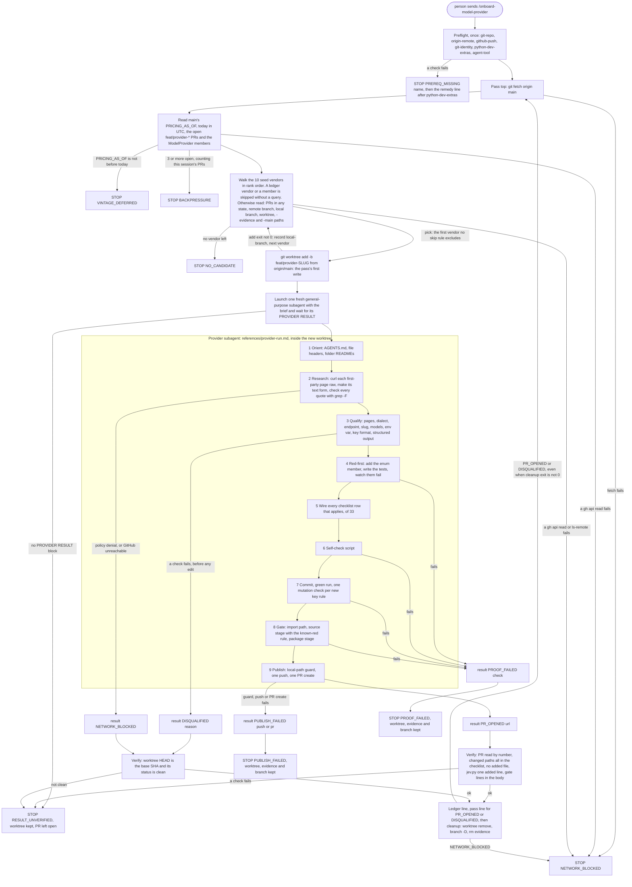

feat(skills): /onboard-model-provider onboards one model vendor per PR from first-party sources, continuously
## Motivation

Adding one model vendor to the SDK has taken a whole expert session. Meta needed one (#1027). A vendor touches 33 places in the repository, and several of them fail silently when skipped: the usage-class map, the structured-output tier, the unmanaged-provider test list and the DIRECT wire test. The goal is that the SDK keeps gaining vendors without anyone wiring them by hand, each one arriving as a pull request whose every fact is traced to the vendor's own pages.

This PR adds the Claude Code project skill `/onboard-model-provider`. A person types it in a Claude Code session in a clone of this repository. The session then works through a fixed, ranked list of ten seed vendors. For each one it creates a fresh worktree from `origin/main` and hands the vendor to a fresh subagent. The subagent researches the vendor only from dated first-party pages, wires it, proves the change (red-first tests, mutation checks, the full gate) and opens one PR on `feat/provider-<slug>`. The session keeps going until it reaches a stop, then prints one STOP line and a ledger. It never merges.

The request asked for "a continuous, 24/7 run that creates a new pr per provider". The user then decided: "dont add as routine, just explain in system prompt" and "no cloud routine". So nothing is scheduled. Continuous mode lives inside one session, and the person starts it again after a stop.

**No vendor is onboarded in this PR.** It adds two Markdown files, a 65-test pack that pins their text, and one regenerated `REPO_MAP.md` entry. Nothing under `vidbyte/`, `lint/`, `scripts/` or `.github/` changes.

Spec: `docs/spec/provider-onboarding-skill/spec.md` (r9 verified; r10, this PR's last docs commit, only links the PR and redraws §5 to the shipped flow).

## How to use

**Before the first run.** These steps apply after this PR merges:

- Update the clone you start from to a `main` that has this skill. The session loads the skill from the checkout it runs in.
- Sign `gh` in with push rights to `cerredz/Vidbyte-SDK`.
- Have a Python 3.11+ interpreter with the dev extras: `<python 3.11+> -m pip install -e ".[dev]"`. The skill never installs anything. It probes `python`, then `python3`, then `py -3.11`, and stops with that remedy line if none has the extras.

**Start it.** In the clone:

```text
claude --add-dir <the clone's parent directory> --permission-mode auto
/onboard-model-provider
```

Send `/onboard-model-provider` as the whole message. It takes no arguments, and the model never starts it by itself (`disable-model-invocation: true`).

**Permission setup.** The skill cannot check this, so SKILL.md states it as a prerequisite.

- `--add-dir` makes the sibling directories the run writes (`<checkout>-onboard-<slug>`, its `-evidence` directory and its `-main` twin) working directories.
- Use auto mode on a workstation.
- Use `bypassPermissions` only inside an isolated container or VM.
- An allowlist with `acceptEdits` is not enough. Allow rules do not match past a leading `PYTHONPATH=`, and the sibling worktree lies outside the working directories, so the run would wait at prompts.
- Subagents inherit the session's permission rules, and a background subagent's prompts show up in the main session.

**What each loop iteration does:**

1. Fetch `origin/main`.
2. Read main's `PRICING_AS_OF`, today's UTC date, the open `feat/provider-*` PRs and the `ModelProvider` members.
3. Stop if main's pricebook date is not before today. Also stop if 3 or more provider PRs are open; the PRs this session opened count at once.
4. Walk the seed vendors in rank order. Skip a vendor that is already a member, or has a PR on `feat/provider-<slug>` in any state, or has a leftover branch, worktree, `-evidence` or `-main` path, or already has an outcome in this session's ledger.
5. Create the worktree `<checkout>-onboard-<slug>` on the new branch `feat/provider-<slug>` from `origin/main`. This is the pass's first write. If the add fails, record `local-branch` and try the next vendor.
6. Hand the vendor to one fresh general-purpose subagent with a short brief, and wait for its result block.
7. The subagent saves each first-party page raw, backs every fact with a verbatim quote, and runs the qualification checks before any edit. A vendor that fails one is `DISQUALIFIED <reason>`, and the loop moves on.
8. The subagent wires the vendor through the 33-row checklist and proves it: red-first tests, a self-check, a green run, a mutation check per new key rule, the source stage and the package stage. Then it pushes once and opens one PR, ready for review.
9. The orchestrator checks the result itself against GitHub and git, prints one pass line, and records the ledger line.
10. It removes the worktree, the local branch and the evidence directory, then starts the next pass.

**How it stops.** There are three stops for the person:

- `NO_CANDIDATE`: every seed vendor is skipped or disqualified.
- `BACKPRESSURE`: 3 or more provider PRs are open.
- `PROOF_FAILED`: a provider run failed its proof bar and needs a person.

It also stops when continuing could not produce a valid PR: `VINTAGE_DEFERRED`, `PREREQ_MISSING`, `NETWORK_BLOCKED`, `PUBLISH_FAILED` and `RESULT_UNVERIFIED`. Every STOP line is followed by one ledger line per seed vendor.

What a stop leaves behind:

- `PROOF_FAILED`, `PUBLISH_FAILED` and `RESULT_UNVERIFIED` keep the worktree, its evidence and the branch, so no unpushed work is lost. The STOP line names the worktree. The next session skips that vendor as `local-branch` until you clean it up with SKILL.md's own commands:

```sh
SLUG=<slug> WORKTREE=<checkout>-onboard-<slug>
git worktree remove --force "$WORKTREE" && git branch -D "feat/provider-$SLUG" && test -n "$SLUG" && rm -rf -- "$WORKTREE-evidence"; echo "cleanup exit $?"
git worktree remove --force "$WORKTREE-main"
```

  Run the last line only when the `-main` twin exists.
- An interrupted session prints no STOP line. It leaves the last pass's worktree and branch, which the next session skips as `local-branch`.

**What it does under your GitHub identity.**

- It reads GitHub only through `gh api` REST calls. It never runs `gh pr` or `gh issue`.
- For each vendor, the subagent makes exactly one push, `HEAD:refs/heads/feat/provider-<slug>`, never forced. It makes exactly one `POST /repos/cerredz/Vidbyte-SDK/pulls` with base `main`, and that PR opens ready for review.
- The orchestrator itself makes no GitHub write.
- The skill never merges, closes, edits, labels or comments on a PR. It never pushes `main` and never deletes a remote branch.
- It never touches the launcher checkout: no checkout, switch, reset, clean, stash or commit there.
- It never uses a real key and never calls a vendor API with a key. Fake keys are built by concatenation.
- It never changes `VIDBYTE_MANAGED_TEXT_PROVIDERS`. Every vendor it adds is DIRECT-only.
- Closing a provider PR unmerged tells the skill to skip that vendor forever. Close one only to reject the vendor.

**How the context stays small.** Each vendor runs in a fresh subagent whose context is thrown away when it returns. The looping session keeps only three things per pass: the brief it sent, the 6-line result block and one ledger line. It never reads vendor pages, the evidence directory, gate logs or the 387-line procedure. It takes the checklist paths for its own diff check from one `sed` command over the procedure.

**No scheduler.** This follows the user's decision. A session runs until its STOP, and you start it again later. Every pass re-reads live state from GitHub and `origin/main`, so a new session picks up where the last one left off.

**The real output.** The preflight and pass-top commands were run exactly as SKILL.md writes them, reading each command from the file, up to but not including `git worktree add`. The run used a `git clone --shared` of this branch with `origin` pointed at GitHub, so no ref in the shared repository was written. It ran at 2026-10-17T22:31:35Z, with `origin/main` at 6f5a7310:

```text
$ git rev-parse --show-toplevel                            -> <scratch>/s6/clone                         exit 0
$ git remote get-url origin                                -> https://github.com/cerredz/Vidbyte-SDK.git exit 0
$ gh api repos/cerredz/Vidbyte-SDK --jq .permissions.push  -> true                                       exit 0
$ git config --get user.email                              -> <address withheld>                         exit 0
$ PY=; for c in python python3 "py -3.11"; do ...          -> py: python                                 exit 0
pass top, one shell call (shell exit 0):
  2026-10-11      PRICING_AS_OF on origin/main
  2026-10-17      date -u +%F
  prs exit 0      no open feat/provider-* PR
  openai anthropic gemini xai deepseek glm minimax kimi meta mistral openrouter elevenlabs playai typesafe   (one per line)
walk, rank 1 cerebras: no PR line, prs exit 0, remote-branch exit 2, local-branch exit 1, paths exit 1  -> first pick
ranks 2-10, read after the pick for information: the same four lines for every vendor
stopped before git worktree add; the clone's git status --short stayed empty
```

The pricebook date is before today, and no provider PR is open. So a real pass would create `feat/provider-cerebras` and hand Cerebras to a subagent. This matches the two earlier runs, by S3 and by re-review round 1, line for line. Only `origin/main` moved, from 845a4d9b to 6f5a7310, and no seed vendor became a member.

## Flow



The orchestrator (top) makes no change until the worktree add. Every read before it either stops the session or skips a vendor.

The subagent (the box) can disqualify a vendor only in research and qualification, before its first edit. After that, it either opens a PR or stops the session with the worktree kept.

The orchestrator trusts no result on its word:

- A `PR_OPENED` result passes four checks against GitHub and git before cleanup.
- A `DISQUALIFIED` or `NETWORK_BLOCKED` result must leave the worktree exactly at its base.

Any mismatch is `RESULT_UNVERIFIED`, and the PR stays open for the person. Every STOP prints the ledger. This diagram replaces spec §5's earlier flowchart, which differed from SKILL.md in seven places (spec §17, r10).

## Changes

| File | Change | What it holds |
|---|---|---|
| `.claude/skills/onboard-model-provider/SKILL.md` | new, 241 lines | The orchestrator. Frontmatter (`name`, a `description` with a "Use it when" clause, `disable-model-invocation: true`). The three user stops and the other STOPs; the stated permission setup and six preflight checks; the constants (`MAX_OPEN_PROVIDER_PRS=3`, `MAX_CATALOGUED_MODELS=5`). Each pass: fetch, vintage, back-pressure as a union with this session's PRs, the skip walk with six dispositions, and the guarded worktree add. The subagent brief; the four result checks; what each outcome leaves behind; the output grammar (12 line forms); the rules; the ranked seed table of 10 vendors with first-party hosts and dated reasons; 4 excluded vendors with reasons. |
| `.claude/skills/onboard-model-provider/references/provider-run.md` | new, 387 lines | The per-vendor procedure, read only by the subagent, in ten sections: 1 Orient; 2 Research (raw `curl` capture with a UTC fetch log, a fixed `html.parser` text form, quotes checked by `grep -F -b -o`, rate-to-model binding, the positive-evidence network rule); 3 Qualify (8 checks, 9 disqualification reasons, the `qualify_ids.py` model-ID probe, the key-format decision with its cross-vendor collision check, and the rule that an existing vendor's key entries are never edited); 4 Red-first; 5 the 33-row wiring checklist (A1 to D2) with notes; 6 Self-check; 7 Commit, green run and mutation checks; 8 Gate with the known-red rule; 9 Publish (PR body sections, the local-path guard, one push, one PR); 10 the PROVIDER RESULT block. |
| `REPO_MAP.md` | 1 line changed | The `.claude/` entry is regenerated in five sentences. It describes both the hosted review-agent settings and project skills that run only when a person invokes one. It drops "Interactive sessions on a developer's own machine do not load it". |
| `tests/features/onboard_model_provider_skill/` | new pack, 9 files, 65 tests | `README.md`, `FEATURE.md`, `onboard_skill_fixtures.py` (fence-aware Markdown reader and a `sed` emulator); `test_onboard_skill_acceptance.py` (person-facing promises); `test_onboard_skill_contract.py` (frontmatter, headings, constants, seed table, brief, result block, enumerations, verification, publish rules, map entry); `test_onboard_skill_wiring_checklist.py` (the 33 rows against the spec and the tree, the C9 and C4 templates, the orchestrator's path command); `test_onboard_skill_commands.py` (read-only pass top, `<py>` and PYTHONPATH spelling, gate commands, mutation check, research protocol, skip reads, worktree add); `test_onboard_skill_security.py` (forbidden constructs, the one GitHub write, the one push refspec, D-29, format binding, the URL rule, the guard command, existing key rules kept); `test_onboard_skill_publish_guard.py` (runs the PR-body guard line from the file through `sh` over 10 bodies). The tests never call the network, `gh`, `git` or Claude, and never compare against a base commit, so they also pass inside every provider PR. |
| `docs/spec/provider-onboarding-skill/` | new, 29 files | The pipeline record: `request.md`, `spec.md`, `test-plan.md`, `review.md`, `verify-log.md`, `pipeline.md`, `context/code-map.md`, this `pr-body.md`, and 21 stage reports (S0 to S6) under `reports/`. |

Before S6's two docs commits, the branch had 62 commits on base 72a4ade1: `feat(skills)` 1, `fix(skills)` 15, `test(skills)` 4, `docs(skills)` 2, `docs(map)` 1, `docs(tests)` 1 and `docs(spec)` 38. It is not rebased. `origin/main` is 70 commits ahead, and `git merge-tree --write-tree origin/main HEAD` merges cleanly (exit 0). Of this PR's files, main changed only `REPO_MAP.md`, and not its `.claude/` entry.

## Compatibility

None for the package. Nothing under `vidbyte/`, `lint/`, `scripts/` or `.github/` changes. The wheel and sdist hold no `.claude` path, because `pyproject.toml` packages only `vidbyte*`. `.claude/ci-settings.json` is byte-identical (blob `f5c44a2064b7b4c426a5ae7efd98987ddf82164b` at base and head), and `.github/workflows/claude.yml` still loads it, so the hosted review agent is unchanged. `llms.txt` and `artifacts/file_index.md` already exclude `.claude/`.

The new behaviour is opt-in. It runs only when a person types `/onboard-model-provider`. Every provider PR it opens later is DIRECT-only: it works with `mode=TextModelMode.DIRECT` (an `Agent` needs `model_mode=TextModelMode.DIRECT`), because the Vidbyte gateway does not serve the new vendor.

## Acceptance criteria → proof

Every test name below exists on this branch (checked with `git grep -n "def <name>" -- tests/features/onboard_model_provider_skill`), and the pack gives `65 passed`.

| AC | What it requires | Proof |
|---|---|---|
| AC-1 | The skill loads and carries the invocation and every output form; the preflight and pass-top commands run read-only against live GitHub | `test_skill_md_carries_the_invocation_as_a_line_of_its_own`, `test_output_section_holds_every_pass_stop_remedy_and_ledger_line_form`, `test_preflight_and_pass_top_commands_write_nothing_before_the_worktree_add`, `test_vintage_and_member_reads_print_the_values_on_main` · PR-time: the run under How to use (2026-10-17T22:31:35Z, first pick cerebras) |
| AC-2 | Frontmatter: name, description ≤ 1,536 characters, manual-only; SKILL.md under 500 lines | `test_frontmatter_has_only_name_description_and_manual_only_invocation` |
| AC-3 | No `gh pr`, `gh issue`, stash, force push, PowerShell, `$env:`, `.exe`, drive-letter path or `path:line` in either file | `test_skill_files_hold_no_forbidden_construct[SKILL.md]`, `test_skill_files_hold_no_forbidden_construct[provider-run.md]` |
| AC-4 | The wiring table: spec header, 33 refs in order, cell grammar, every path and symbol in the tree | `test_wiring_table_has_the_spec_header_and_the_33_refs_in_order`, `test_each_wiring_row_follows_the_cell_grammar_and_names_the_spec_path_and_symbols`, `test_every_wiring_path_and_symbol_exists_in_the_tree`, `test_exactly_the_silent_rows_say_silent` |
| AC-5 | SKILL.md headings; no write before the worktree add; checklist paths come from the procedure, not a copy | `test_h2_headings_are_exactly_the_spec_list_in_order[SKILL.md]`, `test_verifying_a_result_runs_the_four_checks_without_a_copy_of_the_checklist`, `test_preflight_and_pass_top_commands_write_nothing_before_the_worktree_add`, `test_verifying_command_prints_exactly_the_checklist_paths` |
| AC-6 | Seed table: ten slugs in rank order, no researched fact, URLs on first-party hosts; four excluded vendors | `test_seed_table_lists_the_ten_vendors_in_rank_order_without_researched_facts`, `test_every_seed_url_is_on_its_rows_first_party_hosts` |
| AC-7 | provider-run.md headings, disqualification reasons, result block, collision check and swap case | `test_h2_headings_are_exactly_the_spec_list_in_order[provider-run.md]`, `test_each_enumeration_is_named_in_full_where_it_is_decided[disqualification-reasons]`, `test_result_block_is_produced_and_read_with_the_same_fields_and_outcomes`, `test_row_c6_requires_the_swap_case_and_qualify_runs_the_cross_vendor_collision_check` |
| AC-8 | Commit first, green run, revert one rule, restore by checkout, clean diff; every interpreter is `<py>`; PYTHONPATH never exported | `test_mutation_check_commits_first_restores_by_checkout_and_confirms_a_clean_diff`, `test_every_interpreter_command_is_spelled_py_except_the_one_probe_line`, `test_pythonpath_only_prefixes_one_command_and_never_the_package_stage`, `test_skill_files_hold_no_forbidden_construct` |
| AC-9 | The `REPO_MAP.md` `.claude/` entry: 4 or 5 sentences, review settings and invoked skills | `test_repo_map_claude_entry_describes_review_settings_and_invoked_skills` |
| AC-10 | The diff holds only the two skill files, `REPO_MAP.md`, the spec folder and the S2 tests; `ci-settings.json` unchanged | PR-time, at 451478b0: `git diff --stat 72a4ade1 451478b0` ends `39 files changed, 7871 insertions(+), 1 deletion(-)`. A `grep -vE` for any path outside that set printed nothing (exit 1). `git diff --quiet 72a4ade1 451478b0 -- vidbyte lint scripts .github` exits 0, and so does the same check on `.claude/ci-settings.json`. |
| AC-11 | The package stage passes, and the wheel holds no `.claude/` path | PR-time, rerun by S6 at 451478b0 with `--dist-dir <scratch>`: `Installed vidbyte-sdk 0.3.0 passed smoke checks.` · `CI passed.` The wheel has 1126 entries, its top-level names are `vidbyte` and `vidbyte_sdk-0.3.0.dist-info`, and 0 entries contain `.claude`. The sdist has 1433 entries, 0 of which contain `.claude`. |
| AC-12 | Source and package stages pass, apart from tests excepted under D-15 | PR-time: the gate table below |
| AC-13 | The three user stops, disqualified vendors skipped, what each outcome leaves, one session at a time, closing skips forever | `test_intro_names_the_three_user_stops_and_disqualified_vendors_are_skipped_not_stopped`, `test_rules_section_states_the_promises_a_person_relies_on`, `test_each_outcome_states_what_it_leaves_behind` |
| ~~AC-14~~ | withdrawn in spec r2: the Agent tool is a preflight prerequisite, with no inline fallback | — |
| AC-15 | Never a merge, a PR close, a push to `main`, or a change to the managed provider set | `test_github_is_reached_only_through_gh_api_and_the_only_write_is_the_pr_create`, `test_every_push_is_the_single_unforced_provider_refspec`, `test_the_managed_text_provider_set_is_only_ever_named_as_untouched` |

Review added pins beyond the ACs:

- D-29: `test_qualify_rejects_provider_prefixed_ids_and_the_self_check_proves_it`.
- D-13 format binding: `test_format_binding_needs_a_first_party_statement_not_an_example_key`.
- The C9 Bearer template: `test_c9_template_proves_the_vendor_key_leaves_as_its_bearer_token_and_the_other_key_stays`.
- The back-pressure union: `test_backpressure_counts_the_listed_prs_together_with_this_sessions_prs`.
- The vintage direction: `test_vintage_stops_the_session_when_mains_pricebook_is_not_before_today`.
- The response shape: `test_qualify_requires_the_chat_completions_response_and_usage_names`.
- INV-13: `test_every_url_a_run_writes_was_fetched_and_only_the_attribution_line_is_exempt`.
- EC-63: `test_the_pr_body_guard_is_the_exact_command_and_ends_in_a_named_outcome` and `test_the_pr_body_guard_passes_only_a_clean_body`.
- s5r3-1: `test_a_run_never_edits_an_existing_vendors_key_rule_and_sends_a_newer_shape_to_follow_ups` and `test_row_c4_quotes_the_statement_that_documents_the_prefix_and_never_a_paraphrase`.

## Verification

- [ ] Existing repository checks pass. **Not ticked.** The source stage ends `1 failed`. The failure is a test that is red on `origin/main` too, in a file this PR does not change. Lint, the other 5834 tests and the package stage pass.
- [x] New or changed package assets are present in the built wheel. No package asset changed. The skill is meant to stay out of the wheel, and the rebuilt wheel and sdist hold no `.claude` path.
- [x] Documentation and examples reflect the change. The `REPO_MAP.md` `.claude/` entry is regenerated. The skill's own text is its documentation, and §4 of the spec holds the usage example.
- [x] No credentials, private data, generated bytecode, build output, or unrelated changes are included. No key shape appears in the skill (`test_no_literal_key_shape_appears_and_fakes_are_built_by_concatenation`). No `.pyc`, wheel or `dist/` path is in the diff. The skill, tests and map hold no local path. The pipeline records under `docs/spec/provider-onboarding-skill/` name local scratch paths, as 121 committed `docs/spec` files on `main` already do.

Final gate, run independently by the orchestrator at 451478b0. Python commands ran from the worktree root. PYTHONPATH was a one-command prefix for the source stage and was unset for the package stage.

| Gate | Command | Result |
|---|---|---|
| feature pack | `PYTHONPATH="<worktree>" py -3.11 -m pytest tests/features/onboard_model_provider_skill -q -p no:cacheprovider` | `65 passed in 5.20s` |
| lint | `PYTHONIOENCODING=utf-8 py -3.11 lint/run.py` | `SDK-LINT: PASS` |
| source stage | `PYTHONPATH="<worktree>" py -3.11 scripts/run_ci.py --stage source` | `SDK-LINT: PASS` · `1 failed, 5834 passed, 16 skipped in 111.45s`. The 1 is the inherited `tests/features/harness_threads/test_harness_threads_surface.py::test_failure_codes_keep_main_and_append_exactly_the_28_harness_codes` (`assert 148 == 120` on the branch). It was proved red on a detached `origin/main` 6f5a7310 probe (`assert 167 == 120`, `1 failed`), and the file is unchanged against base 72a4ade1. |
| package stage | `py -3.11 scripts/run_ci.py --stage package` (PYTHONPATH unset) | `Installed vidbyte-sdk 0.3.0 passed smoke checks.` · `CI passed.` |
| remote checks | `gh pr checks https://github.com/cerredz/Vidbyte-SDK/pull/1175` | `no checks reported on the 'feat/onboard-model-provider-skill' branch` (CI workflows are dispatch-only) |

Semgrep is remote-only. Its inputs are unchanged: `git diff --name-only 72a4ade1..HEAD -- vidbyte .semgrep` is empty.

The MCP stdio flake (`test_cancelled_waiter_does_not_break_transport`), the second known-red test on main, passed in these runs.

Checks S6 ran itself at 451478b0, beyond the orchestrator's gate:

| Check | Result |
|---|---|
| AC-1 read-only run | See How to use. Every command exited 0, apart from the expected `remote-branch exit 2` and `local-branch exit 1`. The first pick was cerebras. The shared repository's `origin/main`, branch and `feat/provider-*` refs were byte-identical before and after. |
| package stage again, with `--dist-dir <scratch>` and the wheel and sdist listed | `Installed vidbyte-sdk 0.3.0 passed smoke checks.` · `CI passed.` · wheel 1126 entries, sdist 1433, `.claude` paths 0 and 0 |
| spec contracts against the skill text | The 33 wiring rows, the subagent brief, the output grammar and the PROVIDER RESULT block are byte-identical between spec §8.5/§12.3 and the skill. The four pass-top and cleanup commands and eight quoted rules appear in both. |
| merge onto current main | `git merge-tree --write-tree origin/main HEAD`, exit 0, no conflict |
| flowchart | Both mermaid blocks (this body's and spec §5's) render in mermaid 11.4.1 with no error |
| pack after the spec r10 commit | `65 passed` |

## Adversarial review

Before any test was written, the spec had two review rounds (S1, 20 findings; spec §16). After implementation, the code had three lenses (conformance, conventions, engineering), each round checked by an independent verifier that executed every claim. There were 3 repair iterations, of a cap of 8, and 2 re-review rounds, of a cap of 2. Full record: `docs/spec/provider-onboarding-skill/review.md`.

- **S4 review.** Confirmed 3 Blockers (R-1, R-2, R-3), 5 Majors (R-4 to R-8) and 10 Minors. The verifier refuted 1 sub-claim and downgraded 1. Seven Minors were fixed (R-V4 7b61eaee, R-V5 ccbba23d, R-C4 5e89c83b, R-E3 1dbdfede, R-E4 416483ad, R-E8 39e37702, R-E2f df0f4bb7). Three are follow-ups (R-E5, R-E6, R-E7).
- **Final re-review, round 1.** Confirmed R-9 (Blocker), R-10 and R-11 (Majors) and R-12 (Minor, fixed 1cac918e). None was refuted.
- **Final re-review, round 2.** After verification: 0 Blockers and 0 Majors, verdict SOUND. The reviewer's RR2-1 was downgraded to Minor R-13 and fixed at efd675de. R-14 and R-15 are follow-ups.
- **A relayed lesson.** Between the rounds, a lesson came in: SDK PR #1027's Meta key rule had drifted from Meta's docs. It was folded in as s5r3-1 (164ac9fd, pinned e9226643), and round 2 reviewed it.

| ID | Severity | Finding | Fixed in |
|---|---|---|---|
| R-1 | Blocker | The user's "never invent a URL" was stated nowhere, and row D1 wrote documentation links that no rule tied to a fetched page | 42834bc5 |
| R-2 | Blocker | Every run that applied row A13 ended in a false `PROOF_FAILED gate-source` on a harness test that diffs `vidbyte/lib/configs` | 0e972f8c (a bounded exception: an exact scoped diff, plus a control edit on a twin) |
| R-3 | Blocker | Four tests (S5, X8, X9, A5) could not fail for the defects their test-plan rows claim | df0f4bb7 (tests) |
| R-4 | Major | The C9 template every provider PR pastes had a 93-column comment | 6dc92270 |
| R-5 | Major | Two `-c` probes imported the launcher's `vidbyte`, not the worktree's | ff307d1e |
| R-6 | Major | A failed `git worktree add` was hidden, so a second session could adopt the first one's worktree; the cleanup was not chained | 02102cdb |
| R-7 | Major | The response text path and usage key names were never checked, so a vendor with Responses-style usage would record no cost | 1c0ec03c |
| R-8 | Major | The C9 Bearer assertion, the back-pressure union and "an example key alone is not enough" were unpinned | df0f4bb7 (tests) |
| R-9 | Blocker | X4 and X10 could not fail for six defects they claim; one of them re-selects a disqualified vendor on every pass | f31ac4b9 (tests) |
| R-10 | Major | The URL rule and the failed-add branch were unpinned | f31ac4b9 (tests) |
| R-11 | Major | The PR-body local-path guard could never pass in a root container (`/workspace`, `/app`, HOME `/`) and named no outcome | 8edfdec1 (107/107 cases under Git Bash, Linux dash and Linux bash as root) |
| s5r3-1 | Major (relayed) | Nothing stopped a run from replacing an existing vendor's key rule when that vendor's docs show a newer shape | 164ac9fd (skill), e9226643 (tests) |

**Test grants.** Only the S2 test author wrote tests, under a strengthen-only grant: assertions were added, and none was deleted, loosened or skipped. Each new assertion had to be red on its mutation and green on the real files. The grants landed at df0f4bb7, f31ac4b9, e9226643 and efd675de; efd675de narrowed two coverage claims and changed no assertion. The mutation evidence:

- df0f4bb7: 34 of 34 mutations red (control `50 passed`).
- f31ac4b9: 66 of 66 red (control `63 passed`).
- e9226643: 19 of 19 red (control `65 passed`).

At the first three grants the orchestrator also ran mutations of its own (4, 8 and 2), and all of them were red.

## Deviations from the spec

- **S3 implementation choices** (spec §17, 14 items; none changes a requirement or a test):
  - sections 1 to 5 of the procedure are repeatable work, and 6 to 9 are one-shot proof;
  - a collision check that cannot finish counts as `key-prefix-collision`;
  - extra models follow the pricing page's order;
  - only flat USD per-1M rates are accepted;
  - page values enter commands only in single quotes;
  - `git -C` and `cd <worktree> &&` are used throughout;
  - the evidence directory is split into `pages/`, `quotes/` and `probes/`;
  - `NETWORK_BLOCKED` carries its evidence inline;
  - a `qualify_ids.py` probe decides model-ID eligibility;
  - the seed reasons hold no researched fact;
  - the cleanup `rm -rf` is guarded by `test -n "$SLUG"`;
  - the base was not rebased.
- **`NETWORK_BLOCKED` from a failed `gh api` read.** SKILL.md stops with `NETWORK_BLOCKED - api.github.com <status>` on any failed read, a 401 or 404 included. Spec INV-20 lists only reachability failures. The skill's reading fails closed. This is a known one-line spec gap.
- **INV-13 reading.** The base URL is treated as a quoted fact from a page the run opened, not as a page itself. Every other URL a run writes must be the final URL of a 2xx fetch-log line (s5a-10).
- **R-7 option (c) not taken.** The new vendor is not added to `_CHAT_PROVIDERS`. The verifier rated it cosmetic, and it would widen the §12.3 checklist.
- **R-15, inside the skill text.** `provider-run.md` "Rules for the whole run" says the first failure in sections 6 to 9 ends `PROOF_FAILED`, while section 9's steps end `PUBLISH_FAILED`. Both keep the worktree and stop the session; only the label differs. It is a follow-up.
- **Spec §5.** The flowchart differed from SKILL.md in seven places that change no behaviour. Among them: no ledger skip or path reads in the walk, no clean check before cleanup, no edges for a failed fetch, `gh api` read, missing result or failed cleanup, and no evidence directory in cleanup. It is redrawn in r10 to the flow above.

## Decisions to confirm

These defaults were settled without the user. Each can flip with a reviewed edit to the skill.

- **Q-3.** Model IDs with two or more `/` (Fireworks' `accounts/fireworks/models/…`), or whose first segment names an SDK provider (Groq's `openai/…`), are never catalogued. One-`/` IDs such as `meta-llama/…` are allowed.
- **Q-6.** "Prices come only from the vendor's pricing page" is read as any first-party page that states the exact model's per-token USD rate. Cerebras depends on it: its `/pricing` page renders rates with JavaScript.
- **Q-9.** A model the vendor marks as preview may be catalogued or be the default, and the PR names it as preview. Groq depends on it.
- **Q-10.** A rate may be bound to its model by two quotes from the same saved page, at most 1,000 bytes apart, with no other model ID between them. Cerebras' price sits 457 bytes from its ID.
- **Q-2.** There is no refresh step. When one provider PR merges, every other open one conflicts on the shared lists and on `PRICING_AS_OF`. Resolve it by hand on a later day after re-checking prices, and never close it, because closing skips the vendor forever.
- **Q-4.** Provider PRs open ready for review, not as drafts.
- **Q-1, Q-5, Q-7 and Q-8** also kept their default of no: no persistent skip ledger, no `/loop` suggestion, no `allowed-tools` frontmatter, and no orchestrator re-run of the provider tests.

## Follow-ups

**Related and urgent, outside this PR.** Meta's docs now say keys start with `LLM_`, while the SDK's table F holds only `LLM|`. S5 repair 3 tested this with fake keys. A lone new-shape Meta key, with deepseek primary and meta as the other provider, is bound to DEEPSEEK: a cross-vendor misroute. A separate Meta PR should keep `LLM|`, add `LLM_` beside it, keep Meta format-bound, and quote Meta's sentence in its README row. Meta's authentication page also now exports `MODEL_API_KEY`, while the SDK reads `META_API_KEY`, which Meta's muse-code page still documents.

From the reviews:

- **R-E5.** A node that passes when rerun alone counts as flaky. A failure caused by state that the provider's own tests leaked could therefore pass as flaky. Rerun the node's whole file first.
- **R-E6.** The collision check does not compare a new prefix with table A's `sk-` and `eyJ` when the prefix extends them. Add that arm, and an OpenAI JWT swap case to row C6. No seed vendor is known to document such a prefix.
- **R-E7.** The result check does not machine-check that an existing vendor's key entries were left alone. The smallest check is that `git diff -U0 <base> <tip> -- vidbyte/lib/registries/provider_keys.py` has no removed line. Today the text rule and the green run cover it: a replaced Meta rule fails 5 provider-key tests.
- **R-7 option (c).** Add each new vendor to `_CHAT_PROVIDERS`. It is cosmetic.
- **R-14.** The keep rule's "README lines that document them" also covers the shared `Prefixes:` bullet that row D2 extends. A format-bound vendor is also never added to table A's "never" row. Add: "Adding the new vendor to a shared README line (rows C4 and D2) is not an edit of an existing vendor's lines."
- **R-15.** Say that section 9's failures end `PUBLISH_FAILED`, as its steps already do.
- **S10 hardening.** Widen `_EDITS_A_KEY_RULE` to allow one free word or a backticked name before `rule`, `entry` or `prefix`, plus `older`, `stale` and `previous`, and add the ANY-a to ANY-g mutations. The test's assert message still says "no line may tell a run to edit, replace or narrow a key rule", the broader claim that R-13 narrowed in the test plan.
- **The C4 note and the registries README.** The C4 note says a README row quotes "the statement or example that documents P", while `vidbyte/lib/registries/README.md` says "No example key is copied here", and its rows quote truncated examples (`xai-...`). Say "a statement, or a truncated example".

Residuals named by the repairs:

- **Guard, launcher checkout outside HOME.** The PR-body guard no longer matches a launcher checkout outside HOME (for example `/srv/build/…`). Add `"${W%-onboard-*}/"` if a provider PR ever shows one.
- **Guard, a scheme-less quote.** Page text quoted without a scheme, whose path segment equals the user name, fails closed as `PUBLISH_FAILED push local-path-guard`.
- **Unwritable checkout parent.** Claude Code's reference devcontainer mounts the checkout at `/workspace` as user `node`, and `/` is owned by root. There every worktree add fails after git has created the branch. Each vendor ends `local-branch`, ten stray local branches are left, and the session ends `NO_CANDIDATE`. That is loud, and nothing remote is written. SKILL.md should state that the checkout's parent must be writable.

Seen while writing this PR:

- **The result-check read has no exit status.** SKILL.md `## Verifying a result` runs `gh api "repos/cerredz/Vidbyte-SDK/pulls/$PR" …` with no exit status, although `## Each pass` says each `gh api` read in a pass prints one. A failed read becomes `RESULT_UNVERIFIED <slug> pr-state`, with the worktree kept and the PR open, rather than `NETWORK_BLOCKED`. It fails closed; only the label differs.

Known red on `main`, not this PR's:

- the harness failure-codes test above;
- the MCP stdio waiter flake.

🤖 Generated with [Claude Code](https://claude.com/claude-code)
