feat(skills): public SkillLoader resolves every #904 skill source without JevAgent (SDK 0.4.0)
## Motivation

The SDK already turns inline text, local folders, skills.sh installs, GitHub folders, and Anthropic or OpenAI hosted skills into `SkillDocument` text. Until now only `JevAgent`'s skill preload could reach that code: `SkillLoader` and `SkillResolution` were not root exports, and `vidbyte/agents/skills/__init__.py` exports nothing. vidbyte-cli wants one way to attach skills to all six of its agents, and it may import only names in the SDK's public contract, so it could not use the loader at all.

This PR exports the loader that already exists, together with `SkillResolution` and `ConfigurationError`, instead of writing a second one. It also checks the constructor's argument. Until now only JevAgent built a loader, and it always passed a valid tuple. At the merge base `0754e01f`, a generator loads nothing (`()`), a string raises `KeyError: 's'` from `load()`, and the same `LocalSkill` twice raises `ValueError: too many values to unpack (expected 1)`, which aborts every entry. The version moves to 0.4.0, so the CLI can pin the first release that carries these names. JevAgent behaves exactly as before. Spec: `docs/spec/public-skill-loader/spec.md` (r5).

## Changes

### How to use what this PR introduces

```python
import asyncio

from vidbyte import ConfigurationError, InlineSkill, LocalSkill, SkillLoader

entries = (
    InlineSkill(name="house-review", description="Our review checklist.", text="Read the tests first.\n"),
    LocalSkill(name="pdf", path="no-such-folder/pdf"),
)
loader = SkillLoader(entries)  # a tuple or a list; reads no file, key, or URL
resolutions = asyncio.run(loader.load())  # inside a running loop: await loader.load()
for entry, resolution in zip(entries, resolutions, strict=True):
    if resolution.document is not None:
        print(entry.name, "loaded", len(resolution.document.text.encode("utf-8")), "bytes")
    else:
        print(entry.name, resolution.reason.value, resolution.transient)

try:
    SkillLoader((entries[0], entries[0]))
except ConfigurationError as error:
    print("rejected:", error.details["names"])
```

This is the spec §4 snippet, unchanged. It runs as written on this branch. Run from an empty folder, with the worktree on `PYTHONPATH`, it printed:

```text
house-review loaded 22 bytes
pdf not_found False
rejected: ['house-review']
```

To turn a skill entry into prompt text, a program no longer needs a `JevAgent`, a deep import, or its own copy of the fetch, parse, and size rules. A list works the same way as the tuple. GitHub, skills.sh, Anthropic, and OpenAI entries go in the same way, for example `GitHubSkill(name="pdf", repo="anthropics/skills", path="skills/pdf", token=my_token)`.

### Flow

```mermaid
flowchart TD
  A["caller: SkillLoader(entries)"] --> B{"loader.SkillLoader.__init__: an Iterable, and not str or bytes?"}
  B -->|yes| C["tuple(entries), once, in iteration order"]
  B -->|no| D["the value, unconverted"]
  C --> E["skills.SkillEntries.__post_init__"]
  D --> E
  E -->|"not a tuple"| ERR1["ConfigurationError, details: entries_type"]
  E -->|"an element is not an entry or a SkillDocument"| ERR2["ConfigurationError, details: position, entry_type"]
  E -->|"a name repeats"| ERR3["ConfigurationError, details: names"]
  E -->|valid| F["SkillLoader keeps the tuple, remembers each SkillDocument, builds the resolver map, with no I/O"]
  F -->|"await loader.load()"| G["SkillLoader._pending_groups: entries not yet remembered, grouped by source type and group_key"]
  G --> H["asyncio.gather: resolver.resolve(group) for every group at once"]
  H --> R1["InlineSkillResolver: the entry's text becomes a SkillDocument"]
  H --> R2["LocalSkillResolver, SkillsShSkillResolver: read_capped in asyncio.to_thread"]
  H --> R3["GitHubSkillResolver, AnthropicSkillResolver, OpenAISkillResolver: SkillFetch.get through HttpTransport.request, no redirects"]
  R2 -->|"SKILL.md bytes"| P["SkillMarkdown.parse"]
  R3 -->|"SKILL.md bytes"| P
  R2 -->|"missing, unreadable, or too large"| S
  R3 -->|"refused, failed, missing key, or too large"| S
  R1 --> S["one SkillResolution per entry: a document, or a reason and a detail"]
  P -->|"document, or invalid_skill"| S
  H -->|"a resolver raised, or the load was cancelled"| Z["re-raised from load(), and nothing from this load is remembered"]
  S --> M["memory.setdefault for documents and permanent failures, never for rate_limited or fetch_failed"]
  M --> DONE["tuple of SkillResolution, in input order"]
```



Validation happens once, in `SkillEntries.__post_init__`, before any file, environment variable, or URL is read. Each entry's own constructor has already checked its fields. The only state that changes is the loader's `memory`, which keeps documents and permanent failures and never replaces a value it has remembered. An expected failure, such as a missing folder, a 404, a missing key, a rate limit, or a SKILL.md that is malformed or too large, becomes a `SkillResolution` with a `reason` inside its resolver. A resolver bug or a cancellation propagates out of `load()`, and nothing from that load is remembered.

### What changed

| File | Change |
|---|---|
| `vidbyte/lib/dataclasses/skills.py` | New frozen, slotted `SkillEntries` record. Its `__post_init__` checks, in this order, that the value is a tuple, that every element is an entry or a `SkillDocument`, and that names are unique. Each failure raises `ConfigurationError` with one of three `details` shapes. Added to the module `__all__` only; header updated |
| `vidbyte/agents/skills/loader.py` | `__init__` turns any non-text `Iterable` into a tuple once and builds `SkillEntries` from it. The annotation widens from `tuple[...]` to `Sequence[...]`, and memory is built from the converted tuple. `load()`, `documents()`, and `_pending_groups()` are byte-identical. Header updated |
| `vidbyte/__init__.py` | Imports `SkillLoader`, `SkillResolution`, and `ConfigurationError` and adds them to `__all__`; `__version__ = "0.4.0"`; the header's "Error exports" line names `ConfigurationError` |
| `contracts/sdk-public-api.json` | Regenerated by `scripts/generate-sdk-public-api.py` alone: 3 names added, `"version": "0.4.0"`, 643 exports |
| `pyproject.toml` | `version = "0.4.0"`; nothing else |
| `vidbyte/cli/__init__.py` | `VersionResolver.resolve` fallback reads `0.4.0` |
| `vidbyte/mcp_server/server/core.py` | MCP server default `version` reads `0.4.0` |
| `vidbyte/tools/mcp/client.py` | MCP client `clientInfo` version reads `0.4.0` |
| `README.md` | Install pin reads `vidbyte-sdk==0.4.0` |
| `llms.txt` | Version sentence reads `0.4.0` |
| `.github/ISSUE_TEMPLATE/bug_report.yml` | Version placeholder reads `0.4.0` |
| `vidbyte/agents/skills/__init__.py` | Header ROLE line names the root re-export; `__all__` stays `[]` |
| `vidbyte/agents/skills/README.md` | New **Public door** contract bullet. The constructor, memory, and egress wording now covers callers other than JevAgent |
| `vidbyte/agents/README.md` | The `skills/` line names root-import callers |
| `REPO_MAP.md` | The skills entry no longer calls JevAgent's preload the only consumer, and memory is per loader |
| `docs/design/release-0-4-0.md` | New release notes in the 0.3.0 shape: the loader, #1027's two breaking changes, #1095, #1036, the 15 fixes, and the release steps |
| `tests/features/public_skill_loader/` | New pack (`FEATURE.md`, `conftest.py`, 7 modules, 67 cases): acceptance, boundary, both doors, contract, docs, release, security |
| `docs/spec/public-skill-loader/` | Pipeline record: request, spec r5, test plan, review, verify log, stage reports, and this description |

## Compatibility

**New public Python API.** The contract goes from 640 names at `0754e01f` to 643. Nothing is removed or renamed.

| Root name | Signature at this head |
|---|---|
| `SkillLoader` | `SkillLoader(entries: Sequence[SkillEntry \| SkillDocument]) -> None` |
| `SkillLoader.load` | `async def load(self) -> tuple[SkillResolution, ...]` (async only; there is no sync twin) |
| `SkillLoader.documents` | `def documents(self) -> tuple[SkillDocument \| None, ...]` |
| `SkillResolution` | frozen dataclass `SkillResolution(document: SkillDocument \| None = None, reason: SkillUnavailableReason \| None = None, detail: str \| None = None)`, with the read-only property `transient: bool` |
| `ConfigurationError` | `ConfigurationError(message: str, *, details: Mapping[str, Any] \| None = None)`, a `VidbyteSdkError` with `.message` and `.details` |

- **Argument.** Typed code passes a tuple or a list. At runtime, any `collections.abc.Iterable` except `str` or `bytes` is turned into a tuple once, in iteration order, so a generator is used up. An empty collection is valid. Construction reads no file, environment variable, or network.
- **Construction errors.** `ConfigurationError`, whose `details` has exactly one of three shapes:
  - `{"entries_type": <type name>}` for text or a non-`Iterable`, including an object that iterates only through `__getitem__`;
  - `{"position": <0-based int>, "entry_type": <type name>}` for the first element that is not one of the six entry classes or a `SkillDocument`;
  - `{"names": <sorted repeated names>}` for repeated names, compared exactly and case-sensitively.

  Neither the message nor `details` holds the rejected value or a credential. An exception raised while iterating the caller's own argument propagates unchanged.
- **Result.** One `SkillResolution` per entry, in input order.
  - Success: `resolution.document.text`.
  - Failure: `document is None`, with a non-blank `detail` and a `reason`, one of `not_installed`, `not_found`, `auth_failed`, `rate_limited`, `fetch_failed`, `invalid_skill`, or `too_large`. `load()` never sets `decision_failed`, which only the Jev preload uses.
  - `transient` is `True` only for `rate_limited` and `fetch_failed`.
- **Credentials.** Each entry carries its own: `GitHubSkill(token=)`, `AnthropicSkill(api_key=)`, or `OpenAISkill(api_key=)`. If it has none, `load()` reads `GITHUB_TOKEN`, `ANTHROPIC_API_KEY`, or `OPENAI_API_KEY`. There is no loader-level credential.
- **Limits.** A SKILL.md over `SKILL_MARKDOWN_MAX_BYTES` (1,048,576 bytes, the whole file before decoding) comes back as `too_large`, and so does any other download over `SKILL_DOWNLOAD_MAX_BYTES` (33,554,432). It is never truncated and never raised. The loader takes no byte limit from the caller and has no source-string parser. The two caps are not root exports, so a consumer matches on `reason`.
- **Memory.** Memory belongs to one loader instance. Documents and permanent failures are kept, and `rate_limited` and `fetch_failed` are tried again on the next `load()`. Keep one loader per tenant or credential set.
- **Names already at the root since #904:** the six entry classes, `SkillEntry`, `SkillDocument`, `SkillSourceType`, and `SkillUnavailableReason`. `SkillEntries` and `SkillFetchStep` are not root exports.

**Existing callers.** The loader was private, so its only caller is `JevSkillsPreload`, which always passes a valid tuple. `vidbyte/agents/jev/` and the Jev skill tests are unchanged, and those tests pass unedited. The wider annotation accepts every earlier call.

**Version 0.4.0 is a minor release because it also ships main's #1027 (`72a4ade1`).** #1027 came in through the merge of `0754e01f`, and it is breaking:
- **`api_key=` is removed** from 11 signatures on 8 root exports: the constructors of `Agent`, `BaseAgent`, `AggregateAgent`, `AgentRoleSettings`, `AgentRunnerConfig` (where it was the first positional field), `JevAgentSettings`, and `JevRunBriefSettings`, plus `Agent.restore`, `BaseAgent.restore`, `Session.resume`, and `Session.fork_from`. All 11 take `api_keys=` instead, and all but `AgentRunnerConfig` and `JevRunBriefSettings` also take `vidbyte_api_key=`. Passing `api_key=` raises `TypeError`.
- **Text calls go through the Vidbyte gateway by default.** `model_mode` now defaults to `TextModelMode.AUTO`, which sends every text call through the gateway. With only a provider key such as `OPENAI_API_KEY`, the first text call fails before any request with `ConfigurationError: Missing Vidbyte API key …` (`vidbyte/lib/registries/models.py:208`). `TextModelMode.DIRECT` calls the provider directly; it is exported from `vidbyte.lib.enums`, not the root.
- The skill entries keep their own `api_key=`, and `GitHubSkill` keeps `token=`.

The user chose the minor bump. The question put to them named #1027's removal of `api_key=` and its gateway default. Their answer was **"0.4.0 (Recommended)"**, with the option text: "Ship the breaking change as a new minor, per AGENTS.md's 'APIs may change between minor versions'. CLI installs pinned `<0.4` won't silently pick up the gateway routing. The CLI skill PR pins `>=0.4.0,<0.5` and has to verify #1027's behavior, as the CLI's pin comment asks." (request.md §A, Prompt 5). The user first asked for 0.2.2. That plan moved to 0.3.1 when `main` released 0.3.0 during this run, and then to 0.4.0 once #1027 arrived.

**What a consumer must do.**
- Require `vidbyte-sdk>=0.4.0`. 0.3.0 has none of the three names, so `from vidbyte import SkillLoader` raises `ImportError` there.
- Code that passed `api_key=` to the eight exports above moves to `api_keys=`, plus `vidbyte_api_key=` or `VIDBYTE_API_KEY`, or it opts into `TextModelMode.DIRECT`.

**vidbyte-cli.** Its pin goes to `vidbyte-sdk[codex]>=0.4.0,<0.5`. CLI `main` pins `>=0.3.0,<0.4`, and the CLI pipeline branch pins `>=0.2.1,<0.3`. Before it relies on 0.4.0, the CLI run must check #1027's gateway routing against its six agents. It then re-vendors `contracts/sdk-public-api.json`.

**MCP and packaging.** The MCP server's default version and the client's `clientInfo` version now say `0.4.0`. No dependency changes, and the `codex` extra is unchanged.

## Verification

| Gate | Command | Result |
|---|---|---|
| §4 snippet | the snippet above, run from an empty folder with `PYTHONPATH=<worktree>`, at `3a6979dd` | `house-review loaded 22 bytes` / `pdf not_found False` / `rejected: ['house-review']` |
| New pack | `PYTHONPATH=$(pwd) python -m pytest -q -p no:cacheprovider tests/features/public_skill_loader`, at `3a6979dd` | `67 passed in 0.32s` |
| Pack + Jev area | `PYTHONPATH=$(pwd) python -m pytest -q -p no:cacheprovider tests/features/public_skill_loader tests/features/jev_skills_preload tests/test_jev_skill_preload.py`, at `3a6979dd` | `493 passed, 1 skipped in 5.94s` |
| Lint | `python lint/run.py`, at `3a6979dd` | `SDK-LINT: PASS`; `lint/` is unchanged and no baseline was raised |
| Contract | `PYTHONPATH=$(pwd) python scripts/generate-sdk-public-api.py --check`, at `3a6979dd` | `contracts/sdk-public-api.json is current at 013cf884fb9a532101bbbe128d9fde908b2fd131 (vidbyte-sdk 0.4.0, 643 exports).` C016 is clean (verify log, Iteration 2) |
| Source stage, local | `PYTHONPATH=$(pwd) python scripts/run_ci.py --stage source`, at `93a2b1a8`, the last code change | `3 failed, 5888 passed, 16 skipped, 1 warning in 136.28s` / `CI failed`. All 3 are the inherited failures (a), (c), and (d) below |
| Package stage, local | `python scripts/run_ci.py --stage package`, without `PYTHONPATH`, at `93a2b1a8` | `Installed vidbyte-sdk 0.4.0 passed smoke checks.` / `CI passed.` |
| Semgrep | `semgrep scan --error --config .semgrep/typed-mapping-boundary-policy.yml vidbyte`, at `93a2b1a8` | `Ran 1 rule on 962 files: 0 findings.` |
| Remote CI | `gh workflow run ci.yml`, run 38842387870 on `ba841010` | Attempt 1: Source / Python 3.12 failed only on the bash-probe flake (`Tool probe failed: bash did not finish within 15 seconds`, `1 failed, 5850 passed, 56 skipped`), and Package was skipped. Attempt 2 (`gh run rerun --failed`): Source / Python 3.11, Source / Python 3.12, and Package all succeeded |
| Remote Static policy | `gh workflow run static-policy.yml`, run 38842389942 on `ba841010` | Static policy: success |
| Remote, final head | `ci.yml` and `static-policy.yml`, dispatched on the head that adds this file | These runs started after this file was committed. Their IDs and results are in the PR description on GitHub |

Every commit after `93a2b1a8` changes only documentation, and `ba841010` and later heads differ from `93a2b1a8` only under `docs/`.

**Inherited local failures, none caused by a defect in this PR.** These tests are `main`'s, and they are not edited here:
- **(a)** `tests/features/harness_threads/test_harness_threads_surface.py::test_failure_codes_keep_main_and_append_exactly_the_28_harness_codes` fails on `main` itself. The parent session confirmed this independently: it fails the same way on a clean `origin/main` checkout at `0176c0d3`, with `assert 148 == 120`. It compares `FailureCode` with `git merge-base origin/main HEAD`, which already contains #1036's 28 codes.
- **(b)** `tests/test_mcp_stdio_transport.py::McpStdioTransportHardeningTests::test_cancelled_waiter_does_not_break_transport` is a timing flake that also fails on `main`. It passed in the run above.
- **(c)** `::test_branch_leaves_the_tools_and_configs_packages_as_main_has_them` is a guard from #1036 that compares the branch with its merge base. The parent session's independent check: it fails only on the diff assertion for `vidbyte/tools/mcp/client.py`, which is this PR's `clientInfo` version literal (INV-16).
- **(d)** `::test_import_vidbyte_starts_no_process_and_leaves_the_native_package_unloaded` is another of #1036's merge-base guards. The parent session's independent check: its real guarantee holds, because `report["started"] == []` and `report["native"] is False` both pass. Only the line that requires the root `__all__` to equal the merge base's fails, because this PR adds 3 root exports.
- Remote CI clones shallowly and has no `origin/main`, so the merge-base parts of (a), (c), and (d) do not run there.

- [x] Existing repository checks pass. The three required checks (Source / Python 3.11, Source / Python 3.12, and Package) and Static policy are green remotely. Locally, the only failures are (a), (c), and (d) above.
- [x] New or changed package assets are present in the built wheel. This PR adds no package files. The package stage installs the built wheel and runs `import vidbyte`, which imports all three new names: `Installed vidbyte-sdk 0.4.0 passed smoke checks.`
- [x] Documentation and examples reflect the change: the skills README's Public door bullet, `vidbyte/agents/README.md`, `REPO_MAP.md`, the package headers, and the release notes. `test_docs_describe_the_public_door` guards them.
- [x] No credentials, private data, generated bytecode, build output, or unrelated changes are included. The diff has no `.pyc`, `egg-info`, or build files, and every token in the tests is a labeled fake (`ghp_…FAKE`).

### Acceptance criteria → proof

Test paths are under `tests/features/public_skill_loader/` unless they say otherwise.

| AC | What it checks (plain words) | Proven by |
|---|---|---|
| AC-1 | The §4 snippet prints exactly its three lines | `test_public_skill_loader_acceptance.py::test_spec_snippet_prints_its_three_lines`, plus the snippet run in Verification |
| AC-2 | One entry from each of the six sources, built from root imports only, comes back in input order, as a document or as a reason | `test_public_skill_loader_acceptance.py::test_every_source_resolves_through_the_root_door_in_input_order` |
| AC-3 | Text or a single value (`str`, `bytes`, `None`, `int`) is rejected with `entries_type`, before any I/O | `test_public_skill_loader_boundary.py::test_text_or_a_single_value_is_rejected_whole_before_any_io` |
| AC-4 | The first non-entry element is rejected with its 0-based position and type | `test_public_skill_loader_boundary.py::test_first_non_entry_element_is_rejected_at_its_zero_based_position` |
| AC-5 | Repeated names are rejected, sorted and listed once each; names that differ only by case, a space, or Unicode form are distinct | `test_public_skill_loader_boundary.py::test_repeated_names_are_rejected_sorted_and_each_listed_once`, `::test_names_differing_only_by_case_space_or_unicode_form_are_distinct` |
| AC-6 | A rejection never repeats the rejected value or a token or key | `test_public_skill_loader_security.py::test_rejection_never_echoes_the_rejected_value_or_a_credential` |
| AC-7 | Failing sources come back as reasons with details, beside a healthy entry that still loads | `test_public_skill_loader_acceptance.py::test_failing_sources_come_back_as_reasons_beside_a_healthy_entry` |
| AC-8 | A SKILL.md at exactly 1 MiB loads, and one byte more is `too_large` | `tests/features/jev_skills_preload/test_skill_sources_local.py::test_skill_file_over_the_cap_is_too_large_and_at_the_cap_loads`, `test_skill_sources_skills_sh.py::test_installed_skill_md_cap_is_inclusive_and_over_it_is_too_large`, `test_skill_sources_github.py::test_raw_file_cap_is_inclusive`, `test_skill_sources_vendor.py::test_bare_skill_md_cap_is_inclusive` |
| AC-9 | Construction reads no key. At load, each entry's own credential is sent, the environment is the fallback, and no credential reaches another host | `test_public_skill_loader_security.py::test_construction_reads_no_key_and_load_sends_each_credential_only_to_its_own_host` |
| AC-10 | The three names are root exports, are the same objects as in their defining modules, and are exported from the root only; the contract lists them at 0.4.0 | `test_public_skill_loader_contract.py::test_three_new_names_are_root_exports_and_the_defining_objects`, `::test_new_names_are_exported_from_the_root_only`; `generate-sdk-public-api.py --check` and C016 |
| AC-11 | All nine version places agree with `pyproject.toml`, which is at least 0.4.0 | `test_public_skill_loader_release.py::test_every_version_bearing_place_reads_the_release_version` (eight literals); `--check` (the contract's version); `pyproject.toml:7` |
| AC-12 | JevAgent is unchanged: the Jev skill suites pass without edits | `tests/features/jev_skills_preload/` and `tests/test_jev_skill_preload.py`, part of the 493 passed; `git diff 0754e01f HEAD` over them and over `vidbyte/agents/jev/` is empty |
| AC-13 | A second `asyncio.run(loader.load())` on a new loop reuses memory and retries only transient failures | `test_public_skill_loader_acceptance.py::test_second_asyncio_run_reuses_memory_and_retries_only_transient_failures` |
| AC-14 | An empty tuple or an empty list loads `()` with no I/O | `test_public_skill_loader_boundary.py::test_empty_tuple_and_empty_list_load_nothing` |
| AC-15 | A crash or a cancellation propagates, and nothing is remembered | `tests/features/jev_skills_preload/test_skill_sources_memory.py::test_a_crash_while_loading_propagates_and_remembers_nothing`, `::test_cancellation_while_loading_propagates_and_remembers_nothing` (`load()` is byte-identical) |
| AC-16 | The docs describe the public door, not JevAgent as the only consumer | `test_public_skill_loader_docs.py::test_docs_describe_the_public_door` |
| AC-17 | A list and a generator are accepted, in iteration order, and the generator is used once; the constructor type is `Sequence` and `load()` is async | `test_public_skill_loader_boundary.py::test_any_non_text_collection_is_taken_once_in_its_iteration_order`; `test_public_skill_loader_contract.py::test_constructor_takes_one_sequence_of_entries_and_load_stays_async` |
| AC-18 | `JevAlignmentSettings(skills=t)` and `SkillLoader(t)` accept or reject the same names, with equal `details` | `test_public_skill_loader_both_doors.py::test_both_doors_agree_on_repeated_and_unique_names`, `::test_both_doors_agree_across_a_seeded_sweep_of_collections` |
| AC-19 | The release notes name the three names, #1027's two breaking changes, and the nine version places with the export count | No test, by design, because a test would pin prose. Commits `93a2b1a8`, `0ae0c1c4`, and `510ef3f3`; S5 re-review round 2 checked every claim against git and found it SOUND |

### Adversarial review

The S4 review used three lenses (conformance, conventions, and engineering) plus a verifier. It found 1 Major and 6 Minor findings. One of the Minors, R-2, was a Major that the verifier downgraded, and nothing was refuted. S5 then ran two scoped re-review rounds. Round 1 found 1 Major and 2 Minors and refuted 1 Blocker. Round 2 was SOUND, with 3 Minors.

| ID | Severity | Finding | Fixed in |
|---|---|---|---|
| R-1 | Major | The release test compared every version place with the literal `"0.3.1"`, so the next routine bump would have turned 8 cases red | `e4041b3e` (the test compares each place with `pyproject.toml`'s version and checks a floor; granted test edit); floor raised to `(0, 4, 0)` in `dc522090` |
| R-C11 | Major | After the merge of `main`, the consumer contract still described the release as 0.3.0 plus a few fixes, although it carries #1027's breaking change | spec r5 `ed354f3a`; then the user's 0.4.0 decision: `013cf884`, `46416739`, `dc522090`, and `93a2b1a8` |

- Refuted: R-C10 (Blocker), "the PR is no longer a draft". This is GitHub state the user set (`ready_for_review` by `cerredz`), not a defect in this PR.
- Minors fixed:
  - R-2: the exact `Iterable` rule, `a5638085` (spec text `bdf23937`);
  - R-3: a note on the twin name rule, `320bcb8a`;
  - R-4: `load()` terms instead of JevAgent's runs, `922823f6`;
  - R-5: the docs test fails when its heading is missing, `852ea989`;
  - R-C12: stale line citations, `ed354f3a`;
  - R-C13: FEATURE.md and the test plan, `ed354f3a` and `b1a970c4`;
  - R-C21: later main fixes named by a git range, `510ef3f3`;
  - R-C22: "not an `Iterable`", `0ae0c1c4`;
  - R-C20: this PR's title (GitHub state, no commit).
- Minors left as follow-ups: R-6 and R-7.

### Deviations from the spec

- **Version.** The user first asked for 0.2.2. The spec then planned 0.3.1 (D-13), after `main` released 0.3.0 during the run. It ships 0.4.0 (D-15), the user's decision once #1027 reached the branch (Compatibility above).
- **Release notes added.** D-10 and NG-12 said no release doc. On the user's direction, D-16 adds `docs/design/release-0-4-0.md` in the 0.3.0 shape.
- **`main` merged into the branch.** `fc0175da` merges `0754e01f`, with the parent session's approval. The branch's history therefore contains 18 `main` PRs: the 15 fixes #1086 to #1094, #1096 to #1098, and #1100 to #1102, and the features #1027, #1036, and #1095. They are not part of this PR's diff, which `git diff 0754e01f HEAD` shows. The contract was regenerated alone after the merge (`778b094a`) and again for 0.4.0 (`46416739`).
- **S3 implementation deviations (spec §17).**
  - `SkillEntries` could not join the single import line in `loader.py` without breaking lint S051, so it is a wrapped import (`edd21008`).
  - Row 3 is split across two commits: the exports in `c3c5264f`, and `__version__` with the other literals so that the bump is one commit (`67090f24`, later `013cf884`).
  - The **Public door** bullet is the last bullet of the README's contract section, because it refers to the caps listed before it.
- **Wording in spec §2 and AC-3.** Both still say "text or not a collection". The code follows INV-2 (r4): it rejects text and anything that is not an `Iterable`, and it accepts a generator.
- **Draft state.** NG-2 says the PR stays a draft. The user marked it ready for review on 2026-10-15, and it is left that way.

## Follow-ups

- **Fix `tests/features/harness_threads/test_harness_threads_surface.py` on `main`, in its own PR.**
  - (a) fails on `main` itself.
  - (c) and (d) compare the branch with the merge base, so they fail on any branch that adds a root export or touches `vidbyte/tools/`.
- **Update the branch at merge time.** This branch is behind `main` (`0176c0d3`), with no conflicts. `main`'s branch protection is strict, so whoever merges must first update the branch from `main`. After that update, run `python scripts/generate-sdk-public-api.py --check` and check that the nine version places still say 0.4.0. Regenerate the contract in its own commit only if `main` changed the root exports.
- **Release.** After the merge, push the tag `v0.4.0` on the merge commit and dispatch `publish.yml`, as `docs/design/release-0-4-0.md` describes. Tagging and publishing are the user's call.
- **vidbyte-cli, in its own PR.** Check #1027's gateway routing against the six agents, pin `vidbyte-sdk[codex]>=0.4.0,<0.5`, and re-vendor the contract.
- **R-6.** Comment lines in the new test pack are wider than 72 columns (69 at S4). Rewrapping them is a test-only edit.
- **R-7.** The new pack has `FEATURE.md` but no `README.md`, as the `jev_*` packs it copied.
- **Spec text.** Spec §2 (`spec.md:71`) and AC-3 (`:229`) keep "not a collection"; INV-2 governs.
- **Known limitations, accepted in the spec.**
  - Detail strings still say "next run" and "create a new agent" (NG-9).
  - Anonymous GitHub allows about 20 unpinned commands an hour (EC-27). `ref=<40-hex SHA>` plus `path=` cuts each entry to one request.
  - `GitHubSkill(token="")` is rejected, so to force anonymous reads, unset `GITHUB_TOKEN` (EC-25).
  - `asyncio.run(loader.load())` raises inside a running loop; use `await` there (EC-9).
- **Flakes seen in this run.**
  - `tests/features/coding_agent/test_coding_agent_environment.py::test_real_bash_reports_its_version_and_git` has a 15-second bash probe. It timed out once remotely (run 38842387870, attempt 1) and once locally under load.
  - The MCP stdio cancelled-waiter test, (b) above.

🤖 Generated with [Claude Code](https://claude.com/claude-code)
