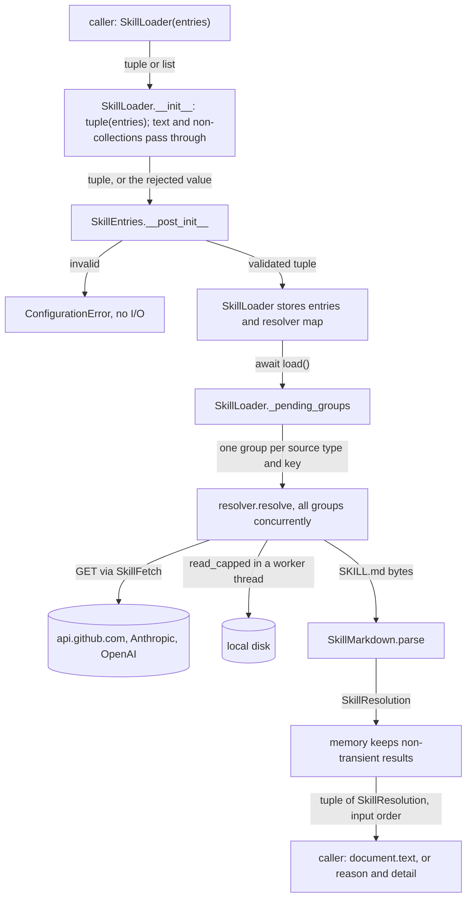
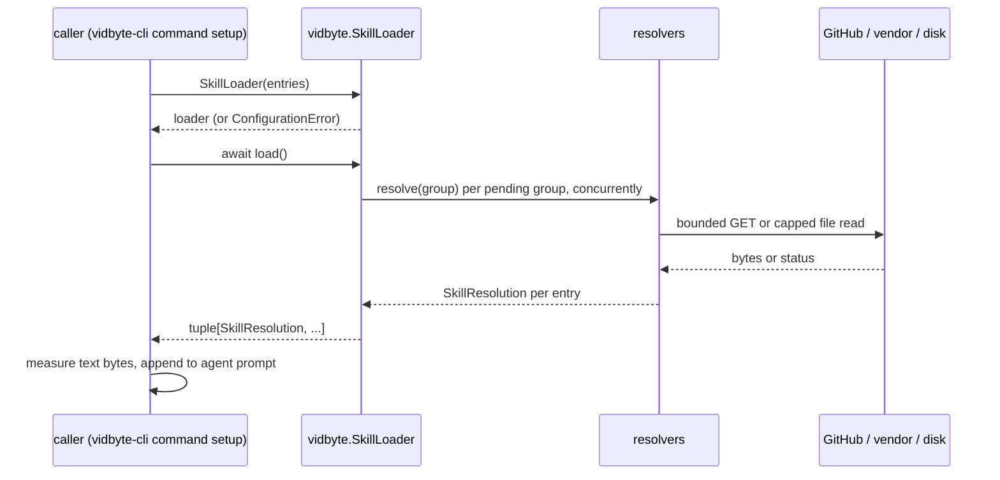

# Spec: Public skill loader: resolve every #904 skill source without JevAgent (SDK 0.3.1)

> **TL;DR** — The SDK's existing `SkillLoader`, its per-entry result `SkillResolution`, and `ConfigurationError` (the error every skill constructor raises) become root exports. Any program, vidbyte-cli first, can then turn inline, local, skills.sh, GitHub, Anthropic, and OpenAI skill entries into `SkillDocument` text without building a `JevAgent`. `SkillLoader(entries)` now takes a tuple or a list, and it rejects malformed entries when it is built, through one new validated record. The package moves to 0.3.1: `main` released 0.3.0 while this run was open, so 0.3.1 is the first release that can carry the loader. The decision that matters most is to expose the one loader that already exists, with its async `load()`, its positional results, and its per-loader memory, instead of wrapping it in a second public facade.

## §0 User prompts

### 0.1 Invoking request (verbatim)

From `docs/spec/public-skill-loader/request.md` §A, Prompt 4. These are the user's answers to a two-question multiple-choice prompt raised by the paused vidbyte-cli pipeline; the questions, the selected answers, and the option text the user was shown are all verbatim:

- Q: "How should vidbyte-cli let you attach skills to every agent, given that the SDK's skill loader is private and only JevAgent uses it?"
  A (selected): **"SDK PR first (Recommended)"**
  Option text shown to the user: "Make the skill loader public in the SDK and bump it to 0.2.2. The CLI PR then adds one shared repeatable option on AgentCommand that loads skills from all six sources and adds them to all six CLI agents' prompts. This follows the repo's 'SDK PR comes first' rule. The CLI PR waits for SDK 0.2.2 on PyPI, which it already had to."
- Q: "If the SDK change comes first, how should it be built?"
  A (selected): **"Own spec-pipeline run (Recommended)"**
  Option text shown to the user: "Run a full spec-pipeline in vidbyte-sdk (spec, blind tests, adversarial review, draft PR) to make the loader public and bump to 0.2.2. The CLI pipeline waits, then resumes against it. Slower, with the most scrutiny on a public API change."

### 0.2 User replies during the run
_None yet. The orchestrator appends any reply the user sends during the run here verbatim, labeled with the revision it produced._

---

## Part A — Framing

## §1 Goal

The user wants one universal "attach skills to agents" mechanism in vidbyte-cli that covers all six CLI agents and every #904 skill source (request.md Prompt 3, Prompt 4). The CLI may import only names in the SDK's public contract (its lint rules C028 and C029), and the code that resolves a skill entry into text is private today:

- `vidbyte/agents/skills/__init__.py:16` is `__all__: list[str] = []`.
- `SkillLoader` is not a root export, and neither is `SkillResolution`. Checked on this branch: `'SkillLoader' in vidbyte.__all__` and `'SkillResolution' in vidbyte.__all__` both print `False`.
- `ConfigurationError` is not a root export either (also checked). It is the error every #904 entry constructor raises for invalid input (`vidbyte/lib/dataclasses/skills.py:39`, `:59`, `:71`).
- The only consumer is `JevSkillsPreload` (`vidbyte/agents/jev/alignment/skills.py:76`), and the CLI never builds a `JevAgent`.

The paused CLI pipeline (`agent-skill-sources`) cannot proceed until an SDK commit exposes a loader and carries the version of the first release that contains it.

The user settled 0.2.2 as that version (§0.1, request.md §C) while 0.2.1 was the latest release. This run started at 15:04. At 15:34 the same day, `main` released 0.3.0 (`a7ed9cde`, #1085; tag `v0.3.0`; the latest vidbyte-sdk on PyPI, as the orchestrator verified). The first release that can contain the loader is therefore 0.3.1 (D-13; orchestrator decision 2026-10-15 16:20, pipeline.md). Q-8 lets the user override it.

| ID | Goal (outcome) | How we will know | Source |
|---|---|---|---|
| G-1 | A program that never builds a `JevAgent` turns any #904 skill entry (inline, local, skills.sh, GitHub, Anthropic, OpenAI) into skill text it can put in any agent's prompt, importing only from the `vidbyte` root | The §4 snippet runs with root imports only. `contracts/sdk-public-api.json` lists every name it uses | request.md §C key decision 1; Prompt 3; Prompt 4 |
| G-2 | An entry that cannot load comes back as its own structured result (`SkillUnavailableReason` plus a detail), never as an exception that aborts the other entries | Every reason the loader produces arrives as data in the result tuple | request.md §C "not as a crash"; §D |
| G-3 | `JevAgent` behaves exactly as before | Every existing JEV and skill-source test passes unedited | request.md §C key decision 3 |
| G-4 | An SDK commit with version 0.3.1 exists, so the CLI can raise its floor and vendor the contract (CLI C029) | The eight version literals and the regenerated contract (nine places, INV-16) read `0.3.1` | request.md §C key decision 4; Prompt 4; D-13 |

## §2 Objective

When this PR merges, `vidbyte.SkillLoader`, `vidbyte.SkillResolution`, and `vidbyte.ConfigurationError` are root exports, listed in `vidbyte.__all__` and in a regenerated `contracts/sdk-public-api.json`. `SkillLoader(entries)` takes any sequence of skill entries and documents, such as a tuple or the list a repeatable option collects, and turns it into a tuple once. A new frozen record, `SkillEntries`, then checks that tuple. The constructor raises `ConfigurationError` before any I/O when the argument is text or not a collection, holds something other than an entry or a document, or repeats a name. Every version literal says `0.3.1`. The texts that call JevAgent's preload the loader's only consumer, or say that the constructor only stores its entries, now describe the public door. This is the SDK slice of a two-PR change. The CLI slice (a repeatable option on `AgentCommand` in vidbyte-cli, with its SDK floor raised) and the PyPI release are not part of this PR (NG-2, NG-3).

## §3 Non-goals

- **NG-1** — A `skills` field on generic `Agent` or `BaseAgent`. *Why not:* out of scope in request.md §C. The caller appends the loaded text itself.
- **NG-2** — Publishing to PyPI, tagging a release, or merging. *Why not:* that is the user's call after review (request.md §C). The PR stays a draft.
- **NG-3** — Any change in vidbyte-cli. *Why not:* request.md §C. The CLI is only the consumer whose needs §9.2 answers.
- **NG-4** — Relevance selection (the Jev decision model) on the public path. *Why not:* the public loader resolves what it is given. Selection belongs to `JevSkillsPreload` and costs a billed Jev call (request.md §C open questions: "Likely not").
- **NG-5** — A parser from source strings such as `github:owner/repo/path`, `skills.sh:<id>`, or a local path. *Why not:* the user never asked the SDK for one, and consumer item 5 calls it optional. The CLI builds entry objects itself (Q-4).
- **NG-6** — A caller byte-limit parameter on the loader. *Why not:* D-7 explains why the caller measures its own budget (Q-3).
- **NG-7** — A loader-level credential parameter. *Why not:* per-entry `token=` and `api_key=` already exist and are public (D-8, Q-6).
- **NG-8** — A synchronous twin of `load()`. *Why not:* D-2 (Q-2).
- **NG-9** — Rewording the agent-centric detail strings ("retried on the next run", "create a new agent after fixing it"). *Why not:* nothing in the conversation asked for it, and NG-14 keeps every detail string unchanged. The tests pin words, not sentences. `tests/features/jev_skills_preload/test_skill_sources_local.py:170-174` requires "agent" and one of "new", "create", or "fresh", and `test_skill_sources_vendor.py:287` and `test_skill_sources_github.py:208` require "next run". So a rewording that keeps those words, such as "create a new agent (or a new SkillLoader) after fixing it", would need no test edit (Q-7).
- **NG-10** — Making `JevAlignmentSettings._normalized_skills` delegate to the new record. *Why not:* JevAgent must keep its behavior (G-3), and delegation would change it. The pinned assertions would still pass, because both copies raise `details == {"names": [...]}`. But JevAgent's duplicate-name message would change from "JevAlignmentSettings.skills must have unique document names." to the message of `SkillEntries`, which names `SkillLoader`. AGENTS.md also says "Do not rewrite untouched code just to make it conform". INV-18 keeps the two copies of the rule in step, and Q-9 offers the delegation.
- **NG-11** — Splitting the 1,366-line `vidbyte/__init__.py`, sorting its `__all__`, or rewriting its header beyond adding `ConfigurationError` to its "Error exports" line (row 3(f)). *Why not:* this is existing debt that belongs in its own pull request (AGENTS.md General Coding Style intro).
- **NG-12** — A release note `docs/design/release-0-3-1.md`. *Why not:* D-10 (Q-5).
- **NG-13** — Exporting the new names from `vidbyte.agents`, `vidbyte.agents.jev`, `vidbyte.lib`, `vidbyte.lib.dataclasses`, or `vidbyte.agents.skills`. *Why not:* D-6.
- **NG-14** — Changing any cap, timeout, retry, deadline, reason, enum member, or detail string. *Why not:* "one loader, one set of fetch/parse/limit rules" (request.md §C), and tests pin each value (`test_fetch_bounds_are_the_documented_values`).
- **NG-15** — Making the loader's attributes (`entries`, `memory`, `resolvers`) private. *Why not:* no test and no consumer reads them (checked with a grep over `tests/` and `vidbyte/`). §9.2 states that they are not part of the public contract.
- **NG-16** — Developer guidance in `skills/`, `llms.txt`, or the root `README.md` describing the loader. *Why not:* nothing asked for it, and #904 documented its entry types in none of these files (a grep for `SkillLoader|GitHubSkill|LocalSkill` over `skills/`, `README.md`, `llms.txt`, and `artifacts/` finds nothing). The package README is the documentation (row 12).
- **NG-17** — Releasing 0.2.2, or cutting a `release/0.2.x` maintenance branch from `179d8adc` to carry it. *Why not:* D-13. That is a release-process addition nobody asked for, and it would keep the loader off `main` (Q-8).

## §4 Developer usage

```python
import asyncio

from vidbyte import ConfigurationError, InlineSkill, LocalSkill, SkillLoader

entries = (
    InlineSkill(name="house-review", description="Our review checklist.", text="Read the tests first.\n"),
    LocalSkill(name="pdf", path="no-such-folder/pdf"),
)
loader = SkillLoader(entries)  # a tuple or a list; reads no file, key, or URL
resolutions = asyncio.run(loader.load())  # inside a running loop: await loader.load()
for entry, resolution in zip(entries, resolutions, strict=True):
    if resolution.document is not None:
        print(entry.name, "loaded", len(resolution.document.text.encode("utf-8")), "bytes")
    else:
        print(entry.name, resolution.reason.value, resolution.transient)

try:
    SkillLoader((entries[0], entries[0]))
except ConfigurationError as error:
    print("rejected:", error.details["names"])
```

Run from a working folder that has no `no-such-folder/pdf/SKILL.md`, it prints exactly:

```text
house-review loaded 22 bytes
pdf not_found False
rejected: ['house-review']
```

The developer builds entries, builds one loader, and gets one result per entry in input order: either a document whose `text` goes into any agent's prompt, or a reason and a detail. They no longer need a `JevAgent`, a deep import, or a copy of the fetching and parsing rules. A list works the same way as the tuple, for example the list a repeatable command-line option collects. A GitHub, skills.sh, Anthropic, or OpenAI entry works the same way, for example `GitHubSkill(name="pdf", repo="anthropics/skills", path="skills/pdf", token=my_token)`.

## §5 Flow diagram





The caller passes its entries as a tuple or a list. `SkillLoader.__init__` turns any collection into a tuple once. It leaves text, and values that are not collections, as they are, so that `SkillEntries` can reject them whole. `SkillEntries` then validates the tuple at the boundary. These two steps are the only new ones, and a bad value stops there before any file, environment variable, or network is touched. `load()` then runs the unchanged pipeline. Entries not yet remembered are grouped by source type and resolver key, every group resolves concurrently, and each resolver reads through `SkillFetch` (network) or `LocalSkillResolver.read_capped` (disk) and parses through `SkillMarkdown`. Every expected failure becomes a `SkillResolution` with a reason inside the resolvers. Documents and permanent failures are kept in the loader's memory, which is the only state that changes. The tuple comes back in input order.

---

## Part B — Behavior (this is the spec; everything else is framing)

## §6 Behavior

### 6.1 Invariants

- **INV-1** — `SkillLoader`, `SkillResolution`, and `ConfigurationError` are importable from the `vidbyte` package root and listed in `vidbyte.__all__` and in `contracts/sdk-public-api.json`. Each root name is the same object (`is`) as the class in its defining module: `vidbyte.agents.skills.loader.SkillLoader`, `vidbyte.lib.dataclasses.skills.SkillResolution`, and `vidbyte.lib.errors.ConfigurationError`.
- **INV-2** — `SkillLoader(entries)` takes any iterable that is not a `str` or `bytes`. Its annotation is `Sequence[SkillEntry | SkillDocument]`, so typed code passes a tuple or a list. The constructor turns the argument into a tuple once, in iteration order. Every element of that tuple must be an instance of a `SkillEntry` subclass or a `SkillDocument`, and no two elements may share a `name` (exact, case-sensitive string comparison). An empty collection is valid. Each of these raises `ConfigurationError` from the constructor, before any file is opened or statted, any environment variable is read, or any request is built:
  - a `str`, `bytes`, or non-iterable argument;
  - a non-entry element;
  - a repeated name.

  `SkillEntries` itself accepts only a `tuple`.
- **INV-3** — The `ConfigurationError` from INV-2 never contains the rejected value itself or any entry's `token` or `api_key`, in its message or in its `details`. It describes the problem only through these `details` keys:
  - an argument that is text or not a collection: `{"entries_type": <type name>}`;
  - a wrong element: `{"position": <0-based int>, "entry_type": <type name>}`;
  - repeated names: `{"names": <sorted list of the repeated names>}`.
  The message names `SkillLoader` and says how to fix the argument.
- **INV-4** — Constructing a `SkillLoader` performs no I/O: no file open or stat, no environment read, no HTTP request. This is unchanged and now also holds for a direct caller.
- **INV-5** — `await loader.load()` returns exactly one `SkillResolution` per input element, in input order (the argument's iteration order). The result's length equals the number of elements, and `result[i]` belongs to the `i`-th element.
- **INV-6** — Every expected failure of an entry is returned as data: a `SkillResolution` with `document is None`, a non-blank `detail`, and a `reason` that is one of `NOT_INSTALLED`, `NOT_FOUND`, `AUTH_FAILED`, `RATE_LIMITED`, `FETCH_FAILED`, `INVALID_SKILL`, or `TOO_LARGE`.
  - `load()` never produces `DECISION_FAILED`, which only the Jev preload sets.
  - `load()` raises only for a programming error, which propagates unchanged, or for cancellation, which stays cancellation. Nothing from that load is remembered.
  - One entry's expected failure never removes or changes another entry's result. The one exception is a failed shared GitHub lookup, which applies to exactly the entries that needed it.
- **INV-7** — A loaded entry's `SkillResolution.document` is a `SkillDocument` whose `name` is the entry's `name` and whose `text` is never trimmed, rewritten, or truncated. The text is:
  - for an `InlineSkill`, its `text`, exactly;
  - for a `SkillDocument` element, that same object;
  - for a local, skills.sh, GitHub, Anthropic, or OpenAI entry, the exact SKILL.md body after the line that closes its frontmatter.
- **INV-8** — A SKILL.md larger than `SKILL_MARKDOWN_MAX_BYTES` (1,048,576) yields `TOO_LARGE`, never a partial document and never an exception. The cap is inclusive and counts the whole file in bytes before decoding, frontmatter included. Any other download larger than `SKILL_DOWNLOAD_MAX_BYTES` (33,554,432) also yields `TOO_LARGE`. Inline text and caller-supplied documents have no SDK size cap. These are existing limits, unchanged.
- **INV-9** — Each entry supplies its own credential.
  - A `GitHubSkill` uses its `token` if set, otherwise `GITHUB_TOKEN`.
  - An `AnthropicSkill` or `OpenAISkill` uses its `api_key` if set, otherwise `ANTHROPIC_API_KEY` or `OPENAI_API_KEY`.

  Environment variables are read only inside `load()`, never at construction. A credential is sent only to `https://api.github.com`, or to the vendor's fixed default endpoint (`https://api.anthropic.com/v1`, `https://api.openai.com/v1`). It never appears in a label, a detail, a URL, a repr, or an error. A credential that starts with the Vidbyte API key prefix, or that holds a character outside printable ASCII, is `AUTH_FAILED` with no request. These rules are unchanged.
- **INV-10** — Memory belongs to one loader. A loader remembers every document and every permanent failure for its own lifetime, and the first remembered resolution is never replaced. `RATE_LIMITED` and `FETCH_FAILED` are asked again on that loader's next `load()`. A new loader re-reads everything, and two loader instances never share memory. This is unchanged (`vidbyte/agents/skills/loader.py` header).
- **INV-11** — `load()` may be awaited on any event loop, including a new loop for each call, for example `asyncio.run(loader.load())` twice on one loader. The loader holds no loop-bound state, because `HttpTransport.request` opens a new `httpx.AsyncClient` for every request (`vidbyte/lib/http/transport.py:66`).

**Must not regress:**
- **INV-12** — JevAgent behavior is unchanged. `JevSkillsPreload.__init__` builds `SkillLoader(skills)` from `JevAlignmentSettings`' normalized tuple (`vidbyte/agents/jev/alignment/skills.py:76`, `vidbyte/agents/jev/settings.py:89-122`). That tuple always satisfies INV-2, so no Jev configuration that is valid today raises. The S1 reviewer's probe confirmed this: all 296 `SkillLoader` constructions in the area suites and `tests/test_jev_done.py` pass a valid tuple with unique names. Every test in `tests/features/jev_skills_preload/` and `tests/test_jev_skill_preload.py` passes without edits.
- **INV-13** — The nine #904 names and `SkillDocument` stay the same object across their export paths, and `SkillFetchStep` stays off the root (`tests/features/jev_skills_preload/test_skill_sources_contract.py:51-67`).
- **INV-14** — `JevAlignmentSettings` keeps its own normalization (`vidbyte/agents/jev/settings.py:89-122`), byte for byte. It turns strings into `inline_skill_<n>` documents and rejects repeated names with `details={"names": ...}`.
- **INV-15** — `vidbyte/agents/skills/__init__.py` still exports nothing (`__all__ == []`) and gains no import or export. Only its ROLE IN CODEBASE header line changes, to name the root import (row 15).
- **INV-16** — Each of the nine version-bearing places reads `0.3.1`:
  - `pyproject.toml` `[project].version`;
  - `vidbyte.__version__`;
  - the `VersionResolver.resolve` fallback in `vidbyte/cli/__init__.py`;
  - the MCP server's default `version` in `vidbyte/mcp_server/server/core.py`;
  - the MCP client's `clientInfo` version in `vidbyte/tools/mcp/client.py`;
  - the install line in `README.md`;
  - the version sentence in `llms.txt`;
  - the placeholder in `.github/ISSUE_TEMPLATE/bug_report.yml`;
  - the regenerated contract's `version`.

  In the package stage, `vidbyte.__version__` also equals the installed distribution's version (that stage's smoke test).
- **INV-17** — `contracts/sdk-public-api.json` is exactly the generator's output: C016 and `python scripts/generate-sdk-public-api.py --check` pass. It is committed alone, after the commit that changed `vidbyte/__init__.py` and `pyproject.toml`, and no commit is amended after it is generated.
- **INV-18** — Both doors apply one name rule. For any tuple or list `t` whose elements are all `SkillEntry` or `SkillDocument` instances, `JevAlignmentSettings(skills=t)` and `SkillLoader(t)` either both succeed, or both raise `ConfigurationError` with equal `details` (`{"names": <sorted repeated names>}`). This guards the two copies of the rule against drift (NG-10, §11 Conflicts, Q-9).

### 6.2 Acceptance criteria

| ID | Given | When | Then | Priority | Proof |
|---|---|---|---|---|---|
| AC-1 | a clean checkout of this branch, run from a folder without `no-such-folder/pdf/SKILL.md` | the §4 snippet runs | it prints exactly the three lines shown in §4 | P0 | `tests/features/public_skill_loader/test_public_skill_loader_acceptance.py::test_spec_snippet_prints_its_three_lines` |
| AC-2 | one entry from each of the six sources, built only from root imports, with the network faked and files real | a caller that never builds a `JevAgent` awaits `SkillLoader(entries).load()` | it gets six results in input order. Each is a document with the exact body (INV-7), or a reason with a non-blank detail (INV-6) | P0 | `tests/features/public_skill_loader/test_public_skill_loader_acceptance.py::test_every_source_resolves_through_the_root_door_in_input_order` |
| AC-3 | an argument that is text or not a collection (a str, bytes, `None`, an int) | `SkillLoader(argument)` is called | `ConfigurationError` is raised with `details["entries_type"]` naming the argument's type. No file, environment variable, or request is touched | P0 | `tests/features/public_skill_loader/test_public_skill_loader_boundary.py::test_text_or_a_single_value_is_rejected_whole_before_any_io` |
| AC-4 | a tuple or list holding a non-entry element (a str, `None`, a dict, a `SkillResolution`) | `SkillLoader(entries)` is called | `ConfigurationError` is raised with that element's 0-based `details["position"]` and `details["entry_type"]`. No I/O happens | P0 | `tests/features/public_skill_loader/test_public_skill_loader_boundary.py::test_first_non_entry_element_is_rejected_at_its_zero_based_position` |
| AC-5 | a tuple or list in which two elements share a name, including the same entry twice and an entry plus a `SkillDocument` of the same name | `SkillLoader(entries)` is called | `ConfigurationError` is raised with `details["names"]` equal to the sorted repeated names | P0 | `tests/features/public_skill_loader/test_public_skill_loader_boundary.py::test_repeated_names_are_rejected_sorted_and_each_listed_once`; `::test_names_differing_only_by_case_space_or_unicode_form_are_distinct` |
| AC-6 | a rejected argument that holds a secret-looking string, or an entry carrying a `token` or `api_key` | AC-3, AC-4, or AC-5 raises | neither the rejected value nor any token or key appears in `str(error)`, `error.message`, or `error.details` (negative) | P0 | `tests/features/public_skill_loader/test_public_skill_loader_security.py::test_rejection_never_echoes_the_rejected_value_or_a_credential` |
| AC-7 | entries whose sources fail: a missing folder, a missing skills.sh install, a GitHub 404, a missing vendor key, a 429, a malformed SKILL.md, an oversized SKILL.md, beside one healthy entry | `load()` is awaited | `load()` does not raise. Each failure is a `SkillResolution` with its reason and a non-blank detail, and the healthy entry still returns its document | P0 | `tests/features/public_skill_loader/test_public_skill_loader_acceptance.py::test_failing_sources_come_back_as_reasons_beside_a_healthy_entry` |
| AC-8 | a SKILL.md of `SKILL_MARKDOWN_MAX_BYTES + 1` bytes, and one of exactly `SKILL_MARKDOWN_MAX_BYTES` bytes | both load | the first is `TOO_LARGE` with no document. The second loads, and its `text` is the body without frontmatter | P0 | existing, `load()` unchanged: `tests/features/jev_skills_preload/test_skill_sources_local.py::test_skill_file_over_the_cap_is_too_large_and_at_the_cap_loads`, `test_skill_sources_skills_sh.py::test_installed_skill_md_cap_is_inclusive_and_over_it_is_too_large`, `test_skill_sources_github.py::test_raw_file_cap_is_inclusive`, `test_skill_sources_vendor.py::test_bare_skill_md_cap_is_inclusive` |
| AC-9 | `GitHubSkill(token=...)` while `GITHUB_TOKEN` holds a different value, and `GitHubSkill()` while `GITHUB_TOKEN` is set; the same pairs for the vendor entries with `api_key` | the loaders are built, then loaded | construction reads no variable. At load, the entry's own credential is the one sent; without one, the variable is read then. No credential reaches any other host | P0 | `tests/features/public_skill_loader/test_public_skill_loader_security.py::test_construction_reads_no_key_and_load_sends_each_credential_only_to_its_own_host` |
| AC-10 | the package root | `import vidbyte` | `SkillLoader`, `SkillResolution`, and `ConfigurationError` are in `vidbyte.__all__` and are the defining-module objects. The contract lists all three, says `"version": "0.3.1"`, and `--check` passes | P0 | `tests/features/public_skill_loader/test_public_skill_loader_contract.py::test_three_new_names_are_root_exports_and_the_defining_objects`, `::test_new_names_are_exported_from_the_root_only`; the contract file: lint C016 and `python scripts/generate-sdk-public-api.py --check` |
| AC-11 | the branch head | each version-bearing place is read | all nine places named in INV-16 read `0.3.1`, including `vidbyte.__version__ == "0.3.1"` and `version = "0.3.1"` in `pyproject.toml` | P0 | `tests/features/public_skill_loader/test_public_skill_loader_release.py::test_every_version_bearing_place_reads_the_release_version` (eight places); the contract's `version`: lint C016 |
| AC-12 | the existing JEV and skill-source suites (`tests/features/jev_skills_preload/`, `tests/test_jev_skill_preload.py`) | they run unedited | every test passes (negative: no JevAgent behavior changed) | P0 | `tests/features/jev_skills_preload/` and `tests/test_jev_skill_preload.py`, run unedited |
| AC-13 | one loader whose first load remembered a document and a `NOT_FOUND` | `asyncio.run(loader.load())` runs a second time on a new event loop | it returns the same results without a new request or file read for the remembered entries, and raises nothing about a closed loop | P1 | `tests/features/public_skill_loader/test_public_skill_loader_acceptance.py::test_second_asyncio_run_reuses_memory_and_retries_only_transient_failures` |
| AC-14 | `SkillLoader(())`, and `SkillLoader([])` | `load()` is awaited | each returns `()`, with no I/O | P1 | `tests/features/public_skill_loader/test_public_skill_loader_boundary.py::test_empty_tuple_and_empty_list_load_nothing` |
| AC-15 | a load that is cancelled, or one whose resolver raises a programming error | `load()` is awaited | the cancellation or the error propagates unchanged, and a later `load()` on the same loader resolves every entry again, because nothing was remembered | P1 | existing, `load()` unchanged: `tests/features/jev_skills_preload/test_skill_sources_memory.py::test_a_crash_while_loading_propagates_and_remembers_nothing`, `::test_cancellation_while_loading_propagates_and_remembers_nothing` |
| AC-16 | the branch head | `REPO_MAP.md`, `vidbyte/agents/README.md`, `vidbyte/agents/skills/README.md`, the headers of `vidbyte/agents/skills/__init__.py` and `loader.py`, and the root `vidbyte/__init__.py` header are read | none of them describes JevAgent's preload as the loader's only consumer, the constructor as only storing its entries, or the loader's memory as living per agent without saying that is JevAgent's case. The skills README states the public-door contract (row 12), and the root header's "Error exports" line names `ConfigurationError` (row 3(f)) | P1 | `tests/features/public_skill_loader/test_public_skill_loader_docs.py::test_docs_describe_the_public_door` |
| AC-17 | a list of valid entries, and a generator that yields the same entries | each is passed to `SkillLoader`, then `load()` is awaited | both are accepted, and each returns one result per entry in the order of the equivalent tuple. The generator is consumed once, at construction | P0 | `tests/features/public_skill_loader/test_public_skill_loader_boundary.py::test_any_non_text_collection_is_taken_once_in_its_iteration_order`; constructor type: `test_public_skill_loader_contract.py::test_constructor_takes_one_sequence_of_entries_and_load_stays_async` |
| AC-18 | tuples and lists of entries and documents, some repeating a name across kinds (a local and a GitHub entry, a document and a vendor entry, two vendor entries) and some not | each `t` is passed to `JevAlignmentSettings(skills=t)` and to `SkillLoader(t)` | both accept, or both raise `ConfigurationError` with equal `details` (INV-18) | P1 | `tests/features/public_skill_loader/test_public_skill_loader_both_doors.py::test_both_doors_agree_on_repeated_and_unique_names`, `::test_both_doors_agree_across_a_seeded_sweep_of_collections` |

### 6.3 Edge cases and failure modes

The "Today" behavior in EC-1 to EC-4 was observed with `PYTHONPATH=$(pwd) python -c ...` against the unmodified loader at `179d8adc`. `vidbyte/agents/skills/` and `vidbyte/lib/dataclasses/skills.py` are byte-identical at `c9d31a7f`.

| ID | Trigger (input + state) | System behavior | User sees | Guarded by (INV-/D-) |
|---|---|---|---|---|
| EC-1 | A generator of entries, on a fresh loader | Today: the memory comprehension in `__init__` consumes the generator, so `load()` silently returns `()`. Now: the constructor turns it into a tuple once, so `load()` resolves every entry | one result per entry. The generator is used up, so a caller that pairs results with entries keeps its own list | INV-2, D-14 |
| EC-2 | A bare str (`"skills/pdf"`) instead of a collection | Today: `load()` raises `KeyError: 's'`, after it has already resolved and remembered any real groups. Now: the constructor keeps text whole, so the record rejects it at construction | `ConfigurationError`, with `entries_type` `str` | INV-2, D-14 |
| EC-3 | A tuple holding `None` or a dict | Today: `KeyError: None`, or `TypeError: unhashable type: 'dict'`, raised from `load()`. Now: `ConfigurationError` | `ConfigurationError` with `position` and `entry_type` | INV-2, D-3 |
| EC-4 | The same `LocalSkill` twice (likewise `SkillsShSkill`, `AnthropicSkill`, `OpenAISkill`) | Today: both land in one resolver group, and the single-entry resolver's `(entry,) = entries` raises `ValueError: too many values to unpack`, which aborts every entry. Now: rejected at construction as a repeated name | `ConfigurationError` with `details["names"] == ["<name>"]` | INV-2, D-4 |
| EC-5 | Two different entries with one name, for example `GitHubSkill("pdf")` and `LocalSkill("pdf")` | Rejected, as `JevAlignmentSettings` already does | `ConfigurationError` listing `pdf`. Fix: rename one | INV-2, D-4 |
| EC-6 | A list of valid entries, such as the list a repeatable command-line option collects | Accepted and turned into a tuple, as `JevAlignmentSettings.skills` accepts a list (`settings.py:96-101`; `test_skill_sources_entries.py:206`) | results in list order | INV-2, D-14 |
| EC-7 | A plain str element meant as inline text (`JevAlignmentSettings` accepts strings) | Rejected at its position | `ConfigurationError` with `entry_type` `str`. Fix: wrap the text in `InlineSkill` | INV-2, D-3 |
| EC-8 | `SkillLoader(())` | Valid. `load()` returns `()` with no I/O | an empty tuple | INV-2, INV-5 |
| EC-9 | `asyncio.run(loader.load())` called from inside a running event loop (for example inside a Codex agent's loop) | asyncio raises `RuntimeError` before any I/O, and the loader is untouched | `RuntimeError: asyncio.run() cannot be called from a running event loop`. Fix: `await loader.load()` | D-2 (documented in §4 and §9.2) |
| EC-10 | A GitHub 403 with `x-ratelimit-remaining: 0`, or a 429 | `RATE_LIMITED`, transient, not remembered. The next `load()` on that loader asks again | the detail says to set `GITHUB_TOKEN` for a higher limit; `transient is True` | INV-6, INV-10 |
| EC-11 | A private repository, with no token and `GITHUB_TOKEN` unset | GitHub answers 404, which becomes `NOT_FOUND` and is remembered | the detail says "or it is private: set GITHUB_TOKEN or pass token=" | INV-6, INV-9 |
| EC-12 | A vendor entry with no `api_key` and the vendor variable unset | `AUTH_FAILED` with no request, remembered | the detail says "pass api_key= on the entry or set ANTHROPIC_API_KEY" (or `OPENAI_API_KEY`) | INV-6, INV-9 |
| EC-13 | A Vidbyte API key placed in `GITHUB_TOKEN` or in an entry's credential | `AUTH_FAILED` before any request | a detail that never contains the key | INV-9 |
| EC-14 | A SKILL.md of 1,048,577 bytes, or one of exactly 1,048,576 bytes | `TOO_LARGE`, remembered, for the first. The second loads | the reason. For a local, skills.sh, or vendor file, the detail gives the size and the cap. For a network download, it gives the cap alone: a GitHub SKILL.md over the cap, or any download over 32 MiB (`fetch.py:88`) | INV-8 |
| EC-15 | A SKILL.md under 1 MiB whose body exceeds the caller's own budget (the CLI's 20,000 bytes) | The loader returns the document. Enforcing the budget is the caller's job: it measures `len(document.text.encode("utf-8"))` and builds its own failure, such as `SkillResolution(reason=SkillUnavailableReason.TOO_LARGE, detail=...)`. If the caller skips that check, it appends more text than its budget, so the risk sits with the caller | the caller's own structured failure | D-7 (accepted, documented in §9.2) |
| EC-16 | Egress to GitHub or a vendor is blocked | Each step fails as `FETCH_FAILED` after up to `SKILL_FETCH_DEADLINE_SECONDS` (25 s). A GitHub group can take up to three sequential steps (commit, tree, file), so up to about 75 s. Groups run concurrently. Not remembered, so every new loader pays it again | a slow `load()` and then `fetch_failed`. A caller may bound it with `asyncio.timeout`; EC-17 then applies | INV-6, INV-10; accepted (NG-14) |
| EC-17 | A cancellation during `load()` (the caller's timeout, Ctrl-C) | `CancelledError` or `TimeoutError` propagates, and nothing from that load is remembered (`loader.py:61-66`) | the caller's own cancellation | INV-6, INV-10 |
| EC-18 | A resolver raises a programming error (a bug) | It propagates unchanged and nothing is remembered. This is the "Fail open, with reasons" contract (`vidbyte/agents/skills/README.md`) | the exception | INV-6; accepted |
| EC-19 | Two overlapping `load()` calls on one loader | They may repeat requests. The first remembered resolution wins, and both calls agree on it (`loader.py` header INV-10) | consistent results | INV-10 |
| EC-20 | A caller mutates `loader.memory` or `loader.resolvers` | Not part of the public contract (§9.2), so the behavior is undefined | — | accepted (NG-15) |
| EC-21 | One loader shared across tenants, with entries that rely on environment credentials | The operator's `GITHUB_TOKEN` or vendor key reads every tenant's entries, and their results share one memory | — | T-1, T-4; accepted and documented (row 12) |
| EC-22 | A missing local folder is fixed while the same loader lives | Still `NOT_FOUND`, because it is remembered. The detail says "create a new agent after fixing it"; for a direct caller that means building a new `SkillLoader` | the agent-centric wording | INV-10; accepted (NG-9) |
| EC-23 | A SKILL.md that is not UTF-8, has bad YAML, or has no frontmatter or no body | `INVALID_SKILL`, remembered (`vidbyte/agents/skills/markdown.py`) | an SDK-written detail that never quotes the file | INV-6 |
| EC-24 | The caller builds `GitHubSkill(repo="https://github.com/a/b")` from user input | The entry's own `__post_init__` raises `ConfigurationError` (`vidbyte/lib/dataclasses/skills.py:190-191`) before any loader exists | a `ConfigurationError` that the caller now catches by its root name | D-5 |
| EC-25 | The caller wants an anonymous GitHub request while `GITHUB_TOKEN` is set | Not possible per entry: `GitHubSkill(token="")` raises `ConfigurationError` (`SkillText.require_optional`). The caller unsets the variable instead | `ConfigurationError` for a blank token | INV-9; accepted (Q-6) |
| EC-26 | A relative `LocalSkill.path` or `SkillsShSkill.directory`, followed later by a `chdir` | The path was pinned to an absolute one when the entry was built, so the later `chdir` does not move it (existing) | — | INV-7 |
| EC-27 | A CLI command builds a fresh loader on every invocation, with unpinned `GitHubSkill`s and no GitHub token | Each loader pays these requests per repository group: one commit lookup unless `ref` is a full 40-hex SHA (`github.py:118`, `:149`), one tree listing if any entry has no `path` (`:122`), and one file request per entry (`:128`). An unpinned entry with no path therefore costs 3 requests. Anonymous GitHub allows 60 REST requests an hour, so that is about 20 such commands an hour before `RATE_LIMITED` | slower commands, then `rate_limited` (transient). Fix: `ref=<40-hex SHA>` plus `path=` cuts each entry to one request, or set `GITHUB_TOKEN` | INV-10; accepted (memory is per loader, D-1); documented in §9.2 row 3 |
| EC-28 | A set, or a dict, passed as `entries` | A set becomes a tuple in the set's iteration order. A dict is iterated by its keys: a key that is not an entry is rejected at its position, and a dict keyed by entries is accepted as the tuple of its keys | for a set, or a dict keyed by entries, results in that iteration order, so pass a sequence to pair results reliably. For a dict with a non-entry key, `ConfigurationError` with that key's `position` | INV-2, D-14 |
| EC-29 | A consumer installs vidbyte-sdk 0.3.0, the latest on PyPI before this PR's release | 0.3.0 has no `SkillLoader`, `SkillResolution`, or `ConfigurationError` root export (checked at tag `v0.3.0`) | `ImportError` at `from vidbyte import SkillLoader`. Fix: a floor of `>=0.3.1` | §9.2 row 7; D-13 |

**Rollback of the user action:** loading skills is read-only. It installs nothing, runs no process, and writes nothing to disk (`vidbyte/agents/skills/README.md` Non-goals). A caller drops a loader to drop its memory. Reverting this PR means reverting its source commit and its contract commit, which restores the 0.3.0 contract. A version already published to PyPI cannot be reused.

## §7 Requirements

**Functional**
| ID | Requirement | Priority | Source (request.md / G-) |
|---|---|---|---|
| FR-1 | `SkillLoader` is a root export (INV-1) | P0 | §C key decision 1; consumer items 1 and 6; G-1 |
| FR-2 | `SkillResolution` is a root export (INV-1) | P0 | consumer items 1 and 6; G-1, G-2 |
| FR-3 | `ConfigurationError` is a root export (INV-1) | P0 | consumer item 6 (D-5); G-1 |
| FR-4 | `SkillLoader(entries)` turns any sequence into a tuple and validates it through `SkillEntries` at construction (INV-2, INV-3, INV-4) | P0 | §C "not as a crash"; AGENTS.md §4; D-14; G-2 |
| FR-5 | `load()` stays async and returns one `SkillResolution` per element, in input order, with expected failures as data (INV-5, INV-6, INV-7, INV-11) | P0 | consumer items 1 and 2; §C; G-1, G-2 |
| FR-6 | Credentials stay per entry with the environment fallback at load time, and the behavior is documented for callers (INV-9) | P0 | consumer item 3; G-1 |
| FR-7 | Size caps are unchanged, oversize is reported as `TOO_LARGE`, and there is no caller byte-limit parameter. Caller-side measurement is documented (INV-8, D-7) | P0 | consumer item 4; G-2 |
| FR-8 | Every version-bearing place reads `0.3.1` (INV-16) | P0 | §C key decision 4 (the reason for the bump); consumer item 7; D-13; G-4 |
| FR-9 | The contract is regenerated by its script in its own commit, and `--check` passes (INV-17) | P0 | §C constraints; lint C016; G-4 |
| FR-10 | The texts that name JevAgent's preload as the loader's only consumer, or say the constructor only stores its entries, describe the public door (rows 2, 3(f), 12, 13, 14, 15; AC-16) | P1 | AGENTS.md "regenerate a wrong entry from the tree"; folder-README rule; A001 |
| FR-11 | JevAgent is unchanged (INV-12, INV-14) | P0 | §C key decision 3; G-3 |
| FR-12 | Both doors apply the same name rule (INV-18) | P1 | D-4; S1 review R-2; G-3 |

**Non-functional**
| ID | Requirement | Priority | Target |
|---|---|---|---|
| NFR-1 | Construction stays free of I/O and cheap | P0 | zero file, environment, or network access in `SkillLoader.__init__`; validation is one pass over the tuple, O(n) in the number of entries |
| NFR-2 | The smallest complete change | P0 | 0 new files, 1 new class, 0 new dependencies, 0 new config keys, and exactly 3 new root names (§8.4) |
| NFR-3 | The full local gate is green, with no lint ratchet raised | P0 | `python scripts/run_ci.py` passes. C016 = 0, S012 = 0, A009 = 0; S015 ≤ 13, A001 ≤ 642, A002 ≤ 703, A006 ≤ 34, S051 ≤ 259, C011 ≤ 2, S060 ≤ 32, S009 (mypy) ≤ 350 (`lint/baseline.json`, unchanged between `179d8adc` and `c9d31a7f`) |
| NFR-4 | Secrets never appear in errors or reprs | P0 | INV-3, INV-9 |
| NFR-5 | "every source": all six source types resolve through the root door | P0 | AC-2 covers inline, local, skills.sh, GitHub, Anthropic, and OpenAI |
| NFR-6 | "the most scrutiny on a public API change": the public surface change is exactly what this spec names | P0 | the contract diff adds `ConfigurationError`, `SkillLoader`, and `SkillResolution`, changes the version, and removes nothing. The documented public members of `SkillLoader` are `__init__(entries)`, `load()`, and `documents()` (§9.2). The only signature change is the widening of `entries` from `tuple[...]` to `Sequence[...]` (D-14) |
| NFR-7 | "universal" and "all six CLI agents": the result belongs to no agent | P0 | a document is plain text (INV-7) that any agent's prompt can take; the loader imports no agent class |
| NFR-8 | "SDK PR comes first": this PR alone gives the CLI everything it needs to resolve all six sources | P0 | every row of the §9.2 consumer contract is answered with root names only; the CLI needs no further SDK change for consumer items 1–7 |

## Part C — Design

## §8 Architecture and decisions

### 8.1 Decisions
| ID | Decision | Deciding reason | Runner-up | Flips if |
|---|---|---|---|---|
| D-1 | Expose the existing `SkillLoader` and `SkillResolution` at the root, with no facade | request.md §C says "Prefer exposing or wrapping the loader that already exists over writing a second one". Its shape already answers consumer item 1: positional per-entry results, each a document or a reason and detail | A public static facade `SkillSources.resolve(entries) -> tuple[SkillResolution, ...]` that builds a fresh loader per call and keeps memory and attributes off the public surface | the owner wants the loader's attributes and `documents()` off the public surface, or wants to restructure `SkillLoader` in a patch release without a breaking change |
| D-2 | `load()` stays async only, with no sync twin | The work is concurrent I/O on asyncio (`asyncio.gather` at `loader.py:61`, `asyncio.to_thread` in `local.py`, async `HttpTransport.request`). The repo's sync twins raise inside a running loop (`TextModelRunner.run`, `vidbyte/lib/runners/text.py:93-100`; `BaseAgent.run`, `vidbyte/agents/base.py:1053-1060`), so a twin would only serve callers that can already write `asyncio.run(loader.load())`. Lint C011 checks only classes whose names end in Agent, Runner, Harness, Session, or Machine and that define `arun()` (`lint/rules/c011_agent_owned_usage_and_sync_twins.py` `_ENTRY_SUFFIXES`), so it does not cover `SkillLoader.load()` | `SkillLoader.load_sync()`, built like `TextModelRunner.run` | Q-2 is answered yes |
| D-3 | Validate the argument in a new frozen record, `SkillEntries`, in `vidbyte/lib/dataclasses/skills.py`. Build it as the first step of `SkillLoader.__init__`, right after the conversion in D-14. The parameter stays `SkillLoader(entries)` | AGENTS.md §4 and the Placement Rules ("Validation of the record itself (`__post_init__`, field checks) lives with the dataclass"). Field guide `strict-config-dataclasses.md` ("a thin adapter over one strictly validated dataclass"). Precedents: `CodingAgent.__init__` builds `CodingAgentSettings` (`vidbyte/agents/coding.py:74`), whose tuple check names the public class (`vidbyte/lib/dataclasses/coding.py:152-153`); `JevSkillsOutcome` checks a tuple of records (`vidbyte/lib/dataclasses/jev.py:3782-3784`). Keeping the signature keeps every existing call site valid | An inline type check in `SkillLoader.__init__` | the owner rejects a one-field record for this check |
| D-4 | Reject repeated names; do not deduplicate | Equal single-entry-source entries crash the load today (EC-4). Unique names are the rule the existing door already enforces (`settings.py:89-122`, `@intent names-uniquely-identify-response-results`), so a skill name means one thing through both doors, and a caller that reports by name is never ambiguous. INV-18 keeps the two copies of the rule in step (NG-10, Q-9) | Reject only equal entries, or deduplicate inside `_pending_groups` | the consumer needs two same-named skills from different sources in one loader |
| D-5 | Root-export `ConfigurationError` | Consumer item 6 asks for every name the CLI needs at the root. Every #904 entry constructor and `SkillLoader` raise this error for invalid input. The CLI's only other way to reach SDK errors is a deep dynamic import (`vidbyte-cli: src/vidbyte_cli/services/mcp/sdk.py:31,71`), which its C028 counts against the baseline | The CLI catches `Exception`, and so cannot tell invalid input from an SDK bug | the user rejects widening the root beyond the loader names (Q-1) |
| D-6 | Export the three names only at the root, imported from their defining modules | This is the smallest option. `vidbyte/agents/skills/__init__.py` must export nothing (its header, WHAT NOT TO DO 1). The root already imports straight from deep modules (`vidbyte/__init__.py:301` `vidbyte.agents.pricing`, `:441` `vidbyte.lib.dataclasses.coding`, `:623` `vidbyte.tools.builtins.handoff`). S015 checks only the root. The contract test's five-path table covers only the entry classes and `SkillDocument` (`test_skill_sources_contract.py:37-59`) | Route the names through `vidbyte.lib.dataclasses`, `vidbyte.lib`, `vidbyte.agents.jev`, and `vidbyte.agents`, as README "Adding a source" step 5 does for entries | the owner wants `SkillResolution` beside `SkillDocument` in `vidbyte.lib.dataclasses` |
| D-7 | No caller byte limit. The caller measures `document.text` in UTF-8 bytes | The CLI's 20,000 bytes is a total across all the instructions it appends (`InstructionsLimit.MAX_TOTAL_BYTES`, CLI S1 report §5), which a per-entry SDK limit cannot enforce. A per-call limit would also clash with per-loader memory, because `TOO_LARGE` is remembered. The repo already applies a caller budget outside the loader: `JevSkillsPreload._unbatched` (`alignment/skills.py:165-176`) marks a loaded skill `TOO_LARGE` for one request and never remembers it | `SkillLoader(entries, max_text_bytes=...)` | Q-3 is answered yes |
| D-8 | Credentials stay per entry, with the environment fallback; no loader-level parameter | The fields `GitHubSkill.token`, `AnthropicSkill.api_key`, and `OpenAISkill.api_key` already exist and are public. A loader-level credential would add a second precedence rule | `SkillLoader(entries, github_token=...)` | Q-6 is answered yes |
| D-9 | No source-string parser | Hard scope rule: the user never asked for one, and consumer item 5 is optional. The CLI builds entries, and the entry constructors validate them | `SkillEntry.from_source("github:o/r/p")` | Q-4 is answered yes |
| D-10 | No `docs/design/release-0-3-1.md` | All three earlier bumps added a `docs/design/release-*.md`: 0.2.0 (`90f36272`), 0.2.1 (`29fbfd28`), and 0.3.0 (`a7ed9cde`). But no gate requires one: a grep of `lint/`, `scripts/`, `.github/`, `AGENTS.md`, `REPO_MAP.md`, and `contracts/README.md` for a release-doc path finds nothing. The user's own list of what a bump touches (request.md §C "Constraints and assumptions") names the version places and the contract, and no release doc. AGENTS.md makes `docs/` opaque unless a human names a file, so copying `release-0-3-0.md` would need the user to name it. This spec is the PR's design record | Add `docs/design/release-0-3-1.md`, as the three earlier bumps did | Q-5 is answered yes (the user names `docs/design/release-0-3-0.md` as readable, so its form can be copied) |
| D-11 | Detail wording is unchanged | Nothing asked for a rewording, and NG-14 keeps every detail string. The tests pin words, not sentences, so a rewording that keeps "agent" with "new", "create", or "fresh", and "next run", would need no test edit (NG-9) | Reword them for one-shot callers, for example "create a new agent (or a new SkillLoader) after fixing it" | Q-7 is answered yes |
| D-12 | The version bump mirrors `29fbfd28` and `a7ed9cde`: the eight literals in the source commit, then the contract regenerated in its own commit (the order `29fbfd28` shows) | The precedents and request.md §C constraints. The generator refuses to stamp while its inputs are dirty (`scripts/generate-sdk-public-api.py`, `_dirty_inputs`) | — | — |
| D-13 | The version is 0.3.1, on `main` | request.md §C gives the reason for the bump: "because the CLI will raise its floor to the first release that contains the loader". With 0.3.0 tagged (`v0.3.0` = `a7ed9cde`) and published, that first release is the next patch, 0.3.1. A 0.2.2 literal on `main` would lower `main`'s version, and `.github/workflows/publish.yml:29-40` requires the release tag to equal `v{version}`. The only way to ship a literal 0.2.2 is a new `release/0.2.x` maintenance branch cut from `179d8adc`. That is a release-process addition nobody asked for (scope rule), and it keeps the loader off `main`. CLI `origin/main` (`64b04b3`, #166) already pins `vidbyte-sdk[codex]>=0.3.0,<0.4`, so a 0.2.2 would also fall outside the CLI's current range. Orchestrator decision 2026-10-15 16:20, pipeline.md | 0.2.2 on a new `release/0.2.x` branch cut from `179d8adc` | the user answers Q-8 with 0.2.2 on a maintenance branch; or `main` releases 0.3.1 before this PR merges, and the version becomes the next unreleased patch |
| D-14 | `SkillLoader(entries)` takes any sequence, annotated `Sequence[SkillEntry \| SkillDocument]`. `__init__` turns any non-text iterable into a tuple before it builds `SkillEntries`, which accepts only a tuple. Text and non-collections pass through unconverted, so the record rejects them whole (`entries_type`) instead of splitting a str into characters | Field guide `strict-config-dataclasses.md:7,13`: coerce loose input in `__init__` before building the record ("a `Tools` catalog becomes a tuple"). Precedent: `CodingAgent.__init__` passes `tools.all() if isinstance(tools, Tools) else tuple(tools)` (`vidbyte/agents/coding.py:78`). The Jev door accepts any non-text iterable (`settings.py:96-101`; `test_skill_sources_entries.py:206` passes a list), so both doors take the same shapes, and INV-18 can compare them on lists. The consumer collects a list from a repeatable option and type-checks with `mypy --strict` (vidbyte-cli `pyproject.toml` `[tool.mypy] strict = true`, `:126` at CLI `origin/main` `64b04b3`), so a tuple-only annotation would make it wrap every call in `tuple(...)`. The conversion type-checks cleanly when written inline (row 2(b)) | Strict tuple only (r1): the annotation stays `tuple[...]`, and the record rejects a list as `entries_type: list` | the owner wants the runtime check to match a tuple-only annotation exactly; or the consumer turns out to pass a tuple anyway, and the owner prefers the smaller code |

### 8.2 Patterns inherited
- **A thin adapter over one validated record.** A constructor keeps its ergonomic signature and builds one frozen record whose `__post_init__` owns every check. Repo use: `CodingAgent.__init__` → `CodingAgentSettings` (`vidbyte/agents/coding.py:74`, `vidbyte/lib/dataclasses/coding.py:145-155`).
- **Coerce loose input in the adapter, and validate a concrete value in the record.** Repo use: `CodingAgent.__init__` passes `tuple(tools)` to `CodingAgentSettings` (`vidbyte/agents/coding.py:78`).
- **Tuple-of-records validation in `__post_init__`.** Repo use: `vidbyte/lib/dataclasses/jev.py:JevSkillsOutcome.__post_init__`.
- **Result-as-data (fail open, with reasons).** An expected failure is a value, while programming errors and cancellation propagate. Repo use: `vidbyte/agents/skills/loader.py:SkillLoader.load`; contract bullet in `vidbyte/agents/skills/README.md`.
- **A caller-side budget over results the loader remembers.** Repo use: `vidbyte/agents/jev/alignment/skills.py:JevSkillsPreload._unbatched`.
- **Async first, with `asyncio.run` at the synchronous edge.** Repo use: `vidbyte/agents/base.py:BaseAgent.run`.
- **A generated contract with provenance.** It is committed separately and checked by lint. Repo use: `scripts/generate-sdk-public-api.py`, rule C016, and release commits `29fbfd28` and `a7ed9cde`.

### 8.3 Smaller design rejected

The smallest design adds two root imports and two `__all__` names (`SkillLoader`, `SkillResolution`) and bumps the version, with no other source change. It fails INV-2 and FR-4, and it fails the settled scope's "not as a crash". On this branch, observed directly: a generator gives a silently empty result (EC-1); a str gives `KeyError` from `load()` (EC-2); `None` or a dict gives `KeyError` or `TypeError` (EC-3); and the same `LocalSkill` twice gives a `ValueError` that aborts every entry (EC-4). A public door that crashes on its own argument is the half-working small design the doctrine rejects. It also leaves the CLI unable to catch the entry constructors' error by name, which fails FR-3.

### 8.4 Complexity budget
| Item | Count | Justification for each |
|---|---|---|
| New files | 0 | Production code only. The spec and S2's tests are outside the implementer's budget |
| New classes/modules | 1 | `SkillEntries` (D-3): the AGENTS.md §4 home for boundary validation |
| New dependencies | 0 | — |
| New config keys | 0 | The existing environment variables `GITHUB_TOKEN`, `ANTHROPIC_API_KEY`, and `OPENAI_API_KEY` are unchanged |
| New collections/tables | 0 | — |
| New public endpoints/commands | 0 commands; 3 root names | `SkillLoader`, `SkillResolution` (FR-1, FR-2); `ConfigurationError` (FR-3, D-5) |

_The implementer may not exceed this budget without stopping and reporting BLOCKED._

### 8.5 Key interfaces

```python
# --- vidbyte (package root): three new names in __all__ ---
from vidbyte import ConfigurationError, SkillLoader, SkillResolution

# vidbyte.agents.skills.loader (existing class; constructor now converts and validates)
class SkillLoader:
    def __init__(self, entries: Sequence[SkillEntry | SkillDocument]) -> None: ...
        # first step, one inline expression (D-14, row 2(b)):
        # self.entries = SkillEntries(entries=tuple(entries) if isinstance(entries, Iterable)
        #     and not isinstance(entries, (str, bytes)) else entries).entries
        # raises ConfigurationError (INV-2, INV-3); performs no I/O (INV-4)
    async def load(self) -> tuple[SkillResolution, ...]: ...          # unchanged
    def documents(self) -> tuple[SkillDocument | None, ...]: ...      # unchanged

# vidbyte.lib.dataclasses.skills (existing records, unchanged)
@dataclass(frozen=True, slots=True)
class SkillResolution:
    document: SkillDocument | None = None
    reason: SkillUnavailableReason | None = None
    detail: str | None = None
    @property
    def transient(self) -> bool: ...   # reason in SKILL_TRANSIENT_REASONS

@dataclass(frozen=True, slots=True)
class SkillDocument:
    name: str
    description: str
    text: str
    source: str | None = None

# vidbyte.lib.dataclasses.skills (NEW, internal: module __all__ only, not a root export)
@dataclass(frozen=True, slots=True)
class SkillEntries:
    entries: tuple[SkillEntry | SkillDocument, ...]
    def __post_init__(self) -> None: ...
        # not a tuple (text or a non-collection reached it)
        #                    -> ConfigurationError(details={"entries_type": str})
        # element not entry  -> ConfigurationError(details={"position": int, "entry_type": str})
        # repeated names     -> ConfigurationError(details={"names": list[str] sorted})

# vidbyte.lib.errors (existing, unchanged; root export added)
class ConfigurationError(VidbyteSdkError):  # .message: str, .details: dict[str, Any]
    ...
```

The test author binds to these names: `SkillLoader`, `SkillLoader.load`, `SkillLoader.documents`, `SkillResolution` (`document`, `reason`, `detail`, `transient`), `SkillDocument.text`, `ConfigurationError.details` with the keys `entries_type`, `position`, `entry_type`, and `names`, `SkillEntries`, and, for INV-18, `JevAlignmentSettings(skills=...)`.

## §9 Data, API, configuration, migration

### 9.1 Data model

There is no persistent data. The one new in-memory record is described here.

`SkillEntries`, a frozen, slotted dataclass in `vidbyte/lib/dataclasses/skills.py`:

| Field | Type | Required | Default | Rule |
|---|---|---|---|---|
| `entries` | `tuple[SkillEntry \| SkillDocument, ...]` | yes | — | It must be a `tuple`; `SkillLoader` makes one from the caller's sequence first (D-14). Each element is a `SkillEntry` subclass instance or a `SkillDocument`. Names are unique (exact string comparison). An empty tuple is allowed |

- **Natural key:** none. The record is a validated value, never stored or compared by callers.
- **Volume:** one record per loader, holding as many elements as the caller passes (a CLI invocation passes its `--skill` flags).
- **No unbounded growth:** the loader's memory holds at most one resolution per element of this tuple.
- **The union is kept on purpose:** the field keeps the `SkillEntry | SkillDocument` union because a caller's document is already resolved and the loader remembers it at once (`loader.py:39`). The record's docstring states this, per `strict-config-dataclasses.md`, "Avoid union fields".

### 9.2 API and interface surface

**Public library surface after this PR.** The new root names are `SkillLoader`, `SkillResolution`, and `ConfigurationError`. The documented public members of `SkillLoader` are `SkillLoader(entries)`, `await loader.load()`, and `loader.documents()`. The instance attributes `entries`, `memory`, and `resolvers` are implementation details, not part of the contract (NG-15).

- **Validation at the boundary:** the loader turns the caller's sequence into a tuple (D-14), and `SkillEntries` validates it (INV-2, INV-3). Each entry's own `__post_init__` has already run before that (`vidbyte/lib/dataclasses/skills.py`).
- **Errors:** `ConfigurationError` from construction only. `load()` returns data for every expected failure (INV-6).
- **Auth:** per entry, read at `load()` (INV-9).
- **Calling convention:** pass a tuple or a list. From synchronous code, call `asyncio.run(loader.load())`. From inside a running event loop, `await loader.load()`. A loader can be loaded again later, on any loop (INV-11), and it re-asks only transient failures (INV-10).

**Consumer contract (vidbyte-cli `agent-skill-sources`, request.md §C items 1–7):**

| # | Consumer requirement | Answer | Names involved | Enforced by |
|---|---|---|---|---|
| 1 | Callable without JevAgent; per entry, text or a structured unavailable status | Call `SkillLoader(entries)` and then `await loader.load()`. **Preconditions, checked at construction with no I/O:** `entries` is a tuple or a list (any iterable except `str` or `bytes` is accepted and turned into a tuple once, in iteration order). Every element is one of the six entry classes or a `SkillDocument`. No two elements share a `name` (exact, case-sensitive; the same rule as `JevAlignmentSettings.skills`, INV-18). A violation raises `ConfigurationError`, whose `details` has exactly one of three shapes: `{"entries_type": <type name>}` for text or a non-collection; `{"position": <0-based index>, "entry_type": <type name>}` for the first bad element; `{"names": <sorted repeated names>}` for repeated names. Neither the message nor the details ever holds the rejected value or a credential. A CLI that derives names from source strings must keep them unique, or catch this error. **Result:** `load()` returns `tuple[SkillResolution, ...]`, one per entry in input order. **Success:** `resolution.document` is a `SkillDocument`, and the text to append is `resolution.document.text`. `name`, `description`, and `source` (a label such as `github:owner/repo@sha12/path/SKILL.md`) are also there. **Failure:** `resolution.document is None`; `resolution.reason` is a `SkillUnavailableReason` (one of the seven loader reasons, never `DECISION_FAILED`); `resolution.detail` is a non-blank SDK-written explanation that names the fix and never echoes a secret or a file body; and `resolution.transient` is `True` for `RATE_LIMITED` and `FETCH_FAILED`. No agent is constructed | `SkillLoader`, `SkillResolution`, `SkillDocument`, `SkillUnavailableReason`, `ConfigurationError`, the six entry classes | FR-1, FR-2, FR-4, FR-5; INV-1, INV-2, INV-3, INV-5, INV-6, INV-7; AC-1–AC-5, AC-7, AC-17; D-14 |
| 2 | Sync or async, and why | **Async** (`async def load`). The resolution runs concurrent I/O on asyncio, and the repo's sync twins raise inside a running event loop (`TextModelRunner.run`, `vidbyte/lib/runners/text.py:93-100`), so a twin would add nothing a caller cannot write as `asyncio.run(loader.load())`. In this repo, lint C011 is the sync-twin rule; it covers only `*Agent`, `*Runner`, `*Harness`, `*Session`, and `*Machine` classes with `arun()`, not `SkillLoader.load()`. (The CLI's C011 is a different rule.) The CLI calls `asyncio.run(...)` from synchronous command setup, or `await` inside a running loop | `SkillLoader.load` | D-2; FR-5; INV-11; AC-13; EC-9 |
| 3 | GitHub token (and vendor keys): how passed, and whether the loader reads the environment | **Per entry**: `GitHubSkill(..., token=...)`, `AnthropicSkill(..., api_key=...)`, `OpenAISkill(..., api_key=...)`. **Yes, the loader reads the environment itself**, and only inside `load()`, only when the entry's field is `None`. GitHub uses `os.environ.get("GITHUB_TOKEN")`; it is stripped, and unset or blank means an anonymous request (`vidbyte/agents/skills/github.py:141`). Vendors go through `ProviderModelRegistry.resolve_api_key` with `ANTHROPIC_API_KEY` or `OPENAI_API_KEY`; the value is stripped, and missing means `AUTH_FAILED` with no request (`vendor.py:121-123`). Credentials go only to `api.github.com` or the vendor's fixed endpoint. There is no loader-level credential parameter (Q-6). To use a keyring token, pass it as `token=` on each entry. To stop any vendor environment fallback, pass `api_key=`. A blank `token=""` is rejected at entry construction, so to force anonymous GitHub reads, unset `GITHUB_TOKEN` (EC-25). The S0 scout's reading that "no caller can pass a credential" is not right: per-entry credentials are public today. **Request cost per command:** each fresh loader re-reads everything (INV-10). Per repository group, `GitHubSkill`s cost one commit lookup unless `ref` is a full 40-hex SHA, one tree listing if any entry has no `path`, and one file request per entry. An unpinned entry with no path therefore costs 3 requests. Anonymous GitHub allows 60 REST requests an hour, which is about 20 such commands an hour before `rate_limited`. `ref=<40-hex SHA>` plus `path=` cuts an entry to one request, and a token raises the limit (EC-27) | `GitHubSkill.token`, `GitHubSkill.ref`, `GitHubSkill.path`, `AnthropicSkill.api_key`, `OpenAISkill.api_key` | D-8; FR-6; INV-9, INV-10; AC-9; EC-27; T-1, T-3 |
| 4 | Size limits; how oversize is reported; can a caller pass a byte limit | **SDK limits:** `SKILL_MARKDOWN_MAX_BYTES = 1_048_576` (`vidbyte/lib/constants/skills.py:30`), inclusive. It measures the **whole SKILL.md file in bytes before decoding, frontmatter included**, for local, skills.sh, the GitHub raw file, a bare vendor SKILL.md, and a vendor zip member's declared size. `SKILL_DOWNLOAD_MAX_BYTES = 33_554_432` (`:35`) bounds GitHub commit and tree answers and vendor zips and records. `SkillDocument.text` is the body only, so its byte length is the file size minus the frontmatter. `InlineSkill.text` and caller `SkillDocument`s have no SDK cap. **Oversize** is reported as `SkillResolution(reason=TOO_LARGE, detail=...)`. The detail gives the size and the cap, or the cap alone for a network download (a GitHub SKILL.md over the cap, or any download over 32 MiB, `fetch.py:88`), so match on `reason`, never on the detail. Oversize is never truncated and never raised, and it is remembered for the loader's lifetime. **No caller byte limit** (D-7, Q-3 default no). The caller enforces its own cap on the returned text by measuring `len(resolution.document.text.encode("utf-8"))`, and for an entry over budget it builds its own structured failure, for example `SkillResolution(reason=SkillUnavailableReason.TOO_LARGE, detail="... over the 20000-byte instructions budget")`. That is possible because `SkillResolution` is now public and validates itself. Because the CLI's 20,000 bytes is a total across all instructions, the CLI must sum anyway. An oversized skill (up to 1 MiB) is downloaded before the caller can measure it | `SkillResolution`, `SkillUnavailableReason.TOO_LARGE`, `SkillDocument.text` | D-7; FR-7; INV-8; AC-8; EC-14, EC-15 |
| 5 | Source-string parser | **Not built** (D-9, Q-4 default no). The CLI parses its own strings and builds entry objects. The constructors validate every field and raise `ConfigurationError`, which the CLI catches by its root name (FR-3) | the six entry classes, `ConfigurationError` | D-9; NG-5 |
| 6 | Root-level names only | Every name the CLI needs, exactly as it appears in `vidbyte.__all__` and `contracts/sdk-public-api.json`. **New:** `ConfigurationError`, `SkillLoader`, `SkillResolution`. **Already root (#904, plus the older `SkillDocument`):** `AnthropicSkill`, `GitHubSkill`, `InlineSkill`, `LocalSkill`, `OpenAISkill`, `SkillDocument`, `SkillEntry`, `SkillSourceType`, `SkillUnavailableReason`, `SkillsShSkill`. `SkillEntries` and `SkillFetchStep` are not root exports, and the CLI does not need them | the 13 names above | FR-1, FR-2, FR-3, FR-9; INV-1, INV-13; AC-10 |
| 7 | Version consistent | **SDK 0.3.1** (D-13; Q-8 lets the user override). `0.3.1` in `pyproject.toml:7`, `vidbyte/__init__.py:40`, `vidbyte/cli/__init__.py:58`, `vidbyte/mcp_server/server/core.py:79`, `vidbyte/tools/mcp/client.py:46`, `README.md:86`, `llms.txt:17`, `.github/ISSUE_TEMPLATE/bug_report.yml:19`, and the regenerated `contracts/sdk-public-api.json` (`"version": "0.3.1"`, `source.commit` set to this PR's source commit). Line numbers were checked at `c9d31a7f`, where each of these reads `0.3.0`. **Fact for the consumer** (this spec specifies no CLI change, NG-3): (1) CLI `origin/main` (`64b04b3`, #166) already pins `vidbyte-sdk[codex]>=0.3.0,<0.4` (vidbyte-cli `pyproject.toml:46,53`), and its comment says to stay within 0.3.x until a newer minor is verified. So 0.3.1 needs only a floor raise to `>=0.3.1,<0.4`, with no minor crossing. (2) The CLI pipeline's branch (`b8af987`) still carries the older `>=0.2.1,<0.3` (`:45,52`), which excludes every 0.3.x release, so it must take CLI main's pin or set the same `>=0.3.1,<0.4`. (3) Version 0.3.0 (tag `v0.3.0`, `a7ed9cde`, the latest on PyPI) has no `SkillLoader`, `SkillResolution`, or `ConfigurationError` root export, so a floor of `>=0.3.0` would fail at import (EC-29). **Trade-off behind Q-8** (S1 review R-11): the pin comment on the CLI pipeline's branch requires verifying a new minor before crossing to 0.3.x, and CLI `origin/main` has since made that crossing itself. 0.3.0 (#1085) changed only version literals, and its root export list equals main's at `179d8adc` (639 names). 0.3.1 differs from a 0.2.2 cut from `179d8adc` only by #1086 to #1088 (plus this PR), as built from this branch. Released from `main` after merge, it also carries whatever `main` has gained by then (#1089 to #1093 so far). | — | FR-8, FR-9; INV-16, INV-17; AC-10, AC-11; D-13 |

### 9.3 Configuration and flags

No new keys. The variables the loader already reads, all of them at `load()` time only:

| Variable / key | Required | Default | Purpose | Lives in |
|---|---|---|---|---|
| `GITHUB_TOKEN` | no | unset (anonymous) | GitHub token when `GitHubSkill.token` is `None` | `GITHUB_CREDENTIAL_ENV_VAR`, `vidbyte/lib/constants/skills.py:72` |
| `ANTHROPIC_API_KEY` | no | unset (`AUTH_FAILED`) | key when `AnthropicSkill.api_key` is `None` | `ProviderModelRegistry.get_api_key_env_var` |
| `OPENAI_API_KEY` | no | unset (`AUTH_FAILED`) | key when `OpenAISkill.api_key` is `None` | `ProviderModelRegistry.get_api_key_env_var` |

The constants (`SKILL_MARKDOWN_MAX_BYTES`, `SKILL_DOWNLOAD_MAX_BYTES`, `SKILL_FETCH_TIMEOUT_SECONDS = 10.0`, `SKILL_FETCH_RETRY_COUNT = 1`, `SKILL_FETCH_BACKOFF_SECONDS = 0.5`, `SKILL_FETCH_DEADLINE_SECONDS = 25.0`, `SKILL_TRANSIENT_REASONS`) are unchanged (NG-14).

### 9.4 Migrations and compatibility

There is no data migration.

- **Base:** this branch is rebased onto `c9d31a7f` (`origin/main` after #1088), whose version is 0.3.0, already released (tag `v0.3.0` = `a7ed9cde`, #1085). Between the old base `179d8adc` and `c9d31a7f`, the files this spec cites changed only in their version literals, each on the same line, so every cited line number still holds. The branch is not rebased again before S3, although `main` has moved on (§11 Baseline).
- **Public contract change:** additive only. Three names are added, the version goes from `0.3.0` to `0.3.1`, and nothing is removed or renamed, so contracts/README.md's "tell the vidbyte-cli owners" step for removals does not apply.
- **Behavior change for direct callers:** the annotation of `SkillLoader`'s `entries` widens from `tuple[...]` to `Sequence[...]`, which every existing call satisfies. The constructor now accepts a list or a generator, and rejects text, a non-collection, a non-entry element, or a repeated name. Its one in-repo caller, `JevSkillsPreload`, always passes a valid tuple (INV-12). There were no outside callers, because the loader was not public. No deprecation path is needed.
- **Downstream:** the CLI raises its floor to `>=0.3.1,<0.4` and re-vendors the contract in its own PR, after 0.3.1 is published (NG-2, NG-3; §9.2 row 7).
- **If `main` moves again:** updating from `origin/main` is an Ask-first action (§14), and once the contract is committed it is done by merge only. Afterwards, follow §12.6. Check that the nine places of INV-16 still read `0.3.1` and that `main` has not released 0.3.1 itself. Then run the generator, commit only if it wrote the file, and always run `--check`.

## §10 Security and tenancy
| ID | Attacker | Shortest path to harm | Control | Where the control sits |
|---|---|---|---|---|
| T-1 | Careless user | An app builds entries from untrusted input (one tenant's settings) without credentials. The operator's `GITHUB_TOKEN` or vendor key then reads that tenant's skills | The SDK reads the environment only for an entry whose credential field is `None`, and only inside `load()`. It sends the credential only to `api.github.com` or the vendor's fixed default endpoint, with no redirects followed. It never echoes the credential (INV-9). The skills README tells apps that take untrusted entries to pass explicit credentials or unset the variables (existing note at :46, repeated in the new public-door bullet, row 12) | SDK: `GitHubSkillResolver._token`, `VendorSkillResolver._key`, `SkillFetch.get` (`follow_redirects=False`) |
| T-2 | Hostile user | Supplies a SKILL.md, zip, or YAML built to exhaust memory or run code, a redirect to another host, or an entry tuple built to crash the loader | Existing controls: the byte caps, `yaml.safe_load` only, the zip member checks, and no redirects. New: `SkillEntries` rejects a malformed collection before any I/O, and its errors carry only type names, positions, and names (INV-2, INV-3) | SDK: `SkillMarkdown`, `VendorSkillResolver._skill_markdown`, `SkillFetch`, `SkillEntries.__post_init__` |
| T-3 | Compromised teammate / leaked credential | A Vidbyte API key placed in `GITHUB_TOKEN` or an entry gets sent to GitHub or a vendor; or a token leaks through a repr or an error | The key-prefix guard refuses a Vidbyte key before any request (`github.py:107-109`, `vendor.py:124-125`). Credential fields are `repr=False`. `ConfigurationError` from `SkillEntries` never includes a value, so a token string passed by mistake as an element is reported only as `entry_type: str` (INV-3) | SDK |
| T-4 | Another tenant | Tenant B receives tenant A's private skill text that a shared loader remembered | Memory lives per loader instance and never at module level (`loader.py` header, WHAT NOT TO DO 4). Credentials take part in entry equality, so entries that carry different tokens never share a remembered result. A caller that shares one loader across tenants shares its memory, so the README states "one loader per tenant or credential set" (row 12) | SDK: `SkillLoader.memory`, entry `__eq__`/`__hash__` |

There are no endpoints and no auth surface: this is an in-process library call. Secrets are handled by the existing conventions: `repr=False` secret fields, no secret in a label, detail, URL, or log, and the Vidbyte key prefix spelled only in `vidbyte/lib/constants/jev.py`, enforced by lint C020.

## §11 Codebase grounding

- **Rules read:**
  - `AGENTS.md` in full (81 lines): Repository Map ("read `REPO_MAP.md` before you create a file"; the `docs/` rule; full gate `python scripts/run_ci.py`); General Coding Style §1–§5; Placement Rules (dataclasses, enums, existing code). `CLAUDE.md` is `@AGENTS.md`.
  - Folder READMEs: `vidbyte/agents/skills/README.md` (in full: the contract bullets, "Adding a source", and Notes for agents, including :44, the import-order rule, and :46, environment credentials); `vidbyte/agents/README.md` Key Modules (:287-301); `contracts/README.md` (in full).
  - `REPO_MAP.md:103-109`, the `vidbyte/agents/skills/` entry.
- **Field-guide entries applied** (`C:/Users/422mi/vidbyte-repos/field-guide/vidbyte-sdk/`):
  - `local-ci-verification.md`: run the source stage with `PYTHONPATH=$(pwd)` and the package stage without it; semgrep scans only tracked files, so `git add` first; check S051 over the whole `vidbyte` tree.
  - `blocking-lint-invariants.md`: A006 counts function-local imports, and the root `__init__.py` is skipped; no `dict[str, Any]` signature in `vidbyte/lib/dataclasses/` (S060); never name a non-HTTP helper `request` (S012); A003 applies only to new classes in `vidbyte/lib/errors/`, and none is added.
  - `strict-config-dataclasses.md`: a constructor that is a thin adapter over one validated record; coerce loose input in `__init__` before building the record (lines 7 and 13; D-14); keep a union only when it is structurally required, and say so in the docstring; bounds live in `vidbyte/lib/constants/`. Its lines 18-23 (one rule, one record) conflict with NG-10; see Conflicts below.
  - `comment-format.md`: multi-line comments at most 72 columns, placed directly above the code; `# @intent <name>` on its own first line.
  - `review-scope.md`: files outside §12.3 stay byte-identical to `origin/main`.
  - `agents-md-map.md`: map folder descriptions stay general intent, with no file names or commands; this applies to the `REPO_MAP.md` edit.
  - `prebuilt-agents.md`: no new command under `vidbyte/cli/`; that file gets only its version literal.
  - `class-bound-helpers.md`: no new free functions are added, so it does not bind.
- **Stack (from manifests):** Python `>=3.11` (`pyproject.toml`); the local interpreter is 3.11.0. Runtime dependencies include `httpx>=0.27` and `PyYAML>=6,<7`. The dev extra pins `pytest==8.3.5`, `pytest-asyncio==1.3.0`, `mypy==2.3.1`, and `ruff==0.16.4`. The build backend is setuptools `>=77.0.3`. There is no database.
- **Commands (exact, from `context/code-map.md` §1 and §3 and AGENTS.md):**
  - Install: `python -m pip install -e ".[dev]"`. **Do not run it from this worktree:** it would repoint the shared editable install away from the user's checkout (code-map §4 note 20). Use `PYTHONPATH=$(pwd)` instead.
  - Which checkout is imported: `PYTHONPATH=$(pwd) python -c "import vidbyte,inspect;print(inspect.getfile(vidbyte))"`, which must print the worktree path.
  - Lint: `python lint/run.py`, plus `--rule <ID>`, `--all`, or `--format json`; the last line must read `AGENT-LINT: PASS`.
  - Import order (S051): `python -m ruff check vidbyte --config lint/ruff.toml --select I001 --no-cache`.
  - Typecheck: run through the lint suite (S009, mypy); there is no separate command.
  - Contract: `python scripts/generate-sdk-public-api.py`, then `python scripts/generate-sdk-public-api.py --check`. The contract lint is `python lint/run.py --rule C016`.
  - Test (focused): `PYTHONPATH=$(pwd) python -m pytest -q tests/features/jev_skills_preload/test_skill_sources_contract.py`.
  - Test (area): `PYTHONPATH=$(pwd) python -m pytest -q tests/features/jev_skills_preload tests/test_jev_skill_preload.py`.
  - Test (full): `PYTHONPATH=$(pwd) python -m pytest`.
  - Area scripts: `python scripts/test-jev-skills-preload.py`; `python scripts/test-jev-agent-scaffold.py`.
  - Full local gate: `PYTHONPATH=$(pwd) python scripts/run_ci.py --stage source`, then `python scripts/run_ci.py --stage package` without `PYTHONPATH`. The canonical gate is `python scripts/run_ci.py`. Its `--stage` takes `all`, `source`, or `package` (`scripts/run_ci.py:260-265`).
  - Remote-only checks: semgrep, `semgrep scan --error --config .semgrep/typed-mapping-boundary-policy.yml vidbyte` with `semgrep==1.170.1` (`.github/workflows/static-policy.yml:23-30`), which is not part of `run_ci.py`; the `AGENTS.md placement` workflow (`.github/workflows/agents-md-placement.yml`).
- **Baseline:** the base is `c9d31a7f` (after #1085 to #1088), and the branch is not rebased again before S3 (orchestrator decision).
  - `origin/main` was at `9aaf662a` (#1089, #1090) at the round-2 review, and at `3b879c67` (#1089 to #1093) at r3.
  - None of those commits touches a file this PR edits, the area test suites, `lint/`, `scripts/`, or `contracts/`.
  - #1091 changed `vidbyte/agents/base.py`, which D-2 cites only as a precedent. `BaseAgent.run` is at `:1053-1060` at the base and sits one line later on `main`.

  The base version is 0.3.0, already released: tag `v0.3.0` = `a7ed9cde`, and the latest vidbyte-sdk on PyPI, as the orchestrator verified. The full-gate test count at `c9d31a7f` is unknown; S2 records it. The S0 briefing's 5,173 passed and 14 skipped was measured at `179d8adc`, and #1086 to #1088 have added tests since. Ratchets from `lint/baseline.json`, unchanged between the two bases: C016 0, S009 350, S015 13, A001 642, A002 703, A003 36, A006 34, A009 0, C011 2, S012 0, S051 259, S060 32, S063 4.
- **Directory layout relevant to this change:**
  ```
  vidbyte/__init__.py                 root exports, __version__
  vidbyte/agents/skills/              loader.py (SkillLoader), resolvers, README.md, __init__.py (exports nothing)
  vidbyte/lib/dataclasses/skills.py   SkillDocument, entries, SkillResolution (+ SkillEntries)
  vidbyte/lib/constants/skills.py     caps and bounds (unchanged)
  vidbyte/lib/enums/skills.py         SkillSourceType, SkillUnavailableReason (unchanged)
  vidbyte/lib/errors/base.py          ConfigurationError (unchanged)
  contracts/sdk-public-api.json       generated public contract
  tests/features/jev_skills_preload/  existing skill-source pack (FEATURE.md, conftest.py, 12 modules)
  ```
- **Nearest sibling features (the templates to copy):**
  - The #904 root export of the skill names (`vidbyte/__init__.py:42-274` imports and `:867-876` in `__all__`), and its contract regeneration (commit `179d8adc`). Copy how names are added to the root and to `__all__`, then regenerated.
  - The 0.2.1 bump, commit `29fbfd28`. Copy its file list for the version literals, and its two-commit order (source, then `chore(contracts): regenerate the public-API contract for 0.2.1`).
  - The 0.3.0 bump, commit `a7ed9cde` (#1085). It touched the same eight literal files and the contract, plus `docs/design/release-0-3-0.md`, which this PR does not copy (D-10).
- **Reusable pieces:**
  - `vidbyte/agents/skills/loader.py:SkillLoader`: the loader itself, exposed unchanged except for its first constructor step.
  - `vidbyte/lib/dataclasses/skills.py:SkillResolution`: the per-entry result, exposed as is.
  - `vidbyte/lib/dataclasses/skills.py:SkillDocument`: the success payload, already root.
  - `vidbyte/lib/errors:ConfigurationError`: the boundary error, exposed.
  - `scripts/generate-sdk-public-api.py`: the only writer of the contract.
- **Code-style exemplar** (`vidbyte/lib/dataclasses/skills.py:233-254`):
  ```python
  @dataclass(frozen=True, slots=True)
  class SkillResolution:
      """What loading one entry produced: a document, or a reason with an explanation."""

      document: SkillDocument | None = None
      reason: SkillUnavailableReason | None = None
      detail: str | None = None

      def __post_init__(self) -> None:
          # A loaded entry carries no reason; an unloaded one says why.
          if self.document is not None:
              if not isinstance(self.document, SkillDocument) or self.reason is not None or self.detail is not None:
                  raise ConfigurationError("SkillResolution.document must be a SkillDocument, with reason and detail left None.")
              return
  ```
- **Domain glossary:**
  - **Entry:** one of the six #904 records (`InlineSkill`, `LocalSkill`, `SkillsShSkill`, `GitHubSkill`, `AnthropicSkill`, `OpenAISkill`), which are data only.
  - **Document:** a resolved `SkillDocument` (name, description, text, and source label).
  - **Resolution:** one entry's outcome, either a document or a reason with a detail.
  - **Transient:** `RATE_LIMITED` or `FETCH_FAILED`, never remembered.
  - **Memory:** a loader's remembered resolutions.
  - **Root export:** a name in `vidbyte.__all__`, recorded in the contract.
  - **Door:** a public way to reach the loader; the Jev door is `JevAlignmentSettings.skills`, and the public door is `vidbyte.SkillLoader`.
- **Prior specs / design docs / ADRs that constrain this:** none read. `docs/spec/jev-skill-sources/spec.md` (cited in the headers of the skills modules) is not named for this run, and AGENTS.md forbids reading `docs/`. Its decisions reach this spec only through the code and headers it produced.
- **Conflicts between house style and AGENTS.md:**
  - House style wants one error class per failure mode; the repo raises `ConfigurationError` for every invalid configuration, with `details`. The repo wins: one class, with distinct `details` keys (INV-3).
  - House style and AGENTS.md agree that files stay well below 1,000 lines. `vidbyte/__init__.py` is already 1,366 lines, and this PR adds about six lines to it; splitting it is NG-11.
  - The field guide (`strict-config-dataclasses.md:18-23`, from owner review on PR #352) and AGENTS.md §5 say that a check written inline in more than one place belongs in one record, so that only that record's `__post_init__` holds it. After this PR, the unique-name rule exists twice: in `JevAlignmentSettings._normalized_skills` (`vidbyte/agents/jev/settings.py:113-121`) and in `SkillEntries`. The lesson gives way here. Routing the Jev door through `SkillEntries` would change JevAgent's duplicate-name message (NG-10, G-3), and §14 bars edits under `vidbyte/agents/jev/`. INV-18 and AC-18 catch any drift between the copies, and Q-9 offers the delegation to the user.

## §12 Work breakdown — everything this PR has to do

### 12.1 Feature list
| ID | Feature (capability this PR adds) | Serves | Visible to |
|---|---|---|---|
| W-1 | Public root door: `SkillLoader`, `SkillResolution`, and `ConfigurationError` importable from `vidbyte` | FR-1, FR-2, FR-3, FR-5, FR-6, FR-7; NFR-5, NFR-8; AC-1, AC-2, AC-7, AC-8, AC-9, AC-10, AC-13, AC-15 | developer (vidbyte-cli) |
| W-2 | Boundary validation: `SkillLoader(entries)` turns a sequence into a tuple and rejects malformed entries through `SkillEntries` before any I/O, with the same name rule as the Jev door; JevAgent is untouched | FR-4, FR-11, FR-12; AC-3, AC-4, AC-5, AC-6, AC-12, AC-14, AC-17, AC-18 | developer |
| W-3 | Version 0.3.1 in every version-bearing place | FR-8; AC-11 | developer, operator |
| W-4 | Documentation names the public door wherever it named JevAgent as the only consumer or said the constructor only stores its entries, and states the public contract (credentials, size budget, one loader per credential set) | FR-6, FR-7, FR-10; AC-16; T-1, T-4 | developer |
| W-5 | Contract regenerated for the three names and 0.3.1 | FR-9; AC-10 | developer (vidbyte-cli vendors it) |

### 12.2 Folder and module map
| Folder | Kind of code (per repo rules) | New? | README / header obligation | May import from |
|---|---|---|---|---|
| `vidbyte/` (root `__init__.py`) | the public export surface | no | change only the header's "Error exports" line (row 3(f), NG-11); every root import in `__all__` (S015) | any package; it is skipped by A006 |
| `vidbyte/agents/skills/` | agent-agnostic skill loader (REPO_MAP :107-109) | no | read `README.md` to the end before editing; file header fields (A001); `__init__.py` gains no import or export, and only its ROLE line changes (row 15); Notes for agents stay last | `vidbyte.lib` and sibling modules only; never `vidbyte.agents.jev` or `from vidbyte.agents import …` (README :44) |
| `vidbyte/lib/dataclasses/` | every dataclass, one domain module each (Placement Rules) | no | update `skills.py`'s header (A001) | `vidbyte.lib` only (AGENTS.md §3, A006) |
| `vidbyte/cli/`, `vidbyte/mcp_server/server/`, `vidbyte/tools/mcp/` | existing modules, version literal only | no | none: a one-literal change; headers untouched | unchanged |
| `contracts/` | generated contracts (`contracts/README.md`) | no | never hand-edit; regenerate | n/a |
| repo root (`pyproject.toml`, `README.md`, `llms.txt`, `REPO_MAP.md`), `.github/ISSUE_TEMPLATE/` | manifest, docs, map, template | no | `REPO_MAP` entries stay general intent (`agents-md-map.md`) | n/a |

### 12.3 File-by-file actions
| # | Action | Path | Kind of code | What exactly changes (symbols, signatures, exports, registrations) | Governing standard (AGENTS.md § / placement rule / field-guide file / lint rule ID) | Serves | Phase |
|---|---|---|---|---|---|---|---|
| 1 | MODIFY | `vidbyte/lib/dataclasses/skills.py` | dataclass | **(a)** Add `@dataclass(frozen=True, slots=True) class SkillEntries` directly above `SkillResolution`, with one field, `entries: tuple[SkillEntry \| SkillDocument, ...]` (no default). Its docstring says it holds the tuple one `SkillLoader` resolves, which the loader makes from the caller's sequence and checks once when it is built, and why the union is kept (§9.1). **(b)** `SkillEntries.__post_init__(self) -> None` makes three checks in order: (1) `isinstance(self.entries, tuple)`, else `ConfigurationError(<message naming SkillLoader and asking for a tuple or list of skill entries and documents, not text or a single value>, details={"entries_type": type(self.entries).__name__})`; (2) every element is `isinstance(entry, (SkillEntry, SkillDocument))`, else `ConfigurationError(<message naming SkillLoader, the 0-based position, the type name, and the InlineSkill hint>, details={"position": i, "entry_type": type(entry).__name__})` for the first bad element; (3) names are unique, else `ConfigurationError(<message naming SkillLoader and asking to rename or remove>, details={"names": sorted(repeated)})`. Directly above check (3) goes a `# @intent skill-entries-unique-names` block. It explains that names identify a skill to callers through both doors, that `JevAlignmentSettings` applies the same rule (INV-18), and that two equal entries would share one single-entry resolver group and abort the load. No message or detail contains a value or a credential (INV-3). **(c)** Add `"SkillEntries"` to the module `__all__` between `"SkillDocument"` and `"SkillEntry"`. **(d)** Header: add `SkillEntries` to PURPOSE; ROLE IN CODEBASE says `SkillLoader` builds one from its argument; add `SkillEntries.__post_init__() -> None` to FUNCTION INVENTORY; KNOWN EDGE CASES says names compare exactly (case-sensitive); add `docs/spec/public-skill-loader/spec.md` to RELATED DOCS; TESTS lists the test files S2 adds | AGENTS.md §4 (validate in `__post_init__`, frozen and slotted, error names the field); Placement Rules (dataclasses in `vidbyte/lib/dataclasses/<domain>.py`, existing `skills` domain); AGENTS.md §3 (lib imports nothing above lib; A006); field guide `strict-config-dataclasses.md` (thin adapter; union documented); `comment-format.md` (72 columns; `@intent` first line); A001 header fields; A002; S060 (no `dict[str, Any]` in a signature); file header WHAT NOT TO DO 4 (no secret in an error); precedent `vidbyte/lib/dataclasses/coding.py:152-153` (message names the public class, `details` carries the type name) | FR-4, FR-12; INV-2, INV-3, INV-18; W-2; AC-3–AC-6, AC-17, AC-18 | P1 |
| 2 | MODIFY | `vidbyte/agents/skills/loader.py` | service (coordinator) | **(a)** Add `SkillEntries` to the existing `from vidbyte.lib.dataclasses.skills import …` line (:27), and `Iterable, Sequence` to the existing `from collections.abc import Hashable` line (:17). **(b)** `SkillLoader.__init__(self, entries: Sequence[SkillEntry \| SkillDocument]) -> None`. The parameter name stays, and its annotation widens from `tuple[...]` (D-14). Its first statement becomes `self.entries = SkillEntries(entries=tuple(entries) if isinstance(entries, Iterable) and not isinstance(entries, (str, bytes)) else entries).entries`, written inline as one conditional expression. Moving the test into a separate boolean variable loses mypy's narrowing and adds an `arg-type` error (checked with mypy 2.3.1 under `lint/mypy.ini` and under `--strict`; the inline form passes both). Above it goes a narrated comment, for example: "Take the entries as a tuple, in the caller's order, and check them once, here, so a wrong value fails when the loader is built, before any file, key, or URL is read. Text stays whole, so the check rejects it instead of reading it letter by letter." The memory comprehension then reads `self.entries`, not the raw argument, and the resolver map is unchanged. **(c)** `load()`, `documents()`, and `_pending_groups()` stay byte-identical, and `__all__ = ["SkillLoader"]` is unchanged. **(d)** Header: ROLE IN CODEBASE adds the public door (built by `JevSkillsPreload.__init__` and by any SDK caller through the root export `vidbyte.SkillLoader`, such as vidbyte-cli, which awaits `load()` and reads each `SkillResolution`); FUNCTION INVENTORY says `__init__(entries)` turns a sequence into a tuple and validates it through `SkillEntries`, with no I/O; KNOWN EDGE CASES adds "construction raises ConfigurationError for text, a non-collection, a non-entry element, or a repeated name; a generator is consumed once"; in the ARCHITECTURE NOTE, "lives per loader (per agent)" becomes "lives per loader (per agent, for JevAgent)"; RELATED DOCS adds this spec; TESTS adds S2's files. The existing WHAT NOT TO DO items 1–4 are kept | AGENTS.md §1 (one level deep: `__init__` calls another class, which does not count); §2 (narrate `__init__`, and update its comments in the same edit); field guide `strict-config-dataclasses.md:7,13` (coerce in `__init__`; precedent `vidbyte/agents/coding.py:78`); loader header WHAT NOT TO DO 1–4 (no I/O in `__init__`, no catching resolver errors, no replacing memory, no module-level memory); skills README :44 (never `from vidbyte.agents import …` here); `comment-format.md`; A001; A006; S009 (≤ 350) | FR-4, FR-10, FR-12; INV-2, INV-4, INV-12, INV-18; AC-17, AC-18; D-14; W-2, W-4 | P1 |
| 3 | MODIFY | `vidbyte/__init__.py` | export surface | **(a)** `__version__ = "0.3.1"` (:40). **(b)** Add `from vidbyte.agents.skills.loader import SkillLoader` between `from vidbyte.agents.pricing import ProviderUsage` (:301) and `from vidbyte.client import VidbyteSDK` (:302). **(c)** Add `from vidbyte.lib.dataclasses.skills import SkillResolution` after the `vidbyte.lib.dataclasses.prosecutor_defender_judge` block (ends :466) and before `from vidbyte.lib.enums import (` (:467). **(d)** Add `ConfigurationError,` inside `from vidbyte.lib.errors import (` (:474-488), after `CodexAgentError,`. **(e)** In `__all__`, add `"SkillLoader",` `"SkillResolution",` `"ConfigurationError",` directly after `"SkillUnavailableReason",` (:876). **(f)** In the header docstring, the line "Error exports: MCP, pipeline, workflow, multi-agent execution, task-ledger, and agent-transfer error families." (:24) gains a mention of the general `ConfigurationError` raised for invalid configuration. Do not sort `__all__`, do not touch the header beyond (f), and add no other name | S015 (every root import is in `__all__`, no duplicates); S051 (ruff I001 order; check over the whole `vidbyte` tree, per `local-ci-verification.md`); D-6 (root only); C016 (input to the contract); NG-11; A001 (keep the header true) | FR-1, FR-2, FR-3, FR-8, FR-10; INV-1, INV-16; W-1, W-3, W-4 | P2 |
| 4 | MODIFY | `pyproject.toml` | config (manifest) | `[project]` `version = "0.3.0"` (:7) becomes `"0.3.1"`. Nothing else | D-12, D-13; precedents `29fbfd28`, `a7ed9cde`; the package stage's smoke test asserts `vidbyte.__version__ == version('vidbyte-sdk')` (`scripts/run_ci.py`) | FR-8; INV-16; W-3 | P2 |
| 5 | MODIFY | `vidbyte/cli/__init__.py` | config literal | The `VersionResolver.resolve` fallback `return "0.3.0"` (:58) becomes `return "0.3.1"` | precedents `29fbfd28`, `a7ed9cde`; `prebuilt-agents.md` (no new CLI surface) | FR-8; W-3 | P2 |
| 6 | MODIFY | `vidbyte/mcp_server/server/core.py` | config literal | `version: str = "0.3.0",` (:79) becomes `"0.3.1"` | precedents `29fbfd28`, `a7ed9cde` | FR-8; W-3 | P2 |
| 7 | MODIFY | `vidbyte/tools/mcp/client.py` | config literal | `"clientInfo": {"name": "vidbyte-sdk", "version": "0.3.0"}` (:46) becomes `"0.3.1"` | precedents `29fbfd28`, `a7ed9cde` | FR-8; W-3 | P2 |
| 8 | MODIFY | `README.md` | doc | `pip install vidbyte-sdk==0.3.0` (:86) becomes `==0.3.1`. Nothing else | precedents `29fbfd28`, `a7ed9cde`; root README is exempt from A009 | FR-8; W-3 | P2 |
| 9 | MODIFY | `llms.txt` | doc | `version \`0.3.0\`` (:17) becomes `0.3.1`. Nothing else | precedents `29fbfd28`, `a7ed9cde` | FR-8; W-3 | P2 |
| 10 | MODIFY | `.github/ISSUE_TEMPLATE/bug_report.yml` | config (template) | `placeholder: 0.3.0` (:19) becomes `0.3.1` | precedents `29fbfd28`, `a7ed9cde` | FR-8; W-3 | P2 |
| 11 | REGENERATE | `contracts/sdk-public-api.json` | generated contract | Written only by `python scripts/generate-sdk-public-api.py`, run after rows 1–10 and 12–15 are committed. Expected data diff: exports gain `ConfigurationError`, `SkillLoader`, and `SkillResolution` (sorted by the generator); `"version": "0.3.0"` becomes `"0.3.1"`; `source.commit` is set to the source commit. Committed alone as `chore(contracts): regenerate the public-API contract for 0.3.1`. Then run `--check` | `contracts/README.md` (never hand-edit); C016; request.md §C (commit source first, never amend after) | FR-9; INV-17; W-5; AC-10 | P3 |
| 12 | MODIFY | `vidbyte/agents/skills/README.md` | doc (folder README) | **(a)** In the intro (:3), the sentence naming JevAgent's preload as the consumer also names any caller that imports `SkillLoader` from the package root. **(b)** Under `## The contract`, add one bullet, **Public door.** It says: `SkillLoader`, `SkillResolution`, and `ConfigurationError` are root exports recorded in `contracts/sdk-public-api.json`; `SkillLoader(entries)` takes a tuple or list of entries and documents with unique names, and otherwise raises `ConfigurationError` before any I/O; `await loader.load()` returns one `SkillResolution` per entry in input order; a caller supplies credentials per entry or through the three environment variables, read at load; a caller applies any byte budget of its own to `document.text`, because the loader's caps are the only limits it enforces; and an app keeps one loader per tenant or credential set. **(c)** In the first contract bullet, **No I/O at construction.** (:20), replace "`SkillLoader(entries)` only stores them" with: `SkillLoader(entries)` turns them into a tuple, checks it (entries or documents with unique names), and stores it, and nothing is read. Replace "inside `load()`, on the first run" with "inside `load()` (for JevAgent, on its first run)". **(d)** `## Notes for agents` stays last. Its only change is the memory bullet (:48): "it lives per agent" becomes "it lives per loader, which for JevAgent is per agent" | AGENTS.md Repository Map (read the README to the end; Notes for agents last; A009 at or under 40,000 characters, currently 7,596) | FR-6, FR-7, FR-10; T-1, T-4; W-4 | P2 |
| 13 | MODIFY | `vidbyte/agents/README.md` | doc (folder README) | Key Modules line :297 (`skills/`) ends "for `JevAgent`'s skill preload and for any caller that imports `SkillLoader` from the package root." Nothing else | A009 (22,470 of 40,000 characters); one line per subpackage | FR-10; W-4 | P2 |
| 14 | MODIFY | `REPO_MAP.md` | doc (repository map) | In the `vidbyte/agents/skills/` entry (:107-109), replace the clause "and today JevAgent's skill preload is its only consumer" with a general-intent clause saying that JevAgent's skill preload and any program that imports the loader from the package root both use it. In the same entry, "reads nothing until the first run, remembers every document and permanent failure for the agent's lifetime" becomes "reads nothing until it is first loaded, remembers every document and permanent failure for the loader's lifetime (an agent's, for JevAgent)". No file names and no commands | AGENTS.md ("regenerate a wrong entry from the tree"); field guide `agents-md-map.md` (general intent, no file names) | FR-10; W-4 | P2 |
| 15 | MODIFY | `vidbyte/agents/skills/__init__.py` | package marker (header only) | The ROLE IN CODEBASE header line (:4), "Imported through its modules: vidbyte.agents.skills.loader (SkillLoader) by JevSkillsPreload in …", also names the package root `vidbyte/__init__.py`, which re-exports `SkillLoader`. No other change: `__all__: list[str] = []` stays, and no import or export is added | INV-15; its header WHAT NOT TO DO 1–2; A001 (keep the header true) | FR-10; W-4 | P2 |

### 12.4 Standards checklist for this change
- [ ] `SkillEntries` is defined in `vidbyte/lib/dataclasses/skills.py`, frozen and slotted, with all validation in `__post_init__`. Its errors name `SkillLoader` and the failing part. `SkillLoader.__init__` itself contains no `raise`, and its only new logic is the one inline conversion expression of row 2(b). *Source:* AGENTS.md §4; Placement Rules; `strict-config-dataclasses.md`.
- [ ] mypy reports no new error (S009 ≤ 350), and the conversion test stays inline in its conditional expression, not in a separate variable. *Source:* row 2(b); S009.
- [ ] `SkillEntries` is in `vidbyte.lib.dataclasses.skills.__all__` and nowhere else: not in `vidbyte/lib/dataclasses/__init__.py`, not at the root. *Source:* D-6; NFR-6.
- [ ] No new enum and no new enum member; no constant changed. *Source:* NG-14; `vidbyte/lib/enums/skills.py` header ("A new unavailable reason is a public contract change").
- [ ] `vidbyte/lib/dataclasses/skills.py` imports nothing above `vidbyte.lib`. *Source:* AGENTS.md §3; A006 (≤ 34).
- [ ] Call chains stay one level deep: `SkillLoader.__init__` calls only another class, and `SkillEntries.__post_init__` calls no helper of its own. *Source:* AGENTS.md §1.
- [ ] `SkillLoader.__init__`'s narration comments are updated in the same edit that adds the validation step. *Source:* AGENTS.md §2.
- [ ] Every new or changed multi-line comment is at most 72 columns and sits directly above its code; `# @intent skill-entries-unique-names` is on its own first line. *Source:* `comment-format.md`; A002 (≤ 703).
- [ ] The headers of `loader.py` and `dataclasses/skills.py` keep every A001 field (PURPOSE, ROLE IN CODEBASE, ARCHITECTURE NOTE, FUNCTION INVENTORY, COMMON MODIFICATION PATTERNS, WHAT NOT TO DO, KNOWN EDGE CASES, RELATED DOCS, TESTS) and describe the new behavior. *Source:* A001 (≤ 642).
- [ ] No `ConfigurationError` message or `details` value contains the rejected value, a token, or a key; `details` uses only `entries_type`, `position`, `entry_type`, and `names`. *Source:* `vidbyte/lib/dataclasses/skills.py` header WHAT NOT TO DO 4; skills README Notes :43; INV-3.
- [ ] No `dict[str, Any]` appears in any new signature in `vidbyte/lib/dataclasses/`. *Source:* S060 (≤ 32).
- [ ] `vidbyte/agents/skills/__init__.py` changes only its ROLE IN CODEBASE header line (row 15), with `__all__` still empty and no import added; nothing inside `vidbyte/agents/skills/` writes `from vidbyte.agents import …` or imports `vidbyte.agents.jev`. *Source:* its header WHAT NOT TO DO 1–2; skills README :44.
- [ ] The loader's WHAT NOT TO DO 1–4 still hold: no I/O in `__init__`, no catching resolver exceptions, no replacing remembered values, no module-level memory. *Source:* `loader.py` header.
- [ ] Every name imported at the root is in `__all__`, with no duplicate. *Source:* S015 (≤ 13).
- [ ] Root imports are in ruff isort order, checked over the whole tree with `python -m ruff check vidbyte --config lint/ruff.toml --select I001 --no-cache`. *Source:* S051 (≤ 259); `local-ci-verification.md`.
- [ ] Each of the nine places named in INV-16 reads `0.3.1`. Check each one by name; a grep for the old literal is not enough, because a merge from `main` can change what it finds. *Source:* request.md §C ("miss none"); INV-16; D-13.
- [ ] The contract is regenerated by the script only, committed alone after the source commit, and `--check` passes; nothing is amended after it. *Source:* `contracts/README.md`; C016 (0); request.md §C.
- [ ] Folder READMEs stay at or under 40,000 characters, with `## Notes for agents` last. *Source:* AGENTS.md; A009 (0).
- [ ] The `REPO_MAP.md` edit keeps the entry general intent, with no file name, extension, or command. *Source:* `agents-md-map.md`.
- [ ] Files outside §12.3 are byte-identical to `origin/main`, in particular `vidbyte/agents/jev/**`, every resolver module, `vidbyte/lib/constants/skills.py`, `vidbyte/lib/enums/**`, and all of `tests/`. *Source:* `review-scope.md`; INV-12; §14.
- [ ] No suppression comment and no change to `lint/baseline.json`. *Source:* house style; `vidbyte-gates.md`.
- [ ] New `.py` content is tracked (`git add`) before any local semgrep run. *Source:* `local-ci-verification.md`.

### 12.5 Non-code actions
- Folder README updates: `vidbyte/agents/skills/README.md` (row 12) and `vidbyte/agents/README.md` (row 13). *Source:* AGENTS.md Repository Map.
- Repository map: `REPO_MAP.md` (row 14). *Source:* AGENTS.md ("regenerate a wrong entry").
- Version literals in docs and templates: `README.md`, `llms.txt`, `.github/ISSUE_TEMPLATE/bug_report.yml` (rows 8–10). *Source:* request.md §C and precedent `29fbfd28`.
- Contract regeneration, as its own commit (row 11). *Source:* `contracts/README.md`; C016.
- Exports in intermediate `__init__.py` files: none (D-6).
- `.env.example`: none exists, and no new variable is added.
- Changelog: the repository has no CHANGELOG file (root listing checked). `contracts/README.md`'s Change Log records folder changes, and neither the 0.2.1 nor the 0.3.0 bump touched it, so it is not edited.
- Design doc under `docs/design/`: not added (D-10, Q-5).
- Lint baseline ratchet: none expected. If a rule reports IMPROVED after a genuine improvement, the implementer may run `python lint/run.py --rule <ID> --update-baseline` and must say so in the report. Never raise a number.
- Test-pack paperwork (FEATURE.md, the pack folder, conftest): S2's job, never the implementer's.

### 12.6 Phases and dependency order

**P1 — Boundary validation** (ships: `SkillLoader` takes a tuple or a list and rejects malformed entries; JevAgent unchanged; the existing area tests stay green): rows 1, 2.

**P2 — Public door, version, and docs** (ships: `from vidbyte import SkillLoader, SkillResolution, ConfigurationError`; version 0.3.1; docs current): rows 3–10, 12–15. P1 and P2 end with the **source commit or commits**, which must include `vidbyte/__init__.py` and `pyproject.toml`. After the source commit, C016 reports the contract stale until P3. That is expected, so the full gate runs after P3.

**P3 — Contract** (ships: the contract with three new names and 0.3.1): row 11, in this exact order:
1. `git status --short` shows nothing for `vidbyte/__init__.py` or `pyproject.toml` (the generator refuses while either is dirty).
2. `python scripts/generate-sdk-public-api.py`.
3. `git add contracts/sdk-public-api.json && git commit -m "chore(contracts): regenerate the public-API contract for 0.3.1 (W-5, row 11)" -m "Co-Authored-By: Claude Opus 5.5 <noreply@anthropic.com>"`. The second `-m` adds the trailer after a blank line. This commit contains that file only.
4. `python scripts/generate-sdk-public-api.py --check` and `python lint/run.py --rule C016`.
5. The full gate: `PYTHONPATH=$(pwd) python scripts/run_ci.py --stage source`, then `python scripts/run_ci.py --stage package`.

Never amend or squash after step 3. Once the contract is committed, update from `main` by merge, not rebase, and only with Ask-first approval (§14). After an approved merge, check that the nine places of INV-16 still read `0.3.1`, and that `main` has not released 0.3.1 itself; if it has, stop, because D-13 flips.

**After any update or repair:**
- Run step 2.
- Commit (step 3) only if step 2 wrote the file. When the exports and the version are unchanged, the generator prints "already current … nothing written" (`scripts/generate-sdk-public-api.py:65-67`, `:112`), and there is nothing to commit.
- Always run step 4.
- Never edit the contract by hand, `source.commit` included.

**Dependency order:** row 2 depends on row 1 (it imports `SkillEntries`). Row 11 depends on rows 3 and 4 being committed. Rows 3–10 do not depend on rows 1–2, because `SkillLoader` and `SkillResolution` already exist. **Independent:** rows 4–10 of one another; rows 12–15 of one another and of every code row.

## §13 Test seams (facts for the test author — no tests here)

- **Framework:** pytest 8.3.5 with pytest-asyncio 1.3.0 (`@pytest.mark.asyncio`, `asyncio_default_fixture_loop_scope="function"`). `addopts=["--strict-config","--strict-markers"]` and `testpaths=["tests"]` come from `pyproject.toml`. Some existing files are `unittest` (`tests/test_jev_skill_preload.py`), and pytest collects them.
- **Layout and naming:**
  - Feature packs live in `tests/features/<pack>/`, with a `FEATURE.md`, an optional `conftest.py`, and `test_<feature>_<aspect>.py` modules (for example `tests/features/jev_skills_preload/test_skill_sources_contract.py`).
  - `tests/__init__.py` exists, while `tests/conftest.py` and `tests/features/__init__.py` do not.
  - Each module guards its feature imports into `FEATURE_MISSING` and adds an autouse `_feature_present` fixture that raises the stored `ImportError` at setup, so a missing name fails, never skips (`test_skill_sources_skills_sh.py:23-44`, `test_skill_sources_contract.py:23-48`).
  - Each module opens with the repo's file header, including a `TESTS:` line with the run command.
- **Prior art to copy:**
  - `tests/features/jev_skills_preload/test_skill_sources_contract.py`: export identity across paths, `__all__` membership, and record validation with `pytest.raises(ConfigurationError)`.
  - `test_skill_sources_local.py`: real files under `tmp_path`.
  - `test_skill_sources_acceptance.py`: `record_io` proves construction does no I/O.
  - `test_skill_sources_memory.py`: memory, cancellation, crash propagation, and concurrency.
  - `test_skill_sources_vendor.py` and `test_skill_sources_github.py`: per-status rows through `fake_http`.
- **Fixtures / factories:**
  - `tests/features/jev_skills_preload/conftest.py` provides `fake_http`, `skill_md`, `write_skill`, `record_io`, `spin_loop`, `jev`, `make_agent`, and `bind_main_runner`, plus the autouse `_isolated_skill_environment`.
  - `fake_http` monkeypatches `HttpTransport._send_once` with a URL-routed fake that records `SentRequest(url, headers, max_response_bytes, timeout_seconds, follow_redirects)`; an unrouted URL raises `AssertionError`.
  - `_isolated_skill_environment` deletes `GITHUB_TOKEN`, `ANTHROPIC_API_KEY`, and `OPENAI_API_KEY`, then `chdir`s to `tmp_path`.
  - `record_io` spies on `open`, `os.open`, `os.stat`, and environment `__getitem__`.
  - **These fixtures are scoped to that directory.** A new pack folder does not inherit them; it needs its own `conftest.py`, or its modules must live in that folder.
  - `tests/agent_test_support.py` (`bind_test_runner`) needs the repository root on `sys.path`.
- **Real seams (do not mock):** `SkillMarkdown`, entry validation, `SkillLoader` memory, `zipfile`, and `yaml` (conftest WHAT NOT TO DO 3). The new `SkillEntries` validation runs for real through `SkillLoader(...)`.
  - The network is faked only at `HttpTransport._send_once`; no socket opens.
  - The filesystem is real, under `tmp_path`.
  - Credentials are fake strings (`"ghp_…FAKE"`, `"sk-…FAKE-KEY"`); real keys are never read.
  - `SKILL_FETCH_DEADLINE_SECONDS` is read as a global of `vidbyte/agents/skills/fetch.py` when the call runs, so a test can patch it there.
  - `LocalSkillResolver.read_capped` is the one seam the local tests replace, to raise an `OSError` Windows cannot produce on demand.
- **Both doors (INV-18, AC-18):** `JevAlignmentSettings` is a root export (`vidbyte/__init__.py` `__all__`) and lives in `vidbyte.agents.jev.settings`. `JevAlignmentSettings(skills=t)` needs no other argument, and its duplicate test pins `details == {"names": [...]}` exactly (`test_skill_sources_entries.py:216-229`). Reuse three of the four cases in its `DUPLICATES` table: `local-and-github`, `document-and-vendor`, and `two-vendors`. Do not reuse `entry-named-like-a-string`: it holds strings, which INV-18 does not cover. The public door rejects that case at position 0 (`{"position": 0, "entry_type": "str"}`), because its element check runs before its name check. The Jev door instead turns the strings into `inline_skill_<n>` documents and reports the repeated name.
- **Version (INV-16, AC-11):** read the expected value from the worktree's own `pyproject.toml` or the nine files, never from `importlib.metadata.version("vidbyte-sdk")`. Under `PYTHONPATH=$(pwd)`, that reads the shared editable install's stale metadata. Checked: it printed `0.2.1` while `vidbyte.__version__` printed `0.3.0`. The package stage's smoke test compares the two only after a real build. `VersionResolver.resolve()` and `vidbyte --version` read the same metadata first. The fallback at `vidbyte/cli/__init__.py:58` is observable only with `vidbyte.cli.metadata.version` patched to raise `importlib.metadata.PackageNotFoundError`, or by reading the file.
- **Per-area config:** none beyond `pyproject.toml`. The contract file is checked by lint C016 and `scripts/generate-sdk-public-api.py --check`, not by pytest (`test_skill_sources_contract.py` WHAT NOT TO DO 1).
- **Import path:** the default interpreter's editable install points at the main checkout, so set `PYTHONPATH=$(pwd)` from the worktree root and check it with `PYTHONPATH=$(pwd) python -c "import vidbyte,inspect;print(inspect.getfile(vidbyte))"`.
- **Run one file:** `PYTHONPATH=$(pwd) python -m pytest -q <path>` · **Run the area:** `PYTHONPATH=$(pwd) python -m pytest -q tests/features/jev_skills_preload tests/test_jev_skill_preload.py` · **Run all:** `PYTHONPATH=$(pwd) python -m pytest`.

## §14 Agent boundaries

- **Always:**
  - Work only inside the worktree `C:/Users/422mi/vidbyte-repos/worktrees/vidbyte-sdk-public-skill-loader`.
  - Set `PYTHONPATH=$(pwd)` for every source-stage command, and leave it unset for `--stage package`.
  - Run the area tests after P1 and after P2. Run the full gate (`python scripts/run_ci.py`, both stages) after P3, before handing off, and quote its final lines.
  - Cite spec IDs (FR-, W-, row numbers) in commit messages, and end each message with the Co-Authored-By line.
  - Commit the source change before generating the contract, then commit the contract alone.
  - Read `vidbyte/agents/skills/README.md` to the end before editing that folder.
- **Ask first (stop and report BLOCKED):**
  - **Modifying any test file**, including `FEATURE.md`, `conftest.py`, and `tests/agent_test_support.py`. The implementer may not touch tests.
  - Exceeding §8.4: any new file, a second new class, or any public name beyond the three.
  - Touching a file not in §12.3, in particular anything under `vidbyte/agents/jev/`, any resolver module, `vidbyte/lib/constants/skills.py`, or `vidbyte/lib/enums/`.
  - Changing any detail string, cap, reason, or enum value.
  - Adding a sync wrapper, a byte-limit parameter, a credential parameter, or a parser.
  - A lint finding that could only pass by changing `lint/baseline.json` or adding a suppression.
  - A test that fails for a reason this spec does not explain.
  - Updating from `origin/main`: before the contract commit, by merge or rebase; after it, by merge only. If it is approved, follow §12.6:
    - check that the nine places of INV-16 still read `0.3.1`, and that `main` has not released 0.3.1 itself (if it has, stop, because D-13 flips);
    - run the generator, and commit only if it wrote the file;
    - always run `--check`.
- **Never:**
  - Hand-edit `contracts/sdk-public-api.json`.
  - Amend or squash after generating the contract, or rebase after the contract commit (update by an approved merge instead).
  - Run `pip install -e` (or any install) from the worktree; it repoints the shared editable install away from the user's checkout.
  - Raise a number in `lint/baseline.json`, or add a suppression.
  - Read, grep, or glob under `docs/`, except `docs/spec/public-skill-loader/`.
  - Edit or read-modify anything in the main checkout `C:/Users/422mi/vidbyte-repos/vidbyte-sdk`.
  - Push to `main`, merge, tag, or publish. Never release 0.2.2 or cut a `release/0.2.x` branch (NG-17).
  - Commit a real secret.
  - Delete, skip, xfail, or weaken a failing test or check.
  - Implement anything not in §12.

## §15 Assumptions and open questions

**Assumptions** (stand unless the user corrects them):
- **A-1** — The CLI's command setup can either `await` the loader or call `asyncio.run(...)`. *If wrong:* the CLI needs a synchronous call from inside a running loop, which no sync twin in this repo can provide either (D-2). The CLI would then run the load on its own thread.
- **A-2** — The CLI wants each skill name used once per invocation, matching the Jev door (D-4). *If wrong:* relax the third check in `SkillEntries` to reject only equal entries.
- **A-3** — The CLI appends `SkillDocument.text` (the body) and budgets against it. *If wrong:* the CLI also measures any `name` or `description` it appends; the measurement stays on the CLI side (D-7).
- **A-4** — No code outside this repository constructs `SkillLoader` today. Inside the repo, every construction passes a tuple with unique names. A grep for `SkillLoader(` and `JevSkillsPreload(` over `tests/`, `vidbyte/`, and `scripts/`, followed by reading each call site, showed this, and the S1 reviewer's probe counted 296 valid constructions. So INV-12 holds. *If wrong:* an outside caller that imported the private module and repeats a name gets a `ConfigurationError`.
- **A-5** — `origin/main` at `c9d31a7f` passes the full gate. Its count is unknown; S2 records it. (The S0 briefing's 5,173 passed and 14 skipped was at `179d8adc`.) *If wrong:* the implementer reports the pre-existing failures by name and does not fix them here.
- **A-6** — The nine places of INV-16 are all of them. At `c9d31a7f`, `git grep -n "0\.3\.0" -- ':!docs'` finds exactly nine lines, the eight literals and the contract's `version`, at the line numbers in §9.2 row 7. A grep for `0, 3, 0`, `0_3_0`, and `0-3-0` finds none. *If wrong:* the extra literal joins rows 4–10.
- **A-7** — The generator reads only `vidbyte/__init__.py` (a literal `__all__`) and `pyproject.toml`, so a repair to `loader.py` or `dataclasses/skills.py` after the contract commit leaves the contract current (code-map §4 note 10). *If wrong:* `--check` and C016 catch it, and the §12.6 repeat rule applies.
- **A-8** — Importing `vidbyte.agents.skills.loader` from the root has no import-order hazard. In two fresh processes, importing the loader before `vidbyte` and importing the record before `vidbyte` both succeeded; the hazard applies only to imports written inside `vidbyte/agents/skills/` (README :44). *If wrong:* row 3's import moves after the `from vidbyte.agents import (...)` block, which it already follows in isort order.
- **A-9** — No other change releases 0.3.1 before this PR merges. *If wrong:* the version becomes the next unreleased patch (D-13's flip condition), and the nine places and the consumer's floor move with it.

**Open questions** (max 5 blocking; none of these is blocking):
| ID | Question | Blocking? | Default if unanswered |
|---|---|---|---|
| Q-1 | Root-export `ConfigurationError` so the CLI can catch invalid entries by name (D-5, consumer item 6)? | non-blocking | **Yes, built** (FR-3). It traces to consumer item 6. If the user says no, remove FR-3, row 3(d), and the `ConfigurationError` mentions in §4 and §9.2; the CLI then catches `Exception` |
| Q-2 | Add a synchronous `SkillLoader.load_sync()`, like `TextModelRunner.run`? | non-blocking | No (D-2) |
| Q-3 | Add a caller byte limit (`max_text_bytes`) to `SkillLoader`? | non-blocking | No (D-7). The caller measures `document.text` |
| Q-4 | Add a source-string parser (`github:owner/repo/path`, `skills.sh:<id>`, local path → entry)? | non-blocking | No (D-9). The CLI builds entries |
| Q-5 | Add `docs/design/release-0-3-1.md`? All three earlier bumps added a `docs/design/release-*.md`: 0.2.0 (`90f36272`), 0.2.1 (`29fbfd28`), and 0.3.0 (`a7ed9cde`) | non-blocking | No (D-10). No gate requires one. If the user wants one, naming `docs/design/release-0-3-0.md` as readable lets the implementer copy its form within the AGENTS.md `docs/` rule |
| Q-6 | Add a loader-level credential parameter (for example `github_token=`), or a way to force anonymous GitHub reads while `GITHUB_TOKEN` is set? | non-blocking | No (D-8) |
| Q-7 | Reword the agent-centric details ("next run", "create a new agent") for one-shot callers? A rewording that keeps the pinned words ("agent" with "new", "create", or "fresh", and "next run") needs no test edit | non-blocking | No (D-11, NG-14) |
| Q-8 | Version: 0.3.1 on main (default applied by orchestrator; user may override with 0.2.2 on a new release/0.2.x branch). Trade-off: the pin comment on the CLI pipeline's branch requires verifying a new minor, but CLI `origin/main` (`64b04b3`) already pins `>=0.3.0,<0.4`, so 0.3.1 needs only a floor raise there, and a 0.2.2 would fall outside it. 0.3.0 (#1085) changed only version literals, and its root export list equals main's at `179d8adc` (639 names). 0.3.1 differs from a 0.2.2 cut from `179d8adc` only by #1086 to #1088 (plus this PR) | non-blocking | 0.3.1 (D-13) |
| Q-9 | Make `JevAlignmentSettings._normalized_skills` end with `SkillEntries(entries=tuple(skills)).entries`, so one record holds the name rule? The pinned `details` stay equal, but JevAgent's duplicate-name message would change to one that names `SkillLoader` | non-blocking | No (NG-10). INV-18 guards against drift instead |

## §16 Review log
| Round | ID | Severity | Section | Finding (one line) | Disposition | Change made / reason |
|---|---|---|---|---|---|---|
| 1 | R-1 | Blocker | §1, §9.4, §12.3 rows 4–11, INV-16/AC-11, §15 | `origin/main` released 0.3.0 after the base; a 0.2.2 bump would conflict with `main` and lower its version | Accepted, superseded in part by orchestrator decision 2026-10-15 16:20 (pipeline.md) | The branch is rebased onto `c9d31a7f`. The version is now 0.3.1 (D-13, NG-17, non-blocking Q-8 with default 0.3.1, not the blocking Q-8 proposed). Rows 3(a) and 4–11 read `0.3.0` → `0.3.1`. INV-16 and AC-11 are restated positively over the nine named places, with no old-literal grep. §9.2 row 7 states the CLI pin fact (EC-29). §9.4, §11 Baseline, A-5, and A-6 are re-verified at `c9d31a7f`. §14 Ask first adds merging or rebasing `main`. Q-5 and D-10 give three-of-three evidence |
| 1 | R-2 | Major | NG-10, D-3/D-4, §11 | The unique-name rule now exists twice, against the field-guide lesson, with no guard against drift | Accepted (delegation kept optional) | §11 Conflicts names the lesson and why it gives way. INV-18, AC-18, and FR-12 make both doors agree on repeated names. NG-10 states the message change that delegation would cause. Q-9 (non-blocking, default no) offers it |
| 1 | R-3 | Major | §12.3 row 12, INV-15, NG-11 | Row 12 left README :20 ("only stores them") and :48 ("per agent") false; INV-15 froze a header that names one importer; the root header's error line omitted `ConfigurationError` | Accepted | Row 12(c) and (d) rewrite :20 and :48. INV-15 is relaxed, and the new row 15 updates the `__init__.py` ROLE line. Row 3(f) updates the root "Error exports" line, and NG-11 is narrowed by that one line. AC-16 covers all of them |
| 1 | R-4 | Minor | NG-9, D-11, Q-7 | The tests pin words, not sentences, so a rewording needs no test edit | Accepted | NG-9, D-11, and Q-7 now say a rewording that keeps the pinned words needs no test edit. The default stays not built (NG-14) |
| 1 | R-5 | Minor | EC-6, D-3 | A strict tuple departs from the field guide's coerce-in-`__init__` rule and the Jev door; the CLI collects a list | Accepted: lists are accepted | D-14 records the choice (any sequence, converted in `__init__`; the record stays tuple-strict). The runner-up is strict tuple, with its flip condition. INV-2, AC-3, AC-4, AC-5, AC-14, AC-17, EC-1, EC-2, EC-6, EC-28, row 2, §8.5, and §9.2 row 1 are updated. The inline-guard mypy fact was verified and added to row 2(b) |
| 1 | R-6 | Minor | §9.2 rows 1, 3, 4; EC-14 | The consumer table left out the constructor preconditions and request cost, and misstated the oversize detail | Accepted | Row 1 now gives the preconditions, the `details` shapes, and the list/tuple rule. Row 3 gives the per-command GitHub request cost and pinning (and new EC-27). Row 4 and EC-14 now say "size and cap, or the cap alone for a network download" (`fetch.py:88`) |
| 2 | R-7 | Major | §13, INV-18/AC-18, EC-28, §12.3 Serves | §13 offered all four `DUPLICATES` cases for INV-18, but the string case gets unequal `details` from a correct build; EC-28's dict statement was too broad | Accepted | §13 now names the three reusable cases and explains why the string case is excluded. EC-28 says a non-entry key is rejected at its position and a dict keyed by entries is accepted. Rows 1 and 2 now serve FR-12, INV-18, AC-17, and AC-18 |
| 2 | R-8 | Minor | §13 Version | `VersionResolver.resolve()` and `vidbyte --version` read the stale metadata first, so the fallback literal cannot be observed through them | Accepted | §13 gives the reviewer's sentence: patch `vidbyte.cli.metadata.version` to raise `PackageNotFoundError`, or read the file |
| 2 | R-9 | Minor | §12.6 P3, §9.4, §14 | "Repeat steps 1–4 as a new contract-only commit" fails when nothing changed; §14 both forbade and allowed a rebase; step 3 lacked the trailer and IDs | Accepted (orchestrator R-9 note) | After the contract commit, updates from main are by approved merge only. After any update or repair, run step 2, commit only if it wrote the file, and always run step 4. Step 3's message carries "W-5, row 11" and the Co-Authored-By trailer. §14 Ask first and Never agree, and §9.4 matches |
| 2 | R-10 | Minor | §12.3 rows 2(d), 14; AC-16 | "per agent" and "the agent's lifetime" remained in the loader header and `REPO_MAP.md:109` | Accepted | Row 2(d) rewords the ARCHITECTURE NOTE to "(per agent, for JevAgent)". Row 14 rewords the map's first-run and lifetime clause. AC-16 checks for unqualified per-agent memory |
| 2 | R-11 | Minor | §9.2 row 7, Q-8 | Neither stated the trade-off for the Q-8 override | Accepted, first clause corrected | The reviewer's sentence is added to row 7 and Q-8, with the decision unchanged and Q-8 still non-blocking. The reviewer's first clause ("The CLI's pin comment requires verifying a new minor") holds only for the CLI pipeline's branch (`b8af987`, `>=0.2.1,<0.3`). CLI `origin/main` (`64b04b3`, #166, 15:48) already pins `>=0.3.0,<0.4` with a "stay within 0.3.x" comment, so the clause is scoped to that branch, and row 7 states CLI main's pin. D-13 gains that supporting fact |
| 2 | — | Note | EC-2, D-14, §11 | Stale facts: EC-2's error text; the CLI `strict = true` line; the "clean origin/main" baseline | Corrected | EC-2 now reads `KeyError: 's'` (reproduced). The CLI `strict = true` is cited as `:126` at CLI `origin/main` `64b04b3`; it is `:124` in the CLI pipeline worktree and `:122` in the local CLI checkout, and no current ref has it at `:123`. §11 Baseline says the base stays `c9d31a7f` and is not rebased again before S3, and records `main` at `9aaf662a` at review and `3b879c67` at r3, with no overlap |

## §17 Revision history
| Revision | Date | Stage | Summary |
|---|---|---|---|
| r1 | 2026-10-15 | S1 spec | Initial spec |
| r2 | 2026-10-15 | S1 revision (review round 1) | Rebased onto 0.3.0 `main` (`c9d31a7f`). Version 0.3.1 (D-13, Q-8). The constructor takes any sequence (D-14). Both doors share one name rule (INV-18, Q-9). README, package-header, and root-header text is kept true (rows 3(f), 12, 15). The consumer table is completed (§9.2 rows 1, 3, 4, 7). EC-27 to EC-29, AC-17, AC-18, FR-12, NG-17, and A-9 are added |
| r3 | 2026-10-15 | S1 revision (review round 2, final) | Status set to approved. R-7 to R-11 are applied: the INV-18 reuse cases and EC-28 are corrected, the Serves columns completed, the version-resolver test note added, the contract-update procedure made workable, the leftover per-agent wording fixed, and the Q-8 trade-off stated with CLI main's current pin. EC-2's error text and the CLI line citation are corrected. The base stays `c9d31a7f` |
| r3 | 2026-10-15 | S3 implement | Rows 1–15 built in §12.6 order: `SkillEntries` (`0b28cf99`), the loader's conversion and check (`6ad3cbd5`, `edd21008`), the three root exports (`c3c5264f`), 0.3.1 (`67090f24`), the docs (`56541481`), and the contract regenerated alone (`46c074c3`). 67 of 67 new cases, the area suite, both gate stages, and semgrep are green. Draft PR #1099 |

**Implementation deviations (S3)**
- Row 2(a): `SkillEntries` could not join the single import line at `loader.py:27`. The longer line broke isort's line length (lint S051), so the import is a parenthesized block (`edd21008`).
- Row 3: built in two commits. Parts (b)–(f), the exports, are in `c3c5264f`. Part (a), `__version__`, is in `67090f24` with rows 4–10, so the bump is one commit, as in `29fbfd28` and `a7ed9cde`. Both commits come before the contract commit.
- Row 12(b): the spec does not say where the **Public door.** bullet goes. It is the last bullet of `## The contract`, after **Bounds**, because it refers to the caps listed there.
